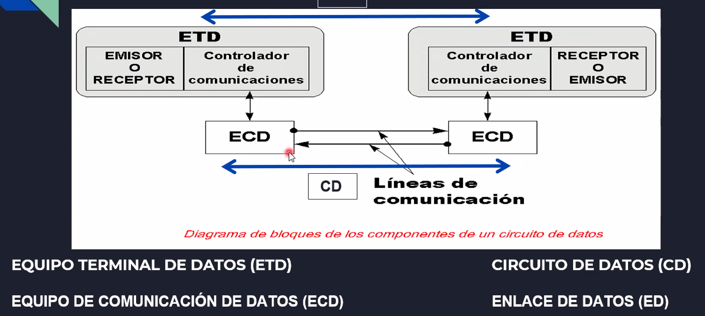
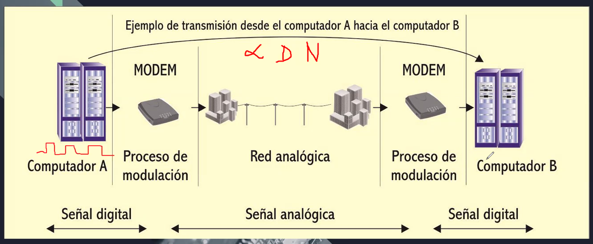
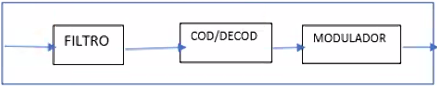
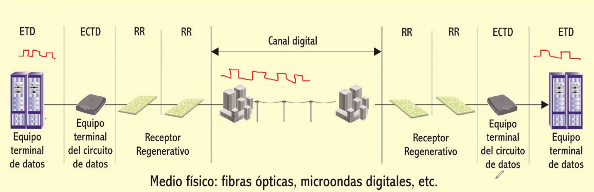
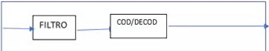
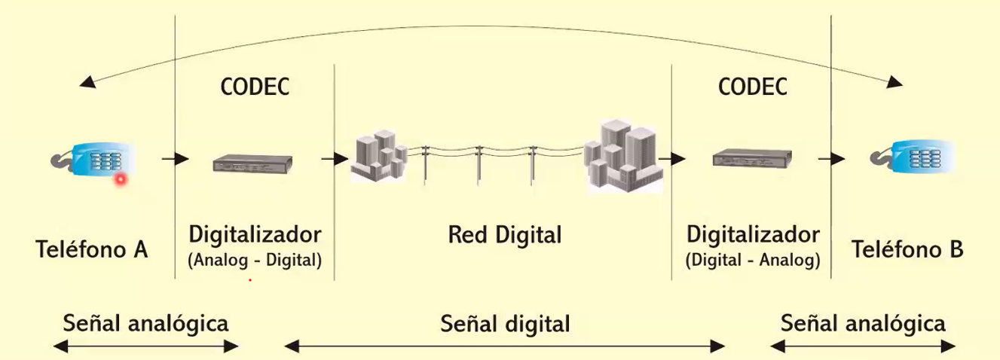
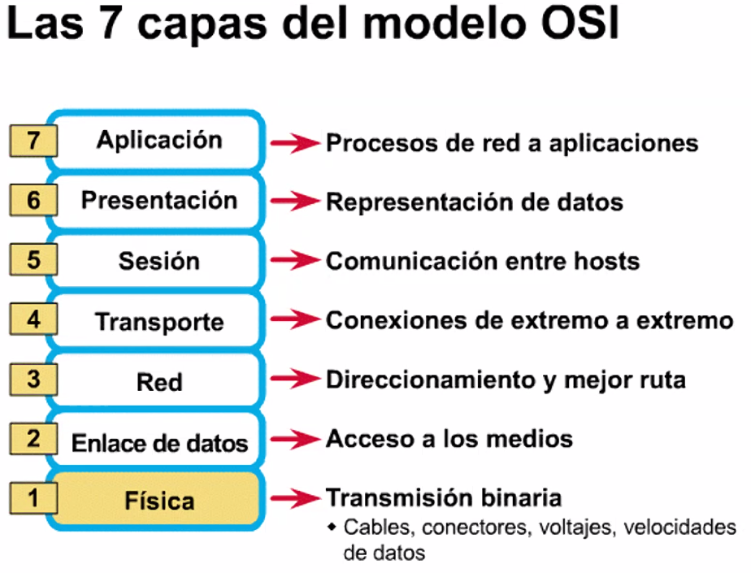
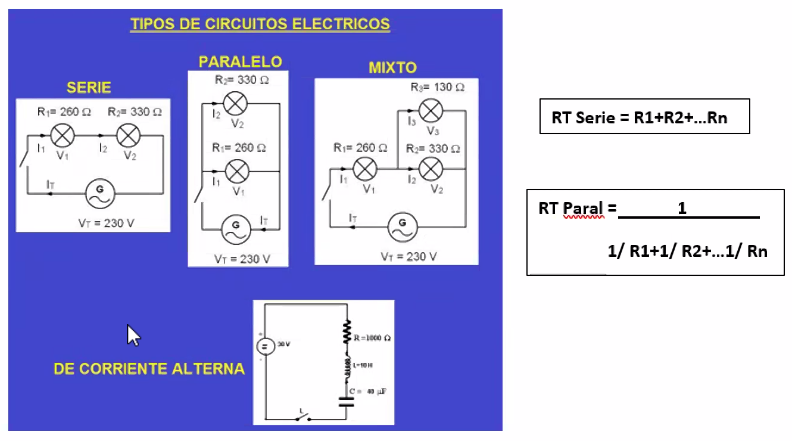
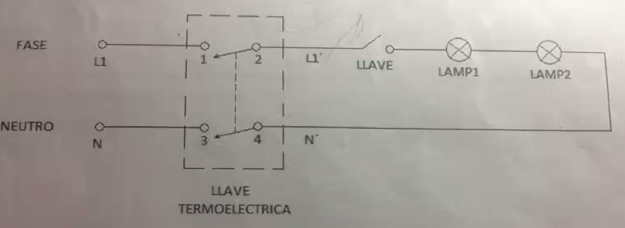
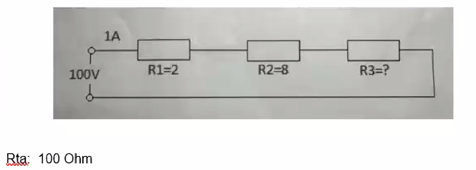

- 11/08/2026

# teleinformatica:
ciencia que estudia las tecnicas necesarias para asegurar la comunicacion de informacion, dentro de un sistema, a traves de las redes teleformáticas.
punto a punto o punto a multipunto.

## transmision de datos:
transmision de informacion previamente codificada, a traves de un canal de comunicacion, con el fin de que llegue a su destino sin errores. codificada por los codigo de linea, que son un conjunto de reglas que permiten representar la informacion en forma de señales electricas, opticas o electromagneticas.
puede ser de forma local o remota, dependiendo de la distancia y la geografia.

## esquema de comunicaciones:
- local
- remota

**u.i.t -> enacom**
entes reguladores de las normas de las telecomunicaciones.(internacional,argentina) . controlan el espectro electromagnetico, la asignacion de frecuencias y la estandarizacion de los sistemas de telecomunicaciones.

## esquema basico de telecomunicaciones:
transmisor <-> canal de comunicacion <-> receptor

### fenomenos que afectan:
- atenuacion: disminucion de la potencia de la señal a medida que se propaga por el canal.
- distorsion: alteracion de la forma de la señal debido a las caracteristicas del canal.
- ruido: presencia de señales no deseadas que interfieren con la señal original.

## circuito teleinformatico basico:

## modelo simplificado de la comunicacion de datos- canal analogico:

## otras fomras de comuniacion - canal digital:
### canal digital:

se utiliza un modem de banda base, donde no hay modulacion de la señal, sino que se transmiten directamente los bits de informacion.

### señal analogica-digital-analogica:

para digitalizar se pasa por estas 3 etapas:
muestreo -> cuantificacion -> codificacion

## redes de comunicaciones:
red: conjunto de recursos de conumicaciones y de infomatica que forman un sistema, para el transporte de informacion.

### clasificacion:
- topologia:
ejemplo: bus, estrella, anillo, malla.
- extension: 
ejemplo: LAN, MAN, WAN.

## internet: red de redes.
definicion: una red internacional formada por un conjunto de miles de redes independientes, operadas en forma autónoma, que estan interconectadas por medio de protocolos y procedimientos normalizados como estandares de internet, que permiten comunicaciones entre dos equipos temrinales host to host que pertenezcana algunas de las redes que la integran.

- tecnologia de malla.

composicion internet:
- etd(host).
- dir ip.
- routers.
- redes.

## modelo OSI: interconexión de sistemas abiertos.

# TP1:

## expresiones matematicas:
- ley de ohm: V=I*R (volt= ohm * ampere)
(voltaje o tension = corriente * resistencia)

- resistencia de un conductor: R=ρ*L/S ()
(resistencia = resistividad * longitud / sección)
ρ=resistividad del material conductor ( *mm2/m) -> el cobre es el que mas se usa.
R= resistencia del conductor
L= longitud del conductor
S= sección del conductor, diametro/area del conductor (mm2)

- potencia: P = V*I (watt= volt * ampere)
(potencia = voltaje * corriente)

- energia consumida = P*t (watt * hora = watt * hora)
(energia consumida = potencia consumida * tiempo)

- esquemas de conexiones circuitales:

## tp1:

1. Hallar la resistencia de una estufa que consume 3 A y se alimenta con una tensión de
120 V.
resolucion:
ley de ohm: V=I*R
120V=R*3A => R=120V/3A => R=40 ohm

2. Determinar la resistividad de un conductor que tiene 4 Km de longitud, 16 mm2 de sección y una resistencia de 20 Ω.
resolucion:

3. Calcular la longitud de un hilo de ferro-niquel de 2.6mm de diámetro y 500Ω de resistencia. (Resistividad= 0.8Ω mm2/m)

4. Graficar el esquema de conexión de dos lámparas en serie incluida la protección termoeléctrica correspondiente.
si se quema la lampara 1, la corriente deja de circular y la lampara 2 se apaga. si se quema la lampara 2, la corriente deja de circular y la lampara 1 se apaga.

5. Graficar el esquema de conexión de dos lámparas en paralelo incluida la protección termoeléctrica correspondiente.

si se quema la lampara 1, la corriente sigue circulando y la lampara 2 permanece encendida. si se quema la lampara 2, la corriente sigue circulando y la lampara 1 permanece encendida.

6. Calcular la resistencia total en el circuito alimentado con 100 V y compuesto por tres resistencias en serie.R1= 2 Ω, R2= 8 Ω, R3= x Ω, la corriente es de 1 A.

7. Cálculo de la resistencia total de 3 resistencias en paralelo. R1= 2 Ω, R2=10 Ω, R3= 8 Ω

8. Un televisor consume una potencia de 200W y permanece encendido durante 8 h y un
calefactor de 500W permanece encendido durante 3 h. Cual de los dos artefactos
consume más energía en los tiempos indicados. Si el kw h vale $ 60, calcule el gasto
total ocasionado por los dos artefactos
9. Una lámpara de 25 W se conecta a los terminales de una batería , entonces la
corriente en dicha lámpara es de 2,5 A, calcule el voltaje entre los terminales de la
lámpara. Calcule la resistencia de la lámpara.
10. Si la lámpara del problema anterior se conecta a una batería de 15 V, calcule la
potencia consumida
11. Un calefactor de 1100 W, esta diseñado para que funcione con un voltaje de 220 V.
Calcule la resistencia del calefactor. Si el voltaje baja a 200 V, calcule en que
porcentaje baja la potencia consumida.
12. Indicar que disciplinas abarca la Teleinformática.
13. -- Qué es la UIT - T(anterior CCITT); qué funciones cumple y como esta constituida?.
14. Indicar cuales son las redes que dieron origen a Internet.
15. ¿Qué equipos principales integran la red Internet y cual es la topología de esta ultima?
16. - Definir transmisión de datos e indicar que tipos de señales se utiliza para llevarla a
cabo.
17. Graficar la topologia de una red WAN empresarial con cuatro sitios (cada uno con una
o mas redes LAN) interconectada a Internet en forma centralizada.
18. Graficar el esquema básico de un sistema informático de procesamiento centralizado
con un mainframe y terminales locales y remotos.
19. Definir los siguientes términos relativos a organismos de estandarización: ISO, IEEEE,
ANSI, EIA.
20. Que funciones cumple un ISP, detallar las tecnologías que puede emplear para el
acceso de los usuarios residenciales a Internet.