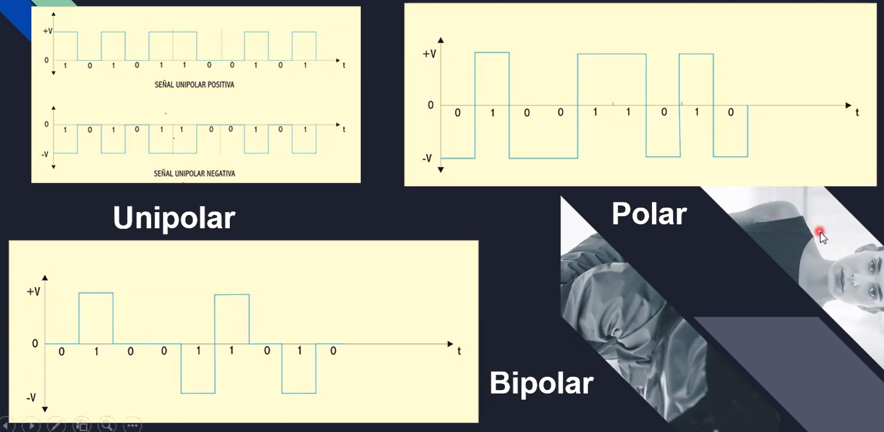
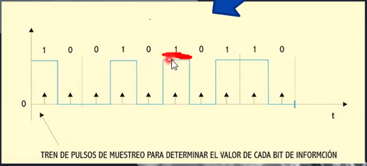
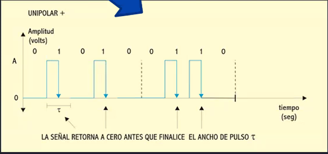
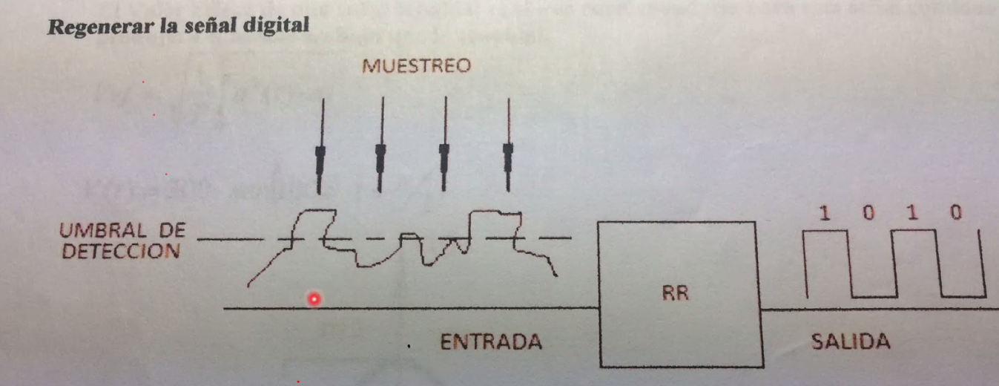
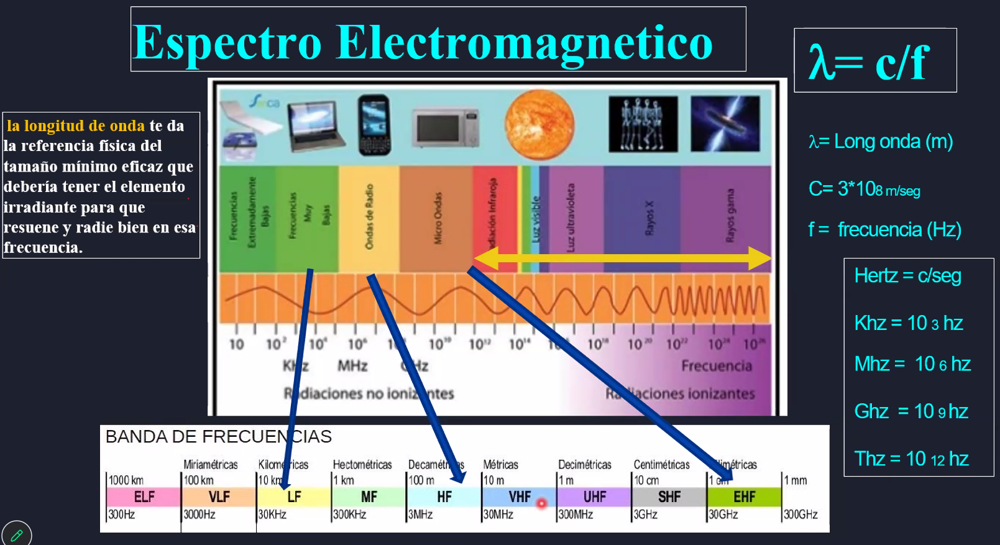
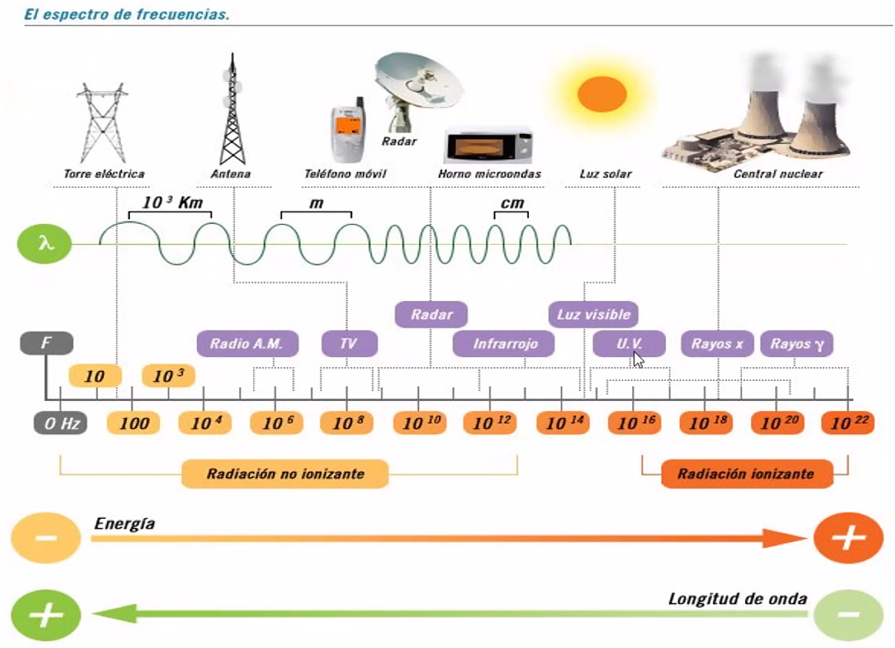

Tema 2(1er parte)
18/08

## señales analógias y digitales

### analogicas: 
son aquellas señales representadoas por funciones partiendo de un intervalo de tiempo determinado, adoptan infinitaos valores de continuo

### digitales:
son aquellas señales representadas por funciones que adoptan un conjunto finito de valores discretos, en un intervalo de tiempo determinado.

### parametros de una señal:
#### analogicas:
- periodo(T): tiempo que tarda en repetirse la señal. unidad: hertz (hz) = 1/segundo
- frecuencia(f): cantidad de veces que se repite la señal en un segundo. calculo: 1/T .unidad: hertz (hz) = 1/segundo
- longitud de onda(lamda): distancia que recorre la señal en un periodo. calculo: v*T (velocidad de propagacion * periodo). unidad: metros (m)

#### digitales:
- ancho de pulso: tiempo que dura un pulso. unidad: segundos (s)
- periodo: tiempo que tarda en repetirse la señal. unidad: hertz (hz) = 1/segundo
- Amplitud(A): valor maximo de la señal. unidad: volt (v)
- FRP = 1/T(seg) = pps. 

### ancho de banda
concepto: es la diferencia entre la frecuencia mas alta y la frecuencia mas baja de una señal. unidad: hertz (hz) = 1/segundo.

Ancho de banda=1/ancho de pulso
(si el ancho de pulso es menor, el ancho de banda es mayor, y si el ancho de pulso es mayor, el ancho de banda es menor)

### clasificacion de señales digitales:
#### segun polaridad:

- unipolar:
+1 , -1, el cero no tiene polaridad
- polar:
+1 , -0
- bipolar:
+1, -1, el cero no tiene polaridad

#### segun ancho de pulso:
- no retorno a cero

- retorno a cero.

se retorna en la mitad del ancho de pulso, a cero, para que el receptor pueda sincronizarse con el emisor.

### repetidor regenerativo:
definicion: es un dispositivo que se encarga de regenerar la señal digital, eliminando el ruido y la distorsion que se produce en la transmision de la señal.

en la imagen vemos que la señal digital se degrada a medida que se transmite, y el repetidor regenerativo se encarga de regenerarla, eliminando el ruido y la distorsion.

### espectro electromagnetico:

por ejemplo: en el MF estan las radiales de AM. las FM y los canales de aire, van a estar en el VHF. UHF, es el espectro de las señales de TV y de los celulares. y en el SHF estan las señales satelitales.

longuitud de onda(m) = velocidad de propagacion (m/s) / frecuencia (hz)
velocidad de propagacion = 3*10^8 m/s (velocidad de la luz)

- entonces, si la frecuencia es mayor, la longitud de onda es menor, y si la frecuencia es menor, la longitud de onda es mayor.
- a mas frecuencia, menor alcance, y a menor frecuencia, mayor alcance.

### señales de banda base:
definicion: son aquellas señales que,generadas por una fuente de informacion, no sufren ningun proceso de modulacion o tratamiento a su salida

### señales moduladas:
definicion: son aquellas señales que,generadas por una fuente de informacion,pasan por un proceso de modulacion o tratamiento a su salida, para poder ser transmitidas por un canal de comunicacion.

### codigos de linea o banda base:
mision:
- eliminar o disminuir el componente de continua de la señal.
- garantizar el sincronismo.
- detectar la presencia de señal en la linea.

#### clasificacion de codigos de linea:
- NRZ
- RZ
- AMI(NRZ bipolar)
- HDB-3
- Manchester
- Manchester diferencial
- Polar RZ(el autoSincronizante por excelencia)

nota: cuando se tienen dos 1 seguidos o 3 ceros seguidos, se produce un problema de sincronismo, ya que el receptor no puede saber si la señal es un 1 o un 0. para solucionar esto, se utilizan codigos de linea que garantizan el sincronismo.

- ejemplo practico: material\practica\UT 2 CODIFICACION - DIST CODIGOS.pdf
- CUADRO COMPARATIVO DE CODIGOS DE LINEA: material\practica\UT 2 Códigos de línea cuadro comparativo.pdf

en HDB-3, la polaridad luego de tres ceros consecutivos, se invierte, para garantizar el sincronismo, basandose en que si la bipolaridad de unos es par o impar. PRACTICAR EL ALGORITMO DE HDB-3, PARA ENTENDERLO MEJOR.

## TP 2 (primera parte):
material\practica\TP  2  2026.pdf

Caracteristicas de las señales de telecomunicaciones. Series Fourier.
Códigos de Linea
1. Graficar una señal analógica y una señal digital, indicar sus principales características y el modo por el cual transportan la información.

2. Indicar las cinco ventajas más notables de la transmisión digital frente a la analógica. ¿Cuál
es la principal desventaja de la primera respecto de la segunda?
ventajas:
- mayor alcance
- mayor inmunidad al ruido
- mayor banda ancha, se puede transmitir mas informacion en el mismo ancho de banda. -> calidad del enlace.
- integracion de disintos servicios(voz, datos, video, etc) en un mismo canal de comunicacion, manteniendo el sincronismo.
- mantenimiento menos costoso(dispositivos modulares y de facil reemplazo).

desventajas:
- el proceso constante de digitalizacion de la señal, lo que puede implicar en esta conversion, errores.

3. Que funciones cumple un repetidor regenerativo?
- corregir una señal DIGITAL que se degrada a medida que se transmite, eliminando el ruido y la distorsion que se produce en la transmision de la señal.
necesita el umbral de deteccion.

5. Calcular el **rango de variación de la longitud de onda** para las señales electromagnéticas
portadoras de las emisoras de radio comerciales ubicadas en la banda de FM de 88 a 108
Mhz.

longuitud de onda(m) = velocidad de propagacion (m/s) / frecuencia (hz)
- para 88 Mhz: 3*10^8 / 88*10^6 = 3.41 m (paso a paso con descripcion: la velocidad de propagacion es la velocidad de la luz, que es 3*10^8 m/s. la frecuencia es 88 Mhz, que es 88*10^6 hz. entonces, la longitud de onda es 3*10^8 / 88*10^6 = 3.41 m)
- para 108 Mhz: 3*10^8 / 108*10^6 = 2.78 m
- rango de variacion de la longitud de onda: 2.78 m a 3.41 m

6. Graficar un tren de pulsos y definir: FRP, ancho de pulso, período y amplitud del pulso.
(ver ejemplo en material\practica\UT 2 CODIFICACION - DIST CODIGOS.pdf)

13. Indicar las principales características de la transmisión en banda base, en qué circunstancias se emplea una transmisión de éste tipo? ¿Que otro tipo de transmisión existe, que características presenta ?

La transmisión en banda base se emplea fundamentalmente en las redes LAN, pues los medios de comunicaciones no pertenecen a las Redes Públicas:
* Bajo costo de los equipos intervinientes.
* Los ETCD (Modem), no realizan la operación de modulación, sino solamente la codificación mediante los códigos de línea.
* Emplean Modem Banda Base.

si no trnasmisiones en banda base, son transmisiones de señales modulads(aplican procedimiento de modulacion de las señales).

14. Para la secuencia siguiente, graficar las señales resultantes de aplicar los códigos AMI, y Bipolar RZ. Indicar los requerimientos de AB en cada caso. 
Secuencia binaria: 1 0 0 1 0 0 0 0 0 1 1 0 0 0 0 1 1 1 0 0 0 0 0 0 0 0 0 1 0 0 0 0 1 1

15. Dada la siguiente secuencia de bits, graficar las señales resultantes utilizando los códigos Manchester. Indicar sus principales características. 
Secuencia binaria: 0 1 1 0 0 1 1 0 1 1 1 1 1 0 0 0 0

16. Dada la secuencia anterior aplicarle una codificación autosincronizante.

(polar RZ)
