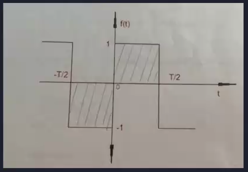

25-08-2026

# Clase 03:
- repaso de velocidades.
- series de fourier.

## medidas de la velocidad:

### velocidad de modulacion o señalizacion (circuito de datos CD)

Vm=1/t, t(menor duracion del pulso)
se mide en BAUDIO(1/seg)

AB=1/t

si sube, el ancho de banda aumenta.

### ve3locidad de transmision (enlace de datos ED)

Vtx=cantidad bits / unidad de timepo
semide en BPS (bits por segundo)

$$
V_{tx} = \sum_{i=1}^{m} \frac{1}{\tau}\,\log_{2}(n)
$$

De uno a M cantidad de canales
n=2n(camtodad de bits que puedo transmitir por pulso) -> n es la cantidad de estados significativos que una señal logra tener en un tiempo determinado.

## relacion entre velocidades:
$$
V_{tx} = V_m \cdot \log_2(n)
$$

Donde:

- $n$: número de estados.

$$
n = 2^N
$$

- $N$: cantidad de bits a transmitir por pulso.

Ejemplo: en una **transmisión multinivel**, $N$ representa el número de bits por baudio.

### velocidad de transferencia de datos:
vtd = cantidad de bits con informacion con o sin errores / tiempo empleado
- [bps]

### velocidad real de transferencia de datos
vrtd = cantidad d ebits con info sin errrores / tiempo empleado
- [bps]

entonces:
$$
AB \Rightarrow V_m
$$

$$
V_{tx} = V_m \cdot \log_2(n)
$$
$$
V_{tx} > V_{td} > V_{rtd}
$$

## señales periodicas:
son quellas señales que se repiuten sistemaicamente durante un periodo de timepo T.
digitales:
f(t) = f(t + T)
analogicas:
f(t) = Asen(wt + fi)

### Representación de una señal periódica mediante Series de Fourier

Toda señal periódica $f(t)$, como una **señal digital**, **onda cuadrada (OC)**, **diente de sierra**, etc., admite su representación mediante una **serie de senos y cosenos**.

toda funcion de onda cuadrada que cumpla condiciones de **Dirichlet**, puede ser desarrollada en series de fourier, es decir, puede ser representada como una suma infinita de senos y cosenos.

3 condiciones se tienen que dar:
- Ser absolutamente integrable en un período.
- Tener un número finito de máximos y mínimos en un período.
- Tener un número finito de discontinuidades finitas en un período.

## formas de representacion series de fourier:

### 1. Expresión trigonométrica de la Serie de Fourier

$$
f(t)=\frac{a_0}{2}+\sum_{n=1}^{\infty}
\left[
a_n\cos(n\omega t)+b_n\sin(n\omega t)
\right]
$$

### Coeficientes

$$
a_0=\frac{2}{T}\int_{-T/2}^{T/2} f(t)\,dt
$$

$$
a_n=\frac{2}{T}\int_{-T/2}^{T/2}
f(t)\cos(n\omega t)\,dt
\qquad n=1,2,3,\ldots
$$

$$
b_n=\frac{2}{T}\int_{-T/2}^{T/2}
f(t)\sin(n\omega t)\,dt
\qquad n=1,2,3,\ldots
$$

### 2. Expresión compleja de la Serie de Fourier

$$
f(t)=\sum_{n=-\infty}^{\infty}
C_n e^{j n \omega_0 t}
$$

espectro de asuncion discreta:
$$
C_n=\frac{1}{T}\int_{-T/2}^{T/2}
f(t)e^{-j n \omega_0 t}\,dt
$$

### paridad de funciones:

$$
P \cdot P = P
$$

$$
I \cdot I = P
$$

$$
I \cdot P = I
$$

Donde:

- $P$: función **par**.
- $I$: función **impar**.
- En el caso $I \cdot P = I$, **se anulan los coeficientes** al integrar simétricamente.

### ejemplos:

$$
f(t)=
\begin{cases}
1, & 0 < t < \frac{T}{2} \\[4pt]
-1, & -\frac{T}{2} < t < 0
\end{cases}
$$
- funcion IMPAR

La señal de **onda cuadrada** se puede expresar mediante la suma de infinitas funciones sinusoidales, todas de diferentes frecuencias, que se llaman **armónicos**.

El $n$ indica el número de armónico.

Si se tomaran infinitos términos, la serie representaría la $f(t)$ de la **onda cuadrada (OC) original**.

#### calculamos:
- area bajo la curva a0=0.
- por porducto de funciones: f(t)*cos(nwt) = I*P = I
por lo tanto, anula los coeficientes an=0
- bn: por producto de funciones: f(t)*sin(nwt) = I*I = P
por lo tanto, no se anula y se calcula el valor de bn. => bn=!0