<!-- Las fuentes anteriores respaldan el ejercicio 19. El resto conserva las notas de clase originales; no fue revisado en esta actualización. -->

01-09-2026

# Clase 04:
- unidad numero 3: se vé en dos partes.
- medida de la velocidad.
-calculo de enlace

## repaso: medidas de la velocidad:
- velociad de modulacion o señalizacion.
cuanto mayor velocidad de modulacion, mas ancho de banda y mas costo y quizas mas ruido.
- velocudad de transmision. De uno a M cantidad de canales

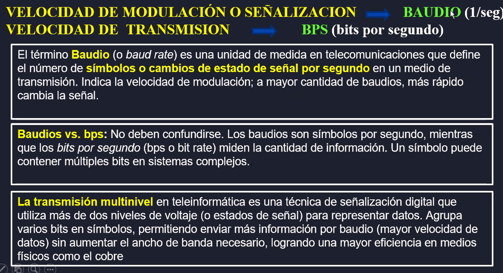

### trnamision multinivel:
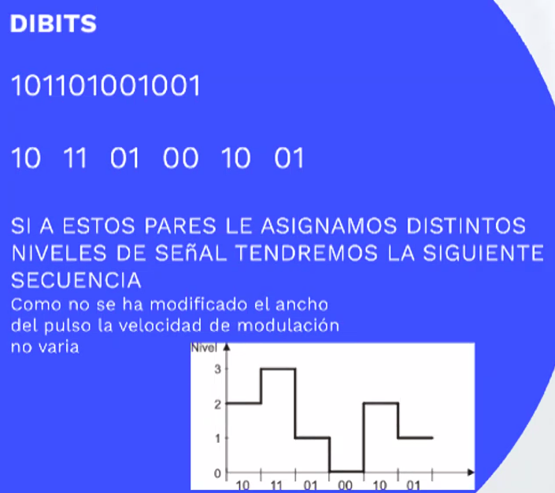
como no se modifica el ancho de pulso, no se modifica el ancho de banda ni la velocidad de modulacion.

### relacion entre velocidades:
....
cuando las dos velocidades son iguales, se dice que es una transmision binaria. Cuando la velocidad de transmision es mayor a la de modulacion, se dice que es una transmision multinivel.

## sincronismo:
definicion: procedimiento donde tanto la fuente como el colector, adoptan una base de tiempo comun, de forma tal de no equivocarse en la Tx de un 1 o 0.
la transmision enotnces puede ser:
- sincronica
- asincornica

### protocoolo asincornico:
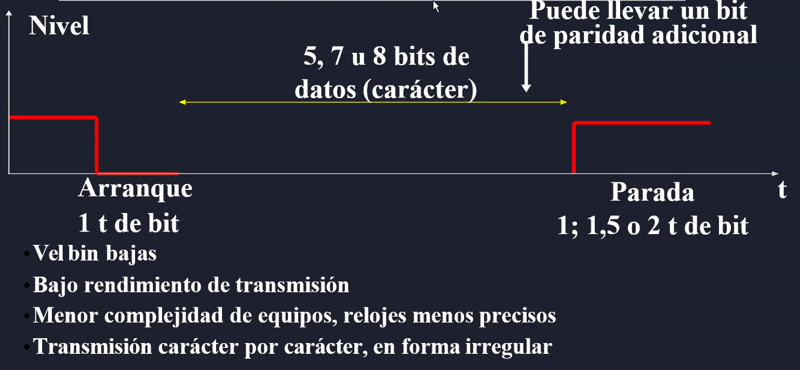

### protocolo sincronico:
se separa en 3 partes:
- header: contiene informacion de control, como por ejemplo la direccion del colector.
- datos de usuario: contiene la informacion que se quiere transmitir.
- final: contiene informacion de control, como por ejemplo la direccion del colector.
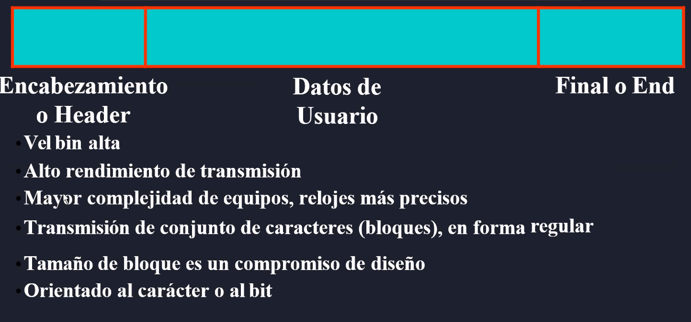

## unidades de transimicion(DB)
se basan en la funcion matematica logarimo.
- relaciona dos magnitudes mediante un cociente X obteniendo un resultado Y adimensional.
- se aprovechan las propiedades matematicas de los logaritmos.

propriedades de los logaritmos:
$\log(a \cdot b) = \log a + \log b$

$\log\left(\frac{a}{b}\right) = \log a - \log b$

$\log(a^b) = b \cdot \log a$

$\log_b \sqrt[b]{a} = \frac{\log a}{b}$

indica la relacion entre potencias, tensiones o corrinetes:
tipos:
- relactivas:
  - decibel(dB)

- absolutas
  - decibel miliwatt(dBm)
  - decibel miliovltio(dBmV)

  ## amplificacion y atenuacion:

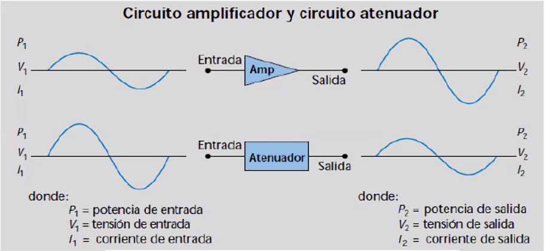

**Relación de potencias:**

$$
G(\mathrm{dB}) = 10 \log\left(\frac{P_2}{P_1}\right)
$$
**Relación de tensiones:**

$$
G(\mathrm{dB}) = 20 \log\left(\frac{V_2}{V_1}\right)
$$
**Relación de corrientes:**

$$
G(\mathrm{dB}) = 20 \log\left(\frac{I_2}{I_1}\right)
$$

## unidades de transmision:
### Algunos usos de los decibeles

- Medir ganancias y atenuaciones en electrónica y telecomunicaciones.
- Dar valores de potencia o tensiones.
- Medir potencias sonoras.

### Valores típicos

| dB | Veces |
|---:|:------|
| 3 dB | Doble |
| 6 dB | 4 |
| 10 dB | 10 |
| 20 dB | 100 |
| 30 dB | 1000 |
| 40 dB | 10000 |
| -3 dB | Mitad |
| -6 dB | 1/4 |
| -10 dB | 1/10 |

### Ejercicio de ejemplo:

Dado el siguiente gráfico, calcular la sensibilidad del receptor.
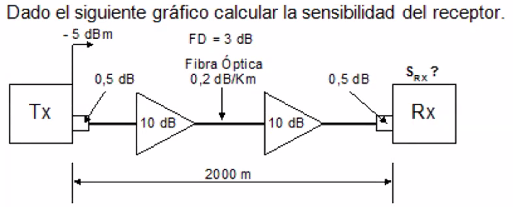
Datos:

$$
P_{Tx} = -5\ \mathrm{dBm}
$$

$$
G_1 = G_2 = 10\ \mathrm{dB}
$$

$$
L_{conector1} = L_{conector2} = 0.5\ \mathrm{dB}
$$

$$
\alpha_{fibra} = 0.2\ \mathrm{dB/km}
$$

$$
L = 2000\ \mathrm{m} = 2\ \mathrm{km}
$$

$$
FD = 3\ \mathrm{dB}
$$

La pérdida de la fibra es:

$$
L_{fibra} = \alpha_{fibra} \cdot L
$$

$$
L_{fibra} = 0.2\ \frac{\mathrm{dB}}{\mathrm{km}} \cdot 2\ \mathrm{km}
= 0.4\ \mathrm{dB}
$$

El balance de potencia es:

$$
P_{Rx}
=
P_{Tx}
- L_{conector1}
+ G_1
- L_{fibra}
+ G_2
- L_{conector2}
$$

$$
P_{Rx}
=
-5
-0.5
+10
-0.4
+10
-0.5
$$

$$
P_{Rx} = 13.6\ \mathrm{dBm}
$$

Si se considera el margen de diseño de $FD=3\ \mathrm{dB}$:

$$
S_{Rx} = P_{Rx} - FD
$$

$$
S_{Rx} = 13.6 - 3
$$

$$
\boxed{S_{Rx} = 10.6\ \mathrm{dBm}}
$$

### ejemplo de amplificacion:

- Ganancia de un amplificador:

La ganancia en dB para una relación de potencias se calcula como:

$$
G(\mathrm{dB}) = 10 \log\left(\frac{P_2}{P_1}\right)
$$

### Caso 1

$$
P_1 = 10\ \mathrm{W}
$$

$$
P_2 = 20\ \mathrm{W}
$$

$$
G = 10\log\left(\frac{20}{10}\right)
$$

$$
G = 10\log(2)
$$

$$
\boxed{G \approx 3\ \mathrm{dB}}
$$

### Caso 2

$$
P_1 = 40\ \mathrm{W}
$$

$$
P_2 = 80\ \mathrm{W}
$$

$$
G = 10\log\left(\frac{80}{40}\right)
$$

$$
G = 10\log(2)
$$

$$
\boxed{G \approx 3\ \mathrm{dB}}
$$

### Caso 3

$$
P_1 = 10\ \mathrm{W}
$$

$$
P_2 = 40\ \mathrm{W}
$$

$$
G = 10\log\left(\frac{40}{10}\right)
$$

$$
G = 10\log(4)
$$

$$
\boxed{G \approx 6\ \mathrm{dB}}
$$

### definicion de ancho de banda de una linea de transmision usando dB:
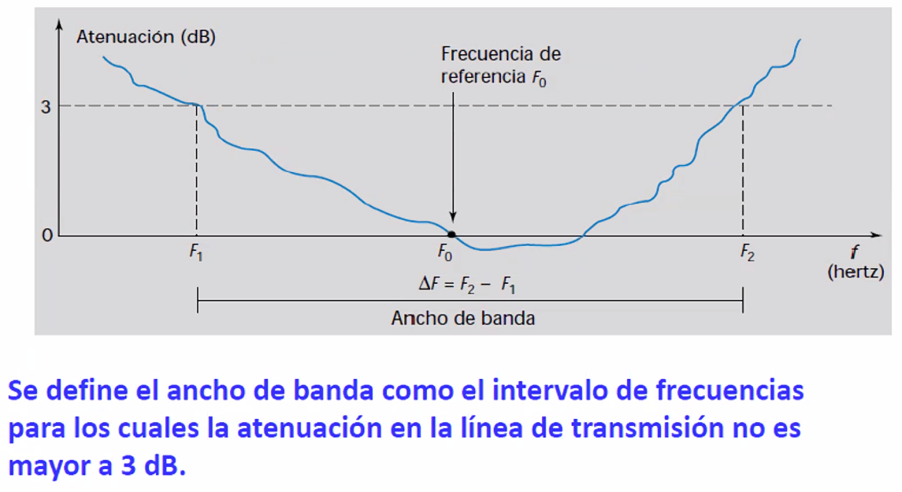

### ganancia de un amplificacor:

La relación entre la ganancia en decibeles y la ganancia en veces es:

$$
x = 10^{\frac{y}{10}}
$$

donde:

- $x$ = ganancia en veces
- $y$ = ganancia en dB

También puede expresarse como:

$$
y(\mathrm{dB}) = 10\log(x)
$$

Para una relación de potencias:

$$
G(\mathrm{dB}) = 10\log\left(\frac{P_{sal}}{P_{ent}}\right)
$$

Por lo tanto:

$$
\frac{P_{sal}}{P_{ent}} = 10^{\frac{G(\mathrm{dB})}{10}}
$$

#### Ejemplo: amplificador de 43 dB

$$
x = 10^{\frac{43}{10}}
$$

$$
x = 10^{4.3}
$$

$$
x \approx 19952.6
$$

$$
\boxed{x \approx 19953\ \text{veces}}
$$

Comprobación:

$$
43\ \mathrm{dB}
=
10\log(19953)
$$

### nivel de transmision y recepcion de señal en cable modem

#### Conversión entre dBmV y mV

La relación entre nivel de tensión en **dBmV** y tensión en **mV** es:

$$
y_{\mathrm{dBmV}} =
20\log\left(\frac{x_{\mathrm{mV}}}{1\ \mathrm{mV}}\right)
$$

Despejando la tensión:

$$
x_{\mathrm{mV}}
=
1\ \mathrm{mV}\cdot 10^{\frac{y_{\mathrm{dBmV}}}{20}}
$$

##### Ejemplo 1

Para:

$$
y = 42.9\ \mathrm{dBmV}
$$

$$
x =
1\ \mathrm{mV}\cdot 10^{\frac{42.9}{20}}
$$

$$
\boxed{x \approx 139.64\ \mathrm{mV}}
$$

##### Ejemplo 2

Para:

$$
y = 2.3\ \mathrm{dBmV}
$$

$$
x =
1\ \mathrm{mV}\cdot 10^{\frac{2.3}{20}}
$$

$$
\boxed{x \approx 1.30\ \mathrm{mV}}
$$

### Atenuaciones en medios de comunicaciones

#### Cable coaxial de 75 $\Omega$

La atenuación del cable coaxial depende de la frecuencia: a mayor frecuencia, mayor atenuación.

| Frecuencia | Atenuación máxima (dB/100 ft) | Atenuación máxima (dB/100 m) |
|---:|---:|---:|
| 5 MHz | 0.58 dB | 1.90 dB |
| 55 MHz | 1.60 dB | 5.25 dB |
| 83 MHz | 1.95 dB | 6.40 dB |
| 187 MHz | 2.85 dB | 9.35 dB |
| 211 MHz | 3.05 dB | 10.00 dB |
| 250 MHz | 3.30 dB | 10.82 dB |
| 300 MHz | 3.55 dB | 11.64 dB |
| 350 MHz | 3.85 dB | 12.63 dB |
| 400 MHz | 4.15 dB | 13.61 dB |
| 450 MHz | 4.40 dB | 14.43 dB |
| 500 MHz | 4.66 dB | 15.29 dB |
| 550 MHz | 4.90 dB | 16.08 dB |
| 600 MHz | 5.10 dB | 16.73 dB |
| 750 MHz | 5.65 dB | 18.54 dB |
| 865 MHz | 6.10 dB | 20.01 dB |
| 1000 MHz | 6.55 dB | 21.49 dB |

Si conocemos la atenuación especificada cada $100\ \mathrm{m}$, la pérdida para una longitud cualquiera puede calcularse como:

$$
A_{\mathrm{cable}}
=
A_{100m}\cdot\frac{L}{100\ \mathrm{m}}
$$

donde:

- $A_{\mathrm{cable}}$ = atenuación total en dB
- $A_{100m}$ = atenuación del cable cada 100 m
- $L$ = longitud del cable en metros

#### Divisor de potencia

Un divisor de potencia introduce una pérdida o atenuación en la señal.

En un divisor ideal de dos salidas:

$$
P_{\mathrm{salida}} = \frac{P_{\mathrm{entrada}}}{2}
$$

Por lo tanto:

$$
A =
10\log\left(\frac{P_{\mathrm{salida}}}{P_{\mathrm{entrada}}}\right)
$$

$$
A =
10\log\left(\frac{1}{2}\right)
$$

$$
\boxed{A \approx -3\ \mathrm{dB}}
$$

En la práctica, la pérdida suele ser algo mayor debido a las pérdidas propias del dispositivo.

## calculo de enclace: Balance de enlace

La relación general entre la potencia transmitida, las pérdidas, las ganancias y la sensibilidad del receptor es:

$$
P_{Tx}
-
P_{\text{total}}
+
G
=
S_{Rx}
$$

donde la pérdida total puede expresarse como:

$$
P_{\text{total}}
=
\alpha_{\text{vínculo}}
+
\alpha_{\text{conectores}}
+
\alpha_{\text{empalmes}}
+
FD
$$

Por lo tanto:

$$
\boxed{
P_{Tx}
-
\left(
\alpha_{\text{vínculo}}
+
\alpha_{\text{conectores}}
+
\alpha_{\text{empalmes}}
+
FD
\right)
+
G
=
S_{Rx}
}
$$

donde:

- $P_{Tx}$ = potencia de transmisión en dBm
- $S_{Rx}$ = sensibilidad del receptor en dBm
- $\alpha_{\text{vínculo}}$ = atenuación del medio en dB
- $\alpha_{\text{conectores}}$ = pérdidas en conectores en dB
- $\alpha_{\text{empalmes}}$ = pérdidas en empalmes en dB
- $FD$ = factor o margen de diseño en dB (dado por el fabricante)
- $G$ = ganancias del sistema en dB

> Al sumar o restar una ganancia o atenuación expresada en dB a una potencia en dBm, el resultado sigue estando expresado en dBm:

$$
\boxed{\mathrm{dBm} \pm \mathrm{dB} = \mathrm{dBm}}
$$

---

### Ejemplo

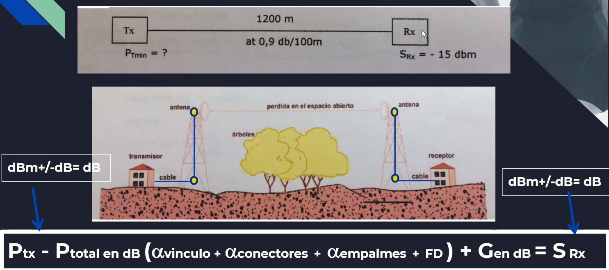

Datos:

$$
L = 1200\ \mathrm{m}
$$

$$
\alpha = 0.9\ \frac{\mathrm{dB}}{100\ \mathrm{m}}
$$

$$
S_{Rx} = -15\ \mathrm{dBm}
$$

La atenuación total del vínculo es:

$$
\alpha_{\text{vínculo}}
=
0.9\ \frac{\mathrm{dB}}{100\ \mathrm{m}}
\cdot
\frac{1200\ \mathrm{m}}{100\ \mathrm{m}}
$$

$$
\alpha_{\text{vínculo}}
=
0.9 \cdot 12
$$

$$
\boxed{\alpha_{\text{vínculo}} = 10.8\ \mathrm{dB}}
$$

Si no existen otras pérdidas ni ganancias:

$$
P_{Tx} - 10.8\ \mathrm{dB} = -15\ \mathrm{dBm}
$$

Despejando:

$$
P_{Tx}
=
-15\ \mathrm{dBm}
+
10.8\ \mathrm{dB}
$$

$$
\boxed{P_{Tx,\min} = -4.2\ \mathrm{dBm}}
$$

# ejercicios: TRABAJO PRÁCTICO N°3

Medidas de Velocidad. Calculo de enlaces, unidades de medida.

1. Si se utiliza un MODEM que transmite a 1200 baudios cuanto tardaría en transmitir los 1000 caracteres.
- vm = 1/t => t=1/V
- vm=1200 baudios => t=1/1200=0,0008333s
- 1 caracter = 1 byte = 8 bits
- tiempo de transmision de 1 caracter = 8*0,0008333=0,006666s
- tiempo de transmision de 1000 caracteres = 1000*0,006666 = 6,66s
rta=6,66s.

2. Indicar bajo que condiciones la velocidad de modulación es igual a la velocidad de transmisión.
- vtx = vm * log2(n)
- si n=2, entonces log2(2)=1 => vtx=vm*1 => vtx=vm
rta=cuando n=2, es decir, se transmite bit a bit, cuando la transmision es binaria.

3. Calcular el tiempo total de transmisión de 1500 caracteres enviados uno a continuación de otro en un sistema de transmisión asincrónica de 75 Baudios. El código utilizado es el Seudo Baudot, los caracteres son ASCII de 8 bits con un bit de paridad.
- 1 bit de arranque+8 bits de datos+1,5 bit de paridad+1 bit de parada=11 bits por caracter 
- total = 11,5 bit
vm = 75 baudios => t=1/75=0,013333s = 1.33333*10^-2 s
- tiempo de transmision de 1 caracter = 11,5*0,013333=0,15333s
- timepo total = 1500*0,15333=229,995s
rta=230s

4. Para un sistema que transmite a 1200 Baudios se quiere aumentar la velocidad a 4800 bps. Indicar  cómo se logra y cuál es el ancho de pulso resultante.
- vtx=vm*log2(n)
- aplicar Tx multinivvel => n=2^N => N=log2(n)
- vm=1200 baudios => t=1/1200=0,0008333s
- vtx=4800 bps => 4800=1200*log2(n)
- 2 4800/1200=log2(n) => 4=log2(n) => n=2^4=16 => N=4 bits por pulso
- se logra aplicando una transmision multinivel con 16 estados, 4 bits por pulso.
- ancho de pulso: t=1/vm
- t1/1200 baudios = 0,0008333s = 8,333*10^-4 s = 833,3 microsegundos.

rta= se logra aplicando una transmision multinivel con 16 estados, 4 bits por pulso. Ancho de pulso = 833,3 microsegundos.

---
5. Calcular el rendimiento de una transmisión sincrónica cuando se envían bloques de datos de 1500 bytes y se utilizan 14 bytes de cabecera y 4 bytes de terminación.

La eficiencia se calcula como:

$$
\eta =
\frac{\text{Cantidad de bits de datos}}
{\text{Cantidad de bits totales}}
\cdot 100
$$

### Ejemplo

$$
\eta =
\frac{1500}{14 + 1500 + 4}
\cdot 100
$$

$$
\eta =
\frac{1500}{1518}
\cdot 100
$$

$$
\boxed{\eta \approx 98.8\%}
$$

---

6. Calcular el rendimiento de transmisión asincrónica que utiliza un código que tiene 1 bit de arranque, 1 de parada y 7 de datos. Efectuar el calculo con y sin bit de paridad.

- los sistemas asincronicos tienen menor rendimiento.

rta=0,77

---

7. Dada una transmisión sincrónica de 1024 bytes , y si no consideramos la cabeza y la cola
de dicha transmisión, determinar la disminución del rendimiento si se utiliza una transmisión
asincrónica mediante un código que emplea 8 bits de datos, 1 de paridad, 2 de parada y 1
de arranque. Para ambos casos se emplea una velocidad de modulación de 2400 Baudios.
Indicar también el tiempo total de transmisión en ambos casos.

---

8. Indicar las causas por las cuales no se puede aumentar, en determinados canales de comunicación, la velocidad de modulación.

rta= relacionar que pasa entre la vm y el AB. si aumento vm implica qyue aumento el AB.
---
9. Definir la velocidad “ACCESS RATE” en un canal de comunicaciones.
rta= es la velocidad maxima que se puede transmitir datos por un canal de com(s).
---
10. Indicar los factores que condicionan o limitan la velocidad efectiva de transmisión de datos
en una línea digital de comunicaciones.
rta= cuales seran: AB, vm, realcion S/N, BER, la duracion del pulso, la modulacion, etc

---
11. Calcular el tiempo total de transmisión de 1800 caracteres de datos enviados en un sistema
de transmisión sincrónico de 3600 Baudios. El rendimiento de la transmisión es del 90%.

Datos:

$$
V_m = 3600\ \text{baudios}
$$

$$
C = 1800\ \text{caracteres}
$$

Considerando:

$$
1\ \text{carácter} = 8\ \text{bits}
$$

y una eficiencia de sincronismo de:

$$
\eta_{\text{sinc}} = 90\% = 0.9
$$

Duración de cada bit

$$
\tau = \frac{1}{V_m}
$$

$$
\tau = \frac{1}{3600}
= 2.77\times10^{-4}\ \text{s}
$$

Cantidad de bits a transmitir

$$
N = 1800 \cdot 8 = 14400\ \text{bits}
$$

Tiempo de transmisión ideal

Para una eficiencia del $100\%$:

$$
T_{\text{ideal}} = N\cdot\tau
$$

$$
T_{\text{ideal}}
=
14400\cdot2.77\times10^{-4}
$$

$$
\boxed{T_{\text{ideal}} = 4\ \text{s}}
$$

Considerando una eficiencia del 90 %

La eficiencia se aplica como:

$$
\eta =
\frac{T_{\text{ideal}}}{T_{\text{total}}}
$$

Por lo tanto:

$$
T_{\text{total}}
=
\frac{T_{\text{ideal}}}{\eta}
$$

$$
T_{\text{total}}
=
\frac{4}{0.9}
$$

$$
\boxed{T_{\text{total}} \approx 4.44\ \text{s}}
$$

---
12. Dado un canal de transmisión de datos coaxil con una atenuación a la frecuencia de operación de 0,9 dB/100 metros y donde la sensibilidad del receptor es -15 dBm
- Calcular la potencia mínima que deberá tener el transmisor si la longitud del coaxil es de 1200 metros. 

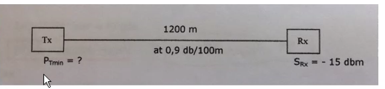

$$
P_{tx} - P_{\text{total en dB}} \left(
\alpha_{\text{vínculo}}
+ \alpha_{\text{conectores}}
+ \alpha_{\text{empalmes}}
+ FD
\right)
+ G_{\text{dB}}
= S_{Rx}
$$

$$
P_{tx} - P_{\text{total en dB}}(\alpha_{\text{vínculo}}) = S_{Rx}
$$

**Relación de potencias:**

$$
G(dB) = 10 \log\left(\frac{P_2}{P_1}\right)
$$

**Relación de tensiones:**

$$
G(dB) = 20 \log\left(\frac{V_2}{V_1}\right)
$$

**Relación de corrientes:**

$$
G(dB) = 20 \log\left(\frac{I_2}{I_1}\right)
$$

**Recordar:**

$$
dBm \pm dB = dBm
$$

$$
\log_a b = c
\quad \Longleftrightarrow \quad
a^c = b
$$

$$
P_{tx} - P_{\text{total en dB}}(\alpha_{\text{vínculo}}) = S_{Rx}
$$

$$
\alpha_{\text{vínculo}}
=
1200\,m
\cdot
\frac{0.9\,dB}{100\,m}
=
10.8\,dB
$$

$$
P_{tx} = S_{Rx} + P_{\text{total en dB}}(\alpha_{\text{vínculo}})
$$

$$
P_{tx} = S_{Rx} + P_{\text{total en dB}}(\alpha_{\text{vínculo}})
$$

$$
P_{tx} = -15\,dBm + 10.8\,dB = -4.2\,dBm
$$

$$
\boxed{P_{tx} = -4.2\,dBm}
$$

Para convertir de **dBm a mW**:

$$
dBm = 10\log\left(\frac{P_i\,[mW]}{1\,mW}\right)
$$

Para la sensibilidad del receptor:

$$
-15\,dBm = 10\log\left(\frac{P_i}{1\,mW}\right)
$$

$$
\frac{P_i}{1\,mW} = 10^{-15/10}
$$

$$
P_i = 10^{-15/10}\,mW
$$

$$
\boxed{S_{Rx} = 0.0316\,mW}
$$

Para la potencia de transmisión:

$$
-4.2\,dBm = 10\log\left(\frac{P_i}{1\,mW}\right)
$$

$$
\frac{P_i}{1\,mW} = 10^{-4.2/10}
$$

$$
P_i = 10^{-4.2/10}\,mW
$$

$$
\boxed{P_{tx} = 0.3802\,mW}
$$
---

13. Calcular la potencia de salida de una línea de transmisión de 100 metros donde la atenuación del cable coaxil es de 5 dB/100m y la potencia del transmisor que excita a la línea es de 0 dBm, se pierde en conectores y empalmes 2dB.  

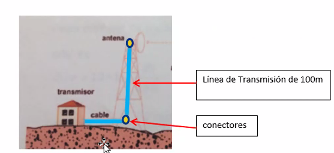

la linea de transmicion es el vinculo/intefaz con el extremo de la antena.

$$
P_{tx} - P_{\text{total en dB}}
\left(
\alpha_{\text{vínculo}} +
\alpha_{\text{conectores y empalmes}}
\right)
= S_{Rx}
$$

Datos:

$$
P_{tx} = 0\,dBm
$$

$$
\alpha_{\text{vínculo}} = 5\,dB
$$

$$
\alpha_{\text{conectores y empalmes}} = 2\,dB
$$

Entonces:

$$
S_{Rx} = 0\,dBm - (5\,dB + 2\,dB)
$$

$$
\boxed{S_{Rx} = -7\,dBm}
$$

Pasamos la potencia a **mW**:

$$
dBm = 10\log_{10}\left(\frac{P}{1\,mW}\right)
$$

$$
-7 = 10\log_{10}\left(\frac{P}{1\,mW}\right)
$$

$$
\frac{P}{1\,mW} = 10^{-7/10}
$$

$$
P = 10^{-7/10}\,mW
$$

$$
\boxed{P \approx 0.199\,mW}
$$

**Rta: $-7\,dBm \approx 0.199\,mW$**

--- 

14. Que sensibilidad mínima (expresada en mW) deberá tener un receptor para un 
enlace a través de una línea de transmisión de 1800 metros, donde la atenuación del cable coaxil empleado es de 0,5 db/100m. La potencia del transmisor que excita la línea es de 2 watts. 

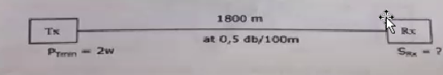

resolucion: de lo general pasar a lo particular.

$$
P_{tx} - P_{\text{total en dB}}
\left(
\alpha_{\text{vínculo}} +
\alpha_{\text{conectores}} +
\alpha_{\text{empalmes}} +
FD
\right)
+ G_{\text{dB}}
= S_{Rx}
$$
=>
$$
P_{tx} - P_{\text{total en dB}}(\alpha_{\text{vínculo}}) = S_{Rx}
$$

Primero pasamos la potencia del transmisor de **W a mW**:

$$
2\,W = 2000\,mW
$$

Sabiendo que:

$$
dBm = 10\log_{10}\left(\frac{P}{1\,mW}\right)
$$

Entonces:

$$
P_{tx} = 10\log_{10}\left(\frac{2000\,mW}{1\,mW}\right)
$$

$$
P_{tx} = 10\log_{10}(2000)
$$

$$
\boxed{P_{tx} \approx 33\,dBm}
$$

Calculamos la atenuación total del vínculo:

$$
\alpha_{\text{vínculo}}
=
1800\,m
\cdot
\frac{0.5\,dB}{100\,m}
$$

$$
\boxed{\alpha_{\text{vínculo}} = 9\,dB}
$$

Reemplazamos en el balance del enlace:

$$
S_{Rx} = 33\,dBm - 9\,dB
$$

$$
\boxed{S_{Rx} = 24\,dBm}
$$

Ahora convertimos la sensibilidad a **mW**:

$$
24 = 10\log_{10}\left(\frac{P}{1\,mW}\right)
$$

$$
\frac{P}{1\,mW} = 10^{24/10}
$$

$$
P = 10^{2.4}\,mW
$$

$$
\boxed{P \approx 251.18\,mW}
$$

**Rta: $S_{Rx} = 24\,dBm \approx 251.18\,mW$**

---

15. Dado un enlace de fibra óptica entre un emisor y un receptor con los siguientes parámetros: 
Atenuación de la FO = 3 dB/km 
Atenuación del conector = 0,6 dB 
Potencia de transmisión = 3 dBm 
Sensibilidad del receptor = - 10 dBm 
Calcular la distancia máxima entre receptor y transmisor suponiendo un factor 
de diseño FD = 10 dB (margen de diseño), empleándose un conector en el 
transmisor y otro en el receptor. Repetir  el cálculo para una FO cuya 
atenuación es de 0,2 dB/km. 

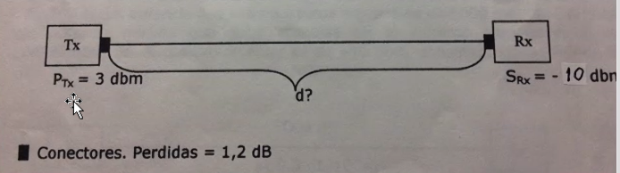

$$
P_{tx} - P_{\text{total en dB}}
\left(
\alpha_{\text{vínculo}}
+
\alpha_{\text{conectores}}
+
FD
\right)
=
S_{Rx}
$$

La atenuación total de los conectores es:

$$
\alpha_{\text{conectores}}
=
2 \cdot 0.6\,dB
=
1.2\,dB
$$

Para la fibra de:

$$
\alpha_{FO} = 3\,dB/km
$$

La atenuación del vínculo es:

$$
\alpha_{\text{vínculo}}
=
3\,\frac{dB}{km}\cdot D
$$

Entonces:

$$
3\,dBm -
\left(
3\,\frac{dB}{km}\cdot D
+
1.2\,dB
+
10\,dB
\right)
=
-10\,dBm
$$

Despejando:

$$
3 - 3D - 1.2 - 10 = -10
$$

$$
-8.2 - 3D = -10
$$

$$
3D = 1.8
$$

$$
D = 0.6\,km
$$

$$
\boxed{D = 600\,m}
$$

Para la segunda fibra:

$$
\alpha_{FO} = 0.2\,dB/km
$$

Entonces:

$$
3\,dBm -
\left(
0.2\,\frac{dB}{km}\cdot D
+
1.2\,dB
+
10\,dB
\right)
=
-10\,dBm
$$

$$
3 - 0.2D - 1.2 - 10 = -10
$$

$$
-8.2 - 0.2D = -10
$$

$$
0.2D = 1.8
$$

$$
D = 9\,km
$$

$$
\boxed{D = 9000\,m}
$$

**Rta:**

$$
\boxed{D_1 = 600\,m}
$$

$$
\boxed{D_2 = 9000\,m}
$$

**Conclusión:** la segunda fibra tiene mayor performance, ya que posee una menor atenuación por unidad de distancia y permite alcanzar una distancia máxima mucho mayor.

---

16. Dos dispositivos de transmisión de datos se encuentran vinculados por un enlace de comunicaciones construido por cable coaxil de atenuación igual a 0,8 dB/100 m. 
La distancia que separa a estos equipos es de 5000 metros. Calcular la potencia mínima que debe aplicarse en el extremo transmisor, si la sensibilidad del dispositivo receptor es de –10 dbm, considerando un FD de 3 dB. 

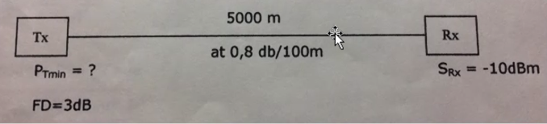

$$
P_{tx} - P_{\text{total en dB}}
\left(
\alpha_{\text{vínculo}} + FD
\right)
=
S_{Rx}
$$

Datos:

$$
S_{Rx} = -10\,dBm
$$

$$
FD = 3\,dB
$$

$$
D = 5000\,m
$$

$$
\alpha = 0.8\,\frac{dB}{100\,m}
$$

Calculamos la atenuación total del vínculo:

$$
\alpha_{\text{vínculo}}
=
5000\,m
\cdot
\frac{0.8\,dB}{100\,m}
=
40\,dB
$$

Reemplazamos:

$$
P_{tx} - (40\,dB + 3\,dB) = -10\,dBm
$$

$$
P_{tx} - 43\,dB = -10\,dBm
$$

$$
\boxed{P_{tx} = 33\,dBm}
$$

Pasamos la potencia a **mW**:

$$
dBm = 10\log_{10}\left(\frac{P}{1\,mW}\right)
$$

$$
33 = 10\log_{10}\left(\frac{P}{1\,mW}\right)
$$

$$
\frac{P}{1\,mW} = 10^{33/10}
$$

$$
P = 10^{3.3}\,mW
$$

$$
\boxed{P \approx 1995\,mW}
$$

**Rta: $P_{tx} = 33\,dBm \approx 1995\,mW$**

---

17. Se requiere montar un enlace de fibra óptica uniendo dos equipos separados 30000 metros uno de otro. La potencia del transmisor es de 2 mW y la sensibilidad del receptor es de – 60 dBm. Cual será la especificación de atenuación máxima a requerir de la fibra que se debe emplear, expresada en dB/Km. 

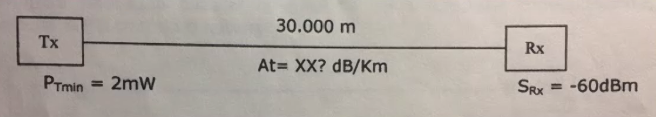

$$
P_{tx} - P_{\text{total en dB}}(\alpha_{\text{vínculo}}) = S_{Rx}
$$

Datos:

$$
P_{tx} = 2\,mW
$$

$$
S_{Rx} = -60\,dBm
$$

$$
D = 30000\,m = 30\,km
$$

Primero pasamos la potencia del transmisor de **mW a dBm**:

$$
dBm = 10\log_{10}\left(\frac{P}{1\,mW}\right)
$$

$$
P_{tx}
=
10\log_{10}\left(\frac{2\,mW}{1\,mW}\right)
$$

$$
\boxed{P_{tx} \approx 3.01\,dBm}
$$

La atenuación total máxima que puede tener el vínculo es:

$$
3.01\,dBm - \alpha_{\text{vínculo}} = -60\,dBm
$$

Despejando:

$$
\alpha_{\text{vínculo}} = 3.01\,dBm - (-60\,dBm)
$$

$$
\boxed{\alpha_{\text{vínculo}} = 63.01\,dB}
$$

Como la distancia es de $30\,km$:

$$
\alpha_{\text{vínculo}}
=
\alpha_{FO}\cdot D
$$

$$
63.01\,dB
=
\alpha_{FO}\cdot30\,km
$$

$$
\alpha_{FO}
=
\frac{63.01\,dB}{30\,km}
$$

$$
\boxed{\alpha_{FO} \approx 2.1\,dB/km}
$$

**Rta: la fibra debe tener una atenuación máxima de $\boxed{2.1\,dB/km}$.**

---

18. Si se tiene un enlace de 1000 m entre un transmisor que entrega una potencia de 100w y un receptor con una sensibilidad de 1w y se pretende utilizar las siguientes líneas de transmisión, indicar cuándo se deberá utilizar amplificadores. Considerar en ambos casos dos conectores de 0,5 dB c/u.   
a. Usando coaxil fino RG 58 con At = 5 dB/100 m    
b. Usando coaxil grueso RG 218 con At = 0,8 dB/100 m.  
En caso necesario calcular la ganancia del amplificador correspondiente. 

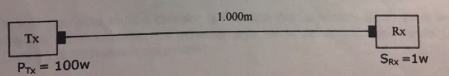

- Coaxil fino RG 58: $A_t = 5\,dB/100\,m$
- Coaxil grueso RG 218: $A_t = 0.8\,dB/100\,m$

En ambos casos:

$$
P_{tx} - P_{\text{total en dB}}
\left(
\alpha_{\text{vínculo}}+\alpha_{\text{conectores}}
\right)
=
S_{Rx}
$$

La pérdida máxima admisible entre transmisor y receptor es:

$$
P(dB)=10\log_{10}\left(\frac{P_1}{P_2}\right)
$$

$$
P(dB)=10\log_{10}\left(\frac{100\,W}{1\,W}\right)
$$

$$
P(dB)=10\log_{10}(100)
$$

$$
\boxed{P_{\text{máx}}=20\,dB}
$$

La atenuación total de los conectores es:

$$
\alpha_{\text{conectores}}
=
2\cdot0.5\,dB
=
1\,dB
$$

### a. Coaxil fino RG 58

$$
\alpha_{\text{vínculo}}
=
1000\,m
\cdot
\frac{5\,dB}{100\,m}
$$

$$
\boxed{\alpha_{\text{vínculo}}=50\,dB}
$$

Sumando los conectores:

$$
\alpha_{\text{total}}
=
50\,dB+1\,dB
$$

$$
\boxed{\alpha_{\text{total}}=51\,dB}
$$

Como el enlace solamente admite una pérdida de $20\,dB$:

$$
G_{\text{amp}}
=
51\,dB-20\,dB
$$

$$
\boxed{G_{\text{amp}}=31\,dB}
$$

**Conclusión:** se debe utilizar un amplificador con una ganancia mínima de:

$$
\boxed{31\,dB}
$$

### b. Coaxil grueso RG 218

$$
\alpha_{\text{vínculo}}
=
1000\,m
\cdot
\frac{0.8\,dB}{100\,m}
$$

$$
\boxed{\alpha_{\text{vínculo}}=8\,dB}
$$

Sumando los conectores:

$$
\alpha_{\text{total}}
=
8\,dB+1\,dB
$$

$$
\boxed{\alpha_{\text{total}}=9\,dB}
$$

Como la pérdida máxima admisible es de $20\,dB$:

$$
20\,dB-9\,dB=11\,dB
$$

$$
\boxed{\text{Margen}=11\,dB}
$$

**Conclusión:** 
- no es necesario utilizar amplificador, ya que queda un margen de $11\,dB$.
- el coaxil grueso RG 218 es el más performante, ya que presenta una atenuación mucho menor. El RG 58 suele ser más barato por metro, pero para un enlace de 1000 m requiere amplificación. En este caso conviene utilizar RG 218, ya que permite realizar el enlace sin amplificador y conserva un margen de potencia de $11\,dB$.

## Ejercicio 19 — TP: cálculo de enlace con amplificador

**Estado de este ejercicio:** revisado contra el enunciado y verificado numéricamente.

**Fuente:** [Cálculo de Enlace — Año 2026, secciones 7 a 10, páginas 2 y 3](../../material/practica/TRABAJO%20PRACTICO%20%20EJ%2019%20CALCULO%20ENLACE.pdf). [Transcripción textual](../../material/_cache/trabajo-practico-ej-19-calculo-enlace.txt). Los cuatro conectores se identifican en el dibujo de la página 3, no en la extracción de texto.

### Enunciado y conceptos que se aplican

Se debe establecer un enlace de fibra óptica entre la casa matriz de una empresa en Mataderos y su depósito en Villa Devoto, con un amplificador intermedio.

- **a)** Calcular la ganancia y la sensibilidad requerida del amplificador para $L_1=500\ \mathrm{m}$ y $L_2=1000\ \mathrm{m}$.
- **b)** Recalcular para $L_1=100\ \mathrm{m}$ y $L_2=2000\ \mathrm{m}$ y analizar los cambios.
- **c)** Elegir entre amplificadores de 3, 6 y 9 dB y explicar las consecuencias.

**Idea física:** la fibra y los conectores atenúan la señal. El amplificador debe recibir una señal suficiente para funcionar y elevar su potencia para compensar las pérdidas restantes hasta el receptor. Son dos requisitos diferentes: **sensibilidad de entrada** y **ganancia**.

El método es el mismo balance de potencia de los ejercicios anteriores: en unidades logarítmicas, las pérdidas se restan y las ganancias se suman. No corresponde calcular pérdidas de propagación de microondas porque el vínculo es una fibra óptica.

### Resolución para transcribir

#### Datos y planteo general

| Magnitud | Símbolo | Valor |
|---|---|---|
| Potencia del transmisor | $P_{Tx}$ | $-3\ \mathrm{dBm}$ |
| Sensibilidad del receptor | $S_{Rx}$ | $1\ \mathrm{mW}$ |
| Atenuación de la fibra | $\alpha_{FO}$ | $1\ \mathrm{dB/km}$ |
| Pérdida por conector | $A_c$ | $0{,}25\ \mathrm{dB}$ |
| Cantidad de conectores | — | 4 en total; 2 por tramo |

Para trabajar con el balance convierto la sensibilidad del receptor a dBm:

$$
S_{Rx}=10\log_{10}\left(\frac{1\ \mathrm{mW}}{1\ \mathrm{mW}}\right)
=\boxed{0\ \mathrm{dBm}}
$$

| Símbolo | Significado | Unidad |
|---|---|---|
| $S_{Rx}$ | Nivel mínimo de potencia que requiere el receptor | dBm en el balance |
| $1\ \mathrm{mW}$ del denominador | Potencia de referencia del dBm | mW |

Uso $10\log_{10}$ porque convierto **potencia**, no tensión. El argumento del logaritmo es adimensional.

Llamo $A_1$ y $A_2$ a las pérdidas de cada tramo, incluyendo sus dos conectores:

$$
A_i=\alpha_{FO}L_i+2A_c\qquad(i=1,2)
$$

| Símbolo | Significado | Unidad |
|---|---|---|
| $A_i$ | Atenuación total del tramo $i$ | dB |
| $\alpha_{FO}$ | Atenuación por unidad de longitud | dB/km |
| $L_i$ | Longitud del tramo $i$ | km |
| $A_c$ | Atenuación de cada conector | dB |

Se utiliza la atenuación constante indicada en el enunciado. No se agregan empalmes ni otras pérdidas no especificadas.

El balance del enlace y la condición de funcionamiento son:

$$
P_{Rx}=P_{Tx}-A_1+G-A_2\geq S_{Rx}
$$

| Símbolo | Significado | Unidad |
|---|---|---|
| $P_{Rx}$, $P_{Tx}$ | Niveles de potencia recibida y transmitida | dBm |
| $A_1$, $A_2$ | Pérdidas de los tramos | dB |
| $G$ | Ganancia de potencia del amplificador | dB |
| $S_{Rx}$ | Umbral del receptor | dBm |

Para hallar la ganancia mínima tomo la igualdad. **No agrego factor de diseño porque no está indicado.** El cálculo utiliza el modelo de balance de potencia de la práctica; supone que el amplificador puede entregar la potencia calculada sin saturarse.

#### a) Ganancia y sensibilidad para las distancias originales

**1. Atenuaciones.** Convierto las longitudes: $L_1=0{,}5\ \mathrm{km}$ y $L_2=1\ \mathrm{km}$.

$$
A_1=1\ \frac{\mathrm{dB}}{\mathrm{km}}\cdot0{,}5\ \mathrm{km}
+2\cdot0{,}25\ \mathrm{dB}=\boxed{1\ \mathrm{dB}}
$$

$$
A_2=1\ \frac{\mathrm{dB}}{\mathrm{km}}\cdot1\ \mathrm{km}
+2\cdot0{,}25\ \mathrm{dB}=\boxed{1{,}5\ \mathrm{dB}}
$$

**2. Sensibilidad requerida.** Primero calculo cuánto llega al amplificador:

$$
P_{\mathrm{ent,A}}=P_{Tx}-A_1
=-3\ \mathrm{dBm}-1\ \mathrm{dB}=\boxed{-4\ \mathrm{dBm}}
$$

| Símbolo | Significado | Unidad |
|---|---|---|
| $P_{\mathrm{ent,A}}$ | Nivel de potencia en la entrada del amplificador | dBm |
| $P_{Tx}$ | Nivel de potencia transmitida | dBm |
| $A_1$ | Pérdida antes del amplificador | dB |

El umbral de sensibilidad del amplificador debe ser igual o inferior a la potencia que llega:

$$
\boxed{S_A\leq-4\ \mathrm{dBm}}
$$

| Símbolo | Significado | Unidad |
|---|---|---|
| $S_A$ | Umbral mínimo de potencia de entrada que admite el amplificador | dBm |

El valor límite solicitado es **$S_A=-4\ \mathrm{dBm}$**. Por ejemplo, un umbral de $-5\ \mathrm{dBm}$ también sirve; uno de $-3\ \mathrm{dBm}$ no alcanza a admitir la señal de $-4\ \mathrm{dBm}$.

Como referencia, convierto el nivel de entrada a potencia:

$$
P=1\ \mathrm{mW}\cdot10^{p/10}
=1\ \mathrm{mW}\cdot10^{-4/10}
\approx\boxed{0{,}398\ \mathrm{mW}}
$$

| Símbolo | Significado | Unidad |
|---|---|---|
| $P$ | Potencia lineal | mW |
| $p$ | Valor numérico del nivel expresado en dBm; aquí $-4$ | — |

La conversión usa la referencia de $1\ \mathrm{mW}$; un nivel negativo en dBm no significa potencia negativa.

**3. Ganancia mínima.** Despejo del balance:

$$
G_{\min}=S_{Rx}-P_{Tx}+A_1+A_2
$$

| Símbolo | Significado | Unidad |
|---|---|---|
| $G_{\min}$ | Ganancia para llegar justo al umbral del receptor, sin margen | dB |
| $S_{Rx}$, $P_{Tx}$ | Niveles de sensibilidad y transmisión | dBm |
| $A_1$, $A_2$ | Pérdidas de cada tramo | dB |

$$
G_{\min}=0\ \mathrm{dBm}-(-3\ \mathrm{dBm})+1\ \mathrm{dB}+1{,}5\ \mathrm{dB}
=\boxed{5{,}5\ \mathrm{dB}}
$$

**Comprobación:** al amplificador llegan $-4\ \mathrm{dBm}$; con $5{,}5\ \mathrm{dB}$ de ganancia salen $1{,}5\ \mathrm{dBm}$. El segundo tramo pierde $1{,}5\ \mathrm{dB}$, de modo que llegan al receptor $0\ \mathrm{dBm}=1\ \mathrm{mW}$, exactamente su sensibilidad.

#### b) Recálculo para L1 = 100 m y L2 = 2000 m

**1. Atenuaciones.** Ahora $L_1=0{,}1\ \mathrm{km}$ y $L_2=2\ \mathrm{km}$:

$$
A_1=1\ \frac{\mathrm{dB}}{\mathrm{km}}\cdot0{,}1\ \mathrm{km}
+0{,}5\ \mathrm{dB}=\boxed{0{,}6\ \mathrm{dB}}
$$

$$
A_2=1\ \frac{\mathrm{dB}}{\mathrm{km}}\cdot2\ \mathrm{km}
+0{,}5\ \mathrm{dB}=\boxed{2{,}5\ \mathrm{dB}}
$$

**2. Sensibilidad requerida.** Aplicando el mismo balance al primer tramo:

$$
P_{\mathrm{ent,A}}=-3\ \mathrm{dBm}-0{,}6\ \mathrm{dB}
=\boxed{-3{,}6\ \mathrm{dBm}}
$$

$$
\boxed{S_A\leq-3{,}6\ \mathrm{dBm}}
$$

El valor límite es $-3{,}6\ \mathrm{dBm}$, equivalente a:

$$
P=1\ \mathrm{mW}\cdot10^{-3{,}6/10}
\approx\boxed{0{,}437\ \mathrm{mW}}
$$

**3. Ganancia mínima.**

$$
G_{\min}=0\ \mathrm{dBm}-(-3\ \mathrm{dBm})+0{,}6\ \mathrm{dB}+2{,}5\ \mathrm{dB}
=\boxed{6{,}1\ \mathrm{dB}}
$$

**Comprobación:** entran al amplificador $-3{,}6\ \mathrm{dBm}$ y salen $2{,}5\ \mathrm{dBm}$. Después de perder $2{,}5\ \mathrm{dB}$ en el segundo tramo, llegan $0\ \mathrm{dBm}$ al receptor.

**Análisis:** al acortarse el primer tramo, llega más potencia al amplificador: pasa de $-4$ a $-3{,}6\ \mathrm{dBm}$. Por eso, la sensibilidad requerida es menos exigente. Sin embargo, la longitud total aumenta de $1{,}5$ a $2{,}1\ \mathrm{km}$. Los $0{,}6\ \mathrm{km}$ adicionales producen $0{,}6\ \mathrm{dB}$ más de pérdida; la ganancia mínima aumenta en esa misma cantidad, de $5{,}5$ a $6{,}1\ \mathrm{dB}$.

#### c) Elección entre amplificadores de 3, 6 y 9 dB

Como el inciso no aclara si la elección corresponde a las distancias originales o a las modificadas, comparo ambos casos:

| Ganancia disponible | Caso a: mínimo 5,5 dB | Caso b: mínimo 6,1 dB |
|---|---|---|
| 3 dB | No alcanza | No alcanza |
| 6 dB | Alcanza | No alcanza |
| 9 dB | Alcanza | Alcanza |

**Para el caso b elegiría 9 dB**, porque es la menor ganancia disponible que alcanza el valor requerido. Para el caso a bastan 6 dB. Si debo elegir un único modelo que sirva para ambos, elegiría **9 dB**, con sensibilidad de $-4\ \mathrm{dBm}$ o menor.

Con 9 dB en el caso b, la potencia recibida es:

$$
P_{Rx}=-3\ \mathrm{dBm}-0{,}6\ \mathrm{dB}+9\ \mathrm{dB}-2{,}5\ \mathrm{dB}
=\boxed{2{,}9\ \mathrm{dBm}}
$$

$$
P=1\ \mathrm{mW}\cdot10^{2{,}9/10}
\approx\boxed{1{,}95\ \mathrm{mW}}
$$

El margen sobre la sensibilidad es:

$$
M=P_{Rx}-S_{Rx}=2{,}9\ \mathrm{dBm}-0\ \mathrm{dBm}
=\boxed{2{,}9\ \mathrm{dB}}
$$

| Símbolo | Significado | Unidad |
|---|---|---|
| $M$ | Margen de potencia sobre la sensibilidad del receptor | dB |
| $P_{Rx}$ | Nivel de potencia recibida | dBm |
| $S_{Rx}$ | Umbral del receptor | dBm |

Este margen permitiría absorber hasta $2{,}9\ \mathrm{dB}$ de pérdidas adicionales en el balance completo antes de alcanzar el umbral del receptor, **siempre que también se mantenga una entrada suficiente en el amplificador**. No garantiza por sí solo que esas pérdidas adicionales puedan ubicarse antes del amplificador.

No elijo 6 dB para el caso b porque:

$$
P_{Rx}=-3\ \mathrm{dBm}-0{,}6\ \mathrm{dB}+6\ \mathrm{dB}-2{,}5\ \mathrm{dB}
=-0{,}1\ \mathrm{dBm}
$$

$$
P=1\ \mathrm{mW}\cdot10^{-0{,}1/10}
\approx0{,}977\ \mathrm{mW}<1\ \mathrm{mW}
$$

Aunque falten solamente $0{,}1\ \mathrm{dB}$, no se cumple el requisito. No corresponde redondear $6{,}1$ a $6\ \mathrm{dB}$ para elegir el equipo.

En el caso a, con 6 dB llegan $0{,}5\ \mathrm{dBm}$ y queda un margen de $0{,}5\ \mathrm{dB}$. Si uso 9 dB en ese mismo caso, llegan $3{,}5\ \mathrm{dBm}$ y queda un margen de $3{,}5\ \mathrm{dB}$.

**Consecuencia y límite del cálculo:** una mayor ganancia aumenta la potencia recibida y el margen. No puede afirmarse que el receptor se sature solo por superar su sensibilidad: esta es su umbral mínimo, no su límite máximo. Como consideración técnica general, para comprobar el funcionamiento real también se deben verificar la potencia máxima de salida del amplificador y la máxima admisible del receptor; el enunciado no proporciona esos datos.

### Cierre para estudiar — no es necesario transcribirlo en la entrega

#### Resultados y verificación de razonabilidad

| Resultado | Caso a | Caso b |
|---|---|---|
| Pérdida antes del amplificador | 1 dB | 0,6 dB |
| Pérdida después del amplificador | 1,5 dB | 2,5 dB |
| Potencia de entrada al amplificador | −4 dBm | −3,6 dBm |
| Sensibilidad requerida | $S_A\leq-4\ \mathrm{dBm}$ | $S_A\leq-3{,}6\ \mathrm{dBm}$ |
| Ganancia mínima | 5,5 dB | 6,1 dB |
| Menor ganancia disponible que sirve | 6 dB | 9 dB |

Las unidades cierran: dB/km por km da dB, y la diferencia entre dos niveles en dBm da dB. En ambos casos el transmisor parte 3 dB por debajo del umbral del receptor; por eso la ganancia debe compensar las pérdidas totales **más esos 3 dB**. Con la ganancia mínima se llega exactamente a 1 mW, sin margen.

#### Errores típicos

- **Contar solo dos conectores:** hay cuatro en el esquema; se pierden 0,5 dB en conectores por tramo.
- **Confundir dB con dBm:** 0 dBm equivale a 1 mW; 0 dB indica una relación de potencias igual a uno.
- **Confundir sensibilidad con potencia recibida:** la primera es un umbral del equipo; la segunda resulta del enlace. Se igualan únicamente para determinar el caso límite.
- **Interpretar “más sensible” como un número mayor:** un umbral de −5 dBm admite señales más débiles que uno de −4 dBm.
- **Redondear hacia abajo la ganancia mínima:** 6 dB no satisface un requisito de 6,1 dB.
- **Llamar saturación a superar la sensibilidad:** falta conocer el límite máximo del receptor para afirmarlo.
- **Confundir margen global con margen de entrada:** una ganancia mayor no corrige una señal que ya llega por debajo del umbral admisible del amplificador.

#### Resumen mental

> Primero calculo la pérdida de cada tramo contando fibra y conectores. Con el primer tramo determino qué señal debe admitir el amplificador; con el enlace completo determino cuánto debe amplificar. Elijo una ganancia disponible que no quede por debajo de la calculada y verifico tanto la entrada del amplificador como la potencia final en el receptor.

#### Checklist de examen y entrega

- [ ] Puedo explicar por qué hay cuatro conectores y dos pérdidas por tramo.
- [ ] Distingo sensibilidad, potencia recibida y ganancia, con sus unidades.
- [ ] Puedo justificar por qué el caso b recibe más potencia en el amplificador pero necesita mayor ganancia.
- [ ] Puedo demostrar por qué 6 dB no alcanza en el caso b.
- [ ] Para entregar: resolución manuscrita y prolija, en orden a), b), c), con nombre y apellido arriba a la derecha de cada hoja.
- [ ] Escanear solamente la resolución en un único PDF identificado con nombre y apellido.

