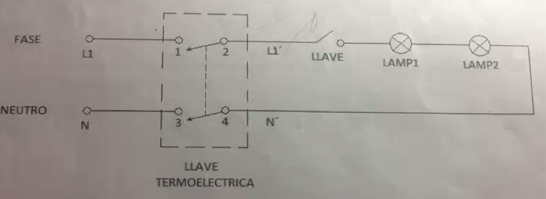
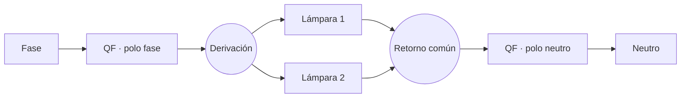
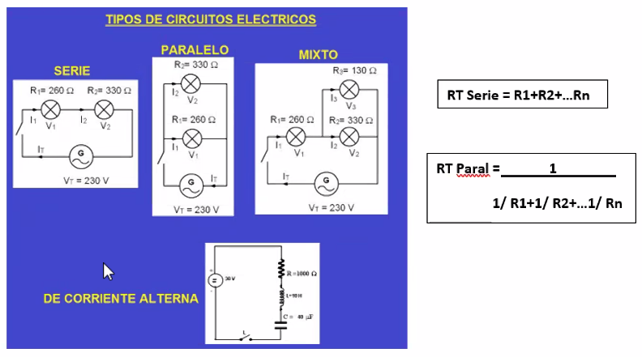
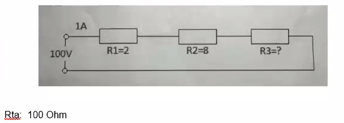
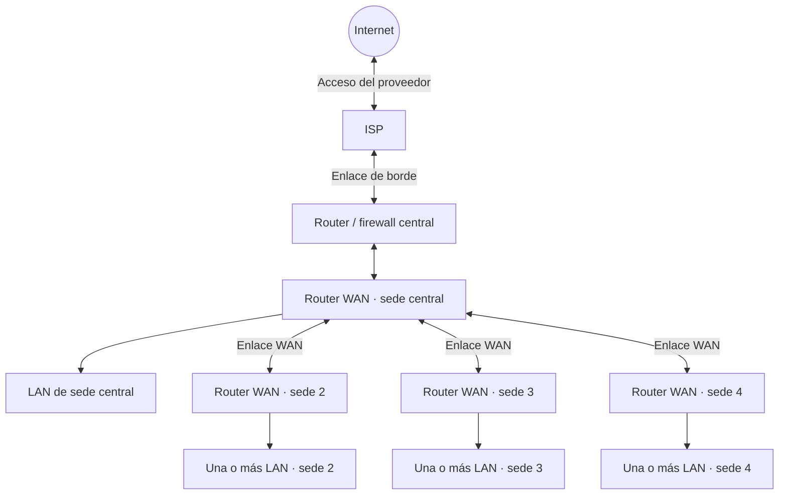
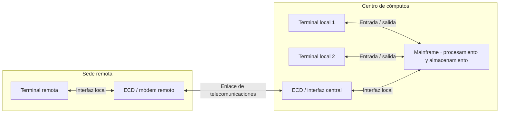

# TP 1 — Electricidad, circuitos y teleinformática

**Fuente del enunciado:** [TP 1 oficial, pp. 2–3](../../material/practica/U%201/TP%201%20%202026.pdf).
**Fuentes de respuestas:** [TP1 — respuestas y resumen, pp. 1–2](../../material/practica/U%201/TP1-respuestas%20y%20resumen.pdf). La p. 3 contiene una interpolación de atenuación de cable RG-213 que no está en el enunciado oficial; no forma parte de esta resolución.
**Fuentes introductorias:** [UT 1 — Comunicaciones, pp. 2–9](../../material/practica/U%201/UT%201%20COMUNICACIONES.pdf) y [U1 — Introducción a las comunicaciones, pp. 3–25](../../material/teoria/U1/U1%20Introduccion%20a%20las%20comunicaciones.pdf).

El TP reúne dos bloques distintos: primero, un repaso de electricidad y circuitos; después, conceptos de teleinformática, Internet y normalización. En las cuentas se muestra primero qué relación física corresponde y recién después se reemplazan los datos.

## Símbolos, unidades y supuestos de las cuentas

| Símbolo | Significado | Unidad usada |
|---|---|---|
| $V$ | tensión o diferencia de potencial | volt (V) |
| $I$ | corriente | ampere (A) |
| $R$ | resistencia | ohm ($\Omega$) |
| $\rho$ | resistividad | $\Omega\,\text{mm}^2/\text{m}$ |
| $L$ | longitud del conductor | metro (m) |
| $S$ | sección transversal | $\text{mm}^2$ |
| $d$ | diámetro del conductor | milímetro (mm) |
| $P$ | potencia | watt (W) |
| $E$ | energía | Wh o kWh |
| $t$ | tiempo | s u h, según la cuenta |

**Relaciones que vamos a usar**

$$
V = RI,\qquad R = \rho\frac{L}{S},\qquad P = VI,\qquad E = Pt
$$

Para una carga resistiva ideal también vale $P=V^2/R$. En serie, las resistencias se suman; en paralelo, se suman sus recíprocos. Las expresiones de potencia para los ejercicios 10 y 11 suponen que la resistencia no cambia con la temperatura: es el modelo simplificado del enunciado, no una descripción completa de una lámpara incandescente o de un calefactor real.

La notación del solucionario se contrastó con la **página original**: la letra de resistividad es $\rho$ y su unidad figura como $\Omega\,\text{mm}^2/\text{m}$. La extracción de texto puede representar esos glifos con caracteres privados; no hay que copiar esos caracteres defectuosos.

## Ejercicio 1 — Resistencia de la estufa

**Enunciado (transcripción literal; TP 1, p. 2):**
> 1. Hallar la resistencia de una estufa que consume 3 A y se alimenta con una tensión de 120 V.

**Datos / condiciones:**
- Corriente: 3 A.
- Tensión: 120 V.
- Incógnita: resistencia de la estufa.

**Resolución paso a paso — método:** conocemos tensión y corriente; por la ley de Ohm, $R=V/I$.

$$
R=\frac{120\,\text{V}}{3\,\text{A}}=40\,\Omega
$$

**Resultado:** $\boxed{R=40\,\Omega}$. Coincide con la respuesta de cátedra ([solucionario, p. 2](../../material/practica/U%201/TP1-respuestas%20y%20resumen.pdf#page=2)). La unidad cierra porque $\text{V}/\text{A}=\Omega$.

## Ejercicio 2 — Resistividad del conductor

**Enunciado (transcripción literal; TP 1, p. 2):**
> 2. Determinar la resistividad de un conductor que tiene 4 Km de longitud, 16 mm2 de sección y una resistencia de 20 Ω.

**Datos / condiciones:**
- Longitud: 4 Km.
- Sección: 16 mm2.
- Resistencia: 20 Ω.
- Incógnita: resistividad.

**Resolución paso a paso — método:** despejamos $\rho$ de $R=\rho L/S$; antes de reemplazar, expresamos la longitud en metros para que coincida con la unidad de $\rho$.

$$
L=4\,\text{km}\times 1000\,\frac{\text{m}}{\text{km}}=4000\,\text{m}
$$

$$
\rho=\frac{RS}{L}
=\frac{(20\,\Omega)(16\,\text{mm}^2)}{4000\,\text{m}}
=0{,}08\,\Omega\,\frac{\text{mm}^2}{\text{m}}
$$

**Resultado:** $\boxed{\rho=0{,}08\,\Omega\,\text{mm}^2/\text{m}}$, igual que en el [solucionario, p. 2](../../material/practica/U%201/TP1-respuestas%20y%20resumen.pdf#page=2). **Control:** no se puede dejar $4\,\text{km}$ dentro de una fórmula cuyo valor de resistividad está expresado por metro.

## Ejercicio 3 — Longitud del hilo de ferro-níquel

**Enunciado (transcripción literal; TP 1, p. 2):**
> 3. Calcular la longitud de un hilo de ferro-niquel de 2.6mm de diámetro y 500Ω de resistencia. (Resistividad= 0.8Ω mm2/m)

**Datos / condiciones:**
- Diámetro: 2.6 mm.
- Resistencia: 500 Ω.
- Resistividad: 0.8 Ω mm2/m.
- Incógnita: longitud del hilo.

**Resolución paso a paso — método:** el área que aparece en la fórmula es la sección circular del hilo, no su diámetro. Con $S=\pi d^2/4$ despejamos $L=RS/\rho$.

$$
S=\frac{\pi d^2}{4}
=\frac{\pi(2{,}6\,\text{mm})^2}{4}
\approx 5{,}31\,\text{mm}^2
$$

$$
L=\frac{RS}{\rho}
=\frac{(500\,\Omega)(5{,}31\,\text{mm}^2)}{0{,}8\,\Omega\,\text{mm}^2/\text{m}}
\approx 3318\,\text{m}
\approx 3{,}32\,\text{km}
$$

**Resultado:** $\boxed{L\approx 3{,}32\,\text{km}}$. El solucionario no trae este ejercicio resuelto; el cálculo usa el dato de resistividad del [enunciado, p. 2](../../material/practica/U%201/TP%201%20%202026.pdf#page=2). Se supone hilo uniforme, sección circular y resistividad constante.

## Ejercicio 4 — Dos lámparas en serie con protección

**Enunciado (transcripción literal; TP 1, p. 2):**
> 4. Graficar el esquema de conexión de dos lámparas en serie incluida la protección termoeléctrica correspondiente.

**Datos / condiciones:**
- No hay datos numéricos.
- Condiciones indicadas: dos lámparas conectadas en serie e inclusión de protección termoeléctrica.

**Resolución paso a paso — método:** en serie hay un único camino de corriente. El esquema muestra una protección bipolar: un polo sobre fase antes de las cargas y el otro sobre neutro después del retorno, como en la captura de clase y la indicación de protección a la entrada del [solucionario, p. 2](../../material/practica/U%201/TP1-respuestas%20y%20resumen.pdf#page=2).

**Desarrollo / lectura del circuito:** la misma corriente atraviesa ambas lámparas. Si una lámpara se abre o se quema, se interrumpe el único camino y se apagan las dos. El Mermaid simplifica la protección como dos polos en los conductores de fase y neutro; ambos pertenecen al mismo aparato y actúan acoplados. La captura de clase dibuja ese conjunto bipolar con más detalle. La consigna dice «protección termoeléctrica» y la clave menciona «disyuntor»; el esquema representa una protección termomagnética genérica ($QF$), sin convertir este dibujo académico en una instrucción de instalación.

## Ejercicio 5 — Dos lámparas en paralelo con protección

**Enunciado (transcripción literal; TP 1, p. 2):**
> 5. Graficar el esquema de conexión de dos lámparas en paralelo incluida la protección termoeléctrica correspondiente.

**Datos / condiciones:**
- No hay datos numéricos.
- Condiciones indicadas: dos lámparas conectadas en paralelo e inclusión de protección termoeléctrica.

**Resolución paso a paso — método:** en paralelo cada lámpara forma una rama entre los mismos dos nodos. El esquema ubica un polo de la protección en fase antes de la bifurcación y el otro en neutro después del retorno común.

**Desarrollo / lectura del circuito:** ambas ramas reciben la misma tensión de alimentación; cada rama conduce su propia corriente. Si una lámpara se abre, la otra conserva un camino cerrado y puede seguir encendida. El Mermaid representa la protección bipolar de forma simplificada: sus polos están en fase y neutro y actúan acoplados. La imagen de apoyo muestra circuitos serie/paralelo/mixtos, pero no el dispositivo de protección; por eso se agrega aquí el esquema de conexión con QF. La respuesta original dice «ídem anterior» para la protección ([solucionario, p. 2](../../material/practica/U%201/TP1-respuestas%20y%20resumen.pdf#page=2)).

## Ejercicio 6 — Resistencia total en serie

**Enunciado (transcripción literal; TP 1, p. 2):**
> 6. Calcular la resistencia total en el circuito alimentado con 100 V y compuesto por tres resistencias en serie.R1= 2 Ω, R2= 8 Ω, R3= x Ω, la corriente es de 1 A.

**Datos / condiciones:**
- Tensión de alimentación: 100 V.
- Resistencias en serie: R1 = 2 Ω, R2 = 8 Ω y R3 = x Ω.
- Corriente: 1 A.
- Incógnita solicitada: resistencia total (R3=x Ω es parte de la descripción del circuito).

**Resolución paso a paso — método:** la corriente y la tensión totales permiten hallar directamente $R_T$ por ley de Ohm. En serie también debe cumplirse $R_T=R_1+R_2+R_3$.

$$
R_T=\frac{V}{I}=\frac{100\,\text{V}}{1\,\text{A}}=100\,\Omega
$$

**Resultado:** $\boxed{R_T=100\,\Omega}$, coincide con la [respuesta de cátedra, p. 2](../../material/practica/U%201/TP1-respuestas%20y%20resumen.pdf#page=2). **No confundir lo pedido:** esos $100\,\Omega$ son la resistencia total, no $R_3$. Como comprobación adicional, $R_3=100-2-8=90\,\Omega$.

## Ejercicio 7 — Tres resistencias en paralelo

**Enunciado (transcripción literal; TP 1, p. 2):**
> 7. Cálculo de la resistencia total de 3 resistencias en paralelo. R1= 2 Ω, R2=10 Ω, R3= 8 Ω

**Datos / condiciones:**
- Resistencias en paralelo: R1 = 2 Ω, R2 = 10 Ω y R3 = 8 Ω.
- Incógnita: resistencia total.

**Resolución paso a paso — método:** al estar las resistencias en paralelo, se suman las conductancias (recíprocos), no los valores de $R$.

$$
\frac{1}{R_T}=\frac{1}{2\,\Omega}+\frac{1}{10\,\Omega}+\frac{1}{8\,\Omega}
=0{,}725\,\Omega^{-1}
$$

$$
R_T=\frac{1}{0{,}725\,\Omega^{-1}}
=\frac{40}{29}\,\Omega
\approx 1{,}38\,\Omega
$$

**Resultado:** $\boxed{R_T\approx 1{,}38\,\Omega}$, coincide con el [solucionario, p. 2](../../material/practica/U%201/TP1-respuestas%20y%20resumen.pdf#page=2). **Razonabilidad:** una resistencia equivalente en paralelo debe ser menor que la más chica de las ramas ($2\,\Omega$); $1{,}38\,\Omega$ cumple ese control.

## Ejercicio 8 — Energía y costo de los artefactos

**Enunciado (transcripción literal; TP 1, p. 2):**
> 8. Un televisor consume una potencia de 200W y permanece encendido durante 8 h y un calefactor de 500W permanece encendido durante 3 h. Cual de los dos artefactos consume más energía en los tiempos indicados. Si el kw h vale $ 60, calcule el gasto total ocasionado por los dos artefactos

**Datos / condiciones:**
- Televisor: 200 W durante 8 h.
- Calefactor: 500 W durante 3 h.
- Precio consignado: $ 60 por kw h.
- Incógnitas: comparación de energías y gasto total.

**Resolución paso a paso — método:** la energía consumida se obtiene multiplicando potencia por tiempo. Para facturar en kWh, pasamos los watts a kilowatts.

$$
E_{TV}=0{,}200\,\text{kW}\times 8\,\text{h}=1{,}6\,\text{kWh}
$$

$$
E_{calefactor}=0{,}500\,\text{kW}\times 3\,\text{h}=1{,}5\,\text{kWh}
$$

El televisor consume $0{,}1\,\text{kWh}$ más en los tiempos indicados. La energía total es:

$$
E_T=1{,}6+1{,}5=3{,}1\,\text{kWh}
$$

$$
\text{Costo}=3{,}1\,\text{kWh}\times \frac{\$60}{\text{kWh}}=\$186
$$

**Resultado:** el televisor consume más energía ($1{,}6\,\text{kWh}$ frente a $1{,}5\,\text{kWh}$) y el costo total es $\boxed{\$186}$. Coincide con la [clave, p. 2](../../material/practica/U%201/TP1-respuestas%20y%20resumen.pdf#page=2). El kWh se cancela al multiplicar por $\$/\text{kWh}$.

## Ejercicio 9 — Tensión y resistencia de la lámpara

**Enunciado (transcripción literal; TP 1, p. 2):**
> 9. Una lámpara de 25 W se conecta a los terminales de una batería , entonces la corriente en dicha lámpara es de 2,5 A, calcule el voltaje entre los terminales de la lámpara. Calcule la resistencia de la lámpara.

**Datos / condiciones:**
- Potencia de la lámpara: 25 W.
- Corriente: 2,5 A.
- Incógnitas: tensión entre terminales y resistencia.

**Resolución paso a paso — método:** primero usamos $P=VI$ para despejar $V$; después, $R=V/I$.

$$
V=\frac{P}{I}=\frac{25\,\text{W}}{2{,}5\,\text{A}}=10\,\text{V}
$$

$$
R=\frac{V}{I}=\frac{10\,\text{V}}{2{,}5\,\text{A}}=4\,\Omega
$$

**Resultado:** $\boxed{V=10\,\text{V}}$ y $\boxed{R=4\,\Omega}$. La clave no desarrolla este ejercicio; se aplica la relación de potencia que figura en el [resumen de fórmulas, p. 1](../../material/practica/U%201/TP1-respuestas%20y%20resumen.pdf#page=1).

## Ejercicio 10 — Potencia de la misma lámpara a 15 V

**Enunciado (transcripción literal; TP 1, p. 2):**
> 10. Si la lámpara del problema anterior se conecta a una batería de 15 V, calcule la potencia consumida

**Datos / condiciones:**
- Tensión de la batería: 15 V.
- El enunciado remite a la lámpara del problema anterior; la resistencia que se use debe identificarse como dato derivado de ese ejercicio, no como un valor repetido aquí.

**Resolución paso a paso — método:** bajo el modelo resistivo del ejercicio, conservamos $R=4\,\Omega$ y usamos $P=V^2/R$.

$$
P=\frac{(15\,\text{V})^2}{4\,\Omega}=56{,}25\,\text{W}
$$

**Resultado:** $\boxed{P=56{,}25\,\text{W}}$. La unidad cierra porque $\text{V}^2/\Omega=\text{W}$. La clave no trae resultado; para una lámpara incandescente real $R$ varía con la temperatura, pero este TP idealiza la carga como resistencia constante.

## Ejercicio 11 — Resistencia y caída porcentual de potencia

**Enunciado (transcripción literal; TP 1, p. 3):**
> 11. Un calefactor de 1100 W, esta diseñado para que funcione con un voltaje de 220 V. Calcule la resistencia del calefactor. Si el voltaje baja a 200 V, calcule en que porcentaje baja la potencia consumida.

**Datos / condiciones:**
- Potencia nominal: 1100 W.
- Tensión de diseño: 220 V.
- Tensión reducida: 200 V.
- Incógnitas: resistencia y porcentaje de disminución de potencia.
- La resistencia constante se adopta como supuesto de resolución, no es un dato explícito.

**Resolución paso a paso — método:** suponemos resistencia constante. Primero inferimos $R=V^2/P$; después calculamos la nueva potencia y comparamos con la inicial.

$$
R=\frac{(220\,\text{V})^2}{1100\,\text{W}}=44\,\Omega
$$

$$
P_{200}=\frac{(200\,\text{V})^2}{44\,\Omega}\approx 909{,}09\,\text{W}
$$

$$
\%\text{ de caída}
=\frac{1100\,\text{W}-909{,}09\,\text{W}}{1100\,\text{W}}\times100
\approx17{,}36\%
$$

**Resultado:** $\boxed{R=44\,\Omega}$ y la potencia disminuye aproximadamente $\boxed{17{,}36\%}$. No alcanza con restar la caída de tensión en porcentaje: para $R$ constante, $P$ varía con el cuadrado de $V$. La clave no trae este cálculo; el supuesto de resistencia constante es el modelo escolar.

## Ejercicio 12 — Disciplinas que abarca la teleinformática

**Enunciado (transcripción literal; TP 1, p. 3):**
> 12. Indicar que disciplinas abarca la Teleinformática.

**Datos / condiciones:**
- No hay datos numéricos.
- Premisa: identificar las disciplinas comprendidas por la Teleinformática.

**Resolución razonada:** teleinformática combina **informática** y **telecomunicaciones**: procesa información en sistemas informáticos y utiliza técnicas/redes de comunicación para intercambiarla a distancia o localmente. La presentación de U1 lo resume como «Telecomunicaciones + Informática» ([UT 1 — Comunicaciones, p. 2](../../material/practica/U%201/UT%201%20COMUNICACIONES.pdf#page=2)); la clase teórica lo vincula con procesamiento distribuido y centralizado ([Introducción a las comunicaciones, pp. 4–5](../../material/teoria/U1/U1%20Introduccion%20a%20las%20comunicaciones.pdf#page=4)).

**Para responder oralmente:** «La teleinformática estudia la integración entre informática y telecomunicaciones para procesar y comunicar información mediante redes».

## Ejercicio 13 — UIT-T: qué es, qué hace y cómo se organiza

**Enunciado (transcripción literal; TP 1, p. 3):**
> 13. -- Qué es la UIT - T(anterior CCITT); qué funciones cumple y como esta constituida?.

**Datos / condiciones:**
- No hay datos numéricos.
- Premisas/pedidos: definir la UIT-T (denominada anteriormente CCITT), explicar funciones y constitución.

**Resolución razonada y contraste de fuentes:** la **UIT-T** (ITU-T, *Telecommunication Standardization Sector*) es el Sector de Normalización de las Telecomunicaciones de la Unión Internacional de Telecomunicaciones. La reforma de la UIT de 1992 reorganizó las áreas de actividad en sectores y renombró el CCITT; la función del UIT-T es estudiar cuestiones técnicas, operativas y tarifarias y aprobar Recomendaciones para normalizar las telecomunicaciones a escala mundial ([historia oficial de la UIT](https://www.itu.int/en/history/Pages/FocusOnStandardization.aspx)).

Su organización actual se entiende así ([marco oficial del UIT-T](https://www.itu.int/en/ITU-T/about/Pages/framework.aspx)):

1. **WTSA** — Asamblea Mundial de Normalización de las Telecomunicaciones: fija dirección y estructura, establece grupos de estudio y el programa de trabajo del período.
2. **Grupos de estudio**: reúnen expertos de los miembros para elaborar proyectos de Recomendaciones UIT-T.
3. **TSAG** — Grupo Asesor de Normalización de las Telecomunicaciones: revisa prioridades y asesora entre asambleas.
4. **TSB** — Oficina de Normalización de las Telecomunicaciones: presta la secretaría y soporte al trabajo del Sector.

Las Recomendaciones facilitan compatibilidad e interoperabilidad internacional. **No son automáticamente leyes:** su obligatoriedad depende de que una ley o regulación aplicable las incorpore ([UIT-T en breve](https://www.itu.int/en/ITU-T/about/Pages/default.aspx)).

## Ejercicio 14 — Redes y organismos vinculados con el origen de Internet

**Enunciado (transcripción literal; TP 1, p. 3):**
> 14. Indicar cuales son las redes que dieron origen a Internet.

**Datos / condiciones:**
- No hay datos numéricos.
- Premisa: identificar las redes que dieron origen a Internet.

**Resolución razonada y precisión de fuentes:** la clave de cátedra enumera «DARPA, ARPANET, MILNET» ([respuestas, p. 2](../../material/practica/U%201/TP1-respuestas%20y%20resumen.pdf#page=2)); las ampliaciones de sigla, país y cronología pertenecen a esa respuesta complementaria, no al enunciado oficial. Para que la respuesta sea técnicamente precisa, hay que separar **organismo** de **red**:

| Nombre | Expansión, tipo y origen | Relación histórica |
|---|---|---|
| **ARPA / DARPA** | *Advanced Research Projects Agency* / *Defense Advanced Research Projects Agency*: agencia estadounidense del Departamento de Defensa, no una red. Se estableció como ARPA en 1958 y adoptó el nombre DARPA en 1972. | DARPA impulsó la investigación de la que surgió ARPANET; sus fuentes ubican allí las raíces del proyecto ([historia de DARPA](https://www.darpa.mil/news/features/arpanet); [cronología del cambio de nombre](https://www.darpa.mil/about/innovation-timeline/arpa-becomes-darpa)). |
| **ARPANET** | *Advanced Research Projects Agency Network*: red experimental estadounidense de conmutación de paquetes financiada por ARPA/DARPA. | Empezó a operar con cuatro nodos en 1969 ([DARPA](https://www.darpa.mil/news/features/arpanet)). |
| **MILNET** | *Military Network*: red militar estadounidense del Departamento de Defensa, separada de ARPANET. | La fecha depende del hito que se esté describiendo (ver abajo). |
| **NSFNET** | *National Science Foundation Network*: red estadounidense de investigación y educación de la National Science Foundation (NSF). | Se estableció en 1985 y enlazó centros académicos y de supercomputación; fue precursora/troncal de la expansión inicial de Internet ([NSF, historia](https://www.nsf.gov/about/history); [NSF, impacto](https://www.nsf.gov/impacts/internet)). |

**Aclaración cronológica ARPANET/MILNET:** no hay que memorizar una fecha única sin decir qué hito refiere. El RFC 881 es un documento de plan y cronograma; en su calendario enumera «The ARPANET/MILNET Logical Split» para el **4 de octubre de 1983**. Es una fecha de separación lógica programada, no por sí sola una constatación de que toda separación ya se hubiera completado ([RFC 881, sección “The Schedule”](https://www.rfc-editor.org/rfc/rfc881.html)). En cambio, el RFC 1302 (FYI 12), publicado en 1992, resume retrospectivamente que **en 1984** la red original se dividió en ARPANET y MILNET ([RFC 1302, sección “History”](https://www.rfc-editor.org/rfc/rfc1302.html)). Ese RFC no detalla qué hito operacional usa para fecharlo; que se refiera a una etapa posterior a la división lógica es una interpretación, no algo que el texto afirme explícitamente.

**Respuesta razonable para el parcial:** nombrá ARPANET y MILNET como redes, y separá el organismo promotor (ARPA/DARPA). Si te piden fecha, explicá el hito de 1983 que aparece en el cronograma de separación lógica y la reseña posterior que registra 1984, en vez de presentar uno solo como fecha indiscutida. La idea central es la **interconexión de múltiples redes** que podían comunicarse mediante protocolos comunes; Internet no surgió simplemente de sumar dos redes. La filmina de U1 presenta una cronología abreviada de ARPA/ARPANET, NIC e IANA ([Introducción a las comunicaciones, p. 23](../../material/teoria/U1/U1%20Introduccion%20a%20las%20comunicaciones.pdf#page=23)). Su texto «ARPA … (1960)» refiere a la **agencia**, cuyo establecimiento fue el **7 de febrero de 1958**, según [DARPA, «ARPA is born»](https://www.darpa.mil/about/innovation-timeline/arpa-is-born) (sin fecha de publicación visible; acceso: 13/10/2026). En cambio, el **gráfico de esa misma página sí ubica ARPANET en 1969**, coincidiendo con la [historia institucional de ARPANET](https://www.darpa.mil/news/features/arpanet) (publicada en julio de 2020; acceso: 13/10/2026). La discrepancia es ARPA 1960 frente a ARPA 1958, no ARPA 1960 frente al inicio de una red distinta.

## Ejercicio 15 — Equipos y topología de Internet

**Enunciado (transcripción literal; TP 1, p. 3):**
> 15. ¿Qué equipos principales integran la red Internet y cual es la topología de esta ultima?

**Datos / condiciones:**
- No hay datos numéricos.
- Premisas/pedidos: identificar equipos principales de Internet y describir su topología.

**Ampliación didáctica de la clave (no integra el enunciado oficial):** se agrega la función de cada equipo y la justificación de la topología para explicar el modelo, no como palabras omitidas de la consigna.

**Desarrollo razonado:**

- **Hosts o ETD:** equipos terminales que producen o consumen información, por ejemplo computadoras y servidores.
- **Routers:** reciben paquetes y los encaminan hacia otras redes según sus direcciones y rutas disponibles.
- **Redes y enlaces:** conectan los hosts y los routers; pueden pertenecer a administraciones distintas.
- **Direcciones IP:** identifican interfaces en el nivel de red; no son equipos físicos.
- **ISP:** prestadores que brindan acceso y enlazan redes de usuarios con otras redes de Internet.

La presentación de U1 resume la composición con hosts/ETD, direcciones IP, routers y redes ([UT 1 — Comunicaciones, p. 9](../../material/practica/U%201/UT%201%20COMUNICACIONES.pdf#page=9)). Se suele dibujar Internet como una **malla de redes interconectadas**, pero no es una malla completa donde cada router se conecta directamente con todos los demás: es una «red de redes» con enlaces y rutas múltiples, gestionada por organizaciones autónomas. El dibujo es un modelo, no un mapa físico único.

## Ejercicio 16 — Definición de transmisión de datos y señales

**Enunciado (transcripción literal; TP 1, p. 3):**
> 16. - Definir transmisión de datos e indicar que tipos de señales se utiliza para llevarla a cabo.

**Datos / condiciones:**
- No hay datos numéricos.
- Premisas/pedidos: definir transmisión de datos e identificar los tipos de señales utilizados.

**Desarrollo razonado:** transmitir datos es mover información codificada desde un punto hacia uno o más puntos a través de un canal. Según el medio, la representación física puede ser eléctrica, óptica, electromagnética u optoelectrónica. La presentación de U1 también distingue transmisión local y remota ([UT 1 — Comunicaciones, p. 3](../../material/practica/U%201/UT%201%20COMUNICACIONES.pdf#page=3)); la filmina teórica enumera señales eléctricas, ópticas, electromagnéticas y electroópticas ([Introducción a las comunicaciones, p. 3](../../material/teoria/U1/U1%20Introduccion%20a%20las%20comunicaciones.pdf#page=3)).

**Aclaración pedagógica:** la información (bits o símbolos) no es la señal física. El transmisor representa la información mediante una señal que el canal pueda transportar.

## Ejercicio 17 — WAN empresarial con cuatro sedes y acceso central a Internet

**Enunciado (transcripción literal; TP 1, p. 3):**
> 17. Graficar la topologia de una red WAN empresarial con cuatro sitios (cada uno con una o mas redes LAN) interconectada a Internet en forma centralizada.

**Datos / condiciones:**
- No hay datos numéricos.
- Condiciones explícitas: red WAN empresarial; cuatro sitios; cada sitio tiene una o más LAN; conexión centralizada a Internet.
- La tecnología y el detalle de topología WAN no están especificados.

**Supuesto explícito del dibujo (no es dato del enunciado):** una sede principal tiene el enlace de salida a Internet; las otras tres se conectan a ella por enlaces WAN. El enunciado no especifica si esos enlaces son alquilados, VPN u otra tecnología, por eso no se fija una en particular.

**Desarrollo / lectura:** la estrella concentra la salida a Internet en la sede central. Si se elige esa arquitectura, el tráfico externo de las sucursales pasa por el enlace y los equipos centrales; eso simplifica la administración, pero concentra carga y dependencia en ese punto. Es una propuesta coherente con la condición de «forma centralizada», no la única topología WAN posible.

## Ejercicio 18 — Procesamiento centralizado con mainframe y terminales

**Enunciado (transcripción literal; TP 1, p. 3):**
> 18. Graficar el esquema básico de un sistema informático de procesamiento centralizado con un mainframe y terminales locales y remotos.

**Datos / condiciones:**
- No hay datos numéricos.
- Condiciones explícitas: procesamiento centralizado, un mainframe y terminales locales y remotos.

**Desarrollo / lectura:** el procesamiento se realiza en el mainframe; los terminales locales y remotos envían entradas y reciben resultados. Para la terminal remota se necesita un enlace de comunicaciones y los equipos de interfaz correspondientes. El esquema no presupone una tecnología de acceso específica.

## Ejercicio 19 — ISO, IEEE, ANSI y EIA

**Enunciado (transcripción literal; TP 1, p. 3):**
> 19. Definir los siguientes términos relativos a organismos de estandarización: ISO, IEEEE, ANSI, EIA.

**Datos / condiciones:**
- No hay datos numéricos.
- Términos pedidos por la fuente: ISO, IEEEE, ANSI y EIA.
- La fuente escribe «IEEEE»; la sigla estándar es «IEEE». Esta aclaración queda fuera de la transcripción literal.

| Sigla | Nombre y función en este ejercicio |
|---|---|
| **ISO** | *International Organization for Standardization*. Red internacional de organismos nacionales que desarrolla normas internacionales mediante consenso. La palabra «ISO» es el nombre corto universal, no una sigla formada por las iniciales de ese nombre ([ISO](https://www.iso.org/about)). |
| **IEEE** | *Institute of Electrical and Electronics Engineers*. Asociación técnica que publica estándares de distintas áreas; IEEE 802 es una familia conocida para tecnologías de redes ([material de cátedra, p. 2](../../material/practica/U%201/Organismos%20%20UT%201.pdf#page=2); [catálogo IEEE Standards](https://standards.ieee.org/standard/)). El enunciado imprime «IEEEE» (una E adicional respecto de «IEEE»); se conserva esa grafía sólo en la transcripción y se aclara aquí. |
| **ANSI** | *American National Standards Institute*. Organización privada sin fines de lucro que coordina el sistema voluntario de normas y evaluación de conformidad de Estados Unidos; no desarrolla por sí sola todas las normas que aprueba ([ANSI](https://ansi.org/about/introduction)). |
| **EIA** | *Electronic Industries Alliance*, expansión verificada en el [glosario institucional de NIST CSRC](https://csrc.nist.gov/glossary/term/electronic_industries_alliance) (sin fecha de publicación visible; acceso: 13/10/2026). Es un antecedente histórico de normalización en la industria electrónica estadounidense. El [material de cátedra, p. 1](../../material/practica/U%201/Organismos%20%20UT%201.pdf#page=1) describe su actividad normativa pero escribe otra denominación histórica, «Electronics Industry Association»; no se atribuye a esa ficha la expansión *Alliance* corregida. No se afirma que la entidad siga operando actualmente con ese nombre. |

**Precisión de fuente:** el PDF de cátedra expande ISO como *International Standards Organization*; el nombre oficial en inglés es *International Organization for Standardization*. La propia organización explica que «ISO» es un nombre corto universal, no una sigla literal ([ISO — About](https://www.iso.org/about)).

## Ejercicio 20 — Funciones del ISP y accesos residenciales

**Enunciado (transcripción literal; TP 1, p. 3):**
> 20. Que funciones cumple un ISP, detallar las tecnologías que puede emplear para el acceso de los usuarios residenciales a Internet.

**Datos / condiciones:**
- No hay datos numéricos.
- Premisas/pedidos: explicar las funciones de un ISP y enumerar tecnologías de acceso residencial a Internet.

### Función del proveedor

Un **ISP** (*Internet Service Provider*) presta al usuario el servicio de acceso a Internet: conecta la red del hogar con una red del proveedor y, mediante sus enlaces e interconexiones, con otros destinos de Internet. En Argentina, ENACOM identifica a estos prestadores dentro del servicio de valor agregado «Acceso a Internet» ([registro de prestadores](https://www.enacom.gob.ar/informacion-de-prestadores_p1346)). La forma jurídica de registro no reemplaza la explicación técnica: para el usuario, la función esencial es ofrecer y operar una conexión de acceso.

### Tecnologías de acceso fijo

El resumen oficial de ENACOM para el cuarto trimestre de 2025 clasifica los accesos fijos por **ADSL, cablemódem, fibra óptica, wireless, satelital y otros** ([ENACOM, Resumen 2025 T4, gráfico «Evolución de accesos según tecnología»](https://indicadores.enacom.gob.ar/files/informes/nacionales/2025/T4/2025T4-01%20-%20Resumen.pdf)). En términos del medio físico:

| Tecnología | Medio de acceso hasta el hogar | Idea de funcionamiento |
|---|---|---|
| **ADSL / xDSL** | Par de cobre telefónico | Transporta datos sobre el par de cobre; comparte la infraestructura de abonado telefónico. |
| **Cablemódem / HFC** | Fibra en la red del operador y coaxial en el tramo de acceso | El módem del cliente intercambia datos con la red híbrida de fibra y coaxial del prestador. |
| **Fibra óptica** | Fibra hasta el domicilio o unidad del usuario | La información se transporta como señal óptica hasta el equipo terminal del hogar. |
| **Wireless fijo** | Enlace radioeléctrico fijo entre un punto del prestador y un equipo/antena del abonado | Se usa donde una red cableada no llega o como alternativa de acceso. |
| **Satelital** | Enlace de radio entre la terminal del domicilio y la red satelital/gateway | Puede dar acceso en zonas alejadas de las redes terrestres. |
| **Otros** | Categoría agregada por el registro | ENACOM no detalla esa categoría en el gráfico; no se la desglosa sin una fuente adicional. |

La tecnología disponible depende de la ubicación y del prestador; la tabla no promete disponibilidad en cualquier domicilio ni compara velocidades o costos. El informe citado es de **acceso fijo**: un servicio móvil usado dentro del hogar es otra categoría y no se cuenta como una de esas filas.

**Respuesta oral:** «El ISP brinda el acceso desde el equipo del abonado hasta Internet y mantiene la conectividad con otras redes. Para el tramo residencial puede utilizar cobre DSL, cable coaxial/HFC, fibra, radio fijo o satélite; cuál se ofrece depende de la cobertura del domicilio».

## Resumen mental

- En electricidad, primero identificá qué magnitud se conoce y cuál se pide; después elegí ley de Ohm, resistencia equivalente, potencia o energía.
- En serie, hay un camino y las resistencias se suman; en paralelo, hay ramas y la equivalente queda por debajo de la menor rama.
- En los ejercicios de potencia con tensión distinta, explicá el supuesto de resistencia constante antes de calcular.
- En teleinformática, distinguí equipos terminales, equipos de comunicación, enlaces, redes y servicios; Internet conecta redes autónomas.
- En historia, DARPA es un organismo; ARPANET y MILNET son redes. No confundas promotor con infraestructura.

### Checklist de examen

- [ ] ¿Convertí km a m y W a kW cuando la unidad de la fórmula lo requiere?
- [ ] ¿Usé sección transversal, no diámetro, en $R=\rho L/S$?
- [ ] ¿Comprobé que $R_T$ en paralelo sea menor que cada rama?
- [ ] ¿Separé potencia (W) de energía (Wh o kWh) y costo ($)?
- [ ] ¿Declaré la hipótesis de resistencia constante al variar tensión?
- [ ] ¿Expliqué qué hace cada dispositivo y cómo fluye la información en los diagramas?
- [ ] ¿Diferencié siglas, organismos, redes y servicios?
