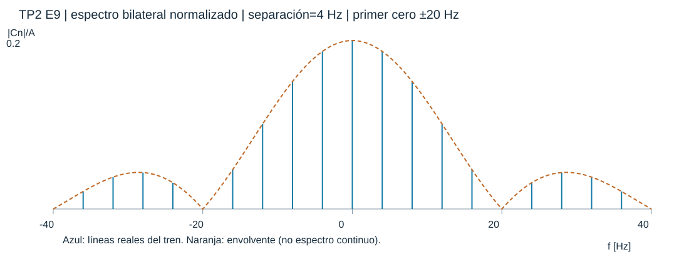
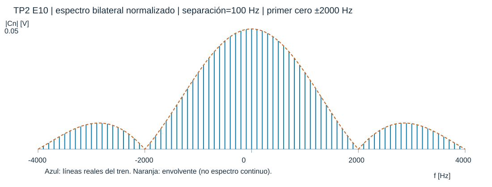
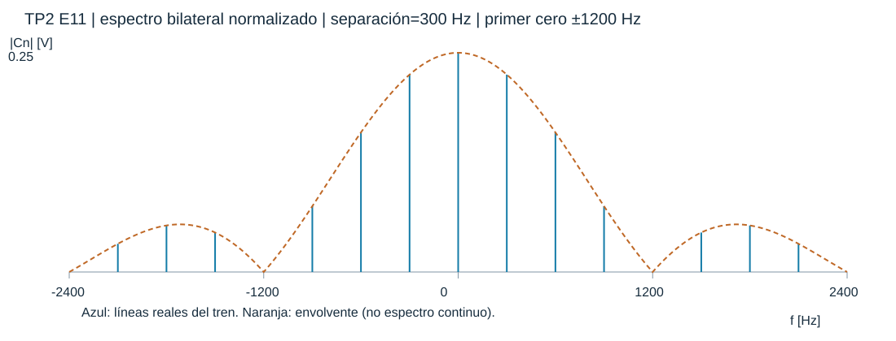
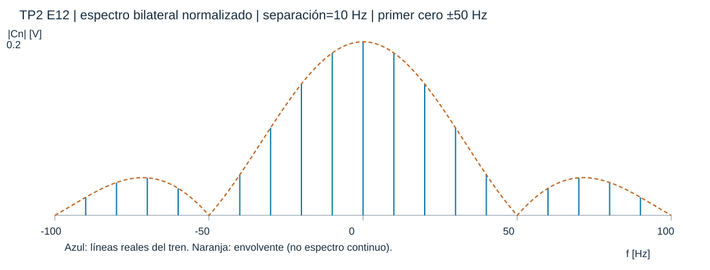
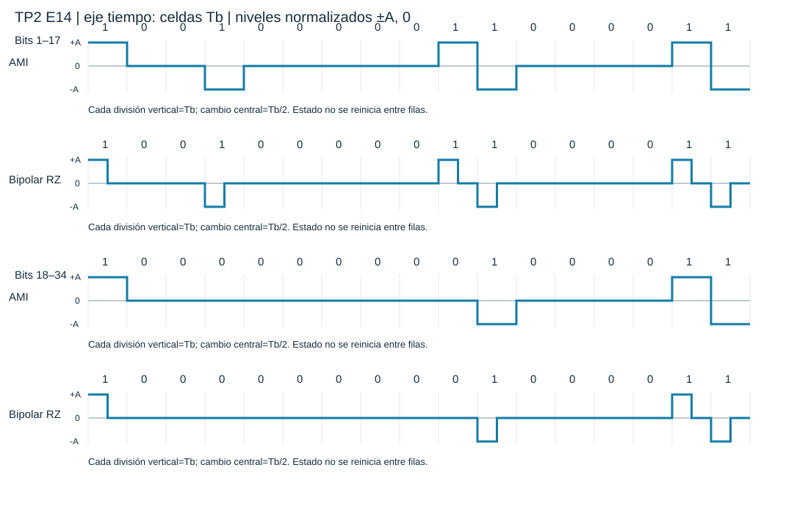
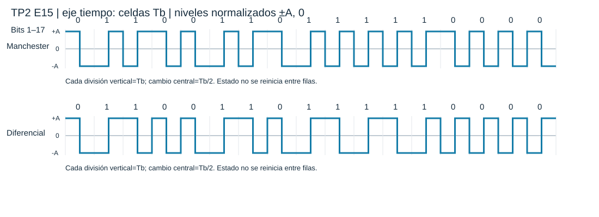
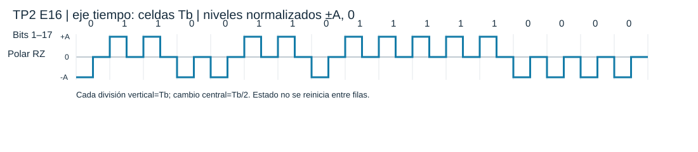

# TP 02 — Señales, Fourier y códigos de línea

**Enunciado:** [TP2 original](../../material/practica/U%202/TP%20%202%20%202026.pdf), PDFpp.2–3.
**Teoría:** [APUNTE U2](../teoria/02-senales-telecomunicaciones/APUNTE.md).
Se preservan los **16 ejercicios**, no sólo los resueltos en captura. Las resoluciones de abajo son
reconstrucciones razonadas, NO una clave oficial inventada. Se distingue qué respalda la hoja
[respuestas 1](../../material/practica/U%202/EXPRESIONES%20Y%20RTAS%20%20UD%202%201RA%20PARTE.pdf)
y [respuestas 2](../../material/practica/U%202/EXPRESIONES%20%20Y%20RTAS%20UD%202%202DA%20PARTE.pdf).

## Estrategia general y conceptos

1. Definir la magnitud física y sus unidades antes de calcular.
2. Señales: separar pico, repetición, media firmada y eficaz.
3. Fourier: fijar período y convención; aprovechar paridad; graficar líneas, no confundir envolvente.
4. AB: declarar criterio de primer cero. No usar Shannon/Nyquist para una pregunta de envolvente.
5. Códigos: marcar grilla de bits, estado inicial y transiciones; mantener longitud y recuperar datos.

## E1 — Graficar analógica y digital

**Enunciado (transcripción literal; TP 2, p. 2):**
> 1. Graficar una señal analógica y una señal digital, indicar sus principales características y el modo por el cual transportan la información.

**Datos / condiciones:** no hay datos numéricos; se pide representar una señal analógica y una digital, describir sus características e indicar cómo transporta información cada una.

**Resolución paso a paso:** mostrar primero qué valores puede tomar y después qué interpreta el receptor.

```text
Analógica (tensión)                 Digital binaria ideal (tensión)
+A      /\      /\                 +A    ┌───┐       ┌───────┐
 0 ────/──\────/──\──── t           0 ────┘   └───────┘       └── t
−A         \/      \/                       1   0   0   1   1
```

En la analógica, variaciones continuas representan información (por ejemplo, forma de una señal de
voz); en digital una regla asigna formas a símbolos discretos. Ambas son fenómenos físicos. La señal
real tiene bordes finitos; el gráfico ideal no afirma frecuencia máxima finita. Si se agrega ruido,
el receptor digital decide entre símbolos, no entre infinitos niveles. Fuente: U2 pp.2–3/UT2 pp. 2–3.

## E2 — Cinco ventajas y principal desventaja

**Enunciado (transcripción literal; TP 2, p. 2):**
> 2. Indicar las cinco ventajas más notables de la transmisión digital frente a la analógica. ¿Cuál es la principal desventaja de la primera respecto de la segunda?

**Datos / condiciones:** no hay datos numéricos; se comparan la transmisión digital y la analógica, distinguiendo cinco ventajas y una desventaja principal.

**Desarrollo original registrado en la captura de práctica (orden y formulación conservados):** [captura de clase 02, TP2 E2](../../capturas/practica/clase%2002.md#tp-2-primera-parte)

Ventajas:
1. mayor alcance
2. mayor inmunidad al ruido
3. mayor banda ancha, se puede transmitir mas informacion en el mismo ancho de banda. -> calidad del enlace.
4. integracion de disintos servicios(voz, datos, video, etc) en un mismo canal de comunicacion, manteniendo el sincronismo.
5. mantenimiento menos costoso(dispositivos modulares y de facil reemplazo).

Desventaja anotada en la captura: el proceso constante de digitalizacion de la señal, lo que puede implicar en esta conversion, errores.

**Lista distinta de la hoja de respuestas U2, p. 1 (se conserva aparte, no fusionada con la captura):** [PDF de respuestas](../../material/practica/U%202/EXPRESIONES%20Y%20RTAS%20%20UD%202%201RA%20PARTE.pdf#page=1)
1. Alcance mayor.
2. Calidad del enlace.
3. Integración de distintos servicios (voz, datos, video), manteniendo el sincronismo.
4. Tecnología digital más sencilla que la analógica.
5. Mantenimiento de equipamiento menos costoso (dispositivos modulares).

La hoja presenta como desventaja la introducción de errores al convertir un canal analógico en digital. Es una lista con formulaciones distintas de las ventajas anotadas en clase; ambas quedan visibles como fuentes separadas.

**Aclaración pedagógica (no reemplaza ninguna de las dos fuentes):** la captura registra que se transmite «más información en el mismo ancho de banda». No se elimina esa respuesta: para sostenerla como afirmación técnica hay que precisar esquema de señalización, niveles y condiciones de ruido; no es una regla universal sin supuestos. Ver el tratamiento de [ancho de banda en U2](../teoria/02-senales-telecomunicaciones/APUNTE.md#ancho-banda).

## E3 — Repetidor regenerativo

**Enunciado (transcripción literal; TP 2, p. 2):**
> 3. Que funciones cumple un repetidor regenerativo?

**Datos / condiciones:** no hay datos numéricos; se pide explicar las funciones de un repetidor regenerativo.

**Formulación original registrada en la captura de práctica (se conserva identificable):** [captura de clase 02, E3 y definición](../../capturas/practica/clase%2002.md#repetidor-regenerativo)

> corregir una señal DIGITAL que se degrada a medida que se transmite, eliminando el ruido y la distorsion que se produce en la transmision de la señal.
>
> necesita el umbral de deteccion.

**Aclaración pedagógica y resolución paso a paso (desarrollo actual, no reemplaza ni se atribuye a la captura):** seguir la cadena entrada degradada → decisión → pulso nuevo. El repetidor regenera amplitud/forma y restablece tiempos de una señal digital mediante decisión y recuperación de reloj; necesita superar un umbral de detección. «Eliminar el ruido y la distorsión» es una simplificación del efecto: el equipo decide y reconstruye símbolos, pero si decide un bit equivocado, entrega ese bit equivocado con forma regenerada. No confundirlo con un amplificador, que también amplifica perturbaciones. Fuentes para esta precisión: respuestas U2, p. 1; U2, p. 3; [libro, PDF 98/impresa 72](../../material/teoria/DOC-20230425-WA0040.pdf#page=98). Ver [señales](../teoria/02-senales-telecomunicaciones/APUNTE.md#senales).

## E4 — Parámetros de una sinusoide

**Enunciado (transcripción literal; TP 2, p. 2):**
> 4. Dada una función periódica definir ciclo, período, frecuencia, pulsación angular, longitud de onda, valor instantáneo,medio y eficaz. Considerar las función f(t) = A sen(ω . t + φ ).Si se tiene la función f(t) = V(t) = 300 sen( 100 π . t + π / 2 ) [V] . Hallar los valores de amplitud máxima, frecuencia, pulsación angular, fase inicial, valor medio y valor eficaz.

**Datos / condiciones:** función general $f(t)=A\,sen(\omega t+\varphi)$; función dada $f(t)=V(t)=300\,sen(100\pi t+\pi/2)$ V. No se da velocidad de propagación para calcular numéricamente la longitud de onda.
**Conceptos:** lectura por comparación con seno general y promedios sobre ciclo completo.

| Magnitud | Definición / resultado |
|---|---|
| Ciclo | una repetición completa |
| Período | tiempo de repetición: 20 ms |
| Frecuencia | ciclos/s: 50 Hz |
| Pulsación | ángulo por segundo: 100π≈314,159 rad/s |
| Longitud de onda | distancia recorrida en un período: λ=vprop/f; falta vprop para valor numérico |
| Valor instantáneo | tensión en cada t; al inicio v(0)=300 V |
| Amplitud | máximo absoluto: 300 V; pico a pico 600 V (dato derivado, no pedido) |
| Fase inicial | π/2 rad=90° |
| Medio firmado |0 V en un período completo |
| Eficaz |300/√2≈212,132 V |

**Pasos:** f=ω/(2π)=(100π)/(2π)=50 Hz; T=1/50 Hz=0,02 s. La fase no altera f.

$$
\overline v=\frac1T\int_0^T300\sin(100\pi t+\pi/2)dt=0\,V,
\qquad V_{\rm rms}=\sqrt{\frac1T\int_0^T v^2(t)dt}=\frac{300}{\sqrt2}\,V
$$

| Símbolo | Significado | Unidad |
|---|---|---|
| $v,\overline v,V_{\rm rms},A$ | instantáneo, media, eficaz, pico | V |
| $T,t,f,\omega,\varphi$ | período, tiempo, frecuencia, pulsación, fase | s; s; Hz; rad/s; rad |

**Supuestos:** sinusoide estacionaria sin continua, integración de ciclo entero; RMS corresponde a
calentamiento resistivo. Verificación: media 0 no obliga RMS 0; RMS<pico. No se usa 0,637 A (media de
semiperíodo positivo/rectificada del libro) como media firmada. No hay respuesta oficial específica
para E4 en las hojas usadas; resolución derivada de fórmulas originales contrastadas.

## E5 — Longitud de onda de FM 88–108 MHz

**Enunciado (transcripción literal; TP 2, p. 2):**
> 5. Calcular el rango de variación de la longitud de onda para las señales electromagnéticas portadoras de las emisoras de radio comerciales ubicadas en la banda de FM de 88 a 108 Mhz.

**Datos / condiciones:** frecuencia portadora entre 88 y 108 Mhz. La velocidad de propagación no está dada; el valor que se use se declara como supuesto de cálculo.
**Camino:** como $\lambda$ es inversamente proporcional a $f$, la frecuencia mayor produce la longitud de onda menor.

$$
\lambda=\frac c f;\quad
\lambda_{88}=\frac{3\cdot10^8\,m/s}{88\cdot10^6\,Hz}\approx3{,}40909\,m;\quad
\lambda_{108}\approx2{,}77778\,m
$$

| Símbolo | Significado | Unidad |
|---|---|---|
| $\lambda,c,f$ | longitud de onda, velocidad, frecuencia | m; m/s; Hz |

**Supuestos:** se usa $c\approx3\cdot10^8\,\text{m/s}$ como velocidad de propagación de la radiación electromagnética en aire/vacío; es una aproximación para esta cuenta, no un dato de la consigna ni una velocidad aplicable a cualquier conductor.
**R:**2,778 m≤λ≤3,409 m. Respuestas 1 p. 1 redondea 3,4 m y 2,77 m; 2,77 es truncamiento, a dos decimales
corresponde 2,78 m. Verificación: longitud menor a 108 MHz. Unidades m/s dividido 1/s dan m.

## E6 — Tren y parámetros

**Enunciado (transcripción literal; TP 2, p. 2):**
> 6. Graficar un tren de pulsos y definir: FRP, ancho de pulso, período y amplitud del pulso.

**Datos / condiciones:** no hay datos numéricos; se solicita un gráfico general y definir FRP, ancho del pulso, período y amplitud.
**Resolución paso a paso:** medir centros separados para $T$ y el ancho del pulso para $\tau$; no medir lo mismo dos veces.

```text
 A       ┌───┐                 ┌───┐
 0 ──────┘   └─────────────────┘   └──── t[s]
         ← τ →                 ← τ →
         ←──────── T ─────────→
```

A=tensión máxima[V]; τ=duración del pulso[s]; T=repetición[s]; FRP=1/T[pps]. Ejemplo registrado
E10: T=10 ms, τ=0,5 ms, A=1 V→FRP=100 pps. Respuestas 1 p. 1 remite a filminas: esta reconstrucción rotula
 explícitamente qué intervalo se mide. Fuente U2 p 24.

## E7 — Corriente continua equivalente

**Enunciado (transcripción literal; TP 2, p. 2):**
> 7. Si por una línea de comunicaciones de longitud L y resistencia total R circula una corriente periódica i(t), y como resultado de la misma se disipa una potencia P, hallar la expresión de la corriente continua equivalente que al circular por la resistencia R disipe la misma potencia P que la generada por la corriente i(t)..

**Datos / condiciones:** se dan simbólicamente $L$, resistencia total $R$, corriente periódica $i(t)$ y potencia disipada $P$; no hay valores numéricos. Se busca la expresión de la corriente continua equivalente.
**Resolución paso a paso:** igualar calentamiento promedio, no corriente media firmada. $L$ no entra separadamente porque ya se dio $R$ total.

$$
P=\frac RT\int_0^T i^2(t)dt=RI_{cc}^2
\quad\Rightarrow\quad
I_{cc}=\sqrt{\frac1T\int_0^T i^2(t)dt}=\sqrt{P/R}
$$

| Símbolo | Significado | Unidad |
|---|---|---|
| $P,R$ | potencia activa media, resistencia total | W;Ω |
| $i(t),I_{cc}$ | corriente instantánea, continua equivalente | A |
| $T,t,L$ | período, tiempo, longitud | s; s; m |

**Supuestos:** resistencia constante y positiva, sin elementos reactivos ni dependencia térmica;
se busca magnitud no negativa. Fuente formal: libro PDF 104, definición eficaz; no respuesta oficial E7.
**Ejemplo hipotético calculado:** i(t)=2 sin(ωt)A sobre 10 Ω→Icc=√2≈1,414 A y P=20 W. Media de i=0 A pero
potencia no es 0: el cuadrado evita cancelación. W/Ω=A² y su raíz produce A.

## E8 — Fourier de cuadrada impar

**Enunciado (transcripción literal; TP 2, p. 2):**
> 8. Dada una señal rectangular periódica, en base a la serie de Fourier, calcular los coeficientes si la señal rectangular tiene los siguientes valores:
>
> f(t) = 1  0 < t < T/2
>
> f(t) = -1  -T/2 < t < 0

**Datos / condiciones:** señal periódica con niveles +1 y −1 en los intervalos indicados; el período se representa mediante $T$. La fuente no especifica unidad física para la amplitud.
**Resolución paso a paso:** usar la paridad para anular media/cosenos, integrar senos y separar órdenes pares/impares.

$$
a_0=0,\qquad a_n=0,\qquad
b_n=\frac4T\int_0^{T/2}\sin(n\omega_0t)dt
=\frac{2}{n\pi}\bigl[1-\cos(n\pi)\bigr]
$$

| Símbolo | Significado | Unidad |
|---|---|---|
| $a_0,a_n,b_n,f$ | coeficientes y señal de amplitud 1 | unidad de señal |
| $T,t,\omega_0=2\pi/T$ | período, tiempo, pulsación | s; s; rad/s |
| $n$ | índice positivo | sin unidad |

**Supuestos:** señal ideal periódica con Dirichlet; intervalo simétrico. f impar, cos par→producto
impar e integral 0. f·seno es par→duplicar integral positiva, no afirmar que todos bn≠0.
Si n par, cos(nπ)=1→bn=0; n impar→bn=4/(nπ).

$$
f(t)=\frac4\pi\left[\sin\omega_0t+\frac13\sin3\omega_0t+\frac15\sin5\omega_0t+\cdots\right]
$$

Ejemplo numérico de coeficientes: b1≈1,27324; b3≈0,424413; b5≈0,254648; pares 0, en unidad de señal.
La fundamental puede superar el pico 1: otras componentes compensan; no es contradicción.
**Verificación:** media 0, espectro sólo órdenes impares, amplitudes decrecientes. En discontinuidades
converge al promedio 0, no a ambos lados a la vez. Fuente: respuestas 2 p 1 y libro PDF 107–108/impresas 81–82.

## E9–E12 — Tren rectangular y espectro

**E9 — Enunciado literal (TP 2, p. 2):**
> 9. Hallar el espectro de amplitud de la Serie Compleja de Fourier teniendo en cuenta que la FRP es de 4 pps (pulsos por segundo) y la velocidad de modulación es de 20 Baudios. Calcular el ancho de banda que deberia tener el canal de comunicaciones.

**Datos / condiciones E9:** FRP = 4 pps; velocidad de modulación = 20 Baudios. No se da amplitud del pulso.

**E10 — Enunciado literal (TP 2, p. 2):**
> 10. Dado los siguientes datos, FRP = 100 pps (pulsos por segundos), velocidad de modulación = 2000 Baudios y la amplitud del pulso (A = 1 V). Se solicita realizar el gráfico de amplitud del espectro de Fourier. Calcular el ancho de banda, cantidad de armónicas y el valor máximo de Cn.

**Datos / condiciones E10:** FRP = 100 pps; velocidad de modulación = 2000 Baudios; A = 1 V.

**E11 — Enunciado literal (TP 2, p. 3):**
> 11. Dado los siguientes datos, FRP = 300 pps (pulsos por segundos), velocidad de modulación = 1200 baudios y la amplitud del pulso (A = 1 V). Se solicita realizar el gráfico de amplitud del espectro de Fourier. Calcular el ancho de banda, cantidad de armónicas y el valor máximo de Cn.

**Datos / condiciones E11:** FRP = 300 pps; velocidad de modulación = 1200 baudios; A = 1 V.

**E12 — Enunciado literal (TP 2, p. 3):**
> 12. Dado un tren de pulsos de FRP = 10 pps (pulsos por segundos), velocidad de modulación igual a 50 baudios y amplitud del pulso (A = 1 V). Se solicita realizar el gráfico de amplitud del espectro de Fourier. Calcular el ancho de banda necesario para transmitir dicha señal, cantidad de armónicas y el valor máximo de Cn.

**Datos / condiciones E12:** FRP = 10 pps; velocidad de modulación = 50 baudios; A = 1 V.

**Resolución paso a paso común (convención explícita, no dato adicional):** $T=1/FRP$, $\tau=1/V_m$, ciclo $D=\tau/T$; luego se obtienen los coeficientes normalizados, primer cero $B=1/\tau$ e índice $n_0=T/\tau$. No se asigna amplitud 1 V al E9 porque no fue dada.

$$
C_n=A\frac\tau T\frac{\sin(n\pi\tau/T)}{n\pi\tau/T},\quad
C_0=A\tau/T,\quad f_n=n/T,\quad B_{\rm cero}=1/\tau,\quad n_0=T/\tau
$$

| Símbolo | Significado | Unidad |
|---|---|---|
| $C_n,C_0,A$ | coeficiente, continua y pico | V si dato dado en V; E9 relativo a A |
| $T,\tau$ | período, ancho pulso | s |
| $D,n,n_0$ | ciclo trabajo, orden, índice del cero | sin unidad |
| $f_n,B$ | frecuencia armónica, banda unilateral primer cero | Hz |
| $FRP,V_m$ | repetición, modulación | pps; baudios |

**Supuestos:** pulso rectangular unipolar centrado, τ<T, tren periódico; n=0 por límite sinc 1. Es
espectro **bilateral normalizado**. Cn no es amplitud unilateral real (ésta es 2|Cn| si n>0).

| Ejercicio | T | τ | D | Primer cero /B | n0 | Armónicas positivas no nulas antes | máximo $\lvert C_n\rvert$, incluye 0 |
|---|---:|---:|---:|---:|---:|---:|---:|
|E9|0,25 s|0,05 s|0,2|20 Hz|5|4|0,2 A|
|E10|0,01 s|0,0005 s|0,05|2000 Hz|20|19|0,05 V|
|E11|1/300 s≈3,333 ms|1/1200 s≈0,833333 ms|0,25|1200 Hz|4|3|0,25 V|
|E12|0,1 s|0,02 s|0,2|50 Hz|5|4|0,2 V|

**Desarrollos con unidades:**
- E9: T=(4 pps)⁻¹=0,25 s; τ=(20 baudios)⁻¹=0,05 s; B=(0,05 s)⁻¹=20 Hz; n0=0,25/0,05=5.
  Cn/A=0,2 sinc(0,2n); C1/A≈0,187098, C2/A≈0,151365, C3/A≈0,100910, C4/A≈0,046774, C5=0.
- E10: T=(100 pps)⁻¹=0,01 s; τ=(2000 baudios)⁻¹=0,0005 s; B=2000 Hz; n0=20. C0=1 V·0,05=0,05 V;
  C1≈0,049795 V, C10≈0,031831 V, C19≈0,002621 V, C20=0.
- E11: τ/T=(1/1200)/(1/300)=1/4 exacto; n0=4; B=4·300 Hz=1200 Hz. C0=0,25 V;
  C1≈0,225079 V, C2≈0,159155 V, C3≈0,075026 V, C4=0.
- E12: τ/T=0,02 s/0,1 s=0,2; n0=5; B=5·10 Hz=50 Hz. C0=0,2 V; C1≈0,187098 V,
  C2≈0,151365 V, C3≈0,100910 V, C4≈0,046774 V, C5=0.

### Gráficos de amplitud — resultados calculados

Líneas bilaterales de $\lvert C_n\rvert$, ambas frecuencias; curva sólo envolvente. Se incluyen lóbulos posteriores:
no se afirma desaparición de espectro tras el primer cero.






**Discrepancias documentadas:** respuestas 2 p 3 usa “FRP=1/τ” en E9 pero calcula T=1/4: la correcta es 1/T.
Cn=Aτ/T es **máximo en 0**, no todo coeficiente. El conteo docente 5/20/4/5 es el índice que cae en
el cero, no número de armónicas no nulas antes. E9: “0,2 A” significa 0,2 **por amplitud A**, no 0,2 amperes;
no hay unidad dada. E11 usa redondeos tempranos de T/τ: aquí se conservan fracciones. E12 no tiene solución
 completa en hoja: sólo “resolución alumno ídem anterior”; desarrollo aquí es propio, no oficial.
**Razonabilidad:** $\tau<T$, $0<D<1$, $C_0\le A$; $B\tau=1$; separación FRP; coeficiente nulo en $n_0$. Continua no cuenta como armónica.

## E13 — Banda base frente a modulación

**Enunciado (transcripción literal; TP 2, p. 3):**
> 13. Indicar las principales características de la transmisión en banda base, en qué circunstancias se emplea una transmisión de éste tipo? ¿Que otro tipo de transmisión existe, que características presenta ?

**Datos / condiciones:** no hay datos numéricos; se pide describir la transmisión en banda base, cuándo se emplea y qué otro tipo de transmisión existe y qué características presenta.

**Resolución conceptual:** distinguir codificar pulsos de trasladarlos a una portadora. La banda base mantiene la señal sin modulación de portadora y puede usar códigos de línea; la alternativa es transmisión modulada, que cambia parámetros de una portadora. Las respuestas y fuentes complementarias aportan ejemplos, no una regla universal. Fuente U2 p. 30/Banda Base pp. 2 y 6.

**Ejemplos y alcance conservados del desarrollo anterior:** la respuesta 1, p. 1, ejemplifica una LAN con medios propios, equipos de bajo costo y un «módem banda base» que codifica, no modula. No toda LAN ni todo medio privado usa obligatoriamente una única técnica: el ejemplo no se eleva a exclusividad. La alternativa es transmisión modulada, desarrollada en U4.

**Misiones registradas de los códigos:** disminuir continua, garantizar sincronismo y detectar
presencia de señal en la línea (UT2 señales p.15; Práctica 2, apartado «misión»; Banda Base p.16).
En unipolar NRZ, una racha `0000` puede mantener el mismo nivel cero que el reposo sin emisión supuesto:
la tensión sola no basta para decidir que el medio está libre. Manchester conserva actividad y
transiciones en esos ceros; polar NRZ puede mostrar actividad por un nivel no nulo sin aportar reloj
en la racha. Detectar presencia no equivale a decodificar bits ni a interpretar cualquier instante
de cero voltios como ausencia. Ver [ejemplo y supuestos](../teoria/02-senales-telecomunicaciones/APUNTE.md#presencia-senal).

## E14 — AMI y bipolar RZ para la secuencia completa

**Enunciado (transcripción literal; TP 2, p. 3):**
> 14. Para la secuencia siguiente, graficar las señales resultantes de aplicar los códigos AMI, y Bipolar RZ. Indicar los requerimientos de AB en cada caso.
>
> Secuencia binaria: 1 0 0 1 0 0 0 0 0 1 1 0 0 0 0 1 1 1 0 0 0 0 0 0 0 0 0 1 0 0 0 0 1 1

**Datos / condiciones:** se pide aplicar dos códigos a la secuencia indicada y comparar los requerimientos de AB. No se dan amplitud $A$ ni duración de bit $T_b$, así que no corresponde inventar resultados dimensionales en V o Hz.

**Supuestos de representación para resolver (no son datos del enunciado):** niveles normalizados ±A y 0; primer 1 positivo; alternancia AMI continua. Para Bipolar RZ, cada marca vuelve a cero tras media celda.

**Resolución paso a paso:** avanzar bit a bit: 0→0; 1→signo opuesto a última marca. En RZ conserva el signo de marca,
pero la segunda mitad queda 0. Las hojas oficiales remiten al conjunto de esquemas, no aportan una
resolución completa numérica de esta secuencia: aquí se calcula.



Cada celda de tabla tiene dos medias celdas; `++` es +A toda Tb, `+0` es +A primera Tb/2 y 0 segunda.

| Bits1–17 | 1 |0|0|1|0|0|0|0|0|1|1|0|0|0|0|1|1|
|---|---|---|---|---|---|---|---|---|---|---|---|---|---|---|---|---|---|
| AMI |++|00|00|−−|00|00|00|00|00|++|−−|00|00|00|00|++|−−|
| Bipolar RZ |+0|00|00|−0|00|00|00|00|00|+0|−0|00|00|00|00|+0|−0|

| Bits18–34 |1|0|0|0|0|0|0|0|0|0|1|0|0|0|0|1|1|
|---|---|---|---|---|---|---|---|---|---|---|---|---|---|---|---|---|---|
| AMI |++|00|00|00|00|00|00|00|00|00|−−|00|00|00|00|++|−−|
| Bipolar RZ |+0|00|00|00|00|00|00|00|00|00|−0|00|00|00|00|+0|−0|

**AB:** con igual Tb, bipolar RZ: τ=Tb/2 acorta pulso frente AMI NRZ: τ=Tb y ensancha envolvente. Si sólo
se compara primer cero de **pulso rectangular individual**, NRZ: $f_{0,\mathrm{pulso}}$=1/Tb y RZ=2/Tb. Esos ceros
no son una fórmula universal de ancho ocupado del **código completo**, que depende de secuencia,
estadística y criterio. Por eso se responde comparativamente “RZ requiere más banda”, sin Hz inventado.
**Razonabilidad:**34 celdas, 10 marcas con signos alternados; Las rachas de ceros no producen reloj automático.
No se aplica HDB3 al E14: no se pidió ese código.

## E15 — Manchester (convenciones explícitas)

**Enunciado (transcripción literal; TP 2, p. 3):**
> 15. Dada la siguiente secuencia de bits, graficar las señales resultantes utilizando los códigos Manchester. Indicar sus principales características.
>
> Secuencia binaria: 0 1 1 0 0 1 1 0 1 1 1 1 1 0 0 0 0

**Datos / condiciones:** secuencia de 17 bits indicada; no se especifican amplitud ni duración del bit. Se pide codificar en Manchester y describir las características.

**Extensión didáctica (no integra el enunciado oficial ni es una resolución previa de E15):** se agrega Manchester diferencial como variante opcional a partir de la [clasificación de códigos de línea en la captura de clase 02](../../capturas/practica/clase%2002.md#clasificacion-de-codigos-de-linea). Convención de Manchester: 0=+−, 1=−+ (U2 p. 41). Para diferencial, la media celda previa es −A; 0 cambia al inicio, 1 no, y ambos cambian a mitad. El gráfico normaliza ±A y usa $T_b$.

**Resolución paso a paso:** aplicar la tabla por bit; para la variante diferencial, actualizar el estado tras cada media celda, sin reiniciarlo entre bits.



| Bit |0|1|1|0|0|1|1|0|1|1|1|1|1|0|0|0|0|
|---|---|---|---|---|---|---|---|---|---|---|---|---|---|---|---|---|---|
| Manchester |+−|−+|−+|+−|+−|−+|−+|+−|−+|−+|−+|−+|−+|+−|+−|+−|+−|
| Diferencial, previo − |+−|−+|+−|+−|+−|−+|+−|+−|−+|+−|−+|+−|−+|−+|−+|−+|−+|

**Características:** transición central siempre→sincronismo; mitades opuestas iguales→media 0 por bit;
pulsos más cortos que NRZ→mayor exigencia espectral. Diferencial codifica dato por transición de inicio,
no por signo absoluto. Ambos requieren convención y grilla. Invertir todo diferencial conserva bits.
No se afirma “AB diferencial menor/error menor” como ley: pendiente del cuadro sin supuestos.
**Chequeo:**17 bits, 34 medias celdas; cada par de signos es opuesto; inicio diferencial cambia sólo
para bits 0. Fuente U2 pp.41–42, esquemas UT2 p 1, respuestas 1 p 1 remite allí.

## E16 — Aplicar una codificación autosincronizante

**Enunciado (transcripción literal; TP 2, p. 3):**
> 16. Dada la secuencia anterior aplicarle una codificación autosincronizante.

**Datos / condiciones:** «la secuencia anterior» remite a los 17 bits transcritos en E15. No se especifican amplitud ni duración del bit, ni se elige un código concreto en el PDF.

**Contexto de la captura (fuera del enunciado PDF):** la captura Práctica 2 identifica **polar RZ**; se adopta esa elección y se atribuye a la captura.

**Resolución paso a paso:** 1→+A en la primera mitad y 0 en la segunda; 0→−A en la primera mitad y 0 en la segunda. Hay pulso y retorno aun en rachas de ceros o unos. A y $T_b$ no están dados: el gráfico se normaliza, sin dimensiones inventadas.



```text
Datos:   0  1  1  0  0  1  1  0  1  1  1  1  1  0  0  0  0
Polar RZ:−0 +0 +0 −0 −0 +0 +0 −0 +0 +0 +0 +0 +0 −0 −0 −0 −0
```

**Resultado razonado:** transición interior en **cada** celda permite reloj incluso con 0000.
Unipolar RZ y bipolar RZ no garantizan eso: sus ceros son 00. Polar RZ es autosincronizante pero acorta pulso,
por eso aumenta banda respecto de polar NRZ. Fuente U2 pp.32–34, cuadro p 1, Castro/Fusario 2013
[PDF 148/impresa 122](../../material/teoria/DOC-20230425-WA0040.pdf#page=148), §2.8.5.4, fig.2.43
(«Polar con retorno a cero», autosincronizante).
Balance estadístico no garantiza continua exactamente 0 por bit: a diferencia de Manchester, cada celda polar RZ
contiene área neta positiva o negativa. Para esta secuencia 9 unos/8 ceros, promedio del bloque= A/(34),
si se repite ese bloque. Autorreloj y continua son propiedades diferentes.

## Trampas, unidades y respuesta oral

- Período [s] no es frecuencia [Hz]. pps, baudios y bit/s describen fenómenos distintos.
- No usar 1/τ como AB universal; declarar primer cero rectangular y criterio unilateral.
- No contar continua como armónica, ni orden del cero como armónica no nula.
- No convertir área algebraica en energía; media firmada puede ser 0 y RMS no.
- Señal “digital” física no tiene saltos instantáneos perfectos.
- Para códigos hay que fijar signo inicial y convención; invirtiendo todos signos AMI sigue mismo dato.
- No deducir Hz si falta Tb ni voltios si falta A.

> Primero leo unidades y defino señal y criterio. Después separo tiempo y frecuencia: período
> posiciona líneas, ancho de pulso determina envolvente. Finalmente pruebo el código siguiendo su
> regla y verifico que pueda recuperar la secuencia original.

## QA y pendientes — 2026-10-11

- Enunciado visual pp.2–3 y respuestas 2 pp.1–4 contrastados; esquema UT2 codificación p 1 inspeccionado.
- Recalculados E4,5,7,8 y E9–12; verificadas secuencias completas y decodificación E14–16.
- SVG calculados propios con datos del TP, no dibujos oficiales ni nuevos ejercicios.
- Inspeccionados los siete gráficos mediante raster PDF/Poppler; niveles y grillas comprobados.
- Pendiente: validación independiente de las correcciones dirigidas; estado no
  revisado. Las comparaciones BER/PSD y B6ZS excluidas no se usan como afirmaciones evaluables.
- Fuentes auxiliares no usadas no cuentan como revisadas; sin build/instalaciones/commits.

### Correcciones y retest — 2026-10-13

E13 recupera la misión de presencia registrada sin identificar cero informativo con medio libre.
E16 corrige sólo la localización de su fuente: PDF148/impresa122, §2.8.5.4, fig.2.43, vista en el original.
Se repasan E1–3/E13 cualitativamente y se recalculan E4–12 y las secuencias completas E14–16.
El estado sigue `en-progreso`; este autocontrol no sustituye el dictamen de aceptación del ciclo.
