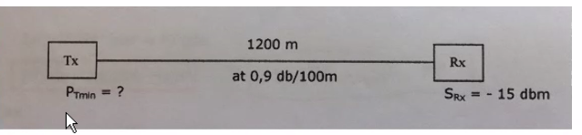
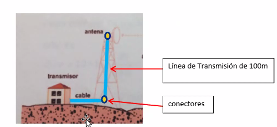
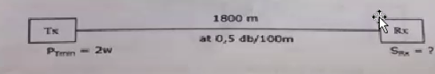
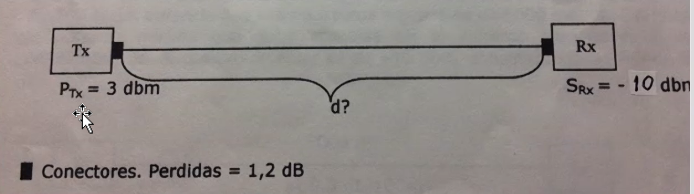
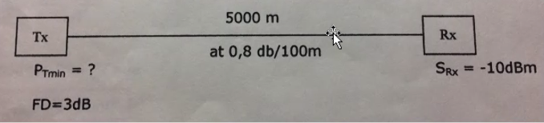
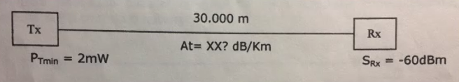
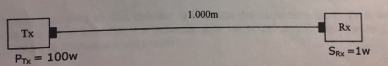
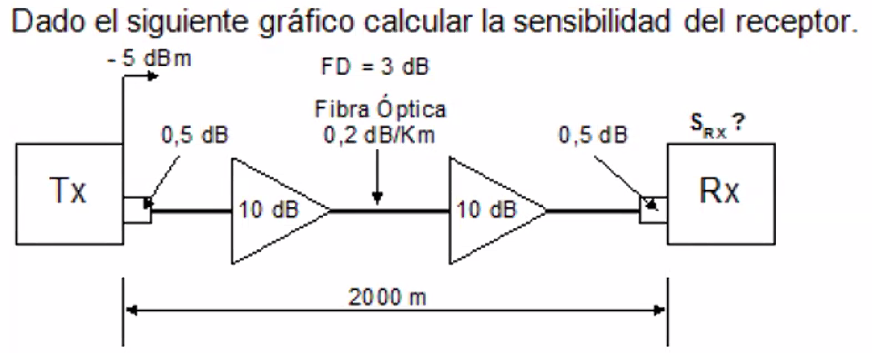

# TP 03 — Velocidades y enlaces

Desarrollo de E1–18 del enunciado registrado. E19 conserva su [resolución existente](tp-03-ejercicio-19-calculo-enlace.md), sin duplicarla ni extender su revisión a U7. Los valores de cables/fibra son **datos de estos ejercicios**, no especificaciones universales actuales de medios.

## Fuentes y método de lectura

| ID | Original y páginas PDF |
|---|---|
| G3 | [TP3 2026](../../material/practica/U%203/TP%20%20%203%20%20%202026.pdf): p. 2 E1–12, p. 3 E13–18, p. 4 E19 |
| R1 | [Respuestas primera parte](../../material/practica/U%203/EXPRESIONES%20%20Y%20RTAS%20UD%20NRO%203%20(1ra%20PARTE).pdf): p. 1 E1–3, p. 2 E4–7, p. 3 E7–11 |
| R2 | [Respuestas segunda parte](../../material/practica/U%203/EXPRESIONES%20%20Y%20RTAS%20UD%20NRO%203%20(2da%20PARTE).pdf): p. 1 E12, p. 2 E13–14, p. 3 E14–16, p. 4 E16–18, p. 5 E18 |
| FV | [UT3 Medida Velocidad](../../material/practica/U%203/UT%203%20MEDIDA%20VELOCIDAD.pdf), p. 2–17 |
| P4 | [Captura práctica 4](../../capturas/practica/clase%2004.md),01/09/2026, secciones ejercicios/E19 y ejemplos previos |

**Teoría:** [U3 velocidades/sincronismo](../teoria/03-redes-telecomunicaciones/APUNTE.md); [U6 fundamentos de dB, atenuación/ruido](../teoria/06-canales-comunicaciones/APUNTE.md). Las cuentas de enlace se resuelven completas acá: no hay que repartir los pasos entre unidades.

Primero identificá **qué se cuenta** y **qué fija el límite**. E1–11 usan tiempos/rendimiento; E12–18 balance de potencia. Un logaritmo no decide por vos si el dato es útil, total o una potencia de referencia.

## Herramientas comunes: símbolos, unidades y supuestos

### Velocidades y rendimiento (E1–11)

$$
V_t=V_m\log_2n,\quad \tau=1/V_m,\quad
\eta=\frac{N_{datos}}{N_{total}},\quad
T=\frac{N_{total}}{V_t}=\frac{N_{datos}}{\eta V_t}.
$$

| Símbolo | Significado | Unidad |
|---|---|---|
| $V_m $ | Tasa de símbolos | baudios |
| $n $ | Estados de señal | conteo |
| $V_t $ | Tasa binaria bruta | bit/s |
| $\tau $ | Intervalo elemental de símbolo | s/símbolo |
| $N_{datos},N_{total}$ | Bits útiles y total transmitido | bit |
| $\eta $ | Eficiencia fraccional | adimensional; ×100 para % |
| $T$ | Tiempo | s |

**Supuestos:** $n=2^N$, mapeo fijo sin redundancia extra; transmisión binaria cuando se igualan números de baudios/bit/s; sin pausas ni retransmisiones salvo indicación. Si se compara rendimiento en bytes, todos los campos deben estar en bytes. Un carácter no equivale automáticamente a 8 bits: se declara el supuesto de cada ejercicio.

**Ejemplo de comprobación E5:** 1500 bytes de datos/1518 bytes totales=0,988142. **Ejemplo de tiempo E1:** 8000 bits/1200 bit/s=6,66667 s. No redondear la duración del bit antes de multiplicar miles de veces.

### Balance de potencia (E12–18 y ejemplos)

La señal debe llegar al menos a la sensibilidad $S_R$; con margen $FD$, debe llegar $FD$ dB por encima. Las pérdidas físicas no incluyen el margen: el margen es una reserva de diseño.

$$
L_c=\alpha d,\qquad
P_R=P_T+G-L_c-L_{con}-L_{emp},\qquad P_R\geq S_R+FD.
$$

$$
P_T+G-L_c-L_{con}-L_{emp}-FD\geq S_R,
\qquad P_{dBm}=10\log_{10}\!\left(\frac{P}{1\,mW}\right),
\qquad P=1\,mW\,10^{P_{dBm}/10}.
$$

| Símbolo | Significado | Unidad |
|---|---|---|
| $\alpha $ | Pérdida por longitud, a frecuencia de operación | dB/km o dB/m según dato |
| $d $ | Longitud en unidad compatible con $\alpha $ | km o m |
| $L_c,L_{con},L_{emp}$ | Pérdidas cable, conectores, empalmes | dB |
| $G$ | Ganancia total | dB |
| $FD$ | Margen requerido | dB |
| $P_T,P_R,S_R$ | Niveles transmisión, recepción, sensibilidad | dBm |
| $P$ | Potencia física de la conversión | mW |
| $P_{dBm}$ | Nivel absoluto referido a 1 mW | dBm |

**Supuestos:** atenuación uniforme a la frecuencia dada; suma logarítmica de ganancias/pérdidas de potencia; sin saturación ni otras pérdidas no declaradas. Los ejercicios sólo establecen condición de potencia, no garantía completa de calidad, ruido/BER ni viabilidad de un amplificador real.

**Ejemplo E12:** 0,9 dB/100 m×1200 m=10,8 dB; transmisor mínimo−15+10,8=−4,2 dBm=0,380189 mW. Para el producto, se convierte 0,9 dB/100 m a 0,009 dB/m; no dividir por 100 m dos veces.

**Error original:** R2 p. 1 y algunas imágenes P4 imprimen «dBm±dB=dB». El resultado sigue en **dBm**; diferencia de dos niveles dBm sí produce dB. Los originales no se modifican.

## E1 — 1000 caracteres a 1200 baudios

**Enunciado (transcripción literal — G3, p. 2):** «Si se utiliza un MODEM que transmite a 1200 baudios cuanto tardaría en transmitir los 1000 caracteres.»

**Datos:** 1200 baudios; 1000 caracteres. **No especificado en el enunciado:** bits por carácter, cantidad de estados ni bits de control. El solucionario R1 adopta 8 bits/caracter, $n=2$ y ningún framing adicional; esos son supuestos de resolución, no datos originales.

**Evidencia:** G3 p. 2; R1 p. 1; P4 E1.

**Resolución paso a paso.** **Paso 1 — modelo de R1:** contar los bits con sus supuestos y dividir por la tasa binaria, no por baudios sin justificar.

$$
N_{datos}=1000\,caracteres\times8\,bit/caracter=8000\,bit,
\quad V_t=1200\,bit/s,
\quad T=8000/1200=6,6666667\,s.
$$

Símbolos y unidades: tabla común de velocidades; 1000 es conteo de caracteres y 8 bit/caracter es convención R1. **R:** 6,667 s con esos supuestos. R1 dice 6,66 s por truncación; no cambia el método.

**Control/trampa:** más control aumentaría el tiempo y más bits por símbolo lo reducirían. No presentar 6,667 s como dato deducido únicamente de 1200 baudios.

## E2 — Cuándo coinciden baudios y bit/s

**Enunciado (transcripción literal — G3, p. 2):** «Indicar bajo que condiciones la velocidad de modulación es igual a la velocidad de transmisión.»

**Condiciones:** es una pregunta conceptual sobre la relación entre tasa de símbolos y tasa de bits; no hay datos numéricos en el enunciado.

**Evidencia:** G3 p. 2; R1 p. 1.

**Resolución paso a paso.** **Paso 1:** analizar bits por símbolo en la relación de la tabla común; la igualdad numérica requiere un bit por símbolo.

Para $V_t=V_m $ en el mapeo binario fijo, el factor debe ser 1 bit/símbolo: **dos estados, $n=2$**. Ejemplo hipotético: 1200 símbolos/s×1 bit/símbolo=1200 bit/s. **Trampa:** igualdad numérica de tasas no vuelve idénticas las unidades ni incluye throughput útil después de control.

## E3 — 1500 caracteres asincrónicos, seudo-Baudot

**Enunciado (transcripción literal — G3, p. 2):** «Calcular el tiempo total de transmisión de 1500 caracteres enviados uno a continuación de otro en un sistema de transmisión asincrónica de 75 Baudios. El código utilizado es el Seudo Baudot, los caracteres son ASCII de 8 bits con un bit de paridad.»

**Datos:** 1500 caracteres consecutivos; 75 baudios; sistema asincrónico; código Seudo Baudot; ASCII de 8 bits y un bit de paridad. **Supuestos agregados por R1, no especificados en la consigna:** 1 bit de arranque y 1,5 tiempos de parada; transmisión binaria. El nombre seudo-Baudot se interpreta con la configuración dada; **no reemplazar por el Baudot de 5 bits**.

**Evidencia:** G3 p. 2; R1 p. 1; P4 E3.

**Resolución paso a paso.** **Paso 1:** sumar los tiempos de bit que R1 asigna a cada carácter; **paso 2:** multiplicar por la cantidad de caracteres y dividir por la velocidad de símbolos.

$$
b_{car}=1+8+1+1,5=11,5\,tiempos\ de\ bit,
\quad N_{total}=1500\times11,5=17250\,bit\ equivalentes,
\quad T=17250/75=230\,s.
$$

$b_{car}$ es duración equivalente por carácter; demás símbolos tabla común. **R:** 230 s. **Control:** sólo datos ocuparían 160 s; los 70 s extra corresponden a delimitación/paridad. **Trampa:** 1,5 parada es tiempo, no media unidad de información; sin la convención de parada faltaba un dato.

## E4 — De 1200 baudios a 4800 bit/s

**Enunciado (transcripción literal — G3, p. 2):** «Para un sistema que transmite a 1200 Baudios se quiere aumentar la velocidad a 4800 bps. Indicar cómo se logra y cuál es el ancho de pulso resultante.»

**Datos:** $V_m=1200$ baudios; tasa requerida $V_t=4800$ bps. Se pide el método y el ancho de pulso.

**Evidencia:** G3 p. 2; R1 p. 2; P4 E4.

**Resolución paso a paso.** **Paso 1:** hallar los bits por símbolo y estados necesarios; **paso 2:** obtener el ancho temporal a partir de la tasa de modulación. Más bits por símbolo, no acortar el intervalo.

$$
N=4800/1200=4\,bit/simbolo,\quad n=2^4=16\,estados,
\quad \tau=1/1200=0,000833333\,s=833,333\,\mu s.
$$

$N$ bits/símbolo;$ n,V_m,V_t,\tau $ tabla común. **R:** transmisión multinivel de 16 estados/cuatribits,833,333 µs. **Control:** 16 estados×no es la tasa; logaritmo 16=4. **Trampa:** mantener baudios no elimina necesidad de distinguir niveles con ruido; no se garantiza cualquier canal.

## E5 — Bloque sincrónico de 1500 bytes

**Enunciado (transcripción literal — G3, p. 2):** «Calcular el rendimiento de una transmisión sincrónica cuando se envían bloques de datos de 1500 bytes y se utilizan 14 bytes de cabecera y 4 bytes de terminación.»

**Datos:** 1500 bytes de datos; 14 bytes de cabecera; 4 bytes de terminación. Se pide el rendimiento.

**Evidencia:** G3 p. 2; R1 p. 2; P4 E5.

**Resolución paso a paso.** **Paso 1:** dividir los datos útiles por el total transmitido, manteniendo una misma unidad arriba y abajo.

$$
\eta=\frac{1500}{14+1500+4}=0,9881422925,
\quad \eta_{\%}=98,81422925\%.
$$

$\eta $ tabla común; las tres cantidades en byte. **R:** 98,8142%≈98,8% del solucionario. **Control:** 18/1518=1,18577% de control; sumado al útil da 100%. **Trampa:** dividir por 1500 o convertir sólo alguno de los campos a bits.

## E6 — Asincrónica con/sin paridad

**Enunciado (transcripción literal — G3, p. 2):** «Calcular el rendimiento de transmisión asincrónica que utiliza un código que tiene 1 bit de arranque, 1 de parada y 7 de datos. Efectuar el calculo con y sin bit de paridad.»

**Datos:** 1 bit de arranque; 1 bit de parada; 7 bits de datos. Se solicita comparar con y sin bit de paridad.

**Evidencia:** G3 p. 2; R1 p. 2; P4 E6.

**Resolución paso a paso.** **Paso 1:** mantener los bits útiles; **paso 2:** calcular el total de cada alternativa y dividir datos útiles por ese total.

$$
\eta_{sin}=7/(1+7+1)=7/9=77,7778\%,\qquad
\eta_{con}=7/(1+7+1+1)=7/10=70\%.
$$

Las fracciones son adimensionales; porcentajes incluyen×100, como tabla común. **R:** 77,7778% sin paridad; 70% con ella. **Control:** ambos menores que E5 porque cada carácter paga delimitación. **Trampa:** R1 sólo imprime la cuenta sin paridad; no omitir la segunda pedida.

## E7 — 1024 bytes, sincrónica frente a asincrónica

**Enunciado (transcripción literal — G3, p. 2):** «Dada una transmisión sincrónica de 1024 bytes , y si no consideramos la cabeza y la cola de dicha transmisión, determinar la disminución del rendimiento si se utiliza una transmisión asincrónica mediante un código que emplea 8 bits de datos, 1 de paridad, 2 de parada y 1 de arranque. Para ambos casos se emplea una velocidad de modulación de 2400 Baudios. Indicar también el tiempo total de transmisión en ambos casos.»

**Datos:** carga de 1024 bytes; transmisión sincrónica sin cabeza ni cola; en la asincrónica, 8 bits de datos, 1 de paridad, 2 de parada y 1 de arranque; 2400 baudios en ambos casos. **Supuestos de cálculo:** representación binaria, 8 bits por byte, sin pausas ni errores.

**Evidencia:** G3 p. 2; R1 pp. 2–3; P4 E7.

**Resolución paso a paso.** **Paso 1:** calcular el rendimiento útil de cada modo; **paso 2:** calcular el tiempo a partir de los bits totales transmitidos.

$$
\eta_s=1=100\%,\quad \eta_a=8/12=66,6667\%,
\quad T_s=1024\times8/2400=3,4133333\,s,
\quad T_a=1024\times12/2400=5,12\,s.
$$

Símbolos tabla común; 1024 caracteres de 8 datos cada uno; 12 tiempos/caracter en asincrónico. **R:** rendimiento baja 33,3333 puntos porcentuales, también 33,3333% relativo porque parte de 100%; tiempo sube 50%, no 33,33%. **Control:** 5,12/3,413333=1,5. R1 redondea 3,41 s. **Trampa:** confundir caída de eficiencia con incremento de duración.

## E8 — Por qué no aumentar indefinidamente baudios

**Enunciado (transcripción literal — G3, p. 2):** «Indicar las causas por las cuales no se puede aumentar, en determinados canales de comunicación, la velocidad de modulación.»

**Condiciones/contexto:** pregunta conceptual; no contiene valores numéricos. El límite depende del canal y de las condiciones físicas de señal y ruido.

**Evidencia:** G3 p. 2; R1 p. 3; P5 Q1; F3 p. 2–4.

**Resolución paso a paso.** **Paso 1:** describir la limitación física, no un resultado numérico. Acortar símbolos aumenta el ancho espectral requerido a igual forma de pulso. **Paso 2:** si el canal no lo reproduce, los pulsos se deforman y el receptor puede confundirlos. Abrir recepción a más banda también integra más ruido si su densidad espectral permanece fija. **No es ley absoluta «más baudios siempre más ruido»**: importa filtro, fuente de ruido y forma de señal.

**Ejemplo hipotético:** intervalo de 1 ms a 0,5 ms duplica 1000 a 2000 baudios y el primer cero rectangular de 1000 a 2000 Hz. Símbolos/unidades/supuesto del modelo en [U3 multinivel](../teoria/03-redes-telecomunicaciones/APUNTE.md#multinivel). **Trampa:** la posibilidad de multinivel no elimina S/N ni errores; cuantificación del ruido en U6.

## E9 — Access rate

**Enunciado (transcripción literal — G3, p. 2):** «Definir la velocidad “ACCESS RATE” en un canal de comunicaciones.»

**Condiciones/contexto:** pregunta de definición; no hay magnitudes numéricas dadas.

**Evidencia:** G3 p. 2; R1 p. 3.

**Resolución paso a paso.** **Paso 1 — respuesta de R1:** definirlo como «velocidad máxima» de transmisión del canal. **Paso 2 — precisión de alcance:** se usa aquí como **tasa de acceso máxima/nominal del enlace**, en bit/s, no como cantidad garantizada de datos útiles recibidos. **No identificarla automáticamente con capacidad Shannon**: la respuesta no especifica modelo físico/ruido.

**Ejemplo hipotético:** acceso nominal de 2400 bit/s con 70% de framing entrega 1680 bit/s útiles antes de considerar errores/pausas. Símbolos de tasa/eficiencia en tabla común. **Trampa:** tomar una tasa de acceso contratada/configurada como throughput real.

## E10 — Qué limita la tasa efectiva

**Enunciado (transcripción literal — G3, p. 2):** «Indicar los factores que condicionan o limitan la velocidad efectiva de transmisión de datos en una línea digital de comunicaciones.»

**Condiciones/contexto:** pregunta conceptual sobre una línea digital; no hay datos numéricos.

**Evidencia:** G3 p. 2; R1 p. 3.

**Resolución paso a paso.** **Paso 1:** separar limitación física de gasto en control. R1 enumera ancho de banda, baudios, S/N, BER, duración de pulso y modulación. **Paso 2:** banda/forma de pulso condicionan señalización; estados distinguibles dependen de modulación/codificación y ruido. Luego control, pausas y errores/retransmisiones reducen información útil sobre tiempo total.

**Control conceptual:** no tratar duración y baudios como variables independientes en el modelo uniforme. BER es tasa de bits erróneos, adimensional, no una velocidad en bit/s. **Trampa:** subir tasa bruta no garantiza más tasa efectiva si empeoran los errores. Desarrollo físico U6.

## E11 — Tiempo con rendimiento 90%

**Enunciado (transcripción literal — G3, p. 2):** «Calcular el tiempo total de transmisión de 1800 caracteres de datos enviados en un sistema de transmisión sincrónico de 3600 Baudios. El rendimiento de la transmisión es del 90%.»

**Datos:** 1800 caracteres; 3600 baudios; sistema sincrónico; rendimiento del 90%. **Supuestos agregados por R1:** 8 bits/caracter, señalización binaria y sin pausas ni errores adicionales.

**Evidencia:** G3 p. 2; R1 p. 3; P4 E11.

**Resolución paso a paso.** **Paso 1:** determinar los bits útiles y el total transmitido, que incluye overhead. **Paso 2:** dividir por la fracción de rendimiento; no sumar 10% al tiempo ideal.

$$
N_{datos}=1800\times8=14400\,bit,\quad
N_{total}=14400/0,9=16000\,bit,\quad
T=16000/3600=4,4444444\,s.
$$

Símbolos tabla común; 0,9 es fracción adimensional. **R:** 4,44444 s≈4,44 s. **Control:** datos/tiempo=3240 bit/s=90% de 3600 bit/s.

**Discrepancia demostrada con R1:** el solucionario R1 p. 3 calcula el tiempo ideal de 4 s, le agrega 0,4 s y da 4,4 s. Eso daría 90,9091% de rendimiento, no 90%. El incremento correcto es 0,44444 s; el método correcto divide por 0,9. No es sólo una diferencia de redondeo. **P4 E11 ya contiene el método correcto:** despeja el tiempo total como tiempo ideal dividido por rendimiento y calcula $4/0,9\approx4,44$ s; coincide con la resolución de este apunte, no con el error de R1.

## E12 — Transmisor mínimo para 1200 m

**Enunciado (transcripción literal — G3, p. 2):** «Dado un canal de transmisión de datos coaxil con una atenuación a la frecuencia de operación de 0,9 dB/100 metros y donde la sensibilidad del receptor es -15 dBm . Calcular la potencia mínima que deberá tener el transmisor si la longitud del coaxil es de 1200 metros.»

**Datos:** coaxil de 1200 m; atenuación de 0,9 dB/100 m a la frecuencia de operación; sensibilidad del receptor de −15 dBm. No se dan margen ni pérdidas de conectores/empalmes.

**Evidencia:** G3 p. 2; R2 p. 1; P4 E12.

**Resolución paso a paso.** **Paso 1:** calcular la pérdida por longitud; **paso 2:** sumar esa pérdida al umbral de sensibilidad.

$$
L_c=0,009\,dB/m\times1200\,m=10,8\,dB,
\quad P_{T,min}=-15+10,8=-4,2\,dBm,
\quad P_{T,min}=10^{-4,2/10}\,mW=0,3801894\,mW.
$$

Símbolos/unidades tabla de balance. **R:** −4,2 dBm (0,380189 mW). **Control:** −4,2−10,8=−15 dBm; potencia positiva aunque nivel negativo. **Trampa:** la imagen escribe resultado dB tras operar dBm; corregir unidad, no imagen.

## E13 — Potencia de salida con conectores/empalmes

**Enunciado (transcripción literal — G3, p. 3):** «Calcular la potencia de salida de una línea de transmisión de 100 metros donde la atenuación del cable coaxil es de 5 dB/100m y la potencia del transmisor que excita a la línea es de 0 dBm, se pierde en conectores y empalmes 2dB.»

**Datos:** 100 m de coaxil; atenuación de 5 dB/100 m; potencia del transmisor de 0 dBm; pérdida en conectores y empalmes de 2 dB. Se pide la potencia de salida de la línea.

**Evidencia:** G3 p. 3; R2 p. 2; P4 E13.

**Resolución paso a paso.** **Paso 1:** sumar las pérdidas del cable y de los conectores/empalmes; **paso 2:** restar la pérdida total de la potencia de entrada. No se inventa una sensibilidad mínima.

$$
L_c=5\,dB,\quad L_{total}=5+2=7\,dB,
\quad P_R=0-7=-7\,dBm,
\quad P_R=10^{-7/10}\,mW=0,1995262\,mW.
$$

$L_{total}$ suma de pérdidas en dB; resto tabla común. **R:** −7 dBm,0,199526 mW. **Control:** atenuar 7 dB divide potencia por 5,01187. **Trampa:** 0 dBm=1 mW, no cero watts; R2 trunca 0,199 mW.

## E14 — Sensibilidad para 1800 m

**Enunciado (transcripción literal — G3, p. 3):** «Que sensibilidad mínima (expresada en mW) deberá tener un receptor para un enlace a través de una línea de transmisión de 1800 metros, donde la atenuación del cable coaxil empleado es de 0,5 db/100m. La potencia del transmisor que excita la línea es de 2 watts.»

**Datos:** enlace de 1800 m; atenuación de 0,5 db/100 m; potencia del transmisor de 2 watts. Se pide la sensibilidad mínima del receptor expresada en mW. No se indican conectores, empalmes ni margen.

**Evidencia:** G3 p. 3; R2 pp. 2–3; P4 E14.

**Resolución paso a paso.** **Paso 1:** convertir la potencia transmitida a dBm sin redondear. **Paso 2:** calcular la pérdida de línea y restarla para hallar el umbral que debe admitir el receptor. **Paso 3:** convertir ese nivel a mW. Como comprobación, se puede dividir la potencia lineal por el factor de pérdida.

$$
L_c=0,005\,dB/m\times1800\,m=9\,dB,
\quad P_T=10\log_{10}2000=33,01029996\,dBm,
$$
$$
P_R=33,01029996-9=24,01029996\,dBm,
\quad P_R=2000\,mW/10^{9/10}=251,7850824\,mW.
$$

Símbolos tabla de balance; logaritmo de 2000 representa cociente 2000 mW/1 mW. **R:** el receptor debe tener umbral $S_R\leq251,785$ mW (nivel≤24,0103 dBm). Menor umbral en mW significa mayor sensibilidad, no peor receptor.

**Discrepancia:** R2 p. 3 da 24 dBm/251,18 mW por redondear 33,0103 a 33 antes de restar. El cálculo preciso da 251,785; si uno convierte 24 dBm redondeados, obtiene 251,1886 mW, otro número aproximado. Conservar precisión hasta el final evita cambiar el dato original 2 W.

## E15 — Distancia máxima de fibra con margen

**Enunciado (transcripción literal — G3, p. 3):**
> «Dado un enlace de fibra óptica entre un emisor y un receptor con los siguientes parámetros:
>
> Atenuación de la FO = 3 dB/km 
> Atenuación del conector = 0,6 dB 
> Potencia de transmisión = 3 dBm 
> Sensibilidad del receptor = - 10 dBm 
>
> Calcular la distancia máxima entre receptor y transmisor suponiendo un factor de diseño FD = 10 dB (margen de diseño), empleándose un conector en el transmisor y otro en el receptor. Repetir el cálculo para una FO cuya atenuación es de 0,2 dB/km.»

**Datos:** atenuación FO de 3 dB/km y 0,2 dB/km (dos casos); pérdida por conector de 0,6 dB; potencia de transmisión de 3 dBm; sensibilidad del receptor de −10 dBm; factor de diseño de 10 dB; un conector en cada extremo.

**Evidencia:** G3 p. 3; R2 p. 3; P4 E15.

**Resolución paso a paso.** **Paso 1:** descontar primero la reserva de diseño y las pérdidas de los conectores del presupuesto; **paso 2:** dividir la pérdida restante por la atenuación de cada fibra.

$$
L_{con}=2\times0,6=1,2\,dB,
\quad L_{c,max}=3-(-10)-10-1,2=1,8\,dB,
$$
$$
d_{max}=L_{c,max}/\alpha:
\quad 1,8/(3\,dB/km)=0,6\,km=600\,m,
\quad 1,8/(0,2\,dB/km)=9\,km=9000\,m.
$$

$d_{max}$ longitud máxima en km;$L_{c,max}$ pérdida admisible en dB; resto tabla común. **R:** 600 m y 9000 m. **Control:** en ambos llega 3−1,8−1,2=0 dBm,10 dB por encima de−10 dBm. **Trampa:** el margen no es pérdida física; si se omite, se sobredimensiona distancia. Los coeficientes son datos del ejercicio, no todos los tipos de fibra.

## E16 — Potencia mínima para 5000 m

**Enunciado (transcripción literal — G3, p. 3):** «Dos dispositivos de transmisión de datos se encuentran vinculados por un enlace de comunicaciones construido por cable coaxil de atenuación igual a 0,8 dB/100 m. La distancia que separa a estos equipos es de 5000 metros. Calcular la potencia mínima que debe aplicarse en el extremo transmisor, si la sensibilidad del dispositivo receptor es de –10 dbm, considerando un FD de 3 dB.»

**Datos:** coaxil con atenuación de 0,8 dB/100 m; distancia de 5000 m; sensibilidad del receptor de −10 dbm; factor de diseño de 3 dB. Se pide la potencia mínima del transmisor.

**Evidencia:** G3 p. 3; R2 pp. 3–4; P4 E16.

**Resolución paso a paso.** **Paso 1:** calcular la pérdida de la línea. **Paso 2:** sumar esa pérdida y el margen al umbral del receptor para obtener la potencia mínima.

$$
L_c=0,008\,dB/m\times5000\,m=40\,dB,
\quad P_{T,min}=-10+40+3=33\,dBm,
\quad P_{T,min}=10^{3,3}\,mW=1995,262315\,mW=1,995262\,W.
$$

Símbolos tabla común. **R:** 33 dBm≈1,99526 W. **Control:** llega−7 dBm,3 dB sobre−10. R2 aproxima 1995 mW. **Trampa:** leer 0,8 dB/100 m como 0,8 dB/m; no inventar conectores ausentes.

## E17 — Atenuación máxima para 30 km

**Enunciado (transcripción literal — G3, p. 3):** «Se requiere montar un enlace de fibra óptica uniendo dos equipos separados 30000 metros uno de otro. La potencia del transmisor es de 2 mW y la sensibilidad del receptor es de – 60 dBm. Cual será la especificación de atenuación máxima a requerir de la fibra que se debe emplear, expresada en dB/Km.»

**Datos:** distancia de 30000 m; potencia del transmisor de 2 mW; sensibilidad del receptor de −60 dBm. Se pide la atenuación máxima de la fibra en dB/Km. No se dan margen ni pérdidas de conectores.

**Evidencia:** G3 p. 3; R2 p. 4; P4 E17.

**Resolución paso a paso.** **Paso 1:** pasar la potencia del transmisor a dBm y calcular el presupuesto total de pérdida. **Paso 2:** dividirlo por la longitud para obtener la atenuación admisible por kilómetro.

$$
P_T=10\log_{10}2=3,01029996\,dBm,
\quad L_{c,max}=3,01029996-(-60)=63,01029996\,dB,
$$
$$
\alpha_{max}=63,01029996\,dB/30\,km=2,100343332\,dB/km.
$$

$\alpha_{max}$ pérdida admisible por km; resto tabla común. **R:** especificar atenuación **no mayor que 2,10034 dB/km**; 2,1 dB/km de R2 es redondeo conservador. **Control:** a 2,1 dB/km, pérdida 63 dB y recepción−59,9897 dBm, apenas encima del umbral. **Trampa:** máximo coeficiente no es potencia; enlace sin margen no es diseño robusto real.

## E18 — ¿Hace falta amplificador?

**Enunciado (transcripción literal — G3, p. 3):** «Si se tiene un enlace de 1000 m entre un transmisor que entrega una potencia de 100w y un receptor con una sensibilidad de 1w y se pretende utilizar las siguientes líneas de transmisión, indicar cuándo se deberá utilizar amplificadores. Considerar en ambos casos dos conectores de 0,5 dB c/u. a. Usando coaxil fino RG 58 con At = 5 dB/100 m b. Usando coaxil grueso RG 218 con At = 0,8 dB/100 m. En caso necesario calcular la ganancia del amplificador correspondiente.»

**Datos:** longitud de 1000 m; transmisor de 100w; sensibilidad de receptor de 1w; dos conectores de 0,5 dB cada uno. Caso a: coaxil fino RG 58, $At=5$ dB/100 m. Caso b: coaxil grueso RG 218, $At=0,8$ dB/100 m. Se pide decidir si hacen falta amplificadores y calcular su ganancia cuando corresponda.

**Evidencia:** G3 p. 3; R2 pp. 4–5; P4 E18.

**Resolución paso a paso.** **Paso 1:** convertir ambas potencias a niveles de la misma referencia. **Paso 2:** calcular las pérdidas totales en cada alternativa y cubrir solamente el déficit, no toda la pérdida. No se agrega margen extra porque no está en la consigna.

$$
P_T=50\,dBm,\quad S_R=30\,dBm,
\quad L_{adm}=50-30=20\,dB,\quad L_{con}=1\,dB.
$$

$L_{adm}$ pérdida admisible en dB; demás tabla común. Potencias se convirtieron usando 100 W=100000 mW y 1 W=1000 mW.

**a) RG58:** pérdida cable 50 dB, total 51 dB. Recepción sin amplificar 50−51=−1 dBm=0,794328 mW; menor que 1000 mW. Déficit 30−(−1)=**31 dB**. Con ganancia 31 dB llega exactamente 30 dBm.

**b) RG218:** pérdida cable 8 dB, total 9 dB. Recepción 50−9=**41 dBm**=12589,254 mW=12,5893 W, por encima de 1 W. **No requiere amplificador**; margen de potencia 11 dB.

**Control:** ganancia necesaria no es 51 dB: el transmisor ya ofrecía 20 dB de presupuesto. El margen 11 dB no es un amplificador «con ganancia negativa». **Límite:** no se pide ubicación, sensibilidad o saturación del amplificador; no afirmar implementabilidad real de 31 dB sólo con balance. R2 p. 5 contiene letras a/b/c para desarrollo; se conserva a/b del enunciado para no inventar un tercer caso.

## E19 — Resolución existente, sin duplicación

**Navegación:** la [resolución detallada de E19](tp-03-ejercicio-19-calculo-enlace.md) conserva el enunciado literal, la trazabilidad directa al [TP3 oficial, p. 4](../../material/practica/U%203/TP%20%20%203%20%20%202026.pdf) y a la guía ampliada de cálculo de enlace. No se duplica acá su desarrollo. Este enlace **no certifica toda U7 ni una nueva revisión numérica de E19**.

## Ejemplos registrados antes del TP en práctica 4

Se mantienen con sus rótulos A–D como **ejemplos registrados en clase, no consignas numeradas del TP3**; no se desarrolla catálogo de medios U7 ni hardware U8. Fundamentos teóricos dB/ruido/balance en U6; criterio de banda a−3 dB en U2. **Fuentes:** P4 secciones previas a E1; FV p. 9–17. Sus diagramas fueron contrastados visualmente.

### A. Balance con dos amplificadores

**Datos:** −5 dBm de transmisor, ganancias 10 dB y 10 dB, dos conectores 0,5 dB, fibra 2 km a 0,2 dB/km, margen 3 dB. **Método:** seguir orden de componentes; potencia real recibida se calcula sin descontar margen físico.

$$
L_c=0,2\,dB/km\times2\,km=0,4\,dB,
\quad P_R=-5-0,5+10-0,4+10-0,5=13,6\,dBm,
\quad S_R\leq13,6-3=10,6\,dBm.
$$

Símbolos tabla de balance. **R:** recepción 13,6 dBm; sensibilidad del equipo no mayor que 10,6 dBm para cumplir reserva 3 dB. **Control:** 13,6−10,6=3 dB. **Trampa:** no escribir que margen «consume» potencia de la señal; se pide qué umbral máximo es tolerable, no sensibilidad medida del equipo.

### B. Amplificación como relación de potencias

$$
G=10\log_{10}(P_{sal}/P_{ent}),\qquad g=10^{G/10}.
$$

| Símbolo | Significado | Unidad |
|---|---|---|
| $P_{sal},P_{ent}$ | Potencias positiva salida/entrada, misma unidad | W o mW |
| $G$ | Ganancia logarítmica de potencia | dB |
| $g $ | Cociente de potencias | adimensional |

**Supuesto:** relación de potencia, no tensión; 10 log y no 20 log. **Casos FV p. 13/P4:** 10→20 W y 40→80 W dan **3,01030 dB** cada uno.10→40 W da **6,02060 dB**. Los 3 y 6 dB de la lámina son aproximaciones. El amplificador de 43 dB de FV p. 15/P4 tiene factor $g=10^{4,3}=19952,62315$ veces, ≈19953, como el ejemplo registrado. Se usa sólo la ganancia del ejemplo, no se certifica ficha completa del aparato.

**Control/trampa:** igual cociente implica igual ganancia aunque difieran watts absolutos; 43 dB no son 43 veces. La tabla original de valores 3,6,10,20,30,40 dB y negativos es una guía de factores; 3 dB≈doble, −3 dB≈mitad, no igualdad exacta.

### C. Cablemódem: dBmV a mV

**Fuente:** FV p. 16; P4 «nivel de transmisión y recepción». Son niveles de **tensión**, no dBm de potencia.

$$
L_V=20\log_{10}\!\left(\frac{V}{1\,mV}\right),\qquad V=1\,mV\,10^{L_V/20}.
$$

| Símbolo | Significado | Unidad |
|---|---|---|
| $L_V$ | Nivel de tensión referido a 1 mV | dBmV |
| $V$ | Tensión en misma convención de medida | mV |

**Supuestos:** referencia 1 mV y tensión definida consistentemente; no convertir a potencia sin impedancia. **Ejemplos registrados:** 42,9 dBmV→**139,636836 mV**≈139,64 mV; 2,3 dBmV→**1,30316678 mV**≈1,30 mV. **Control/trampa:** factor 20 en tensión; no usar 10 ni asumir dBmV=dBm.

### D. Tabla de atenuación y divisor: datos de ejemplo, no catálogo general

**Fuente:** FV p. 17; P4 «Atenuaciones en medios de comunicaciones», cable 75 Ω de la figura. La frecuencia condiciona el coeficiente. Se preservan sus valores para practicar unidades, no como estándar de todo coaxial.

| Frecuencia [MHz] | Máximo [dB/100 ft] | Máximo [dB/100 m] |
|---: |---: |---: |
| 5 | 0,58 | 1,90 |
| 55 | 1,60 | 5,25 |
| 83 | 1,95 | 6,40 |
| 187 | 2,85 | 9,35 |
| 211 | 3,05 | 10,00 |
| 250 | 3,30 | 10,82 |
| 300 | 3,55 | 11,64 |
| 350 | 3,85 | 12,63 |
| 400 | 4,15 | 13,61 |
| 450 | 4,40 | 14,43 |
| 500 | 4,66 | 15,29 |
| 550 | 4,90 | 16,08 |
| 600 | 5,10 | 16,73 |
| 750 | 5,65 | 18,54 |
| 865 | 6,10 | 20,01 |
| 1000 | 6,55 | 21,49 |

**Método y ejemplo hipotético derivado:** a 55 MHz, para 200 m y coeficiente 5,25 dB/100 m, la pérdida es 10,5 dB. Símbolos/supuestos del producto longitud×coeficiente: tabla de balance. Conversión de columnas: 100 ft=30,48 m; factor 100/30,48=3,28083990. Por ejemplo 1,60×factor=5,24934 dB/100 m→5,25. La captura conserva redondeos de tabla (p.ej.10,00 frente al cálculo 10,00656 desde 3,05); no se mezclan precisiones como si fueran errores de física.

Un **divisor ideal de dos salidas iguales** entrega mitad de potencia por salida:

$$
P_{sal}=P_{ent}/2,\qquad G_{sal}=10\log_{10}(1/2)=-3,01030\,dB.
$$

| Símbolo | Significado | Unidad |
|---|---|---|
| $P_{sal},P_{ent}$ | Potencias salida/entrada | W, misma unidad |
| $G_{sal}$ | Ganancia firmada de una rama | dB |

**Supuesto/ejemplo:** divisor ideal, igual reparto, sin pérdidas adicionales; 2 mW de entrada→1 mW por salida. Atenuación expresada como pérdida positiva=3,01030 dB; ganancia firmada=−3,01030 dB. **Trampa:** no confundir signo ni trasladar pérdida ideal al equipo real sin especificación.

## Discrepancias, supuestos y pendientes visibles

| Ítem | Evidencia y decisión |
|---|---|
| E1 | Enunciado incompleto para tiempo único; 8 bits y binario son supuestos R1 |
| E3 | Parada 1,5 tiempos viene de R1, no del dato explícito G3 |
| E6 | R1 sólo muestra sin paridad; se completa ambos casos pedidos |
| E11 | R1 p. 3 suma 10% al tiempo; se corrige dividiendo por 0,9. P4 E11 ya divide $4/0,9\approx4,44$ s y coincide con el método correcto |
| E12 / imágenes | dBm±dB conserva dBm, no dB |
| E14 | Redondeo prematuro R2: preciso 251,785 mW frente 251,18 mW impreso |
| E18 | Ganancia requerida cubre déficit, no toda pérdida; viabilidad real/amplificador no evaluados |
| E19 | Sólo enlace a resolución existente; no se tocó ni revalidó |
| Tabla coeficientes | Valores de ejemplo con redondeos, no especificación general de medios |
| Paquete | Pendientes reviews independientes y enlaces/anclas finales de unidades en edición |

## QA ejecutado y razonabilidad

Contraste visual iniciado 2026-10-10; recálculos y enlaces comprobados 2026-10-11. Se leyeron caches antes de escribir, se observaron G3 p. 2–3 ampliadas, R1 p. 1–3 y R2 p. 1–5 (ampliadas R1 p. 3/R2 p. 3 para discrepancias). FV 17 páginas y figuras de P4 contrastadas visualmente. Todas las cuentas de E1–18 y ejemplos A–D se recalcularon con Python; resultados con precisión interna y redondeo sólo final. No se ejecutó build, instalación ni commit. Los símbolos básicos de cada desarrollo remiten a las tablas de esta misma práctica para no depender de pasos en otras unidades.

Los 17 recursos copiados tienen hashes iguales a originales en [manifiesto](../teoria/03-redes-telecomunicaciones/recursos/manifiesto.json). El [control local de autor](../teoria/03-redes-telecomunicaciones/recursos/qa-autor.json) registra 31 aserciones numéricas, 17 hashes de copias iguales y 90 enlaces: 8 referencias de U4/U6 aún sin archivo al control; las demás rutas/anclas comprobadas resuelven. Se prueban balances inversos y ejemplos con unidades; la integración transversal comprueba anclas de otras unidades al concluir sus autores. Estado **en-progreso**, no certificado revisado por esta revisión de autor.

## Para examen y trampas globales

> «Primero cuento información y control o construyo el presupuesto de potencia. Baudios necesitan bits por símbolo para pasar a bit/s; rendimiento modifica el total transmitido. En enlace, ganancias/pérdidas están en dB y niveles en dBm; el margen es reserva. Conservo precisión hasta el resultado y pruebo el balance al revés».

- [ ] No doy tiempo único de E1 sin declarar supuestos.
- [ ] No omito arranque/parada/paridad ni control de bloques.
- [ ] No confundo porcentaje relativo, puntos porcentuales y cambio de tiempo.
- [ ] No sumo 10% al tiempo por rendimiento 90%.
- [ ] No aplico logaritmo a W sin convertir referencia de dBm.
- [ ] No cuento conectores inventados ni olvido los dados.
- [ ] No descuento margen como pérdida física real.
- [ ] No redondeo 33,0103 a 33 antes del balance E14.
- [ ] No convierto datos de un ejercicio en regla universal del medio.
