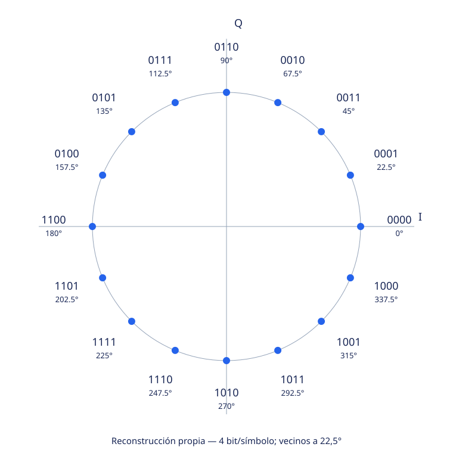

# TP 04 — Modulación y multiplexación

**Enunciados:** [TP4 oficial](../../material/practica/U%204/TP%204%20%202026.pdf), p.2 E1–8 y p.3 E9–10. **Solucionario:** [Respuestas oficiales](../../material/practica/U%204/EXPRESIONES%20%20Y%20RTAS%20UNIDAD%20%20TEMATICA%20NRO%204.pdf), p.1 E1–3, p.2 E3–5, p.3 E5–10, p.4 tabla E10.

**Procedencia:** [práctica 6,15/09/2026](../../capturas/practica/clase%2006.md), bloque TP4. Los enunciados siguientes se transcriben literalmente del TP (sólo se normalizaron saltos de línea); cada resolución queda separada y atribuida. Se preservan las aclaraciones y discrepancias con las respuestas oficiales, sin hacerlas pasar por texto de la consigna. Ningún original se modificó. [Teoría U4](../teoria/04-modulacion-digitalizacion-multiplexacion/APUNTE.md).

## Herramientas comunes de cálculo

$$f_s=1/T_s,\quad b=\log_2L,\quad V_{PCM}=f_sb,\quad b_s=\log_2M,\quad V_t=V_mb_s,\quad \Delta\theta=360^\circ/M,\quad B_{FM}\approx2(\Delta f+f_a).$$

| Símbolo | Significado | Unidad |
|---|---|---|
| $f_s,T_s$ | Muestreo e intervalo | muestras/s; s |
| $L,b$ | Niveles y bits por muestra PCM | adimensional; bit/muestra |
| $V_{PCM}$ | Tasa PCM sin organización adicional | bit/s |
| $M,b_s$ | Estados y bits por símbolo | adimensional; bit/símbolo |
| $V_t,V_m$ | Tasa binaria y tasa de símbolos | bit/s; baudios |
| $\Delta\theta$ | Separación angular PSK regular | grados |
| $\Delta f,f_a,B_{FM}$ | Desviación, tono modulador y banda | Hz |

**Supuestos:** palabras/mapeos fijos, potencias de 2, sin redundancia ni overhead salvo indicación; PSK equiespaciada. Carson para tono FM y desviación conocida, banda significativa aproximada. Cada aplicación se calcula abajo. No se calcula capacidad Shannon: no hay datos de ruido para eso.

<a id="e1"></a>
## E1 — Salida de un modulador PCM

**Enunciado (transcripción literal — TP4, p. 2):** «Se tiene que transmitir una señal analógica que pasa a través de un filtro de 4000 Hz de ancho de banda. Dicha señal entra a un modulador PCM donde se toman muestras cada 125 microsegundos, codificándose cada muestra según un proceso de cuantificación de 128 niveles. Hallar la capacidad que debe tener el vínculo de salida del modulador. Cuál sería dicha capacidad si fueran 256 niveles cuánticos?»

**Datos:** filtro de 4000 Hz; intervalo de muestreo de 125 microsegundos; primer caso con 128 niveles cuánticos y segundo caso con 256 niveles. Se pide la tasa/capacidad requerida del vínculo de salida.

**Evidencia:** TP4 p. 2; respuesta oficial p. 1.

**Resolución paso a paso.** **Paso 1:** separar resolución temporal y de amplitud. Invertir el período de muestreo para obtener muestras/s. **Paso 2:** contar bits por nivel y multiplicar. Se interpreta el filtro como pasa-bajos hasta 4000 Hz; ese ancho solo no identificaría la frecuencia máxima de cualquier señal pasabanda.

**Desarrollo:** 125 μs=0,000125 s → 1/0,000125=8000 muestras/s. 128=2⁷ → 7 bits/muestra. 8000×7=56 000 bit/s=**56 kbit/s**. 256=2⁸ → 8 bits/muestra; 8000×8=64 000 bit/s=**64 kbit/s**.

**Razonabilidad:** sumar un bit por cada una de 8000 muestras añade 8000 bit/s. Muestra/s×bit/muestra=bit/s. La salida requiere al menos esa tasa antes de trama/control; no es una capacidad de canal derivada de S/N.

**Trampas:**125 μs no son 125 ms; 128 niveles no son 128 bits. Muestreo 8000 coincide con doble de 4000 Hz como límite ideal, no garantía práctica sin margen. El caso 128 niveles es el dato del ejercicio, no definición universal de ley μ G.711.

**Para examen:** obtengo muestras por segundo del período y bits por muestra del repertorio; el producto da el flujo PCM requerido.

<a id="e2"></a>
## E2 — Separación de estados 16-PSK

**Enunciado (transcripción literal — TP4, p. 2):** «Se dispone de un modem que trabaja con el tipo de modulación 16-PSK. Calcule el desfasaje entre estados que adopta la señal modulada.»

**Datos:** modulación 16-PSK ($M=16$ estados). Se pide el desfasaje entre estados.

**Evidencia:** TP4 p. 2; respuesta oficial p. 1.

**Resolución paso a paso.** **Paso 1:** repartir los 360° de la circunferencia en 16 estados regulares. $360/16=$ **22,5°**, equivalente a π/8 rad. **Paso 2 — control:** $16×22,5°=360°$; se cierra la circunferencia.

**Trampa:** no es el salto obligatorio de todo símbolo al siguiente; datos consecutivos pueden repetir fase o saltar varios vecinos. Se pide separación de estados, no frecuencia ni tasa.

<a id="e3"></a>
## E3 — Relación entre velocidades en 16-PSK

**Enunciado (transcripción literal — TP4, p. 2):** «Qué relación hay entre la velocidad de transmisión Vt y la velocidad de modulación Vm, con respecto al ejercicio anterior?»

**Condiciones/contexto:** se refiere al módem 16-PSK del ejercicio anterior; $M=16$. No se proporciona un valor de $V_m$.

**Evidencia:** TP4 p. 2; respuesta oficial pp. 1–2.

**Resolución paso a paso.** **Paso 1:** contar bits por estado: log₂16=4 bit/símbolo. **Paso 2:** multiplicar la tasa de símbolos por los bits/símbolo: **$V_t=V_m\cdot4$ bit/símbolo**. Dicho verbalmente, la tasa binaria numérica es cuatro veces la tasa de símbolos, expresadas cada una en sus unidades apropiadas.

**Ejemplo hipotético para completar la relación:**1000 baudios×4 bit/símbolo=4000 bit/s. No se inventa una velocidad del módem del enunciado. **Trampa:** escribir «4 baudios» como bits por símbolo o dar valor absoluto sin que el enunciado proporcione $V_m$.

<a id="e4"></a>
## E4 —8-PSK: señales, Gray y diagrama

**Enunciado (transcripción literal — TP4, p. 2):**

> Se tiene un modem cuyo tipo de modulación es 8-PSK. Indicar:
>
> • De la señal moduladora, portadora y modulada, cuáles son analógicas y cuáles digitales?
>
> • Proponer una asignación de fases a secuencias de bits y realizar el diagrama de fases.
>
> • Qué relación existe entre la velocidad de modulación y la velocidad de transmisión?

**Datos:** módem 8-PSK ($M=8$ estados). Se solicita clasificar las señales moduladora, portadora y modulada; proponer asignación de fases a secuencias de bits, dibujar el diagrama de fases y relacionar $V_m$ y $V_t$.

**Evidencia:** TP4 p. 2; respuesta oficial p. 2.

**Resolución paso a paso.** **Paso 1 — clasificación:** digital describe el mensaje; una sinusoidal pasabanda puede transportar símbolos discretos. **Resultado:** moduladora digital; portadora analógica; modulada analógica. No copiar la afirmación contraria de CP, desmentida por M1 p.5.

**Paso 2 — estados y fases:** $8=2^3$, tres bits por símbolo; $360/8=45°$. Construir Gray por reflexión y recorrerlo alrededor del círculo:

| Fase | Bits |
|---:|:---:|
|0° |000 |
|45° |001 |
|90° |011 |
|135° |010 |
|180° |110 |
|225° |111 |
|270° |101 |
|315° |100 |

```text
                   011 (90°)
                       |
       010 (135°)       |       001 (45°)
                 \     |     /
                  \    |    /
 110 (180°) ----------- O ----------- 000 (0°)
                  /    |    \
                 /     |     \
       111 (225°)       |       100 (315°)
                       |
                   101 (270°)
```

**Convención:** cada extremo representa un punto a igual distancia de O; ejes I/Q; antihorario positivo. Tabla/diagrama usan el mismo mapeo CP/P, que puede rotarse si receptor coincide. Resultado **$V_t=V_m\cdot3$ bit/símbolo**; ejemplo propio 2400 baudios → 7200 bit/s.

**Verificación:**8 palabras diferentes; vecinos cambian un bit, también 100 → 000 al cierre. **Trampa:** Gray reduce bits dañados por error al vecino, no cambia distancia física ni corrige errores.

<a id="e5"></a>
## E5 —9600 bit/s con 2400 baudios

**Enunciado (transcripción literal — TP4, p. 2):**

> Se quiere transmitir por un canal telefónico a 9600 bps y se cuenta con un modem de 2400 baudios que opera con transmisión multinivel y modulación PSK. Hallar:
>
> • Qué tipo de modulación PSK debe emplearse para transmitir a la velocidad de transmisión requerida.
>
> • El diagrama vectorial y la asignación de fases correspondiente.

**Datos:** canal telefónico; tasa requerida de 9600 bps; módem de 2400 baudios; transmisión multinivel y modulación PSK. Se pide el orden PSK, el diagrama vectorial y la asignación de fases.

**Evidencia:** TP4 p. 2; respuesta oficial pp. 2–3.

**Resolución paso a paso.** **Paso 1:** dividir tasa binaria por símbolos para obtener bits/símbolo y determinar estados necesarios. **Paso 2:** distribuir fases y asignar Gray. No usar Nyquist/Shannon porque no hay datos de banda/ruido para evaluar realizabilidad.

**Cuentas:** 9600/2400=4 bit/símbolo; 2⁴=16 estados → **16-PSK**. $360/16=22,5°$. $2400×4=9600$ bit/s: objetivo correcto antes de redundancia.

| Estado | Fase | Gray |
|---:|---:|:---:|
|0 |0° |0000 |
|1 |22,5° |0001 |
|2 |45° |0011 |
|3 |67,5° |0010 |
|4 |90° |0110 |
|5 |112,5° |0111 |
|6 |135° |0101 |
|7 |157,5° |0100 |
|8 |180° |1100 |
|9 |202,5° |1101 |
|10 |225° |1111 |
|11 |247,5° |1110 |
|12 |270° |1010 |
|13 |292,5° |1011 |
|14 |315° |1001 |
|15 |337,5° |1000 |



**Verificación:**16 puntos de igual radio; vecinos separados 22,5°; 16 etiquetas únicas; distancia de Hamming 1 en todos los vecinos, incluido último → primero. La lista se obtiene reflejando la de 3 bits, prefijando 0/1.

**Trampas:** 16 estados no son 16 bits; no asegurar 9600 bit/s útiles si luego se añade redundancia; no inferir que el canal soporta la calidad deseada sólo por cumplir esta cuenta. Respuestas p.3 dice opuestos difieren dos bits: se cumple para este Gray reflejado, pero la condición decisiva solicitada es vecinos a un bit.

<a id="e6"></a>
## E6 — Ancho de banda FM

**Enunciado (transcripción literal — TP4, p. 2):** «Una portadora de 100 Mhz se modula en frecuencia con una señal sinusoidal de 10 Khz (fm) de manera tal que la desviación máxima de frecuencia (Δf) es de 1 Mhz. Determinar el ancho de banda aproximado de la señal de FM en este caso.»

**Datos:** portadora de 100 Mhz; señal sinusoidal moduladora de 10 Khz ($f_m$); desviación máxima de frecuencia de 1 Mhz ($\Delta f$). Se pide el ancho de banda aproximado.

**Evidencia:** TP4 p. 2; respuesta oficial p. 3.

**Resolución paso a paso.** **Paso 1:** unificar unidades y calcular el índice para reconocer banda ancha. **Paso 2:** aplicar Carson con desviación y tono; NO sumar la portadora.

**Desarrollo:** 1 MHz=1000 kHz; índice 1000/10=100. Banda≈2(1000+10)=**2020 kHz=2,02 MHz**. Centrada en 100 MHz, la banda significativa aproximada es 98,99–101,01 MHz; este intervalo es elaboración propia.

**Razonabilidad:** índice muy alto, banda dominada por dos veces desviación; es 2020 k Hz, no 2020 MHz. La portadora ubica el espectro, no determina su anchura. Fórmula aproximada, no límite espectral estricto.

<a id="e7"></a>
## E7 — Tabla de familias y señales

**Enunciado (transcripción literal — TP4, p. 2):** «Confeccione un cuadro resumen de los tipos de modulación especificando para cada uno si la señal moduladora, portadora y modulada son analógicas o digitales.»

**Condiciones/contexto:** no se dan magnitudes ni una lista cerrada de tipos; la consigna solicita una síntesis por tipo de modulación. La respuesta oficial remite a filminas.

**Evidencia:** TP4 p. 2; respuesta oficial p. 3; M1 p. 5/P p. 7.

**Resolución paso a paso.** **Paso 1:** separar mensaje, soporte y resultado; no clasificar mirando sólo el nombre analógico/digital. El cuadro siguiente es una reconstrucción propia apoyada en las filminas, no un cuadro literal de la consigna ni una tabla transcripta del solucionario.

| Familia | Moduladora | Portadora | Modulada | Métodos |
|---|---|---|---|---|
| Continua analógica |Analógica |Analógica |Analógica |AM, FM, PM |
| Continua digital |Digital |Analógica |Analógica |ASK, FSK, PSK, DPSK, M-PSK, M-QAM |
| Pulsos analógica |Analógica |Tren de pulsos |Analógica |PAM, PDM, PPM |
| Pulsos digital |Digital codificada |Tren de pulsos |Digital |PCM, DPCM, DM, ADM |

**Ejemplos:** voz → AM; bits → PSK; amplitudes continuas muestreadas → PAM; valores PCM codificados → pulsos binarios. La voz puede estar al origen de PCM: la filmina clasifica la representación dentro del proceso digital, no niega la conversión analógica-digital. **Trampa:** PAM no es digital sólo por tener pulsos.

<a id="e8"></a>
## E8 — ¿Qué modulación se afecta menos por ruido?

**Enunciado (transcripción literal — TP4, p. 2):** «Qué tipos de modulación se ven menos afectados por el ruido y por qué?»

**Condiciones/contexto:** pregunta conceptual, sin datos numéricos. La respuesta oficial propone FM sin especificar un modelo de ruido; la explicación que sigue limita la comparación al ruido de amplitud.

**Evidencia:** TP4 p. 2; respuesta oficial p. 3.

**Resolución paso a paso.** **Paso 1:** identificar el parámetro perturbado y el parámetro que transporta la información. **Respuesta de cátedra:** frente a variaciones de amplitud, FM puede resistir mejor que AM porque la información depende de la frecuencia; limitar amplitud puede reducir esas variaciones. AM lleva el mensaje en su envolvente y esa perturbación lo afecta directamente.

**Límite:** no afirmar que FM es inmune ni mejor que todas las modulaciones en cualquier canal. Ruido de fase/frecuencia, S/N, potencia, banda y detector importan. Para PSK/QAM compará orden y energía en [U4](../teoria/04-modulacion-digitalizacion-multiplexacion/APUNTE.md#psk-qam), sin extrapolar esta respuesta a «FSK siempre tiene menor BER que PSK».

**Ejemplo conceptual propio:** una fluctuación sólo de amplitud cambia el dato AM; si un receptor FM la limita, mantiene idealmente la variación frecuencial. Si también desplaza fases/cruces, no queda eliminada por limitar amplitud.

<a id="e9"></a>
## E9 — Señal resultante de FDM/TDM

**Enunciado (transcripción literal — TP4, p. 3):** «Qué tipo de señales (analógicas o digitales) se obtienen después de un proceso de multiplexión FDM y TDM?»

**Condiciones/contexto:** pregunta conceptual; no hay magnitudes numéricas. La respuesta oficial distingue el agregado FDM y TDM digital en el esquema del TP. La técnica de multiplexación, por sí sola, no determina toda forma física posterior.

**Evidencia:** TP4 p. 3; respuesta oficial p. 3.

**Resolución paso a paso.** **Paso 1 — respuesta del esquema docente:** FDM → agregado pasabanda analógico; TDM digital → secuencia digital entramada. **Paso 2 — motivo:** FDM suma subcanales modulados en frecuencias diferentes; TDM alterna porciones digitales en ranuras.

**Ejemplo propio:** dos flujos binarios modulados en bandas distintas siguen produciendo un agregado FDM analógico; dos canales PCM alternados producen palabras digitales TDM. **Trampa:** clasificar por el origen de la información. Tampoco generalizar que TDM prohíbe cualquier multiplexación de pulsos analógicos: se contesta en el contexto digital del TP. Si después se modula la salida TDM, la forma física transmitida puede ser pasabanda.

<a id="e10"></a>
## E10 — Comparación FDM, TDM, STDM

**Enunciado (transcripción literal — TP4, p. 3):** «Confeccione un cuadro comparativo entre el multiplexor con sus variantes FDM, TDM y STDM.»

**Condiciones/contexto:** se pide comparar FDM, TDM y STDM; no se aportan parámetros numéricos ni una plantilla de cuadro.

**Evidencia:** TP4 p. 3; respuesta oficial p. 4; filminas pp. 17–19.

**Cuadro original de respuestas (p. 4; grafía conservada, saltos de línea reunidos por celda):**

| PARAMETRO | FDM | TDM | STDM |
|---|---|---|---|
| Modo de Transmisión de la Info | S | ------- | ------ |
| Envio de señales | Analogicas- Digitales | Digitales | Digitales |
| Señal resultante del proceso | Analogicas | Digitales | Digitales |
| Relación S/N | Se deteriora | No se deteriora | No se deteriora |
| Tecnología | analogica | digital | digital |
| Costos de Implementación | Mas bajo | Mas elevados | Mas elevados |
| Eficiencia del uso del Ancho de Banda | Menos eficiente- asigna bandas de guarda para separar cada subcanal | Mas eficiente -asigna el AB en intervalos de tiempo fijo a cada subcanal | Mas eficiente -asigna el AB en intervalos de tiempo variables a cada subcanal |

**Resolución paso a paso.** **Paso 1:** comparar recurso, asignación, identificación de destino, eficiencia y costo sin confundirlos con duplexidad. **Cuadro de síntesis propio:** organiza los aspectos del material; no es una transcripción literal del cuadro oficial.

| Aspecto | FDM | TDM síncrono | STDM |
|---|---|---|---|
| División | Frecuencia | Tiempo fijo | Tiempo por demanda |
| Entradas | Analógicas/digitales mediante modulación | Digitales; analógicas digitalizadas en este TP | Digitales intermitentes |
| Resultado del esquema | Analógico | Digital | Digital |
| Fuentes | Simultáneas en bandas distintas | Turnos recurrentes para todas | Turnos para activas |
| Separación | Filtros/guardas | Posición y sincronismo | Identificación y asignación dinámica |
| Desperdicio/costo de control | Guardas y bandas reservadas | Ranuras vacías y sincronismo | Identificación y colas |
| Ventaja apropiada | Señales concurrentes en bandas | Servicio periódico predecible | Tráfico intermitente |

**Ejemplo numérico hipotético común:** tres canales. FDM de 4 k Hz por canal y dos guardas de 0,5 k Hz requiere 13 k Hz. TDM de 8 bits por fuente reserva 24 bits por trama aunque B esté vacío. STDM con 2 bits de ID por bloque y A/C activos transporta 20 bits; con tres activos, 30 bits. No convertir 13 k Hz directamente en bit/s sin especificar modulación.

**Corrigenda del cuadro oficial p.4:**
- «FDM simplex»: la técnica no fija dirección. Pueden usarse bandas para ambos sentidos; la dirección depende del enlace, no del nombre FDM.
- «S/N no se deteriora en TDM/STDM»: es idealización del procesamiento digital, no inmunidad física. Puede haber errores; el cuantificador de una entrada analógica introduce error antes del MUX.
- «FDM más barato, TDM/STDM más caros»: comparación histórica del material, no cotización ni ley universal.
- «STDM siempre más eficiente»: depende de intermitencia/control; el pico de tres activas evidencia el costo.

**Para examen:** FDM separa bandas; TDM reserva posiciones; STDM asigna según demanda. La elección depende de continuidad, recursos y demoras tolerables, no de una ganancia gratis.

## Autocontrol y alcance

2026-10-11: enunciados contrastados con las tres páginas PDF, respuestas de cuatro páginas y filminas; diagramas propios Gray 8/16 y cuentas PCM/FM recalculados. Anclas, enlaces y valores comprobados con el script del autor. Estado en-progreso: espera revisión independiente, no «revisado». Pendientes de sensibilidad FM, BER y generalizaciones WDM no forman parte de las cuentas confirmadas.

**Errores de unidad:** baudios ≠ bit/s; Hz ≠ bit/s; MHz ≠ k Hz; μs ≠ ms. **Variantes del mismo método:** si cambia L, contá bits; si cambia M, contá estados; si cambia Vm, multiplicá por bits/símbolo; si cambia la desviación, recalculá banda sin sumar portadora.
