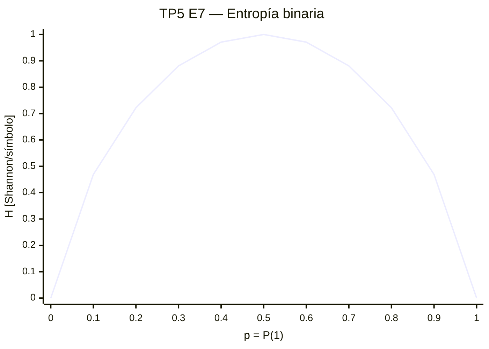

# TP5 — Información y codificación: catorce ejercicios

**Enunciados:** [TP5 oficial](../../material/practica/U%205/TP%20%205%20%202026.pdf), PDF p.2 para E1–E6 y p.3 para E7–E14, contrastadas visualmente. **Registro de resolución de clase:** [06/10/2026](../../capturas/practica/practica_un5.md), mismos catorce números. **Teoría:** [U5](../teoria/05-teoria-informacion-codificacion/APUNTE.md).

Es una **resolución razonada**, no una clave oficial. Se preservan los datos y se explicitan supuestos omitidos por la guía. No se corrige la captura original. Las ambigüedades de E2, E8, E10, E12 y E14 se resuelven condicionalmente, sin inventar criterio del docente.

Los enunciados siguientes se transcriben del PDF oficial con sus saltos de línea normalizados; las líneas de `capturas/practica/practica_un5.md` identifican el desarrollo de clase. En E2 y E9 la captura tiene pequeñas variantes de transcripción; se conserva el texto del PDF como fuente del enunciado.

<a id="metodo"></a>
## Conceptos, fórmulas y unidades comunes

Primero identificá qué cuenta la consigna: sorpresa puntual, información media, tasa temporal o longitud de representación. Después elegí la fórmula. Todas las expresiones de los ejercicios reutilizan las siguientes definiciones y unidades; las tablas de datos de cada ejercicio fijan sus valores.

| Fórmula | Símbolos y unidades | Supuestos y ejemplo mínimo |
|---|---|---|
| $I(x)=-\log_2 p(x)$ | $I$:Shannon; $p$:adimensional | Suceso discreto de probabilidad positiva; $p=1/8$ →3 Shannon |
| $H=-\sum p_i\log_2p_i$ | $H$:Shannon/símbolo; $p_i$:adimensional | Probabilidades suman 1; memoria nula para información media por emisión;0,5/0,5 →1 Shannon/símbolo |
| $I(x_1\ldots x_m)=\sum_j I(x_j)$ | $m$:conteo; $I$:Shannon | Símbolos independientes; dos resultados de probabilidad 1/8 →6 Shannon |
| $I_{ \rm eq}=m\log_2N$ | $m$:símbolos; $N$:alternativas; $I$:Shannon | Independencia y equiprobabilidad;4 de 32 →20 Shannon |
| $\Gamma=H/\overline\tau$, $\overline\tau=\sum p_i\tau_i$ | $\Gamma$:Shannon/s; $\tau_i,\overline\tau$:s/símbolo | Ritmo/duración conocidos, pausas declaradas; $H=1$, duración 0,001s →1000 Shannon/s |
| $t=L/v$ | $L$:bit; $v$:bit/s; $t$:s | Longitud física y tasa física compatibles;16000 bit a 33600 bit/s →0,47619s |
| $n=\lceil\log_2M\rceil$ | $M$:conteo de símbolos; $n$:bit/símbolo fijo | Código binario fijo inyectivo;90 símbolos →7 bit |
| $\eta_{ \rm inf}=H/n$, $R_{ \rm inf}=n-H$ | $H$:Shannon/símbolo; $n,R$:bit/símbolo; $\eta$:adimensional | Información en base 2, equivalencia informativa; $H=3$, $n=4$ →75% y 1 bit/símbolo |
| $R_{ \rm rel}=1-\eta_{ \rm inf}$ | Redundancia relativa:adimensional o% | Misma definición de eficiencia;75% →25% |
| $u=M/2^n$ | $u$:fracción de combinaciones ocupadas | No es eficiencia informativa;10 dígitos en 4 bit →62,5% |
| $M=\binom{n}{w}=n!/[w!(n-w)!]$ | $n,w$:posiciones; $M$:conteo | Palabras binarias de longitud$n$ y exactamente$w$ unos; elegir 5 de 10 →252 |

**Estrategia común:** normalizar probabilidades → declarar independencia cuando se suman símbolos → calcular sin redondear intermedios → incorporar tiempo sólo si se da → verificar unidad y límite teórico. En imágenes, equiprobabilidad de cada píxel NO demuestra independencia entre píxeles: para multiplicar se agrega esa hipótesis.

<a id="ejercicio-01"></a>
## 1. Cuatro caracteres de un alfabeto de 32

**Fuente del enunciado:** PDF oficial, p. 2. **Desarrollo de clase:** `capturas/practica/practica_un5.md`, líneas 20–61.

### Enunciado (transcripción literal)

> Calcular la cantidad de información asociada a una palabra de cuatro caracteres proveniente de una fuente equiprobable de símbolos. Considerar un alfabeto de 32 símbolos.

### Datos / condiciones

| Dato | Valor | Unidad |
|---|---:|---|
| Alfabeto $N$ |32|Símbolos diferentes|
| Longitud $m$ |4|Caracteres|
| Probabilidad por carácter |1/32|Adimensional|

### Resolución paso a paso

**Paso 1 — modelo:** contar alternativas por posición y sumar sorpresas. **Hipótesis:** independencia de posiciones; la guía da equiprobabilidad marginal, no prueba memoria nula.

**Paso 2 — cálculo:**

$$I(x)=\log_2 32=5\ \text{Shannon},\qquad I(\text{palabra})=4(5)=20\ \text{Shannon}$$

**Paso 3 — verificación y error típico:** hay$32^4=1048576$ palabras equiprobables, de probabilidad$1/1048576$; su logaritmo inverso es 20. **Trampa:** decir 20 bit/s sin dato temporal. El resultado es información de un mensaje, no tasa.

<a id="ejercicio-02"></a>
## 2. Secuencia 010101000001: estimación e información

**Fuente del enunciado:** PDF oficial, p. 2. **Desarrollo de clase:** `capturas/practica/practica_un5.md`, líneas 69–138.

### Enunciado (transcripción literal)

> Dado un tren de pulsos correspondientes a la siguiente secuencia: `010101000001`, calcular la información suministrada con la aparición de un uno o de un cero y la ENTROPÍA de la fuente.

### Datos / condiciones

| Dato contado | Valor | Unidad |
|---|---:|---|
| Muestra |12|Símbolos|
| Ceros |8|Ocurrencias|
| Unos |4|Ocurrencias|
| $\widehat p_0,\widehat p_1$ |2/3,1/3|Frecuencias relativas adimensionales|

### Resolución paso a paso

**Paso 1 — estimación y modelo:** estimar probabilidades con la muestra y aplicar información/entropía. **Hipótesis:** tratar las frecuencias como estimaciones de una fuente binaria de memoria nula. Una secuencia finita no prueba ese modelo ni identifica las verdaderas probabilidades.

**Paso 2 — cálculo de información y entropía:**

$$\widehat I(0)=\log_2(3/2)=0,584963\ \text{Shannon}$$
$$\widehat I(1)=\log_2 3=1,584963\ \text{Shannon}$$
$$\widehat H=\frac23(0,584963)+\frac13(1,584963)=0,918296\ \text{Shannon/símbolo}$$

**Paso 3 — verificación y límite:** queda entre 0 y 1, y el resultado más raro aporta más. Bajo ese modelo, la sorpresa de la secuencia es$8\widehat I(0)+4\widehat I(1)=11,019550$Shannon; no son 12 Shannon porque no es equiprobable. Si la secuencia fuera una salida determinista ya conocida, no describiría la misma fuente aleatoria: esa conclusión no se deduce de la guía.

**Corrección de captura:** aparece 0,918 Shannon/s en un paso; debe **Shannon/símbolo**. No hay tiempos dados. Se documenta acá sin editar el original.

<a id="ejercicio-03"></a>
## 3. Tres mensajes no equiprobables

**Fuente del enunciado:** PDF oficial, p. 2. **Desarrollo de clase:** `capturas/practica/practica_un5.md`, líneas 150–195.

### Enunciado (transcripción literal)

> Dados 3 mensajes con la siguiente probabilidad de ocurrencia:
> p1 = 20 %
> p2 = 50 %
> p3 = 30 %
>
> Calcular la cantidad de información suministrada por cada uno de ellos. Calcular la información promedio por mensaje de esta fuente.

### Datos / condiciones

| Mensaje | Probabilidad | Unidad |
|---|---:|---|
|1|20 %|Adimensional|
|2|50 %|Adimensional|
|3|30 %|Adimensional|

### Resolución paso a paso

**Paso 1 — camino:** convertir porcentajes, calcular sorpresas y ponderarlas; no usar media aritmética simple.

**Paso 2 — calcular sorpresa y aporte por mensaje:**

| Mensaje | $p_i$ [adimensional] | $I_i$ [Shannon] | $p_iI_i$ [aporte a Shannon/mensaje] |
|---|---:|---:|---:|
|1|0,2|2,321928|0,464386|
|2|0,5|1|0,5|
|3|0,3|1,736966|0,521090|

**Paso 3 — promedio ponderado:**

$$H=0,2\log_2 5+0,5\log_2 2+0,3\log_2(10/3)=1,485475\ \text{Shannon/mensaje}$$

**Paso 4 — supuesto, verificación y error típico:** esos tres son todos los resultados; suman 1. **Verificación:** el máximo para tres mensajes es 1,584963 Shannon/mensaje; el promedio calculado es menor. **Trampa:** confundir el mensaje más probable, de menor sorpresa, con el que más pesa por sí solo en todas las estadísticas.

<a id="ejercicio-04"></a>
## 4. 128 símbolos y palabra de seis

**Fuente del enunciado:** PDF oficial, p. 2. **Desarrollo de clase:** `capturas/practica/practica_un5.md`, líneas 206–256.

### Enunciado (transcripción literal)

> Se tiene un alfabeto de 128 símbolos diferentes y equiprobables. Se desea transmitir un mensaje. Calcular:
> a. La probabilidad de ocurrencia de un símbolo
> b. La cantidad de información obtenida con la recepción de dicho símbolo
> c. La cantidad de información de una palabra formada por 6 símbolos
> d. La ENTROPÍA de la fuente.

### Datos / condiciones

| Dato | Valor | Unidad |
|---|---:|---|
|Alfabeto, $N$|128|Símbolos diferentes|
|Longitud de palabra, $m$|6|Símbolos|
|Distribución|Equiprobable|Condición|

### Resolución paso a paso

**Paso 1 — camino:** equiprobabilidad → información puntual → suma bajo independencia → promedio.

**Paso 2 — resolver los incisos a–d:**

| Inciso | Desarrollo | Resultado y unidad |
|---|---|---|
|a|$p_i=1/128$|0,0078125 adimensional|
|b|$I_i=\log_2 128$|7 Shannon|
|c|$I(\text{palabra})=6\log_2 128$|42 Shannon|
|d|$H=128(1/128)\log_2 128$|7 Shannon/símbolo|

**Paso 3 — supuesto, verificación y error típico:** **Supuesto adicional del inciso c):** las seis posiciones son independientes; así se puede sumar la información de sus símbolos para obtener la de la palabra. **Verificación:** $128^6=2^{42}$ palabras equiprobables; 42 Shannon por palabra. **Trampa:** entropía 42 Shannon/símbolo; 42 corresponde a la palabra completa, 7 a cada emisión.

<a id="ejercicio-05"></a>
## 5. Mensaje CABLE

**Fuente del enunciado:** PDF oficial, p. 2. **Desarrollo de clase:** `capturas/practica/practica_un5.md`, líneas 272–313.

### Enunciado (transcripción literal)

> Suponiendo una fuente con los símbolos A B C E L donde cada uno tiene asociado la siguiente probabilidad:
> A = 1/4    B = 1/4    C = 1/8    E = 1/4    L = 1/8
>
> Calcular la información suministrada con el mensaje: CABLE

### Datos / condiciones

| Dato | Valor |
|---|---|
| Símbolos y probabilidades | A: 1/4; B: 1/4; C: 1/8; E: 1/4; L: 1/8 |
| Mensaje | CABLE |

### Resolución paso a paso

**Paso 1 — camino e hipótesis:** usar las probabilidades suministradas, no las frecuencias del único mensaje observado. **Hipótesis:** independencia de sus cinco posiciones.

**Paso 2 — calcular información de cada carácter:**

| Posición | Símbolo | Probabilidad [adimensional] | Información [Shannon] |
|---|---|---:|---:|
|1|C|1/8|3|
|2|A|1/4|2|
|3|B|1/4|2|
|4|L|1/8|3|
|5|E|1/4|2|

**Paso 3 — combinar la información del mensaje:**

$$P(\text{CABLE})=\frac18\frac14\frac14\frac18\frac14=\frac1{4096}$$
$$I(\text{CABLE})=3+2+2+3+2=12\ \text{Shannon}$$

**Paso 4 — verificación y error típico:** logaritmo inverso de 1/4096 =12. La entropía de la fuente es 2,25 Shannon/símbolo; cinco veces ese promedio da 11,25 Shannon por bloque **en promedio**, no la información puntual del mensaje CABLE. **Trampa:** reemplazar todas las probabilidades por 1/5 porque el mensaje usa una vez cada letra.

<a id="ejercicio-06"></a>
## 6. Una imagen y mil palabras

**Fuente del enunciado:** PDF oficial, p. 2. **Desarrollo de clase:** `capturas/practica/practica_un5.md`, líneas 319–377.

### Enunciado (transcripción literal)

> Suponiendo una imagen de 600 líneas horizontales y 300 puntos discretos por línea donde cada punto tiene 8 niveles equiprobables de brillo y un vocabulario de 100.000 palabras equiprobables. Demostrar el proverbio que dice que una imagen vale más que 1000 palabras.

### Datos / condiciones

| Dato | Valor | Unidad |
|---|---:|---|
| Resolución |600×300|Puntos|
| Brillos |8|Alternativas/punto|
| Vocabulario |100000|Palabras diferentes|

### Resolución paso a paso

**Paso 1 — modelo e hipótesis:** contar puntos, multiplicar información por punto, comparar con 1000 elecciones del vocabulario. **Hipótesis:** píxeles independientes; palabras independientes; sin compresión. Son elecciones estadísticas, no una medida de calidad descriptiva ni de significado.

**Paso 2 — cálculo de información y comparación:**

$$I_{\rm imagen}=600(300)\log_2 8=540000\ \text{Shannon}$$
$$I_{1000\rm palabras}=1000\log_2(100000)=16609,640474\ \text{Shannon}$$
$$\frac{I_{\rm imagen}}{I_{1000\rm palabras}}=32,511240\qquad
\frac{I_{\rm imagen}}{\log_2(100000)}=32511,239532\ \text{palabras equivalentes}$$

**Paso 3 — resultado, verificación y límites:** la imagen modelada tiene unas 32,51 veces la información de esas mil palabras; equivale aproximadamente a 32511,24 elecciones del vocabulario. Si se exige un número entero suficiente,32512 palabras. **Verificación:**540000 es mucho mayor que 16610. **Trampas:** redondear primero 16,61 altera el equivalente; probar una igualdad semántica universal a partir del modelo. El proverbio sólo se ilustra bajo estas hipótesis.

<a id="ejercicio-07"></a>
## 7. Fuente binaria y curva de entropía

**Fuente del enunciado:** PDF oficial, p. 3. **Desarrollo de clase:** `capturas/practica/practica_un5.md`, líneas 383–430.

### Enunciado (transcripción literal)

> Se tiene una fuente binaria con igual probabilidad de ocurrencia. Calcular la entropía H y graficar la curva correspondiente que relaciona a la misma con la probabilidad de ocurrencia de cada símbolo.

### Datos / condiciones

- La fuente es binaria y sus dos símbolos son equiprobables; no se dan valores numéricos adicionales.
- Para construir la curva se toma $p=P(1)$ y $P(0)=1-p$.

### Resolución paso a paso

**Paso 1 — planteo:** calcular el caso 0,5/0,5 y luego variar$p$ para describir una familia de fuentes, no cambiar las probabilidades del caso dado sin avisar. **Modelo:** memoria nula.

**Paso 2 — fórmula y caso equiprobable:**

$$H(p)=-p\log_2p-(1-p)\log_2(1-p),\qquad H(0,5)=1\ \text{Shannon/símbolo}$$

Aquí$p=P(1)$ es adimensional; $H$ va en Shannon/símbolo. En los extremos se usa el límite$0\log_2 0=0$.

|$p$|0|0,1|0,2|0,3|0,4|0,5|0,6|0,7|0,8|0,9|1|
|---|---|---|---|---|---|---|---|---|---|---|---|
|$H$[Shannon/símbolo]|0|0,468996|0,721928|0,881291|0,970951|1|0,970951|0,881291|0,721928|0,468996|0|

**Paso 3 — graficar la familia variando $p$:**



**Paso 4 — verificación y error típico:** simetría$p\leftrightarrow1-p$; máximo 1; extremos 0. **Trampa:** máximo cuando un símbolo es seguro: seguridad implica cero incertidumbre, no máximo.

<a id="ejercicio-08"></a>
## 8. Modo gráfico frente a texto: bits e información no son lo mismo

**Fuente del enunciado:** PDF oficial, p. 3. **Desarrollo de clase:** `capturas/practica/practica_un5.md`, líneas 436–518.

### Enunciado (transcripción literal)

> Se transmite una imagen en modo gráfico de 640 x 480 pix, si cada punto tiene 256 niveles equiprobables de brillo. Calcular la información de la imagen y el tiempo total de transmisión si se utiliza un canal que permite enviar información a razón de 33.600 Shannon/seg. Comparar con una transmisión en modo texto que utiliza 25 líneas x 80 columnas utilizando un código ASCII de 8 bits. Ambas imágenes se transmiten sin comprimir. No tener en cuenta el overhead.

### Datos / condiciones

| Dato | Valor | Unidad |
|---|---:|---|
| Gráfico |307200|Píxeles|
| Brillos |256|Alternativas/píxel|
| Pantalla texto |2000|Caracteres|
| Tamaño de código de texto |8|bit/caracter|
| Tasa dada |33600|Shannon/s|

### Resolución paso a paso

**Paso 1 — separar magnitudes y declarar la interpretación:** separar información modelada del gráfico y tamaño físico del texto. «ASCII de 8bits» es vocabulario del enunciado; se interpreta como un código de caracteres almacenado en bytes, no redefine el ASCII básico de 7bits.

**Paso 2 — información y tiempo del gráfico, bajo independencia adicional de los píxeles:**

$$I_g=640(480)\log_2 256=2457600\ \text{Shannon}$$
$$t_g=I_g/33600=73,142857\ \text{s}$$

Ese tiempo supone que la tasa informativa útil dada es realizable y que el gráfico se transmite en la representación ideal de 8 bit/píxel, sin overhead.

**Paso 3 — tamaño físico del texto y límite estadístico:** $L_t=25(80)(8)=16000$ **bit transmitidos**, cualquiera sea el texto. El enunciado NO da probabilidades de los caracteres, así que NO permite calcular la información estadística real del texto. La longitud del código no prueba equiprobabilidad de 256 valores.

Para reproducir la comparación de transmisión sin comprimir, se toma la tasa dada como tasa nominal física de 33600 bit/s bajo utilización ideal del canal:

$$t_t=16000/33600=0,476190\ \text{s},\qquad L_g/L_t=153,6$$

**Paso 4 — comparación condicionada:** tiempos 73,142857s y 0,476190s; gráfico 153,6 veces más largo y más lento. Si además se **supusieran**2000 caracteres independientes de un alfabeto de 256 valores equiprobables, entonces su información también sería 16000 Shannon y la razón informativa 153,6; esa hipótesis **no está dada** y no se presenta como hecho.

**Pendiente docente:** confirmar si 33600 Shannon/s se usa como tasa física ideal y qué página de códigos quiere «ASCII de 8 bits». Si fuese sólo capacidad máxima informativa, no fija por sí sola tasa real de transmisión de bytes. **Trampa:** transformar 8 bit/caracter automáticamente en 8 Shannon/caracter, como hace la resolución capturada.

<a id="ejercicio-09"></a>
## 9. Fuente telegráfica con duración variable

**Fuente del enunciado:** PDF oficial, p. 3. **Desarrollo de clase:** `capturas/practica/practica_un5.md`, líneas 529–552.

### Enunciado (transcripción literal)

> Calcular la tasa de información T [shannon/seg], de una fuente telegráfica, sabiendo que:
> P punto = 2/3
> P raya = 1/3
> T punto = 0,2 seg
> T raya = 0,4 seg

### Datos / condiciones

| Símbolo | Probabilidad | Duración |
|---|---:|---:|
|Punto|2/3|0,2 s|
|Raya|1/3|0,4 s|
|Magnitud pedida|Tasa de información $T$|Shannon/s|

### Resolución paso a paso

**Paso 1 — camino y supuestos:** entropía por emisión dividida por duración **media ponderada**, no por suma de tiempos ni por promedio de tasas individuales. **Supuestos:** símbolos independientes; sólo las duraciones dadas, sin pausas adicionales. Acá $T$ de la consigna es tasa; la llamamos $\Gamma$ para no confundirla con período.

**Paso 2 — entropía por símbolo:**

$$H=-\frac23\log_2\frac23-\frac13\log_2\frac13=0,918296\ \text{Shannon/símbolo}$$

**Paso 3 — duración media y tasa:**

$$\overline\tau=\frac23(0,2)+\frac13(0,4)=0,266667\ \text{s/símbolo}$$
$$\Gamma=H/\overline\tau=3,443609\ \text{Shannon/s}$$

**Paso 4 — verificación y error típico:** ritmo medio 3,75 símbolos/s multiplicado por 0,918296 Shannon/símbolo da la misma tasa. **Trampa:** exigir relación raya/punto 3:1 por la norma Morse: esta fuente hipotética usa 2:1; se resuelven los datos, no se sustituyen por otro sistema.

<a id="ejercicio-10"></a>
## 10. Imágenes de TV y capacidad requerida

**Fuente del enunciado:** PDF oficial, p. 3. **Desarrollo de clase:** `capturas/practica/practica_un5.md`, líneas 558–590.

### Enunciado (transcripción literal)

> Una imagen de TV tiene 625 líneas con 500 puntos por línea. Cada punto tiene 128 niveles equiprobables de brillo. Si se transmiten 20 imágenes por segundo. Calcular la tasa de información y la capacidad del canal.

### Datos / condiciones

| Dato | Valor | Unidad |
|---|---:|---|
|Líneas por imagen|625|líneas/imagen|
|Puntos por línea|500|puntos/línea|
|Niveles de brillo|128|alternativas/punto, equiprobables|
|Imágenes por segundo|20|imagen/s|

### Resolución paso a paso

**Paso 1 — modelo e hipótesis:** información por imagen → por segundo → exigencia sobre canal. **Hipótesis adicionales:** píxeles e imágenes independientes; transmisión ideal sin compresión ni overhead.

**Paso 2 — información de una imagen:**

$$I_{\rm imagen}=625(500)\log_2 128=2187500\ \text{Shannon/imagen}$$

**Paso 3 — tasa y condición de capacidad:**

$$\Gamma=2187500(20)=43750000\ \text{Shannon/s}=43,75\ \text{MShannon/s}$$

**Resultado:** tasa requerida 43,75 MShannon/s. Condición límite necesaria: $C\geq43,75$ Mbit/s, con información expresada en base 2. **No se calculó la capacidad real de un canal:** faltan su modelo, ancho de banda, ruido y demás condiciones; sólo su mínimo requerido ideal. Para diseño fiable con margen se trabaja por debajo de la capacidad, no se promete error nulo justo en el límite.

**Paso 4 — verificación y límite:** 312500 × 7 × 20 = 43750000; información/imagen por imágenes/s cancela «imagen». **Trampa:** $C=\Gamma$ como propiedad conocida del medio. El enunciado pide capacidad, pero sus datos sólo permiten una cota de demanda.

<a id="ejercicio-11"></a>
## 11. Cantidad de palabras equivalente a una imagen

**Fuente del enunciado:** PDF oficial, p. 3. **Desarrollo de clase:** `capturas/practica/practica_un5.md`, líneas 596–631.

### Enunciado (transcripción literal)

> Calcular la cantidad de palabras que son necesarias pronunciar para transmitir la misma cantidad de información que contiene una imagen que posee 400 líneas horizontales y 500 puntos por línea. A cada punto se le asocia 128 niveles discretos equiprobables de brillo. Para describir dicha imagen supondremos un vocabulario de 10.000 palabras equiprobables.

### Datos / condiciones

| Dato | Valor | Unidad |
|---|---:|---|
|Líneas por imagen|400|líneas/imagen|
|Puntos por línea|500|puntos/línea|
|Niveles de brillo|128|alternativas/punto, equiprobables|
|Vocabulario|10.000|palabras equiprobables|

### Resolución paso a paso

**Paso 1 — camino y supuestos:** información de imagen dividida por información de una elección del vocabulario. **Supuestos:** independencia de píxeles y de palabras; equivalente estadístico, no descripción semántica garantizada.

**Paso 2 — información de imagen y por palabra:**

$$I_{\rm imagen}=400(500)\log_2 128=1400000\ \text{Shannon}$$
$$I_{\rm palabra}=\log_2(10000)=13,287712\ \text{Shannon/palabra}$$

**Paso 3 — cantidad entera de palabras:**

$$N_{\rm palabras}=1400000/\log_2(10000)=105360,498482\ \text{palabras}$$

**Paso 4 — resultado, verificación y límite:** 105361 palabras enteras para igualar o superar la información modelada. No existe una fracción de palabra pronunciada como mensaje del vocabulario. **Verificación:** 105360 quedan ligeramente por debajo y 105361 por encima; cerca de 14 bit/palabra hacen razonable un resultado del orden 100000. **Trampa:** decir que se demuestra cómo describir efectivamente la imagen con ese número de palabras.

<a id="ejercicio-12"></a>
## 12. Código 5 de 10 y significado de redundancia

**Fuente del enunciado:** PDF oficial, p. 3. **Desarrollo de clase:** `capturas/practica/practica_un5.md`, líneas 637–683.

### Enunciado (transcripción literal)

> Suponer un código llamado 5 de 10 construído con el mismo criterio que el 4 de 8. Cuántos símbolos se podrían representar con este alfabeto código? Cuál es su redundancia ( R ) ?

### Datos / condiciones

- La guía da un código llamado «5 de 10» y remite al criterio del código «4 de 8».
- La guía pregunta la redundancia $R$, pero no fija su definición.
- No se agregan otros datos; la lectura «exactamente 5 unos» se explicita como supuesto al resolver.

### Resolución paso a paso

**Paso 1 — interpretación condicional del criterio:** palabras de 10 bit con **exactamente 5 unos** y 5 ceros. Si la cátedra usa otra convención, hay que confirmarla. **Camino:** elegir posiciones de unos, no contar todas las palabras binarias.

**Paso 2 — contar palabras válidas:**

$$M=\binom{10}{5}=\frac{10!}{5!5!}=252\ \text{palabras válidas}$$

Hay 1024 patrones de 10 bit; 772 quedan inválidos. **Eso es un conteo de patrones, no bits redundantes.**

**Paso 3 — calcular el exceso para palabras válidas equiprobables:**

Para palabras válidas equiprobables:

$$H_{\max}=\log_2 252=7,977280\ \text{Shannon/palabra}$$
$$R_{\rm inf}=10-\log_2 252=2,022720\ \text{bit/palabra}$$
$$\eta_{\rm eq}=\frac{\log_2 252}{10}=79,772799\%,\qquad R_{\rm rel}=20,227201\%$$

**Paso 4 — distinguir definiciones y límites:** estos son exceso informativo y su fracción relativa. La ocupación de patrones es 252/1024 = 24,609375%; no 79,77%. No se llama $k=7,977280$ a un bloque de entrada de bits enteros. Si el diseño requiriera bloques binarios completos de entrada, cabrían 128 entradas de 7 bit en un subconjunto de las 252 palabras; entonces $k=7$, redundancia agregada 3 bit y tasa 0,7, pero ése sería **otro diseño**, no el alfabeto íntegro pedido.

**Paso 5 — verificación y error típico:** 252 < 1024 y $\log_2 252<10$, de modo que el exceso es positivo. **Trampa:** afirmar que detectar todos los errores es posible porque hay 772 patrones descartados. El peso fijo detecta una única alteración de bit, pero un intercambio 1→0 y 0→1 puede seguir siendo palabra válida; no garantiza toda detección de dos errores.

**Paso 6 — pendiente docente:** la guía no define $R$; se entregan las definiciones con unidades para no inventar cuál espera. El 4 de 8 se usa como criterio citado, no como repertorio nuevo.

<a id="ejercicio-13"></a>
## 13. PC-8: UTN y Red

**Fuente del enunciado:** PDF oficial, p. 3. **Desarrollo de clase:** `capturas/practica/practica_un5.md`, líneas 692–721.

### Enunciado (transcripción literal)

> Codificar en el código PC - 8 la siguiente información en sus formas decimal , hexadecimal y binaria:
> a. UTN
> b. Red

### Datos / condiciones

- Entradas: `UTN` y `Red`, respetando mayúsculas/minúsculas.
- Código solicitado: PC-8; la resolución identifica la página 437 según el registro de clase.
- Salidas pedidas: representaciones decimal, hexadecimal y binaria.

### Resolución paso a paso

**Paso 1 — seleccionar la tabla y preservar la entrada:** identificar página 437 según captura; buscar el valor del carácter respetando mayúsculas, convertir base conservando el byte. Respaldo primario de versión y valores: [U5 PC-8](../teoria/05-teoria-informacion-codificacion/APUNTE.md#pc8), RFC 20/IANA/Microsoft. No se agregan comillas, espacios ni terminadores al mensaje pedido.

**Paso 2 — consultar valores por carácter:**

| Carácter | Decimal [valor de byte] | Hexadecimal [valor de byte] | Binario [8 bit] |
|---|---:|---|---|
|U|85|55|01010101|
|T|84|54|01010100|
|N|78|4E|01001110|
|R|82|52|01010010|
|e|101|65|01100101|
|d|100|64|01100100|

**Paso 3 — expresar los dos mensajes en cada base:**

```text
UTN
Decimal:     85 84 78
Hexadecimal: 55 54 4E
Binario:     01010101 01010100 01001110

Red
Decimal:     82 101 100
Hexadecimal: 52 65 64
Binario:     01010010 01100101 01100100
```

**Paso 4 — verificación y error típico:** tres bytes = 24 bit en cada mensaje; los valores básicos coinciden con ASCII. U: 5 × 16 + 5 = 85; e: 6 × 16 + 5 = 101. Python CP 437 verificó ida/vuelta de ambos literales. **Trampa:** transformar `Red` en `RED`, quitar el cero inicial o interpretar el hexadecimal como una cadena de dígitos a transmitir. No se calculó entropía del mensaje con esos 24 bit de longitud.

<a id="ejercicio-14"></a>
## 14. Diseñar un código fijo para 90 símbolos

**Fuente del enunciado:** PDF oficial, p. 3. **Desarrollo de clase:** `capturas/practica/practica_un5.md`, líneas 727–797.

### Enunciado (transcripción literal)

> Se tiene un alfabeto fuente de 90 símbolos. Diseñe un código que lo represente determinando la cantidad de bits a emplear y la eficiencia del mismo.

### Datos / condiciones

- Tamaño del alfabeto fuente: 90 símbolos.
- La consigna no proporciona probabilidades de los símbolos; no permite obtener la entropía real de la fuente.
- Se resuelve con código binario de longitud fija y se declara el supuesto de equiprobabilidad para la eficiencia máxima.

### Resolución paso a paso

**Paso 1 — determinar la longitud mínima:** encontrar longitud mínima fija que admite 90 palabras, dar una asignación explícita y declarar qué eficiencia se calcula. El enunciado no da probabilidades; no se puede conocer entropía real sólo con el tamaño del alfabeto.

$$2^6=64<90\leq128=2^7,\qquad n=\lceil\log_2 90\rceil=7\ \text{bit/símbolo}$$

**Paso 2 — diseño explícito:** numerar los símbolos$s_0,\ldots,s_{89}$ y asignar a$s_j$ la representación binaria de$j$ en 7 bit. Primeras palabras$s_0$→`0000000`,$s_1$→`0000001`; última$s_{89}$→`1011001`. No hay dos símbolos con la misma palabra. Quedan sin asignar las 38 palabras correspondientes a 90–127.

**Paso 3 — eficiencia informativa máxima bajo equiprobabilidad explícita:**

$$H_{\max}=\log_2 90=6,491853\ \text{Shannon/símbolo}$$
$$\eta_{\rm eq}=\frac{\log_2 90}{7}=92,740759\%$$
$$R_{\rm inf}=7-\log_2 90=0,508147\ \text{bit/símbolo},\qquad R_{\rm rel}=7,259241\%$$

**Paso 4 — ocupación y límite:**90/128 =70,3125%. No es la eficiencia informativa. Si la fuente no es equiprobable, se usa$H/7$ y será menor o igual al máximo 92,74%; hace falta conocer$p_i$. No llamar$\log_2 90$ «entropía mínima»: para alfabeto fijo es la **máxima**, alcanzada con equiprobabilidad.

**Paso 5 — verificación y error típico:**7 bit son suficientes y 6 insuficientes; todas las 90 asignaciones caben en 0–127. **Trampa:** responder sólo «7 bits» sin diseñar, o responder 70,31% sin explicar que mide ocupación y no información/bits.

<a id="control"></a>
## Control del autor y discrepancias

**2026-10-11:** TP oficial PDF 2–3 inspeccionado visualmente,14 enunciados cotejados contra captura; cuentas recalculadas con Python del runtime bundled, sin builds ni instalaciones. Se verificaron cuentas de información/entropía, tamaños, tiempos, combinatoria 252, conversiones CP 437 y diseño 90 símbolos. Se usa precisión completa para dividir y se redondea al final. Navegación local y anclas comprobadas con script dedicado; no equivale a revisión independiente.

**2026-10-13, formato:** se incorporaron las transcripciones literales del PDF y sus fuentes de desarrollo por línea, los bloques separados de Datos/condiciones y pasos numerados; se mantuvieron las cuentas y el orden de desarrollo existente. Los originales de `capturas/` y `material/` no se modificaron.

**2026-10-13, ciclo1:** E4 vincula explícitamente la independencia al inciso c), sin alterar su cuenta de 42 Shannon. E9–E13 tienen spacing normalizado; comparaciones automáticas de cifras, fórmulas y texto sin whitespace antes/después dan identidad. Se recalcularon E1–E14 y comprobaron sus resultados escritos: E9 3,443609 Shannon/s; E10 43,75 MShannon/s; E11 105361 palabras enteras; E12 252 palabras y 2,022720 bit/palabra de exceso; E13 conserva UTN/Red exactos; E14 7 bit/símbolo y eficiencia equiprobable 92,740759%. Markdown E9–E13 inspeccionado en tres renders `marked`/Chrome sin desborde; LaTeX preservado literalmente, no se declara render MathJax. Evidencia: `tmp/autor-u05-ciclo1/qa.json`, `spacing-check.json` y `render-qa.json`; son controles del autor, pendientes de revalidación.

| Registro original / guía | Tratamiento en este desarrollo |
|---|---|
| Captura E2 escribe Shannon/s en un paso de entropía | Corrección a Shannon/símbolo, sin modificar captura |
| E1/4/5/6/8/10/11 suman símbolos sin nombrar independencia | Hipótesis adicional declarada |
| Captura E6 estima 32510 palabras tras redondear 16,61 | Sin redondeo intermedio:32511,239532 equivalentes |
| Captura E8 supone 256 caracteres equiprobables desde 8 bit | Se separan 16000 bit físicos e información estadística desconocida |
| Guía E10 pide capacidad con datos sólo de fuente | Cota de demanda, no capacidad real conocida |
| E12 no define$R$ | Exceso absoluto, relativo y ocupación separados; supuesto 252equiprobables |
| Captura E14 llama$H_{\min}$ a$\log_2 90$ | Es$H_{\max}$ del alfabeto; equiprobabilidad declarada |

**Pendientes:** confirmar criterios docentes de E2, E8, E10, E12, E14; revisión independiente y transversal. No se inventó una clave oficial ni se certifica el TP como revisado.

## Para examen

Antes de calcular, decí qué variable es aleatoria, qué probabilidades usás y qué hipótesis permiten sumar. Después diferenciá información, representación y tasa. En eficiencia y redundancia, una fórmula sin definición no alcanza: el porcentaje de palabras ocupadas y la información media por bit representan cosas distintas.
