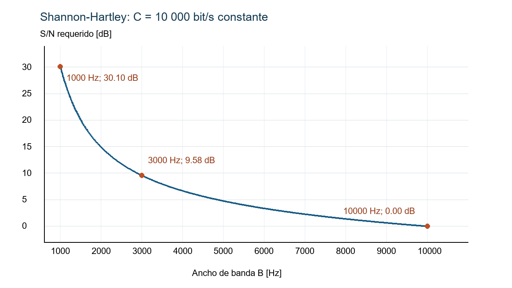

# TP 06 — Capacidad de canales y tratamiento de errores

**Enunciados originales:** [primera parte, PDF p.2](../../material/practica/U6/TP%20%206%20%281ra%20parte%29%20%20%20%202026.pdf), [segunda parte, PDF pp.2–3](../../material/practica/U6/TP%20%20%206%20%20%20%282da%20parte%29%20%202026.pdf). Se transcriben completos y se conservan las palabras y la puntuación del original; sólo se unieron los cortes de línea propios del PDF. Los datos se resumen por separado. La numeración reinicia en cada parte.

**Teoría:** [APUNTE U6](../teoria/06-canales-comunicaciones/APUNTE.md). **Todas las soluciones son elaboración propia razonada**, no clave oficial ni afirmación de resolución oral de clase. Se conservan los supuestos y ambigüedades: no se inventan datos faltantes. Las normas enlazadas verifican ejemplos solicitados por la guía, no abren nuevos temas teóricos.

## Herramientas comunes, unidades y criterio de elección

Antes de calcular, identificá si el problema limita por **banda y niveles sin ruido**, o por **banda y ruido**. Shannon no exige que el enunciado dé un número concreto de niveles; Nyquist/Hartley sí necesita ese dato para un resultado numérico finito del modelo multinivel.

$$
B=f_{CS}-f_{CI},\qquad s=10^{s_{dB}/10},\qquad C=B\log_2(1+s)
$$

$$
s=2^{C/B}-1,\qquad s_{dB}=10\log_{10}s,\qquad C_{ideal}=2B\log_2 n
$$

| Símbolo | Qué representa | Unidad |
|---|---|---|
| $f_{CI},f_{CS}$ | Frecuencias de corte inferior/superior | Hz |
| $B$ | Ancho de banda, no frecuencia central | Hz |
| $s=S/N$ | Cociente de potencias señal/ruido | veces, adimensional |
| $s_{dB}$ | El mismo cociente en escala logarítmica | dB |
| $S,N$ | Potencias medias en el mismo punto y banda | W |
| $C,C_{ideal}$ | Capacidad del modelo con/sin ruido | bit/s |
| $n$ | Niveles distinguibles | adimensional |

**Supuestos comunes de Shannon:** banda limitada, ruido blanco gaussiano aditivo, potencia media restringida, codificación adecuada. Se calcula un límite teórico, no el rendimiento de un equipo finito. **Nyquist/Hartley:** canal sin ruido, señalización ideal en banda base sin ISI y niveles perfectamente distinguibles. Para un número fijo entero de bits por símbolo, se usa $n$ potencia de dos.

**Ejemplo de las conversiones:** 30 dB→1000 veces; 300–3300 Hz→3000 Hz; Shannon produce $3000\log_2(1001)=29\,901,68$ bit/s. Invirtiendo con esa capacidad se recuperan 1000 veces y 30 dB. Con canal ideal de igual banda y 4 niveles, el límite Nyquist/Hartley es 12 000 bit/s, no ese resultado de Shannon. Cada fórmula de arriba se usa con sus datos y se ejemplifica también en las consignas correspondientes.

<a id="parte-1"></a>
## Primera parte — Capacidad y tasa de información

<a id="p1-e1"></a>
### E1. Canal telefónico: banda y S/N

**Enunciado original (TP6-I, p. 2):**

> Teniendo en cuenta que en un canal telefónico el valor de la relación S/N típico es de 30 dB, FCI=300Hz, FCS=3300 Hz. ¿Cuál es el límite superior de la tasa de transmisión de datos confiable?

**Datos resumidos:** $S/N=30$ dB; $f_{CI}=300$ Hz; $f_{CS}=3300$ Hz. Se pide el límite de capacidad $C$ [bit/s].

**Resolución paso a paso:**

1. **Elegimos el modelo.** Hay ruido y el ejercicio pide la tasa máxima confiable, así que usamos Shannon-Hartley. Antes de la fórmula, obtenemos el ancho de banda que realmente ocupa el canal.
2. **Restamos los límites de frecuencia.** $B=f_{CS}-f_{CI}=3300-300=3000$ Hz. Los 3300 Hz son la frecuencia superior, no el ancho de banda completo.
3. **Convertimos la relación señal-ruido de dB a veces.** Como es una relación de potencias, $s=10^{30/10}=1000$. No se puede introducir el número 30 directamente en el logaritmo de Shannon.
4. **Calculamos la capacidad.** $C=B\log_2(1+s)=3000\log_2(1+1000)=3000\log_2(1001)=29\,901,68$ bit/s.

**Resultado e interpretación:** el límite teórico es **29,90 kbit/s**. La unidad de la respuesta es bit/s; no son baudios ni una frecuencia de muestreo. Shannon-Hartley establece un techo del modelo, no garantiza que un equipo real opere exactamente a esa tasa.

**Comprobación:** 3 kHz de banda por un factor espectral de casi 10 da una tasa del orden de 30 kbit/s, razonable. No se usa 3300 Hz como ancho de banda ni 30 como cociente lineal.

**Contraste con la captura de clase:** allí se redondea $\log_2(1001)$ a $9,97$ y se informa $29\,910$ bit/s. Con más cifras, el cálculo da $29\,901,68$ bit/s; la diferencia es sólo de redondeo y ambos resultados son aproximadamente **29,9 kbit/s**. El enunciado capturado queda en [`practica_un6.md`](../../capturas/practica/practica_un6.md), intacto.

<a id="p1-e2"></a>
### E2. S/N necesario para la misma capacidad

**Enunciado original (TP6-I, p. 2):**

> Calcular la relación señal a ruido (S/N) expresada en dB para los siguientes casos:
>
> a. Δf = 3000 Hz, C = 10.000 bps.
> b. Δf = 10 KHz, C = 10.000 bps.
> c. Δf = 1 KHz, C = 10 Kbps.
>
> Graficar la variación de S/N (expresada en dB) en función del ancho de banda Δf (expresada en Hz). Extraer conclusiones.

**Datos resumidos:** a) $B=3000$ Hz, $C=10\,000$ bit/s; b) $B=10$ kHz, $C=10\,000$ bit/s; c) $B=1$ kHz, $C=10$ kbit/s. En los tres casos la capacidad pedida es la misma; se busca el S/N mínimo teórico que la soporta.

**Resolución paso a paso:**

1. **Despejamos la ecuación de Shannon** para dejar el S/N lineal como incógnita: $C=B\log_2(1+s)$, por lo tanto $s=2^{C/B}-1$.
2. **Unificamos unidades.** La fórmula requiere $C$ en bit/s y $B$ en Hz. Así, $10$ kHz=$10\,000$ Hz y $10$ kbit/s=$10\,000$ bit/s.
3. **Calculamos $s$ para cada caso** y recién después lo expresamos en decibeles con $s_{dB}=10\log_{10}(s)$, porque $s$ es una relación de potencias.
4. **Graficamos los puntos** usando $B$ [Hz] en el eje horizontal y S/N [dB] en el vertical. La tabla entrega los valores que alimentan el gráfico.

| Caso | $B$ [Hz] | $C$ [bit/s] | $s$ [veces] | $s_{dB}$ [dB] |
|---|---:|---:|---:|---:|
| a | 3000 | 10 000 | $2^{10000/3000}-1=9,07937$ | 9,58056 |
| b | 10 000 | 10 000 | $2^1-1=1$ | 0 |
| c | 1000 | 10 000 | $2^{10}-1=1023$ | 30,09876 |



**Resultado y conclusión:** a igual capacidad requerida, una banda menor exige mayor S/N. Al pasar de 1000 a 10 000 Hz, el S/N requerido baja de 30,0988 a 0 dB. **Razonabilidad:** 0 dB significa que señal y ruido tienen igual potencia; no significa que no haya ruido.

**Trampa:** esto compara el **S/N requerido** por el modelo, no promete que un receptor real consiga mejor S/N al abrir banda. Con ruido térmico, ampliar banda integra más ruido; ese efecto físico y el despeje a capacidad fija son preguntas distintas.

<a id="p1-e3"></a>
### E3. Canal sin ruido

**Enunciado original (TP6-I, p. 2):**

> ¿Cuál es la capacidad máxima de un canal sin ruido?

**Datos resumidos:** no se indican ancho de banda $B$ ni cantidad de niveles $n$. Se pide una capacidad máxima, pero faltan datos para dar un valor numérico.

**Resolución paso a paso:**

1. **Identificamos el modelo:** canal sin ruido, limitado en banda y con $n$ niveles distinguibles. Se aplica Nyquist-Hartley, no Shannon-Hartley.
2. **Escribimos la relación:** $C=2B\log_2 n$ bit/s. Para obtener un número hacen falta tanto $B$ [Hz] como $n$ [niveles].
3. **Respondemos lo que sí puede determinarse:** con $n$ fijo, la capacidad es finita y se calcula con esa expresión; para un canal binario ($n=2$), $C=2B$ bit/s. El enunciado no especifica $B$ ni $n$, así que no hay un resultado numérico único.

**Ejemplo explicativo, no dato de la guía:** con $B=3000$ Hz y $n=4$, $C=2(3000)\log_2 4=12\,000$ bit/s. Si se aumentara a $n=16$ niveles, con la misma banda, $C=24\,000$ bit/s.

**Límite y trampa:** si no se limita la cantidad de niveles distinguibles, el modelo ideal sin ruido no da un techo finito al aumentar niveles. Eso no significa que la velocidad de modulación pueda superar sin límite lo que permite la banda. No hay que inventar un valor para este enunciado; queda pendiente confirmar si la cátedra esperaba asumir un canal binario.

<a id="p1-e4"></a>
### E4. Duplicar capacidad manteniendo canal y ruido

**Enunciado original (TP6-I, p. 2):**

> Necesitamos duplicar la capacidad de transporte de información de un canal de datos cuyo ancho de banda (AB) es de 4KHz y su SNR=20dB. Sabiendo que utilizaremos el mismo canal, necesitamos saber cuántas veces debemos aumentar la potencia de señal original para lograrlo. ¿Cuál es la nueva SNR medida en dB?

**Datos resumidos:** $B=4$ kHz=$4000$ Hz; $s_{dB}=20$ dB. Se mantiene el mismo canal y se busca duplicar la capacidad; determinar el factor de aumento de potencia de señal y la SNR final.

**Resolución paso a paso:**

1. **Pasamos la SNR inicial a escala lineal:** $s=10^{20/10}=100$. En este modelo, $s=S/N$.
2. **Escribimos las capacidades inicial y final** con la misma banda: $C=B\log_2(1+s)$ y $C'=B\log_2(1+s')$. La condición es $C'=2C$.
3. **Despejamos la SNR final.** Al cancelar el mismo $B$, queda $\log_2(1+s')=2\log_2(1+s)$; por propiedades del logaritmo, $1+s'=(1+s)^2$, de donde $s'=(1+s)^2-1=101^2-1=10\,200$.
4. **Convertimos ese cociente en aumento de señal.** Al usar el mismo canal, tomamos constante la potencia de ruido. Entonces $S'/S=s'/s=10\,200/100=102$: la potencia final debe ser 102 veces la original.
5. **Calculamos la nueva SNR en dB:** $s'_{dB}=10\log_{10}(10\,200)=40,086$ dB.

$$
\log_2(1+s')=2\log_2(1+s)\Rightarrow s'=(1+s)^2-1
$$

| Símbolo | Significado | Unidad |
|---|---|---|
| $s,s'$ | S/N inicial/final | veces |
| $S,S'$ | Potencia de señal inicial/final | W |
| $N$ | Potencia de ruido conservada | W |

**Supuestos:** mismo modelo Shannon; $B,N$ constantes, sin saturación ni límite de potencia adicional.

Capacidad inicial: $4000\log_2(101)=26\,632,85$ bit/s. Final: $4000\log_2(10\,201)=53\,265,69$ bit/s. Nueva SNR: $10\log_{10}(10\,200)=40,0860$ dB.

**Resultado:** potencia final **102 veces la inicial**, es decir se añade 101 veces la potencia inicial (aumento de 10 100 %). SNR final **40,086 dB**. **Razonabilidad:** la capacidad crece logarítmicamente; duplicarla cuesta muchísimo a SNR alta. **Trampa:** decir «2 veces», o interpretar 102 como el incremento en vez del factor final.

<a id="p1-e5"></a>
### E5. Ruido duplicado

**Enunciado original (TP6-I, p. 2):**

> Tenemos un canal cuyo ancho de banda (AB) es de 4KHz y su SNR=20dB. Sabiendo que por desperfectos aumenta al doble su potencia de ruido, estimar en forma porcentual la caída en la capacidad de transporte. ¿Cuál es la nueva SNR medida en dB?

**Datos resumidos:** $B=4$ kHz=$4000$ Hz; $s=20$ dB inicialmente; la potencia de ruido se duplica. Se conserva la potencia de señal. Se pide caída porcentual de capacidad y SNR final.

**Resolución paso a paso:**

1. **Convertimos la SNR inicial a escala lineal:** $s=10^{20/10}=100$.
2. **Aplicamos qué significa duplicar el ruido.** Como la potencia de señal no cambia y $s=S/N$, al reemplazar $N$ por $2N$ la nueva relación lineal es $s'=S/(2N)=s/2=50$.
3. **Calculamos la SNR final en dB:** $10\log_{10}(50)=16,9897$ dB. No se divide el valor 20 dB por dos; la operación se hace en la escala lineal.
4. **Calculamos ambas capacidades** con Shannon y la misma banda: $C=4000\log_2(1+100)=26\,632,85$ bit/s; $C'=4000\log_2(1+50)=22\,689,70$ bit/s.
5. **Hallamos la caída relativa a la capacidad inicial:** $D=100(C-C')/C=14,8056$ %.

$$
D=100\frac{C-C'}{C}
$$

| Símbolo | Significado | Unidad |
|---|---|---|
| $C,C'$ | Capacidad antes/después | bit/s |
| $D$ | Caída respecto de la capacidad inicial | % |

**Supuestos:** $S,B$ constantes, mismo tipo de ruido/modelo.

**Resultado:** caída **14,81 %**, nueva SNR **16,99 dB**. **Razonabilidad:** S/N cae 3,0103 dB, pero capacidad no cae a la mitad por su dependencia logarítmica. **Trampa:** dividir 20 dB por 2 o confundir porcentaje de S/N con porcentaje de capacidad.

<a id="p1-e6"></a>
### E6. Señal y ruido dados como tensiones

**Enunciado original (TP6-I, p. 2):**

> Se mide el rendimiento de una línea telefónica (3.1KHz de ancho de banda). Cuando la señal es 10 voltios, el ruido es de 5 milivoltios. ¿Cuál es la tasa de datos máxima soportada por esta línea telefónica?

**Datos resumidos:** $B=3,1$ kHz=$3100$ Hz; $V_S=10$ V; $V_N=5$ mV. Se pide la tasa máxima. El enunciado no aclara si las tensiones son eficaces ni sus impedancias.

**Resolución paso a paso:**

1. **Identificamos qué necesita Shannon:** una relación de potencias $S/N$, no un cociente de tensiones.
2. **Hacemos explícito el supuesto necesario:** interpretamos ambas tensiones como valores eficaces medidas sobre la misma resistencia. Sólo bajo esa condición se puede elevar al cuadrado el cociente de tensiones para obtener el cociente de potencias.
3. **Unificamos las unidades:** $5$ mV=$0,005$ V y $B=3,1$ kHz=$3100$ Hz. El cociente de tensiones es $V_S/V_N=10/0,005=2000$.
4. **Calculamos la SNR lineal:** $s=(V_S/V_N)^2=2000^2=4\,000\,000$ veces. Esta es una relación de potencias, adimensional.
5. **Aplicamos Shannon-Hartley:** $C=3100\log_2(1+4\,000\,000)=67\,987,86$ bit/s.

$$
s=\left(\frac{V_S}{V_N}\right)^2
$$

| Símbolo | Significado | Unidad |
|---|---|---|
| $V_S,V_N$ | Tensiones eficaces de señal/ruido | V |
| $s$ | Cociente de potencias resultante | veces |

**Límite del resultado:** igual resistencia y mismo criterio eficaz son supuestos no declarados por la consigna; por eso el resultado queda condicionado y no se puede afirmar para cualquier impedancia o para tensiones pico mezcladas con eficaces.

**Resultado:** **67,99 kbit/s** bajo esos supuestos. **Razonabilidad:** convertir 10 V y 5 mV antes de dividir; el cociente no lleva unidad y es enorme. **Trampa:** usar 2000 como S/N de potencia o mezclar tensión pico con eficaz.

**Extensión del profesor (bonus pedagógico; no figura en el enunciado original): S/N en dB.** Ya tenemos la relación de potencias $s=4\,000\,000$, así que:

$$
s_{dB}=10\log_{10}(4\,000\,000)=66,0206\ \text{dB}\approx66\ \text{dB}
$$

Es el mismo resultado que $20\log_{10}(2000)=66,0206$ dB, usando directamente la relación de tensiones y el supuesto de igual impedancia. La cuenta de capacidad se mantiene: $C\approx67\,987,86$ bit/s (aproximadamente **67 988 bit/s** al entero más cercano); la captura informa **67 987 bps**, una aproximación algo más truncada.

<a id="parte-2"></a>
## Segunda parte — Tratamiento de errores

<a id="p2-e1"></a>
### E1. Principales causas

**Enunciado original (TP6-II, p. 2):**

> Indicar las principales causas de errores en las redes de datos.

**Datos resumidos:** no hay datos numéricos; se pide identificar causas de error en el proceso de transmisión.

**Resolución paso a paso:**

1. **Seguimos la señal por el sistema:** el transmisor representa bits como señales; el medio las atenúa y perturba; el receptor decide qué símbolo recibió.
2. **Identificamos alteraciones del medio:** atenuación, distorsión y ruido. Entre las fuentes de ruido se incluyen ruido térmico, diafonía, impulsos e intermodulación. La banda limitada también impide transmitir cambios arbitrariamente rápidos.
3. **Conectamos la alteración con el error:** si la señal llega cerca del umbral de decisión, una perturbación puede hacer que el receptor elija otro símbolo y, por tanto, recupere un bit diferente. Fuente: PDF U6 pp.8–18.

**Ejemplo propio:** se envía un nivel que representa 0 y un impulso lo lleva al lado de 1 del umbral en el instante de decisión: se recibe un bit distinto. **Trampa:** afirmar que toda atenuación ocasiona obligatoriamente errores; depende del margen. **Razonabilidad:** el medio altera la señal, no «entiende» el contenido lógico del bit.

<a id="p2-e2"></a>
### E2. Políticas de tratamiento

**Enunciado original (TP6-II, p. 2):**

> Que políticas se emplean para el tratamiento de los errores en las redes de datos.

**Datos resumidos:** no hay datos numéricos; se pide describir las políticas de tratamiento de errores.

**Resolución paso a paso:**

1. **Separamos detección de recuperación.** Paridad, CRC y checksum agregan redundancia para detectar inconsistencias; detectar un error no reconstruye por sí solo los datos originales.
2. **Describimos ARQ (Automatic Repeat reQuest):** el receptor detecta una trama inválida y, mediante retorno/confirmaciones, pide que se retransmita. Requiere canal de retorno y agrega demora y tráfico.
3. **Describimos FEC (Forward Error Correction):** el emisor agrega redundancia suficiente para que el receptor pueda corregir ciertos errores sin pedir retransmisión. La capacidad de corrección es limitada y depende del código. Fuente: PDF U6 pp.19–34.

**Ejemplo:** una trama falla CRC→se descarta como inconsistente; ARQ puede pedir otra copia. Hamming (7,4)→se corrige una inversión usando redundancia ya recibida. **Trampa:** «CRC corrige» o «FEC siempre significa dos copias». **Razonabilidad:** no se obtiene información nueva de una comprobación que sólo indica inconsistencia.

<a id="p2-e3"></a>
### E3. Calidad de servicio

**Enunciado original (TP6-II, p. 2):**

> Como incide la corrección de errores en la calidad de servicios de las redes.

**Datos resumidos:** no hay datos numéricos; se pide explicar el efecto de corregir errores sobre la calidad de servicio.

**Resolución paso a paso:**

1. **Miramos el beneficio:** recuperar datos puede disminuir la tasa de errores residuales y evitar que la aplicación procese información corrupta.
2. **Miramos el costo de FEC:** los bits redundantes ocupan parte de la capacidad y la codificación/decodificación consume procesamiento, aunque pueda evitar esperar una retransmisión.
3. **Miramos el costo de ARQ:** las confirmaciones y retransmisiones consumen tráfico y pueden aumentar latencia y variabilidad del retardo. Las ventanas ayudan a aprovechar el enlace, pero requieren buffers. Fuente: PDF U6 pp.19–21, 31–34.
4. **Concluimos sin generalizar:** la corrección mejora confiabilidad, pero puede empeorar velocidad útil, retardo o uso de recursos. El efecto total depende del tipo de servicio y del mecanismo utilizado.

**Ejemplo propio:** 100 bits útiles con 20 de control ocupan 120; sin errores la eficiencia de formato es 83,33 %. Si una retransmisión completa es necesaria para ese mismo bloque, se enviaron 240 bits para esos 100 útiles: 41,67 %, sin contar ACK ni esperas. **Trampa:** más protección no implica siempre mayor velocidad útil. **Razonabilidad:** se gana fiabilidad pagando recursos; el objetivo de servicio decide el compromiso.

<a id="p2-e4"></a>
### E4. Calcular BER

**Enunciado original (TP6-II, p. 2):**

> En una red de transmisión de datos se reciben 20 bits erróneos en 200.000 bits totales. Cuál es el BER?

**Datos resumidos:** $b_{err}=20$ bit erróneos; $b_{tot}=200\,000$ bit recibidos. Se pide BER.

$$
\mathrm{BER}=b_{err}/b_{tot}
$$

| Símbolo | Significado | Unidad |
|---|---|---|
| $b_{err},b_{tot}$ | Bits erróneos / bits observados | bits contados |
| BER | Proporción de errores de bit | adimensional |

**Resolución paso a paso:**

1. **Definimos BER:** cantidad de bits erróneos dividida por la cantidad total de bits observados (PDF U6 p.16).
2. **Sustituimos los conteos:** $\mathrm{BER}=20/200\,000=0,0001=10^{-4}$.
3. **Si se expresa como porcentaje**, multiplicamos por 100: $0,0001\times100=0,01$ %.

**Resultado:** **BER=$10^{-4}$**, promedio de un error cada 10 000 bits observados. **Razonabilidad:** no significa una periodicidad exacta. **Trampa:** 0,0001 % o bit/s: ambas unidades/porcentajes son incorrectos.

<a id="p2-e5"></a>
### E5. Interpretar la medición en Ethernet

**Enunciado original (TP6-II, p. 2):**

> La medición anterior se ha realizado sobre una LAN -ETHERNET. ¿Qué comportamiento puede esperarse de dicha red?

**Datos resumidos:** se usa la BER del ejercicio anterior ($10^{-4}$); la medición corresponde a una LAN Ethernet. No se informa tamaño de trama, distribución de errores ni punto exacto de medición.

**Resolución paso a paso:**

1. **Interpretamos la BER como evidencia de errores de bit** en el punto medido; no la convertimos directamente en porcentaje de tramas perdidas.
2. **Relacionamos bits erróneos con tramas:** los errores pueden hacer que una trama falle su FCS basado en CRC-32 y sea descartada como no válida. El CRC detecta ciertas alteraciones; no corrige los bits recibidos.
3. **Consideramos lo que puede hacer una capa superior:** un protocolo como TCP puede recuperar datos mediante retransmisión ([RFC 9293](https://www.rfc-editor.org/rfc/rfc9293), §3.8.1). El mecanismo Ethernet por sí solo no implica que la MAC solicite repetir cada trama dañada. FCS Ethernet: [IEEE, Frame Check Sequences](https://technav.ieee.org/area/cyclic-redundancy-check/).
4. **Limitamos la conclusión:** cabe esperar tramas descartadas, menor rendimiento útil y posibles demoras si se retransmiten datos en otra capa, pero la BER sola no alcanza para predecir cuántas tramas fallarán ni diagnosticar una causa concreta.

**Apoyo general señalado:** las tramas detectadas como dañadas no se entregan como datos válidos; puede haber retransmisión según protocolo superior. No se diagnostica cable, equipo ni estándar físico exacto desde BER sola.

**Límite visible:** los 20 bits malos podrían estar en una sola trama o repartidos entre muchas. El tamaño de trama, ubicación de medida (antes/después de FEC), distribución de errores y carga faltan. No se declara porcentaje exacto de paquetes perdidos ni «la red se cae».

**Trampa:** creer que una BER numéricamente pequeña es irrelevante en un enlace de alta tasa; confundir pérdidas con colisiones o achacar a CRC una corrección automática. **Razonabilidad:** la medición permite advertir degradación, no reconstruir todas sus causas.

<a id="p2-e6"></a>
### E6. CRC del mensaje registrado

**Enunciado original (TP6-II, p. 2):**

> Dado el siguiente mensaje a transmitir [ M(x) ] y teniendo como polinomio generador G(x) = x⁴ + x + 1. Aplicar el método para detección de errores CRC determinando la información a transmitir.
>
> M(x)= 1 0 1 1 0 1 0 1 1 0 1
>
> Repetir el procedimiento del lado del receptor. Extraer conclusiones.

**Datos resumidos:** mensaje $M=10110101101$ (11 bits); generador $G(x)=x^4+x+1$ (grado 4). Se pide formar la trama transmitida y verificarla en el receptor. Fuente: PDF U6 pp.27–28 para el método.

**Resolución paso a paso:**

1. **Pasamos el generador a bits** leyendo los coeficientes desde $x^4$ hasta $x^0$: $G(x)=x^4+0x^3+0x^2+x+1$ corresponde a `10011`. Su grado es 4.
2. **Reservamos cuatro posiciones para el CRC** porque el grado del generador es 4. Esto equivale a multiplicar el mensaje por $x^4$, es decir, anexar cuatro ceros: `10110101101` → `101101011010000`.
3. **Dividimos módulo 2** por `10011`. La resta de esta división es XOR: no se llevan ni se prestan valores. En cada paso se alinea el primer 1 del divisor con el primer 1 aún no eliminado del dividendo.
4. **Tomamos el resto de cuatro bits** (completando con ceros a la izquierda si hiciera falta) y lo anexamos al mensaje original. Así se obtiene la trama que se transmite.
5. **En el receptor dividimos la trama recibida por el mismo generador.** Un resto `0000` significa que la trama pasa la comprobación CRC; no prueba que sea imposible que haya ocurrido un error.

No se usa el generador `11001` del ejemplo teórico: corresponde a otro ejercicio.

| Símbolo | Significado | Unidad |
|---|---|---|
| $M(x)$ | Polinomio cuyos coeficientes son el mensaje, de mayor grado a menor | bits lógicos representados |
| $G(x)$ | Generador acordado | representación algebraica, sin unidad física |
| $r$ | Grado del generador (=4) | conteo, adimensional |
| $R(x)$ | Resto de grado menor que 4 | representación de 4 bits |
| $T(x)$ | Mensaje desplazado más resto (XOR) | representación de secuencia |
| $x$ | Variable formal | sin unidad física |

**Supuestos:** CRC didáctico sin inicialización/reflexión/complemento de un protocolo particular; bits en el orden escrito. Emisor/receptor comparten generador y posiciones.

```text
Mensaje M:             10110101101        (11 bits)
Generador G:           10011              (grado 4)
Desplazado M·x^4:      101101011010000      (15 bits)

101101011010000 XOR 100110000000000 = 001011011010000
001011011010000 XOR 001001100000000 = 000010111010000
000010111010000 XOR 000010011000000 = 000000100010000
000000100010000 XOR 000000100110000 = 000000000100000
000000000100000 XOR 000000000100110 = 000000000000110

Resto, con 4 lugares: 0110
Transmitido T:        101101011010110
```

El cociente es `10101010010`; el resto representa $x^2+x$.

**Receptor, recibiendo sin alteraciones:**

```text
101101011010110 XOR 100110000000000 = 001011011010110
001011011010110 XOR 001001100000000 = 000010111010110
000010111010110 XOR 000010011000000 = 000000100010110
000000100010110 XOR 000000100110000 = 000000000100110
000000000100110 XOR 000000000100110 = 000000000000000
```

**Resultado:** transmitir **`101101011010110`**; receptor obtiene resto **`0000`**. **Razonabilidad:** 11 datos+4 CRC=15 bits; el resto tiene cuatro posiciones aunque empiece con 0. El control es consistente.

**Conclusión:** resto no nulo detecta inconsistencia; resto nulo sólo indica que pasó esa prueba. Un error múltiplo del generador puede pasar inadvertido. **Trampa:** dejar resto `110` sin aclarar longitud, usar suma con acarreo o afirmar que cero demuestra ausencia absoluta de error.

<a id="p2-e7"></a>
### E7. Cuatro protocolos que emplean CRC

**Enunciado original (TP6-II, p. 2):**

> Cite por lo menos cuatro protocolos que emplean para la detección de errores el CRC.

**Datos resumidos:** no hay datos numéricos; se solicitan al menos cuatro protocolos que empleen CRC.

**Resolución paso a paso:**

1. **Tomamos CRC como una operación de detección:** verificamos qué protocolo calcula y transmite una redundancia cíclica; el nombre del campo por sí solo puede ser engañoso.
2. **Elegimos cuatro protocolos diferentes** y anotamos qué campo/mecanismo usa cada uno, para no confundir nombre del protocolo con variante ni llamar CRC a cualquier checksum.
3. **Verificamos cada ejemplo contra una fuente primaria:**

| Ejemplo | Campo/mecanismo | Evidencia primaria |
|---|---|---|
| Ethernet (IEEE 802.3) | FCS de 32 bits, CRC-32 | [IEEE, Frame Check Sequences](https://technav.ieee.org/area/cyclic-redundancy-check/) |
| PPP con framing tipo HDLC | FCS por división polinomial; opción de 16 o 32 bits | [RFC 1662, §3.1 y apéndice C](https://www.rfc-editor.org/rfc/rfc1662) |
| SCTP | Campo llamado checksum, pero algoritmo **CRC32c** | [RFC 9260, §6.8](https://www.rfc-editor.org/rfc/rfc9260) |
| ATM AAL5 (protocolo de adaptación) | CRC de cuatro octetos del CPCS-PDU | [RFC 1483, §3](https://www.rfc-editor.org/rfc/rfc1483) |

4. **Comprobamos la distinción importante:** SCTP llama *checksum* a su campo, pero la operación especificada es CRC32c; eso no lo convierte en la suma aritmética de verificación.

**Trampa:** el nombre «checksum» del campo SCTP no lo vuelve suma de verificación aritmética; distinguir nombre del campo y operación. **Razonabilidad:** cada ejemplo protege una unidad y tiene parámetros concretos; no se aplica a todos el generador corto del E6. No se desarrolla ATM como tema nuevo.

<a id="p2-e8"></a>
### E8. Cuatro protocolos con suma de verificación

**Enunciado original (TP6-II, p. 2):**

> Cite por lo menos cuatro protocolos que emplean para la detección de errores el método de suma de verificación.

**Datos resumidos:** no hay datos numéricos; se solicitan al menos cuatro protocolos que empleen sumas de verificación.

**Resolución paso a paso:**

1. **Buscamos mecanismos de suma aritmética**, no campos CRC aunque se llamen *checksum*.
2. **Anotamos qué porción protege cada protocolo**, porque las sumas no siempre cubren el mensaje completo.
3. **Verificamos cuatro ejemplos con sus fuentes primarias:**

| Protocolo | Qué cubre / precisión | Evidencia primaria |
|---|---|---|
| IPv4 | Suma de comprobación sólo del encabezado, no payload | [RFC 791, §3.1](https://www.rfc-editor.org/rfc/rfc791) |
| TCP | Encabezado, datos y pseudoencabezado; suma en complemento a uno | [RFC 9293, §3.1](https://www.rfc-editor.org/rfc/rfc9293) |
| UDP en el caso IPv4 descrito por RFC 768 | Pseudoencabezado, encabezado UDP y datos; cero puede indicar ausencia de checksum | [RFC 768, Fields](https://www.rfc-editor.org/rfc/rfc768) |
| ICMPv4 | Mensaje ICMP desde campo Type, no encabezado IPv4 | [RFC 792, Checksum](https://www.rfc-editor.org/rfc/rfc792) |

**Relación con teoría:** son ejemplos reales de la familia; no la suma decimal simplificada de la filmina29. Algoritmo Internet: [RFC 1071, §1](https://www.rfc-editor.org/rfc/rfc1071).

**Trampa:** responder «IP» sin distinguir versión/cobertura; incluir SCTP como suma aritmética porque el campo se llama checksum; afirmar UDP siempre protege con checksum sin considerar su variante y reglas. **Razonabilidad:** un control de encabezado no protege automáticamente los datos transportados.

<a id="p2-e9"></a>
### E9. Cuándo emplear códigos correctores

**Enunciado original (TP6-II, p. 2):**

> Cuando se emplean códigos correctores de errores, cite ejemplos.

**Datos resumidos:** no hay datos numéricos; se piden situaciones de uso y ejemplos de códigos correctores.

**Resolución paso a paso:**

1. **Identificamos cuándo conviene corregir sin retransmitir:** si el retorno o la espera son inviables o costosos, se puede usar FEC, siempre que el código soporte los patrones y la cantidad de errores esperados.
2. **Damos un ejemplo de código:** Hamming (7,4), desarrollado por la cátedra, agrega tres bits de control a cuatro bits de datos y corrige un error por palabra.
3. **Aclaramos otro esquema visto en clase:** el doble envío diferido de la filmina 34 también agrega redundancia, pero necesita una comprobación para decidir cuál copia usar; no se debe atribuir capacidad de corrección ilimitada.
4. **Relacionamos el uso con la red:** en multicast fiable, FEC puede reducir pedidos individuales de reparación ([RFC 3453, §1](https://www.rfc-editor.org/rfc/rfc3453)).

**Ejemplo registrado:** `0011`→`1000011`; recibir `1000001` falla las comprobaciones 2 y 4, síndrome `110`→bit6; corregirlo recupera `0011`. Ver [U6 Hamming](../teoria/06-canales-comunicaciones/APUNTE.md#hamming).

**Trampa:** prometer que FEC recupera cualquier pérdida/error o que dos copias distintas permiten elegir sin otra evidencia. **Razonabilidad:** un código tiene capacidad limitada; la ausencia de retorno justifica proteger anticipadamente, no inventa información faltante.

<a id="p2-e10"></a>
### E10. Manifestación y medida del error

**Enunciado original (TP6-II, p. 2):**

> Como se manifiesta el error en la redes de datos y como se mide?

**Datos resumidos:** no hay datos numéricos; se pide describir manifestaciones y métricas de error.

**Resolución paso a paso:**

1. **Separamos niveles de manifestación:** en la señal física hay una decisión incorrecta; en bits aparecen valores distintos de los enviados; en tramas/bloques, los controles pueden detectar inconsistencias, provocar descarte o llevar a retransmisión.
2. **Elegimos la métrica según qué queremos medir:** BER cuenta bits erróneos sobre bits observados; una tasa de tramas erróneas debe contar tramas, no reutilizar el cociente de bits.
3. **Declaramos el punto y el conjunto medidos:** el resultado depende del intervalo, cantidad total observada y posición de medición (por ejemplo, antes o después de FEC). Fuente: PDF U6 pp.16, 19–29, 31.

**Ejemplo:** 20 errores/200 000 bits→BER=$10^{-4}$. Si esos 20 errores pertenecen a una sola trama, el conteo de tramas afectadas es uno, no veinte. **Trampa:** medir BER en bit/s o identificar «sin errores detectados» con ausencia demostrada de errores. **Razonabilidad:** una métrica siempre declara conjunto, intervalo y punto de observación.

<a id="hamming-guia"></a>
### Indicación adicional de la guía: uso de Hamming

La p.3 sólo enlaza un recurso externo sobre Hamming; **no contiene una palabra de datos ni una nueva consigna numérica**. No se inventa «E11» ni se atribuye al recurso una solución oficial. El ejemplo `0011` de las filminas se conserva completo en [APUNTE U6](../teoria/06-canales-comunicaciones/APUNTE.md#hamming), con tablas y corrección por síndrome. El enlace externo se registra como indicación, no se utiliza como autoridad para estas cuentas.

## Pendientes, controles y para examen

- E3-I: falta banda/niveles para dar número; distinción ideal/binario explícita.
- E6-I: interpretación eficaz e impedancias iguales no declaradas por enunciado.
- E5-II: BER sola no determina pérdida de tramas exacta ni diagnóstico de la LAN.
- Enlace Hamming de p.3: sin consigna adicional, no se crea ejercicio.
- Sin clave oficial; revisión independiente del candidato pendiente. [Evidencia QA de U6](../teoria/06-canales-comunicaciones/evidencia-qa.md) registra recálculos y cotejos ejecutados, sin build.

**Para examen:** primero justifico qué límite/modelo uso y convierto unidades. Para errores, separo detección, retransmisión y corrección anticipada, y explico qué garantiza realmente el control. Un resultado sin supuestos no es una resolución completa.

**Checklist:**

- [ ] Resto cortes para obtener banda; dB→veces antes de Shannon.
- [ ] No confundo tensiones con potencias ni baudios con bit/s.
- [ ] Justifico por qué duplicar capacidad no es duplicar señal.
- [ ] Expreso BER como proporción y convierto correctamente a porcentaje.
- [ ] Divido CRC con XOR; resto 4 bits y trama 15 bits del E6-II.
- [ ] Doy cuatro ejemplos verificados de CRC y cuatro de suma, sin confundir campos con algoritmos.
- [ ] Distingo recuperación por ARQ y por FEC, con sus costos/límites.
