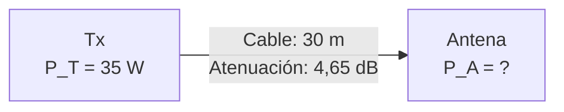
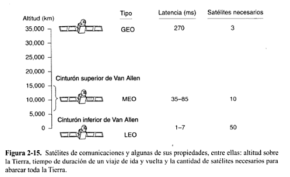

# TP 07 — Medios físicos de comunicación

**Enunciados originales:** [TP7 oficial, PDF pp. 2–3](../../material/practica/U%207/TP%20%20%207%20%202026.pdf). E1–E5 están en p. 2; E6–E8, en p. 3. Se conservan el orden, los términos, la notación y la puntuación de la guía; sólo se normalizan sus saltos de línea. La tabla de E1 se transcribe y la figura de E7 se extrae del PDF sin recrearla.

**Clase de trabajo:** 27/10/2026. El cuestionario inicial pertenece a [U6](../repaso/u06-cuestionario-practica-2026-10-27.md); este documento reúne el posterior trabajo práctico de U7.

**Teoría de referencia:** [apunte de U7](../teoria/07-medios-comunicaciones/apuntes-comunicacion-de-datos-u7.md).

**Alcance actual:** ocho enunciados transcritos y contrastados visualmente con las páginas originales, con datos/condiciones separados y desarrollo razonado de E1–E8. **Las soluciones son elaboración propia, no una clave oficial ni una transcripción de la resolución docente del 27/10.** E2, E6, E7 y E8 requieren explicitar interpretaciones o datos adicionales: se muestran los resultados condicionales y sus límites, sin inventar una respuesta oficial única. El TP permanece en progreso hasta resolver esas confirmaciones.

## Breve repaso previo de clase

Pendiente de registrar según lo que se aporte de la clase. Se incorporarán sólo los conceptos necesarios para los ejercicios, sin duplicar el desarrollo teórico de U7.

## Cómo leer las resoluciones

En cada ejercicio: problema físico y método → supuestos añadidos claramente separados de los datos → cuentas con unidades → resultado e interpretación → comprobación y errores típicos. Se conserva el enunciado literal aunque su redacción resulte ambigua. Las tablas de símbolos de E1, E2, E3, E7 y E8 definen la notación; E4–E6 reutilizan explícitamente la de E3.

## 1. Potencia aplicada a la antena

**Fuente del enunciado:** PDF oficial, p. 2.

### Enunciado (transcripción literal)

> Un equipo radiotransmisor se vincula a su antena mediante la llamada línea de transmisión que se ocupa de la transferencia de energía en un sentido u otro con la menor pérdida y distorsión. Estas líneas pueden ser coaxiales. Suponer el empleo de coaxial RG 213/U. El transceptor (transmisor y receptor ) tiene una potencia a la salida del equipo de 35 W operando a la frecuencia de 400 Mhz, la longitud de la línea es de 30 metros. ¿Cuál es la potencia aplicada a la antena debido a la atenuación introducida por la línea? Ver tabla 7-20 de la página 446.

| Frecuencia de operación [MHz] | 10 | 50 | 100 | 200 | 400 | 1000 |
|---|---|---|---|---|---|---|
| RG 213/U - At [dB/100m] - | 2 | 4.9 | 7 | 10.5 | 15.5 | 26 |

### Datos / condiciones

| Dato | Valor | Unidad |
|---|---|---|
| Cable | RG 213/U | — |
| Potencia a la salida del equipo | 35 | W |
| Frecuencia de operación | 400 | MHz |
| Longitud de la línea | 30 | m |
| Atenuación tabulada a 400 MHz | 15.5 | dB/100 m |

**Qué se pide:** potencia aplicada a la antena tras atravesar la línea.

### Esquema de la resolución de clase

**Procedencia:** esquema redibujado a partir de la captura aportada por el estudiante; no es una reproducción de la imagen original. Los 4,65 dB son la pérdida calculada para esos 30 m, no un dato adicional del enunciado. Se busca la potencia al final del cable, justo en la entrada de la antena.

### Resolución paso a paso

**Concepto y estrategia:** el cable disipa parte de la potencia antes de que llegue a la antena. Seguimos el procedimiento de clase: calcular la pérdida de los 30 m → convertir la potencia transmitida a dBm → restar la pérdida en dB → volver a W. Después comprobamos el resultado mediante la cuenta directa de potencias.

**Procedencia del desarrollo:** captura de la resolución de E1 aportada por el estudiante, correspondiente al trabajo de práctica del 27/10/2026. Se conserva su secuencia y se distingue abajo el pequeño desajuste numérico de la captura de la cuenta recalculada. No se modifica el original.

1. **Leemos la fila correcta.** A 400 MHz, el RG 213/U pierde 15,5 dB por cada 100 m. No se usa el dato de otra frecuencia.
2. **Escalamos con la longitud**, suponiendo cable uniforme a esa frecuencia:

$$
A_c=\alpha_{100}\frac{\ell_c}{100\ \mathrm m}
=15,5\frac{30}{100}=4,65\ \mathrm{dB}.
$$

3. **Convertimos la potencia de salida a dBm.** dBm expresa un nivel de potencia referido a 1 mW. Primero pasamos 35 W a 35 000 mW y después aplicamos el logaritmo:

$$
P_{t,\mathrm{dBm}}=10\log_{10}\!\left(\frac{P_t}{1\ \mathrm{mW}}\right)
=10\log_{10}(35\,000)
=45,4407\ \mathrm{dBm}.
$$

4. **Hacemos el balance hasta la entrada de la antena.** En este ejercicio sólo se considera la pérdida del cable: no se dan pérdidas de conectores, empalmes ni otras reservas. Una pérdida positiva se resta del nivel de entrada:

$$
P_{a,\mathrm{dBm}}=P_{t,\mathrm{dBm}}-A_c
=45,4407-4,65
=40,7907\ \mathrm{dBm}.
$$

**Cómo leer las unidades:** un nivel en dBm menos una pérdida en dB da otro nivel en dBm. No se restan 4,65 dB directamente de 35 W. Tampoco se suma ganancia de antena: se pide la potencia **aplicada a su entrada**, no la potencia radiada equivalente en una dirección.

5. **Volvemos de dBm a potencia lineal.** Invertimos el logaritmo y recuperamos primero mW, porque ésa es la referencia de dBm:

$$
P_a=(1\ \mathrm{mW})\,10^{P_{a,\mathrm{dBm}}/10}
\simeq11\,996,9\ \mathrm{mW}
=11,9969\ \mathrm W
\simeq12,00\ \mathrm W.
$$

| Símbolo | Significado | Unidad |
|---|---|---|
| $\alpha_{100}$ | Pérdida de un tramo de 100 m a la frecuencia elegida | dB |
| $\ell_c$ | Longitud del cable | m |
| $A_c$ | Pérdida del tramo | dB |
| $P_t$, $P_a$ | Potencia a la entrada del cable y en la antena | W |
| $P_{t,\mathrm{dBm}}$, $P_{a,\mathrm{dBm}}$ | Niveles de esas mismas potencias referidos a 1 mW | dBm; se usa su valor numérico en el exponente |

**Convención de la primera cuenta:** $\alpha_{100}=15,5\ \mathrm{dB}$ es la pérdida de referencia de 100 m; se multiplica por la cantidad adimensional de tramos de 100 m. La tasa tabulada equivale a 0,155 dB/m.

**Supuestos:** atenuación uniforme, conexiones adaptadas y sin pérdidas adicionales de conectores u otros elementos que no da la guía.

**Resultado:** llegan a la antena **40,7907 dBm**, equivalentes a aproximadamente **12,00 W**. Se calcula sin redondear los valores intermedios; a un decimal, el nivel es **40,8 dBm**.

### Comprobación por el método directo

La cuenta que ya figuraba en este apunte produce el mismo resultado sin pasar por dBm. Una atenuación positiva reduce la potencia, por eso el exponente lleva signo negativo:

$$
P_a=P_t\,10^{-A_c/10}
=35\,10^{-4,65/10}
=11,9969\ \mathrm W.
$$

Los símbolos y unidades son los de la tabla anterior. Este método conserva los mismos supuestos del balance en dBm: no es otro modelo físico, sino la misma relación expresada en escala lineal.

**Comprobación:** 4,65 dB representan un factor de potencia de aproximadamente 0,3428; el cable entrega cerca del 34,28 % de los 35 W. La salida es menor que la entrada.

### Contraste numérico con la resolución de clase

La captura anota **45,44 dBm − 4,65 dB = 40,7 dBm**, y luego unos **11 748 mW ≈ 12 W**. La resta da **40,79 dBm**, no 40,7 dBm. Con más precisión se obtienen los **40,7907 dBm y 11,9969 W** calculados arriba. Si se parte de 40,7 dBm, la conversión sí da aproximadamente **11 749 mW = 11,749 W**. El resultado final aproximado de 12 W se mantiene, pero se separa esta diferencia para no reproducirla como igualdad exacta.

**Aclaración de notación:** la captura llama $S_{Rx}$ al nivel al final del cable. En E1 ese punto es la entrada de la antena; aquí usamos $P_{a,\mathrm{dBm}}$ para no confundirlo con la sensibilidad de un receptor, que se discute en E2. La magnitud calculada es potencia, no un umbral de sensibilidad.

**Errores típicos:** dividir 35 W por 4,65; mezclar W y dB en una resta; olvidar que la conversión inversa de dBm entrega mW; usar $20\log_{10}$ para esta relación de potencias. El factor 20 corresponde a amplitudes bajo condiciones compatibles, no a esta cuenta.

**Para explicar la resolución:** calculo 4,65 dB de pérdida; convierto 35 W a 45,4407 dBm, resto la pérdida y obtengo 40,7907 dBm, equivalentes a unos 12 W. La cuenta directa de potencias confirma el resultado.

**Respaldo:** tabla del TP7, p. 2; [U7, coaxil y atenuación](../teoria/07-medios-comunicaciones/apuntes-comunicacion-de-datos-u7.md#coaxil).

## 2. Sensibilidad del receptor

**Fuente del enunciado:** PDF oficial, p. 2.

### Enunciado (transcripción literal)

> Para el ejercicio anterior calcular la sensibilidad del receptor si éste último se construye con el mismo tipo coaxial del transmisor y la misma distancia entre antena y receptor (30m). Ambas antenas tienen una ganancia de 30dB y se encuentran separadas entre sí 1Km.

### Datos / condiciones

| Dato | Valor | Unidad |
|---|---|---|
| Referencia | Condiciones del ejercicio 1 | — |
| Cable del receptor | Mismo tipo que el transmisor: RG 213/U | — |
| Distancia entre antena y receptor | 30 | m |
| Ganancia de cada antena | 30 | dB, tal como figura en la consigna |
| Separación entre antenas | 1 | km |

**Qué se pide:** la «sensibilidad del receptor», en los términos de la guía. El modelo de propagación y la interpretación de esa magnitud se explicitarán al resolver, sin agregarlos como datos originales.

### Resolución paso a paso

**Concepto y estrategia:** seguimos la potencia desde la salida del transmisor hasta la entrada del receptor. Los dos cables y el espacio libre restan; las ganancias de las dos antenas suman. Este balance determina **potencia recibida**, no por sí solo la sensibilidad intrínseca de un equipo.

**Supuestos agregados para poder calcular:** propagación en espacio libre, línea de vista y campo lejano, antenas orientadas y con polarización compatible, ganancias interpretadas como **30 dBi cada una**, sin pérdidas extra ni margen de desvanecimiento. La consigna dice dB, sin especificar referencia de ganancia: usar dBi es una hipótesis explícita.

1. **Heredamos E1.** La frecuencia es 400 MHz y cada cable introduce 4,65 dB. La pérdida de ambos cables es 9,30 dB.
2. **Expresamos la potencia del transmisor en dBm**, para combinar ganancias y pérdidas:

$$
P_{t,\mathrm{dBm}}=10\log_{10}\!\left(\frac{P_t}{1\ \mathrm{mW}}\right)
=10\log_{10}(35\,000)
=45,4407\ \mathrm{dBm}.
$$

3. **Calculamos la pérdida de espacio libre**, con la constante redondeada de la cátedra y las unidades indicadas:

$$
L_{fs}=32,4+20\log_{10}\!\left(\frac{d}{1\ \mathrm{km}}\right)
+20\log_{10}\!\left(\frac{f}{1\ \mathrm{MHz}}\right)
=32,4+20\log_{10}(1)+20\log_{10}(400)
=84,4412\ \mathrm{dB}.
$$

4. **Hacemos el balance completo hasta el conector del receptor:**

$$
P_{r,\mathrm{dBm}}=P_{t,\mathrm{dBm}}-A_{ct}+G_t-L_{fs}+G_r-A_{cr}
=45,4407-4,65+30-84,4412+30-4,65
=11,6995\ \mathrm{dBm}.
$$

| Símbolo | Significado | Unidad |
|---|---|---|
| $P_t$ | Potencia del transmisor | mW dentro de la conversión; 35 000 mW |
| $P_{t,\mathrm{dBm}}$, $P_{r,\mathrm{dBm}}$ | Niveles de potencia transmitida y recibida | dBm |
| $d$, $f$ | Distancia entre antenas y frecuencia | km; MHz en la ecuación usada |
| $L_{fs}$ | Pérdida de espacio libre | dB |
| $A_{ct}$, $A_{cr}$ | Pérdidas de cables transmisor y receptor | dB |
| $G_t$, $G_r$ | Ganancias de antenas respecto de isotrópica, por hipótesis | dBi |

**Resultado calculable:** bajo esos supuestos llegan **+11,70 dBm**, equivalentes a aproximadamente **14,79 mW**, a la entrada del receptor.

**Cómo responder sobre la sensibilidad:** para que alcance con ese nivel, sin margen, el umbral de sensibilidad debe ser **menor o igual que +11,70 dBm**. Un umbral numéricamente menor en dBm permite recibir señales más débiles. No se ha calculado que un receptor concreto *tenga* esa sensibilidad: hacen falta su modo de operación y un criterio de calidad, entre otros datos.

El balance tampoco verifica si ese nivel supera el máximo admisible de entrada del receptor: ese dato no está dado. Cumplir la condición de sensibilidad no basta para garantizar el funcionamiento completo del equipo.

**Con margen:** si se exige una reserva adicional de $M$ dB, el umbral admisible debe quedar al menos $M$ dB por debajo del nivel recibido. **Ejemplo didáctico, no dato de la guía:** con reserva de 10 dB, debería ser menor o igual que +1,70 dBm.

**Comprobación:** de 35 W se pasa a unos 12 W después del primer cable. Las ganancias suman 60 dB, mientras el espacio libre resta 84,44 dB y el segundo cable otros 4,65 dB: el nivel final es menor, aun con antenas de ganancia elevada.

**Errores típicos:** olvidar uno de los cables; sumar W con dB; interpretar los 30 dB como potencia adicional creada por la antena; confundir potencia recibida con sensibilidad real.

**Respaldo y pendiente:** [U7, presupuesto de enlace](../teoria/07-medios-comunicaciones/apuntes-comunicacion-de-datos-u7.md#radioenlace), PDF teórico p. 33, contrastado visualmente. La distinción entre nivel de entrada y sensibilidad se apoya también en la definición de nivel mínimo recibido bajo un criterio de BER de [Rohde & Schwarz, §3.2](https://scdn.rohde-schwarz.com/ur/pws/dl_downloads/dl_application/application_notes/1cm71/1CM71_2E.pdf). Confirmar si el docente usa «sensibilidad» para nombrar el umbral admisible del balance y qué referencia pretende para las ganancias.

## 3. Antenas de media longitud de onda

**Fuente del enunciado:** PDF oficial, p. 2.

### Enunciado (transcripción literal)

> Dado un enlace radioeléctrico funcionando a la frecuencia de 300MHz, ¿Cuál es la longitud necesaria de las antenas para un buen rendimiento si las mismas son de media longitud de onda?

### Datos / condiciones

| Dato | Valor | Unidad |
|---|---|---|
| Frecuencia del enlace | 300 | MHz |
| Longitud de las antenas | Media longitud de onda | — |

**Qué se pide:** longitud necesaria de las antenas.

### Resolución paso a paso

**Concepto y estrategia:** la longitud de onda es la distancia recorrida por la onda en un período. Una antena idealizada de media onda tiene una longitud total igual a la mitad de esa distancia.

1. **Convertimos la frecuencia:** 300 MHz son 300 000 000 Hz.
2. **Obtenemos la longitud de onda y después su mitad:**

$$
\lambda=\frac{c}{f}
=\frac{3\times10^8}{300\times10^6}
=1\ \mathrm m,
\qquad
\ell_a=\frac{\lambda}{2}=0,50\ \mathrm m.
$$

| Símbolo | Significado | Unidad |
|---|---|---|
| $c$ | Velocidad de propagación aproximada en aire: $3\times10^8$ | m/s |
| $f$ | Frecuencia | Hz |
| $\lambda$ | Longitud de onda | m |
| $\ell_a$ | Longitud total de la antena idealizada | m |

**Supuestos:** propagación aproximada en aire y modelo geométrico ideal; no se aplican factores de acortamiento ni correcciones de construcción no dados.

**Resultado:** cada antena de media onda mide aproximadamente **0,50 m = 50 cm** en total. Si se implementa como un dipolo simétrico, cada brazo mide idealmente unos 25 cm: no son 50 cm por brazo.

**Comprobación:** a 300 MHz la onda mide 1 m; la antena solicitada ocupa la mitad.

**Error típico:** entregar 1 m, que es la longitud de onda completa, o confundir longitud total con longitud de cada brazo.

**Respaldo:** [U7, §6.4](../teoria/07-medios-comunicaciones/apuntes-comunicacion-de-datos-u7.md#64-longitud-de-antena-y-frecuencia); tabla de antenas de la presentación teórica, p. 24, contrastada visualmente.

## 4. Antena de un teléfono celular

**Fuente del enunciado:** PDF oficial, p. 2.

### Enunciado (transcripción literal)

> ¿Cuál debería ser la longitud de la antena de un teléfono celular cuya portadora opera a la frecuencia de 1 GHz ? La antena es de media longitud de onda.

### Datos / condiciones

| Dato | Valor | Unidad |
|---|---|---|
| Frecuencia de la portadora | 1 | GHz |
| Longitud de la antena | Media longitud de onda | — |

**Qué se pide:** longitud de la antena.

### Resolución paso a paso

**Concepto y estrategia:** se aplica el mismo modelo de media onda de E3. Al aumentar la frecuencia, disminuye la longitud requerida, sin cambiar la velocidad de propagación del modelo.

1. **Unificamos unidades:** 1 GHz equivale a $10^9$ Hz.
2. **Calculamos media longitud de onda:**

$$
\ell_a=\frac{c}{2f}
=\frac{3\times10^8}{2\times10^9}
=0,15\ \mathrm m=15\ \mathrm{cm}.
$$

Los símbolos y unidades son los de la tabla de E3: $c$ en m/s, $f$ en Hz y $\ell_a$ en m. Se mantienen sus supuestos de aire y antena idealizada.

**Resultado:** **15 cm de longitud total**. En un dipolo simétrico ideal serían dos brazos de unos 7,5 cm.

**Comprobación:** la frecuencia es aproximadamente 3,33 veces la de E3; la longitud queda en el 30 % de los 50 cm anteriores.

**Error típico:** usar el número 1 como si estuviera en Hz o aplicar un factor de miniaturización de una antena comercial que el ejercicio no proporciona. Los 15 cm describen el modelo pedido, no todas las construcciones reales de teléfonos.

**Respaldo:** mismo modelo y tabla de antenas de U7, p. 24, utilizados en E3.

## 5. Tipo de antena de un receptor de FM

**Fuente del enunciado:** PDF oficial, p. 2.

### Enunciado (transcripción literal)

> Si un receptor de FM utiliza una antena de 75cm, ¿ De qué tipo de antena se trata ?. La banda de FM corresponde a 88 - 108 MHz.

### Datos / condiciones

| Dato | Valor | Unidad |
|---|---|---|
| Longitud de la antena | 75 | cm |
| Banda de FM indicada | 88 - 108 | MHz |

**Qué se pide:** identificar el tipo de antena.

### Resolución paso a paso

**Concepto y estrategia:** ahora conocemos una longitud física y un intervalo de frecuencias. Buscamos qué fracción de longitud de onda resulta compatible con ambos; la longitud por sí sola no permite deducir toda la construcción de la antena.

1. **Convertimos la longitud:** 75 cm son 0,75 m.
2. **Probamos el modelo de un cuarto de onda**, usando los símbolos de E3:

$$
\ell_a=\frac{\lambda}{4}=\frac{c}{4f}
\quad\Longrightarrow\quad
f=\frac{c}{4\ell_a}
=\frac{3\times10^8}{4(0,75)}
=10^8\ \mathrm{Hz}=100\ \mathrm{MHz}.
$$

3. **Contrastamos con la banda dada:** 100 MHz está dentro de 88–108 MHz. A los extremos de la banda, un cuarto de onda ideal mide aproximadamente 85,23 cm y 69,44 cm, respectivamente; 75 cm queda entre ambas referencias.

**Resultado:** es compatible con una **antena de un cuarto de onda** en torno a 100 MHz. Si se trata de una varilla única que usa un plano de tierra o contrapeso, corresponde al modelo de monopolo de cuarto de onda. El enunciado no permite asegurar su geometría o montaje concretos.

**Supuestos:** longitud eléctrica aproximada a la física, propagación en aire y comparación con los modelos ideales de la tabla de cátedra. No se calcula aquí la adaptación ni la cobertura efectiva de toda la banda.

**Comprobación:** a 100 MHz la longitud de onda completa es 3 m; un cuarto son 0,75 m. Una antena idealizada de media onda de esa misma longitud correspondería a 200 MHz, fuera de la banda dada.

**Error típico:** responder «media onda» sin relacionar la longitud con la frecuencia, o afirmar que una sola longitud garantiza adaptación perfecta en toda la banda.

**Respaldo:** clasificación por longitud eléctrica de la presentación U7, p. 24. La distinción de construcción física se agrega como apoyo conceptual, no como dato observado de la antena.

## 6. Antena para transmitir voz en su espectro original

**Fuente del enunciado:** PDF oficial, p. 3.

### Enunciado (transcripción literal)

> ¿Qué longitud debería tener una antena de media onda para que pueda transmitir voz humana en su espectro original? Tomar como referencia el ancho de banda del canal telefónico. Extraiga conclusiones.

### Datos / condiciones

- No hay datos numéricos explícitos en esta consigna.
- La antena debe ser de media onda.
- Se considera la voz humana en su espectro original y se indica como referencia el ancho de banda del canal telefónico.

**Qué se pide:** longitud de la antena y conclusiones. La frecuencia de referencia que se elija deberá justificarse al resolver; no se incorpora aquí como si estuviera dada numéricamente en el PDF.

### Resolución paso a paso

**Concepto y estrategia:** este ejercicio muestra por qué interesa trasladar la voz a una portadora de radiofrecuencia: una media onda a frecuencias de audio tendría dimensiones enormes. Antes de calcular hay que elegir una frecuencia, porque **ancho de banda y frecuencia no son la misma magnitud**.

1. **Identificamos el dato faltante.** El enunciado no da límites del canal ni una frecuencia concreta. La voz ocupa una banda, no una única sinusoide; no existe una sola antena que sea exactamente de media onda para todas sus componentes.
2. **Explicitamos una interpretación didáctica condicional:** tomamos una frecuencia de referencia de **3 kHz** para ilustrar la escala telefónica. Es una hipótesis de esta resolución, no un valor escrito en TP7 ni la afirmación de que el ancho de banda sea siempre igual a la frecuencia.
3. **Aplicamos media onda**, con los símbolos y unidades de E3:

$$
\ell_a=\frac{c}{2f_{\mathrm{ref}}}
=\frac{3\times10^8}{2(3\times10^3)}
=50\,000\ \mathrm m=50\ \mathrm{km}.
$$

Aquí $f_{\mathrm{ref}}$ es la frecuencia de referencia elegida [Hz]; $\ell_a$ es la longitud total [m] y $c$ conserva el valor aproximado en aire [m/s].

**Resultado condicional:** con referencia de **3 kHz**, la antena idealizada de media onda mide **50 km**. Si el docente toma **4 kHz**, la misma cuenta da **37,5 km**. Son respuestas a supuestos distintos: no se elige una silenciosamente como clave oficial.

**Conclusión física:** el orden de magnitud es de decenas de kilómetros, poco práctico para este modelo de antena. Modular sobre una portadora mucho más alta permite trabajar con longitudes de onda mucho menores, como las de E3–E5. Esto no cambia el contenido de voz que se quiere transportar.

**Comprobación:** 3 kHz es 100 000 veces menor que los 300 MHz de E3; por eso la media onda aumenta de 0,50 m a 50 000 m.

**Error típico:** confundir el ancho de una banda con una frecuencia de portadora, o considerar que 50 km es una longitud universal para cualquier voz o canal telefónico.

**Respaldo y pendiente:** relación entre frecuencia y longitud de antena, U7 p. 24; elección de 3 kHz identificada como hipótesis didáctica. Confirmar qué referencia numérica quiere usar el docente en este ejercicio.

## 7. Retardo de la transmisión satelital

**Fuente del enunciado y de la figura:** PDF oficial, p. 3.

### Enunciado (transcripción literal)

> Calcular el retardo total que ocasiona la transmisión satelital para los satélites de órbita baja, media y alta respectivamente.

### Datos / condiciones

- Se consideran satélites de órbita baja, media y alta.
- La figura original aporta referencias de altitud, latencia y cantidad de satélites necesarios; se conserva como parte del enunciado, incluido su pie.
- No se fija numéricamente en el texto de la consigna una altitud concreta para cada cálculo.

**Qué se pide:** retardo total para cada tipo de órbita. Al resolver se deberá explicitar el recorrido considerado y distinguir ida de ida y vuelta, atendiendo al pie de la figura.

### Resolución paso a paso

**Concepto y estrategia:** el retardo de propagación depende de la longitud del recorrido, no del período orbital. Contamos una subida y una bajada del mismo envío. Para usar alturas, adoptamos explícitamente el modelo vertical simplificado de la diapositiva de práctica.

1. **Definimos qué significa «total»:** con dos tramos iguales, cada uno de altura $H$, se aplica:

$$
T=\frac{H}{V_p},
\qquad
R=2T=\frac{2H}{V_p}.
$$

| Símbolo | Significado | Unidad |
|---|---|---|
| $H$ | Altura usada como longitud de cada tramo idealizado | km |
| $V_p$ | Velocidad de propagación aproximada: 300 000 | km/s |
| $T$ | Tiempo de una subida o una bajada | s |
| $R$ | Retardo de una subida más una bajada | s |

**Supuestos:** dos tramos verticales de igual longitud y velocidad, sólo propagación, sin procesamiento ni colas. En recorridos oblicuos las distancias son mayores; para un mensaje y su respuesta habría que contar cuatro tramos.

2. **Declaramos la fuente de alturas.** El texto del TP no fija alturas concretas. Para obtener valores calculados usamos los intervalos de la **presentación teórica U7, p. 37**, no alturas inventadas ni deducidas de la posición del dibujo. Son las referencias particulares de esa lámina, no límites universales de las órbitas.
3. **Sustituimos.** Por ejemplo, para GEO: dos veces 36 000 km dividido por 300 000 km/s da 0,24 s, es decir, 240 ms. Con el mismo procedimiento:

| Tipo | Altura de referencia de U7 p. 37 | $T$: un tramo | $R$: subida + bajada |
|---|---:|---:|---:|
| LEO | 150–450 km | 0,5–1,5 ms | **1–3 ms** |
| MEO | 9000–18 000 km | 30–60 ms | **60–120 ms** |
| GEO | 36 000 km | 120 ms | **240 ms** |

4. **Separamos cálculo de lectura de la figura del TP.** La figura 2-15 de la consigna muestra otras referencias de latencia:

| Tipo | Latencia impresa en la figura del TP |
|---|---:|
| LEO | 1–7 ms |
| MEO | 35–85 ms |
| GEO | 270 ms |

**Resultado:** con las alturas de la lámina teórica y el modelo $R=2T$, se obtienen **LEO: 1–3 ms; MEO: 60–120 ms; GEO: 240 ms**. Si se pide sólo leer la figura de la guía, sus valores son **1–7 ms, 35–85 ms y 270 ms**, respectivamente. No se mezclan ambos juegos como si tuvieran los mismos supuestos.

**Aclaración de fidelidad:** el pie de la figura llama a su latencia «tiempo de duración de un viaje de ida y vuelta». Esa expresión no fija inequívocamente si habla de subir/bajar o de mensaje/respuesta; por eso esta resolución hace explícito su recorrido y conserva los valores de la figura sin corregirlos. La diferencia no se presenta como un simple redondeo: no contamos con su geometría de cálculo.

**Comprobación:** un satélite más alto exige más distancia y mayor retardo en este modelo. Para GEO, cada tramo son 120 ms; duplicar da 240 ms, no 480 ms. Los 480 ms corresponden a agregar una respuesta por el mismo camino.

**Error típico:** confundir órbita de 24 h con retardo de comunicación; usar $R=2T$ y volver a duplicar porque ya se contó subida y bajada; deducir un retardo único para toda una clase orbital sin fijar altura y recorrido.

**Respaldo y pendiente:** lámina teórica U7 p. 37, contrastada visualmente, y [§9.3: notación de práctica $R=2T$](../teoria/07-medios-comunicaciones/apuntes-comunicacion-de-datos-u7.md#93-retardo-y-constelaciones); figura 2-15 del TP7 p. 3. Confirmar cuál conjunto de alturas y qué recorrido exige el docente para su respuesta numérica.

## 8. Impedancia de una línea telefónica

**Fuente del enunciado:** PDF oficial, p. 3.

### Enunciado (transcripción literal)

> Dada una línea telefónica con los siguientes parámetros distribuidos :
>
> L = 2 micro Hy / km;
>
> C = 0,058 µF / km;
>
> ¿A qué frecuencia la impedancia es resistiva?

### Datos / condiciones

| Dato | Valor | Unidad según el original |
|---|---|---|
| Inductancia distribuida, L | 2 | micro Hy / km |
| Capacitancia distribuida, C | 0,058 | µF / km |

**Qué se pide:** frecuencia a la cual la impedancia es resistiva. El modelo de línea y el significado de «impedancia» se explicitarán al resolver; no se infieren parámetros ausentes en esta transcripción.

### Resolución paso a paso

**Concepto y estrategia:** «impedancia resistiva» significa que la parte imaginaria es nula. Pero antes de igualar reactancias hay que distinguir un **circuito RLC serie concentrado** de una **línea con parámetros distribuidos**. El PDF dice «parámetros distribuidos» y da cantidades por kilómetro: no autoriza a tratarlas silenciosamente como una bobina y un capacitor totales.

#### Paso 1 — Contrastar los dos modelos del material

La presentación U7 p. 6 muestra una relación de circuito serie; la p. 7 presenta la impedancia característica de línea:

$$
Z_{\mathrm{serie}}=R_s+j\left(\omega L_\Sigma-\frac{1}{\omega C_\Sigma}\right),
\qquad
Z_0=\sqrt{\frac{R'+j\omega L'}{G'+j\omega C'}},
\qquad \omega=2\pi f.
$$

| Símbolo | Significado | Unidad |
|---|---|---|
| $Z_{\mathrm{serie}}$, $Z_0$ | Impedancia de un circuito serie; impedancia característica de línea | Ω |
| $R_s$ | Resistencia total del circuito serie | Ω |
| $L_\Sigma$, $C_\Sigma$ | Inductancia y capacitancia **totales** del circuito serie | H; F |
| $R'$, $G'$ | Resistencia y conductancia de línea por longitud | Ω/km; S/km |
| $L'$, $C'$ | Inductancia y capacitancia de línea por longitud | H/km; F/km |
| $\omega$, $f$ | Frecuencia angular; frecuencia | rad/s; Hz |
| $j$ | Unidad imaginaria | adimensional |

**Supuestos:** régimen sinusoidal y elementos ideales para el circuito serie; línea uniforme para $Z_0$, usando la misma unidad de longitud en todos sus parámetros. Ninguna de estas expresiones identifica por sí sola la impedancia de entrada de una línea finita con terminación desconocida.

#### Paso 2 — Respuesta con la lectura literal de línea distribuida

Faltan $R'$, $G'$ y la precisión de qué impedancia se pregunta. Si se refiere a la impedancia de entrada, también importan la longitud, la carga y la frecuencia. **No puede determinarse una frecuencia única con los datos dados.**

Bajo la hipótesis adicional de **línea ideal sin pérdidas**, $R'$ y $G'$ son nulos y la expresión se reduce a:

$$
Z_0=\sqrt{\frac{L'}{C'}}
=\sqrt{\frac{2\times10^{-6}}{0,058\times10^{-6}}}
=5,8722\ \Omega.
$$

La unidad por longitud se cancela en el cociente. Este modelo da una impedancia característica **real y positiva sin seleccionar una frecuencia particular**, no una resonancia aislada a 467 kHz. Es un ejemplo calculado del modelo ideal, no una identificación física confirmada del cable de la guía.

#### Paso 3 — Cuenta condicional si se pretendía un RLC serie

**Hipótesis distinta, no dato original:** si los valores fueran inductancia total de **2 µH** y capacitancia total de **0,058 µF** de un circuito serie, se anularía la parte reactiva cuando sus magnitudes inductiva y capacitiva fueran iguales. De esa condición se despeja:

$$
\omega L_\Sigma=\frac{1}{\omega C_\Sigma}
\quad\Longrightarrow\quad
f_0=\frac{1}{2\pi\sqrt{L_\Sigma C_\Sigma}}.
$$

Aquí $f_0$ es la frecuencia de resonancia [Hz]; los demás símbolos y unidades están en la tabla anterior. **Validez:** circuito serie concentrado, componentes ideales y parámetros **totales**, no parámetros por kilómetro.

Con esa hipótesis:

$$
f_0=\frac{1}{2\pi\sqrt{(2\times10^{-6})(0,058\times10^{-6})}}
=467\,295,00\ \mathrm{Hz}
\simeq467,30\ \mathrm{kHz}.
$$

**Comprobación del ejemplo serie:** a esa frecuencia, ambas magnitudes de reactancia valen aproximadamente 5,8722 Ω; al restarlas se cancelan y queda $R_s$. No hace falta conocer $R_s$ para encontrar la frecuencia de cancelación en este modelo ideal.

**Por qué no alcanza con omitir «/km»:** el producto de H/km por F/km tiene dimensión de tiempo al cuadrado dividido por longitud al cuadrado. Su raíz tiene dimensión tiempo/longitud y su inversa, longitud/tiempo, **no Hz**. Elegir un tramo de 1 km tampoco convierte automáticamente su red distribuida en un RLC serie equivalente.

**Resultado y estado:** el enunciado literal **no determina una frecuencia única**. **467,30 kHz** es sólo el resultado del modelo serie alternativo con valores totales; no se fija como respuesta oficial del TP. Confirmar con el docente si pretendía ese circuito, qué longitud/modelo supone o si hay una errata de unidades. No se corrige el PDF.

**Error típico:** aplicar una fórmula conocida porque aparecen L y C, sin revisar la topología ni si los valores son totales o distribuidos.

**Respaldo:** [U7, líneas conductoras, §§2.1–2.2](../teoria/07-medios-comunicaciones/apuntes-comunicacion-de-datos-u7.md#conductores), PDF teórico pp. 6–7, contrastadas visualmente. Como contraste externo del alcance de las fórmulas: [Steer, §2.2.5: línea sin pérdidas](https://eng.libretexts.org/Bookshelves/Electrical_Engineering/Electronics/Microwave_and_RF_Design_II_-_Transmission_Lines_(Steer)/02%253A_Transmission_Lines/2.02%253A_Transmission_Line_Theory) y [Fiore, §8.2: resonancia serie](https://eng.libretexts.org/Bookshelves/Electrical_Engineering/Electronics/AC_Electrical_Circuit_Analysis%3A_A_Practical_Approach_%28Fiore%29/08%3A_Resonance/8.2%3A_Series_Resonance). La distinción entre modelos ya está señalada en el apunte local; las cuentas numéricas son elaboración propia.

## Seguimiento

- **Transcripción:** E1–E8 y tabla E1 contrastadas visualmente con PDF pp. 2–3; figura E7 extraída directamente del original.
- **Datos:** separados de las consignas; los parámetros agregados para resolver están identificados como hipótesis, no como datos originales.
- **Resoluciones:** desarrollo propio de E1–E8; cálculos recalculados y modelos contrastados con las fuentes indicadas en cada ejercicio. No es clave oficial.
- **Pendientes docentes:** E2, referencia de ganancia y significado de sensibilidad; E6, frecuencia de referencia; E7, alturas y recorrido; E8, modelo de impedancia y unidades/longitud. Seguimiento central: [TODO U7-002](../../todos.md#u7-002).
- **Repaso oral de clase:** todavía pendiente de registrar; no se sustituye por las soluciones elaboradas acá.
- **Estado:** en progreso; las comprobaciones de estructura y cálculo no eliminan las ambigüedades ni certifican revisión integral de U7.

### Verificación diferenciada — 27/10/2026

| Tipo de comprobación | Alcance y resultado |
|---|---|
| Estructura y fidelidad | Ocho enunciados cotejados automáticamente con el texto del PDF normalizando sólo espacios; se conserva el contraste visual previo de pp. 2–3. Ocho bloques de datos y ocho de resolución; tabla e imagen originales preservadas; enlaces locales y anclas comprobados. |
| Recálculos | Cuentas de E1–E8 recalculadas con precisión antes del redondeo; balance inverso de E2 y cancelación de reactancias del ejemplo serie de E8 comprobados. Esto verifica las cuentas bajo sus hipótesis, no confirma la intención docente. |
| Contraste técnico | Consultadas las láminas originales de U7 pp. 6–7, 24, 33 y 37, además de la figura E7. Se diferencian las hipótesis de los datos y las cuentas propias de las fuentes. E2, E6, E7 y E8 conservan las confirmaciones pendientes indicadas; no se declara revisión integral ni clave oficial. |
