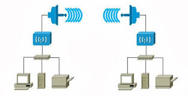
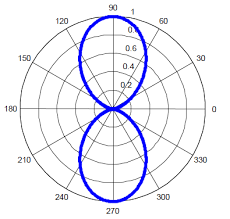

# Cuestionario de repaso — Segundo parcial (U5–U8)

**Alcance previsto:** U5–U8. **Cobertura documentada:** Q01–Q09 sobre capacidad, radioenlaces y satélites, entropía, hardware y jerarquías, null-módem, UTP y detección/corrección. Se incorporan las demás preguntas a medida que se reciben; esto no es un simulacro completo.

**Cómo usarlo:** elegí una opción y justificá tu elección antes de desplegar la resolución. Se preservan el texto y el orden de las opciones; se omiten los rótulos de la plataforma y las marcas de copiado. Las respuestas son razonadas, no una clave oficial.

## Q01 — Teorema de Shannon-Hartley

### Enunciado original

El **Teorema de Shannon-Hartley** es importante porque relaciona fundamentalmente:

1. El ancho de banda y la relación señal/ruido (S/N)
2. Ninguna de las opciones.
3. La singularidad y la longitud de bloque de un código
4. La velocidad de transmisión y el retardo de grupo
5. La atenuación y la distancia

### Datos y condiciones

- **Datos numéricos:** no hay.
- **Qué se pide:** reconocer qué magnitudes relaciona el teorema, no calcular una capacidad.

Mostrar resolución razonada

1. **Partí del problema físico.** El canal sólo deja pasar una banda de frecuencias y el ruido dificulta que el receptor distinga las señales. La pregunta es cuánta información por segundo se puede transmitir de forma confiable con esas dos restricciones.
2. **Identificá qué calcula el teorema.** Para el modelo de canal limitado en banda, con ruido blanco gaussiano aditivo y potencia media de señal limitada, el ancho de banda y la relación señal/ruido determinan el techo teórico de tasa confiable, no la velocidad efectiva de un equipo.

$$
C = B \log_2\left(1+\frac{S}{N}\right)
$$

| Símbolo | Significado | Unidad |
|---|---|---|
| $C$ | Capacidad del canal | bit/s |
| $B$ | Ancho de banda del canal | Hz |
| $S$, $N$ | Potencias medias de señal y ruido en la banda | W |
| $S/N$ | Cociente de potencias | Adimensional (veces, no dB) |

**Respuesta razonada: 1. El ancho de banda y la relación señal/ruido (S/N).** Las dos magnitudes determinan una tercera: la **capacidad**.

**Aplicación en práctica:** en [TP6, primera parte, E1](../practica/tp-06-canales.md#p1-e1), los cortes de 300 Hz y 3 300 Hz dan $B=3\,000$ Hz. Los 30 dB de S/N equivalen a 1 000 veces; entonces $C=3\,000\log_2(1\,001)\approx29\,901{,}68$ bit/s, es decir, **29,90 kbit/s**. No se usa 3 300 Hz como ancho de banda ni se sustituye 30 directamente dentro del logaritmo.

**Por qué no las otras opciones:**

- **2.** La opción 1 sí identifica las variables del teorema.
- **3.** La [singularidad y la longitud de bloque](../teoria/05-teoria-informacion-codificacion/APUNTE.md#propiedades) describen propiedades de un código; no son las magnitudes que determinan esta capacidad.
- **4.** La velocidad de transmisión no es el distractor por sí sola: el teorema sí establece un límite de tasa. El error es combinarla con el [retardo de grupo](../teoria/06-canales-comunicaciones/APUNTE.md#distorsion), que se estudia como mecanismo de distorsión cuando varía con la frecuencia.
- **5.** La [atenuación](../teoria/06-canales-comunicaciones/APUNTE.md#atenuacion) puede afectar la potencia de señal recibida y así el S/N. La distancia no aparece directamente en la ecuación.

**Conexión U5–U6:** la [tasa de información de la fuente (U5)](../teoria/05-teoria-informacion-codificacion/APUNTE.md#tasa) dice cuánta información se genera por segundo; la [capacidad del canal (U6)](../teoria/06-canales-comunicaciones/APUNTE.md#shannon) pone el techo a lo que se puede transmitir de forma confiable. Se comparan en bit/s, pero no describen lo mismo.

**Evidencia:** enunciado aportado en el chat, pregunta 1; [presentación de U6](../../material/teoria/U6/U%206%20Canales%20de%20Comunicaciones%20y%20control%20de%20errores.pdf#page=6), pp. 6–7 (fórmula y relación banda/S/N); [TP6, primera parte](../../material/practica/U%206/TP%20%206%20%281ra%20parte%29%20%20%20%202026.pdf#page=2), p. 2, E1 (datos del ejemplo).

## Q02 — Diagrama de irradiación de un radioenlace

### Enunciado original

El diagrama de irradiación que se observa corresponde a las antenas de este radioenlace.

Seleccione una:

- Verdadero
- Falso

### Datos y condiciones

- **Datos:** se dan el esquema del enlace y el diagrama polar. No se indica el modelo de antena, la frecuencia ni una ganancia absoluta.
- **Qué se pide:** evaluar si ese diagrama representa la irradiación de las antenas dibujadas.

Mostrar resolución razonada

1. **Identificá hacia dónde tiene que irradiar cada antena.** El dibujo muestra dos antenas de reflector enfrentadas en un enlace punto a punto. Para cada antena se espera un lóbulo principal hacia la otra estación, no dos máximos iguales en direcciones opuestas.
2. **Leé el patrón de una antena.** En el gráfico hay máximos iguales a 90° y 270°. Ese corte en forma de ocho es compatible con un corte del patrón de un dipolo, pero no permite identificar un modelo exacto de antena. Los dos lóbulos no son las dos antenas del dibujo.
3. **Respuesta razonada: Falso.** Un reflector real puede tener lóbulos secundarios y radiación posterior; lo que no corresponde al montaje dibujado es mostrar dos máximos principales de igual nivel en direcciones opuestas.

**Conexión con la práctica:** en el [TP7, E2](../practica/tp-07-medios-comunicaciones.md#ejercicio-02), la ganancia de cada antena entra en el balance del enlace. El diagrama explica por qué importa el apuntamiento: la ganancia que aporta la antena depende de la dirección hacia la otra estación. El gráfico de esta pregunta no da una ganancia absoluta para calcular un balance.

**Evidencia:** enunciado y dos imágenes aportados en el chat, pregunta 2; [presentación de U7](../../material/teoria/U7/U7%20Medios%20de%20Comunicaciones.pdf#page=24), pp. 24 y 34; [apunte U7: antenas](../teoria/07-medios-comunicaciones/apuntes-comunicacion-de-datos-u7.md#radio) y [radioenlace](../teoria/07-medios-comunicaciones/apuntes-comunicacion-de-datos-u7.md#radioenlace). La misma consigna aparece como [Q01 del repaso de U7](u07-medios-comunicaciones.md#q01); acá conserva su numeración del preparcial.

## Q03 — Comunicaciones satelitales

### Enunciado original

Qué afirmación sobre comunicaciones satelitales es correcta?

Seleccione una o más de una:

a. Ninguna de las anteriores

b. La frecuencia de operación del enlace descendente es igual al ascendente

c. Se emplea ARQ Stop & Wait para corregir errores

d. En el down link se puede mejorar la potencia tanto como se necesite con pocas limitaciones

e. La frecuencia de operación del enlace descendente es mayor que la ascendente

### Datos y condiciones

- **Datos numéricos:** no hay. No se especifican órbita, banda ni protocolo.
- **Qué se pide:** seleccionar las afirmaciones correctas. Para justificar la respuesta esperable se toma como referencia el enlace satelital GEO convencional visto en la unidad.

Mostrar resolución razonada y salvedad

1. **Distinguí quién transmite en cada tramo.** La subida va de tierra al satélite; la bajada, del satélite a tierra. En el caso convencional se usan bandas distintas y la bajada suele operar a menor frecuencia. Por ejemplo, la [UIT-R S.1524](https://www.itu.int/dms_pubrec/itu-r/rec/s/R-REC-S.1524-0-200106-I%21%21PDF-E.pdf) documenta redes GEO de aproximadamente 6 GHz de subida y 4 GHz de bajada. Por eso **b** y **e** no describen ese caso; no es una regla universal de asignación.
2. **Ubicá el límite de potencia.** En el downlink transmite el satélite, con potencia eléctrica, amplificadores y disipación térmica limitados. Mejorar el enlace no equivale a poder aumentar indefinidamente la potencia transmitida: **d** es incorrecta.
3. **Evaluá la espera de Stop & Wait.** Se envía una trama y se espera su confirmación antes de enviar la siguiente. Si hay un error, ARQ recupera por retransmisión; no corrige bits en destino como FEC. Con un tiempo de ida y vuelta grande frente al tiempo de envío de la trama, gran parte del tiempo se va esperando. El [RFC 3366, §1.4.1](https://www.rfc-editor.org/rfc/rfc3366.html#section-1.4.1) explica esta limitación. Por eso **c** no es la respuesta esperable para el caso GEO de gran retardo, aunque el retardo no vuelve imposible usar Stop & Wait.
4. **Respuesta esperable en ese encuadre: a. Ninguna de las anteriores.** No es una clave oficial. Como el enunciado no fija órbita ni protocolo, no corresponde descartar **c** en todo sistema satelital ni usar este ítem para corrección automática sin aclarar el alcance.

**Conexión con la práctica:** el [TP7, E7](../practica/tp-07-medios-comunicaciones.md#ejercicio-07) compara retardos de propagación según la órbita. Para evaluar Stop & Wait, al trayecto de ida de los datos hay que sumar el regreso de la confirmación; el retardo del enlace en un sentido no es el tiempo de ida y vuelta.

**Evidencia:** enunciado aportado en el chat, pregunta 3; [presentación de U7](../../material/teoria/U7/U7%20Medios%20de%20Comunicaciones.pdf#page=35), pp. 35–42; [apunte U7: subida y bajada](../teoria/07-medios-comunicaciones/apuntes-comunicacion-de-datos-u7.md#uplink-downlink) y [apunte U6: Stop & Wait](../teoria/06-canales-comunicaciones/APUNTE.md#stop-wait). El [repaso de U7, Q03](u07-medios-comunicaciones.md#q03) conserva una versión con otro orden de opciones: la letra no se traslada entre versiones.

## Q04 — Radioenlace de 20 MHz

### Enunciado original

Dado un enlace radioeléctrico a la frecuencia de 20 MHz,

1. A qué banda del espectro electromagnético de la UIT corresponde?
2. Cuál es la longitud necesaria de las antenas Tx y Rx para un buen rendimiento si las mismas son de media longitud de onda?
3. Si la distancia entre el equipo de radio y la antena es de 25 metros, cuál se usará como línea de transmisión: el coaxil RG 223 C/U o el RG 214/U? Justifique. Usar el folleto técnico.
4. Considerando los datos anteriores para el Tx y Rx, siendo la potencia del transmisor de 100W y la atenuación en el espacio libre con onda ionosférica de 40 dB, qué potencia en mW se recibiría en el receptor suponiendo que la ganancia de cada antena en el Tx y Rx es de 10 dB?

[Folleto técnico adjunto — coaxiles, tabla 2](recursos/segundo-parcial-u05-u08/q04-folleto-coaxil.png)

### Datos y condiciones

- **Datos:** frecuencia de 20 MHz; antenas de media onda; 25 m de coaxil en cada extremo; potencia Tx de 100 W, pérdida del trayecto de 40 dB y ganancia de 10 dB por antena.
- **Qué se pide:** clasificar la banda, calcular el largo de cada antena, elegir el coaxil y calcular la potencia en la entrada del receptor. El folleto rotula la primera alternativa **RG 223/U**: se usa esa fila para el «RG 223 C/U» de la consigna.

Mostrar resolución razonada

1. **Banda: HF (ondas decamétricas).** 20 MHz cae en el intervalo de 3 a 30 MHz de la [UIT-R V.431, tabla 1](https://www.itu.int/rec/R-REC-V.431-9-202510-I/en).
2. **Antenas: 7,50 m nominales cada una.** En aire, tomando $c\approx3\times10^8$ m/s como velocidad de propagación y $f=20\times10^6$ Hz como frecuencia, la longitud de onda $\lambda=c/f$ resulta 15 m; media onda son 7,50 m. Es la longitud total de cada antena, no de cada brazo de un dipolo; el ajuste real depende de su construcción y entorno. No se usa el factor de velocidad del coaxil para esta cuenta.
3. **Coaxil: RG 214/U si el criterio es minimizar pérdidas.** Ambos figuran con 50 Ω nominales; la tabla de atenuación a 20 °C no tiene columna a 20 MHz. Como aproximación, interpolamos linealmente en frecuencia entre 10 y 50 MHz: 20 MHz está a un cuarto del intervalo. Se aplica ese cuarto al incremento de pérdida y se divide por cuatro para pasar de 100 m a 25 m. No es una medición ni una especificación de potencia admisible a 20 MHz.

| Fila de tabla 2 | 10 MHz [dB/100 m] | 50 MHz [dB/100 m] | Estimación a 20 MHz [dB/100 m] | Pérdida por 25 m [dB] |
|---|---:|---:|---:|---:|
| RG 223/U | 3,9 | 9,5 | 5,30 | 1,325 |
| RG 214/U | 2,2 | 5,4 | 3,00 | 0,75 |

4. **Balance: aproximadamente 708 mW.** Seguí el trayecto: transmisor → cable Tx → antena Tx → propagación → antena Rx → cable Rx → receptor. Convertí 100 W a 100 000 mW, es decir, 50 dBm. Restá **ambas** pérdidas de cable, sumá las dos ganancias de antena y usá los 40 dB como pérdida total de propagación dada, sin recalcularla ni descontarla dos veces.

$$
P_{\mathrm{Rx}}\,[\mathrm{dBm}]=50-0{,}75+10-40+10-0{,}75=28{,}50,
\qquad P_{\mathrm{Rx}}\,[\mathrm{mW}]=10^{28{,}50/10}\approx707{,}95.
$$

$P_{\mathrm{Rx}}$ es la potencia en la entrada del receptor: dBm expresa el nivel respecto de 1 mW, y las pérdidas/ganancias relativas se suman o restan en dB. Se supone que las ganancias son efectivas en la dirección del enlace y compatibles con el balance; no se agregan conectores, desadaptación ni margen de desvanecimiento no informados.

**Evidencia y conexiones:** folleto adjunto, tabla 2, filas RG 223/U y RG 214/U, columnas de 10 y 50 MHz; [U7: antenas](../teoria/07-medios-comunicaciones/apuntes-comunicacion-de-datos-u7.md#radio) y [presupuesto de enlace](../teoria/07-medios-comunicaciones/apuntes-comunicacion-de-datos-u7.md#radioenlace); [TP7 E1: pérdidas del coaxil](../practica/tp-07-medios-comunicaciones.md#ejercicio-01), [E2: balance](../practica/tp-07-medios-comunicaciones.md#ejercicio-02) y [E3: media onda](../practica/tp-07-medios-comunicaciones.md#ejercicio-03).

## Q05 — Entropía de una fuente de memoria nula

### Enunciado original

¿Qué describe la Entropía de una fuente de memoria nula?

1. La cantidad de bits en los que difieren dos secuencias
2. El valor medio de información o incertidumbre de una fuente
3. La disminución de la intensidad de la señal útil
4. La máxima velocidad de transmisión que se puede cursar libre de errores
5. Ninguna de las opciones.

### Datos y condiciones

- **Datos:** no hay probabilidades ni valores numéricos. La fuente es de memoria nula.
- **Qué se pide:** identificar qué magnitud describe la entropía, no calcularla.

Mostrar resolución razonada

**Respuesta: 2. El valor medio de información o incertidumbre de una fuente.** Con memoria nula, conocer las emisiones anteriores no cambia las probabilidades de la siguiente. La entropía promedia la información de los resultados posibles según su probabilidad. En [TP5 E7](../practica/tp-05-informacion-codificacion.md#ejercicio-07), una fuente binaria equiprobable de memoria nula tiene entropía de 1 bit/símbolo. Memoria nula no implica equiprobabilidad.

**Distractores:** 1 es distancia de Hamming para secuencias de igual longitud; 3 es atenuación; 4 alude a capacidad del canal (bit/s), no a incertidumbre media por símbolo; 5 no aplica porque 2 es correcta.

**Evidencia:** enunciado aportado en el chat; [apunte U5: entropía y memoria nula](../teoria/05-teoria-informacion-codificacion/APUNTE.md#entropia). Compará con la capacidad de [Q01](#q01).

## Q06 — Asociaciones entre tecnologías

### Enunciado original

Qué opciones constituyen términos relacionados correctamente?

Seleccione una o más de una:

a. Cablemodem - GPON

b. Ninguno de los anteriores

c. Banda base - modulación

d. E2 - PDH

e. HDSL - asimétrico

### Datos y condiciones

- **Datos:** cinco pares de términos; no hay valores numéricos.
- **Qué se pide:** reconocer las asociaciones correctas en el sentido de la clasificación de la materia.

Mostrar resolución razonada y salvedad

- **d. E2 - PDH:** asociación inequívoca. E2 es el segundo orden de la jerarquía digital plesiócrona europea; su tasa nominal es 8 448 kbit/s ([UIT-T G.742, §§1–2](https://www.itu.int/rec/T-REC-G.742-198811-I/en)). Cuatro tributarios E1 suman 8 192 kbit/s; la diferencia corresponde a la estructura del multiplex, no a otro tributario.
- **a.** El cable módem se asocia con CATV/HFC y DOCSIS; [GPON](https://www.itu.int/rec/T-REC-G.984.1/en) es una red óptica pasiva. Que HFC tenga un tramo de fibra no lo convierte en GPON.
- **c.** En la distinción de U8, el módem de banda base no traslada los datos a una portadora como el módem vocal; no se marcaría en ese encuadre. «Modulación» sin calificar es ambiguo: en un sentido más amplio existen técnicas en banda base, como PAM. No memorices que «en banda base no existe modulación».
- **e.** HDSL es simétrico; ADSL es el ejemplo asimétrico ([UIT-T G.991.1, resumen](https://www.itu.int/ITU-T/recommendations/rec.aspx?id=4524)).
- **b.** No aplica porque d es correcta.

**Evidencia:** enunciado aportado en el chat; [U4: PDH](../teoria/04-modulacion-digitalizacion-multiplexacion/APUNTE.md#pdh-sdh) y [U8: banda base](../teoria/08-hardware-comunicaciones/APUNTE.md#banda-base), [xDSL](../teoria/08-hardware-comunicaciones/APUNTE.md#xdsl) y [cable módem](../teoria/08-hardware-comunicaciones/APUNTE.md#cable-modem). **Pendiente:** clave del aula para el alcance de c.

## Q07 — Cable null módem

### Enunciado original

En la recomendación RS 232, ¿qué afirmación es correcta respecto del cable null módem?

Seleccione una:

a. La longitud máxima es de 30 metros.

b. Deben cruzarse los conductores de GND y SIG.

c. No deben cruzarse los conductores de RTS con CTS

d. Ninguna de las anteriores

e. Tiene el mismo tipo de conector en ambos extremos.

### Datos y condiciones

- **Datos:** 30 metros aparece como opción, no como premisa. No se especifica qué fichas usan los equipos ni la variante de control de flujo.
- **Qué se pide:** reconocer la opción correspondiente al null módem.

Mostrar resolución razonada y salvedad

**Respuesta esperable: e**, según el ejemplo de cátedra de dos DB-25 hembra. El [cuestionario de interfaces de U8](u08-interfaces-digitales.md) registra la misma afirmación marcada como correcta en otra versión de la pregunta. No se traslada la letra de esa versión.

**Qué lo define:** conecta dos DTE; TD de cada equipo llega a RD del otro y el retorno de señal se conserva. La igualdad de conectores no es universal: [Lantronix documenta un null-módem DE-9 a DB-25](https://ltrxdev.atlassian.net/wiki/spaces/LTRXTS/pages/105906724/RS232%2BSerial%2BCable%2BWiring).

**Distractores en ese encuadre:** a no es un máximo inherente al cable; b confunde protección con retorno de señal; c no vale como regla porque hay variantes que cruzan RTS con CTS entre extremos y otras con puentes locales; d no coincide con el ejemplo ilustrado. Sin ese encuadre, e no es una definición general.

**Evidencia:** enunciado aportado en el chat; [apunte U8: cables y variantes](../teoria/08-hardware-comunicaciones/APUNTE.md#cables), presentación de U8 pp. 14 y 16. La corrección documentada del otro cuestionario no es una clave oficial de este preparcial.

## Q08 — Lectura de un folleto UTP

### Enunciado original

Qué afirmación sobre cableado UTP es correcta, teniendo en cuenta el folleto técnico adjunto?

a. Ninguna de las anteriores

b. La diafonía NEXT es de 49,25 dB a 7 MHz

c. La resistencia a la corriente continua supera los 10 ohms dentro de los 100 m

d. La impedancia es de 100 ohms operando a 1 GHz

e. La diafonía NEXT es de 57,67 dB a 6 MHz

[Folleto técnico adjunto — Berk-Tek, Performance Data](recursos/segundo-parcial-u05-u08/q08-folleto-utp.png)

### Datos y condiciones

- **Datos de la ficha:** fila NEXT, peor caso: 53 dB a 4 MHz y 48 dB a 8 MHz; impedancia nominal de 100 Ω en 1–100 MHz; resistencia de CC máxima de 9,38 Ω/100 m.
- **Qué se pide:** reconocer qué afirmación concuerda con la ficha. No hay columnas de 6 ni 7 MHz; la consigna no especifica un método de interpolación.

Mostrar resolución razonada y salvedad

1. **Leé la fila correcta.** NEXT caracteriza el acoplamiento entre pares medido en el extremo cercano. La fila del folleto expresa pérdida de diafonía en dB: un valor más alto significa menor acoplamiento.
2. **Estimá a 7 MHz.** Si se interpola linealmente en frecuencia, 7 MHz está a tres cuartos del intervalo de 4 a 8 MHz. Se recorre tres cuartos de una caída de 5 dB: $53+(3/4)(48-53)=49{,}25$ dB. A 6 MHz, el punto medio da 50,50 dB con el mismo método, no 57,67 dB.
3. **Respuesta esperable: b, si se admite interpolar.** 49,25 dB es una estimación, no un valor tabulado ni una garantía a 7 MHz. Si se exigieran sólo valores explícitos de la ficha, **a** sería defendible.

**Distractores:** c contradice el máximo de 9,38 Ω/100 m; d traslada los 100 Ω a 1 GHz, fuera del rango de la ficha; e no está tabulada y no coincide con la misma interpolación.

**Evidencia:** folleto adjunto, sección *Performance Data*, fila NEXT (*Worst Case*) y especificaciones de impedancia y resistencia; [apunte U7: pares y diafonía](../teoria/07-medios-comunicaciones/apuntes-comunicacion-de-datos-u7.md#pares).

## Q09 — Detección y corrección por distancia mínima

### Enunciado original

Dado el siguiente código compuesto por 4 mensajes:

000     110     011     101

Cuántos errores detecta y cuantos corrige?

Se indica número detección, número corrección. Ejemplo: 3,2

Seleccione una o más de una:

a. Ninguna de las anteriores

b. 2,0

c. 1,0

d. 2,1

e. 1,1

### Datos y condiciones

- **Datos:** cuatro palabras válidas de tres bits. Se consideran cambios de bits dentro de una palabra, no inserciones ni borrados.
- **Qué se pide:** indicar los máximos garantizados de detección y corrección, en ese orden.

Mostrar resolución razonada

1. **Compará palabras válidas.** Las seis parejas difieren en dos posiciones: desde 000 a cada una de las otras se encienden dos bits; entre dos palabras con dos unos, un uno cambia de posición (cambian dos bits). Por lo tanto, la distancia mínima es 2.
2. **Detectar no es corregir.** Cambiar un bit rompe la paridad par y da una palabra inválida: el receptor detecta el error. Pero si recibe 100, pudo venir de 000, 110 o 101 con un cambio; no puede saber cuál corregir. Con dos cambios incluso se puede pasar de 000 a 110 sin que el receptor detecte nada.
3. **Respuesta: c. 1,0.** b y d atribuyen detección garantizada de dos cambios; d y e atribuyen corrección de uno; a no aplica porque c coincide.

**Evidencia y práctica:** enunciado aportado en el chat; [U6: distancia de Hamming](../teoria/06-canales-comunicaciones/APUNTE.md#hamming) y [TP6: ejemplo de código corrector](../practica/tp-06-canales.md#hamming-guia). El [repaso U6](u06-control-errores.md) incluye estas mismas palabras con opciones reordenadas.

