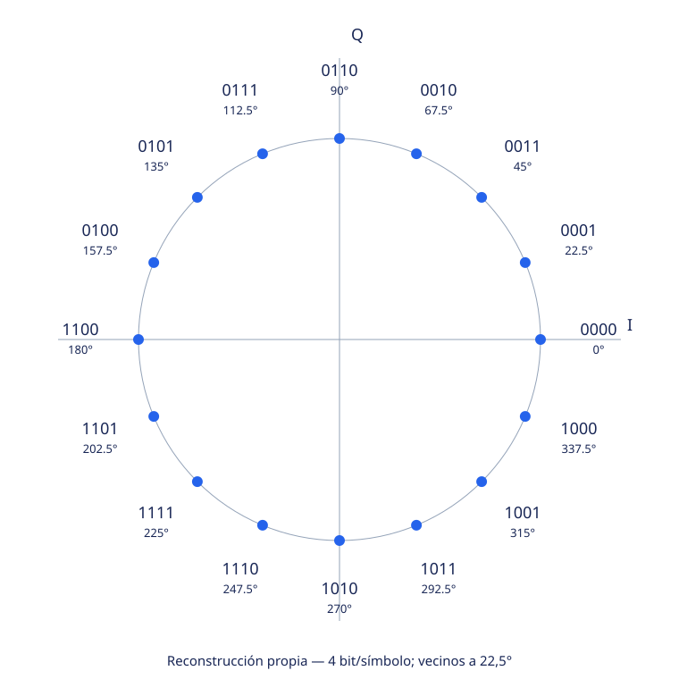

# Repaso U4 — Cuatro preguntas registradas

**Origen:** [cuestionario original](../../capturas/teoria/Cuestionarios/cuestionario%20-%20modulacion%20y%20multiplexacion.md), preguntas 1–4, y su [respuesta gráfica Q2](../../capturas/teoria/Cuestionarios/image.png). Se mantienen esos cuatro IDs, sin agregar un simulacro. Las correcciones son elaboración propia contrastada con los originales; no se modificó la captura.

## Preguntas — resolvé antes de mirar la corrección

<a id="q1"></a>
### U04-Q01 — Parámetro de portadora

**Enunciado (transcripción literal — captura Cuestionarios, Pregunta 1):** «El método de modulación en el cual se varía la frecuencia de la portadora según la información es el:»

**Opciones originales:**

a. PSK  
b. ASK  
c. PDM  
d. PAM  
e. Ninguna de las anteriores

**Condiciones/contexto:** pregunta conceptual sobre la variable de la portadora; no hay magnitudes numéricas.

<a id="q2"></a>
### U04-Q02 — PSK y QAM

**Enunciado (transcripción literal — captura Cuestionarios, Pregunta 2):**

> Se transmite por un canal que permite una velocidad de modulación de 4800 baudios con una modulación 8-PSK.
>
> 1. ¿Qué velocidad de transmisión se alcanza? Proponer el diagrama de estados y el cuadro con la mejor asignación de combinación de bits a cada fase.
> 2. Si se empleara la modulación 16-PSK no variando las condiciones, ¿cuál sería la velocidad de transmisión? Compare la probabilidad de error de ambas modulaciones. ¿Cómo se resuelven las diferencias respecto de este parámetro?
> 3. Si pasamos del 16-PSK con la misma cantidad de estados a una modulación M-QAM, ¿cuál tiene mejor respuesta frente a la probabilidad de errores? Justifique.

**Datos del enunciado:** velocidad de modulación de 4800 baudios; 8-PSK en el punto de partida; luego 16-PSK sin cambiar las condiciones; y comparación final con M-QAM de igual cantidad de estados ($M=16$).

**Condiciones de la comparación de error (aportadas por el gráfico de respuesta adjunto, no por la consigna):** M-PSK con detección coherente y canal AWGN; comparación a igual $E_b/N_0$. El gráfico también compara 16-QAM con 16-PSK a igual cantidad de estados y el mismo $E_b/N_0$. Se atribuyen esas condiciones al gráfico para no hacerlas pasar por parte del enunciado.

<a id="q3"></a>
### U04-Q03 — Digitalización

**Enunciado (transcripción literal — captura Cuestionarios, Pregunta 3):** «En la digitalización de señales analógicas, ¿qué opción incluye a todos los procesos necesarios y en el orden correspondiente?»

**Opciones originales:**

a. Muestreo, cuantificación, codificación  
b. Muestreo, cuantificación, señalización  
c. Ninguno de los anteriores  
d. Modulación, cuantificación, codificación  
e. Muestreo, codificación, cuantificación

**Condiciones/contexto:** pregunta conceptual sobre la digitalización de señales analógicas; no contiene datos numéricos.

<a id="q4"></a>
### U04-Q04 — Ruido granular y multiplexación

**Enunciado (transcripción literal — captura Cuestionarios, Pregunta 4):** «¿En qué técnica de multiplexión tiene presencia el ruido granular por el tipo de procesamiento que implica?»

**Opciones originales:**

a. Ninguna de las anteriores  
b. TDM  
c. FDM  
d. CDM  
e. WDM

**Condiciones/contexto:** la consigna original no especifica PCM. La explicación de la captura marca TDM en un contexto de PCM y multiplexación; explica además la cuantificación de una señal analógica. Ese contexto pertenece a la respuesta, no al texto del enunciado. No hay valores numéricos.

---

## Corrección razonada — separada de las preguntas

### U04-Q01

**Resolución paso a paso.** **Paso 1:** identificar el parámetro que cambia: frecuencia. **Paso 2:** reconocer sus nombres —FM para moduladora analógica o FSK para símbolos digitales— y revisar las opciones: ninguna aparece, por eso corresponde **e)**. PSK cambia fase; ASK, amplitud; PAM, amplitud de pulsos; PDM, duración. Evidencia: Modulación 1, PDF pp. 5–6 y 12–14; [teoría](../teoria/04-modulacion-digitalizacion-multiplexacion/APUNTE.md#modulacion).

### U04-Q02

**Resolución paso a paso.** **Paso 1:** contar bits de cada estado antes de multiplicar por símbolos por segundo. Para repertorio fijo de potencia de dos y sin redundancia, $b_s=\log_2M$ y $V_t=V_mb_s$.

| Símbolo | Significado | Unidad |
|---|---|---|
| $M$ | Estados permitidos | adimensional |
| $b_s$ | Bits por símbolo | bit/símbolo |
| $V_m$ | Símbolos por segundo | baudios |
| $V_t$ | Tasa binaria antes de overhead | bit/s |

#### Paso 2 — 8-PSK: resultado, cuadro y diagrama propios

$\log_2 8=3$ bit/símbolo; $4800\times3=14\,400$ bit/s. Separación: 360°/8 = **45°**. Tomamos fase 0° sobre el eje I positivo y recorrido antihorario; los ocho puntos tienen igual radio. Ésta es la convención de P PDF p.14/CP; no se mezclan sus etiquetas con la alternativa M1 p.19/C5.

| Fase | Bits Gray |
|---:|:---:|
| 0° | 000 |
| 45° | 001 |
| 90° | 011 |
| 135° | 010 |
| 180° | 110 |
| 225° | 111 |
| 270° | 101 |
| 315° | 100 |

```text
                         Q
                     011 (90°)
                         |
       010 (135°)         |         001 (45°)
                  \      |      /
 110 (180°) ------------- O ------------- 000 (0°) → I
                  /      |      \
       111 (225°)         |         100 (315°)
                         |
                     101 (270°)
```

Los extremos representan puntos equidistantes del origen O, no flechas de un cambio temporal obligatorio. Gray cambia un bit entre vecinos, incluso 100 → 000 al cierre. No es la única asignación válida y no corrige errores. El [TP E4](../practica/tp-04-modulacion-multiplexacion.md#e4) amplía el desarrollo; no hace falta abrirlo para ver la salida pedida.

#### Paso 3 — 16-PSK: resultado, cuadro y diagrama propios

$\log_2 16=4$ bit/símbolo; $4800\times4=19\,200$ bit/s. Separación: 360°/16 = **22,5°**, con la misma referencia angular y radio uniforme.

| Fase | Bits Gray |
|---:|:---:|
| 0° | 0000 |
| 22,5° | 0001 |
| 45° | 0011 |
| 67,5° | 0010 |
| 90° | 0110 |
| 112,5° | 0111 |
| 135° | 0101 |
| 157,5° | 0100 |
| 180° | 1100 |
| 202,5° | 1101 |
| 225° | 1111 |
| 247,5° | 1110 |
| 270° | 1010 |
| 292,5° | 1011 |
| 315° | 1001 |
| 337,5° | 1000 |



Las 16 etiquetas son únicas y los vecinos cambian un bit, incluido 1000 → 0000. El gráfico representa los mismos estados que el [TP E5](../practica/tp-04-modulacion-multiplexacion.md#e5), pero acá la tasa se calcula con los **4800 baudios de Q2**, no con los 2400 del TP.

A energía comparable, 16 fases se acercan más que 8: aumenta la exigencia frente al ruido. Puede requerirse más energía relativa o protección codificada (TCM registrado), con sus condiciones/costos. Gray no aleja puntos ni corrige errores. No se calcula BER sin modelo de canal/detector.

#### Paso 4 — Comparación con QAM

Igual cantidad de estados significa **16-QAM**, no cualquier orden. Con constelación rectangular, igual energía media y canal/receptor comparables, sus distancias permiten mejor respuesta que 16-PSK. No concluir «toda QAM siempre supera toda PSK». Evidencia: Modulación 1 pp.19–24, especialmente curvas p.24; [comparación y condiciones](../teoria/04-modulacion-digitalizacion-multiplexacion/APUNTE.md#psk-qam). La tabla gráfica de parámetros no se usa como umbral absoluto: su condición BER está pendiente de aclaración.

### U04-Q03

**Resolución paso a paso.** **Paso 1:** muestrear selecciona instantes. **Paso 2:** cuantificar aproxima amplitudes a niveles finitos. **Paso 3:** codificar asigna palabras binarias. Por eso, **a)** es la opción correcta. Tener pulsos no basta para ser digital: PAM puede mantener amplitudes continuas. Evidencia: Modulación 2 pp. 3–5; [PCM](../teoria/04-modulacion-digitalizacion-multiplexacion/APUNTE.md#pcm).

### U04-Q04 — Clave contextual, no causalidad universal

**Resolución paso a paso.** **Paso 1 — leer la respuesta contextual de la captura:** marca **b) TDM** para el esquema de procesamiento analógico, PCM y multiplexación. Modulación 2 p. 4 llama granular/de cuantificación al error de aproximar amplitudes; Multiplexación pp. 15–17 presenta canales PCM reunidos temporalmente. Esa evidencia permite conservar la clave **b en ese contexto**, sin añadir PCM a la transcripción del enunciado. **Ejemplo pedagógico propio (no mencionado en la captura):** voz analógica → PCM → TDM.

**Paso 2 — distinguir el proceso:** TDM separa por tiempo, NO cuantifica por sí mismo. Si reúne flujos digitales existentes, no introduce automáticamente ruido granular. El error aparece en el cuantificador PCM previo; en Delta, el término también describe oscilación de la escalera alrededor de una entrada lenta (Modulación 2 pp. 11–12). FDM/WDM/CDM tampoco prohíben transportar información previamente cuantificada. Una pregunta sin contexto analógico/PCM sería ambigua y no tendría esa respuesta universal.

Respuesta de examen: «En el sistema PCM-TDM del curso, la cuantificación previa introduce el error granular; la multiplexación temporal no lo genera por definición». [PCM](../teoria/04-modulacion-digitalizacion-multiplexacion/APUNTE.md#pcm) y [Delta](../teoria/04-modulacion-digitalizacion-multiplexacion/APUNTE.md#delta-dpcm).

## Alcance y autocontrol

Sólo Q1–4 registradas. Enunciados/corrección separados; enlace Q2 gráfico original inspeccionado; tasas y vecinos Gray recalculados. Retest 2026-10-13: cuadros 8/16 y sus dibujos propios coinciden en los 24 estados; no se necesita abrir TP para completar Q2. Pendientes de BER, sensibilidad FM y simplificación μ no se evalúan como datos confirmados. Candidato en-progreso: espera re-revisión independiente de las correcciones.
