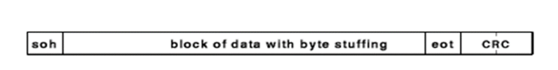
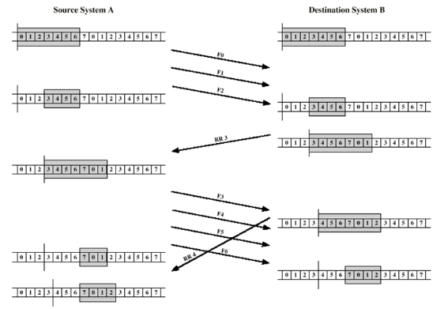

# Cuestionario — Unidad 6: control de errores

**Alcance:** seis preguntas sobre detección, corrección, paridad, CRC, ARQ, ventanas y distancia de Hamming.

**Fuente de los enunciados:** transcripción compartida por el usuario. La pregunta 6 remite a la [imagen original de la consigna en Moodle](https://aulasvirtuales.frba.utn.edu.ar/pluginfile.php/3787913/question/questiontext/2817945/6/44833443/ARQ%20ventana.png). No se aportó una clave oficial: las respuestas se contrastan con el material de U6 y, para Q6, con el diagrama provisto.

### Q01 — Detección y corrección

#### Enunciado original (transcripción literal)

Qué afirmación es correcta respecto de control de errores?

a. CRC es una técnica de corrección de errores

b. Suma de verificación aplica bits de paridad

c. FEC es una técnica de corrección de errores hacia atrás

d. ARQ es aplicable a una comunicación punto a multipunto

e. Ninguna de las anteriores

#### Datos y condiciones

- **Datos numéricos:** no hay.
- **Premisas o condiciones:** es una selección múltiple; el enunciado no aclara si pregunta por la caracterización simplificada de las láminas o por aplicabilidad general.
- **Qué se pide:** identificar las afirmaciones que el material permite considerar correctas.

Mostrar resolución razonada

#### Resolución paso a paso

1. **Separamos detección de recuperación.** CRC comprueba una relación entre los bits y el resto calculado; por sí solo no reconstruye datos ni corrige el bloque. La suma de verificación también es un mecanismo de detección, distinto de agregar un bit de paridad.
2. **Separamos las dos direcciones de recuperación.** ARQ es corrección hacia atrás: primero se detecta el error y luego se solicita repetir el bloque. FEC es corrección hacia adelante: se agrega redundancia para intentar recuperar sin pedir esa retransmisión.
3. **Evaluamos d según su lectura literal general.** Sí existen protocolos de multicast fiable basados en NACK que solicitan reparación/retransmisión; RFC 5401 describe esos mecanismos e incluye ARQ selectivo. Por lo tanto, d es verdadera como afirmación general de aplicabilidad.
4. **Contrastamos con el alcance de la cátedra.** Las láminas U6 presentan el ARQ básico «entre dos estaciones» y FEC «entre dos o más». Si el examen restringe la respuesta a esa taxonomía introductoria, d se tomaría como falsa y la opción resultante sería e. El enunciado no explicita esa restricción; por eso el ítem es ambiguo y no se debe fijar una clave única sin confirmar qué alcance pretende.
5. **Respuesta:** **ambigua**. En lectura técnica general, **d**; bajo el modelo simplificado de las láminas, **e**.
6. **Distractores:** a confunde detección con corrección; b confunde suma de verificación con paridad; c invierte las direcciones de FEC y ARQ.

**Fuente/evidencia:** [APUNTE U6, detección y corrección](../teoria/06-canales-comunicaciones/APUNTE.md#control), [CRC](../teoria/06-canales-comunicaciones/APUNTE.md#crc), [checksum](../teoria/06-canales-comunicaciones/APUNTE.md#checksum), [ARQ](../teoria/06-canales-comunicaciones/APUNTE.md#arq) y [FEC](../teoria/06-canales-comunicaciones/APUNTE.md#fec); PDF U6, pp. 27–31 y 34. Para la posibilidad de ARQ en multicast, ver [RFC 5401, NACK-based reliable multicast](https://www.rfc-editor.org/rfc/rfc5401.html), §§1 y 4.

### Q02 — Bit de paridad

#### Enunciado original (transcripción literal)

El método de detección de errores mediante bit de paridad ...

1. detecta el 100 % de los errores que se pueden producir.

2. detecta el 70 % de los errores que se pueden producir.

3. detecta una cantidad par de errores.

4. corrige una cantidad impar de errores.

5. Ninguna de las opciones es elegible.

#### Datos y condiciones

- **Datos numéricos:** no hay.
- **Premisas o condiciones:** respuesta única; se trata de paridad simple aplicada al grupo de bits comprobado. El enunciado no establece un modelo probabilístico de errores.
- **Qué se pide:** elegir la afirmación correcta sobre detección y corrección.

Mostrar resolución razonada

#### Resolución paso a paso

1. **Observamos qué pasa al invertir bits.** Cada bit alterado cambia la paridad total. Por eso, un número impar de inversiones cambia el resultado de la comprobación y se detecta.
2. **Identificamos el límite.** Un número par de inversiones puede conservar la paridad acordada; el receptor no detecta necesariamente esos errores. El bit de paridad tampoco identifica cuál bit se alteró y, por sí solo, no corrige.
3. **No asignamos un porcentaje sin distribución de errores.** «70 %» no se deduce del método; dependería de un modelo de probabilidad no dado.
4. **Respuesta:** **5. Ninguna de las opciones es elegible.** La redacción «elegible» se conserva tal como fue suministrada.
5. **Distractores:** 1 exagera la cobertura; 2 inventa una tasa sin modelo; 3 invierte el comportamiento; 4 atribuye corrección a una comprobación que sólo detecta ciertos patrones.

**Fuente/evidencia:** [APUNTE U6, paridad](../teoria/06-canales-comunicaciones/APUNTE.md#paridad); PDF U6, pp. 24–25.

### Q03 — Qué contiene el campo CRC

#### Enunciado original (transcripción literal)

El campo indicado como CRC en la unidad de datos de un protocolo, lleva el polinomio generador con el cual se está trabajando.

Imagen del enunciado: `soh | block of data with byte stuffing | eot | CRC`.

Verdadero

Falso

#### Datos y condiciones

- **Datos numéricos:** no hay.
- **Premisas o condiciones:** selección simple; la imagen muestra un campo CRC al final del bloque y la proposición afirma que ese campo transporta el polinomio generador.
- **Qué se pide:** determinar si la proposición es verdadera o falsa.

Mostrar resolución razonada

#### Resolución paso a paso

1. **Diferenciamos el algoritmo del valor transmitido.** El generador $G(x)$ es el polinomio acordado para calcular la comprobación. El emisor divide el mensaje desplazado por ese generador y obtiene un resto $R(x)$.
2. **Identificamos qué representa el campo.** En el esquema didáctico, el campo CRC lleva los bits de comprobación —el resto calculado—, no el polinomio generador completo. El receptor usa el generador acordado para verificar la secuencia recibida.
3. **Respuesta:** **Falso.**
4. **Por qué la otra opción no corresponde:** «Verdadero» confunde el parámetro del cálculo ($G(x)$) con el resultado que se incluye en la trama (CRC/FCS).

**Fuente/evidencia:** [APUNTE U6, CRC](../teoria/06-canales-comunicaciones/APUNTE.md#crc); PDF U6, pp. 27–28. La representación de SOH, datos, EOT y CRC se limita a la figura de la consigna; no se afirma que toda trama CRC use esos delimitadores.

### Q04 — Funciones de ARQ y ventana

#### Enunciado original (transcripción literal)

Qué afirmación sobre ARQ es correcta?

a. No emplea técnicas para detección de errores

b. Emplea sólo confirmación positiva de recepción

c. Es considerada una técnica de control de errores y de flujo

d. El tamaño de ventana es la cantidad de paquetes que se transmiten sin esperar conformidad.

e. Ninguna de las anteriores

#### Datos y condiciones

- **Datos numéricos:** no hay.
- **Premisas o condiciones:** selección múltiple; «conformidad» se interpreta como confirmación/ACK, en el contexto de ARQ con ventanas.
- **Qué se pide:** identificar las afirmaciones correctas sobre ARQ.

Mostrar resolución razonada

#### Resolución paso a paso

1. **ARQ necesita detección.** Primero se detecta el bloque incorrecto; luego la realimentación permite pedir su retransmisión. Por eso a es falsa.
2. **No usa sólo confirmaciones positivas.** El material diferencia ACK (confirmación positiva) y NAK (negativa); además, un temporizador puede disparar una retransmisión cuando no llega la confirmación esperada. Por eso b es falsa.
3. **Controla errores y flujo.** La lámina de U6 lo indica expresamente; la ventana regula cuántas tramas pueden quedar pendientes antes de que el emisor necesite avanzar con confirmaciones. Por eso c es verdadera.
4. **Interpretamos la ventana con precisión.** Su tamaño limita la cantidad máxima de paquetes/tramas sin confirmar que pueden estar en vuelo. No significa que siempre se envíe exactamente esa cantidad: al llegar al límite, el emisor espera a que las confirmaciones deslicen/liberen la ventana. Por eso d es verdadera en el sentido simplificado del enunciado.
5. **Respuesta:** **c y d.**
6. **Distractores:** a niega la etapa de detección; b omite NAK y temporizadores; e es falsa porque sí hay afirmaciones correctas.

**Fuente/evidencia:** [APUNTE U6, ARQ](../teoria/06-canales-comunicaciones/APUNTE.md#arq) y [ventana deslizante](../teoria/06-canales-comunicaciones/APUNTE.md#ventana); PDF U6, pp. 31–33.

### Q05 — Distancia mínima del código

#### Enunciado original (transcripción literal)

Dado el siguiente código compuesto por 4 mensajes:

000     110     011     101

Cuántos errores detecta y cuantos corrige?

Se indica número detección, número corrección. Ejemplo: 3,2

a. 1,0

b. 1,1

c. 2,0

d. 2,1

e. Ninguna de las anteriores

#### Datos y condiciones

- **Datos:** palabras de código de tres bits: `000`, `110`, `011` y `101`.
- **Premisas o condiciones:** la consigna permite seleccionar una o más opciones; se consideran las cuatro palabras válidas indicadas. Detección y corrección garantizadas se calculan con la distancia de Hamming mínima.
- **Qué se pide:** indicar cuántos errores se detectan y cuántos se corrigen.

Mostrar resolución razonada

#### Resolución paso a paso

1. **Calculamos las distancias de Hamming.** Todas las parejas distintas de la lista difieren en dos posiciones:

   | Pareja | Distancia |
   |---|---:|
   | `000`–`110` | 2 |
   | `000`–`011` | 2 |
   | `000`–`101` | 2 |
   | `110`–`011` | 2 |
   | `110`–`101` | 2 |
   | `011`–`101` | 2 |

2. **Obtenemos la distancia mínima:** $d_{H,\min}=2$.
3. **Aplicamos las capacidades del código:**

   $$e_{det}=d_{H,\min}-1=1,\qquad e_{corr}=\left\lfloor\frac{d_{H,\min}-1}{2}\right\rfloor=0.$$

4. **Respuesta:** **a. 1,0** — garantiza detectar un error, pero no corregir ninguno.
5. **Distractores:** b atribuye corrección con $d_{H,\min}=2$; c y d afirman detección de dos errores, que requeriría distancia mínima al menos 3; e es falsa porque la opción a coincide.

**Fuente/evidencia:** [APUNTE U6, distancia y capacidades](../teoria/06-canales-comunicaciones/APUNTE.md#hamming); PDF U6, pp. 35–36. Las distancias de las seis parejas se calcularon sobre las palabras transcritas.

### Q06 — Lectura de ventanas ARQ

#### Enunciado original (transcripción literal)

Qué afirmaciones se pueden asumir como correctas respecto del ARQ aplicado en el intercambio de paquetes del siguiente gráfico?

a. Se opera con tamaño de ventana máximo de 8

b. Del lado origen la ventana no es deslizante

c. Del lado destino se observa en alguna instancia una ventana de 3

d. Del lado de origen se observa en alguna instancia una ventana de 5

e. Ninguna de las anteriores

#### Datos y condiciones

- **Datos:** el gráfico numera secuencias de 0 a 7 y muestra ventanas sombreadas, los envíos F0–F2, la confirmación RR3, los envíos F3–F6 y RR4.
- **Premisas o condiciones:** la consigna permite seleccionar una o más opciones. Se cuentan las posiciones cubiertas por cada ventana sombreada, incluyendo ambos extremos y siguiendo el módulo 8.
- **Qué se pide:** determinar qué opciones describe correctamente el gráfico.

Mostrar resolución razonada

#### Resolución paso a paso

1. **Contamos las posiciones, no los rótulos extremos.** La numeración tiene ocho valores posibles (0–7), pero eso no quiere decir que cada ventana mostrada tenga tamaño 8.
2. **Leemos las ventanas del origen.** En los estados dibujados se observan tamaños 7 (`0–6`), 4 (`3–6`), 7 (`3–1`, con vuelta módulo 8), 3 (`7–1`) y 4 (`7–2`). Por lo tanto, el origen sí desliza su ventana y no aparece una de tamaño 5.
3. **Leemos las ventanas del destino.** Se observan tamaños 7 (`0–6`), 4 (`3–6`), 7 (`3–1`), 7 (`4–2`) y 4 (`7–2`). No se ve una ventana de tamaño 3.
4. **Evaluamos las afirmaciones.** a no se desprende del gráfico: la mayor ventana sombreada tiene 7 posiciones, no 8; además, un máximo teórico depende de la variante ARQ, que el enunciado no identifica. b es falsa porque el origen desplaza la ventana; c y d son falsas por los conteos anteriores.
5. **Respuesta:** **e. Ninguna de las anteriores.**

**Fuente/evidencia:** conteo propio sobre el [diagrama adjunto a Q06](https://aulasvirtuales.frba.utn.edu.ar/pluginfile.php/3787913/question/questiontext/2817945/6/44833443/ARQ%20ventana.png); para el concepto de ventana, [APUNTE U6, ARQ Sliding Windows](../teoria/06-canales-comunicaciones/APUNTE.md#ventana), PDF U6, p. 33. La respuesta se basa en las áreas sombreadas visibles, no en una variante ARQ supuesta.

## Observaciones de alcance

- No se recibió una clave oficial; el desarrollo es una resolución propia contrastada con el material citado.
- Q01 es ambiguo si no se indica alcance: RFC 5401 documenta reliable multicast basado en NACK/ARQ, pero la lámina U6 presenta el ARQ introductorio entre dos estaciones. La clave depende de cuál de esas lecturas se evalúa.
- En Q06, «hay ocho números de secuencia» no equivale a «la ventana tiene ocho posiciones». Tampoco se infiere un máximo teórico universal sin especificar la variante ARQ.
