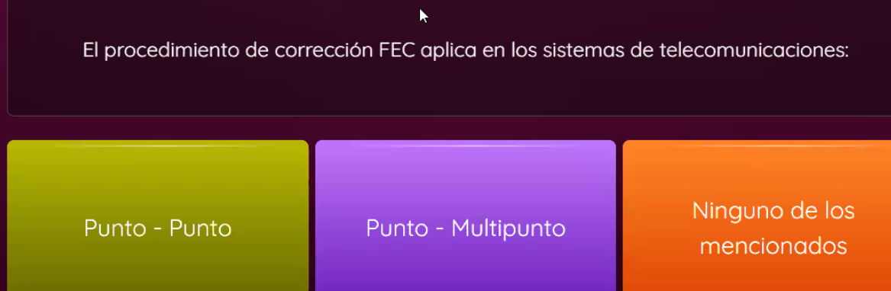
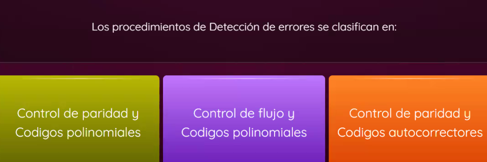
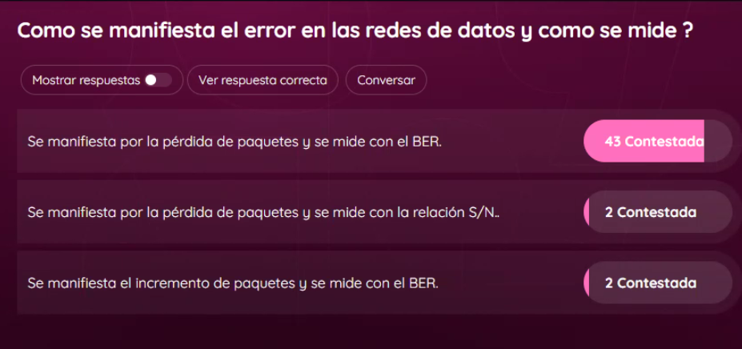

# Cuestionario práctico — Unidad 6: canales y control de errores

**Clase de origen:** práctica del 27/10/2026, que comienza resolviendo este cuestionario de U6. Se documentan las preguntas Q01–Q03 aportadas; este archivo no representa la clase completa ni incluye el posterior repaso y TP de U7.

**Fuente del enunciado:** captura aportada por el estudiante. **Respuesta informada:** indicada por el estudiante durante el registro de clase; la imagen no muestra una corrección.

### Q01 — Aplicación de FEC

#### Enunciado original (transcripción literal)

El procedimiento de corrección FEC aplica en los sistemas de telecomunicaciones:

- Punto - Punto
- Punto - Multipunto
- Ninguno de los mencionados

#### Datos y condiciones

- **Datos numéricos:** no hay.
- **Qué se pide:** seleccionar el sistema al que se aplica el procedimiento de corrección FEC.
- **Respuesta correcta informada en clase por el estudiante:** **Punto - Multipunto**.

Mostrar resolución razonada y aclaración técnica

#### Resolución paso a paso

1. **Problema:** un emisor transmite a varios receptores; si cada receptor solicita repeticiones, la recuperación exige gestionar esas solicitudes.
2. **Concepto:** FEC (*Forward Error Correction*, corrección hacia adelante) permite recuperar información a partir de la redundancia recibida, dentro de la capacidad correctora del esquema, sin pedir una retransmisión para esa recuperación.
3. **Aplicación:** en un sistema punto a multipunto, cada receptor puede aprovechar esa redundancia para corregir localmente. Por eso la respuesta registrada para este cuestionario es **Punto - Multipunto**.
4. **Distractores y límite del enunciado:** «Ninguno de los mencionados» no corresponde al uso señalado. «Punto - Punto» no es la opción indicada en clase, pero FEC **no es exclusivo** de punto a multipunto: también puede emplearse entre dos estaciones. La pregunta no explicita esa distinción; no debe estudiarse como una prohibición de usar FEC en punto a punto.

**Evidencia y alcance del contraste:** [apunte U6, §22: FEC](../teoria/06-canales-comunicaciones/APUNTE.md#fec), que recoge la lámina de cátedra p. 34 («entre dos o más estaciones») y distingue FEC general del doble envío diferido ilustrado. Se consultó el apunte existente y el cache de la lámina; no se realizó un nuevo contraste visual del PDF en este registro.

**Error típico:** confundir «respuesta esperada en este cuestionario» con «única aplicación técnicamente posible».

### Q02 — Clasificación de los procedimientos de detección de errores

#### Enunciado original (transcripción literal)

Los procedimientos de Detección de errores se clasifican en:

- Control de paridad y Codigos polinomiales
- Control de flujo y Codigos polinomiales
- Control de paridad y Codigos autocorrectores

#### Datos y condiciones

- **Datos numéricos:** no hay.
- **Qué se pide:** identificar las dos familias de detección de errores de la clasificación de cátedra.
- **Respuesta correcta informada en clase por el estudiante:** **Control de paridad y Codigos polinomiales**.

Mostrar resolución razonada

#### Resolución paso a paso

1. **Problema:** el receptor necesita comprobar si los bits recibidos presentan errores; detectarlos no equivale a reconstruir automáticamente el mensaje original.
2. **Clasificación de cátedra:** las familias de detección son **control de paridad** y **código polinomial**, desarrollado mediante CRC (chequeo de redundancia cíclica).
3. **Respuesta:** corresponde la primera opción, **Control de paridad y Codigos polinomiales**.
4. **Segundo distractor:** el control de flujo regula el envío según lo que puede recibir o procesar el destinatario; no es una familia de detección de errores.
5. **Tercer distractor:** en el esquema de cátedra, los códigos autocorrectores se agrupan bajo **corrección**, no bajo las dos familias solicitadas de detección. Esto no significa que un código corrector sea incapaz de detectar errores: se distingue la función y la clasificación usada en la pregunta.

**Ejemplo didáctico:** con paridad par, si cambia un único bit, la comprobación de paridad permite detectar la alteración, pero por sí sola no identifica qué bit cambió para corregirlo.

**Evidencia y alcance del contraste:** [apunte U6, mapa de métodos de la p. 22](../teoria/06-canales-comunicaciones/APUNTE.md#mapa-de-metodos-de-la-p-22). La respuesta informada coincide con ese esquema. Se consultó el apunte existente; no se realizó un nuevo contraste visual del PDF en este registro.

**Error típico:** confundir control de flujo, detección y corrección: regulan el ritmo de envío, advierten errores y recuperan información, respectivamente.

### Q03 — Manifestación y medida del error en redes de datos

#### Enunciado original (transcripción literal)

Como se manifiesta el error en las redes de datos y como se mide ?

- Se manifiesta por la pérdida de paquetes y se mide con el BER.
- Se manifiesta por la pérdida de paquetes y se mide con la relación S/N..
- Se manifiesta el incremento de paquetes y se mide con el BER.

#### Datos y condiciones

- **Datos numéricos del problema:** no hay. Los recuentos de respuestas de la interfaz no son datos para calcular BER.
- **Qué se pide:** identificar cómo se manifiesta el error y con qué magnitud se mide.
- **Respuesta oficial:** pendiente de confirmación. La captura muestra 43 respuestas para la primera opción y 2 para cada una de las otras; no muestra cuál está marcada como correcta.

Mostrar análisis de las opciones y aclaración técnica

#### Resolución razonada

1. **Medida:** BER (*Bit Error Ratio*, proporción de bits erróneos) compara los bits erróneos con el total de bits considerados. Es adimensional, no una velocidad en bit/s. El apunte U6, §11, desarrolla esta medida.
2. **Distinción:** la relación señal-ruido S/N describe la potencia de señal respecto de la de ruido; no cuenta directamente errores. Por eso la segunda opción confunde una condición del canal con una medida del resultado de la transmisión.
3. **Manifestación:** como aclaración conceptual de apoyo, un error de transmisión puede alterar bits; si un paquete con errores se descarta, puede observarse como pérdida de paquetes. No todo error implica necesariamente pérdida: depende de la detección, corrección y tratamiento que se aplique.
4. **Lectura del cuestionario:** la primera opción es la candidata más plausible entre las ofrecidas, pero su redacción simplifica la relación entre errores y pérdida. La tercera no describe la manifestación general de un error: las retransmisiones pueden aumentar el tráfico, pero ese aumento es una posible consecuencia del mecanismo de recuperación.
5. **Límite importante:** BER mide errores de **bits**, no directamente la proporción de **paquetes perdidos**. La mayoría de votos no confirma una respuesta ni elimina esta diferencia técnica.

**Ejemplo didáctico del apunte:** 10 bits erróneos entre 1 000 000 de bits considerados representan una BER de $10^{-5}$ (0,001 %). Se cuentan bits del mismo intervalo y punto de observación; este dato solo no permite determinar cuántos paquetes se perdieron.

**Evidencia y alcance:** [apunte U6, §11: BER](../teoria/06-canales-comunicaciones/APUNTE.md#ber), referido a la lámina de cátedra p. 16. Se consultó el apunte existente, sin nuevo contraste visual del PDF. La distinción entre alteración de bits, descarte de paquetes y retransmisión se agrega como apoyo conceptual general; no se atribuye como explicación dada en clase.

**Error típico:** tratar BER y pérdida de paquetes como si fueran la misma medida.

## Pendientes

- Incorporar las siguientes preguntas según se aporten, manteniendo su orden y opciones originales.
- Q03: confirmar qué opción indicó la cátedra como correcta; conservar la salvedad de que BER no mide directamente pérdida de paquetes.
- No se declara revisión integral del cuestionario ni del material U6.
