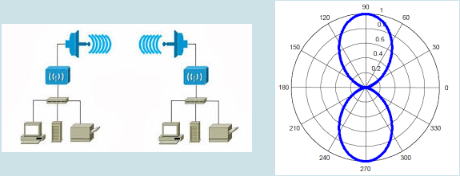
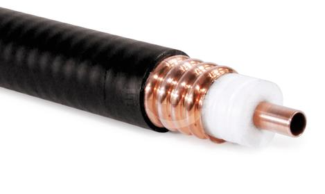

# Cuestionario — Unidad 7: medios de comunicaciones

**Alcance:** seis preguntas conceptuales sobre antenas, coaxil, satélites, par trenzado y fibra óptica. Es un cuestionario de origen, no un simulacro de toda la unidad.

**Cómo usarlo:** leé cada enunciado, elegí tu respuesta y explicá el motivo antes de desplegar la resolución. Al final hay una clave rápida también desplegable.

**Procedencia y transcripción:** se conservan completas las consignas y las opciones, en su orden. Se normaliza la puntuación de las preguntas sin cambiar su sentido y se omiten rótulos de la plataforma —«Pregunta», «Respuesta», estados y puntajes—. La modalidad de selección se registra en **Datos y condiciones**.

Las ilustraciones de Q01 y Q02 son recortes de las capturas aportadas, no recreaciones: muestran lo necesario sin la interfaz. Las copias completas, coordenadas de recorte y hashes se conservan en el [registro de imágenes](recursos/u07-medios-comunicaciones/registro-imagenes.md).

**Estado y límite:** no se aportó una clave oficial. Las respuestas son razonadas y contrastadas con las fuentes indicadas. **Q03 conserva una ambigüedad de alcance:** la respuesta esperable en el planteo satelital convencional es c, pero la opción b no puede declararse universalmente falsa. No usar ese ítem como corrección automática sin aclarar el contexto.

## Fuentes de contraste

- **G — Presentación general:** [U7 Medios de Comunicaciones](../../material/teoria/U7/U7%20Medios%20de%20Comunicaciones.pdf), Ing. Alejandro Echazú. Las páginas cuentan la portada como p. 1.
- **O — Presentación óptica:** [UT 7 Medios de Comunicaciones opticas](../../material/teoria/U7/UT%207%20Medios%20de%20Comunicaciones%20opticas.pdf), del mismo docente; numeración PDF desde la portada.
- **T — Apunte de estudio:** [Medios de comunicaciones](../teoria/07-medios-comunicaciones/apuntes-comunicacion-de-datos-u7.md). Cada resolución enlaza la sección correspondiente y localiza el material original.
- **Apoyo externo de Q03:** [RFC 3366, §1.4.1](https://www.rfc-editor.org/rfc/rfc3366.html#section-1.4.1), sobre Stop & Wait y producto ancho de banda–retardo; [UIT-R S.1524-0](https://www.itu.int/dms_pubrec/itu-r/rec/s/R-REC-S.1524-0-200106-I%21%21PDF-E.pdf), con ejemplos de portadoras de subida y bajada. Consultados el 24/10/2026; no son una clave del cuestionario.

---

## Q01 — Diagrama de irradiación de un radioenlace

### Enunciado y opciones

El diagrama de irradiación que se observa corresponde a las antenas de este radioenlace.

- Verdadero
- Falso

### Datos y condiciones

- **Datos numéricos:** no se dan frecuencia ni características cuantitativas de las antenas.
- **Modalidad:** selección simple, verdadero o falso.
- **Condición:** hay que evaluar conjuntamente el dibujo del enlace y el patrón polar; no alcanza con mirar sólo uno de ellos.
- **Qué se pide:** decidir si el patrón representa a las antenas del radioenlace mostrado.

Mostrar resolución razonada

### Resolución paso a paso

1. **Identificamos la función de las antenas.** El dibujo representa un enlace punto a punto con antenas de reflector enfrentadas. Interesa concentrar la radiación hacia la estación del otro extremo, no repartirla de igual manera hacia delante y hacia atrás.
2. **Leemos el gráfico.** El patrón tiene dos lóbulos iguales y opuestos, con máximos a 90° y 270°. Es compatible con un corte del patrón de un dipolo; no representa el patrón global de una antena parabólica de radioenlace, cuyo lóbulo principal domina en la dirección de apuntamiento.
3. **Contrastamos ambas partes.** Una parabólica real puede tener lóbulos secundarios y radiación posterior; lo que no corresponde aquí es representar su respuesta con dos lóbulos opuestos de igual magnitud.
4. **Respuesta: Falso.**
5. **Por qué no «Verdadero»:** confunde el patrón de dos lóbulos mostrado con la radiación concentrada hacia el otro extremo del enlace.

**Error típico:** llamar «omnidireccional» a cualquier dibujo simétrico. Un diagrama es un corte en un plano: el patrón en forma de ocho de un dipolo no significa que radie igual en todas las direcciones de ese plano.

**Fuente/evidencia:** ilustración del enunciado; G, pp. 23–24 y 33–34; [T, §6: radio y antenas](../teoria/07-medios-comunicaciones/apuntes-comunicacion-de-datos-u7.md#radio) y [§8: radioenlace](../teoria/07-medios-comunicaciones/apuntes-comunicacion-de-datos-u7.md#radioenlace). La identificación comparativa del patrón es apoyo conceptual; no se atribuye al gráfico un modelo exacto de antena que el enunciado no especifica.

---

## Q02 — Conductor central hueco del coaxil

### Enunciado y opciones

¿Por qué motivo el conductor central de este coaxil es hueco?

1. Porque transmite muy altas potencias.
2. Ninguna de las opciones dadas es elegible.
3. Porque el conductor tiene una conductividad muy baja.
4. Porque opera en muy altas frecuencias.
5. Porque tiene alta profundidad de penetración la corriente en el conductor

### Datos y condiciones

- **Datos numéricos:** no se informan frecuencia, potencia ni dimensiones.
- **Modalidad:** la captura muestra casillas de selección múltiple; se evalúan las cinco opciones.
- **Condición:** la imagen permite observar el conductor central hueco, pero no medir su frecuencia de trabajo ni su potencia.
- **Qué se pide:** explicar qué fenómeno permite aprovechar esa construcción.

Mostrar resolución razonada

### Resolución paso a paso

1. **Partimos de cómo circula la corriente alterna.** A frecuencias elevadas, la corriente no se distribuye uniformemente por toda la sección del conductor: se concentra cerca de su superficie. Es el **efecto pelicular**.
2. **Relacionamos frecuencia y penetración.** Al aumentar la frecuencia disminuye la profundidad de penetración. La región central de un conductor macizo aporta cada vez menos a la conducción de esa corriente de alta frecuencia.
3. **Explicamos el hueco.** Si la pared conserva un espesor suficiente para la conducción superficial, se puede prescindir de material interior poco aprovechado. Esto permite reducir material y peso sin necesitar un conductor central completamente macizo. Sigue habiendo un conductor central: no se transforma en una guía de onda sin él.
4. **Respuesta: opción 4. Porque opera en muy altas frecuencias.**

### Por qué no corresponden las otras opciones

| Opción | Motivo |
|---|---|
| 1 | Un coaxil de esta construcción puede transportar potencia elevada, pero «alta potencia» no explica por sí sola el aprovechamiento de un conductor tubular. El fenómeno buscado es la concentración superficial a alta frecuencia. |
| 2 | Hay una opción fundada: la 4. |
| 3 | Una conductividad baja aumentaría las pérdidas; no es la razón técnica buscada para hacer hueco el conductor. |
| 5 | Invierte el razonamiento: a alta frecuencia la profundidad de penetración es **baja**, no alta. |

**Idea de examen:** no es que la corriente «viaje por el hueco» ni que la superficie tenga espesor cero. Circula mayormente en una región superficial del metal.

**Fuente/evidencia:** G, p. 8, efecto pelicular; pp. 16–20, construcción del coaxil; [T, §2.3](../teoria/07-medios-comunicaciones/apuntes-comunicacion-de-datos-u7.md#conductores) y [§4: coaxil](../teoria/07-medios-comunicaciones/apuntes-comunicacion-de-datos-u7.md#coaxil). El vínculo entre efecto pelicular y ahorro de material es explicación conceptual aplicada a la fotografía, no una frecuencia o potencia deducida de ella.

---

## Q03 — Comunicaciones satelitales

### Enunciado y opciones

¿Qué afirmación sobre comunicaciones satelitales es correcta?

a. En el down link se puede mejorar la potencia tanto como se necesite con pocas limitaciones

b. Se emplea ARQ Stop & Wait para corregir errores

c. Ninguna de las anteriores

d. La frecuencia de operación del enlace descendente es igual al ascendente

e. La frecuencia de operación del enlace descendente es mayor que la ascendente

### Datos y condiciones

- **Datos numéricos:** no hay.
- **Modalidad:** selección múltiple.
- **Qué no especifica la consigna:** órbita, retardo, banda, tasa de transmisión ni protocolo.
- **Qué se pide:** identificar las afirmaciones correctas sobre enlaces satelitales.
- **Alcance de la resolución:** se distingue la respuesta esperable para el planteo convencional de gran retardo de una afirmación universal sobre cualquier sistema satelital.

Mostrar resolución razonada y salvedad de alcance

### Resolución paso a paso

1. **Ubicamos quién transmite.** El uplink va de la estación terrena al satélite. El downlink va del satélite a tierra: allí la transmisión depende de los recursos a bordo.
2. **Evaluamos la potencia de bajada.** No se puede aumentarla sin límites: intervienen la energía disponible, los amplificadores, la disipación térmica y las condiciones de operación. Por eso a es incorrecta.
3. **Analizamos Stop & Wait.** Envía una trama y espera su confirmación antes de continuar. En un enlace satelital de gran retardo, esa espera puede dejar el canal ocioso mucho tiempo. Por eso no es la elección característica que se busca en el planteo introductorio de enlaces GEO; el problema es de rendimiento, no una imposibilidad física.
4. **Comparamos subida y bajada.** En los enlaces convencionales tomados como referencia se emplean frecuencias distintas y la bajada suele estar en una banda menor. Ejemplo externo verificado: aproximadamente **6 GHz de subida y 4 GHz de bajada** en banda C, en las tablas de UIT-R S.1524. En ese contexto, d y e son incorrectas. Es un ejemplo de planificación de bandas, no una ley universal de toda comunicación satelital.
5. **Respuesta esperable bajo ese encuadre: c. Ninguna de las anteriores.** No se presenta como una clave oficial ni como una conclusión válida sin condiciones para todos los sistemas satelitales.

### Salvedad que no hay que ocultar

La opción b sólo dice «se emplea»; no dice «es eficiente en GEO», «es recomendable» ni «es el único método». El enunciado tampoco fija la órbita o el protocolo. **Que Stop & Wait resulte ineficiente en un enlace de gran retardo no demuestra que nunca se pueda utilizar en comunicaciones satelitales.**

[RFC 3366, §1.4.1](https://www.rfc-editor.org/rfc/rfc3366.html#section-1.4.1) caracteriza Stop & Wait como apropiado para enlaces con producto ancho de banda–retardo bajo. Eso respalda el problema de rendimiento, no una prohibición por usar un satélite. Por ese motivo, **b no puede descartarse universalmente con los datos de la consigna**.

**Criterio de estudio:** retené el razonamiento que conduce a c en el caso convencional, pero no memorices «en satélites no se usa ARQ». El ítem queda pendiente de aclaración del alcance o de contraste con la clave y explicación oficiales; no debe penalizarse automáticamente una discusión fundada de b.

**Fuente/evidencia:** G, pp. 35–42, componentes, órbitas y retardos; [T, §9](../teoria/07-medios-comunicaciones/apuntes-comunicacion-de-datos-u7.md#satelites), especialmente [uplink/downlink](../teoria/07-medios-comunicaciones/apuntes-comunicacion-de-datos-u7.md#uplink-downlink). El mecanismo de ARQ se retoma de [U6, Stop and Wait](../teoria/06-canales-comunicaciones/APUNTE.md#stop-wait). RFC 3366 y UIT-R S.1524 aportan las precisiones externas indicadas. No se atribuye al PDF U7 una clave de este cuestionario.

---

## Q04 — Paso de trenzado y diafonía

### Enunciado y opciones

El cable UTP con longitud de trenzado de 5 cm es mejor frente a la diafonía que el de 15 cm.

- Verdadero
- Falso

### Datos y condiciones

- **Datos:** longitudes de trenzado de 5 cm y 15 cm.
- **Modalidad:** selección simple, verdadero o falso.
- **Interpretación:** «longitud de trenzado» es el **paso de torsión**, la distancia correspondiente a una vuelta; no es el largo total del cable.
- **Supuesto de comparación:** las demás características de construcción y las condiciones de uso son comparables.
- **Qué se pide:** determinar cuál ofrece mejor comportamiento frente a la diafonía en la comparación didáctica.

Mostrar resolución razonada

### Resolución paso a paso

1. **Identificamos el problema.** La diafonía es el acoplamiento no deseado de señal desde un circuito o par vecino.
2. **Explicamos el trenzado.** Al alternar las posiciones de los conductores, ayuda a equilibrar la exposición y los acoplamientos. Junto con la recepción diferencial, reduce el efecto de las perturbaciones.
3. **Comparamos los pasos.** Un paso de 5 cm produce un trenzado más cerrado que uno de 15 cm. La presentación relaciona explícitamente **menor longitud de torsión con mejor respuesta frente a diafonía**.
4. **Respuesta: Verdadero**, dentro de la comparación indicada.
5. **Por qué no «Falso»:** invierte la relación presentada por la cátedra entre paso de torsión y diafonía.

**Límite:** no permite afirmar que cualquier cable de paso 5 cm sea mejor que cualquier otro cable en todos los aspectos. También importan geometría, balance, relación entre los pasos de los distintos pares, frecuencia e instalación. Tampoco equivale a eliminar toda interferencia.

**Fuente/evidencia:** G, p. 14, «Relación diafonía con longitud de trenzado o de torsión»; [T, §3.2: por qué el trenzado reduce interferencias](../teoria/07-medios-comunicaciones/apuntes-comunicacion-de-datos-u7.md#pares).

---

## Q05 — Fibra óptica monomodo

### Enunciado y opciones

La fibra óptica monomodo ...

1. Opera en la 4ta ventana.
2. El revestimiento tiene menor diámetro que la multimodo.
3. El núcleo tiene menor diámetro que la multimodo.
4. Tiene dispersión modal.
5. No hay opciones elegibles.

### Datos y condiciones

- **Datos numéricos:** la consigna no da diámetros ni longitudes de onda.
- **Condición:** comparación entre fibra monomodo y multimodo según los tipos y dimensiones de la presentación.
- **Qué se pide:** identificar la afirmación correcta.

Mostrar resolución razonada

### Resolución paso a paso

1. **Separamos núcleo de revestimiento.** El núcleo es la región central; el revestimiento óptico lo rodea. No se debe confundir ninguno con la cubierta mecánica exterior.
2. **Comparamos ejemplos de la cátedra.** La p. 10 del PDF óptico muestra estas dimensiones:

   | Tipo de fibra | Diámetro del núcleo | Diámetro del revestimiento óptico |
   |---|---:|---:|
   | Monomodo | 9 µm | 125 µm |
   | Multimodo | 50 µm | 125 µm |
   | Multimodo | 62,5 µm | 125 µm |

   Son valores de referencia de la fuente, no datos nuevos del enunciado ni dimensiones universales de todas las fibras.

3. **Identificamos la diferencia buscada.** El menor diámetro del núcleo, junto con la estructura óptica y la longitud de onda de operación adecuadas, permite el funcionamiento monomodo. Los ejemplos comparten diámetro de revestimiento: lo que disminuye en la comparación es el núcleo.
4. **Respuesta: opción 3. El núcleo tiene menor diámetro que la multimodo.**

### Por qué no corresponden las otras opciones

| Opción | Motivo |
|---|---|
| 1 | No es la característica que define a la monomodo ni la clasificación que utiliza el material: las láminas la sitúan en segunda y tercera ventana. No se deduce de eso una imposibilidad de usar otras regiones espectrales con fibra y equipos compatibles. |
| 2 | Confunde núcleo con revestimiento. En los ejemplos comparados, el revestimiento es de 125 µm en ambos tipos. |
| 4 | La operación monomodo evita la dispersión **entre modos** que caracteriza a la multimodo. Puede persistir dispersión cromática: monomodo no significa «sin ninguna dispersión». |
| 5 | Sí hay una opción correcta: la 3. |

**Error típico:** interpretar «9/125 µm» como una división o como el diámetro del cable completo. Son dos diámetros: núcleo y revestimiento óptico.

**Fuente/evidencia:** O, p. 6, perfiles y modos; pp. 8–10, ventanas y dimensiones. Ver [T, tipos de fibra](../teoria/07-medios-comunicaciones/apuntes-comunicacion-de-datos-u7.md#tipos-fibra), [dispersión](../teoria/07-medios-comunicaciones/apuntes-comunicacion-de-datos-u7.md#dispersion-fibra) y [ventanas y dimensiones](../teoria/07-medios-comunicaciones/apuntes-comunicacion-de-datos-u7.md#ventanas-opticas).

---

## Q06 — Cono de aceptación y costo de operación

### Enunciado y opciones

Una de las causas del mayor costo de la operación con fibra óptica obedece a la criticidad de la aplicación de la señal al cable respetando el cono de aceptación.

- Verdadero
- Falso

### Datos y condiciones

- **Datos numéricos:** no se dan costos, ángulos ni dimensiones.
- **Modalidad:** selección simple, verdadero o falso.
- **Condición:** «aplicación de la señal» se interpreta como el **acoplamiento de luz desde el emisor hacia la fibra**.
- **Qué se pide:** evaluar si la precisión necesaria en ese acoplamiento puede contribuir al costo.

Mostrar resolución razonada

### Resolución paso a paso

1. **Identificamos el problema físico.** No toda luz que alcanza la cara de la fibra queda guiada. El cono de aceptación representa las direcciones de entrada admisibles en el modelo de rayos utilizado por la cátedra.
2. **Relacionamos dirección y guiado.** Los rayos admitidos pueden cumplir la condición de reflexión total interna en la frontera núcleo–revestimiento. Los que entran con una dirección inadecuada pueden no quedar guiados y su energía no se aprovecha en el recorrido útil.
3. **Relacionamos aceptación con acoplamiento.** Hay que dirigir la luz hacia el núcleo con posición y orientación adecuadas. La alineación, los componentes ópticos y la calidad de las terminaciones exigen precisión; una mala unión o un mal acoplamiento introduce pérdidas.
4. **Explicamos la consecuencia económica.** Esa precisión requiere componentes, herramientas y tareas adecuadas para instalación, puesta en servicio y mantenimiento. Es una causa técnica que contribuye al costo, no un valor económico calculable con los datos de la consigna.
5. **Respuesta: Verdadero.**
6. **Por qué no «Falso»:** ignoraría que un emisor y una fibra deben acoplarse correctamente; no basta con hacer llegar luz a cualquier parte del extremo del cable.

**Límites importantes:** el cono de aceptación no es el mismo ángulo que el crítico interno; corresponden a lugares distintos del recorrido. La afirmación tampoco prueba que toda solución de fibra sea siempre más cara que cualquier otra tecnología: no hay un presupuesto ni una comparación de costo total en el enunciado.

**Fuente/evidencia:** O, pp. 4–5, reflexión total interna y cono de aceptación; p. 13, cadena optoelectrónica; [T, §10.2](../teoria/07-medios-comunicaciones/apuntes-comunicacion-de-datos-u7.md#reflexion-total-interna). La consecuencia sobre precisión y costos es una explicación de apoyo conceptual aplicada a esas condiciones físicas, no una tabla de precios ni una cita textual de la filmina.

---

## Clave rápida de repaso

Mostrar respuestas y condición de validez

| Pregunta | Respuesta razonada | Condición o punto clave |
|---|---|---|
| Q01 | Falso | Dos lóbulos iguales no representan el patrón global de las parabólicas del radioenlace. |
| Q02 | 4 | Alta frecuencia → menor penetración → conducción principalmente superficial. |
| Q03 | c, esperable en el planteo convencional | **No es clave oficial.** La opción b requiere contexto; no se descarta universalmente por el solo hecho de ser un enlace satelital. |
| Q04 | Verdadero | Menor paso de torsión, con las demás condiciones comparables. |
| Q05 | 3 | Se reduce el diámetro del núcleo, no necesariamente el del revestimiento. |
| Q06 | Verdadero | El acoplamiento óptico preciso puede contribuir al costo; no es una afirmación de costo total universal. |

## Controles y pendientes

- **Q03:** falta aclarar el contexto que presupone el enunciado o contrastarlo con una clave oficial acompañada de su explicación. Hasta entonces, conservar c como respuesta esperable condicionada y b como salvedad; no usar la pregunta para una corrección automática rígida.
- **Q01–Q02:** ilustraciones revisadas contra las capturas completas; sólo se recortó la interfaz y el espacio no ilustrativo. Ver [procedencia](recursos/u07-medios-comunicaciones/registro-imagenes.md).
- **Q04–Q06:** las condiciones de comparación y las inferencias se distinguen de los datos del enunciado. No se inventaron frecuencias, potencias, ángulos ni precios.
- El estado de este cuestionario no modifica el del apunte teórico ni certifica toda la Unidad 7.
