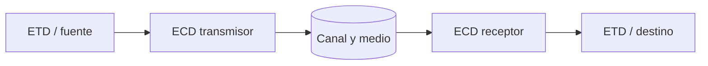
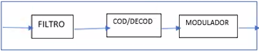
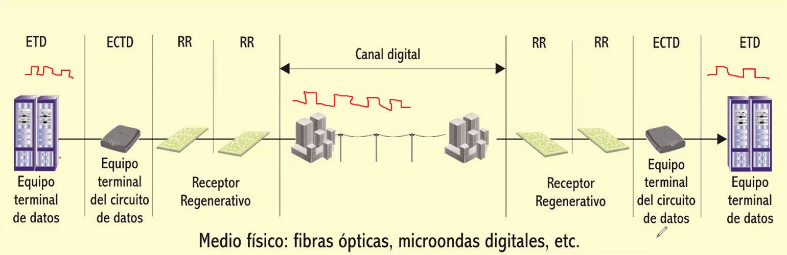

# Unidad 1 — Introducción a las comunicaciones

**Fuentes generales del apunte**

- Presentación teórica de U1: `material/teoria/U1/U1 Introduccion a las comunicaciones.pdf`.
- Presentación de introducción a la teleinformática: `material/practica/U 1/UT 1 COMUNICACIONES.pdf`.
- Material complementario de organismos: `material/practica/U 1/Organismos  UT 1.pdf`.
- Enunciado de TP1: `material/practica/U 1/TP 1  2026.pdf`.
- Las capturas históricas ayudan a reconstruir qué se vio, pero no reemplazan a los PDF originales. Las siete figuras copiadas desde la captura de práctica se preservan sin cambios en [`imagenes/`](imagenes/).

**Idea central de la unidad**

> Comunicar datos requiere que equipos, señales, medios, redes y reglas compatibles trabajen como un sistema, aunque los extremos y las redes intermedias sean distintos.

**Por qué importa**

Antes de analizar una señal o un protocolo particular, hay que saber qué piezas participan y qué problema resuelve cada una. U1 arma ese mapa: después U2 estudia las señales, U3 los modos y las redes, y U4 la digitalización.

**Alcance de esta versión**

Integra la clase teórica U1, los conceptos iniciales de la captura de práctica y las preguntas 1–3 del cuestionario U1/U2. No convierte el apunte en una enciclopedia de Internet, ni resuelve los ejercicios eléctricos del TP1. Los datos actuales de organismos, proveedores y puntos de intercambio se omiten si no aparecen verificados en una fuente oficial.

---

<a id="teleinformatica-y-explotacion"></a>
## 1) Teleinformática y formas de explotación

**Fuentes de esta sección:** `material/teoria/U1/U1 Introduccion a las comunicaciones.pdf`, pp. 4–5; `material/practica/U 1/UT 1 COMUNICACIONES.pdf`, pp. 2–3; [captura histórica de práctica 1](../../../capturas/practica/clase%2001.md).

### Concepto central: integrar procesamiento y comunicación

#### Problema

Una computadora puede procesar información localmente, pero cuando el trabajo involucra equipos separados también hace falta transportar datos entre ellos. Mirar sólo el procesamiento deja afuera la conexión; mirar sólo la conexión deja afuera qué información se produce y se usa.

#### Concepto

La presentación introduce **teleinformática** como la combinación de **telecomunicaciones e informática**. En esta unidad, pensala como el campo que reúne el procesamiento de información y su intercambio por una red.

#### Modelo mental

```txt
información que se procesa ↔ equipos que la intercambian ↔ comunicación
```

El esquema no dice que todo sistema tenga una única computadora o un único medio: sólo recuerda que procesamiento y comunicación pueden formar parte del mismo sistema.

#### Ejemplo mínimo

En un sistema de procesamiento centralizado, una computadora principal realiza el trabajo y los terminales permiten operar o consultar. En un sistema distribuido, varios nodos procesan partes del trabajo y la comunicación entre ellos pasa a ser esencial.

#### Distinción útil para examen

| Criterio | Centralizado | Distribuido |
|---|---|---|
| Dónde se concentra el procesamiento | En un equipo o centro principal | En varios nodos independientes |
| Qué conviene mirar primero | El procesamiento central | La comunicación y coordinación entre nodos |

La presentación también enumera modos de explotación de sistemas informáticos —proceso por lotes, proceso por lotes remotos, tiempo compartido, interacción en tiempo real e interacción diferida— y de sistemas teleinformáticos —fuera de línea/en línea e interactivo/no interactivo—. Como la diapositiva lista las categorías sin desarrollar definiciones, estas glosas son **conocimiento general para ubicarlas**, no una ampliación de sus criterios formales:

- **Por lotes:** se agrupan trabajos y se procesan sin diálogo continuo durante cada operación; **por lotes remotos** indica que el envío del trabajo se hace desde otro lugar.
- **Tiempo compartido:** varios usuarios comparten el uso de un sistema de procesamiento.
- **Interactivo:** el usuario intercambia entradas y respuestas con el sistema; “en tiempo real” y “diferido” distinguen la oportunidad de esa respuesta, sin que U1 dé umbrales temporales.
- **En línea/fuera de línea:** son etiquetas del modo de operación teleinformático; la presentación no establece aquí una definición técnica más fina.

Son **clasificaciones distintas**: centralizado/distribuido describe dónde se procesa; en línea/fuera de línea e interactivo/no interactivo describen el modo de operación o diálogo.

#### Errores típicos

- **Error:** llamar “distribuido” a cualquier sistema que tenga más de un equipo. **Por qué está mal:** también importa que los nodos participen del procesamiento y deban comunicarse o coordinarse.
- **Error:** tratar “centralizado/distribuido” y “en línea/fuera de línea” como pares opuestos del mismo criterio. **Lo correcto:** el primero habla de la distribución del procesamiento; el segundo, del modo de operación.

#### Para examen

> La teleinformática integra informática y telecomunicaciones: no sólo se procesan datos, también se intercambian entre equipos. En un sistema centralizado el procesamiento se concentra; en uno distribuido, distintos nodos procesan y la comunicación entre ellos es parte central del sistema. No hay que confundir esa distribución con los modos en línea o interactivo.

---

<a id="transmision-y-canal"></a>
## 2) Transmisión de datos y canal

**Fuentes de esta sección:** `material/teoria/U1/U1 Introduccion a las comunicaciones.pdf`, pp. 3, 7–8; `material/practica/U 1/UT 1 COMUNICACIONES.pdf`, pp. 3, 5–7; [captura histórica de práctica 1](../../../capturas/practica/clase%2001.md).

### Concepto central: la información debe representarse como una señal

#### Problema físico

La información no viaja por un cable o por el aire como una idea abstracta: el transmisor la representa mediante una señal que puede propagarse por un medio y el receptor debe recuperar.

#### Concepto

La presentación define **transmisión de datos** como el movimiento de información codificada desde un punto hacia uno o más puntos mediante señales eléctricas, ópticas, electromagnéticas o electroópticas. La práctica distingue transmisión **local** y **remota**, y punto a punto o punto a multipunto.

“Confiable”, “sin errores”, “en tiempo real”, “flexible” y “segura” aparecen como características deseables. Leelas como objetivos de un sistema, no como una garantía automática: el canal real puede alterar la señal.

#### Modelo mental



La información se codifica para transmitirla; el medio lleva señales; en destino se recupera la información. La unidad presenta este recorrido, pero deja los detalles de codificación y de modulación para unidades posteriores.

#### Ejemplo mínimo: dos representaciones del canal

En las figuras de clase, una computadora entrega datos digitales a un equipo de comunicación. Para atravesar el ejemplo de **red analógica**, el transmisor emplea un módem y el equipo receptor recupera los datos en el otro extremo. La ilustración del **canal digital** muestra una cadena de equipos distinta: no concluyas que “dato digital” y “canal digital” son sinónimos; son aspectos diferentes del sistema.







La captura llama **módem de banda base** al equipo del ejemplo de canal digital. En U1 alcanza con retener la representación de clase —bits transmitidos como señal digital—; no generalices de ahí que toda comunicación digital carece de codificación o de acondicionamiento de señal.

#### Anticipo: conversión analógica-digital-analógica

El ejemplo telefónico parte de una señal analógica, la convierte para circular por una red digital y la reconstruye como señal analógica en destino. La captura nombra las etapas de digitalización como **muestreo, cuantificación y codificación**. Acá sólo necesitamos reconocer la cadena; el mecanismo y sus fórmulas corresponden a U4.


#### Errores típicos

- **Error:** decir que todo lo digital viaja necesariamente por un canal digital. **Por qué está mal:** la representación de los datos y la forma de la señal en el medio son decisiones distintas.
- **Error:** tomar “sin errores” como promesa de que ningún bit se altera. **Lo correcto:** es una meta de calidad; el canal real puede introducir efectos que se estudian más adelante.
- **Error:** desarrollar muestreo o cuantificación aquí como si ya fuera el tema central. **Lo correcto:** reconocer las etapas y continuar su explicación en U4.

#### Para examen

> Transmitir datos es mover información codificada mediante señales por un medio, desde un origen hacia uno o más destinos. El transmisor representa la información en una señal adecuada; el canal la propaga y el receptor intenta recuperarla. Que los datos sean digitales no determina por sí solo si el canal es analógico o digital.

### Concepto secundario: efectos sobre la señal

La práctica presenta tres fenómenos que pueden aparecer durante la propagación:

| Fenómeno | Qué observamos |
|---|---|
| **Atenuación** | La señal llega con menor nivel que al salir del transmisor. |
| **Distorsión** | Cambia la forma de la señal por las características del canal. |
| **Ruido** | Se suman señales no deseadas que interfieren con la señal útil. |

No se desarrollan fórmulas en U1. Son un anticipo de fenómenos del canal que se profundizan más adelante.

---

<a id="circuito-y-enlace"></a>
## 3) ETD, ECD, circuito de datos y enlace de datos

**Fuentes de esta sección:** `material/teoria/U1/U1 Introduccion a las comunicaciones.pdf`, p. 6; `material/practica/U 1/UT 1 COMUNICACIONES.pdf`, p. 4; [captura teórica de clase 1](../../../capturas/teoria/01-introduccion-comunicaciones/Apuntes-clase%201.md); [cuestionario U1/U2, pregunta 1](../../../capturas/teoria/Cuestionarios/cuestionario%20U1%20y%20U2.md).

### Concepto central: separar el equipo terminal del equipo de comunicación

#### Problema

El equipo que genera o consume información no necesariamente puede conectarse directamente al medio. Hace falta distinguir el procesamiento de datos de la adaptación/comunicación con el medio.

#### Conceptos

- **ETD (Equipo Terminal de Datos):** extremo que origina o recibe los datos. En la captura se menciona un controlador de comunicaciones dentro del ETD.
- **ECD (Equipo de Comunicación de Datos):** equipo que participa en la comunicación entre el ETD y el medio; la presentación lo dibuja como el equipo conectado al terminal y al canal.
- **Medio:** soporte por el que se propaga la señal.
- **Circuito de datos (CD):** según el esquema original de U1, incluye los dos ECD y el medio de comunicación que los conecta.
- **Enlace de datos (ED):** en ese esquema, representa la relación de comunicación entre los ETD de los extremos. No es otro nombre para el medio físico.

#### Modelo mental

```txt
ETD A ── ECD A ═════ medio de comunicación ═════ ECD B ── ETD B
  └──────────────────── enlace de datos ──────────────────────┘
                  └──────── circuito de datos ────────┘
```


La interfaz ETD–ECD es una frontera adicional: no la confundas con el enlace ni con el circuito.

#### Ejemplo mínimo

Una computadora (ETD) entrega datos a su equipo de comunicación (ECD); los ECD de ambos extremos usan el medio para establecer el circuito de datos. El intercambio que interesa a los ETD se representa como enlace de datos.

#### Gotcha verificado: la captura omite un componente del circuito

La captura teórica ubica el enlace entre ETD y el circuito entre ECD, pero omite nombrar el medio al describir este último. La **diapositiva original** dibuja el enlace entre los ETD y el circuito incluyendo ECD + medio + ECD; la pregunta 1 del cuestionario confirma que el circuito comprende ECD y medio. La discrepancia es de completitud, no una inversión de los dos rótulos.

#### Errores típicos

- **Error:** definir el circuito como sólo “ECD a ECD”. **Por qué está mal:** deja afuera el medio que la lámina coloca dentro del circuito; la pregunta 1 también lo incluye.
- **Error:** llamar ECD al equipo que procesa el contenido de aplicación. **Lo correcto:** el ETD es el extremo de datos; el ECD cumple el papel de comunicación con el canal.
- **Error:** tratar interfaz, enlace y circuito como equivalentes. **Lo correcto:** interfaz = frontera ETD/ECD; enlace = relación entre extremos; circuito = ECDs más medio, según el esquema U1.

#### Para examen

> El ETD origina o recibe datos y el ECD interviene en su comunicación por el medio. En el esquema de U1, el circuito de datos está formado por los ECD de ambos extremos y el medio; el enlace de datos relaciona a los ETD. La diapositiva original y la pregunta 1 del cuestionario precisan que el medio forma parte del circuito, un elemento omitido en la captura teórica.

---

<a id="redes-internet-ixp"></a>
## 4) Redes, Internet y puntos de intercambio

**Fuentes de esta sección:** `material/teoria/U1/U1 Introduccion a las comunicaciones.pdf`, pp. 21–25; `material/practica/U 1/UT 1 COMUNICACIONES.pdf`, pp. 8–9; `material/practica/U 1/TP 1  2026.pdf`, p. 3; [captura histórica de práctica 1](../../../capturas/practica/clase%2001.md).

### Concepto central: una red conecta recursos para transportar información

#### Problema

Cuando los equipos están separados, una conexión aislada no alcanza para comunicar muchos usuarios y sistemas. La red organiza nodos, enlaces y recursos para transportar información entre ellos.

#### Concepto

La presentación define una **red de comunicaciones** como un conjunto de recursos de comunicaciones e informática que forman un sistema para transportar información. El esquema mental de base es **nodos unidos por enlaces**.

#### Modelo mental

La **topología** describe cómo se disponen nodos y enlaces. La captura de práctica enumera:

| Topología nombrada en clase | Descripción orientativa |
|---|---|
| Bus | Nodos conectados a un medio común. |
| Estrella | Nodos conectados alrededor de un punto central. |
| Anillo | Nodos conectados en un recorrido cerrado. |
| Malla | Varios nodos conectados mediante enlaces alternativos. |

La captura sólo enumera estos nombres; las descripciones de una línea son **conocimiento general agregado para entenderlos**, no una especificación técnica de cada topología.

Por extensión, la misma captura nombra LAN, MAN y WAN: redes de área local, metropolitana y amplia. En U1 basta saber que clasifican por alcance; no se comparan aquí tecnologías, distancias ni velocidades.

#### Ejemplo mínimo: Internet

**Internet es una red de redes:** muchas redes independientes y autónomas se interconectan mediante protocolos y procedimientos normalizados para permitir comunicación entre equipos terminales (*host-to-host*). La presentación identifica hosts/ETD con direcciones IP, redes y routers como componentes de ese conjunto.

La captura práctica la resume como “malla”. Usalo como una imagen para recordar que hay conexiones entre redes; no como afirmación de que Internet tenga una única topología física de malla. La propia presentación la describe como redes autónomas interconectadas y muestra una composición con varios niveles de redes.

La unidad nombra IoT (*Internet of Things*, Internet de las cosas) como interconexión de objetos con Internet, e IIoT como su variante industrial. Son anticipos: no se estudian aquí arquitecturas ni aplicaciones.

La presentación también bosqueja una evolución con los nombres ARPA/DARPA, ARPANET, NIC e IANA. Los hitos de ARPA/DARPA, ARPANET, MILNET y NSFNET están contrastados con fuentes institucionales en [TP1, ejercicio 14](../../practica/tp-01-comunicaciones.md#ejercicio-14--redes-y-organismos-vinculados-con-el-origen-de-internet). Esa respuesta precisa, entre otras cosas, que ARPA se estableció en 1958 (no en 1960, como dice la diapositiva) y que ARPANET comenzó a operar en 1969. Quedan pendientes únicamente las fechas y funciones históricas concretas de NIC e IANA; ver [Pendientes por sección](#8-pendientes-por-seccion).

#### Caso real: IXP o punto neutro

Un **IXP (Internet Exchange Point)** es una infraestructura física donde proveedores de servicios de Internet (ISP) intercambian tráfico entre sus redes. Según la diapositiva, eso reduce la parte del tráfico de un ISP que debe entregarse a su proveedor de conectividad. La lámina menciona el nombre anterior **NAP**; no se desarrolla la operación actual ni se agregan cifras.

La función del ISP y las tecnologías residenciales de acceso tratadas en TP1 se desarrollan, con fuentes oficiales, en [TP1, ejercicio 20](../../practica/tp-01-comunicaciones.md#ejercicio-20--funciones-del-isp-y-accesos-residenciales); acá se conserva sólo el contexto necesario para entender qué redes intercambian tráfico en un IXP.

#### Errores típicos

- **Error:** decir que Internet es una sola red administrada como una única organización. **Lo correcto:** U1 la presenta como redes independientes que se interconectan.
- **Error:** tomar “malla” como descripción exacta de toda la topología de Internet. **Lo correcto:** usarlo sólo como simplificación visual de la captura.
- **Error:** confundir un IXP con un ISP. **Lo correcto:** el IXP es infraestructura de intercambio; los ISP son las redes/proveedores que intercambian tráfico.
- **Error:** atribuir velocidades, cantidad de redes o mapa actual de IXP sin fuente vigente. **Lo correcto:** limitarse a la función conceptual hasta contrastar datos actuales.

#### Para examen

> Una red reúne recursos y conecta nodos mediante enlaces para transportar información. Internet es una red de redes autónomas que se comunican con protocolos normalizados; los routers conectan redes y los hosts son los extremos. Un IXP permite que ISP intercambien tráfico entre sus redes y puede reducir la parte que entregan a proveedores de conectividad.

---

<a id="normalizacion"></a>
## 5) Normalización: acordar reglas para poder interconectar

**Fuentes de esta sección:** `material/teoria/U1/U1 Introduccion a las comunicaciones.pdf`, pp. 9–10, 23–24; `material/practica/U 1/Organismos  UT 1.pdf`, pp. 1–3; [captura teórica de clase 1](../../../capturas/teoria/01-introduccion-comunicaciones/Apuntes-clase%201.md).

### Concepto secundario: estándares y organismos

Si cada fabricante interpretara de manera distinta señales, interfaces y procedimientos, equipos heterogéneos no podrían cooperar de forma previsible. **Normalizar** significa acordar especificaciones comunes que permitan interoperabilidad. El problema de conectar sistemas abiertos y heterogéneos motiva tanto las normas como el modelo OSI.

El material de U1 nombra organismos de ámbitos y funciones diferentes —entre ellos ISO, UIT/ITU, IEEE, ANSI, EIA/TIA, IETF, IANA, FCC, ENACOM, IRAM y ONTI—. Para esta unidad retené las relaciones concretas enseñadas:

- **ISO** desarrolló el modelo de referencia OSI.
- La presentación vincula **IETF** con la emisión de RFC para Internet y referencia **IANA**.
- Los demás nombres aparecen como ejemplos de organismos o entidades relacionados con normalización/comunicaciones; no se les atribuye acá una función actual idéntica.

Para las preguntas de organismos del TP1, las funciones de UIT-T y de ISO, IEEE y ANSI están contrastadas con fuentes institucionales en [ejercicio 13](../../practica/tp-01-comunicaciones.md#ejercicio-13--uit-t-que-es-que-hace-y-como-se-organiza) y [ejercicio 19](../../practica/tp-01-comunicaciones.md#ejercicio-19--iso-ieee-ansi-y-eia); EIA se presenta allí como antecedente histórico, sin afirmar vigencia actual. La ficha de cátedra reúne descripciones de distintas épocas, por eso esta síntesis no extiende esas funciones a todos los nombres listados.

#### Error típico

- **Error:** decir que OSI es un estándar del IEEE. **Lo correcto para el cuestionario U1/U2:** OSI es el modelo de referencia desarrollado por ISO; IEEE no es la respuesta.
- **Error:** afirmar que todos los organismos mencionados cumplen exactamente el mismo rol. **Por qué está mal:** el material reúne organismos de estandarización, grupos técnicos y entidades regulatorias; sus competencias no son intercambiables.

---

<a id="modelo-osi"></a>
## 6) Modelo de referencia OSI

**Fuentes de esta sección:** `material/teoria/U1/U1 Introduccion a las comunicaciones.pdf`, pp. 10–20; [captura teórica de clase 1](../../../capturas/teoria/01-introduccion-comunicaciones/Apuntes-clase%201.md); [cuestionario U1/U2, preguntas 2–3](../../../capturas/teoria/Cuestionarios/cuestionario%20U1%20y%20U2.md).

### Concepto central: dividir una comunicación compleja en capas

#### Problema

Dos sistemas abiertos pueden tener fabricantes, tecnologías y detalles internos distintos. Si toda la comunicación se diseñara como un único bloque, sería difícil separar responsabilidades y acordar cómo deben cooperar.

#### Concepto

**OSI** (*Open Systems Interconnection*, interconexión de sistemas abiertos) es un **modelo de referencia de ISO** que organiza funciones de comunicación en siete capas. Es una abstracción para describir responsabilidades e interacciones; no significa que cada sistema implemente literalmente siete cajas físicas.

#### Modelo mental


- Entre **capas pares** de sistemas distintos se describe la comunicación mediante **protocolos**.
- Entre **capas adyacentes** de un mismo sistema hay una **interfaz**.
- Una capa inferior ofrece un **servicio** a la capa superior por medio de la interfaz.
- Una **entidad** es un elemento activo de una capa que provee o usa servicios.
- Una **PDU** (*Protocol Data Unit*) es la unidad de datos intercambiada entre entidades pares de una capa según su protocolo.

#### Las siete capas

| N.º | Capa | Responsabilidad presentada en U1 | Ejemplo o término de clase |
|---:|---|---|---|
| 7 | Aplicación | Servicios de red; terminal virtual para dialogar con terminales incompatibles, interfaz de usuario, autorizaciones, autenticidad y disponibilidad. | Correo electrónico y transferencia de archivos. |
| 6 | Presentación | Codifica y convierte representaciones, adecua la sintaxis, y puede comprimir o aplicar criptografía; la captura aclara que no necesariamente interpreta la semántica. | Conversión de formatos. |
| 5 | Sesión | Establece/libera sesiones entre equipos, gestiona el diálogo, sincroniza y administra el testigo; la captura también menciona mejorar servicios. | Control del diálogo. |
| 4 | Transporte | Transferencia extremo a extremo confiable y transparente; oculta detalles inferiores, multiplexa y regula flujo. La captura menciona calidad Q o S, siglas que no desarrolla. | TCP, UDP y SPX. |
| 3 | Red | Servicio a transporte orientado o no a conexión; encaminamiento y reenvío, interconexión de redes, congestión y facturación. | IP, IPX, X.25, Frame Relay y ATM. |
| 2 | Enlace de datos | La captura lo presenta como enlace confiable entre nodos directamente conectados; establece/mantiene/libera conexiones ofrecidas a la capa 3, delimita bits y asegura transparencia, controla errores/flujo y trata daño, pérdida y duplicación. | HDLC, PPP, Ethernet y Token Ring. |
| 1 | Física | Conexión al medio; define características mecánicas, eléctricas, funcionales y de procedimiento para transmitir bits. | RS-232 en la presentación; V.24 en el cuestionario. |

El esquema de clase agrupa las capas **7–5** como orientadas a las aplicaciones, la **4** como intermedia y las **3–1** como dependientes de la red. Es una guía para leer responsabilidades, no un reemplazo de las funciones por capa.

La tabla resume las responsabilidades que enumera la captura de clase; no promete que cada protocolo concreto implemente cada función de la misma manera.

En las notas de clase aparecen como ejemplos de PDU: **paquete** en red, **segmento** en transporte y **trama** en enlace. Son nombres introductorios; el detalle depende del protocolo concreto.

#### Ejemplo mínimo

Al enviar un archivo, la aplicación solicita un servicio, las capas inferiores organizan y transportan los datos, y la capa física representa bits como señales sobre el medio. En el otro sistema, las capas pares siguen sus protocolos y cada capa usa los servicios de la capa inferior. Es un ejemplo de responsabilidades; U1 no exige construir una trama completa.

#### Errores típicos

- **Error:** entre capas iguales hay interfaces. **Lo correcto:** las interfaces conectan capas adyacentes locales; los protocolos describen la comunicación entre pares.
- **Error:** ubicar la compresión o la criptografía en sesión. **Lo correcto en este material:** ambas aparecen en presentación, capa 6.
- **Error:** decir que V.24 es de otra capa por aparecer como norma de interfaz. **Lo correcto para el cuestionario:** se asocia a capa física, capa 1. La presentación da RS-232 como otro ejemplo de interfaz física; no hace falta afirmar que ambas normas sean idénticas.
- **Error:** decir que OSI es IEEE o que es una arquitectura física obligatoria. **Lo correcto:** es el modelo de referencia de ISO.
- **Error:** decir que la capa de enlace garantiza por sí sola una transmisión infalible. **Lo correcto:** U1 le atribuye funciones de control; no borra los efectos del canal real.

#### Para examen

> OSI es un modelo de referencia de ISO que divide las funciones de comunicación en siete capas para ordenar la interconexión de sistemas heterogéneos. Entre entidades pares se usan protocolos; entre capas adyacentes existe una interfaz por la que la capa inferior ofrece servicios a la superior. Hay que ubicar las funciones principales de las siete capas y no confundir protocolo con interfaz.

---

## 7) Gotchas del material

1. **Circuito de datos vs. enlace:** la captura teórica ubica el enlace entre ETD y el circuito entre ECD, pero omite el medio en la definición del circuito. La lámina original, p. 6, y el cuestionario, pregunta 1, coinciden en que el circuito comprende ECD + medio.
2. **OSI vs. IEEE:** el cuestionario contiene deliberadamente la afirmación incorrecta “OSI es IEEE”; la presentación identifica ISO como organismo del modelo.
3. **“Internet en malla”:** la captura usa la malla como simplificación. La presentación define Internet como redes autónomas interconectadas y muestra más de una jerarquía; no memorices una topología única para toda Internet.
4. **Nombres de organismos:** la diapositiva los presenta juntos, pero no todos son organismos del mismo tipo ni tienen la misma competencia. U1 sólo requiere las asociaciones ISO–OSI e IETF–RFC en esta síntesis.
5. **Señal “sin errores”:** es un objetivo de calidad listado en la presentación, no una propiedad garantizada del medio.

---

## 8) Pendientes por sección

| Sección | Qué falta verificar | Fuente o próxima acción |
|---|---|---|
| [Teleinformática y explotación](#teleinformatica-y-explotacion) | La presentación enumera modalidades de explotación informática y teleinformática, pero no define sus límites exactos ni criterios de clasificación. No se les asignan umbrales ni ejemplos más específicos. | Si esos criterios se evalúan en detalle, hace falta una explicación de cátedra o una fuente bibliográfica que trate expresamente esta clasificación; la diapositiva de U1 sólo lista las categorías. `material/teoria/U1/U1 Introduccion a las comunicaciones.pdf`, p. 5. |
| [Redes e Internet](#redes-internet-ixp) | La cronología de ARPA/DARPA, ARPANET, MILNET y NSFNET se contrasta en TP1 E14. Siguen sin verificarse las fechas y funciones históricas concretas de NIC e IANA que sugiere la diapositiva. | Mantener esas fechas/funciones fuera de la secuencia de estudio hasta contrastarlas con una fuente institucional apropiada. `material/teoria/U1/U1 Introduccion a las comunicaciones.pdf`, pp. 23–24; [TP1, ejercicio 14](../../practica/tp-01-comunicaciones.md#ejercicio-14--redes-y-organismos-vinculados-con-el-origen-de-internet). |

---

## 9) Práctica y repaso

La teoría explica conceptos; el TP y las preguntas quedan separados. No se incorporan acá soluciones eléctricas ni respuestas completas de práctica.

- [Índice de práctica](../../practica/INDICE.md) — TPs y ejercicios separados.
- [Índice de repaso](../../repaso/INDICE.md) — cuestionarios históricos.
- [Cuestionario U1/U2, preguntas 1–3](../../../capturas/teoria/Cuestionarios/cuestionario%20U1%20y%20U2.md) — circuito de datos y modelo OSI, integrados en este apunte; Q4–7 quedan pendientes de U2.

---

## 10) Relación con otras unidades

- [U2 — Características de las señales](../02-senales-telecomunicaciones/INDICE.md) — caracteriza las señales que U1 presenta como vehículo de la información.
- [U3 — Redes de telecomunicaciones](../03-redes-telecomunicaciones/INDICE.md) — desarrolla los modos y la organización de las redes.
- [U4 — Modulación, digitalización y multiplexación](../04-modulacion-digitalizacion-multiplexacion/INDICE.md) — continúa el anticipo de conversión analógica/digital, incluido PCM.

---

## 11) Resumen mental

Si te preguntan **“¿qué presenta la Unidad 1?”**, contestá:

> La comunicación de datos integra equipos que procesan información, equipos de comunicación, medios, redes y reglas comunes. La información codificada se representa mediante señales y puede viajar local o remotamente; el canal puede afectarla. Un ETD origina o recibe datos, un ECD interviene en la comunicación, y en el esquema de U1 el circuito de datos reúne ECD y medio mientras el enlace relaciona los extremos. Internet es una red de redes autónomas, y un IXP permite intercambiar tráfico entre ISP. El modelo OSI de ISO organiza la comunicación en siete capas; protocolo, interfaz y servicio describen relaciones distintas.

**Checklist para examen**

- [ ] Explicar por qué teleinformática combina procesamiento y comunicación.
- [ ] Diferenciar procesamiento centralizado/distribuido de los modos en línea e interactivo.
- [ ] Explicar transmisión de datos como información codificada transportada mediante señales.
- [ ] Ubicar ETD, ECD y medio; distinguir circuito de datos, enlace e interfaz.
- [ ] Definir red, nombrar topologías y distinguir clasificación por alcance.
- [ ] Explicar Internet como red de redes e IXP como punto de intercambio entre redes de ISP.
- [ ] Reconocer atenuación, distorsión y ruido como efectos del canal, sin confundirlos.
- [ ] Enumerar las siete capas OSI y ubicar ISO, protocolos, interfaces y servicios.
- [ ] Recordar V.24 en capa 1 y compresión/criptografía en capa 6 según el cuestionario.
- [ ] Recordar los hitos de ARPA/DARPA y ARPANET contrastados en TP1 E14; dejar pendientes las fechas/funciones históricas de NIC e IANA.
- [ ] Consultar TP1 E13 y E19 para las funciones de organismos contrastadas con fuentes institucionales; no generalizar esos roles a todos los nombres de la ficha.
