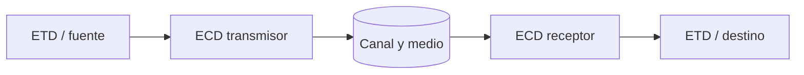
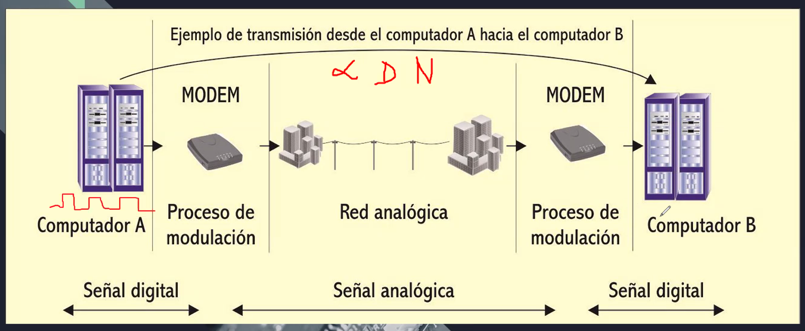
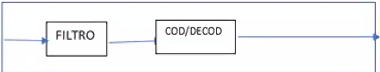
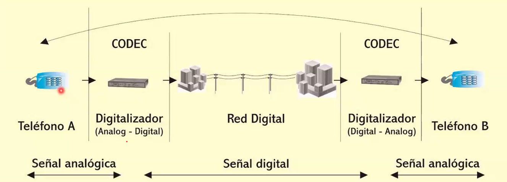
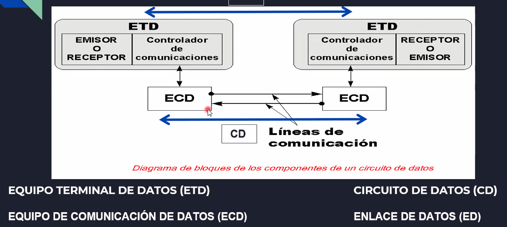
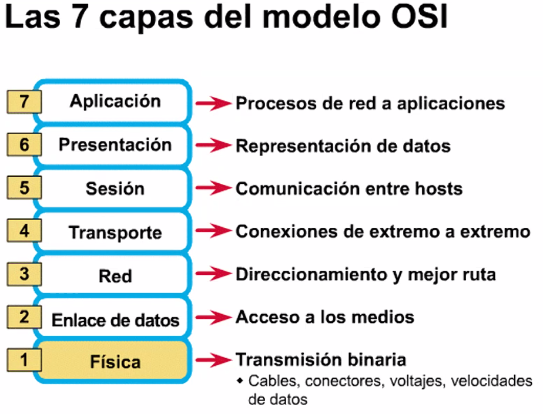

# Unidad 1 — Introducción a las comunicaciones

**Fuentes generales del apunte**

- Presentación teórica de U1: `material/teoria/U1/U1 Introduccion a las comunicaciones.pdf`.
- Presentación de introducción a la teleinformática: `material/practica/U 1/UT 1 COMUNICACIONES.pdf`.
- Material complementario de organismos: `material/practica/U 1/Organismos  UT 1.pdf`.
- Enunciado de TP1: `material/practica/U 1/TP 1  2026.pdf`.
- Las capturas históricas ayudan a reconstruir qué se vio, pero no reemplazan a los PDF originales. Las siete figuras copiadas desde la captura de práctica se preservan sin cambios en [`imagenes/`](imagenes/).

**Idea central de la unidad**

> Comunicar datos requiere que equipos, señales, medios, redes y reglas compatibles trabajen como un sistema, aunque los extremos y las redes intermedias sean distintos.

**Por qué importa**

Antes de analizar una señal o un protocolo particular, hay que saber qué piezas participan y qué problema resuelve cada una. U1 arma ese mapa: después U2 estudia las señales, U3 los modos y las redes, y U4 la digitalización.

**Alcance de esta versión**

Integra la clase teórica U1, los conceptos iniciales de la captura de práctica y las preguntas 1–3 del cuestionario U1/U2. No convierte el apunte en una enciclopedia de Internet, ni resuelve los ejercicios eléctricos del TP1. Los datos actuales de organismos, proveedores y puntos de intercambio se omiten si no aparecen verificados en una fuente oficial.

**Cobertura del programa frente al contenido registrado**

El programa define la unidad completa; este trabajo consolida lo registrado, no autoriza agregar el resto desde un libro. `en-progreso` refleja el límite de cátedra indicado en modalidades, la evidencia histórica parcial todavía no integrada y la revalidación independiente posterior a las correcciones; NO significa que las otras secciones sean un esqueleto.

| Tema del programa U1 | Sección / destino | Evidencia registrada | Cobertura real |
|---|---|---|---|
| Informática, telecomunicaciones y teleinformática | [§1](#teleinformatica-y-explotacion) | Teoría pp. 4–5; práctica pp. 2–3; capturas T1 y P1 | Desarrollado en el nivel introductorio registrado. |
| Historia general y evolución de informática/comunicaciones | Pendiente de integración; ver [§8](#8-pendientes-por-seccion) | Teoría p. 2: gráfico de evolución y convergencia, ejes 1950–2000, procesamiento centralizado/distribuido e integración | **Evidencia gráfica parcial disponible**, inspeccionada; no desarrollada como sección histórica ni suficiente para la historia general completa. No es evidencia ausente. |
| Revolución informática, sociedad del conocimiento y ética | — | Sin desarrollo suficiente en las capturas ni filminas específicas U1 usadas | Fuera del alcance desarrollado; el gráfico p. 2 no demuestra cobertura de sociedad/ética. Consultar bibliografía no habilita agregar esos temas. |
| Modos de explotación informáticos y teleinformáticos | [§1](#teleinformatica-y-explotacion) | Teoría p. 5 | Todas las categorías explicadas; límite de significado de «interactivo diferido» señalado. |
| Aplicaciones de comunicación de datos | [§1](#teleinformatica-y-explotacion), [TP1 E17–18](../../practica/tp-01-comunicaciones.md#ejercicio-17--wan-empresarial-con-cuatro-sedes-y-acceso-central-a-internet) | Captura P1; TP1 p. 3 | Ejemplos de procesamiento centralizado/distribuido y diálogo; no catálogo de aplicaciones nuevo. |
| Transmisión, circuito, red analógica, enlace y circuito de datos | [§2](#transmision-y-canal), [§3](#circuito-y-enlace) | Teoría pp. 3, 6–8; práctica pp. 3–7; Q1 | Desarrollado; las etapas de digitalización sólo se anticipan y continúan en U4. |
| Internet, antecedentes, equipos y organización | [§4](#redes-internet-ixp), [§5](#normalizacion) | Teoría pp. 21–25; práctica pp. 8–9; TP1 E14–15 y E19–20 | Red de redes, hosts, routers, ISP/IXP, NIC/IANA y contexto histórico; sin mapa/cifras vigentes ni gobernanza ampliada. |
| Situación actual y globalización | [§4](#redes-internet-ixp) | IoT/IIoT como anticipo en pp. 21–22 | Sólo el anticipo registrado; no panorama actual integral. |
| OSI introductorio y normalización (material registrado de U1) | [§5](#normalizacion), [§6](#modelo-osi) | Teoría pp. 9–20; práctica p. 10; Q2–3 | Siete capas, entidades, servicio, interfaz, protocolo y PDU; no desarrollar protocolos concretos. |

Las páginas de «teoría» corresponden a `U1 Introduccion a las comunicaciones.pdf`; las de «práctica» a `UT 1 COMUNICACIONES.pdf`. T1 = captura teórica clase 1; P1 = captura práctica del 11/08/2026. Programa: `material/catedra/PROGRAMA de la materia.pdf`, p. PDF2, apartado «Unidad 1»; el original se registra en el [inventario](../../../docs/consolidacion-u1-u6/inventario-fuentes.md).

**Mapa de integración de los originales**

| Fragmento original | Destino consolidado |
|---|---|
| Teoría p. 2: gráfico de evolución de informática y comunicaciones | Evidencia parcial reconocida en cobertura y §8; **disponible pero no integrada** como relato histórico. No se infieren fechas exactas de las flechas ni cobertura de sociedad/ética. |
| T1 «distribuidos/centralizados»; P1 «teleinformática» | §1, criterios y ejemplos; comparación con Castro 2013 §3.2.4, pp. PDF169–171 / impresas143–145. |
| T1/P1 «transmisión» y P1 «fenómenos», canal analógico/digital y A/D/A | §2; imágenes originales `image-1.png` a `image-5.png`; desarrollo cuantitativo de señales/canal/digitalización fuera de U1. |
| T1/P1 «circuito teleinformático» y Q1 | §3; `image.png`; corrección de la omisión del medio sin tocar captura. |
| P1 «redes», Internet, composición; T1 Internet, IoT/IIoT e IXP | §4; historia de filminas aclarada con documentos primarios; TP1 E14–15 y E20 sigue en práctica. |
| T1 «organismos» y «OSI», funciones de las siete capas | §5–6; protocolos adicionales de la captura se identifican como ejemplos, no como equivalencia exacta de capas. |
| Q1–3 del cuestionario U1/U2 | [Repaso U1](../../repaso/u01-introduccion-comunicaciones.md), enunciados sin marca de respuesta y soluciones razonadas separadas. Q4–7 pertenecen a U2. |
| P1 «expresiones matemáticas» y TP1 E1–20 | [TP1 existente](../../practica/tp-01-comunicaciones.md); no duplicado ni reescrito. |

---

<a id="teleinformatica-y-explotacion"></a>
## 1) Teleinformática y formas de explotación

**Fuentes de esta sección:** `material/teoria/U1/U1 Introduccion a las comunicaciones.pdf`, pp. 4–5; `material/practica/U 1/UT 1 COMUNICACIONES.pdf`, pp. 2–3; Castro Lechtaler y Fusario (2013), §3.2.4, pp. PDF169–171 / impresas143–145; [captura histórica de práctica 1](../../../capturas/practica/clase%2001.md) y [captura teórica](../../../capturas/teoria/01-introduccion-comunicaciones/Apuntes-clase%201.md), fragmento «distribuidos y centralizados». Las aclaraciones de explotación se contrastan además con las fuentes IBM enlazadas abajo; no amplían el temario.

### Concepto central: integrar procesamiento y comunicación

#### Problema físico / de ingeniería

Una computadora puede procesar información localmente, pero cuando el trabajo involucra equipos separados también hace falta transportar datos entre ellos. Mirar sólo el procesamiento deja afuera la conexión; mirar sólo la conexión deja afuera qué información se produce y se usa.

#### Concepto

La presentación introduce **teleinformática** como la combinación de **telecomunicaciones e informática**. En esta unidad, pensala como el campo que reúne el procesamiento de información y su intercambio por una red.

#### Modelo mental

```txt
información que se procesa ↔ equipos que la intercambian ↔ comunicación
```

El esquema no dice que todo sistema tenga una única computadora o un único medio: sólo recuerda que procesamiento y comunicación pueden formar parte del mismo sistema.

#### Ejemplo mínimo

En un sistema de procesamiento centralizado, una computadora principal realiza el trabajo y los terminales permiten operar o consultar. En un sistema distribuido, varios nodos procesan partes del trabajo y la comunicación entre ellos pasa a ser esencial.

#### Distinción útil para examen

| Criterio | Centralizado | Distribuido |
|---|---|---|
| Dónde se concentra el procesamiento | En un equipo o centro principal | En varios nodos independientes |
| Qué conviene mirar primero | El procesamiento central | La comunicación y coordinación entre nodos |

#### Formalización cualitativa: criterios, no una fórmula

La p. 5 enumera modalidades pero no las define. Para entenderlas, separá **dónde se procesa**, **cómo se entrega el trabajo**, **si hay diálogo** y **qué oportunidad necesita la respuesta**. No son clasificaciones excluyentes de un único eje: un sistema centralizado puede atender terminales remotos de forma interactiva y también ejecutar lotes.

| Modalidad informática registrada | Qué la distingue | Ejemplo didáctico (no un dato de norma) |
|---|---|---|
| Proceso por lotes | Se entrega un trabajo o conjunto de datos y el procesamiento continúa sin diálogo paso a paso con el usuario. | Liquidar todos los recibos de un período y consultar luego la salida. |
| Proceso por lotes remotos | La entrada del trabajo se envía desde un sitio remoto; eso no vuelve interactiva su ejecución. | Una sucursal envía los datos y el trabajo al centro de cómputos para ejecutarlo como lote. |
| Tiempo compartido | Varios usuarios usan conversacional y concurrentemente los recursos de un sistema; compartir no requiere un procesador dedicado por usuario. | Dos terminales ejecutan comandos en un mainframe y reciben sus resultados. |
| Procesos interactivos en tiempo real | Hay consulta/respuesta y la respuesta debe llegar a tiempo para la actividad atendida; «tiempo real» no equivale a respuesta instantánea. | Un control recibe una medición y actúa mientras todavía puede corregir el proceso. |
| Procesos interactivos diferidos | La lámina usa esta etiqueta sin fijar un criterio. Como lectura orientativa: hay intercambio pero la respuesta se obtiene posteriormente, no con el plazo exigido por el caso de tiempo real. | Se envía una consulta y se retoma el diálogo al disponer de su resultado. No llamar «interactivo» a cualquier lote por recibir una salida. |

**Contraste:** el procesamiento sin interacción y los ejemplos de lotes están documentados en [IBM, cargas batch y online](https://www.ibm.com/docs/en/zos-basic-skills?topic=today-mainframe-workloads-batch-online-transaction-processing); tiempo compartido en [IBM, Controlling time-sharing](https://www.ibm.com/docs/en/zos/3.2.0?topic=operations-controlling-time-sharing). Consultados el 10/10/2026, páginas sin fecha de publicación visible. El sentido de tiempo real proviene de Castro 2013, p. PDF171 / impresa145: la respuesta debe ser suficientemente oportuna para influir en el proceso. La interpretación de «interactivo diferido» NO se presenta como definición formal de cátedra; queda acotada en [Pendientes](#8-pendientes-por-seccion).

| Modalidad teleinformática registrada | Criterio y ejemplo |
|---|---|
| En línea | El terminal/equipo participa directamente del sistema al operar. Ejemplo: desde una terminal se consulta al equipo central. No implica necesariamente conexión a Internet ni respuesta en tiempo real. |
| Fuera de línea | La operación del equipo no está bajo control directo del sistema al que se destinará el trabajo. Ejemplo didáctico: capturar datos en un dispositivo y transferirlos después al centro de procesamiento. |
| Interactivo | Cada consulta recibe una respuesta que permite decidir la siguiente operación. Ejemplo: consultar disponibilidad y elegir la reserva según la respuesta. |
| No interactivo | El trabajo no depende de un diálogo sucesivo con el usuario durante su ejecución. Ejemplo: transmitir automáticamente un lote ya preparado. |

En línea/fuera de línea se toma aquí en el sentido de operación de equipos del [glosario IBM z/VM, voces online/offline](https://www.ibm.com/support/pages/zvm/library/glossary/index.html), actualizado el 03/09/2021, consultado el 10/10/2026. El propio glosario distingue ese sentido del de «conectado a Internet». Interactivo se contrasta con Castro 2013 §3.2.4.2, p. PDF170 / impresa144. Los ejemplos y la combinación de criterios son reconstrucción pedagógica, no nuevas modalidades añadidas.

**Modelo aplicado:** `terminal → consulta → procesamiento → respuesta → siguiente consulta` permite reconocer interacción. En cambio, `entrega del lote → ejecución autónoma → salida` permite reconocer batch. U1 no fija segundos, velocidades ni una ecuación de rendimiento para estas categorías; inventar un umbral no las haría más precisas.

#### Errores típicos

- **Error:** llamar “distribuido” a cualquier sistema que tenga más de un equipo. **Por qué está mal:** también importa que los nodos participen del procesamiento y deban comunicarse o coordinarse.
- **Error:** tratar “centralizado/distribuido” y “en línea/fuera de línea” como pares opuestos del mismo criterio. **Lo correcto:** el primero habla de la distribución del procesamiento; el segundo, del modo de operación.
- **Error:** «en línea = interactivo = tiempo real». **Por qué está mal:** conexión/operación directa, diálogo y oportunidad de respuesta son criterios diferentes; enviar un lote por una red no genera diálogo durante su ejecución.

#### Para examen

> La teleinformática integra informática y telecomunicaciones: no sólo se procesan datos, también se intercambian entre equipos. En un sistema centralizado el procesamiento se concentra; en uno distribuido, distintos nodos procesan y la comunicación entre ellos es parte central del sistema. No hay que confundir esa distribución con los modos en línea o interactivo.

---

<a id="transmision-y-canal"></a>
## 2) Transmisión de datos y canal

**Fuentes de esta sección:** `material/teoria/U1/U1 Introduccion a las comunicaciones.pdf`, pp. 3, 7–8; `material/practica/U 1/UT 1 COMUNICACIONES.pdf`, pp. 3, 5–7; [captura histórica de práctica 1](../../../capturas/practica/clase%2001.md).

### Concepto central: la información debe representarse como una señal

#### Problema físico

La información no viaja por un cable o por el aire como una idea abstracta: el transmisor la representa mediante una señal que puede propagarse por un medio y el receptor debe recuperar.

#### Concepto

La presentación define **transmisión de datos** como el movimiento de información codificada desde un punto hacia uno o más puntos mediante señales eléctricas, ópticas, electromagnéticas o electroópticas. La práctica distingue transmisión **local** y **remota**, y punto a punto o punto a multipunto.

“Confiable”, “sin errores”, “en tiempo real”, “flexible” y “segura” aparecen como características deseables. Leelas como objetivos de un sistema, no como una garantía automática: el canal real puede alterar la señal.

**Formalización cualitativa y límites:** punto a punto significa un origen y un destino; punto a multipunto, un origen hacia varios destinos. Local/remota describe el ámbito geográfico, no si la señal es analógica o digital. Por ejemplo didáctico, dos equipos en el laboratorio pueden transmitir localmente punto a punto; enviar desde una sede hacia varias sucursales es remoto y punto a multipunto. No se establece una distancia universal en metros para separar local de remoto.

#### Modelo mental



La información se codifica para transmitirla; el medio lleva señales; en destino se recupera la información. La unidad presenta este recorrido, pero deja los detalles de codificación y de modulación para unidades posteriores.

#### Ejemplo mínimo: dos representaciones del canal

En las figuras de clase, una computadora entrega datos digitales a un equipo de comunicación. Para atravesar el ejemplo de **red analógica**, el transmisor emplea un módem y el equipo receptor recupera los datos en el otro extremo. La ilustración del **canal digital** muestra una cadena de equipos distinta: no concluyas que “dato digital” y “canal digital” son sinónimos; son aspectos diferentes del sistema.

**Módem** reúne las funciones de modulación y demodulación: adapta la representación de los datos a la señal transportable por ese canal y realiza la recuperación inversa. En el ejemplo A→B, el módem de A modula y el de B demodula. La figura rotula ambos como «proceso de modulación» por simplificación; en recepción hay que leer la operación inversa, no una segunda modulación que restaure los bits.




Lectura del esquema auxiliar de captura: **filtro** acondiciona las componentes de la señal; **COD/DECOD** representa codificación/decodificación; **modulador** adapta la señal al canal analógico. Es un esquema de bloques, no especifica filtros ni algoritmos; no deduzcas una configuración universal de todos los módems a partir de él.


En la figura, **ECTD** significa equipo terminal del circuito de datos y ocupa el papel de adaptación al circuito; la clase usa también el rótulo ECD. **RR** es receptor regenerativo: recupera la representación digital de la señal recibida antes de continuar su transporte. Estos nombres describen funciones, no componentes físicamente obligatorios de cualquier enlace digital.



La captura llama **módem de banda base** al equipo del ejemplo de canal digital. En U1 alcanza con retener la representación de clase —bits transmitidos como señal digital—; no generalices de ahí que toda comunicación digital carece de codificación o de acondicionamiento de señal.

#### Anticipo: conversión analógica-digital-analógica

El ejemplo telefónico parte de una señal analógica, la convierte para circular por una red digital y la reconstruye como señal analógica en destino. La captura nombra las etapas de digitalización como **muestreo, cuantificación y codificación**. Acá sólo necesitamos reconocer la cadena; el mecanismo y sus fórmulas corresponden a U4.



**CODEC** indica codificador/decodificador: en esta figura realiza la conversión analógica→digital y la reconstrucción digital→analógica. Es distinto del módem del caso anterior: digitalizar una voz y modular datos son problemas distintos, aunque ambos adapten representaciones.

Las figuras son copias byte a byte de `capturas/practica/image-1.png` a `image-5.png`; contienen anotaciones de clase conservadas. Los casos completos se contrastaron con teoría pp. 7–8 y práctica pp. 5–7. Los dos diagramas pequeños `image-2.png`/`image-4.png` sólo están en la captura: no se les atribuye una página PDF inexistente.

#### Errores típicos

- **Error:** decir que todo lo digital viaja necesariamente por un canal digital. **Por qué está mal:** la representación de los datos y la forma de la señal en el medio son decisiones distintas.
- **Error:** tomar “sin errores” como promesa de que ningún bit se altera. **Lo correcto:** es una meta de calidad; el canal real puede introducir efectos que se estudian más adelante.
- **Error:** desarrollar muestreo o cuantificación aquí como si ya fuera el tema central. **Lo correcto:** reconocer las etapas y continuar su explicación en U4.

#### Para examen

> Transmitir datos es mover información codificada mediante señales por un medio, desde un origen hacia uno o más destinos. El transmisor representa la información en una señal adecuada; el canal la propaga y el receptor intenta recuperarla. Que los datos sean digitales no determina por sí solo si el canal es analógico o digital.

### Concepto secundario: efectos sobre la señal

La práctica presenta tres fenómenos que pueden aparecer durante la propagación:

| Fenómeno | Qué observamos |
|---|---|
| **Atenuación** | La señal llega con menor nivel que al salir del transmisor; ejemplo cualitativo: un pulso de igual forma pero menor amplitud. |
| **Distorsión** | Cambia la forma de la señal por las características del canal; ejemplo: un pulso llega redondeado o ensanchado. |
| **Ruido** | Se suman perturbaciones no deseadas a la señal útil; ejemplo: pequeñas variaciones superpuestas a su nivel. |

No se desarrollan fórmulas en U1. Son un anticipo de fenómenos del canal que se profundizan más adelante.

---

<a id="circuito-y-enlace"></a>
## 3) ETD, ECD, circuito de datos y enlace de datos

**Fuentes de esta sección:** `material/teoria/U1/U1 Introduccion a las comunicaciones.pdf`, p. 6; `material/practica/U 1/UT 1 COMUNICACIONES.pdf`, p. 4; [captura teórica de clase 1](../../../capturas/teoria/01-introduccion-comunicaciones/Apuntes-clase%201.md); [cuestionario U1/U2, pregunta 1](../../../capturas/teoria/Cuestionarios/cuestionario%20U1%20y%20U2.md).

### Concepto central: separar el equipo terminal del equipo de comunicación

#### Problema físico / de ingeniería

El equipo que genera o consume información no necesariamente puede conectarse directamente al medio. Hace falta distinguir el procesamiento de datos de la adaptación/comunicación con el medio.

#### Conceptos

- **ETD (Equipo Terminal de Datos):** extremo que origina o recibe los datos. En la captura se menciona un controlador de comunicaciones dentro del ETD.
- **ECD (Equipo de Comunicación de Datos):** equipo que participa en la comunicación entre el ETD y el medio; la presentación lo dibuja como el equipo conectado al terminal y al canal.
- **Medio:** soporte por el que se propaga la señal.
- **Circuito de datos (CD):** según el esquema original de U1, incluye los dos ECD y el medio de comunicación que los conecta.
- **Enlace de datos (ED):** en ese esquema, representa la relación de comunicación entre los ETD de los extremos. No es otro nombre para el medio físico.

#### Modelo mental

```txt
ETD A ── ECD A ═════ medio de comunicación ═════ ECD B ── ETD B
  └──────────────────── enlace de datos ──────────────────────┘
                  └──────── circuito de datos ────────┘
```



La interfaz ETD–ECD es una frontera adicional: no la confundas con el enlace ni con el circuito.

**Formalización del modelo:** el CD abarca `ECD A + medio + ECD B`; el ED abarca la relación entre `ETD A` y `ETD B`. Es una delimitación funcional del dibujo U1, no una fórmula de resistencia ni una igualdad de dispositivos físicos. La interfaz local permite intercambiar datos y control entre ETD y ECD. El controlador de comunicaciones mencionado dentro del ETD atiende ese intercambio sin cambiar el límite del CD.

#### Ejemplo mínimo

Una computadora (ETD) entrega datos a su equipo de comunicación (ECD); los ECD de ambos extremos usan el medio para establecer el circuito de datos. El intercambio que interesa a los ETD se representa como enlace de datos.

#### Gotcha verificado: la captura omite un componente del circuito

La captura teórica ubica el enlace entre ETD y el circuito entre ECD, pero omite nombrar el medio al describir este último. La **diapositiva original** dibuja el enlace entre los ETD y el circuito incluyendo ECD + medio + ECD; la pregunta 1 del cuestionario confirma que el circuito comprende ECD y medio. La discrepancia es de completitud, no una inversión de los dos rótulos.

#### Errores típicos

- **Error:** definir el circuito como sólo “ECD a ECD”. **Por qué está mal:** deja afuera el medio que la lámina coloca dentro del circuito; la pregunta 1 también lo incluye.
- **Error:** llamar ECD al equipo que procesa el contenido de aplicación. **Lo correcto:** el ETD es el extremo de datos; el ECD cumple el papel de comunicación con el canal.
- **Error:** tratar interfaz, enlace y circuito como equivalentes. **Lo correcto:** interfaz = frontera ETD/ECD; enlace = relación entre extremos; circuito = ECDs más medio, según el esquema U1.

#### Para examen

> El ETD origina o recibe datos y el ECD interviene en su comunicación por el medio. En el esquema de U1, el circuito de datos está formado por los ECD de ambos extremos y el medio; el enlace de datos relaciona a los ETD. La diapositiva original y la pregunta 1 del cuestionario precisan que el medio forma parte del circuito, un elemento omitido en la captura teórica.

---

<a id="redes-internet-ixp"></a>
## 4) Redes, Internet y puntos de intercambio

**Fuentes de esta sección:** `material/teoria/U1/U1 Introduccion a las comunicaciones.pdf`, pp. 21–25; `material/practica/U 1/UT 1 COMUNICACIONES.pdf`, pp. 8–9; `material/practica/U 1/TP 1  2026.pdf`, p. 3; [captura histórica de práctica 1](../../../capturas/practica/clase%2001.md).

### Concepto central: una red conecta recursos para transportar información

#### Problema físico / de ingeniería

Cuando los equipos están separados, una conexión aislada no alcanza para comunicar muchos usuarios y sistemas. La red organiza nodos, enlaces y recursos para transportar información entre ellos.

#### Concepto

La presentación define una **red de comunicaciones** como un conjunto de recursos de comunicaciones e informática que forman un sistema para transportar información. El esquema mental de base es **nodos unidos por enlaces**.

#### Modelo mental

La **topología** describe cómo se disponen nodos y enlaces. La captura de práctica enumera:

| Topología nombrada en clase | Descripción orientativa |
|---|---|
| Bus | Nodos conectados a un medio común. |
| Estrella | Nodos conectados alrededor de un punto central. |
| Anillo | Nodos conectados en un recorrido cerrado. |
| Malla | Varios nodos conectados mediante enlaces alternativos. |

La captura sólo enumera estos nombres; las descripciones de una línea son **conocimiento general agregado para entenderlos**, no una especificación técnica de cada topología.

Por extensión, la misma captura nombra LAN, MAN y WAN: redes de área local, metropolitana y amplia. En U1 basta saber que clasifican por alcance; no se comparan aquí tecnologías, distancias ni velocidades.

**Ejemplos didácticos para distinguir:** un laboratorio puede ser una LAN; una red que vincula edificios a escala metropolitana, una MAN; la conexión de varias sedes en distintas regiones, una WAN. Por topología, un medio compartido representa bus; cuatro terminales vinculados a un centro, estrella; conexiones sucesivas que cierran el recorrido, anillo; conexiones alternativas entre nodos, malla. Alcance y topología son ejes diferentes: una WAN empresarial puede organizarse en estrella. Su dibujo con cuatro sitios pertenece a [TP1 E17](../../practica/tp-01-comunicaciones.md#ejercicio-17--wan-empresarial-con-cuatro-sedes-y-acceso-central-a-internet).

#### Ejemplo mínimo: Internet

**Internet es una red de redes:** muchas redes independientes y autónomas se interconectan mediante protocolos y procedimientos normalizados para permitir comunicación entre equipos terminales (*host-to-host*). La presentación identifica hosts/ETD con direcciones IP, redes y routers como componentes de ese conjunto.

**Formalización funcional del modelo:** un **host** origina/recibe el contenido; una **dirección IP** identifica una interfaz a nivel de red; el **router** reenvía datos entre redes hacia el destino. Una dirección no es un equipo y un router no es el usuario que produce el mensaje. Ejemplo didáctico: `host de LAN A → router A → redes intermedias → router B → host de LAN B`; la comunicación extremo a extremo puede atravesar equipos y redes administrados independientemente.

La presentación práctica p. 8 contrasta redes separadas por servicio (telefonía, TV por cable, datos) con redes integradas, multimediales o convergentes. El punto registrado es que una infraestructura puede transportar varios tipos de información; no que desaparezcan las diferencias de requisitos de voz, video y datos. Por ejemplo orientativo, una red puede transportar tanto una comunicación de voz como un archivo: siguen siendo servicios distintos sobre recursos compartidos.

La captura práctica la resume como “malla”. Usalo como una imagen para recordar que hay conexiones entre redes; no como afirmación de que Internet tenga una única topología física de malla. La propia presentación la describe como redes autónomas interconectadas y muestra una composición con varios niveles de redes.

La unidad nombra IoT (*Internet of Things*, Internet de las cosas) como interconexión de objetos con Internet, e IIoT como su variante industrial. Son anticipos: no se estudian aquí arquitecturas ni aplicaciones.

#### Antecedentes y organización: redes no son organismos

La presentación pp. 23–24 bosqueja ARPA/DARPA, ARPANET, NIC e IANA. Los hitos de ARPA/DARPA, ARPANET, MILNET y NSFNET están contrastados con fuentes institucionales en [TP1 E14](../../practica/tp-01-comunicaciones.md#ejercicio-14--redes-y-organismos-vinculados-con-el-origen-de-internet): ARPA se estableció en **1958**, no en 1960 como afirma la diapositiva; ARPANET comenzó a operar en **1969**. **ARPA/DARPA es el organismo promotor, ARPANET y MILNET son redes**; no pongas a todos en la misma categoría. El apunte no duplica la cronología extendida del TP.

| Nombre registrado | Función y evidencia histórica concreta |
|---|---|
| **NIC — Network Information Center** | Centro de información de la red en SRI (Stanford Research Institute). En diciembre de **1970**, RFC82 describe servicios de recopilación de documentos, consulta de catálogos e índices y acceso al material; en febrero de **1971**, RFC95 documenta distribución de notas/RFC y contactos entre sitios. Es evidencia de actividad en esas fechas, NO una fecha única de fundación inferida. |
| **IANA — Internet Assigned Numbers Authority** | Coordina identificadores para que números/nombres técnicos tengan significado consistente. Como antecedente, Jon Postel propone administrar y publicar números de socket en RFC349, **30/05/1972**. El nombre IANA figura expresamente en RFC1083, **diciembre de 1988**, §7.2. Las actividades precursoras y la aparición del nombre no son el mismo hito. |

Fuentes primarias: [RFC82 (1970), pp. 5–6](https://www.rfc-editor.org/rfc/rfc82.txt), [RFC95 (1971), pp. 1–2](https://www.rfc-editor.org/rfc/rfc95.txt), [RFC349 (1972), p. 1](https://www.rfc-editor.org/rfc/rfc349.txt) y [RFC1083 (1988), §§7.2 y 7.4](https://www.rfc-editor.org/rfc/rfc1083.txt). Acceso: 10/10/2026. Son documentos históricos: no se toman sus contactos, direcciones o estándares de la época como vigentes.

Hoy la [descripción oficial de IANA](https://www.iana.org/about), consultada el 10/10/2026 (sin fecha de publicación visible), distingue registros de nombres de dominio, recursos numéricos y parámetros de protocolos. Esto aclara por qué una Internet descentralizada necesita coordinación de ciertos identificadores; **IANA no administra cada red ni transporta el tráfico de los usuarios**. No se agrega aquí una unidad de gobernanza de Internet.

#### Caso real: IXP o punto neutro

Un **IXP (Internet Exchange Point)** es una infraestructura física donde proveedores de servicios de Internet (ISP) intercambian tráfico entre sus redes. Según la diapositiva, eso reduce la parte del tráfico de un ISP que debe entregarse a su proveedor de conectividad. La lámina menciona el nombre anterior **NAP**; no se desarrolla la operación actual ni se agregan cifras.

La función del ISP y las tecnologías residenciales de acceso tratadas en TP1 se desarrollan, con fuentes oficiales, en [TP1, ejercicio 20](../../practica/tp-01-comunicaciones.md#ejercicio-20--funciones-del-isp-y-accesos-residenciales); acá se conserva sólo el contexto necesario para entender qué redes intercambian tráfico en un IXP.

#### Errores típicos

- **Error:** decir que Internet es una sola red administrada como una única organización. **Lo correcto:** U1 la presenta como redes independientes que se interconectan.
- **Error:** tomar “malla” como descripción exacta de toda la topología de Internet. **Lo correcto:** usarlo sólo como simplificación visual de la captura.
- **Error:** confundir un IXP con un ISP. **Lo correcto:** el IXP es infraestructura de intercambio; los ISP son las redes/proveedores que intercambian tráfico.
- **Error:** atribuir velocidades, cantidad de redes o mapa actual de IXP sin fuente vigente. **Lo correcto:** limitarse a la función conceptual hasta contrastar datos actuales.

#### Para examen

> Una red reúne recursos y conecta nodos mediante enlaces para transportar información. Internet es una red de redes autónomas que se comunican con protocolos normalizados; los routers conectan redes y los hosts son los extremos. Un IXP permite que ISP intercambien tráfico entre sus redes y puede reducir la parte que entregan a proveedores de conectividad.

---

<a id="normalizacion"></a>
## 5) Normalización: acordar reglas para poder interconectar

**Fuentes de esta sección:** `material/teoria/U1/U1 Introduccion a las comunicaciones.pdf`, pp. 9–10, 23–24; `material/practica/U 1/Organismos  UT 1.pdf`, pp. 1–3; [captura teórica de clase 1](../../../capturas/teoria/01-introduccion-comunicaciones/Apuntes-clase%201.md), «normalización». Las funciones de organismos desarrolladas en TP1 conservan allí sus fuentes primarias.

### Concepto secundario: estándares y organismos

Si cada fabricante interpretara de manera distinta señales, interfaces y procedimientos, equipos heterogéneos no podrían cooperar de forma previsible. **Normalizar** significa acordar especificaciones comunes que permitan interoperabilidad. El problema de conectar sistemas abiertos y heterogéneos motiva tanto las normas como el modelo OSI.

El material de U1 nombra organismos de ámbitos y funciones diferentes —entre ellos ISO, UIT/ITU, IEEE, ANSI, EIA/TIA, IETF, IANA, FCC, ENACOM, IRAM y ONTI—. Para esta unidad retené las relaciones concretas enseñadas:

- **ISO** desarrolló el modelo de referencia OSI.
- La presentación vincula **IETF** con la emisión de RFC para Internet y referencia **IANA**.
- Los demás nombres aparecen como ejemplos de organismos o entidades relacionados con normalización/comunicaciones; no se les atribuye acá una función actual idéntica.

Para las preguntas de organismos del TP1, las funciones de UIT-T y de ISO, IEEE y ANSI están contrastadas con fuentes institucionales en [ejercicio 13](../../practica/tp-01-comunicaciones.md#ejercicio-13--uit-t-qué-es-qué-hace-y-cómo-se-organiza) y [ejercicio 19](../../practica/tp-01-comunicaciones.md#ejercicio-19--iso-ieee-ansi-y-eia); EIA se presenta allí como antecedente histórico, sin afirmar vigencia actual. La ficha de cátedra reúne descripciones de distintas épocas, por eso esta síntesis no extiende esas funciones a todos los nombres listados.

**Qué distinción resuelve la normalización:** ISO y IEEE desarrollan estándares; UIT-T es el sector de normalización de telecomunicaciones de la Unión Internacional de Telecomunicaciones (UIT/ITU); IETF (*Internet Engineering Task Force*) trabaja en especificaciones técnicas de Internet; IANA registra/coordina identificadores, no es intercambiable con IETF. La ficha también nombra FCC (Comisión Federal de Comunicaciones de Estados Unidos), ENACOM (Ente Nacional de Comunicaciones), IRAM (Instituto Argentino de Normalización y Certificación), TIA (Telecommunications Industry Association) y la lámina ONTI (Oficina Nacional de Tecnologías de Información). Se conservan como referencias de clase, sin convertir una ficha histórica en organigrama vigente. ANSI (*American National Standards Institute*) coordina el sistema voluntario de normalización estadounidense; el ejemplo RS-232 remite al antecedente de normas EIA. La función concreta importa más que memorizar una lista de siglas.

**Aclaración comprobada sobre RFC:** *Request for Comments* es una serie documental; los estándares de Internet se publican en ella, pero **no todo RFC es un estándar ni todo RFC procede de IETF**. La frase de la lámina p. 24 es una simplificación que no debe memorizarse como equivalencia. El [RFC Editor, «What is an RFC?»](https://www.rfc-editor.org/series/rfc/), consultado el 10/10/2026, distingue estándares, documentos informativos y otros tipos; RFC95, usado arriba como evidencia histórica, no es un estándar técnico actual.

#### Error típico

- **Error:** decir que OSI es un estándar del IEEE. **Lo correcto para el cuestionario U1/U2:** OSI es el modelo de referencia desarrollado por ISO; IEEE no es la respuesta.
- **Error:** afirmar que todos los organismos mencionados cumplen exactamente el mismo rol. **Por qué está mal:** el material reúne organismos de estandarización, grupos técnicos y entidades regulatorias; sus competencias no son intercambiables.

---

<a id="modelo-osi"></a>
## 6) Modelo de referencia OSI

**Fuentes de esta sección:** `material/teoria/U1/U1 Introduccion a las comunicaciones.pdf`, pp. 10–20; Castro Lechtaler y Fusario (2013), §§4.3.4–4.3.5, pp. PDF276–282 / impresas251–257; [captura teórica de clase 1](../../../capturas/teoria/01-introduccion-comunicaciones/Apuntes-clase%201.md), fragmentos de OSI y niveles 1–7; [cuestionario U1/U2, preguntas 2–3](../../../capturas/teoria/Cuestionarios/cuestionario%20U1%20y%20U2.md). Las aclaraciones de V.24 y ejemplos de protocolos usan las fuentes primarias enlazadas abajo.

### Concepto central: dividir una comunicación compleja en capas

#### Problema físico / de ingeniería

Dos sistemas abiertos pueden tener fabricantes, tecnologías y detalles internos distintos. Si toda la comunicación se diseñara como un único bloque, sería difícil separar responsabilidades y acordar cómo deben cooperar.

#### Concepto

**OSI** (*Open Systems Interconnection*, interconexión de sistemas abiertos) es un **modelo de referencia de ISO** que organiza funciones de comunicación en siete capas. Es una abstracción para describir responsabilidades e interacciones; no significa que cada sistema implemente literalmente siete cajas físicas.

#### Modelo mental



- Entre **capas pares** de sistemas distintos se describe la comunicación mediante **protocolos**.
- Entre **capas adyacentes** de un mismo sistema hay una **interfaz**.
- Una capa inferior ofrece un **servicio** a la capa superior por medio de la interfaz.
- Una **entidad** es un elemento activo de una capa que provee o usa servicios.
- Una **PDU** (*Protocol Data Unit*) es la unidad de datos intercambiada entre entidades pares de una capa según su protocolo.

#### Formalización: las siete capas y sus responsabilidades

El número de capa es una posición funcional, **no una unidad física ni una velocidad**. El modelo se aplica para describir funciones y relaciones; no presupone siete dispositivos separados. Servicio dice **qué ofrece** una capa, protocolo dice **cómo cooperan los pares**, interfaz dice **cómo se accede localmente al servicio**.

**Cómo leer los nombres de protocolos de la tabla:** TCP = *Transmission Control Protocol* (control de transmisión); UDP = *User Datagram Protocol* (datagramas de usuario); IP = *Internet Protocol*; IPX = *Internetwork Packet Exchange* (intercambio de paquetes entre redes); SPX = *Sequenced Packet Exchange* (intercambio secuenciado de paquetes); HDLC = *High-level Data Link Control* (control de enlace de datos de alto nivel); PPP = *Point-to-Point Protocol* (punto a punto). Ethernet y Token Ring son nombres de tecnologías de enlace, no siglas que haya que expandir. Son ejemplos registrados: no hace falta estudiar aquí su estructura ni sus algoritmos.

Procedencia de las expansiones, sin ampliar protocolos: [RFC793 (1981), título](https://www.rfc-editor.org/rfc/rfc793.html), [RFC768 (1980), título y protocolo IP](https://www.rfc-editor.org/rfc/rfc768.txt), [RFC1553 (1993), introducción, IPX/SPX](https://www.rfc-editor.org/rfc/rfc1553.html) y [RFC1662 (1994), introducción y referencias 1–2, PPP/HDLC](https://www.rfc-editor.org/rfc/rfc1662.html). Acceso: 13/10/2026. Se usan para identificar nombres históricos, no para certificar vigencia de esas versiones.

| N.º | Capa | Responsabilidad presentada en U1 | Ejemplo o término de clase |
|---:|---|---|---|
| 7 | Aplicación | Servicios de red; terminal virtual para dialogar con terminales incompatibles, interfaz de usuario, autorizaciones, autenticidad y disponibilidad. | Correo electrónico y transferencia de archivos. |
| 6 | Presentación | Codifica y convierte representaciones, adecua la sintaxis, y puede comprimir o aplicar criptografía; la captura aclara que no necesariamente interpreta la semántica. | Conversión de formatos. |
| 5 | Sesión | Establece/libera sesiones entre equipos, gestiona el diálogo, sincroniza y administra el testigo; la captura también menciona mejorar servicios. | Control del diálogo. |
| 4 | Transporte | Transferencia extremo a extremo y calidad de servicio; oculta detalles inferiores, multiplexa y regula flujo. «Sin errores» describe el servicio confiable presentado, no cualquier protocolo de transporte. | TCP, UDP y SPX, con servicios distintos. |
| 3 | Red | Servicio a transporte orientado o no a conexión; encaminamiento y reenvío, interconexión de redes, congestión y facturación. | IP, IPX; ver aclaración sobre otros nombres de la captura. |
| 2 | Enlace de datos | La captura lo presenta como enlace confiable entre nodos directamente conectados; establece/mantiene/libera conexiones ofrecidas a la capa 3, delimita bits y asegura transparencia, controla errores/flujo y trata daño, pérdida y duplicación. | HDLC, PPP, Ethernet y Token Ring. |
| 1 | Física | Conexión al medio; define características mecánicas, eléctricas, funcionales y de procedimiento para transmitir bits. | RS-232 en la presentación; V.24 en el cuestionario. |

El esquema de clase agrupa las capas **7–5** como orientadas a las aplicaciones, la **4** como intermedia y las **3–1** como dependientes de la red. Es una guía para leer responsabilidades, no un reemplazo de las funciones por capa.

La tabla resume las responsabilidades que enumera la captura de clase; no promete que cada protocolo concreto implemente cada función de la misma manera.

**Precisiones para no estudiar una contradicción:**

- La lámina p. 17 escribe «Q o S»: se refiere a calidad de servicio (*Quality of Service*, QoS), no a dos magnitudes físicas. El libro §4.3.5.5, p. PDF281 / impresa256, explica que transporte ofrece la calidad de funcionamiento necesaria a la capa superior.
- La captura agrega UDP a transporte, aunque enumera «conexión sin errores». **UDP no garantiza entrega ni protección contra duplicados**: lo declara [RFC768 (1980), introducción](https://www.rfc-editor.org/rfc/rfc768.txt), consultado el 10/10/2026. La ubicación en transporte no obliga a que todos sus protocolos sean confiables.
- La captura agrupa X.25, Frame Relay y ATM entre ejemplos de red. Se conservan como referencias de tecnologías registradas, **no como equivalencia de todas ellas con una única capa 3**. En particular, Frame Relay transporta tramas y puede llevar diferentes protocolos de red encima; lo muestra [RFC1490 (1993), §§1–2](https://www.rfc-editor.org/rfc/rfc1490.txt), consultado el 10/10/2026. No se estudia aquí la arquitectura completa de esas tecnologías.
- **V.24** enumera definiciones de circuitos de intercambio entre ETD y ECD; se asocia al nivel físico en Q2–3. No es una especificación completa equivalente a RS-232 ni una definición de todos los niveles eléctricos. Fuente: [UIT-T V.24, título y alcance de la recomendación](https://www.itu.int/rec/T-REC-V.24/en), consultada el 10/10/2026. Su detalle corresponde a U8 y queda fuera de esta consolidación.

En las notas de clase aparecen como ejemplos de PDU: **paquete** en red, **segmento** en transporte y **trama** en enlace. Son nombres introductorios; el detalle depende del protocolo concreto.

#### Significado operativo: qué problema resuelve cada función

Las funciones proceden de **teoría pp. 15–18** y de la captura T1, niveles 2–5; Castro 2013, §§4.3.5.3–4.3.5.6, pp. PDF280–281 / impresas255–256, aclara transferencia ordenada, encaminamiento, servicio extremo a extremo y organización del diálogo. Las definiciones en lenguaje llano y los casos siguientes son **explicaciones didácticas** de esos términos registrados, no citas literales ni reglas universales de implementación.

| Función / capa | Problema y significado operativo | Caso cualitativo para explicarla |
|---|---|---|
| **Administración del testigo — sesión (5)** | Si una operación del diálogo no debe ser realizada por ambos extremos simultáneamente, se administra un **permiso lógico** para realizarla. Quien tiene el testigo puede ejercer ese derecho y después cederlo. | A tiene permiso para enviar en un diálogo con turnos; B espera hasta recibirlo. No es el testigo de acceso al medio de **Token Ring**, ejemplo de enlace (2). |
| **Sincronización del diálogo — sesión (5)** | Coordina el avance de la interacción y puede marcar puntos acordados para saber desde dónde continuarla tras una interrupción. No es sincronización eléctrica del reloj de bits. | Ambos extremos reconocen un punto de avance del archivo; al interrumpirse la sesión saben qué parte del intercambio quedó acordada. El mecanismo concreto depende del servicio. |
| **Multiplexación — transporte (4)** | Permite compartir un servicio inferior entre varias comunicaciones, conservando cómo distinguirlas para entregar los datos a la comunicación correspondiente. | Un equipo mantiene dos transferencias sobre recursos de red comunes; al recibir datos no mezcla la conversación A con la B. Acá no se calcula reparto de tiempo o frecuencia de U4. |
| **Control de flujo — enlace (2) o transporte (4)** | Regula lo que envía un emisor para que el **receptor correspondiente** pueda aceptarlo/procesarlo, sin desbordar su almacenamiento. Cambia el alcance: un tramo en enlace, extremo a extremo en transporte. | El receptor consume lentamente los datos; el emisor debe limitar el envío aunque la red tenga recursos libres. |
| **Tratamiento de congestión — red (3)** | Atiende sobrecarga de **recursos de la red**: el tráfico conjunto exige más capacidad de transmisión o almacenamiento de la disponible. No es sinónimo de receptor lento. | Muchos emisores comparten un enlace de salida y se acumulan paquetes en el equipo intermedio, aunque cada destino pueda recibir rápido. No se impone acá un algoritmo de control. |
| **Delimitación con transparencia — enlace (2)** | Hace reconocibles los límites de una trama sin confundir contenido útil con información de control. La representación usada para delimitar debe permitir recuperar los datos originales. | Si dentro del archivo aparece una secuencia igual al marcador de límite, no debe interpretarse como fin prematuro de trama. U1 define el problema; los procedimientos concretos quedan fuera de este ejemplo. |
| **Ocultar detalles inferiores — transporte (4)** | Ofrece a la capa superior un servicio extremo a extremo sin obligarla a manejar los detalles internos de los tramos y redes atravesados. Es otro uso de «transparencia», no el de delimitación de enlace. | La sesión solicita transferir datos sin elegir cómo cada tramo los transporta. |
| **Encaminamiento y reenvío — red (3)** | Encaminamiento determina por dónde continuar hacia el destino; reenvío aplica esa decisión para pasar los datos por el sistema intermedio hacia el siguiente tramo. | Un equipo intermedio determina la salida hacia la red destino y por esa salida reenvía el paquete. |

**Prueba de comprensión:** un receptor lento con red libre requiere regular flujo; muchos emisores saturando una salida requieren tratar congestión. Si el contenido parece un delimitador, el problema es transparencia de enlace. Si dos extremos compiten por un turno de diálogo, el problema es el testigo de sesión. Nombrar la capa sin explicar el problema NO alcanza.

#### Ejemplo aplicado: enviar un archivo sin confundir las funciones

Es una **reconstrucción didáctica del modelo**, no una obligación de que un programa real tenga siete módulos ni use todos estos servicios.

| Capa | Acción del ejemplo |
|---|---|
| Aplicación | El usuario pide transferir el archivo al otro equipo. |
| Presentación | Si las representaciones difieren, se adapta la sintaxis; si el servicio lo requiere, se comprime o cifra. |
| Sesión | Se organiza el diálogo y, si corresponde, se establecen puntos de sincronización para continuarlo. |
| Transporte | Se organiza la transferencia extremo a extremo con la calidad requerida por ese servicio. |
| Red | Se encamina la información hacia la red del equipo de destino. |
| Enlace | Se delimita en tramas la transmisión entre nodos de un tramo y se aplican sus controles. |
| Física | Se representan los bits con señales adecuadas al medio y se reciben en el otro extremo del tramo. |

Una entidad de transporte solicita un **servicio** local a red mediante la **interfaz** entre ambas; la entidad de transporte remota interpreta lo acordado por el **protocolo** de transporte. La relación entre pares es lógica: los datos deben bajar por las capas y cruzar físicamente el medio, no saltan por una flecha horizontal de capa 4 a capa 4. En recepción se recuperan las unidades y se entregan al nivel superior. U1 no exige construir una trama completa ni calcular su tamaño.

#### Errores típicos

- **Error:** entre capas iguales hay interfaces. **Lo correcto:** las interfaces conectan capas adyacentes locales; los protocolos describen la comunicación entre pares.
- **Error:** ubicar la compresión o la criptografía en sesión. **Lo correcto en este material:** ambas aparecen en presentación, capa 6.
- **Error:** decir que V.24 es de otra capa por aparecer como norma de interfaz. **Lo correcto para el cuestionario:** se asocia a capa física, capa 1. La presentación da RS-232 como otro ejemplo de interfaz física; no hace falta afirmar que ambas normas sean idénticas.
- **Error:** decir que OSI es IEEE o que es una arquitectura física obligatoria. **Lo correcto:** es el modelo de referencia de ISO.
- **Error:** decir que la capa de enlace garantiza por sí sola una transmisión infalible. **Lo correcto:** U1 le atribuye funciones de control; no borra los efectos del canal real.

#### Para examen

> OSI es un modelo de referencia de ISO que divide las funciones de comunicación en siete capas para ordenar la interconexión de sistemas heterogéneos. Entre entidades pares se usan protocolos; entre capas adyacentes existe una interfaz por la que la capa inferior ofrece servicios a la superior. Hay que ubicar las funciones principales de las siete capas y no confundir protocolo con interfaz.

---

## 7) Gotchas del material

1. **Circuito de datos vs. enlace:** la captura teórica ubica el enlace entre ETD y el circuito entre ECD, pero omite el medio en la definición del circuito. La lámina original, p. 6, y el cuestionario, pregunta 1, coinciden en que el circuito comprende ECD + medio.
2. **OSI vs. IEEE:** el cuestionario contiene deliberadamente la afirmación incorrecta “OSI es IEEE”; la presentación identifica ISO como organismo del modelo.
3. **“Internet en malla”:** la captura usa la malla como simplificación. La presentación define Internet como redes autónomas interconectadas y muestra más de una jerarquía; no memorices una topología única para toda Internet.
4. **Nombres de organismos:** la diapositiva los presenta juntos, pero no todos son organismos del mismo tipo ni tienen la misma competencia. U1 sólo requiere las asociaciones ISO–OSI e IETF–RFC en esta síntesis.
5. **Señal “sin errores”:** es un objetivo de calidad listado en la presentación, no una propiedad garantizada del medio.
6. **RFC ≠ estándar:** la lámina p. 24 comprime la relación IETF–RFC; la serie contiene documentos de distintos tipos y orígenes, según RFC Editor (§5).
7. **Modelo vs. protocolo real:** la captura agrega UDP a una descripción confiable de transporte y lista Frame Relay con red. Se distingue función abstracta de implementación; RFC768 y RFC1490 resuelven esos casos en §6.
8. **Historia:** la lámina p. 23 fecha ARPA en 1960; TP1 E14 contrasta 1958. NIC/IANA no son redes y sus antecedentes no equivalen a una fecha de fundación única (§4).
9. **Ficha de organismos:** p. 2 usa un nombre no oficial para ISO y mezcla 1947 con «1906». El dato de 1906 no se enseña como fundación de ISO; la precisión institucional se conserva en TP1 E19. La ficha no certifica vigencia de entidades ni cantidades de miembros.
10. **Explotación:** «en línea» no significa necesariamente «conectado a Internet», y «tiempo real» no significa instantáneo; §1 deja explícitos los criterios y el límite de «interactivo diferido».

---

<a id="8-pendientes-por-seccion"></a>
## 8) Pendientes por sección

| Sección | Qué falta / qué NO se da por confirmado | Evidencia y próxima acción |
|---|---|---|
| [Teleinformática y explotación](#teleinformatica-y-explotacion) | La etiqueta «procesos interactivos diferidos» no tiene definición formal en el material específico. La tabla da una interpretación orientativa, no una equivalencia evaluable. | Teoría p. 5 sólo enumera; Castro §3.2.4.2 define interacción y tiempo real, no ese subtipo. Confirmar con la cátedra qué criterio quiere distinguir; mientras tanto NO formular preguntas sobre ese límite. En línea/fuera de línea e interactivo/no interactivo sí tienen contraste explícito. |
| Historia / cobertura integral de U1 | La teoría p. 2 sí contiene evidencia gráfica parcial de evolución informática/comunicaciones, **disponible pero no integrada** como sección histórica; no cubre por sí sola la historia general completa. Sociedad del conocimiento, ética y panorama actual integral siguen sin desarrollo suficiente en las fuentes específicas usadas. | Gráfico p. 2 visto el 13/10/2026: ejes 1950–2000, centralización/distribución e integración. Si se decide integrar ese fragmento, explicar sus límites sin convertir las flechas en fechas exactas; para los demás temas conseguir clase/material específico. No sumar bibliografía como temario registrado. |
| Unidad candidata | Recibió dictámenes independientes iniciales A/B; el candidato corregido aún necesita revalidación independiente y conserva pendientes de alcance. TP1 E20: el revisor B no pudo reproducir el contraste de dos fuentes ENACOM; esto no demuestra falsedad. | Ciclo1 corrige hallazgos puntuales, no aprueba integralmente la unidad ni sustituye ese contraste externo. No promover a `revisado` por autocontrol. |

NIC/IANA ya no son pendientes materiales: §4 registra funciones y fechas documentadas, distinguiendo actividad, antecedentes y denominación. No se inventa una fecha única de fundación del NIC o de IANA que no demuestra la evidencia.

<a id="registro-de-revision"></a>
### Registro de contraste y autocontrol — 10/10/2026

| Control realizado | Evidencia inspeccionada y resultado | Límite |
|---|---|---|
| Programa vs. registro | Programa original p. PDF2 renderizada; tabla de cobertura y mapa de integración al frente. | No certifica toda U1: exclusiones visibles. |
| Cátedra teórica U1 | Texto del cache existente y renders de pp. PDF3–25; inspección de las 23 páginas en cuatro planchas legibles: definiciones, categorías, límites ED/CD, canales, organismos, OSI, Internet/IoT, cronología e IXP. | P. 22: se inspeccionó el ejemplo visual IIoT, no se auditaron valores de catálogo del equipo dibujado ni se los incorporó. |
| Cátedra práctica U1 | Texto del cache y renders PDF2–10, inspeccionados en dos planchas: teleinformática, canales analógico/digital y A/D/A, redes e Internet, capas. | No se reejecutaron los veinte ejercicios de TP1; práctica existente preservada. |
| Bibliografía usada | Castro 2013 pp. PDF170–171 / impresas144–145, imágenes completas: diálogo y respuesta oportuna. OSI pp. PDF276–282, planchas y lectura individual ampliada PDF276–278 y280–282: capas, pares, servicios y funciones. | PDF279 sólo se inspeccionó en plancha; su comparación TCP/IP no se desarrolló. El offset de páginas cambia: no restar 26 automáticamente a todo el libro. |
| Figuras de apuntes | Siete originales de `capturas/practica/image*.png` usados en U1 inspeccionados individualmente; cotejo con copias existentes en `imagenes/` por SHA-256: **7/7 idénticas**. [Registro de imágenes](imagenes/registro-imagenes.md). | Las figuras pequeñas de filtro/COD no figuran en el PDF, se citan como captura y no como norma de diseño universal. |
| Ficha de organismos | Tres páginas originales renderizadas y vistas individualmente; conserva nombres de distintas épocas. | No se certifica su vigencia: ISO contiene dos años contradictorios y nombre incorrecto; se usa la precisión institucional de TP1 E19, no el dato erróneo. |
| Fuentes externas primarias | RFC82/95/349/1083, RFC768, RFC1490, RFC Editor, IANA, UIT-T V.24 y documentación/glosario IBM consultados; resultados incorporados junto a las afirmaciones. | RFC históricos sirven de evidencia histórica; no se toman como organigrama/estándar vigente por su mera publicación. |
| Fórmulas y cuentas | **No aplican en esta teoría U1:** delimitaciones y clasificaciones cualitativas sin fórmulas cuantitativas. No se introdujeron cuentas decorativas; las fórmulas eléctricas siguen en TP1. | No afirmar «cuentas TP1 verificadas» a partir de este control. |
| Navegación y alcance | 84 enlaces locales de APUNTE, INDICE, registro de imágenes y repaso comprobados mediante resolución de rutas/anclas: 0 incidencias; Q1–3 separadas y trazadas. Baseline de 259 originales/caches: 0 discrepancias SHA-256. | Rutas de U2–U4 enlazan sus índices existentes; revisión técnica de esas unidades corresponde a sus autores. |

Renders de trabajo: `tmp/autor-u01/`; son evidencia auxiliar de inspección, no nuevas fuentes ni imágenes agregadas al apunte. La referencia válida sigue siendo cada PDF original. Este registro documenta **autocontrol parcial del candidato**, no aprobación independiente ni revisión integral del programa.

### Correcciones y autocontrol de ciclo 1 — 13/10/2026

Los dictámenes independientes iniciales U01-A/B motivaron correcciones puntuales. El cierre del autor no equivale a aceptación del revisor: el estado sigue **en-progreso**. El registro del 10/10 queda arriba como control histórico, no como resultado actualizado.

| Control de este ciclo | Evidencia y resultado efectivo | Límite conservado |
|---|---|---|
| Cobertura e historia | Reabiertas y vistas teoría p. 2 y p. 23. P. 2 es gráfico parcial disponible/no integrado; p. 23 atribuye 1960 a ARPA y muestra ARPANET 1969. TP1 E14 ahora compara agencia 1958/agencia 1960, no agencia/red. DARPA «ARPA is born» y ARPANET consultadas el 13/10. | No se desarrolló una historia general nueva ni se infirió sociedad/ética del gráfico. |
| OSI | Teoría pp. 15–18 y Castro 2013 pp. PDF280–281 / impresas255–256 renderizadas y vistas; captura T1 niveles 2–5 releída. Glosario explica permiso de diálogo, datos frente a delimitadores, conversaciones compartidas y receptor lento frente a recursos de red sobrecargados; siglas identificadas antes del ejemplo. | Ejemplos didácticos, sin algoritmos de protocolos ni cuentas de multiplexación física. No se afirma haber evaluado a un alumno. |
| TP1 E4/E19 | Enunciado pp. 2–3, ficha Organismos p. 1 y `capturas/practica/image-8.png` vistos. Alt describe dos lámparas; EIA = Electronic Industries Alliance, contrastado con NIST CSRC el 13/10; se separa ese nombre de la variante histórica de la ficha. | PNG intacto; no se certifica vigencia actual de EIA. |
| Cuentas TP1 | Enunciados pp. 2–3 y clave pp. 1–2 vistos. Recalculados los nueve ejercicios cuantitativos E1–3/E6–11: 40 Ω; 0,08 Ω·mm²/m; 3,32 km; 100 Ω y R3=90 Ω; 1,38 Ω; 1,6/1,5 kWh y $186; 10 V/4 Ω; 56,25 W; 44 Ω/909,09 W/17,36%. Coinciden a la precisión informada. | Resistencia constante en E10/E11; E3 calculado sin redondear el área intermedia. Teoría OSI sigue cualitativa. |
| Integridad y accesibilidad | 110 enlaces locales de teoría/índice/registro/TP1/repaso: 0 fallos de recurso/ancla/página PDF; 10 referencias de imagen con alt no vacío y recurso presente. Siete copias teóricas y tres assets TP1: **10/10 hashes originales idénticos**. Baseline de 259 originales/cache: 0 diferencias. Informes iniciales y snapshot: intactos. | Enlaces web nuevos consultados por separado; el verificador local no afirma disponibilidad de los demás sitios externos. ENACOM E20 conserva la limitación de reproducción independiente. |

Inspección visual de este ciclo: **13 páginas PDF** (teoría 2,15–18,23; TP1 2–3; clave 1–2; Organismos 1; Castro 280–281), más la imagen original de las dos lámparas. Renders nuevos bajo `tmp/autor-u01/ciclo1/`; Poppler advirtió fuentes Symbol/ArialUnicode en algunos documentos, pero los datos y rótulos contrastados fueron legibles. Resultados reproducibles: `tmp/autor-u01/ciclo1/qa.py` y `qa.json`; cierres con IDs originales en `tmp/reviews/cierres-u01-ciclo1.md`. No se modificaron anclas preexistentes ni se hizo build, instalación o commit.

---

## 9) Práctica y repaso

La teoría explica conceptos; el TP y las preguntas quedan separados. No se incorporan acá soluciones eléctricas ni respuestas completas de práctica.

- [Índice de práctica](../../practica/INDICE.md) — TPs y ejercicios separados.
- [Repaso U1](../../repaso/u01-introduccion-comunicaciones.md) — Q1–3 históricas con soluciones razonadas separadas.
- [Índice de repaso](../../repaso/INDICE.md) — navegación general.
- [Cuestionario U1/U2, preguntas 1–3](../../../capturas/teoria/Cuestionarios/cuestionario%20U1%20y%20U2.md) — original inmutable de circuito de datos y OSI; Q4–7 se asignan a U2, no se evalúan en este repaso U1.

---

## 10) Relación con otras unidades

- [U2 — Características de las señales](../02-senales-telecomunicaciones/INDICE.md) — caracteriza las señales que U1 presenta como vehículo de la información.
- [U3 — Redes de telecomunicaciones](../03-redes-telecomunicaciones/INDICE.md) — desarrolla los modos y la organización de las redes.
- [U4 — Modulación, digitalización y multiplexación](../04-modulacion-digitalizacion-multiplexacion/INDICE.md) — continúa el anticipo de conversión analógica/digital, incluido PCM.

---

## 11) Resumen mental

Si te preguntan **“¿qué presenta la Unidad 1?”**, contestá:

> La comunicación de datos integra equipos que procesan información, equipos de comunicación, medios, redes y reglas comunes. La información codificada se representa mediante señales y puede viajar local o remotamente; el canal puede afectarla. Un ETD origina o recibe datos, un ECD interviene en la comunicación, y en el esquema de U1 el circuito de datos reúne ECD y medio mientras el enlace relaciona los extremos. Internet es una red de redes autónomas, y un IXP permite intercambiar tráfico entre ISP. El modelo OSI de ISO organiza la comunicación en siete capas; protocolo, interfaz y servicio describen relaciones distintas.

**Checklist para examen**

- [ ] Explicar por qué teleinformática combina procesamiento y comunicación.
- [ ] Diferenciar procesamiento centralizado/distribuido de los modos en línea e interactivo.
- [ ] Explicar transmisión de datos como información codificada transportada mediante señales.
- [ ] Ubicar ETD, ECD y medio; distinguir circuito de datos, enlace e interfaz.
- [ ] Definir red, nombrar topologías y distinguir clasificación por alcance.
- [ ] Explicar Internet como red de redes e IXP como punto de intercambio entre redes de ISP.
- [ ] Reconocer atenuación, distorsión y ruido como efectos del canal, sin confundirlos.
- [ ] Enumerar las siete capas OSI y ubicar ISO, protocolos, interfaces y servicios.
- [ ] Explicar con un caso el testigo de sesión, la transparencia de enlace y la multiplexación de transporte; distinguir receptor lento (flujo) de red sobrecargada (congestión).
- [ ] Recordar V.24 en capa 1 y compresión/criptografía en capa 6 según el cuestionario.
- [ ] Distinguir los hitos de ARPA/DARPA y ARPANET (TP1 E14), actividad del NIC en 1970–1971 y antecedentes de IANA en 1972 frente al nombre documentado en 1988.
- [ ] Consultar TP1 E13 y E19 para las funciones de organismos contrastadas con fuentes institucionales; no generalizar esos roles a todos los nombres de la ficha.
