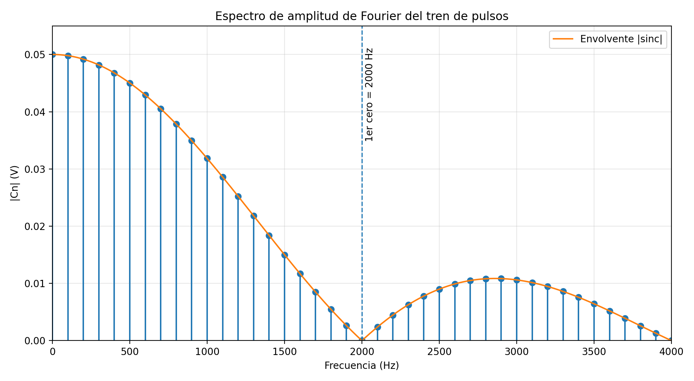
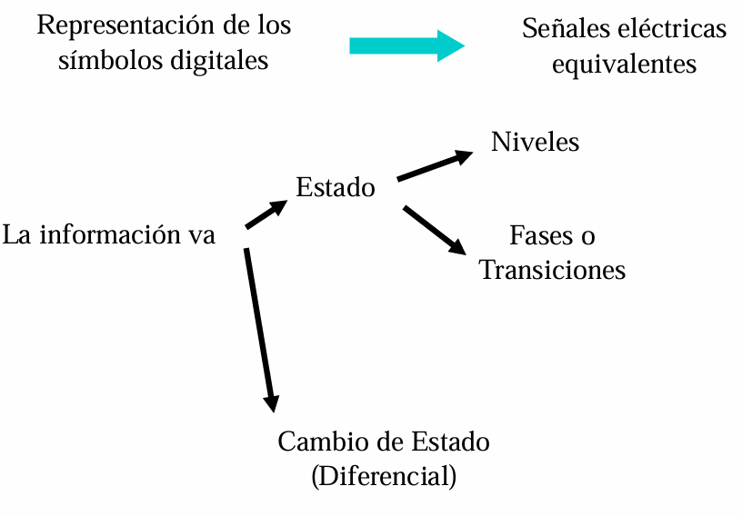
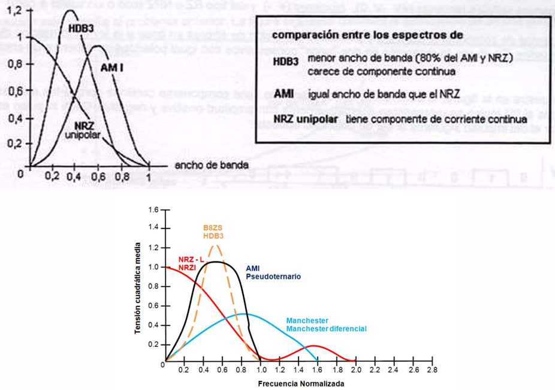

# Unidad 2 — Características de las señales de telecomunicaciones

> La información viaja en una magnitud física. Para saber si llegará bien hay que describir cómo cambia en el tiempo, qué frecuencias necesita y qué cambios puede conservar el medio.

**Ruta:** señal → parámetros → Fourier → ancho de banda → OEM → códigos → filtros. La práctica está en [TP2](../../practica/tp-02-senales.md); los cuestionarios, en [señales](../../repaso/u02-senales.md) y [Fourier/AB](../../repaso/u02-fourier-y-ancho-de-banda.md).

## Alcance registrado y mapa de integración

Se consolida lo registrado, NO todo el programa ni todos los capítulos del libro. Las páginas citadas son páginas **PDF**, salvo indicación de impresa. `en-progreso` refleja los pendientes explícitos, no una promoción de revisión parcial a revisión integral.

| Fuente / evidencia original | Contenido integrado | Destino |
|---|---|---|
| [Teoría 2, 20/08](../../../capturas/teoria/02-senales-telecomunicaciones/apuntes-clase%202.md), U2 pp.2–24 | analógico/digital, unidades, Fourier y AB | [Señales](#senales), [parámetros](#parametros), [Fourier](#fourier), [AB](#ancho-banda); dB en U6 |
| [Teoría 3, fecha no registrada](../../../capturas/teoria/02-senales-telecomunicaciones/apuntes-clase3.md), U2 pp.22–29 | tren, espectro, OEM | [Tren](#tren), [OEM](#oem) |
| [Teoría 4, 03/09](../../../capturas/teoria/02-senales-telecomunicaciones/apuntes-clase%204.md), U2 pp.30–48 | códigos, comparación espectral, filtros | [Códigos](#codigos), [filtros](#filtros) |
| [Práctica 2, 18/08](../../../capturas/practica/clase%2002.md), UT2 señales y respuestas 1 | parámetros, polaridad, regeneración, espectro y TP2 | secciones homónimas; [TP2 E1–16](../../practica/tp-02-senales.md) |
| [Práctica 3, 25/08](../../../capturas/practica/clase%2003.md), respuestas 2 pp.1–4 | periodicidad, Dirichlet, paridad, Fourier | [Fourier](#fourier); velocidades van a U3 |
| [Teoría U3 clase 4](../../../capturas/teoria/03-redes-telecomunicaciones/apuntes-clase%204.md), tramo AB | relación espectro-canal | [AB](#ancho-banda); no duplica velocidades |
| [Cuestionario U1/U2 Q4–7](../../../capturas/teoria/Cuestionarios/cuestionario%20U1%20y%20U2.md) | instrumentos, RZ, HDB3, filtros | [repaso U2](../../repaso/u02-senales.md) |
| [Cuestionario U3 Q2](../../../capturas/teoria/03-redes-telecomunicaciones/cuestionario_U3.md), TP2 E10 | tren 100 pps/2000 baudios/1 V | [tren](#tren), TP2 E10 y repaso |
| Pilotos Fourier y AB | desarrollo, ejemplos y preguntas preservados | teoría aquí; preguntas en ficha; rutas anteriores son stubs compatibles |

**Programa vs. registro:** señales, parámetros, Fourier, espectro EM, AB, banda base, códigos y filtros están registrados. OEM contiene representación de onda y polarización. La **ecuación diferencial de difusión** está en el programa, pero no tiene desarrollo registrado en las capturas ni en el material específico usado: queda **fuera de este alcance**, no se rellena desde bibliografía. No se incorporan medios U7 ni interfaces U8.

Fuentes: [presentación U2](../../../material/teoria/U2/U%202%20Características%20de%20las%20señales%20de%20telecom.pdf), [Señales Banda Base](../../../material/teoria/U2/Señales%20Banda%20Base.pdf), [UT2 señales](../../../material/practica/U%202/UT%202%20SEÑALES%20TELCOM-CODIGOS%20DE%20LINEA.pdf), [cuadro](../../../material/practica/U%202/UT%202%20Códigos%20de%20línea%20cuadro%20comparativo.pdf), [Castro/Fusario 2013](../../../material/teoria/DOC-20230425-WA0040.pdf). Los caches son auxiliares de búsqueda, no autoridad independiente.

<a id="senales"></a>
## 1. Señales analógicas, digitales y regeneración

**Fuente:** U2 pp.2–3; UT2 señales pp.2–3 y9; libro PDF 98/impresa 72 para umbral.

### Problema físico y concepto

El medio transporta tensión, corriente o campos, no números abstractos. Una señal **analógica** admite un continuo de valores; una **digital** representa símbolos de un conjunto discreto y finito. Binaria significa dos símbolos, NO que toda señal digital tenga dos niveles. Los flancos físicos de una señal digital no son instantáneos: discreto es el alfabeto sobre el que decide el receptor.

**Modelo mental:** el receptor analógico intenta conservar una forma; el digital decide cuál de pocos símbolos fue enviado. Un ruido pequeño puede ser tolerado si no cruza la frontera de decisión.

| Aspecto | Analógica | Digital |
|---|---|---|
| Información | variaciones continuas de forma/amplitud/frecuencia/fase | secuencia de símbolos según codificación |
| Ruido | se suma y afecta fidelidad | tolerable mientras conserve margen de decisión |
| Repetición | amplificar también amplifica ruido/distorsión presentes | decidir, reconstruir y temporizar pulsos |
| Calidad según cátedra | relación señal/ruido | BER; desarrollo en [U6](../06-canales-comunicaciones/APUNTE.md) |
| Conversión | modulación no equivale a digitalización | CODEC/digitalizador; desarrollo en [U4](../04-modulacion-digitalizacion-multiplexacion/APUNTE.md) |

### Ejemplo mínimo y límite

Ejemplo **hipotético**: niveles 0 V y 2 V, umbral 1 V. Una recepción de 1,7 V se interpreta como 1; una de 0,8 V como 0. Si se transmitió 1 y llegó 0,8 V, el regenerador genera un 0 limpio: **no recupera mágicamente el dato original**. Amplificar aumenta el nivel recibido; regenerar decide y reconstruye amplitud, forma y tiempos. Necesita energía suficiente y reloj recuperable.

**Caso del material:** el libro PDF 98 exige espaciar repetidores para no bajar del umbral. El “alcance infinito” de U2 p 3 idealiza regeneraciones sucesivas; no es distancia ilimitada ni error nulo. La conversión A/D se desarrolla en U4; un módem no es un digitalizador universal de cualquier señal.

### Errores típicos

- Digital ≠ inmune al ruido: hay decisiones incorrectas si no alcanza el margen.
- Regenerar ≠ amplificar ni corregir cualquier error de datos.
- Costos y ventajas del cuadro son comparaciones típicas, no leyes para cualquier instalación.

### Para examen

> Analógica representa información mediante variaciones continuas; digital mediante símbolos discretos. La regeneración reconstruye los símbolos decididos, pero requiere nivel y sincronismo suficientes y no deshace una decisión errónea.

<a id="parametros"></a>
## 2. Parámetros temporales y valores medio y eficaz

**Fuente:** U2 pp.12–14 y27–28; TP2 E4,6,7; libro §2.4 PDF 99–105/impresas 73–79.

### Problema físico, concepto y modelo mental

Dos ondas pueden tener igual pico y distinta potencia, o igual frecuencia y estar corridas en el tiempo. Un **ciclo** es una repetición completa; el **período**, su duración; la **frecuencia**, ciclos por segundo. La fase inicial indica dónde empieza el ciclo al fijar t=0. Pensá una sinusoide como proyección de un vector giratorio: radio=amplitud, giro=pulsación, posición inicial=fase.

### Formalización

$$
v(t)=A\sin(\omega t+\varphi),\qquad f=1/T,\qquad \omega=2\pi f=2\pi/T
$$

| Símbolo | Significado | Unidad |
|---|---|---|
| $v(t),A$ | tensión instantánea, amplitud máxima | V |
| $t,T$ | instante, período | s |
| $f$ | frecuencia | Hz=ciclos/s |
| $\omega$ | pulsación angular | rad/s |
| $\varphi$ | fase inicial | rad |

**Supuestos:** sinusoide pura de amplitud/frecuencia constantes; argumento en radianes. Ejemplo **hipotético**: T=2 ms → f=500 Hz, ω=1000πrad/s. Para A=1 V, fase 0: v(0)=0 V y v(0,5 ms)=1 V.

La **FRP** es frecuencia de repetición de pulsos: FRP=1/T en pulsos/s (pps), numéricamente Hz. El **ancho de pulso** τ [s] indica duración de cada pulso, no necesariamente T. En TP2 E10: T=10 ms, τ=0,5 ms y A=1 V; ocupa el 5% del período. Velocidad de modulación e intervalo de señalización van en [U3](../03-redes-telecomunicaciones/APUNTE.md): FRP no es universalmente Vm ni tasa de bits.

### Valor medio y eficaz

El medio firmado es área algebraica por período e identifica continua. El eficaz (RMS) equivale al nivel continuo que disipa igual potencia en una **resistencia constante**. Se eleva al cuadrado porque el calentamiento no cambia de signo.

$$
\overline v=\frac1T\int_0^T v(t)dt,\qquad
V_{\rm rms}=\sqrt{\frac1T\int_0^T v^2(t)dt}
$$

| Símbolo | Significado | Unidad |
|---|---|---|
| $\overline v,V_{\rm rms},v(t)$ | media firmada, eficaz, instantánea | V |
| $T,t$ | período, tiempo | s |

**Supuestos:** señal periódica integrable, RMS finito. Para seno sin continua, integral de seno en un período=0 y de seno²=T/2: media 0 V y RMS=A/√2. Ejemplo TP2 E4, A=300 V: RMS≈212,13 V, media 0 V. Cuadrada simétrica ±1 V: media 0 V y RMS 1 V. Media nula NO significa potencia nula. TP2 E7 deriva el caso en corriente.

**Discrepancia:** libro PDF 104 define media en un período; el ejemplo siguiente usa semiperíodo positivo y obtiene 0,637 A. Eso es media rectificada/positiva, no media firmada del ciclo. Para E4 y continua de Fourier se usa la **firmada**. No se añade factor de forma al alcance registrado.

### Errores típicos y examen

- Práctica 2 asigna Hz al período: T se mide en **s**, f en **Hz**.
- Media≠RMS≠pico. Para E4: 0 V,212,13 V,300 V respectivamente.
- τ≠T salvo dato explícito; tampoco es automáticamente intervalo de bit.

> Período mide duración y frecuencia repetición; amplitud mide máximo y fase el desplazamiento. La media firmada indica continua; el eficaz representa efecto de potencia, por eso media cero no implica eficaz cero.

<a id="fourier"></a>
## 3. Fourier: del tiempo al espectro

**Fuente:** U2 pp.15–21; Práctica 3; respuestas 2 pp.1–2; libro §2.4.5 PDF 106–112/impresas 80–86.

### Problema físico

Una onda cuadrada puede verse perfectamente definida en un osciloscopio, pero al atravesar un medio limitado en frecuencia pierde sus bordes. Mirar sólo $f(t)$ no explica cuáles de sus componentes fueron atenuadas.

### Concepto

Si $f(t)$ es periódica de período $T$, su serie de Fourier la expresa como una suma de:

1. una componente continua (su valor medio);
2. una componente fundamental de frecuencia $f_0=1/T$;
3. armónicas en $2f_0,3f_0,\ldots$

El conjunto de amplitudes y fases frente a frecuencia es su **espectro**. Para una señal periódica es discreto: sólo hay líneas en frecuencias determinadas.

### Modelo mental

Pensá cada senoidal como una pieza. Una sola redondea mucho la señal; al agregar armónicas aparecen los detalles rápidos, como los flancos de un pulso. El espectro es el inventario de esas piezas.

```text
señal periódica en el tiempo
        ↓ análisis de Fourier
continua + fundamental + armónicas
        ↓ suma de componentes
aproximación de la señal original
```

### Formalización trigonométrica

$$
f(t)=\frac{a_0}{2}+\sum_{n=1}^{\infty}
\left[a_n\cos(n\omega_0t)+b_n\sin(n\omega_0t)\right]
$$

$$
a_0=\frac{2}{T}\int_{-T/2}^{T/2}f(t)\,dt,
\qquad
a_n=\frac{2}{T}\int_{-T/2}^{T/2}f(t)\cos(n\omega_0t)\,dt
$$

$$
b_n=\frac{2}{T}\int_{-T/2}^{T/2}f(t)\sin(n\omega_0t)\,dt,
\qquad
\omega_0=\frac{2\pi}{T}=2\pi f_0
$$

| Símbolo | Significado | Unidad |
|---|---|---|
| $f(t)$ | valor instantáneo de la señal | la de la señal; en los ejemplos, V |
| $T$ | período fundamental | s |
| $f_0$ | frecuencia fundamental | Hz |
| $\omega_0$ | frecuencia angular fundamental | rad/s |
| $n$ | índice de la armónica | adimensional |
| $a_0/2$ | valor medio o componente continua | la de $f(t)$ |
| $a_n,b_n$ | coeficientes de coseno y seno | la de $f(t)$ |

**Supuestos y límites de validez**

- La señal debe ser periódica y cumplir condiciones suficientes de convergencia; para las señales del TP alcanza con que en un período sea integrable, tenga un número finito de extremos y un número finito de discontinuidades finitas.
- En una discontinuidad, la serie converge al promedio de los límites laterales. Cerca del salto queda una sobreoscilación al truncar la serie (fenómeno de Gibbs).
- Esta serie describe señales periódicas. Para una señal no periódica se usa la transformada de Fourier, tema relacionado pero distinto.

### Ejemplo numérico: onda cuadrada impar

Sea una onda de amplitud $A=1\ \text{V}$ y frecuencia fundamental $f_0=100\ \text{Hz}$:

$$
f(t)=
\begin{cases}
+A,&0<t<T/2\\
-A,&-T/2<t<0
\end{cases}
$$

Por ser impar, su valor medio y sus coeficientes de coseno se anulan. Sólo quedan senos:

$$
a_0=0,\qquad a_n=0,\qquad
b_n=
\begin{cases}
\dfrac{4A}{n\pi},&n\text{ impar}\\
0,&n\text{ par}
\end{cases}
$$

| Símbolo | Significado | Unidad |
|---|---|---|
| $A$ | amplitud de la onda cuadrada | V |
| $b_n$ | amplitud de la componente senoidal $n$ | V |
| $n$ | orden armónico | adimensional |

Las tres primeras componentes no nulas son:

| Componente | Frecuencia | Amplitud |
|---|---:|---:|
| fundamental ($n=1$) | $100\ \text{Hz}$ | $4/\pi\approx1{,}273\ \text{V}$ |
| tercera armónica ($n=3$) | $300\ \text{Hz}$ | $4/(3\pi)\approx0{,}424\ \text{V}$ |
| quinta armónica ($n=5$) | $500\ \text{Hz}$ | $4/(5\pi)\approx0{,}255\ \text{V}$ |

Con sólo esas tres piezas, la reconstrucción ya empieza a formar los flancos, pero todavía no es una onda cuadrada ideal.

**Verificación de razonabilidad:** las frecuencias son múltiplos impares de $100\ \text{Hz}$ y las amplitudes decrecen como $1/n$; ambas tendencias coinciden con la figura de U2, pp. 18-19.

### Caso real

Un osciloscopio muestra amplitud frente al tiempo; un analizador de espectro muestra amplitud o potencia frente a frecuencia. La presentación de U2, p. 20, contrapone ambos instrumentos: son dos vistas de la misma señal, no dos señales diferentes.

### Errores típicos

- **Confundir armónica con frecuencia cualquiera.** La armónica $n$ está exactamente en $nf_0$.
- **Decir que una onda cuadrada ideal tiene sólo una frecuencia.** Una sola senoidal no puede producir saltos; hacen falta infinitas armónicas.
- **Anular coeficientes por paridad sin mirar el intervalo.** La simplificación exige integrar sobre un intervalo simétrico y comprobar la paridad del producto completo.
- **Llamar continuo al espectro de una señal periódica.** La serie produce líneas discretas; el pulso aislado no periódico tiene espectro continuo.

### Para examen

> La serie de Fourier representa una señal periódica mediante una componente continua y senoidales en múltiplos de la frecuencia fundamental. Sus coeficientes indican amplitud y fase, por eso permiten pasar del dominio temporal al espectral y analizar qué componentes podrá transmitir un canal.

---

<a id="tren"></a>
### Forma compleja y tren rectangular

Para un tren de pulsos rectangulares de amplitud $A$, duración $\tau$ y período $T$, centrado en cada período, la forma compleja normalizada es:

$$
f(t)=\sum_{n=-\infty}^{\infty}C_ne^{jn\omega_0t},
\qquad
C_n=\frac{1}{T}\int_{-T/2}^{T/2}f(t)e^{-jn\omega_0t}\,dt
$$

$$
C_n=A\frac{\tau}{T}\operatorname{sinc}\left(n\frac{\tau}{T}\right),
\qquad
\operatorname{sinc}(x)=\frac{\sin(\pi x)}{\pi x}
$$

| Símbolo | Significado | Unidad |
|---|---|---|
| $C_n$ | coeficiente complejo de la línea $n$ | la de la señal; aquí, V |
| $A$ | amplitud del pulso | V |
| $\tau$ | duración o ancho del pulso | s |
| $T$ | período de repetición | s |
| $\tau/T$ | ciclo de trabajo | adimensional |
| $n\omega_0$ | frecuencia angular de la línea $n$ | rad/s |

**Supuestos y límites de validez:** esta expresión corresponde a pulsos rectangulares centrados. Un desplazamiento temporal agrega fase, aunque no cambia $|C_n|$. La función $\operatorname{sinc}$ queda definida arriba porque existen dos convenciones usuales.

La separación entre líneas depende de $T$; los ceros de la envolvente dependen de $\tau$. Ésa es la relación física que desarrolla [Ancho de banda](#primer-cero).



> **Verificación visual:** la figura fue contrastada con el enunciado y resolución de `Ejercicio cuestionario 10-09-2026.pdf`, pp. 1-3. Representa $FRP=100\ \text{Hz}$, $\tau=0{,}5\ \text{ms}$ y el primer cero en $2000\ \text{Hz}$.

---


### Convenciones: corrección del piloto

La inspección de U2 p 16 y libro PDF 108 confirma que **1/T delante de la suma no es un error por sí mismo**: es otra normalización. Para no dar dos unidades al mismo símbolo, distinguimos:

$$
D_n=\int_{-T/2}^{T/2}f(t)e^{-jn\omega_0t}dt=T C_n,\qquad
f(t)=\frac1T\sum_{n=-\infty}^{\infty}D_ne^{jn\omega_0t}
$$

| Símbolo | Significado | Unidad para tensión |
|---|---|---|
| $D_n$ | integral sin normalizar, llamada Cn en U2 p 16 | V·s |
| $C_n$ | coeficiente normalizado de este apunte/TP | V |
| $T,\omega_0,n$ | período, pulsación fundamental, índice | s; rad/s; sin unidad |

**Supuestos:** misma señal e intervalo que antes. TP2 E10: C0=0,05 V y T=0,01 s → D0=0,0005 V·s; D0/T=0,05 V. Cambiar el lugar de 1/T exige cambiar definición. Respuestas2 p 2 usa la normalizada; el libro PDF 109 escribe integral sin 1/T pero llega a Aτ/T: allí **sí mezcla convenciones**, demostrado por las unidades. El piloto anterior confundía la primera diferencia con un error.

Para una señal real, los pares $\pm nf_0$ representan una sinusoide real:

$$
C_0=a_0/2,\quad C_n=(a_n-jb_n)/2,\quad C_{-n}=(a_n+jb_n)/2,\quad
R_n=\sqrt{a_n^2+b_n^2}=2|C_n|\quad(n>0)
$$

| Símbolo | Significado | Unidad |
|---|---|---|
| $a_n,b_n$ | coeficientes trigonométricos | V |
| $C_{\pm n}$ | coeficientes bilaterales normalizados | V |
| $R_n$ | amplitud real del armónico | V |
| $j,n$ | unidad imaginaria, índice | sin unidad |

**Supuestos:** señal real, n positivo, convención normalizada. Cuadrada 1 V: $b_1=4/\pi$≈1,27324 V; $C_1=-j2/\pi\,V$, |C1|≈0,63662 V; $R_1=1{,}27324\,V$. La raíz de U2 p 16 es amplitud unilateral real, no módulo bilateral normalizado. Se declara tipo de espectro antes de graficar. La fase exige cuadrante correcto; dividir $b_n/a_n$ falla si $a_n=0$. Para el tren centrado, Cn es real: fase 0 si es positivo, π si negativo, **indefinida** si cero. “Real, entonces fase cero” (libro PDF 109) sólo vale para positivos. Las frecuencias negativas son componentes conjugadas, no otra oscilación física independiente. El módulo nunca tiene lóbulos negativos: esas curvas son coeficientes firmados.

### Ejemplo complejo completo: TP2 E10

**Datos registrados:** FRP=100 pps, Vm=2000 baudios, A=1 V. En **este enunciado** se adopta τ=1/Vm. Tren rectangular unipolar centrado: T=0,01 s, τ=0,0005 s, D=τ/T=0,05.

$$
C_n=0{,}05\,V\frac{\sin(0{,}05n\pi)}{0{,}05n\pi},\qquad C_0=0{,}05\,V
$$

| Símbolo | Significado | Unidad |
|---|---|---|
| $C_n,C_0,A$ | coeficiente, continua, pico temporal | V |
| $D,n$ | ciclo de trabajo, índice | sin unidad |
| $f_n=nf_0,f_0$ | frecuencia de línea, fundamental | Hz |

**Supuestos:** tren definido arriba; en n=0 se usa límite sinc=1, no división 0/0.

| n | frecuencia | Cn firmado (V) | módulo (V) |
|---:|---:|---:|---:|
|0|0 Hz|0,050000|0,050000|
|1|100 Hz|0,049795|0,049795|
|2|200 Hz|0,049182|0,049182|
|5|500 Hz|0,045016|0,045016|
|10|1000 Hz|0,031831|0,031831|
|19|1900 Hz|0,002621|0,002621|
|20|2000 Hz|0|0|
|21|2100 Hz|−0,002371|0,002371|

Las líneas negativas tienen igual módulo; separación 100 Hz. La curva que une alturas es **envolvente**: el tren no tiene todas sus frecuencias. Máximo |Cn|=0,05 V en n=0; excluyendo continua, el mayor es |C±1|≈0,049795 V. El pico temporal 1 V NO es el máximo de cada coeficiente. La suma reconstruye el pulso. Para la cuadrada impar del E8, $a_0=a_n=0$; $b_n$ también se anula para n par, no es no-nulo para todo n. Agregar continua desplaza verticalmente sin cambiar frecuencias armónicas (U2 p 21).

### Errores típicos del tren y examen

- FRP fija separación; τ fija ceros. Cambiar uno no equivale a cambiar el otro.
- C0 es media y Cn no es pico. Indicá normalización y espectro bilateral/unilateral.
- La serie finita no reproduce exactamente saltos; en el salto converge al promedio lateral.

> Las líneas del tren rectangular están en múltiplos de 1/T y sus alturas siguen una sinc controlada por τ. La continua normalizada es Aτ/T y el primer cero de envolvente está en 1/τ; dibujar envolvente no convierte el espectro discreto en continuo.

<a id="ancho-banda"></a>
## 4. Ancho de banda: señal, canal y criterio

**Fuente:** U2 pp.7 y22–24; libro PDF 112 y §2.7 PDF 134–138/impresas 108–112; TP2 E9–12. Se integra el piloto con contraste bibliográfico delimitado.

Una transición perfectamente vertical exige componentes de frecuencia arbitrariamente altas. Ningún medio físico real las transmite todas con la misma ganancia y fase. Al limitar el espectro, el receptor obtiene una señal redondeada o deformada.

### Modelo mental

Pensá el canal como una ventana sobre el eje de frecuencias:

```text
espectro que necesita la señal ∩ frecuencias que deja pasar el canal
                         ↓
             componentes que llegan al receptor
```

La presentación de U2, p. 23, confirma visualmente esto: al reducir el ancho de banda de un canal, una señal digital periódica pierde detalle hasta parecerse a una senoidal.

---

### Ancho de banda de una señal

### Concepto

El material de cátedra lo define como el intervalo del espectro donde se concentra la mayor cantidad de energía. Para calcularlo hay que declarar **qué criterio delimita ese intervalo**: componentes no nulas, porcentaje de energía, nivel relativo o primer cero, según el problema.

Si los extremos elegidos son $f_L$ y $f_H$:

$$
B=f_H-f_L
$$

| Símbolo | Significado | Unidad |
|---|---|---|
| $B$ | ancho de banda | Hz |
| $f_L$ | frecuencia límite inferior | Hz |
| $f_H$ | frecuencia límite superior | Hz |

**Supuestos y límites de validez:** la resta sólo mide el intervalo; no decide los límites. El criterio para elegir $f_L$ y $f_H$ debe acompañar siempre el resultado. Una onda cuadrada ideal tiene ancho de banda matemático infinito, aunque en ingeniería se la aproxime con uno finito.

### Ejemplo numérico

Si se decide conservar las componentes comprendidas entre $300\ \text{Hz}$ y $3400\ \text{Hz}$:

$$
B=3400\ \text{Hz}-300\ \text{Hz}=3100\ \text{Hz}=3{,}1\ \text{kHz}
$$

**Verificación de razonabilidad:** el extremo superior es mayor y la resta conserva la unidad Hz. No puede concluirse cuánta información se transmite sólo con este número.

---

### Ancho de banda de un canal por puntos de 3 dB

### Concepto

Para la línea de transmisión, la presentación de U2, p. 7, toma el intervalo entre las frecuencias donde la atenuación alcanza $3\ \text{dB}$ respecto de una frecuencia de referencia. Si esas frecuencias son $f_1$ y $f_2$, el ancho de banda del canal es $B=f_2-f_1$.

Una caída de potencia de aproximadamente $3\ \text{dB}$ representa cerca de la mitad de potencia:

$$
\frac{P_2}{P_1}=10^{-3/10}\approx0{,}501
$$

| Símbolo | Significado | Unidad |
|---|---|---|
| $P_1$ | potencia en la referencia | W |
| $P_2$ | potencia en el punto de corte | W |
| $P_2/P_1$ | relación de potencias | adimensional |
| $f_1,f_2$ | puntos de corte inferior y superior | Hz |

**Supuestos y límites de validez:** el valor $-3\ \text{dB}$ se interpreta aquí como relación de potencias. Hablar de $20\log_{10}$ para tensión sólo es equivalente cuando las impedancias comparadas son iguales.

### Caso real

Filtros, amplificadores y líneas se caracterizan mediante su respuesta en frecuencia. Dos equipos pueden anunciar el mismo intervalo en hertz, pero no ser equivalentes si usan tolerancias o criterios de corte distintos.

---

<a id="primer-cero"></a>
### Tren de pulsos y primer cero

Para el tren rectangular estudiado en [Serie de Fourier](#tren), la envolvente espectral tiene su primer cero positivo en:

$$
B_{\text{primer cero}}=\frac{1}{\tau}
$$

| Símbolo | Significado | Unidad |
|---|---|---|
| $B_{\text{primer cero}}$ | intervalo desde continua hasta el primer cero | Hz |
| $\tau$ | duración del pulso rectangular | s |

**Supuestos y límites de validez:** no es una ley universal de ancho de banda. Es el criterio explícito del TP 2 para un pulso rectangular ideal. El espectro continúa después del primer cero en lóbulos de menor amplitud.

En el ejercicio con $V_m=2000\ \text{baudios}$ se toma $\tau=1/V_m=0{,}5\ \text{ms}$; entonces:

$$
B_{\text{primer cero}}=\frac{1}{0{,}0005\ \text{s}}=2000\ \text{Hz}
$$

Las líneas están separadas por $FRP=100\ \text{Hz}$, por lo que el primer cero coincide con $n=2000/100=20$. La componente $n=20$ vale cero: hay **19 armónicas no nulas** entre la continua y el primer cero, aunque el material resuelto usa la frase “20 armónicas hasta el primer cero”.

### Error típico

- **Error:** repetir $B=1/\tau$ para cualquier señal o canal. **Por qué está mal:** esa igualdad sale de los ceros de la sinc de un pulso rectangular. **Lo correcto:** nombrar la forma de señal y el criterio de primer cero.
- **Error:** expresar ancho de banda en bit/s. **Por qué está mal:** bit/s mide tasa de transmisión; Hz mide extensión espectral. **Lo correcto:** relacionarlos más adelante mediante un modelo con supuestos, como Nyquist o Shannon.
- **Error:** creer que fuera del ancho de banda la energía desaparece siempre. **Por qué está mal:** una definición efectiva o a $3\ \text{dB}$ fija un límite convencional; no afirma que el espectro sea exactamente cero.

### Para examen

> El ancho de banda es un intervalo de frecuencias medido en hertz. Sus extremos dependen del criterio: para una línea pueden ser los puntos de $3\ \text{dB}$ y, para el tren rectangular del TP, se toma el primer cero de la envolvente en $1/\tau$. Por eso nunca hay que dar un ancho de banda sin decir de qué objeto se habla y cómo se delimitó.

---

**Conteo y criterios:** n0=T/τ es el índice del cero si entero. E10 tiene 19 armónicas positivas no nulas antes de 2000 Hz, más continua y 19 conjugadas negativas: 39 líneas no nulas dentro de (−2000, 2000) Hz. Si n0 no es entero, el cero de envolvente puede estar entre líneas; no redondear τ para fabricar un cero. De 0 al primer cero son 2000 Hz; entre −2000 y +2000 Hz son 4000 Hz. El TP usa el primero. El espectro matemático sigue siendo infinito porque hay lóbulos laterales.

**Ejemplo hipotético de canal:** cortes 200 Hz y 3600 Hz → B=3400 Hz. Potencia en cortes≈0,501 de referencia; a impedancias iguales, tensión≈0,708 de referencia. No se anula respuesta fuera del corte ni toda banda real es plana. “Mayor energía” no fija porcentaje: libro PDF 112 respalda primer cero como **aproximación** y PDF 134 límites bajo tolerancias. Para señal periódica sostenida hablamos rigurosamente de potencia media; “energía concentrada” es la expresión intuitiva de cátedra.

<a id="db-contexto"></a>
### Unidades logarítmicas registradas: vínculo con U6

U2 pp.4–11 registra dB y niveles dBm/dBmV. El desarrollo canónico, supuestos eléctricos y balance de enlace van en [U6](../06-canales-comunicaciones/APUNTE.md). Aquí explican curvas de respuesta y cortes: Hz no se reemplaza por dB.
- dB compara niveles; dBm refiere potencia a 1 mW; dBmV tensión a 1 mV.
- “Veces” en U2 p 8 es cociente de **potencia**, no tensión. 3 dB≈doble y −3 dB≈mitad son aproximaciones.
- U2 p 9: 43 dB≈19952,62 veces en potencia; p 10: Tx 42,9 dBmV≈139,64 mV y Rx 2,3 dBmV≈1,30 mV. Estos Tx/Rx de cablemódem no bastan para inferir pérdida de un trayecto: pueden ser frecuencias/sentidos distintos.
- U2 p 11: F6TSVM de 75 Ω tiene 1,90 dB/100 m a 5 MHz y 21,49 dB/100 m a 1000 MHz. Ilustra dependencia de frecuencia y longitud; splitter agrega pérdida. No se agrega teoría de medios U7.
- U2 p 9 también registra tilt 15,5 dB y figuras de ruido 8,5 dB a 54 MHz/8 dB a 1 GHz: datos de ese equipo, no universales. Figura de ruido se explica en U6.
- P=U²/Z de la captura no es una expresión de potencia activa real general para Z compleja; la condición de resistencia y valores RMS se desarrolla en U6. No se cancela ese matiz por decir “Z iguales”.

<a id="oem"></a>
## 5. Ondas electromagnéticas y espectro EM

**Fuente:** U2 pp.25–29; UT2 señales pp.10–12; Práctica 2.

### Problema físico, concepto y modelo mental

La perturbación se propaga: el mismo estado aparece más tarde más lejos. Una OEM combina campos eléctrico y magnético variables en espacio y tiempo. En la onda plana de U2 p 25/28, E, H y propagación son mutuamente perpendiculares. **Polarización** describe orientación del campo eléctrico, no polaridad lógica de un código. Foto a un instante→longitud de onda; evolución en un punto→período: distancia≠tiempo.

### Formalización y corrección dimensional

$$
\lambda=vT=\frac v f,\qquad
E(z,t)=E_0\cos\!\left[\omega\left(t-\frac z v\right)+\varphi\right],\qquad
H(z,t)=H_0\cos\!\left[\omega\left(t-\frac z v\right)+\varphi\right]
$$

| Símbolo | Significado | Unidad |
|---|---|---|
| $\lambda,z$ | longitud de onda, distancia en propagación | m |
| $v$ | velocidad de propagación | m/s |
| $T,t,f,\omega,\varphi$ | período, instante, frecuencia, pulsación, fase | s; s; Hz; rad/s; rad |
| $E,E_0$ | campo eléctrico y amplitud | V/m |
| $H,H_0$ | campo magnético H y amplitud | A/m |

**Supuestos:** onda plana armónica viajera, velocidad constante, sin modelar atenuación. Ambos campos viajan en la misma coordenada z. En vacío (aire aproximado aquí), v≈c=3·10⁸ m/s; no se aplica a todo cable. U2 p 26 escribe cos(ωt−y/v): resta ángulo y tiempo. Se corrige a cos[ω(t−z/v)] por dimensiones, sin modificar original: el retardo z/v debe multiplicarse por ω. Es aclaración del contenido registrado, no desarrollo nuevo de ecuaciones diferenciales de onda/difusión.

**Ejemplo registrado:**100 MHz en aire→T=10 ns y λ=3 m: viajar 3 m demora 10 ns, un período. UT2 p 12: 1 MHz→300 m; 600 MHz→0,5 m; 2,4 GHz→0,125 m; 5 GHz→0,06 m; 28 GHz→≈0,010714 m. Son escalas, no receta universal de alcance ni de tamaño mínimo de antena; no se desarrolla U7.

**Aplicación numérica de ambos campos — datos hipotéticos.** En el mismo modelo de onda plana, tomamos $f=100\,\mathrm{MHz}$, $v=3\cdot10^8\,\mathrm{m/s}$, $z=0{,}75\,\mathrm m$, $\varphi=0$, $E_0=3{,}77\,\mathrm{V/m}$ y $H_0=0{,}010\,\mathrm{A/m}$ como amplitudes dadas. Son componentes en sus respectivas direcciones de campo; no se deduce una amplitud de la otra ni se agrega aquí un modelo de antena o de atenuación. El retardo es $z/v=2{,}5\,\mathrm{ns}$ y $\omega=2\pi\cdot10^8\,\mathrm{rad/s}$. Para $t=0$:

$$
\omega(t-z/v)+\varphi
=(2\pi\cdot10^8\,\mathrm{rad/s})(-2{,}5\cdot10^{-9}\,\mathrm s)=-\pi/2\,\mathrm{rad}
$$

Por eso $E(0{,}75\,\mathrm m,0)=(3{,}77\,\mathrm{V/m})\cos(-\pi/2)=0\,\mathrm{V/m}$ y $H(0{,}75\,\mathrm m,0)=(0{,}010\,\mathrm{A/m})\cos(-\pi/2)=0\,\mathrm{A/m}$. Para ver que no son siempre nulos, mantenemos la posición y cambiamos el instante:

| $t$ | Fase $\omega(t-z/v)$ | $E(z,t)$ | $H(z,t)$ |
|---|---|---|---|
| $0\,\mathrm{ns}$ | $-\pi/2\,\mathrm{rad}$ | $0\,\mathrm{V/m}$ | $0\,\mathrm{A/m}$ |
| $2{,}5\,\mathrm{ns}$ | $0\,\mathrm{rad}$ | $3{,}77\,\mathrm{V/m}$ | $0{,}010\,\mathrm{A/m}$ |
| $7{,}5\,\mathrm{ns}$ | $\pi\,\mathrm{rad}$ | $-3{,}77\,\mathrm{V/m}$ | $-0{,}010\,\mathrm{A/m}$ |

El signo cambia la orientación instantánea de la componente, no la dirección de propagación. Esto aplica las expresiones registradas de U2 p.26; no desarrolla ecuaciones diferenciales de onda/difusión.

### Espectro EM no es espectro de una señal

El espectro EM ordena frecuencias posibles de radiación; Fourier dice cuáles componen **esa señal**. La práctica registra estas bandas y usos típicos en sus figuras:

| Banda | Intervalo mostrado | Ejemplo registrado |
|---|---|---|
| VLF |3–30 kHz|muy bajas|
| LF |30–300 kHz|bajas|
| MF |300 kHz–3 MHz|AM|
| HF |3–30 MHz|altas|
| VHF |30–300 MHz|FM/TV del ejemplo|
| UHF |300 MHz–3 GHz|TV/celular del ejemplo|
| SHF |3–30 GHz|satélite del ejemplo|
| EHF |30–300 GHz|extremadamente altas|

No es asignación regulatoria vigente ni exclusividad por servicio. U2 p 29 también ubica infrarrojo, visible, ultravioleta, rayos X y gamma: [mapa original copiado](recursos/espectro-electromagnetico.png), sin inventar cortes poco legibles.

### Errores típicos y examen

- Mayor frecuencia→menor λ sólo con v fija; **no implica universalmente menor alcance**. También dependen medio, pérdidas, potencia, antenas y condiciones.
- El rótulo “mayor energía” de p 27 no significa que una onda clásica de mayor f tenga necesariamente mayor potencia; frecuencia sola no fija amplitud.
- H [A/m] no se intercambia sin explicación con B [teslas].

> La onda se repite en tiempo con período T y en espacio con longitud λ, unidos por v. En una OEM plana E y H son perpendiculares entre sí y a la propagación. Espectro EM clasifica frecuencias; Fourier describe las componentes de una señal concreta.

<a id="codigos"></a>
## 6. Banda base y códigos de línea

**Fuente:** U2 pp.30–46; Señales Banda Base pp.2,6–33; cuadro pp.1–3; UT2 codificación p 1; libro §2.8 PDF 139–155/impresas 113–129. Capturas Práctica 2 y Teoría 4. La misión de presencia se registra además en UT2 señales p.15 y Práctica 2, apartado «misión»; Señales Banda Base p.16 ilustra su problema físico.

### Problema físico, concepto y modelo mental

La secuencia binaria no especifica tensión de cable. Ceros largos sin transiciones pueden perder reloj; continua bloqueada por transformador deforma la señal; además el espectro debe caber en el canal. Un **código de línea** asigna estados o transiciones a datos para adaptarlos al medio. En **banda base** no se traslada información mediante portadora modulada; sí puede codificarse. “Sin tratamiento” de U2 p. 30 no excluye codificación: Señales Banda Base p 6 lo aclara. Modulación se desarrolla en U4. Modelo: una regla de dibujo sobre una grilla; el receptor comparte regla y recupera ritmo de cambios. Las tres misiones registradas son **reducir continua, garantizar sincronismo y permitir detectar presencia de señal en la línea**. Además, el espectro debe ser compatible con el ancho de banda disponible; estas exigencias pueden competir.

<a id="presencia-senal"></a>
### Presencia de señal no es valor del bit

Detectar **presencia** significa reconocer actividad física de una emisión en la línea, no decidir si el dato vale 1 o 0. En el caso de medio compartido de Señales Banda Base p.16, confundir un cero informativo con ausencia de emisión puede hacer creer que el medio está libre cuando alguien transmite.

**Ejemplo hipotético:** reposo sin emisión a $0\,\mathrm V$, amplitud $A=1\,\mathrm V$ y $T_b=1\,\mathrm{ms}$. En unipolar NRZ, transmitir `0000` mantiene $0\,\mathrm V$ durante cuatro celdas: una observación de tensión sola no distingue esos datos del reposo supuesto. En polar NRZ los mismos ceros mantienen $-1\,\mathrm V$: se distingue actividad por nivel, pero no hay transiciones para recuperar reloj. En Manchester, con nuestra convención, los ceros son `+− +− +− +−`: hay niveles opuestos y transiciones en cada celda. Un detector con niveles y ventana de observación adecuados puede reconocer actividad durante esa racha, además de la referencia de reloj.

**Límite:** NO se concluye «tensión instantánea cero = línea inactiva». Polar RZ retorna a cero parte de cada bit y sigue siendo una emisión; hay que observar la actividad con el código y los umbrales declarados. Presencia, recuperación de reloj y decodificación son funciones diferentes.

### Clasificaciones independientes

| Criterio | Familia y ejemplo |
|---|---|
| Unipolar | una polaridad más cero: 1=+A,0=0 (o versión negativa) |
| Polar | signos opuestos: 1=+A,0=−A |
| Bipolar/seudoternario AMI |1 alterna+A/−A; 0=0. Tres niveles transportan datos binarios |
| NRZ | pulso ocupa intervalo significativo completo, sin retorno interior obligatorio |
| RZ | retorna a 0 antes del final; habitualmente mitad, no obligatorio |
| Por nivel | valor físico distingue símbolo |
| Diferencial | transiciones según regla compartida |

RZ vuelve a nivel **cero**, no “cualquier valor intermedio”: corrige Teoría 4. Todos los ejemplos con dos mitades siguientes declaran τ=Tb/2; no es definición universal de RZ.

### Formalización mínima: continua

$$
C_0=\overline v=\frac1T\int_0^T v(t)dt
$$

| Símbolo | Significado | Unidad |
|---|---|---|
| $C_0,\overline v,v$ | continua, media firmada, tensión | V |
| $T,t$ | período completo, tiempo | s |

**Supuestos:** secuencia periódica; en datos aleatorios se usa media estadística con probabilidades explicitadas. No se promedia “energía firmada”: energía no es negativa. Ejemplo **hipotético**: 1100 repetido, A=1 V, celdas iguales: unipolar NRZ→media 0,5 V; polar NRZ→0 V; Manchester±1 V→0 V en cada celda. Polar NRZ1110 repetido→media 0,5 V: **ser polar no garantiza continua nula para cualquier secuencia**. “No posee” del cuadro presupone balance/equiprobabilidad; Manchester balancea cada bit sin ese supuesto. AMI alterna marcas y mantiene acotada la acumulación de signo. Acortar pulsos ensancha envolvente (ver [primer cero](#primer-cero)), con igual tasa/criterio. Eso no ordena universalmente todas las PSD. BER depende de potencia, ruido y detector; rankings sin supuestos no son resultados universales.

### Reglas operativas y ejemplos

Amplitud **hipotética** A=1 V, Tb=1 ms. `+`, `−`, `0` representan +1 V,−1 V,0 V. Cada pareja ocupa primera/segunda mitad del bit; primer 1 AMI positivo. Los diferenciales polares inician en −A; el unipolar diferencial inicia en 0, coherente con sus niveles 0/+A.

| Código | Regla | Salida 10110 | Compromiso |
|---|---|---|---|
| Unipolar NRZ |1=+,0=0|`++ 00 ++ ++ 00`|rachas sin reloj; continua|
| Polar NRZ |1=+,0=−|`++ −− ++ ++ −−`|rachas iguales sin transiciones; balance condicionado|
| Unipolar RZ |1=+0,0=00|`+0 00 +0 +0 00`|ceros largos sin reloj; pulsos más cortos|
| Polar RZ |1=+0,0=−0|`+0 −0 +0 +0 −0`|transición en cada bit|
| AMI/NRZ bipolar |marcas alternadas,0=00|`++ 00 −− ++ 00`|ceros largos sin reloj|
| Bipolar RZ |marcas alternadas retornan 0|`+0 00 −0 +0 00`|mismo problema de ceros; banda mayor|
| Polar diferencial |1 cambia inicio,0 mantiene|`++ ++ −− ++ ++`|estado previo; ceros largos sin cambios|
| Unipolar diferencial |igual, niveles 0/+|`++ ++ 00 ++ ++`|estado previo y continua|
| Manchester |1=−+,0=+−|`−+ +− −+ −+ +−`|reloj central y balance por bit|
| Manchester diferencial |mitad siempre, inicio sólo 0|`−+ −+ +− −+ −+`|dato por transición, no por polaridad|

Manchester sigue convención escrita de U2 p. 41; otra asignación requiere declararla. En diferencial, transición central=reloj y transición de inicio=dato. El “final del intervalo anterior” de Señales Banda Base p 30 es el mismo borde que el inicio del siguiente, no otro algoritmo.



**Caso registrado:** Ethernet histórico IEEE802.3 en U2 p. 41, TokenRing IEEE802.5 en p. 42. No generalizar Manchester a toda Ethernet. FDDI de captura no se repite como ejemplo Manchester: filmina no lo sustenta.

<a id="hdb3"></a>
### HDB3: no más de tres ceros sin pulso

AMI falla en ceros largos. HDB3 sustituye **cuatro ceros** por `000V` o `R00V`, no sustituye al tercer cero. V viola alternancia: repite signo del pulso no nulo anterior. R rellena cumpliendo alternancia AMI. El receptor reconoce grupo y recupera 0000; no se agregan bits de información.

1. Contá marcas de datos desde última V; acordá inicialización.
2. Cuenta impar → `000V`: V con signo del último pulso.
3. Cuenta par → `R00V`: R opuesto al último pulso, V mismo signo que R.
4. Reiniciá cuenta tras V; signos de V sucesivas alternan.

Ejemplo U2 p. 39, cuenta inicial 0 y último pulso−:

```text
Datos:  1  1  1 | 0 0 0 0 | 0 0 0 0 | 0 1 0 1
HDB3:   +  −  + | 0 0 0 +V| −R0 0 −V| 0 + 0 −
Cuenta:       3 → impar     0 → par
```

R/V no son nuevos unos. Primera sustitución sigue 3 marcas; segunda sigue 0 marcas. “Primera V siempre mismo signo que último 1” (Señales Banda Base p 26) requiere distinguir último **pulso**, que puede ser R, y último 1 de datos: en `R00V` no comparte signo con último 1 de datos. Diagrama U2 p. 39 y libro PDF 155 respaldan regla operacional de alternancia/relleno.

### Códigos secundarios registrados

- **Miller:** 1 cambia mitad; 0 no, salvo borde entre dos 0. Con inicio −,1001→`−+ ++ −− −+`. Menos transiciones que Manchester; AB del cuadro es comparación cualitativa. Fuente: cuadro p 3, libro §2.8.5.10.
- **CMI:** 0 tiene dos mitades opuestas; 1 ocupa celda completa y alterna signo entre marcas. Primer 1 positivo,0=−+ →101 se dibuja`++ −+ −−`. Fuente: cuadro pp.2–3, Banda Base p 33.
- **B6ZS:** AMI con sustitución 000000. Cuadro p 3 muestra`0+−0−+`o`0−+0+−`según signo previo. Mantiene seis celdas, no seis bits por símbolo. Secuencia/signos/prestaciones quedan pendientes de corroboración independiente; **no se evalúan**.
- **2B1Q:** 2 bits→1 símbolo cuaternario. U2 p 43: 00→−2,5 V; 01→−0,833 V; 10→+2,5 V; 11→+0,833 V. Ejemplo 001110→−2,5;+0,833;+2,5 V. Son niveles de esa tabla, no universales. Igual flujo binario requiere mitad de símbolos; tasas se explican en U3.
- **4B3T:** 4 bits→3 símbolos ternarios, no 3 bits ni compresión informativa. U2 p 43 ofrece estados alternativos para balancear acumulación de signos.1010→`0+−`, suma 0; 0000 tiene`---`o`+++`, elegidos para compensar historia. Son 25% menos **símbolos** que un símbolo binario por bit. AB 25% menor exige además mismo flujo, forma de pulso y criterio; no sale sólo de palabra “ternario”.

**Advertencia local — 2B1Q: tabla y figura no usan la misma correspondencia.** La tabla de U2 p.43 adoptada arriba asigna `01` a −0,833 V y `10` a +2,5 V. El panel 2B1Q de U2 p.44 y de la copia histórica enlazada abajo dibuja `01` por encima de cero y `10`/`11` por debajo. Esa representación no sirve para comprobar los signos de **nuestra tabla**; no demuestra que toda otra asignación 2B1Q sea inválida. El eje de la figura no calibra voltajes, por lo que no le atribuimos valores numéricos.

Para la secuencia original `01101110101111010101`, esta es la reconstrucción **calculada con la tabla de p.43**, no una transcripción del dibujo de p.44. Se mantienen diez símbolos, cada uno para dos bits:

| Símbolo | 1 | 2 | 3 | 4 | 5 | 6 | 7 | 8 | 9 | 10 |
|---|---|---|---|---|---|---|---|---|---|---|
| Dibit | 01 | 10 | 11 | 10 | 10 | 11 | 11 | 01 | 01 | 01 |
| Tensión (V), tabla p.43 | −0,833 | +2,5 | +0,833 | +2,5 | +2,5 | +0,833 | +0,833 | −0,833 | −0,833 | −0,833 |
| Signo mostrado en el panel histórico p.44 | + | − | − | − | − | − | − | + | + | + |

**Figura histórica preservada, con la discrepancia anterior:** [comparación original AMI/4B3T/2B1Q](recursos/multinivel.png) (U2 pp.43–44). Para 4B3T, el historial importa al elegir terna redundante; no se inventa algoritmo docente para una selección no especificada.

### Análisis espectral y límites de las comparaciones



U2 p 45 muestra bajas frecuencias y efectos de códigos; unipolar NRZ aporta continua, AMI/HDB3 balancean marcas, Manchester garantiza área firmada cero por bit. La densidad espectral de potencia representa **potencia por intervalo de frecuencia** (W/Hz en normalización de potencia), no ancho τ ni área del pulso. Depende de pulso, tasa y estadísticas; no se calcula sólo con τ.

**Pendiente del cuadro:** diferencial “menor AB y menor error que Manchester” (p 2) no es universal. U2 p 45 los dibuja juntos; sin criterio, potencia y detector no se evalúa desigualdad como hecho. Igual para rankings de “mayor densidad” y 80% de HDB3 del rótulo: persisten como afirmaciones atribuidas al material, no leyes confirmadas.

### Errores típicos y examen

- NRZ/RZ=duración; unipolar/polar/bipolar=signos. Ejes independientes.
- RZ vuelve a 0; polar RZ pulsa todos los bits, bipolar RZ no pulsa los 0.
- HDB3 sustituye 4 ceros; V repite **último pulso**, no alterna como 1.
- Tres niveles AMI no son 3 bits por pulso: datos siguen binarios.
- Continua es media de amplitud firmada, no energía; balance estadístico no es balance por bit.
- Recibir un bit 0 no significa ausencia de emisión; presencia y reloj no son la misma función.

> Los códigos adaptan datos al canal sin portadora modulada: estados/transiciones controlan espectro, continua y sincronismo. RZ acorta pulsos; Manchester asegura transición central; HDB3 conserva AMI y sustituye 4 ceros para sostener reloj. Detectar actividad permite distinguir una emisión del reposo bajo condiciones declaradas, sin confundir el cero informativo con ausencia de señal.

<a id="filtros"></a>
## 7. Filtros: selección física de frecuencias

**Fuente:** U2 pp.47–48; Teoría 4; libro §2.9 PDF 156–159/impresas 130–133.

### Problema físico, concepto y modelo

Queremos conservar unas componentes y atenuar otras. Un **filtro** es circuito, sistema o parte de red selectivo en frecuencia. No elige bits: actúa sobre componentes y puede deformar pulsos. Modelo: cada línea de Fourier atraviesa una puerta distinta; la salida suma lo que quedó.

| Tipo | Banda de paso ideal | Ejemplo hipotético |
|---|---|---|
| Pasa bajos |0 hasta fc|fc=1 kHz: pasan 100 Hz/500 Hz; no 5 kHz|
| Pasa altos |mayores que fc|fc=1 kHz: pasa 5 kHz; no 100 Hz|
| Pasa banda |fL a fH|300–3400 Hz: pasa 1 kHz; no 100 Hz/5 kHz|
| Eliminador de banda |fuera de fL–fH|rechaza 300–3400 Hz: pasan 100 Hz/5 kHz; no 1 kHz|

### Formalización y límites

$$
B=f_H-f_L
$$

| Símbolo | Significado | Unidad |
|---|---|---|
| $B,f_L,f_H,f_c$ | ancho, cortes inferior/superior, corte único | Hz |

**Supuestos:** declarar banda de paso y criterio de corte, por ejemplo 3 dB. Ejemplo anterior pasa banda: B=3400−300=3100 Hz. Para pasa bajos fL=0 y B=fc; no se asigna ancho finito al pasa altos ideal sin especificar límite superior. El **ideal** cambia abruptamente; el **real** tiene transición gradual, pérdida/ondulación en paso y rechazo finito. También puede afectar fase/retardo. Selectividad indica rapidez de discriminación cerca del corte; no es sinónimo de B.

### Diseños secundarios y caso

- **LC:** bobinas/capacitores tienen impedancias dependientes de frecuencia; ramas serie obstaculizan y ramas derivadas apartan componentes según diseño.
- **Cristal:** usa resonancia piezoeléctrica para selección estrecha.
- **Activo:** amplificador y red resistiva/capacitiva, requiere alimentación.

No se calculan órdenes/componentes no registrados. U2 p 48 muestra curvas/símbolos. Canal de voz de los ejemplos aproxima pasa banda; uno de banda base puede aproximar pasa bajos. “Todo canal es pasa banda” no es general: Q7 se responde en contexto de sus dos cortes. Si sólo pasa fundamental de cuadrada, salida parece sinusoide (U2 p 23): no significa desaparición automática de toda información.

### Errores típicos y examen

- Rechazo real no significa exactamente 0; 3 dB no es un muro.
- fc es frecuencia y B intervalo. Sólo coinciden en pasa bajos con fL=0.
- Espectro dentro de banda no garantiza ausencia de toda distorsión de fase.

> Un filtro atenúa selectivamente frecuencias. Los cuatro tipos se distinguen por qué intervalos dejan pasar; cortes reales requieren tolerancia. Atenuar armónicas de un pulso cambia su forma temporal.

<a id="pendientes"></a>
## Pendientes por sección y discrepancias

| ID / sección | Resuelto / falta | Efecto |
|---|---|---|
| U2-P01 Fourier | normalizaciones separadas; libro mezcla Cn/Dn entre 2-50 y 2-52 | se estudia convención declarada, no literal inconsistente |
| U2-P02 OEM | argumento p 26 corregido dimensionalmente; falta confirmación docente de errata | no se evalúa fórmula original errónea |
| U2-P03 códigos | rankings BER/PSD y desigualdad de AB de Manchester diferencial sin modelo | excluidos del repaso como hechos confirmados |
| U2-P04 B6ZS | tabla registrada, falta corroborar variantes/signos/condiciones | no evaluado |
| U2-P05 OEM | algunos límites fuera de bandas radio poco legibles | no se inventan cortes visible/rayos |
| U2-P06 programa | difusión sin desarrollo en registros utilizados | fuera del alcance |
| U2-P07 auxiliares | xlsx Fourier, docx sonoridad, zip/rar no usados | no se atribuye revisión a esos originales |
| U2-P08 estado | dictámenes A/B iniciales cerrados; falta validar las correcciones y resolver pendientes de fuente | NO revisado |

## Registro de QA realizado — 2026-10-11

- Leídas capturas Teoría 2/3/4, Práctica 2/3, tramo U3 clase 4 y cuestionarios asignados; fuentes PDF con cache previo.
- Renderizados e inspeccionados U2 pp.1–48, TP2 pp.2–3, respuestas 2 pp.1–4, codificación pp.1–3 y cuadro pp.1–3. PDF codificación pp.2–3 tiene pequeños fragmentos; no se inventa ejercicio extra de ellos.
- Libro inspeccionado visualmente PDF 104,108–110,112,134,149,151,155,157. Contraste **delimitado**, no libro ni unidad integralmente revisados.
- Recalculados parámetros/RMS, cuadrada, coeficientes del tren, ceros/conteos, λFM y secuencias completas TP2 E14–16; QA matemático/documental, sin build.
- Recursos copiados byte a byte: [manifiesto SHA-256](recursos/manifest.json); originales intactos.
- Inspeccionadas las cuatro capturas copiadas y los siete SVG propios del TP. Rasterización auxiliar mediante PDF/Poppler, con Helvetica en lugar de Arial; grillas, signos y líneas legibles. No equivale a certificar el render de cualquier visor Markdown.
- Inventario de encabezados/links previo a migrar: [compatibilidad](compatibilidad.md); stubs conservan anclas, incluyendo sufijos por encabezados repetidos.
- Control documental: 148 enlaces locales resueltos, 37 anclas anteriores preservadas (30 de pilotos y 7 del índice), 36 tablas con columnas consistentes. U3 ya existe; quedan cinco enlaces previstos hacia los futuros APUNTE U4/U6, a comprobar en integración transversal.
- Baseline de 259 originales/caches históricos comprobado por SHA-256: ninguna diferencia. No se declara revisión integral por tener caches, renders ni controles automáticos.

### Correcciones dirigidas y autocontrol — 2026-10-13

- U02-A-001/B-002: misión de presencia integrada en [códigos](#presencia-senal), TP2 E13 y corrección de S05 ya existente. Se separan cero informativo, actividad física y recuperación de reloj.
- U02-A-002: calculados E/H a tres instantes, con amplitudes hipotéticas, retardo y unidades declarados.
- U02-A-003/B-001: contraste visual U2 pp.43–44; aviso accesible antes de la figura intacta y reconstrucción de sus diez dibits con la tabla de p.43. No se declara errónea toda correspondencia alternativa 2B1Q.
- U02-A-004/B-003: TP2 E16 remite a Castro/Fusario PDF148/impresa122, §2.8.5.4 y fig.2.43, inspeccionadas en el original. No cambió la secuencia ni su cálculo.
- El recálculo, enlaces, anclas e integridad de este ciclo se documentan en el cierre específico. Los enlaces a U4/U6 que eran futuros en el corte del 11/10 ahora resuelven; se verifica navegación, no se certifica aquí la teoría de esas unidades.
- El contraste propio adicional se limita a las páginas e ítems intervenidos; no se atribuye a este ciclo una nueva inspección integral del libro. Se conservan las exclusiones de los dictámenes: URL/videos no reproducidos, auxiliares DOC/XLSX/ZIP/RAR no usados, temas sin registro y pendientes PSD/BER/B6ZS. Tampoco se certifica tipografía/render de todos los visores Markdown. El autocontrol de correcciones no equivale a aceptación independiente ni a estado «revisado».

## Resumen mental

La señal es física y los símbolos son decisiones. El tiempo muestra forma, frecuencia muestra componentes: Fourier une ambas vistas. El canal limita respuesta; por eso AB necesita criterio y acortar pulso exige conservar frecuencias altas. Los códigos deciden cómo dibujar bits para sostener reloj, evitar continua y reconocer presencia de emisión. Los filtros determinan qué dibujo llega. OEM agrega propagación espacial: λ=v/f, no regla universal de alcance.

## Checklist de examen

- [ ] Distingo continuo/discreto y regenerar/amplificar.
- [ ] T/τ en segundos; f/AB en Hz; ω en rad/s; velocidades en U3.
- [ ] Obtengo media firmada y RMS sin confundir con pico.
- [ ] Explico y calculo Fourier de cuadrada impar y tren rectangular.
- [ ] Declaro Cn normalizado, bilateral/unilateral y caso n=0.
- [ ] FRP fija separación, τ ceros; índice 20 no son 20 armónicas no nulas.
- [ ] Distingo AB señal/canal, primer cero/3 dB y ancho ideal infinito.
- [ ] λ=v/f con velocidad declarada; espectro EM no es el de una señal.
- [ ] Dibujo NRZ/RZ/AMI/Manchester y explico HDB3 con estado inicial.
- [ ] Distingo cero informativo, presencia de actividad y recuperación de reloj.
- [ ] Aplico la tabla 2B1Q declarada y reconozco la discrepancia del panel histórico.
- [ ] No afirmo media nula de polar NRZ para cualquier secuencia.
- [ ] Identifico cuatro filtros y bandas; no todo canal es pasa banda.
- [ ] Reconozco pendientes y no los repito como confirmados.
