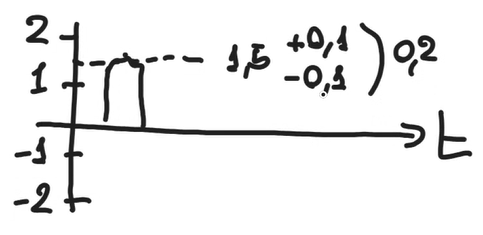
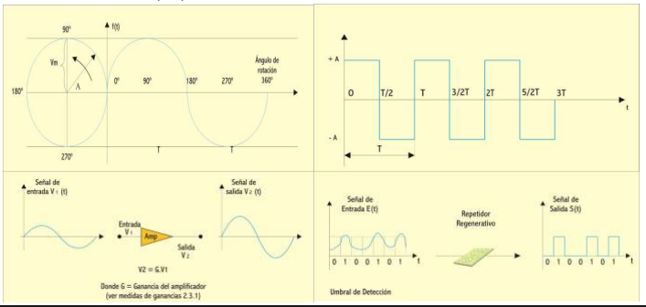
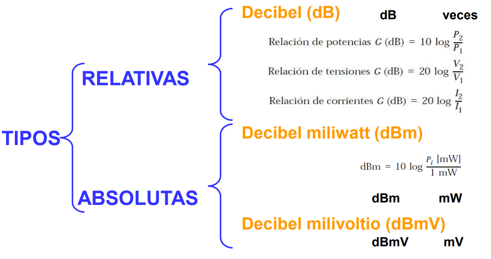
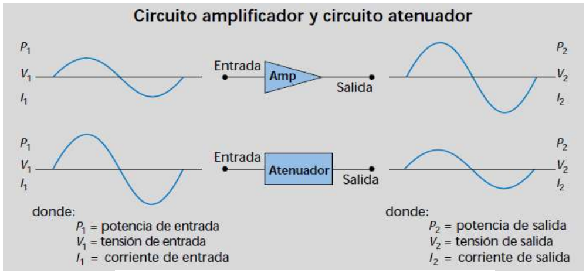
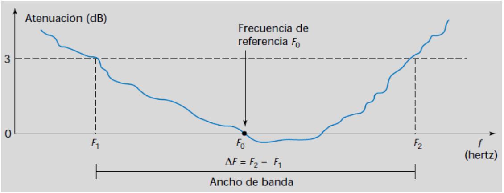
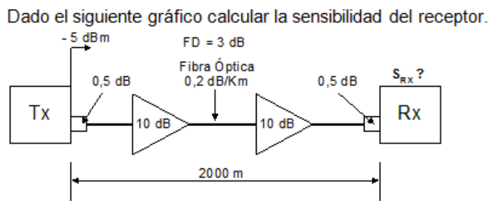

dia: 2026-08-20
presentacion:
C:\Users\Martin\Documents\UTN_SISTEMAS\Anual_2026\comunicacion_de_datos\material\teoria\Presentaciones
archivo: U 2 Características de las señales de telecom.pdf

# U2: caracteristicas de las Señales de telecomunicaciones

## características de las 

| Característica | Analógicas | Digitales |
|---|---|---|
| Valores que adopta | Infinitos | Finitos / discretos |
| Transporte de la info | En la forma | En la codificación |
| Inmunidad al ruido | Menos | Más |
| Error | Decisión infinitos estados | Decisión finitos estados |
| Costos | Más | Menos |
| Medición de calidad de canal | Relación S/N (señal a ruido, señal/ruido) | BER  ($ Bit Error rate = \dfrac{\text{bits con error}}{\text{bits totales}}$)|
| Conversión A/D o D/A | Módem | CODEC, digitalizador |
| Alcance de la transmisión | - Finito - Uso de amplificador - Ganancia (G), (estos generan ruido de amplificador(NA)) | - Infinito - Uso de rep regenerativo - Umbral detección  |

definicion de ruido: toda señal que no es deseada.

## unidades de transmisión:
se basan en la funcion matematica logaritmica.
Y=log10(X)
- Relaciona dos magnitudes mediante un cociente (X) obteniendo
un resultado (Y) adimensional.
- se aprovechan las propiedades matematicas de los logaritmos.

**INDICA LA RELACIÓN ENTRE POTENCIAS, TENSIONES O CORRIENTES**

Los decibeles se clasifican en **relativos** y **absolutos**.

### Decibeles relativos

El **decibel (dB)** expresa una **relación** entre dos magnitudes.

- **Relación de potencias:**

  $$G(dB) = 10 \log_{10}\left(\frac{P_2}{P_1}\right)$$

  Donde $P_1$ y $P_2$ se expresan en **watts (W)**.

- **Relación de tensiones:**

  $$G(dB) = 20 \log_{10}\left(\frac{V_2}{V_1}\right)$$

  Donde $V_1$ y $V_2$ se expresan en **volts (V)**.

- **Relación de corrientes:**

  $$G(dB) = 20 \log_{10}\left(\frac{I_2}{I_1}\right)$$

  Donde $I_1$ e $I_2$ se expresan en **amperes (A)**.

El **dB** indica una relación, es decir, cuántas **veces** cambia una magnitud respecto de otra.

- P = potencia
- V = tensión
- I = corriente

### Decibeles absolutos

Los decibeles absolutos expresan una magnitud respecto de un **valor de referencia fijo**.

#### Decibel miliwatt (dBm)

El **dBm** expresa una potencia tomando como referencia **1 mW**.

$$P(dBm) = 10 \log_{10}\left(\frac{P[mW]}{1\,mW}\right)$$

- **dBm** → escala logarítmica.
- **mW** → potencia real.

si p2>p1 ganancia
si p2<p1 atenuacion/perdida
p<1mw -> dBm(-)
p>1mw -> dBm(+)

#### Decibel milivoltio (dBmV)

El **dBmV** expresa una tensión tomando como referencia **1 mV**.

$$V(dBmV) = 20 \log_{10}\left(\frac{V[mV]}{1\,mV}\right)$$

- **dBmV** → escala logarítmica.
- **mV** → tensión real.

### Relación entre potencia, tensión y corriente en decibeles

La potencia eléctrica puede expresarse como:

$$
P = \frac{U^2}{Z}
$$

o también como:

$$
P = I^2 Z
$$

donde:

- $P$ es la potencia.
- $U$ es la tensión.
- $I$ es la corriente.
- $Z$ es la impedancia.

La tensión y la corriente se relacionan mediante:

$$
U = IZ
$$

La impedancia se expresa como:

$$
Z = R + jX
$$

y se mide en ohmios:

$$
[Z] = \Omega
$$

---

#### Relación de tensiones en dB

La relación de potencias se define como:

$$
G(dB) = 10\log_{10}\left(\frac{P_2}{P_1}\right)
$$

Como:

$$
P_2 = \frac{U_2^2}{Z_2}
$$

y:

$$
P_1 = \frac{U_1^2}{Z_1}
$$

entonces:

$$
G(dB)
=
10\log_{10}
\left(
\frac{U_2^2/Z_2}{U_1^2/Z_1}
\right)
$$

Si las impedancias son iguales:

$$
Z_2 = Z_1
$$

las impedancias se cancelan:

$$
G(dB)
=
10\log_{10}
\left(
\frac{U_2^2}{U_1^2}
\right)
$$

Por lo tanto:

$$
G(dB)
=
10\log_{10}
\left(
\frac{U_2}{U_1}
\right)^2
$$

Aplicando la propiedad del logaritmo:

$$
\boxed{
G(dB)
=
20\log_{10}
\left(
\frac{U_2}{U_1}
\right)
}
$$

Por esta razón, para una relación de tensiones con impedancias iguales se utiliza $20\log$.

---

#### Relación de corrientes en dB

El razonamiento es análogo al caso de las tensiones, ya que la potencia también puede expresarse en función de la corriente.

Partimos de:

$$
P = I^2Z
$$

Al igual que antes, si el sistema tiene la **misma impedancia** en ambos puntos de medición:

$$
Z_2 = Z_1
$$

las impedancias vuelven a cancelarse dentro del logaritmo, y se llega a:

$$
G(dB)
=
20\log_{10}
\left(
\frac{I_2}{I_1}
\right)
$$

> 💡 **Idea clave:** el factor cambia de $10$ a $20$ porque la magnitud (tensión o corriente) está **elevada al cuadrado** dentro de la fórmula de potencia. Al aplicar la propiedad del logaritmo del exponente, ese cuadrado "sale" multiplicando y duplica el coeficiente.

#### Resumen de fórmulas

En síntesis, para expresar una relación en decibeles se utiliza:

- **Potencias** (siempre):

$$
\boxed{
G(dB)=10\log_{10}\left(\frac{P_2}{P_1}\right)
}
$$

- **Tensiones**, *solo si las impedancias son iguales* ($Z_1 = Z_2$):

$$
\boxed{
G(dB)=20\log_{10}\left(\frac{U_2}{U_1}\right)
}
$$

- **Corrientes**, *solo si las impedancias son iguales* ($Z_1 = Z_2$):

$$
\boxed{
G(dB)=20\log_{10}\left(\frac{I_2}{I_1}\right)
}
$$

⚠️ **Importante:** las fórmulas de tensión y corriente con $20\log$ son válidas únicamente bajo la condición de igualdad de impedancias. Si las impedancias fueran distintas, no se pueden cancelar y hay que volver a la expresión completa en función de la potencia.

## Amplificación y Atenuación
Descripción usando las unidades de transmisión relativas

## Definición de ancho de banda de una línea de transmisión usando dB
Se define el ancho de banda como el intervalo de frecuencias para los cuales la atenuación en la línea de transmisión no es mayor a 3 dB. **Los 3 dB representan la mitad de la potencia de la señal transmitida.**

## UNIDADES DE TRANSMISIÓN

ALGUNOS USOS:
- MEDIR GANANCIAS, ATENUACIONES EN ELECTRÓNICA Y TELECOMUNICACIONES
- DAR VALORES DE POTENCIA O TENSIONES
- MEDIR POTENCIAS SONORAS
https://www.youtube.com/watch?v=M-y7uGrCEBkALGUNOS USOS
- MEDIR GANANCIAS, ATENUACIONES EN ELECTRÓNICA Y
TELECOMUNICACIONES
- DAR VALORES DE POTENCIA O TENSIONES
- MEDIR **POTENCIAS SONORAS** https://www.youtube.com/watch?v=M-y7uGrCEBk - > se mide en decibeles (dB) absolutos.

### Valores típicos en dB

| dB | Veces |
|---:|---:|
| 3 dB | Doble |
| 6 dB | 4 |
| 10 dB | 10 |
| 20 dB | 100 |
| 30 dB | 1000 |
| 40 dB | 10000 |
| -3 dB | Mitad |
| -6 dB | 1/4 |
| -10 dB | 1/10 |

la potencia minima necesaria para recibir una señal

### GANANCIA DE UN AMPLIFICADOR
#### Ejemplo de ganancia de un amplificador

Un amplificador presenta una **ganancia operativa mínima de 43 dB**.

La relación entre la ganancia en decibeles y la relación de potencias es:

$$
G(dB) = 10\log_{10}\left(\frac{P_{sal}}{P_{ent}}\right)
$$

Para obtener cuántas veces aumenta la potencia:

$$
\frac{P_{sal}}{P_{ent}} = 10^{\frac{G(dB)}{10}}
$$

Para una ganancia de **43 dB**:

$$
\frac{P_{sal}}{P_{ent}} = 10^{\frac{43}{10}}
$$

$$
\frac{P_{sal}}{P_{ent}} = 10^{4.3}
$$

$$
\boxed{\frac{P_{sal}}{P_{ent}} \approx 19953}
$$

Por lo tanto:

$$
\boxed{43\ dB \approx 19953\ veces}
$$

Esto significa que la **potencia de salida** es aproximadamente **19953 veces mayor que la potencia de entrada**.

También puede verificarse realizando la conversión inversa:

$$
G(dB) = 10\log_{10}(19953)
$$

$$
\boxed{G(dB) \approx 43\ dB}
$$

#### Datos del amplificador del ejemplo

| Característica | Unidad | Valor |
|---|---:|---:|
| Ganancia operativa mínima | dB | 43 |
| Internal Tilt | dB | 15.5 |
| Figura de ruido a 54 MHz | dB | 8.5 |
| Figura de ruido a 1 GHz | dB | 8.0 |

### Nivel de transmisión y recepción de señal en cable módem

Los niveles de señal de un cable módem pueden expresarse en **dBmV**.

El **dBmV** representa una tensión referida a **1 mV**.

La conversión de milivoltios a dBmV se calcula mediante:

$$
V(dBmV) = 20\log_{10}\left(\frac{V[mV]}{1\ mV}\right)
$$

La conversión de dBmV a milivoltios se calcula mediante:

$$
V[mV] = 1\ mV \cdot 10^{\frac{V(dBmV)}{20}}
$$

---

#### Nivel de transmisión (Tx)

El nivel de transmisión del ejemplo es:

$$
Tx = 42.9\ dBmV
$$

Convirtiendo a milivoltios:

$$
V = 1\ mV \cdot 10^{\frac{42.9}{20}}
$$

$$
\boxed{V \approx 139.64\ mV}
$$

Por lo tanto:

$$
\boxed{42.9\ dBmV \approx 139.64\ mV}
$$

---

#### Nivel de recepción (Rx)

El nivel de recepción del ejemplo es:

$$
Rx = 2.3\ dBmV
$$

Convirtiendo a milivoltios:

$$
V = 1\ mV \cdot 10^{\frac{2.3}{20}}
$$

$$
\boxed{V \approx 1.30\ mV}
$$

Por lo tanto:

$$
\boxed{2.3\ dBmV \approx 1.30\ mV}
$$

---

#### Resumen

| Señal | Nivel en dBmV | Tensión aproximada |
|---|---:|---:|
| Transmisión (Tx) | 42.9 dBmV | 139.64 mV |
| Recepción (Rx) | 2.3 dBmV | 1.30 mV |

Un valor en **dBmV** puede convertirse a una tensión real en **mV** utilizando como referencia $1\ mV$.

## Atenuaciones en medios de comunicaciones

La **atenuación** representa la disminución del nivel de una señal mientras se propaga por un medio de transmisión.

En un cable coaxial, la atenuación depende de la **frecuencia** y de la **longitud del cable**.

A medida que aumenta la frecuencia, **aumenta la atenuación** del cable.

### Cable coaxial

El ejemplo corresponde a un cable:

- **F6TSVM**
- Impedancia característica: **75 Ω**
- Tipo: **cable coaxial de bajada (Drop Cable)**

### Atenuación del cable según la frecuencia

| Frecuencia | Atenuación máxima cada 100 ft | Atenuación máxima cada 100 m |
|---:|---:|---:|
| 5 MHz | 0.58 dB | 1.90 dB |
| 55 MHz | 1.60 dB | 5.25 dB |
| 83 MHz | 1.95 dB | 6.40 dB |
| 187 MHz | 2.85 dB | 9.35 dB |
| 211 MHz | 3.05 dB | 10.00 dB |
| 250 MHz | 3.30 dB | 10.82 dB |
| 300 MHz | 3.55 dB | 11.64 dB |
| 350 MHz | 3.85 dB | 12.63 dB |
| 400 MHz | 4.15 dB | 13.61 dB |
| 450 MHz | 4.40 dB | 14.43 dB |
| 500 MHz | 4.66 dB | 15.29 dB |
| 550 MHz | 4.90 dB | 16.08 dB |
| 600 MHz | 5.10 dB | 16.73 dB |
| 750 MHz | 5.65 dB | 18.54 dB |
| 865 MHz | 6.10 dB | 20.01 dB |
| 1000 MHz | 6.55 dB | 21.49 dB |

Por lo tanto:

$$
\boxed{\text{Mayor frecuencia} \Rightarrow \text{Mayor atenuación}}
$$

Por ejemplo:

- A **5 MHz**, el cable atenúa aproximadamente **1.90 dB cada 100 m**.
- A **1000 MHz**, el cable atenúa aproximadamente **21.49 dB cada 100 m**.

### Divisor de potencia

Un **divisor de potencia (splitter)** divide una señal de entrada entre varias salidas.

Al realizar esta división, cada salida presenta una **atenuación** respecto de la señal de entrada.

Por lo tanto, en una red coaxial deben considerarse tanto:

- Las pérdidas producidas por la **longitud del cable**.
- Las pérdidas producidas por elementos pasivos, como los **divisores de potencia**.

# SEÑALES DE COMUNICACIONES
- SEÑALES PERIÓDICAS O NO PERIÓDICAS
- DOMINIO DEL TIEMPO Y DE LA FRECUENCIA
- SERIE O TRANSFORMADA DE FOURIER
- SEÑALES PERIÓDICAS
     SENOIDAL ARMÓNICA SIMPLE
     ONDA CUADRADA
     PULSO RECTANGULAR (TREN)

# parametros

# serie de fourier

...
incompleta
