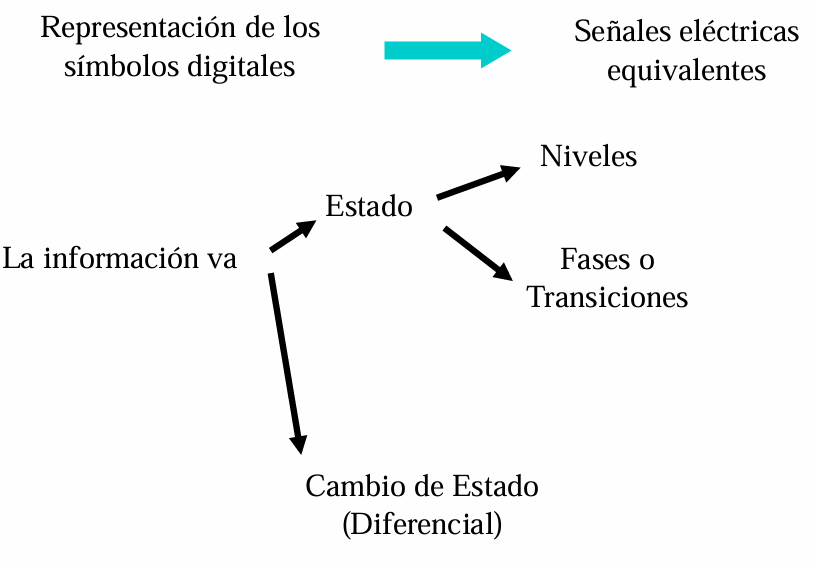
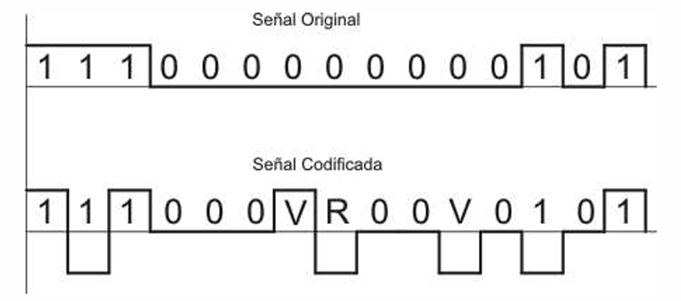
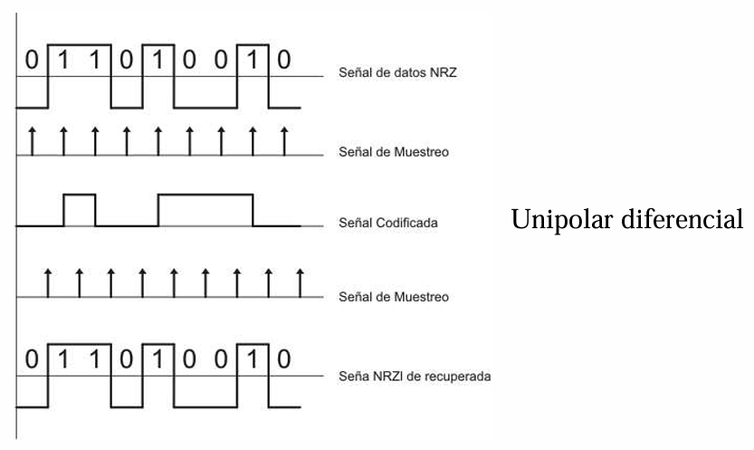
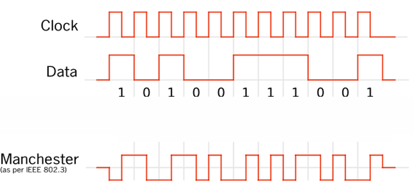
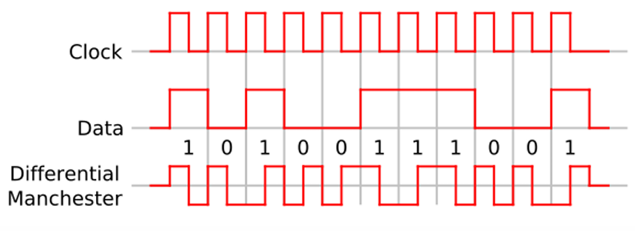
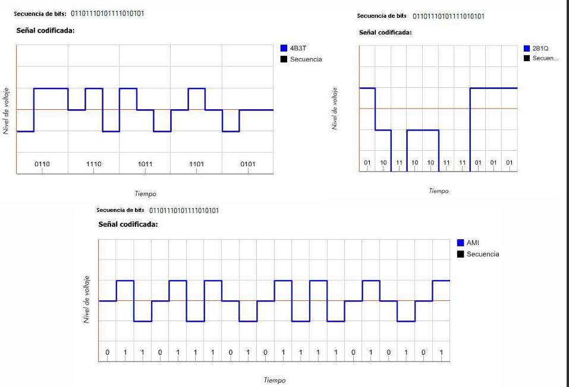
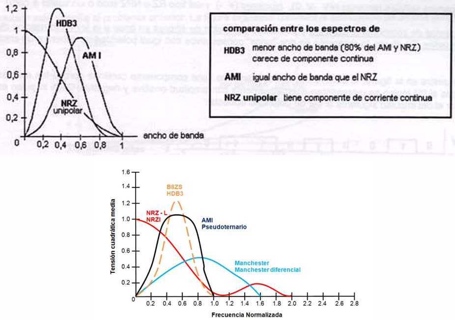
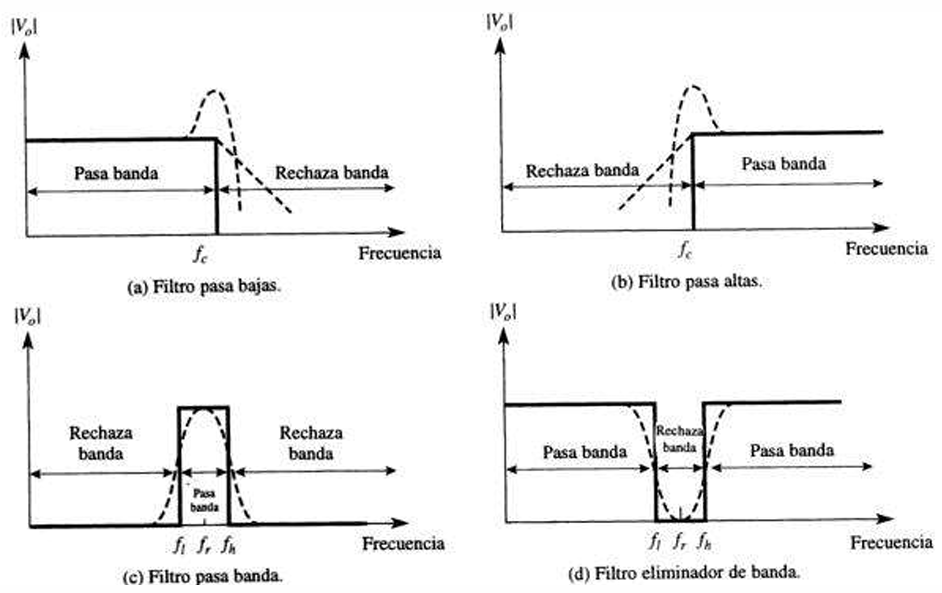

3/9/2026

## codigos de linea o banda base

pueden pedir en los parciales: comparar los diferentes codigos de linea.

## Cuadro comparativo de códigos de línea

| Código de línea | Regla de formación | Ancho de banda ocupado | Componente continua (valor medio distinto de 0) | Probabilidad de errores | Sincronismo | Densidad espectral de potencia | Dependencia entre símbolos |
|---|---|---|---|---|---|---|---|
| **Unipolar NRZ** | 1 → V+ o -   0 → V 0   τ = T | Menor que RZ | Sí posee | Mayor que Polar | No transiciones entre bits consecutivos | Mayor que RZ y menor que Polar | No hay |
| **Polar NRZ** | 1 → V+   0 → V-   τ = T | Menor que RZ | No posee | Menor que Unipolar | No transiciones entre bits consecutivos | Mayor que Unipolar y que RZ | No hay |
| **Unipolar RZ** | 1 → V+ o -   0 → V 0   τ menor T | Mayor que NRZ | Sí posee | Mayor que Polar | Hay transiciones entre 1(s) consecutivos. No entre 0(s). Mejor que NRZ | Menor que NRZ y menor que Polar | No hay |
| **Polar RZ** | 1 → V+   0 → V-   τ menor T | Mayor que NRZ | No posee | Menor que Unipolar | Hay transiciones entre 1(s)/0(s) consecutivos. **Autosíncronizante** | Menor que NRZ y mayor que Unipolar | No hay |
| **Bipolar NRZ AMI (Alternative Mark Inversion)** | 1 → V+ o - alt   0 → V 0   τ = T | Menor que RZ | No posee | Menor que Unipolar pero mayor que Polar | Hay transiciones entre 1(s). No entre 0(s). Mejor que NRZ pero peor RZ. Falta sincronismo con 0(s) seguidos | Similar a Unipolar NRZ | Sí hay |
| **Bipolar RZ** | 1 → V+ o - alt   0 → V 0   τ menor T | Mayor que AMI | No posee | Igual que AMI | Igual que AMI | Menor que AMI | Sí hay |
| **Unipolar diferencial** | 1 → transición entre V+ y 0   0 → no transición | Similar NRZ | Sí posee | Mayor que Polar | Pérdida de sincronismo | Similar Unipolares | Sí hay |
| **Polar diferencial** | 1 → transición entre V+ y V-   0 → no transición | Similar NRZ | No posee | Menor que Unipolar | Pérdida de sincronismo | Similar Polares | Sí hay |
| **Manchester (bifase)** | 1 → transición + τ/2   0 → transición - τ/2 | Similar al Polar RZ | No posee | Similar al Polar RZ | Buen sincronismo | Mayor que Polar RZ | No hay |
| **Manchester diferencial** | Siempre transición en τ/2   Si 0 además transición en el inicio del Is   Si 1 no transición en el inicio del Is | Menor que Manchester | No posee | Menor que Manchester | Buen sincronismo | Mayor que Manchester | Sí hay |
| **HDB-3 (High Density Binary)** | Igual al AMI pero con violación al 4to 0 | Similar AMI | No posee | Similar AMI | Soluciona problema de sincronismo AMI | Algo mayor que AMI | Sí hay |
| **Miller** | 1 → transición τ/2   0 → no transición salvo que siga 0 con transición τ | Menor que Manchester | No posee | Similar Polar | Buen sincronismo | Mayor que Polar diferencial | Sí hay |
| **CMI (Coded Mark Inversion)** | Polar NRZ   1 → alterna V en τ   0 → consecutivo V en τ/2 | Mayor que los NRZ comunes | No posee | Similar Polar NRZ | Mejor que Polar NRZ | Menor que Polar NRZ | Sí hay |
| **4B-3T** | Lleva 4 dígitos de 2 niveles a 3 dígitos de 3 niveles | Reduce 25% | — | — | — | — | — |
| **B6ZS (Sustitución Binaria de 6 ceros)** | AMI con sustitución de 6 0(s) por combinación de   0 + - 0 - +   o   0 - + 0 + -   según 1 sea + o - | Similar AMI | — | — | Reduce problema de sincronismo del AMI | — | — |

**Referencias:**  
Is = Intervalo significativo

### definiciones:
- Densidad espectral de potencia: el tau de la señal a 1 es la potencia de la señal a 1. La densidad espectral de potencia es la potencia de la señal a 1 por el ancho de banda que ocupa la señal. está relacionada al area del puslo.

### conclusiones:
- PUlSOS ANGOSTOS - > MAYOR ANCHO DE BANDA - > CANTIDAD DE BITS: Maoyor cantidad de bits transmitidos por segundo -> Mayor velocidad de transmisión.

- PULSOS ANCHOS -> MENOR ANCHO DE BANDA -> MENOR CANTIDAD DE BITS TRANSMITIDOS POR SEGUNDO -> MENOR VELOCIDAD DE TRANSMISIÓN.

el retorno a cero de los RZ no es un retorno exactamente a la mitad, puede ser a cualquier valor entre 0 y el valor de la señal. El retorno a cero es un retorno a un valor intermedio entre 0 y el valor de la señal.

### HDB-3 (High Density Bipolar – 3)
busca resolver el problema del AMI

nos damos cuenta que el V no es un 1 porque no cambia de polaridad con respecto al ultimo 1.

- Cada 0000 se reemplazan por impulsos: R00V o 000V. ALEATORIZACIÓN.
- R00V cuando es **par** el número de impulsos entre la violación V anterior y la que se 
va a introducir. 
- 000V cuando es **impar** el número de impulsos entre la violación V anterior y la que se va a introducir.

### codificacion diferencial

La señal se codifica con transiciones. Si “1” hay transición. Si “0” no la hay. No importa la polaridad

### CÓDIGO MANCHESTER BIFASE
•SIEMPRE TRANSICIÓN EN LA MITAD DEL INTERVALO DE BIT (IB).
•LA TRANSICIÓN TRANSMITE DATOS Y SINCRONIZA (AUTOSINCRONIZANTE).
•OCUPA MAYOR ANCHO DE BANDA.
•SI “0” LA TRANSICIÓN ES DE ALTO A BAJO.
•SI “1” LA TRANSICIÓN ES DE BAJO A ALTO. 
•ES USADO EN REDES ETHERNET (IEEE 802.3)

usado en redes ethernet (IEEE 802.3) y en redes de fibra óptica (FDDI).

### CÓDIGO MANCHESTER BIFASE DIFERENCIAL
•SIEMPRE TRANSICIÓN EN LA MITAD DEL INTERVALO DE BIT (IB). AUTOSINCRONIZANTE. MAYOR ANCHO DE BANDA.
•SI “0” ADEMÁS HAY TRANSICIÓN EN EL INICIO DE IB.
•SI “1” NO TRANSICIÓN EN EL INICIO DE IB. 
•ES USADO EN REDES TOKEN RING (IEEE 802.5)

## CÓDIGO 2B 1Q / 4B 3

### Código cuaternario

| Código binario | Código cuaternario | Nivel de tensión |
|---|---|---|
| 00 | Nivel de tensión 1 | -2,5 voltios |
| 01 | Nivel de tensión 2 | -0,833 voltios |
| 10 | Nivel de tensión 3 | +2,5 voltios |
| 11 | Nivel de tensión 4 | +0,833 voltios |

### Señal ternaria transmitida

| Información binaria a transmitir | Dominan las tensiones negativas | Equilibrio | Dominan las tensiones positivas |
|---|---|---|---|
| 0000 | `---` | | `+++` |
| 0001 | `--0` | | `++0` |
| 0010 | `-0-` | | `+0+` |
| 0011 | `0--` | | `0++` |
| 0100 | `--+` | | `++-` |
| 0101 | `-+-` | | `+-+` |
| 0110 | `+--` | | `-++` |
| 0111 | `-00` | | `+00` |
| 1000 | `0-0` | | `0+0` |
| 1001 | `00-` | | `00+` |
| 1010 | | `0+-` | |
| 1011 | | `0-+` | |
| 1100 | | `+0-` | |
| 1101 | | `-0+` | |
| 1110 | | `+-0` | |
| 1111 | | `-+0` | |

### comparacion:

## ANÁLISIS ESPECTRAL DE CÓDIGOS

## FILTROS
Circuitos, sistemas o partes de redes que presentan características selectivas respecto de las frecuencias.
Aplica la característica de la **atenuación**. 
Parámetros de un filtro:
- Ancho de Banda
- Frecuencias de corte
- electividad

Comportamiento Ideal o Real de un filtro:
- ideal: pasa todas las frecuencias de la banda de paso y atenúa todas las frecuencias de la banda de rechazo.
- real: pasa todas las frecuencias de la banda de paso y atenúa algunas frecuencias de la banda de rechazo.

Diseño:
- Circuito L C
- Cristal
- Activos

### TIPOS DE FILTROS Y SÍMBOLO

| Tipo de filtro | Característica |
|---|---|
| **Filtro pasa bajos** | Deja pasar las frecuencias **menores** que la frecuencia de corte $f_c$ y atenúa/rechaza las frecuencias **mayores** a $f_c$. |
| **Filtro pasa altos** | Deja pasar las frecuencias **mayores** que la frecuencia de corte $f_c$ y atenúa/rechaza las frecuencias **menores** a $f_c$. |
| **Filtro pasa banda** | Deja pasar únicamente las frecuencias comprendidas entre una frecuencia inferior $f_l$ y una superior $f_h$. Rechaza las frecuencias fuera de ese intervalo. |
| **Filtro eliminador de banda** | Rechaza las frecuencias comprendidas entre $f_l$ y $f_h$ y deja pasar las frecuencias que se encuentran fuera de ese intervalo. |

- $f_c$: frecuencia de corte.
- $f_l$: frecuencia de corte inferior.
- $f_h$: frecuencia de corte superior.
- $f_r$: frecuencia central o de resonancia.

Conceptualmente, para memorizarlo fácil: pasa bajos → pasa lo de abajo; pasa altos → pasa lo de arriba; pasa banda → pasa el medio; eliminador de banda → elimina el medio.

