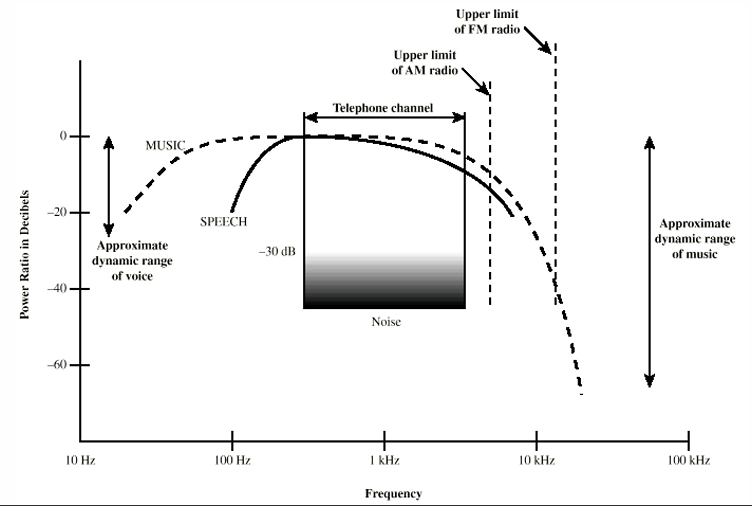
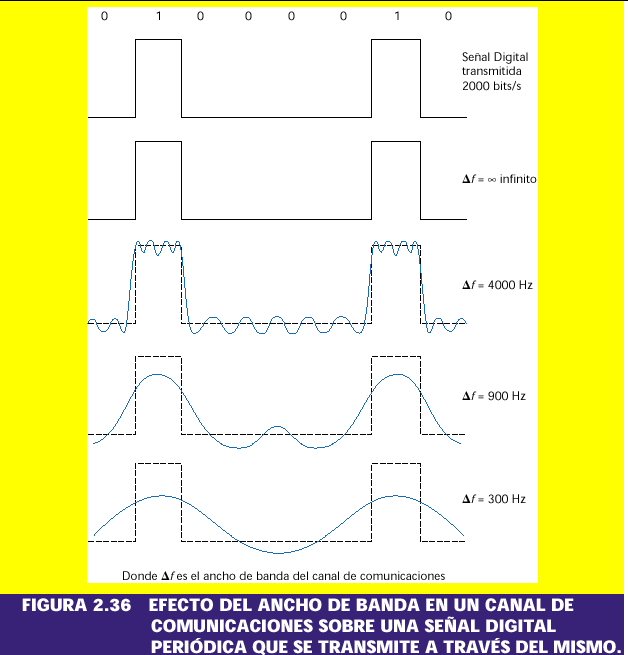
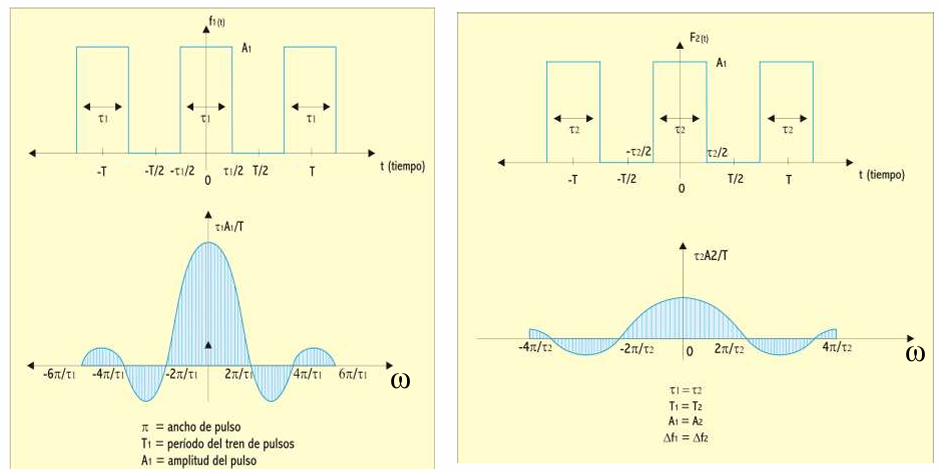
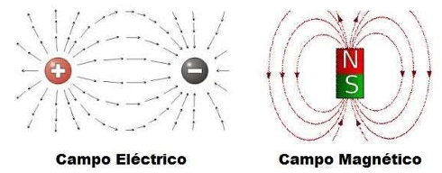
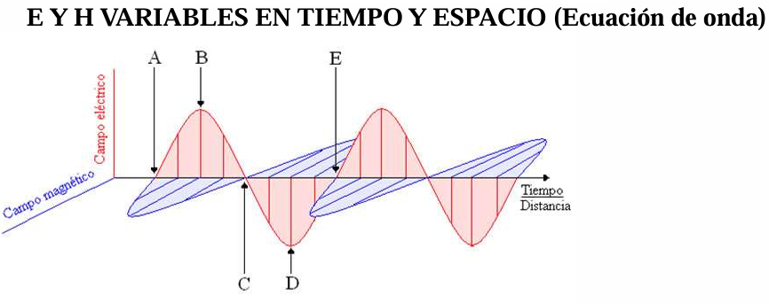

apuntes tomados de:
https://www.youtube.com/watch?v=_5djwGzLJ44
y de la presentacion de la clase

## ANCHO DE BANDA
ES LA PARTE DEL ESPECTRO (INTERVALO DE FRECUENCIAS) DONDE SE CONCENTRA LA MAYOR CANTIDAD DE ENERGÍA DE LA SEÑAL.

## TREN DE PULSOS RECTANGULARES

RELACIÓN ENTRE ANCHO DE PULSO Y ESPECTRO DE AMPLITUD
LÍNEAS ESPECTRALES SEGÚN PERÍODO (T)

$$
\left(\frac{A\tau}{T}\right)\left(\frac{\operatorname{sen}(x)}{x}\right)
$$

$$
x = \frac{n\omega\tau}{2}
$$
PUNTOS DE CORTE (AMPLITUD “0”) SEGÚN ANCHO DE PULSO

## ONDAS ELECTROMAGNÉTICAS (OEM)
CAMPO ELÉCTRICO (E) Y CAMPO MAGNÉTICO (H)

