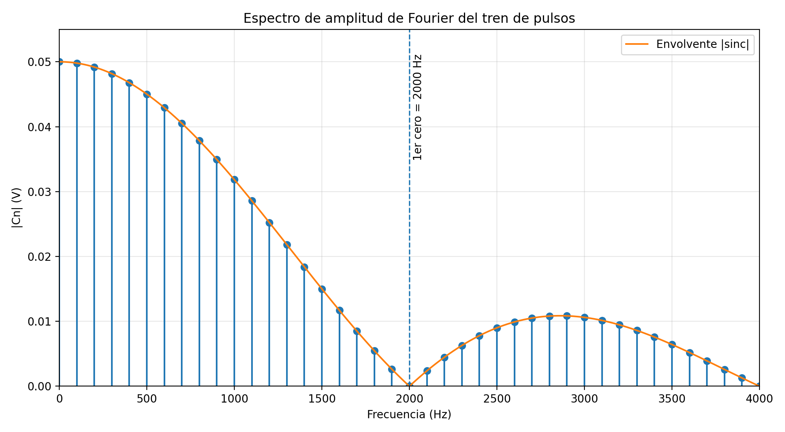

# Serie de Fourier

**Idea central**

> Una señal periódica que parece compleja en el tiempo puede describirse como la suma de una componente
> continua y señales senoidales cuyas frecuencias son múltiplos de una frecuencia fundamental.

**Por qué importa**

Un canal real no deja pasar todas las frecuencias por igual. Para anticipar cómo deformará una señal,
primero hay que saber **qué frecuencias componen esa señal**. Fourier construye ese puente entre el
dominio del tiempo y el [ancho de banda](ancho-de-banda.md).

**Requisitos previos**

- período $T$ [s] y frecuencia $f_0=1/T$ [Hz];
- seno, coseno, integración y paridad de funciones.

> **Procedencia:** la motivación, las dos representaciones y las figuras de reconstrucción provienen de
> la presentación de U2, pp. 15-24. Los ejercicios que fijan el alcance están en el TP 2, pp. 2-3. Las
> notas de [Práctica 3](../../practica/clase%2003.md) aportan el razonamiento de paridad, pero siguen
> siendo una captura histórica.

---

## 1) Del tiempo a las componentes de frecuencia

### Problema físico

Una onda cuadrada puede verse perfectamente definida en un osciloscopio, pero al atravesar un medio
limitado en frecuencia pierde sus bordes. Mirar sólo $f(t)$ no explica cuáles de sus componentes fueron
atenuadas.

### Concepto

Si $f(t)$ es periódica de período $T$, su serie de Fourier la expresa como una suma de:

1. una componente continua (su valor medio);
2. una componente fundamental de frecuencia $f_0=1/T$;
3. armónicas en $2f_0,3f_0,\ldots$

El conjunto de amplitudes y fases frente a frecuencia es su **espectro**. Para una señal periódica es
discreto: sólo hay líneas en frecuencias determinadas.

### Modelo mental

Pensá cada senoidal como una pieza. Una sola redondea mucho la señal; al agregar armónicas aparecen los
detalles rápidos, como los flancos de un pulso. El espectro es el inventario de esas piezas.

```text
señal periódica en el tiempo
        ↓ análisis de Fourier
continua + fundamental + armónicas
        ↓ suma de componentes
aproximación de la señal original
```

### Formalización trigonométrica

$$
f(t)=\frac{a_0}{2}+\sum_{n=1}^{\infty}
\left[a_n\cos(n\omega_0t)+b_n\sin(n\omega_0t)\right]
$$

$$
a_0=\frac{2}{T}\int_{-T/2}^{T/2}f(t)\,dt,
\qquad
a_n=\frac{2}{T}\int_{-T/2}^{T/2}f(t)\cos(n\omega_0t)\,dt
$$

$$
b_n=\frac{2}{T}\int_{-T/2}^{T/2}f(t)\sin(n\omega_0t)\,dt,
\qquad
\omega_0=\frac{2\pi}{T}=2\pi f_0
$$

| Símbolo | Significado | Unidad |
|---|---|---|
| $f(t)$ | valor instantáneo de la señal | la de la señal; en los ejemplos, V |
| $T$ | período fundamental | s |
| $f_0$ | frecuencia fundamental | Hz |
| $\omega_0$ | frecuencia angular fundamental | rad/s |
| $n$ | índice de la armónica | adimensional |
| $a_0/2$ | valor medio o componente continua | la de $f(t)$ |
| $a_n,b_n$ | coeficientes de coseno y seno | la de $f(t)$ |

**Supuestos y límites de validez**

- La señal debe ser periódica y cumplir condiciones suficientes de convergencia; para las señales del
  TP alcanza con que en un período sea integrable, tenga un número finito de extremos y un número
  finito de discontinuidades finitas.
- En una discontinuidad, la serie converge al promedio de los límites laterales. Cerca del salto queda
  una sobreoscilación al truncar la serie (fenómeno de Gibbs).
- Esta serie describe señales periódicas. Para una señal no periódica se usa la transformada de Fourier,
  tema relacionado pero distinto.

### Ejemplo numérico: onda cuadrada impar

Sea una onda de amplitud $A=1\ \text{V}$ y frecuencia fundamental $f_0=100\ \text{Hz}$:

$$
f(t)=
\begin{cases}
+A,&0<t<T/2\\
-A,&-T/2<t<0
\end{cases}
$$

Por ser impar, su valor medio y sus coeficientes de coseno se anulan. Sólo quedan senos:

$$
a_0=0,\qquad a_n=0,\qquad
b_n=
\begin{cases}
\dfrac{4A}{n\pi},&n\text{ impar}\\
0,&n\text{ par}
\end{cases}
$$

| Símbolo | Significado | Unidad |
|---|---|---|
| $A$ | amplitud de la onda cuadrada | V |
| $b_n$ | amplitud de la componente senoidal $n$ | V |
| $n$ | orden armónico | adimensional |

Las tres primeras componentes no nulas son:

| Componente | Frecuencia | Amplitud |
|---|---:|---:|
| fundamental ($n=1$) | $100\ \text{Hz}$ | $4/\pi\approx1{,}273\ \text{V}$ |
| tercera armónica ($n=3$) | $300\ \text{Hz}$ | $4/(3\pi)\approx0{,}424\ \text{V}$ |
| quinta armónica ($n=5$) | $500\ \text{Hz}$ | $4/(5\pi)\approx0{,}255\ \text{V}$ |

Con sólo esas tres piezas, la reconstrucción ya empieza a formar los flancos, pero todavía no es una
onda cuadrada ideal.

**Verificación de razonabilidad:** las frecuencias son múltiplos impares de $100\ \text{Hz}$ y las
amplitudes decrecen como $1/n$; ambas tendencias coinciden con la figura de U2, pp. 18-19.

### Caso real

Un osciloscopio muestra amplitud frente al tiempo; un analizador de espectro muestra amplitud o potencia
frente a frecuencia. La presentación de U2, p. 20, contrapone ambos instrumentos: son dos vistas de la
misma señal, no dos señales diferentes.

### Errores típicos

- **Confundir armónica con frecuencia cualquiera.** La armónica $n$ está exactamente en $nf_0$.
- **Decir que una onda cuadrada ideal tiene sólo una frecuencia.** Una sola senoidal no puede producir
  saltos; hacen falta infinitas armónicas.
- **Anular coeficientes por paridad sin mirar el intervalo.** La simplificación exige integrar sobre un
  intervalo simétrico y comprobar la paridad del producto completo.
- **Llamar continuo al espectro de una señal periódica.** La serie produce líneas discretas; el pulso
  aislado no periódico tiene espectro continuo.

### Para examen

> La serie de Fourier representa una señal periódica mediante una componente continua y senoidales en
> múltiplos de la frecuencia fundamental. Sus coeficientes indican amplitud y fase, por eso permiten
> pasar del dominio temporal al espectral y analizar qué componentes podrá transmitir un canal.

---

## 2) Forma compleja y tren rectangular

Para un tren de pulsos rectangulares de amplitud $A$, duración $\tau$ y período $T$, centrado en cada
período, la forma compleja normalizada es:

$$
f(t)=\sum_{n=-\infty}^{\infty}C_ne^{jn\omega_0t},
\qquad
C_n=\frac{1}{T}\int_{-T/2}^{T/2}f(t)e^{-jn\omega_0t}\,dt
$$

$$
C_n=A\frac{\tau}{T}\operatorname{sinc}\left(n\frac{\tau}{T}\right),
\qquad
\operatorname{sinc}(x)=\frac{\sin(\pi x)}{\pi x}
$$

| Símbolo | Significado | Unidad |
|---|---|---|
| $C_n$ | coeficiente complejo de la línea $n$ | la de la señal; aquí, V |
| $A$ | amplitud del pulso | V |
| $\tau$ | duración o ancho del pulso | s |
| $T$ | período de repetición | s |
| $\tau/T$ | ciclo de trabajo | adimensional |
| $n\omega_0$ | frecuencia angular de la línea $n$ | rad/s |

**Supuestos y límites de validez:** esta expresión corresponde a pulsos rectangulares centrados. Un
desplazamiento temporal agrega fase, aunque no cambia $|C_n|$. La función $\operatorname{sinc}$ queda
definida arriba porque existen dos convenciones usuales.

La separación entre líneas depende de $T$; los ceros de la envolvente dependen de $\tau$. Ésa es la
relación física que desarrolla [Ancho de banda](ancho-de-banda.md#4-tren-de-pulsos-y-primer-cero).



> **Verificación visual:** la figura fue contrastada con el enunciado y resolución de
> `Ejercicio cuestionario 10-09-2026.pdf`, pp. 1-3. Representa $FRP=100\ \text{Hz}$,
> $\tau=0{,}5\ \text{ms}$ y el primer cero en $2000\ \text{Hz}$.

---

## 3) Gotcha del material

La diapositiva 16 de U2 muestra una expresión compleja cuya normalización no es legible de forma
coherente: aparece un factor $1/T$ junto a la suma, mientras la integral de $C_n$ no lo muestra. En este
apunte se usa la convención matemática consistente escrita arriba: **sin** $1/T$ delante de la suma y
**con** $1/T$ en $C_n$.

Este punto queda registrado y por eso el apunte no se marca `revisado` hasta contrastarlo con la
bibliografía de cátedra o una aclaración docente.

---

## 4) Resumen mental

Si te preguntan **“¿para qué sirve la serie de Fourier?”**, contestá:

> Sirve para desarmar una señal periódica en continua, fundamental y armónicas. La forma temporal dice
> cómo varía la señal; el espectro dice qué frecuencias necesita. Cuantas más armónicas pasan por el
> canal, mejor se conservan los cambios rápidos de la señal.

**Checklist para examen**

- distinguir dominio temporal y frecuencial;
- obtener $f_0=1/T$ y ubicar $nf_0$;
- explicar qué representan $a_0$, $a_n$, $b_n$ o $C_n$;
- usar paridad sin olvidar el intervalo simétrico;
- distinguir señal periódica de pulso aislado;
- relacionar armónicas disponibles con deformación.

## Preguntas de autoevaluación

1. ¿Por qué una onda cuadrada pierde sus flancos si el canal elimina las armónicas altas?
2. ¿Qué cambia en el espectro al duplicar $T$ sin cambiar $\tau$?
3. ¿Qué coeficientes se anulan para una onda cuadrada impar y por qué?
