# Unidad 3 — Redes de telecomunicaciones

**Idea central:** distinguí qué se cuenta por segundo; después cómo se reconocen los datos y cómo se conectan sus extremos. Más símbolos no significa automáticamente más información útil ni una red mejor.

## Alcance y fuentes

Consolida clases teóricas 4–5, segmentos U3 de prácticas 3–5 y material específico U3 inventariado. Incluye RTPC, tráfico y RDSI presentes en las filminas aunque no se desarrollen en las capturas. **No equivale a cobertura completa del programa.** No agrega temas desde bibliografía ni desarrolla U7/U8.

| ID | Original y localización (p. = página PDF) |
|---|---|
| F3 | [U3 Redes de Telecomunicaciones](../../../material/teoria/U3/U3%20Redes%20de%20Telecomunicaciones.pdf),28 páginas |
| FV | [UT3 Medida Velocidad](../../../material/practica/U%203/UT%203%20MEDIDA%20VELOCIDAD.pdf),17 páginas |
| G3 | [TP3 2026](../../../material/practica/U%203/TP%20%20%203%20%20%202026.pdf), p. 2 E1–12, p. 3 E13–18, p. 4 E19 |
| R1 | [Respuestas primera parte](../../../material/practica/U%203/EXPRESIONES%20%20Y%20RTAS%20UD%20NRO%203%20(1ra%20PARTE).pdf), p. 1–3 |
| C4/C5 | [Teoría clase 4](../../../capturas/teoria/03-redes-telecomunicaciones/apuntes-clase%204.md),03/09/2026; [clase 5](../../../capturas/teoria/03-redes-telecomunicaciones/apuntes-clase%205.md), sin fecha explícita |
| P3/P4/P5 | [Práctica 3](../../../capturas/practica/clase%2003.md),25/08/2026; [práctica 4](../../../capturas/practica/clase%2004.md),01/09/2026; [práctica 5](../../../capturas/practica/Clase%2005.md),08/09/2026 |

Los caches existen y se usan para buscar, no como autoridad. Los ejemplos **hipotéticos** y aclaraciones matemáticas son elaboración pedagógica de las relaciones del corpus, no valores normativos.

### Mapa de fragmentos

| Fragmento | Destino |
|---|---|
| C4 velocidades/multinivel; P3 antes de Fourier; P4 repaso | [Velocidades](#velocidades), [multinivel](#multinivel) |
| C4 tipos/modos/sincronismo; C5 protocolos; P4 sincronismo | [Sentidos y modos](#sentidos-modos), [sincronismo](#sincronismo), [protocolos](#protocolos) |
| C5 redes/enlaces/costos/conmutación/topologías | [Redes](#redes), [conmutación](#conmutacion), [topologías](#topologias) |
| F3 p. 19–26: RTPC, PBX, VoIP, híbridos, señalización/tráfico | [RTPC](#rtpc), [tráfico](#trafico) |
| F3 p. 27–28 RDSI | [RDSI](#rdsi); multiplexación U4 |
| P3 Fourier; cuestionario_U3 Q2 | U2, sin duplicación |
| P4 cuentas de enlace y TP3 | [Práctica TP3](../../practica/tp-03-redes.md); E19 existente enlazado |
| P4 fundamentos dB/ruido/balance | U6; ejemplos resueltos permanecen completos en TP3 |
| P5 Q1/Q2/Q4; cuestionario_U3 Q1/Q3 | [Repaso U3](../../repaso/u03-redes.md) |
| P5 Q3 dBm | U6, referencia cruzada |

### Programa frente al corpus

| Tema programático | Evidencia | Cobertura |
|---|---|---|
| Velocidades/multinivel/modos/sincronismo | F3 p. 2–11, FV p. 2–8, C4/P3/P4 | Desarrollado |
| AB, tasa de error y canal | F3 p. 2–4, P5 Q1, G3 E8/E10 | Cualitativo; límites físicos U6 |
| Compresión de datos | Sin desarrollo en corpus | Excluido, pendiente de fuente/clase |
| Redes/enlaces/topologías | F3 p. 12–18, C5 | Desarrollado |
| RTPC, digitalización, centrales privadas | F3 p. 19–28 | Fundamentos; PCM/TDM/jerarquías U4 |
| Ingeniería de tráfico | F3 p. 26 | Tráfico y unidades |
| Congestión/grado de servicio/capacidad de tráfico | Sin modelo en corpus | No se agregan Erlang B/C ni dimensionamiento |
| Hiperservicios, tarificación/registro, gestión/supervisión/mantenimiento, redes digitales privadas | Figuras/menciones insuficientes | Pendientes; el programa solo no habilita desarrollo |
| Protocolos carácter/bit | F3 p. 9–11 | Distinción y familias, no formatos detallados |
| Arquitecturas/clasificación | Nube, Internet, RTPC/VoIP/RDSI | Sólo ejemplos registrados; OSI U1 |

## 1. Velocidades: señal, bits y entrega útil

**Fuentes:** F3 p. 2–4; FV p. 2–5; C4 «Medidas de la velocidad»; P3/P4 repaso.

### Problema físico → concepto → modelo mental

El receptor observa una señal durante cierto tiempo. Contar sus intervalos no basta: un estado puede representar varios bits y algunos bits sólo delimitan/controlan la comunicación. Por eso hay distintas tasas:

- **Modulación/señalización $V_m $:** intervalos de símbolo por segundo, en **baudios**. El modelo elemental usa intervalo $\tau $.
- **Transmisión $V_t $** ($V_{tx}$ en fuentes): todos los bits transmitidos por segundo.
- **Transferencia $V_{td}$:** bits de información por segundo, con o sin errores según cátedra.
- **Transferencia real $V_{rtd}$:** información útil correctamente recibida por segundo.

El modelo mental es **símbolos → bits representados → descontar control → descontar información errónea**. Se mira el mismo intervalo con distintos numeradores. F3/FV ubican modulación en la línea, transmisión en el circuito de datos y transferencia en el enlace. P3 intercambia algunas etiquetas CD/ED: se usa la asignación coincidente de F3 p. 2–3/FV p. 2–5. Los elementos del circuito se explican en [U1](../01-introduccion-comunicaciones/APUNTE.md).

### Formalización, unidades y ejemplo

$$
V_m=1/\tau,\quad V_t=N_t/\Delta t,\quad V_{td}=N_u/\Delta t,\quad V_{rtd}=N_c/\Delta t.
$$

| Símbolo | Significado | Unidad |
|---|---|---|
| $\tau $ | Intervalo elemental | s/símbolo |
| $V_m $ | Símbolos por segundo | baudios = símbolo/s |
| $N_t,N_u,N_c $ | Bits totales, útiles, útiles correctos | bit |
| $\Delta t $ | Tiempo de observación | s |
| $V_t,V_{td},V_{rtd}$ | Tasas binarias | bit/s |

**Supuestos:** duración de símbolo constante; mismo intervalo y criterio de conteo; los datos correctos son subconjunto de los útiles y éstos de los totales. Una retransmisión no se vuelve información nueva.

**Ejemplo hipotético:** símbolos binarios de 1 ms: 1000 baudios y 1000 bit/s. En 1 s se transmiten 1000 bits,800 útiles y 760 útiles correctos: 800 bit/s de transferencia y 760 bit/s de transferencia real. Son 100 y 95 byte/s, respectivamente: 1 byte=8 bits.

$$
V_t\geq V_{td}\geq V_{rtd}.
$$

| Símbolos | Unidad/supuesto | Ejemplo |
|---|---|---|
| Tasas anteriores | bit/s; mismo intervalo/subconjuntos | 1000 ≥ 800 ≥ 760 bit/s |

La desigualdad estricta de F3 p. 3 es el caso con control y errores, no una ley que impida igualdad. Sin errores, transferencia y transferencia real pueden coincidir; sin overhead también con transmisión.

### Errores típicos → examen

- Baudios no son necesariamente **flancos visibles**: símbolos consecutivos iguales pueden no cambiar nivel.
- Baudios no son bit/s salvo un bit/símbolo en este modelo.
- El material dice «bps (bits/s o byte/s)»: la magnitud admite ambas unidades, **el valor requiere conversión por ocho**.
- Throughput no es automáticamente tasa nominal: control, pausas y errores cuentan.

**Para examen:** «Baudios cuentan símbolos, bit/s bits. Transferencia excluye control y la real excluye además información incorrecta; comparo tasas medidas sobre el mismo intervalo».

## 2. Multinivel y ancho de banda

**Fuentes:** F3 p. 2,4–5; FV p. 3–5; P4 multinivel; G3 E4/R1 p. 2.

### Problema → concepto → modelo

Acortar indefinidamente los pulsos exige componentes espectrales que el canal no puede reproducir: se deforman y dificultan la decisión. Otra posibilidad es mantener su duración y **aumentar los estados distinguibles**. Agrupás bits: dos estados representan 0/1; cuatro pueden representar 00/01/10/11.

La [filmina teórica de U3, p. 5](../../../material/teoria/U3/U3%20Redes%20de%20Telecomunicaciones.pdf#page=5) muestra cuatro niveles distinguibles, rotulados `00`, `01`, `10` y `11`: **$n=4$ niveles**, que permiten representar **$N=2$ bits por símbolo**. La secuencia registrada `101101001001` se agrupa `10 11 01 00 10 01`: son seis símbolos que representan doce bits. Los escalones conservan el ancho.

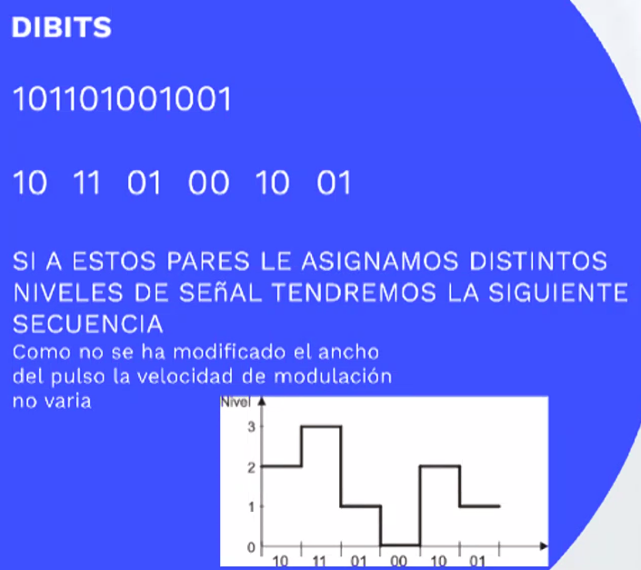

$$
N=\log_2 n,\quad n=2^N,\quad V_t=V_m\log_2n.
$$

| Símbolo | Significado | Unidad |
|---|---|---|
| $n$ | Cantidad de niveles distinguibles del pulso (estados posibles por símbolo) | conteo de niveles |
| $N$ | Cantidad de bits que representa un símbolo; no es la cantidad de niveles | bit/símbolo |
| $V_m $ | Tasa de símbolos | baudios |
| $V_t $ | Tasa binaria bruta | bit/s |

**Supuestos:** mapeo fijo binario con $n=2^N$, todos los estados utilizables; no descontar redundancia/overhead. El receptor debe distinguirlos en condiciones reales.

**Ejemplo E4:** 1200 baudios y 4800 bit/s exigen 4 bit/símbolo y 16 estados. El intervalo sigue siendo 1/1200 s = **833,333 µs**. Con 2 estados daría 1200 bit/s y con 4,2400 bit/s. No se aceleró el reloj.

Para varios canales independientes simultáneos, FV p. 2 suma sus aportes:

$$
V_{t,\mathrm{total}}=\sum_{i=1}^{m}V_{m,i}\log_2 n_i.
$$

| Símbolo | Significado | Unidad |
|---|---|---|
| $m,i $ | Cantidad/índice de canales | conteo |
| $V_{m,i},n_i $ | Tasa/estados del canal $ i $ | baudios; conteo |
| $V_{t,\mathrm{total}}$ | Tasa agregada | bit/s |

**Supuesto y ejemplo hipotético:** canales simultáneos independientes, sin contar el dato dos veces. Dos canales de 1200 baudios con 4 estados aportan 2400 bit/s cada uno: 4800 bit/s totales.

### Qué significa AB=1/τ

F3/FV escriben AB=1/τ. Se interpreta en el modelo de pulso rectangular del curso:

$$
B_{\mathrm{primer\ cero}}=1/\tau.
$$

| Símbolo | Significado | Unidad |
|---|---|---|
| $\tau $ | Ancho del pulso rectangular | s |
| $B_{\mathrm{primer\ cero}}$ | Frecuencia del primer cero desde 0 | Hz |

**Supuesto:** criterio de primer cero, no ancho universal para cualquier canal/código/modulación. En E4 da 1200 Hz. El espectro rectangular no termina allí: su ancho ideal total es infinito. Fourier se desarrolla en [U2](../02-senales-telecomunicaciones/APUNTE.md), Nyquist/ruido en [U6](../06-canales-comunicaciones/APUNTE.md).

Acortar el pulso desplaza componentes hacia frecuencias mayores. Mantener forma/intervalo y aumentar estados no exige cambiar por sí solo ese ancho espectral. **No elimina el límite de ruido**: estados más próximos se distinguen peor.

### Errores típicos → examen

16 estados no son 16 bits por símbolo sino 4. Igualar números de Hz y baudios exige declarar el modelo. La relación de representación no es una capacidad garantizada ni Shannon.

**Para examen:** «Multinivel aumenta bits por símbolo sin cambiar necesariamente los baudios. El ancho depende de forma/duración del pulso; el ruido limita cuántos estados puedo distinguir».

## 3. Sentidos y modos de transmisión

**Fuentes:** F3 p. 5–7; C4 tipos/modos; cuestionario_U3 Q3.

Son criterios independientes: dirección de intercambio no es número de vías ni orden de bits.

| Tipo | Qué permite | Ejemplo registrado |
|---|---|---|
| Simplex | Un solo sentido | Radiodifusión: emisora→oyentes |
| Half duplex | Ambos sentidos alternados | Walkie-talkie |
| Full duplex | Ambos sentidos simultáneos | Teléfono |

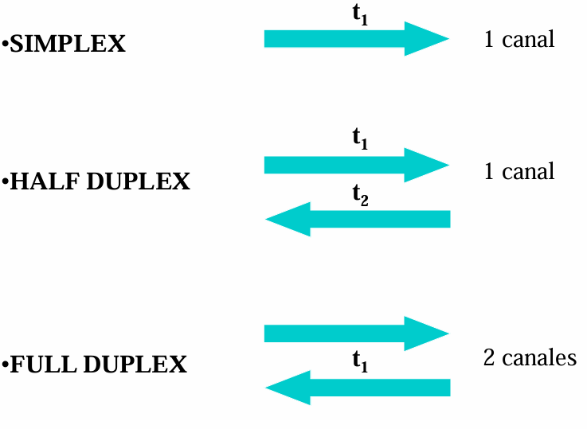

Full duplex se dibuja con dos canales: expresa dos sentidos simultáneos, **no obliga a dos cables separados**. F3 p. 25 muestra última milla telefónica de dos hilos.

**Serie:** bits sucesivos por una vía de datos. **Paralelo:** distintas posiciones del dato por varias vías al mismo tiempo. El paralelo debe reunir posiciones correspondientes al mismo dato: importa su alineación temporal.

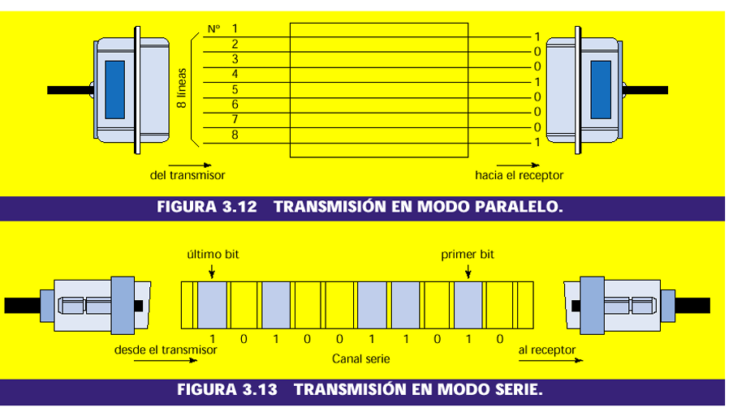

**Ejemplo hipotético a igual intervalo:** 8 bits en serie con 1 ms/bit ocupan 8 ms; 8 vías paralelas binarias entregan esos 8 bits en 1 ms. Se paga con vías y coordinación. C4 dice «serie menor velocidad/mayor distancia; paralelo mayor velocidad/menor distancia»: es una tendencia a condiciones semejantes, **no regla absoluta** independiente de reloj/medio/tecnología.

**Errores típicos:** serie no implica simplex y paralelo no implica full duplex. No confundir una implementación física con la definición.

**Para examen:** «Simplex/half/full duplex clasifican dirección y simultaneidad; serie/paralelo clasifican distribución de bits entre vías. Son ejes distintos».

## 4. Sincronismo y rendimiento

**Fuentes:** F3 p. 8–11; FV p. 6–8; C4 sincronismo; C5 protocolos; P4; G3 E3/E5–7/E11.

### Problema físico → concepto → modelo

Sin referencia temporal común, el receptor no sabe cuándo decidir el nivel ni qué posiciones forman un carácter/bloque. Sincronizar coordina esas referencias; no significa hacer llegar todos los bits juntos.

- **Bit:** identificar intervalos e instantes de decisión.
- **Carácter:** identificar límites y posiciones del carácter.
- **Bloque:** localizar una unidad compuesta de datos y control.

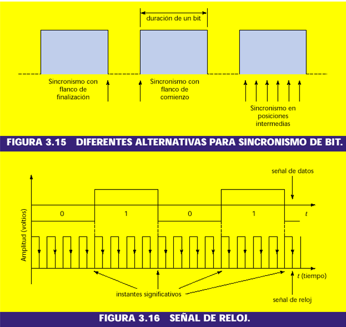

### Asincrónica: delimitar cada carácter

Arranque → datos → paridad opcional → parada. El arranque fija la referencia del carácter; el receptor lee posiciones usando su reloj. **Asincrónica sí necesita sincronismo de bit.** Entre caracteres puede haber pausas irregulares.

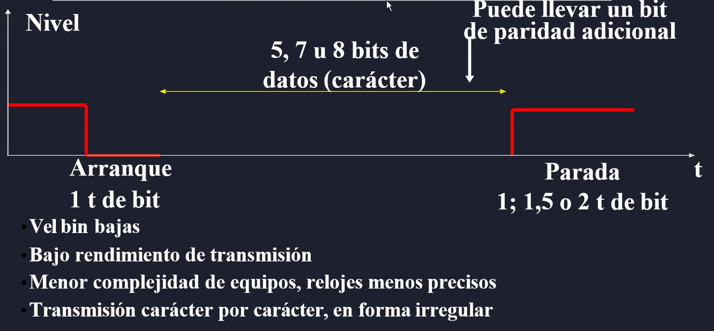

Parada de 1,5 bits significa una duración de 1,5 tiempos de bit, no «medio bit de información».

$$
b_{total}=1+b_d+b_p+b_s,\qquad
\eta_a=\frac{b_d}{1+b_d+b_p+b_s},\qquad
T_a=\frac{K(1+b_d+b_p+b_s)}{V_t}.
$$

| Símbolo | Significado | Unidad |
|---|---|---|
| $b_d,b_p $ | Datos y paridad por carácter | bit/carácter |
| $b_s $ | Parada en tiempos de bit | equivalentes de bit/carácter |
| $1$ | Arranque | equivalente de bit/carácter |
| $K$ | Cantidad de caracteres | caracteres |
| $V_t $ | Tasa binaria bruta | bit/s |
| $\eta_a $ | Fracción de tiempos destinados a datos | adimensional; ×100 para % |
| $T_a $ | Duración total | s |

**Supuestos:** caracteres seguidos, misma configuración, sin pausas/retransmisiones; sustituir $V_t $ por $V_m $ sólo para un bit/símbolo. El rendimiento mide este framing, no todos los errores de red.

**Ejemplo E6:** 1 arranque+7 datos+1 parada son 9 tiempos, rendimiento **77,7778%**. Agregar 1 paridad da 10 tiempos y **70%**. E3: 1500 caracteres con 1+8+1+1,5 tiempos a 75 bit/s ocupan **230 s**, bajo convención seudo-Baudot del solucionario.

### Sincrónica: amortizar control por bloque

Agrupa datos con encabezamiento y final; no añade arranque/parada a cada carácter. Mantiene referencia temporal durante el bloque.

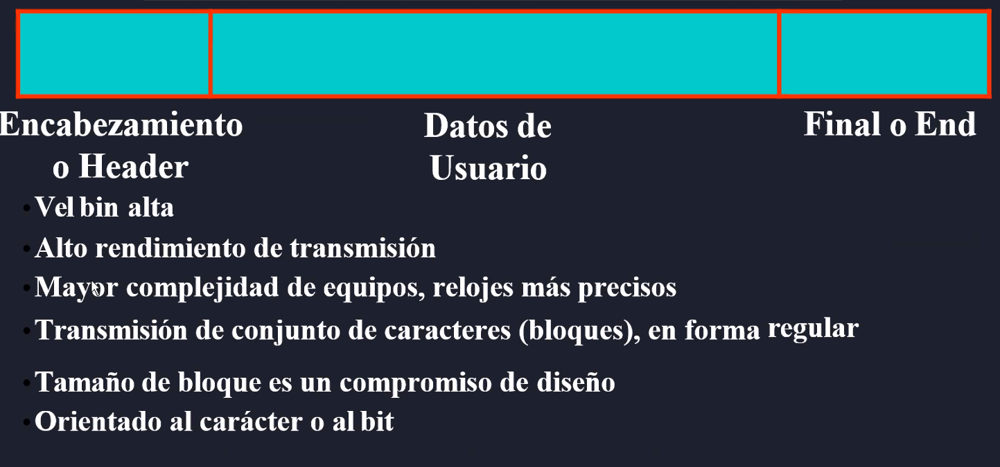

El header contiene control para interpretar/encaminar el bloque. El final delimita y/o controla integridad según protocolo. P4 pone dirección del colector como ejemplo en ambos extremos:** no es formato universal**; aquí no se inventan campos de una trama concreta.

$$
\eta_s=\frac{D}{H+D+F},\qquad T_s=\frac{8D}{\eta_sV_t}.
$$

| Símbolo | Significado | Unidad |
|---|---|---|
| $D,H,F$ | Datos, header, final | byte, todos en misma unidad |
| $8$ | Conversión de byte a bits | bit/byte |
| $\eta_s $ | Fracción útil del bloque | adimensional |
| $V_t $ | Tasa bruta | bit/s |
| $T_s $ | Tiempo total | s |

**Supuestos:** esos campos,8 bits por byte, sin pausas ni retransmisiones; rendimiento fraccional (90%=0,90). **Ejemplo E5:** 1500 bytes útiles+14 de encabezado+4 finales →1500/1518=**98,8142%**. E11: 1800 bytes a 3600 bit/s con 90% requieren **4,44444 s**, no 4,4 s: se divide por 0,90. [TP3 E11](../../practica/tp-03-redes.md#e11) documenta discrepancia original.

### Compromiso, errores y examen

Bloques largos reparten overhead entre más datos; si una falla obliga a repetir el bloque, se retransmite más. La cátedra contrapone sencillez asincrónica y rendimiento sincrónico: son tendencias del modelo, no afirmaciones de que todo asincrónico sea lento o mejor ante cualquier canal malo.

**Errores típicos:** contar paridad como payload; mezclar bytes y bits; omitir pausas dadas; asumir que 90% de rendimiento implica sumar 10% al tiempo. Asincronía no elimina reloj y sincronía no significa cero overhead.

**Para examen:** «Asincrónica delimita cada carácter; sincrónica delimita bloques y mantiene base temporal. Rendimiento es datos útiles sobre total; un bloque mayor reduce overhead relativo, pero encarece la repetición por errores».

**Puente hacia protocolos.** La [diapositiva 9 de U3](../../../material/teoria/U3/U3%20Redes%20de%20Telecomunicaciones.pdf#page=9) separa la transmisión serie en asincrónica y sincrónica. Dentro de la rama sincrónica, la lámina distingue protocolos orientados al carácter y al bit; esa orientación no es lo mismo que el sincronismo de carácter o de bit. Los ejemplos y el alcance de esa clasificación se explican en el [punto 5](#protocolos).

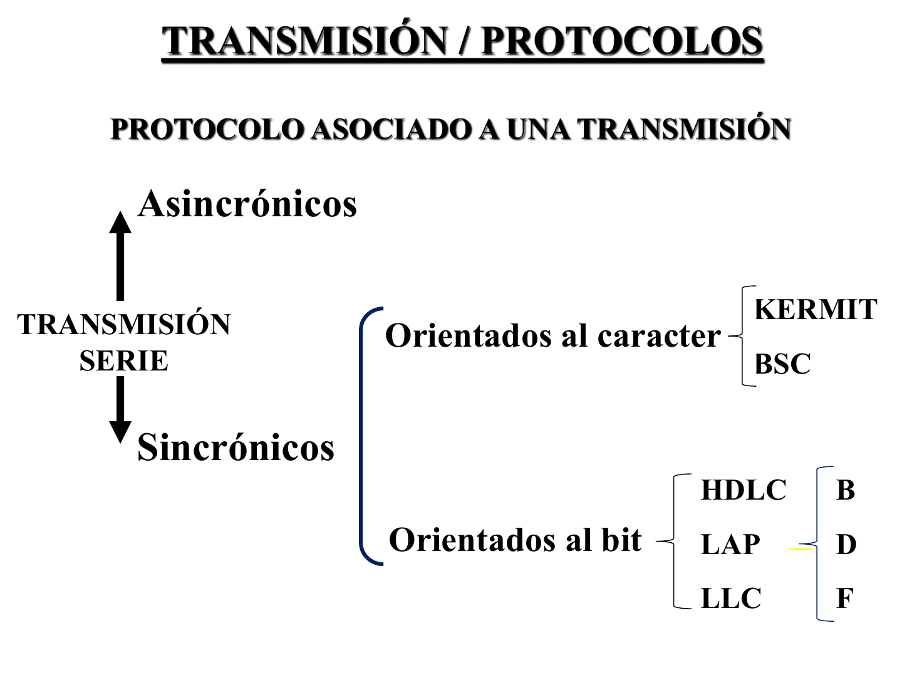

## 5. Protocolos orientados al carácter y al bit

**Fuentes:** F3 p. 9–11; C5 «Protocolo asociado a una transmisión».

Un protocolo define reglas compartidas para identificar unidades, distinguir control/datos y actuar sobre ellas. **Orientado al carácter:** usa unidades/caracteres de control para organizar comunicación. **Orientado al bit:** interpreta patrones de bits sin depender de que los datos sean texto. Esta aclaración conceptual no agrega formatos ausentes del corpus.

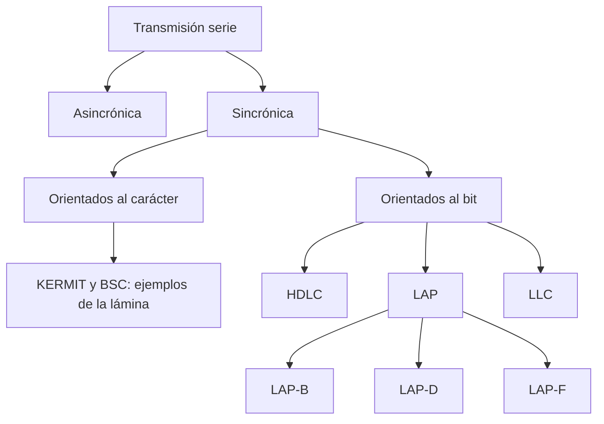

Un delimitador interpretado como carácter de control ejemplifica el primer enfoque; un patrón de bits, el segundo. F3 enumera familias, **no desarrolla sus tramas**. La ubicación de KERMIT es la del árbol original: no permite inferir que todo uso de KERMIT necesite línea sincrónica. Esa generalización no se incorpora como conocimiento confirmado.

**Error típico:** sincronismo de carácter no es protocolo orientado al carácter: uno localiza posiciones temporalmente y el otro interpreta control. LLC/LAP tampoco son modulaciones.

**Para examen:** «La orientación describe representación de control y delimitación, no dirección de transmisión ni bits por símbolo».

## 6. Redes y enlaces

**Fuentes:** F3 p. 12–15; C5 redes, enlaces, costos.

### Problema → concepto → modelo

Conectar cada comunicación como sistema aislado deja de ser razonable al crecer usuarios. Una red articula **terminales** que originan/reciben datos, **enlaces** que transportan y **nodos** que conectan o encaminan. La nube abstrae su interior, no niega su estructura.

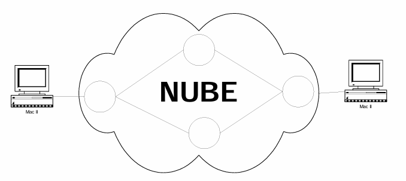

| Representación | Qué distingue | Ejemplo de F3 p. 13 |
|---|---|---|
| Punto a punto | Dos extremos por enlace | Dos equipos directamente vinculados |
| Difusión multipunto | Varios extremos comparten medio | Ethernet dibujado como bus |
| Conmutada | Terminales conectados por nodos | Nube entre equipos |
| Internet | Interconexión de redes | Varias nubes unidas |

El bus de la lámina es un ejemplo compartido, no define **todo Ethernet**. Punto a punto tampoco implica automáticamente servicio dedicado.

Los enlaces se clasifican por **puntos unidos** (punto a punto/multipunto) y **características** (dedicados/conmutados). El dedicado permanece asignado al servicio; el conmutado usa la red para establecer o encaminar. Son criterios diferentes, no categorías excluyentes de una sola lista.

**Ejemplo hipotético:** cuatro terminales pueden usar cuatro accesos a un nodo central en lugar de seis enlaces entre pares. Menos enlaces, pero ahora el centro es dependencia compartida; se cuenta un nodo central adicional. [Topologías](#topologias) justifica la malla.

### Costos frente a volumen: discrepancia de la captura

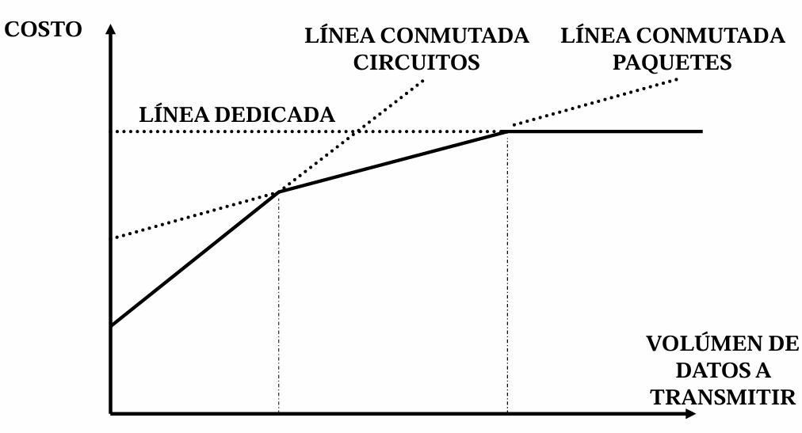

Elegí la curva de **menor altura** al volumen dado: el dibujo muestra **bajo volumen→circuitos; intermedio→paquetes; alto→dedicada**. En este modelo la dedicada tiene costo constante; las otras aumentan con uso.

C5 escribe bajo→dedicada y alto→paquetes: contradice F3 p. 15 y su propia imagen. Se corrige aquí la lectura sin editar la captura. No hay tarifas ni coordenadas numéricas: no se inventan puntos de cruce ni se usa la figura histórica como recomendación comercial actual.

**Errores típicos:** enlace no es toda la red; nube no identifica una única tecnología; costo mayor no equivale a servicio mejor.

**Para examen:** «Terminales, enlaces y nodos forman la red. Comparo alternativas a igual volumen y elijo el mínimo del gráfico, no un ranking memorizado».

## 7. Circuitos y paquetes

**Fuentes:** F3 p. 14,16,19; C5 tipos de conmutación.

### Problema → concepto → modelo

Muchos usuarios necesitan compartir infraestructura. **Circuitos:** establece conexión con recursos asignados a una comunicación: establecer→mantener/transferir→desconectar. **Paquetes:** transmite unidades que los nodos reciben/encaminan por recursos compartidos.

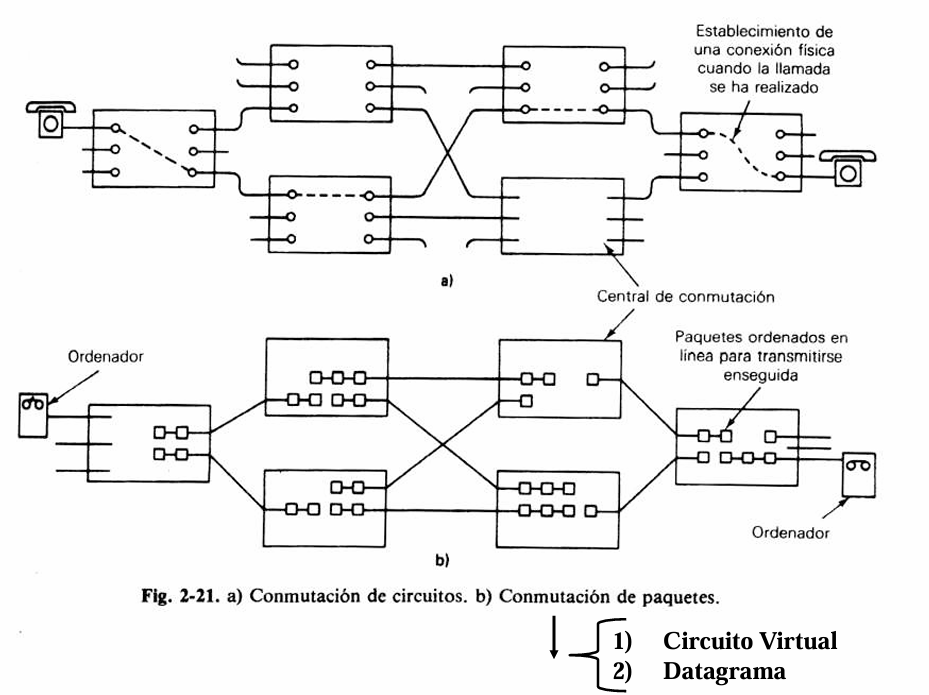

En circuitos, la ruta habilitada se mantiene durante la sesión aunque haya silencio. En paquetes, las unidades comparten enlaces y pueden esperar: la demora depende de la actividad. La figura menciona **circuito virtual** (asociación lógica previa) y **datagrama** (unidades encaminadas como datagramas). Asociación lógica no equivale a reserva física de todo un circuito.

**Ejemplo hipotético:** sesión de 60 s con datos durante 10 s: el recurso del circuito sigue comprometido durante la sesión; paquetes no obliga por definición a reservar 60 s exclusivos. No se deduce throughput real: faltan velocidades, colas, control.

**Errores típicos:** «paquetes=siempre sin conexión» ignora circuitos virtuales; circuito no es cable nuevo exclusivo; paquetes no garantiza menor demora bajo cualquier carga.

**Para examen:** «Circuitos asigna recursos a una sesión; paquetes comparte transmisión entre unidades. Cambian establecimiento, utilización y comportamiento temporal».

## 8. Topologías

**Fuentes:** F3 p. 17–18; C5 topologías/cuadro comparativo.

### Problema → concepto → modelo

La ubicación de enlaces cambia costo y qué comunicación resiste una falla. Topología organiza nodos/enlaces: no es velocidad ni protocolo.

| Tipo | Organización y ejemplo | Compromiso |
|---|---|---|
| Malla | Varios enlaces entre nodos; cuatro nodos por pares | Más caminos y enlaces; puede ser parcial |
| Estrella | Accesos al centro; HUB de la lámina | Localización de un acceso; dependencia del centro |
| Bus | Medio común | Pocos medios principales; falla común afecta varios |
| Anillo/ring | Recorrido cerrado; Token Ring | Dependencia del recorrido y mecanismos de recuperación |
| Híbrida | Combinación; ejemplo hipotético dos estrellas unidas | Hereda compromisos de sus partes |

### Malla completa: formalización y ejemplo

Cada nodo se conecta a $n-1$ y cada enlace se cuenta desde ambos extremos:

$$
N_e=\frac{n(n-1)}2.
$$

| Símbolo | Significado | Unidad |
|---|---|---|
| $n $ | Nodos | conteo |
| $N_e $ | Enlaces entre pares | conteo |

**Supuestos:** malla completa, un enlace bidireccional por par, sin autoenlaces ni paralelos. **Ejemplo de la figura:** cuatro nodos→6 enlaces. Agregar un quinto requiere 4 enlaces nuevos: total 10. Una estrella con 4 periféricos requiere 4 accesos, pero también un nodo central; no comparar poblaciones distintas sin decirlo.

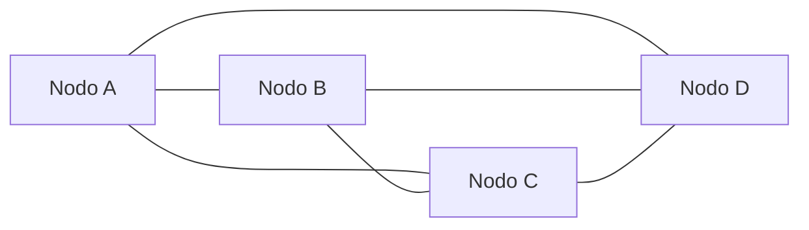

### Cuadro de cátedra y límites

| F3 p. 18 | Estrella | Malla | Anillo | Bus |
|---|---|---|---|---|
| Número de nodos | Bajo/medio | Alto | Medio/alto | Medio/alto |
| Confiabilidad | Media | Media | Baja | Media |
| Reconfiguración | Baja | Alta | Baja | Alta |
| Localización de fallas | Alta | Baja | Alta | Baja |
| Cantidad de enlaces | Alta | Alta | Baja | Baja |

Se preserva la tabla registrada, **no como ley cuantitativa universal**: no especifica tamaño, redundancia ni probabilidades. La malla con caminos alternativos puede tolerar una falla de enlace; la estrella pierde comunicaciones por el centro si éste falla. El ranking media/baja no reemplaza ese análisis.

**Errores típicos:** fórmula de malla completa aplicada a parcial; contar dos extremos como dos enlaces; deducir confiabilidad sólo del nombre; confundir topología física y lógica.

**Para examen:** «Topología condiciona costo y fallas. La malla completa tiene un enlace por par,$n(n-1)/2$; las otras comparaciones requieren aclarar implementación».

## 9. Red telefónica y evolución registrada

**Fuentes:** F3 p. 19–25; desarrollo limitado a esas láminas.

La **RTPC/PSTN**, red telefónica pública conmutada, resuelve conectar abonados sin una línea directa por cada pareja. Las comunicaciones atraviesan establecimiento, mantenimiento/transferencia y desconexión del circuito.

| Componente | Función | Ejemplo |
|---|---|---|
| Abonado | Usuario/extremo del servicio | Teléfono de origen/destino |
| Bucle local/lazo de abonado | Acceso a la central, última milla | Pareja de hilos del abonado |
| Conmutador | Establece conexión entre accesos/rutas | Central que selecciona salida |
| Troncal | Enlace entre centrales | Ruta entre zonas |

**Conmutación espacial (p. 20–21):** rutas físicamente independientes dentro del conmutador. La figura de tres etapas muestra entrada→matrices intermedias→salida; no necesita una única matriz gigantesca. No se agrega dimensionamiento ausente.

**Conmutación temporal (p. 20,22):** interfaces conectan líneas full duplex a un bus digital con intervalos asignados; la unidad de control organiza el acceso. Separación por tiempo, no mezcla indistinta de muestras. PCM y [TDM/jerarquías](../04-modulacion-digitalizacion-multiplexacion/APUNTE.md) pertenecen a U4.

**Ejemplo hipotético:** dos comunicaciones espaciales usan rutas internas distintas; en el bus temporal sus muestras ocupan dos intervalos distintos de cada ciclo. Compartir bus no significa superponer ambas muestras.

F3 p. 23 contrapone **red pública PSTN** y **central privada PBX/PABX**. La PBX organiza llamadas internas de una institución y su conexión externa, no es modulación. El esquema público tiene planos urbano, interurbano e internacional, con nivel de sincronismo/control/señalización. Es arquitectura de la lámina, no descripción actual universal de operadores.

F3 p. 24 muestra evolución voz/datos: redes PSTN e IP WAN separadas; incorporación de **gateways** para interconectar entornos y transportar voz por IP; solución integrada con control de llamadas y camino PSTN secundario. **VoIP** es transporte de voz por IP. Se explica el dibujo, no se propone configurar sus productos ni ampliar hardware U8.

### Dos hilos, cuatro hilos e híbridos

En F3 p. 25 los extremos tienen **2H** y un tramo intermedio **4H**. Dos hilos comparten pareja física para ambos sentidos; cuatro separan parejas de transmisión/recepción. Un **circuito híbrido** combina/separa sentidos para adaptar ambas organizaciones. La figura contiene balance: no asumir separación ideal por dibujar un transformador. Eco/distorsión se conectan con [U6](../06-canales-comunicaciones/APUNTE.md).

**Errores típicos:** full duplex no exige cuatro hilos; troncal no es lazo; PBX no es toda la red pública; no convertir una arquitectura histórica en regla presente.

**Para examen:** «La red telefónica articula abonados, lazos, centrales y troncales. La conmutación separa recursos en espacio o tiempo; pública/privada e integración IP son cuestiones de arquitectura».

## 10. Señalización e ingeniería de tráfico

**Fuentes:** F3 p. 26; contexto RTPC p. 19–25.

### Problema → concepto → modelo

Las llamadas no duran lo mismo ni ocurren todas juntas. Dimensionar sólo por abonados ignora tiempo de ocupación. El **tráfico** combina frecuencia de llamadas y duración: representa ocupación media, no bits/s ni cantidad fija de cables.

La **señalización** transmite control del servicio. F3 distingue **asociada al canal (SAC)** y **por canal común (SCC)**: control ligado al canal de la comunicación frente a control sobre un canal común. Sus rótulos A/D no se generalizan a que toda SAC sea analógica o toda SCC un estándar concreto.

### Formalización y ejemplo

$$
A=\lambda T_R.
$$

| Símbolo | Significado | Unidad |
|---|---|---|
| $A$ | Tráfico/ocupación media | Erlang |
| $\lambda $ | Frecuencia media de llamadas; F3 usa $C$ | llamadas/h |
| $T_R$ | Retención media | h/llamada |

Se usa $\lambda $ para no confundir $C$ con capacidad de canal U6. **Supuestos:** medias sobre mismo período/población y unidades coherentes; distinguir tráfico ofrecido/cursado. La lámina no fija modelo de bloqueo.

**Ejemplo hipotético:** 60 llamadas/h,3 min/llamada→0,05 h/llamada→**3 Erlangs**: ocupación media equivalente a 3 recursos continuamente ocupados, no exactamente 3 llamadas activas siempre. El gráfico F3 p. 26 tiene picos horarios: la media diaria puede ocultar hora cargada.

**Límite de alcance:** no se agregan Erlang B/C ni grado de servicio; con sólo $A$ no se dimensiona cantidad de circuitos sin modelo de demanda/atención y calidad requerida.

**Errores típicos:** llamadas/h×min sin convertir; Erlangs como bit/s; media confundida con máximo simultáneo.

**Para examen:** «El tráfico integra llegadas y retención. Un Erlang expresa ocupación media continua; por sí solo no fija bloqueo ni dimensionamiento».

## 11. RDSI: integración y tasas

**Fuentes:** F3 p. 27–28; conexión U4 para PCM/TDM/PDH/SDH/SONET. Secundario parcial: sin procedimientos ausentes.

La **RDSI/ISDN** integra servicios en una red digital: la lámina conecta voz, datos, video y fax. Los canales **B** transportan usuario a 64 kbit/s; **D** señalización/control a 16 o 64 kbit/s según acceso. Sumar B y D no equivale a throughput exclusivamente útil de aplicación: D incluye control.

- **BRI:** F3 da 2B+D,144 kbit/s de canales y 160 kbit/s total. Verificación: 2×64+16=144 kbit/s. La resta del cuadro da 16 kbit/s, pero **no confirma una tasa universal de interfaz**. El [resumen oficial UIT-T I.430 (11/1995)](https://www.itu.int/ITU-T/recommendations/rec.aspx?lang=es&rec=3248), descripción de interfaz S/T, especifica **192 kbit/s** para el acceso 2B+D. La lámina no declara punto de referencia para sus 160 kbit/s: permanece pendiente contextualizar esa cifra y se excluye como dato universal de examen. Este contraste aclara el tema ya registrado; no agrega un nuevo capítulo ni usa un PDF sin cache.
- **PRI USA:** 23B+D,1,536 Mbit/s de canales y 1,544 Mbit/s total. Verificación: 23×64+64=1536 kbit/s.
- **PRI Europa:** imprime 31B+D y 2,048 Mbit/s tanto útil como total. **Fila no confirmada:** consumiría 32 canales de 64 kbit/s sin dejar explícito un intervalo de alineación; requiere contraste con E1/PCM30 U4. Se registra como afirmación del original, no especificación validada.

Las sumas usan conteos adimensionales por kbit/s de cada canal; suponen canales simultáneos y tasas declaradas. No son fórmulas de capacidad física.

**Errores típicos:** canales+control llamados exclusivamente payload; corrección silenciosa de fila conflictiva; integración confundida con capacidad ilimitada.

**Para examen:** «RDSI reúne usuario B y señalización D. Distingo suma de canales, tasa de interfaz y entrega útil».

## Pendientes por sección y registro QA

| Sección | Control / pendiente |
|---|---|
| §1–4 velocidades/multinivel/sincronismo | F3 p. 2–11, FV p. 2–8 texto+visual; cuentas recalculadas. No universalizar AB=1/τ ni tendencias serie/paralelo |
| §5 protocolos | Árbol F3 p. 9 visual; KERMIT es etiqueta de lámina, no clasificación exhaustiva validada |
| §6–8 redes/costos/topologías | F3 p. 12–18 visual; costos corregidos contra p. 15; rankings de topología no validados como ley |
| §9–10 RTPC/tráfico | F3 p. 19–26 texto+visual; diagramas espacio/tiempo, jerarquía, VoIP, híbridos leídos. Sin grado de servicio |
| §11 RDSI | p. 27–28 visual; PRI Europa pendiente de contraste E1 y BRI 160 kbit/s sin referencia de interfaz (I.430 S/T=192), ambos excluidos de evaluación confirmada |
| Programa | Temas sin corpus de la tabla de alcance permanecen pendientes |
| Paquete | Faltan reviews independientes e integración transversal; no revisión integral ni estado revisado |

**QA ejecutado 2026-10-10:** rg, pdftoppm y Python bundled comprobados; caches leídos antes de redacción. F3 28 páginas y FV 17 renderizadas y observadas en contactos de páginas, con ampliaciones p. 15/18/28; G3 p. 2–3 ampliadas y R1 p. 1–3 visual. Poppler emitió avisos Symbol/ArialUnicode: símbolos críticos contrastados con texto/cálculos; no se ignoran limitaciones del render. Recursos copiados sin editar originales: [manifiesto SHA-256](recursos/manifiesto.json). Comprobación local (2026-10-11): 31 aserciones numéricas, 17 copias con SHA-256 iguales y 90 enlaces revisados; 8 referencias a U4/U6 todavía sin archivo al momento del control, ninguna otra ruta/ancla local faltante. Registro: [QA de autor](recursos/qa-autor.json). Las anclas cruzadas se integran finalmente cuando estén las otras unidades.

## Resumen mental

Símbolos/s no son bits/s y bits enviados no son datos útiles entregados. Multinivel necesita estados distinguibles, no rompe límites físicos. Sincronismo permite decidir cuándo y cómo agrupar; rendimiento descuenta control. Dirección, modo, protocolo, enlace, conmutación y topología son aspectos distintos. RTPC conecta usuarios con recursos compartidos; tráfico mide ocupación media, no velocidad binaria.

### Checklist de examen

- [ ] Distingo baudios, bit/s, byte/s, Hz con ejemplo.
- [ ] Explico 16 estados→4 bits/símbolo y criterio espectral de AB.
- [ ] No confundo dirección con serie/paralelo.
- [ ] Explico sincronismos y por qué asincrónico sí sincroniza.
- [ ] Calculo rendimiento/tiempo incluyendo control y dividiendo por eficiencia.
- [ ] Distingo orientación del protocolo y sincronización física.
- [ ] Identifico terminal, nodo, enlace y circuitos/paquetes.
- [ ] Cuento malla completa y analizo fallas concretas.
- [ ] Leo mínimos del gráfico de costos, no la captura invertida.
- [ ] Explico lazo/troncal/PBX, espacio/tiempo,2H/4H, señalización.
- [ ] Convierto retención a horas para calcular Erlangs.
- [ ] No evalúo como confirmados grado de servicio ni cifras RDSI de interfaz pendientes.
