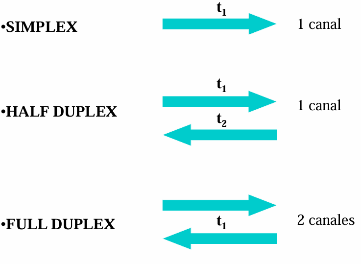
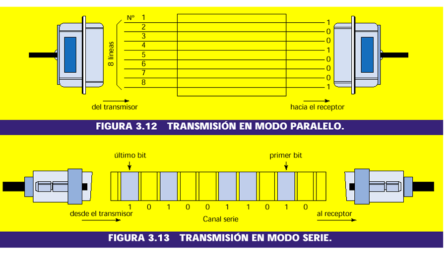
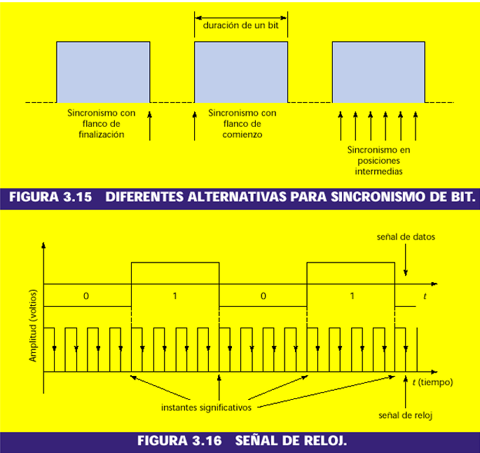

3/9/2026

# Medidas de la velocidad

## Velocidad de modulación — Línea de Tx

$$
V_m = \frac{1}{\tau}
$$

Donde:

- $\tau$ = menor duración del pulso.
- Se mide en **baudios (1/s)**.

### Ancho de banda

$$
AB = \frac{1}{\tau}
$$

---

## Velocidad de transmisión (binaria) — Circuito de datos CD

$$
V_{tx} = \frac{\text{cantidad de bits}}{\text{unidad de tiempo}}
$$

Se mide en **bps (bits/s)**.

---

## Relación entre velocidades

$$
V_{tx} = V_m \log_2(n)
$$

Donde:

- $V_{tx}$ = velocidad de transmisión en **bps**.
- $V_m$ = velocidad de modulación en **baudios**.
- $n$ = número de estados o niveles posibles.

> Ejemplo de aplicación: **transmisión multinivel**.

## Velocidad de transferencia de datos (Throughput) — Enlace de datos ED

$$
V_{td} = \frac{\text{cantidad de bits con información}}{\text{unidad de tiempo}}
$$

Se mide en **bps (bits/s o Bytes/s)**.

---

## Velocidad real de transferencia de datos — ED

$$
V_{rtd} = \frac{\text{cantidad de bits con información sin errores}}{\text{unidad de tiempo}}
$$

Se mide en **bps (bits/s o Bytes/s)**.

---

## Relación entre velocidades

$$
V_{tx} > V_{td} > V_{rtd}
$$

puede que:
$$
V_{td} = V_{rtd}
$$
si el canal está perfecto.

Esta relación representa la **eficiencia de un sistema de comunicaciones**.

# Ancho de banda

**Es la dimensión de las comunicaciones.**

## Relación entre ancho de banda y velocidad de transmisión

- **Ancho de banda (AB):** Hz, kHz o MHz.
- **Velocidad de transmisión ($V_{tx}$):** bps, Kbps o Mbps.

$$
AB \Rightarrow V_m
$$

$$
V_{tx} = V_m \log_2(n)
$$

Donde:

- $V_m$ = velocidad de modulación.
- $n$ = número de estados.
- $n$ depende de la **codificación y de la modulación**.

---

> **A mayor ancho de banda → mayor velocidad de transmisión.**

> **Mayores anchos de banda → mayor costo ($$$).**

# Temas de transmisión de datos

## Transmisión multinivel

$n$ representa los **niveles del pulso**.

$$
V_{tx} = V_m \log_2(n)
$$

> Cada pulso puede llevar **más de 1 bit**.

---

## Tipos de transmisión

- **Simplex**: la radio.
- **Half-Duplex**: el walkie-talkie.
- **Full-Duplex**: el teléfono.

---

## Modos de transmisión

- **Serie** -> menor velocidad de transmisión, pero mayor distancia de transmisión.
- **Paralelo** -> mayor velocidad de transmisión, pero menor distancia de transmisión. 

---

## Sincronismo
lo escencial es el tiempo.

- Sincronismo de **bit**
- Sincronismo de **caracter**: se aplica para sincronizar un caracter.
- Sincronismo de **bloque**: se aplica para sincronizar un bloque de datos.

---

## Transmisión según sincronización

- **Transmisión asincrónica**
- **Transmisión sincrónica**