# Transmisión / Protocolos

## Protocolo asociado a una transmisión

La **transmisión serie** puede clasificarse en:

```text
                              TRANSMISIÓN SERIE
                                      │
                  ┌───────────────────┴───────────────────┐
                  │                                       │
           ASINCRÓNICOS                              SINCRÓNICOS
                                                          │
                              ┌───────────────────────────┴──────────────────────────┐
                              │                                                      │
                   Orientados al carácter                                  Orientados al bit
                              │                                                      │
                        ┌─────┴─────┐                                  ┌─────────────┼─────────────┐
                        │           │                                  │             │             │
                     KERMIT        BSC                               HDLC           LAP            LLC
                                                                                    │
                                                                              ┌─────┼─────┐
                                                                              │     │     │
                                                                              B     D     F
```

Otra forma de visualizar la clasificación:

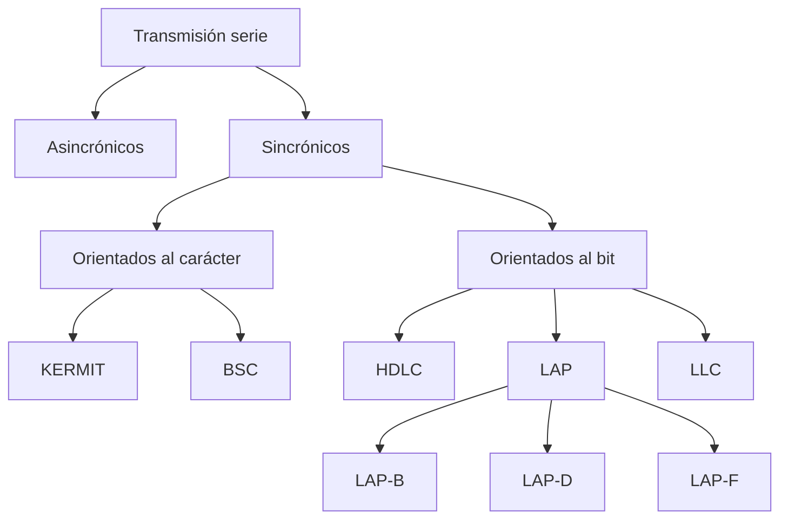

---

# Protocolo asincrónico

En una transmisión asincrónica, cada carácter se transmite de forma independiente y se delimita mediante **bits de arranque y parada**.

acá vamos a tener sincronismo orientado al **caracter**.

## Tipos de sincronismo
Hay dos sincronismos, de bit y de caracter. El sincronismo de bit se utiliza para alinear los bits dentro de un carácter, mientras que el sincronismo de carácter se utiliza para identificar el inicio y el fin de cada carácter.
caracter: delimitado por bits de arranque y parada.
bit: delimitado por el sincronismo de bit.

## Estructura general

```text
Nivel
  ↑
1 │──────────────┐                                             ┌────────────────────
  │              │                                             │
  │              │                                             │
0 │              └─────────────────────────────────────────────┘
  │
  └──────────────────────────────────────────────────────────────────────────────→ t
                 │        <----------- Datos ----------->     │
                 │                                            │
                 │        5, 7 u 8 bits                       │        
                 │         de carácter                        │
                 │                                            │
            ARRANQUE              Puede llevar 
                          un bitde paridad adicional          PARADA
             1 bit                   1 bit                    1, 1.5 o 2 bits
```

La trama de un carácter puede representarse de forma abstracta como:

```text
┌──────────┬──────────────────────────────┬──────────────────┬───────────────┐
│ Arranque │            Datos             │ Paridad opcional │    Parada     │
├──────────┼──────────────────────────────┼──────────────────┼───────────────┤
│  1 bit   │         5, 7 u 8 bits        │      1 bit       │ 1, 1.5 o 2 bit│
└──────────┴──────────────────────────────┴──────────────────┴───────────────┘
```

### Duraciones

Bit de arranque:

\[
T_{\text{arranque}} = 1\,t_{\text{bit}}
\]

Campo de datos:

\[
N_{\text{datos}} \in \{5,7,8\}\text{ bits}
\]

El carácter puede llevar además un bit de paridad:

\[
N_{\text{paridad}} =
\begin{cases}
0 & \text{sin paridad}\\
1 & \text{con paridad}
\end{cases}
\]

Bits de parada:

\[
T_{\text{parada}} \in
\left\{
1\,t_{\text{bit}},
1.5\,t_{\text{bit}},
2\,t_{\text{bit}}
\right\}
\]

Por lo tanto, la cantidad total de bits transmitidos por carácter es:

\[
N_{\text{total}}
=
1
+
N_{\text{datos}}
+
N_{\text{paridad}}
+
N_{\text{parada}}
\]

donde:

- \(1\) corresponde al **bit de arranque**.
- \(N_{\text{datos}}\) puede ser **5, 7 u 8 bits**.
- \(N_{\text{paridad}}\) puede ser **0 o 1 bit**.
- \(N_{\text{parada}}\) puede equivaler a **1, 1.5 o 2 tiempos de bit**.

## Características del protocolo asincrónico

- Velocidades binarias bajas.
- Bajo rendimiento de transmisión.
- Menor complejidad de los equipos y relojes menos precisos.
- Transmisión carácter por carácter, en forma irregular.
- Si se producen errores, hay menos pérdida de caracteres.


### Conclusiones
Este tipo de comunicaciones es mejor para calidades pobres.

# Protocolo sincrónico

En una **transmisión sincrónica**, la información se transmite en conjuntos de caracteres o **bloques**, en lugar de enviar cada carácter de forma independiente.

acá vamos a tener sincronismo orientado a **bloques**.

## Estructura general de un bloque

La estructura puede representarse de manera abstracta como:

```text
┌────────────────────┬─────────────────────────────┬────────────────────┐
│ Encabezamiento     │       Datos de usuario      │    Final o End     │
│ o Header           │                             │                    │
└────────────────────┴─────────────────────────────┴────────────────────┘
```

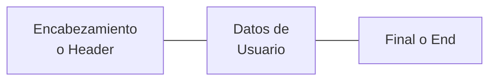

## Características del protocolo sincrónico

- Velocidad binaria alta.
- Alto rendimiento de transmisión.
- Mayor complejidad de los equipos y relojes más precisos.
- Transmisión de conjuntos de caracteres (**bloques**) en forma regular.
- Si se producen errores, hay una mayor pérdida de caracteres según el tamaño del bloque.
- El **tamaño del bloque** es un compromiso de diseño.
- Puede estar **orientado al carácter** o **al bit**.


# Redes de Telecomunicaciones

## Composición

Una **red de telecomunicaciones** está compuesta por:

- **Enlaces de comunicaciones**
- **Nodos de red**
- **Equipos terminales**

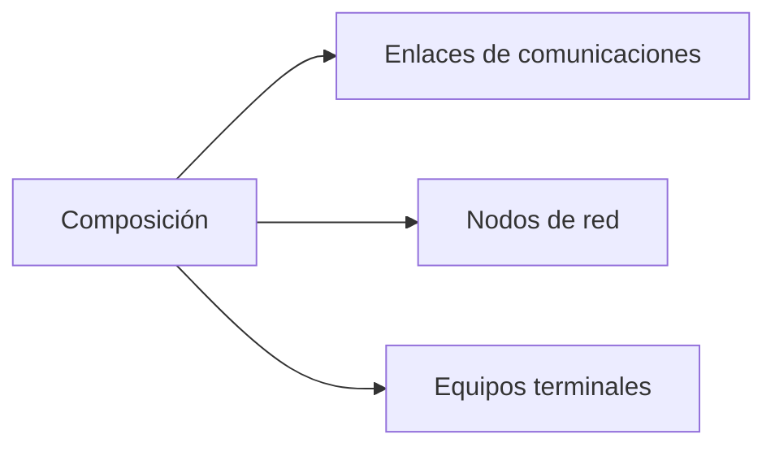

---

## Representación de una red

La red puede abstraerse como una **nube**, dentro de la cual existen distintos **nodos de red** interconectados.  
Los **equipos terminales** se conectan a esa nube mediante enlaces de comunicación.

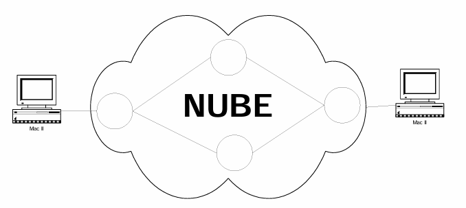

### Conceptos

**Equipos terminales:** dispositivos ubicados en los extremos de la comunicación, desde los cuales se origina o hacia los cuales se dirige la información.

**Nodos de red:** puntos internos de la red encargados de recibir, procesar y/o encaminar la información.

**Enlaces de comunicaciones:** medios que permiten la conexión entre equipos terminales y nodos, o entre distintos nodos de la red.

**Nube:** representación abstracta de la red de comunicaciones. Se utiliza cuando no es necesario mostrar en detalle toda su estructura interna.

# Redes

Según la forma en que se conectan los equipos y se establece la comunicación, pueden representarse distintos tipos de redes:

## Punto a punto

Dos equipos se encuentran conectados directamente mediante un enlace.

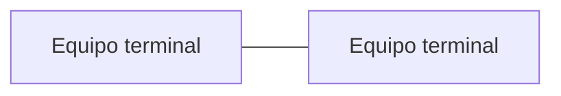

---

## Difusión multipunto

Varios equipos comparten un mismo medio o enlace de comunicación.

```text
              ┌──────────────┐      ┌──────────────┐
              │    Equipo    │      │    Equipo    │
              │   terminal   │      │   terminal   │
              └──────┬───────┘      └──────┬───────┘
                     │                     │
                     │                     │
        ═════════════╪═════════════════════╪═════════════
                    Ethernet
                     │                     │
              ┌──────┴───────┐      ┌──────┴───────┐
              │    Equipo    │      │    Equipo    │
              │   terminal   │      │   terminal   │
              └──────────────┘      └──────────────┘
```

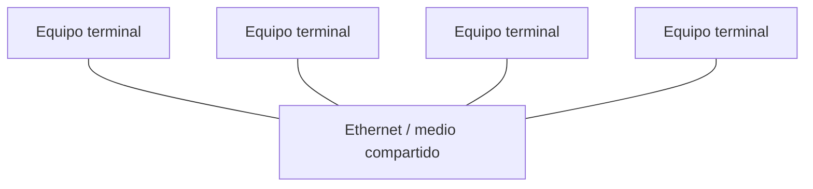

---

## Red conmutada

Los equipos terminales se comunican a través de una **red intermedia**, representada habitualmente mediante una nube.

```text
┌──────────────┐                              ┌──────────────┐
│    Equipo    │         .------------.       │    Equipo    │
│   terminal   │────────(     NUBE     )──────│   terminal   │
└──────────────┘         '------------'       └──────────────┘
```

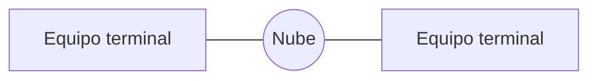

---

## Internet

Internet puede representarse como una **interconexión de múltiples redes**, cada una de ellas abstraída mediante una nube.

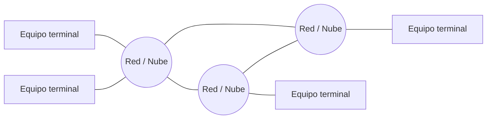

---

# Enlaces de comunicaciones

## Tipos de enlaces

Los **enlaces de comunicaciones** pueden clasificarse según distintos criterios.

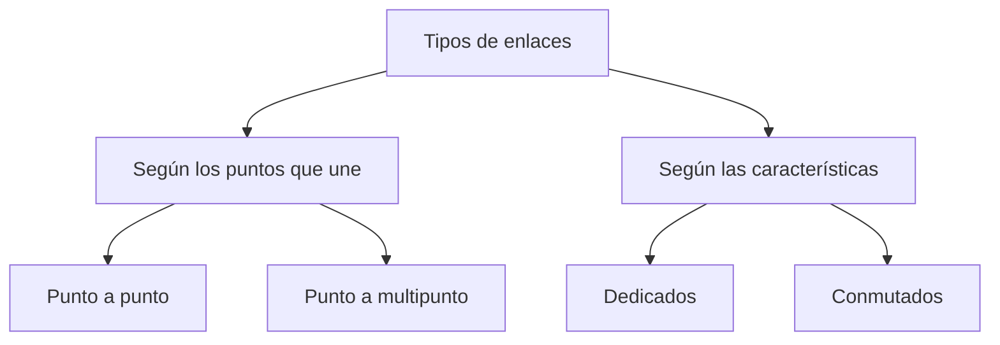

### Según los puntos que une

- **Punto a punto**
- **Punto a multipunto**

### Según las características

- **Dedicados**
- **Conmutados**

# CUADRO COMPARATIVO: COSTOS VS VOLUMEN DE DATOS

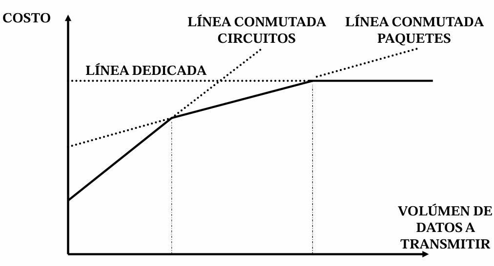

- si tengo menos volumen conviene una linea dedicada.
- si tengo un volumen intermedio, una linea conmutada de circuitos.
- si tengo mayor volumen conviene una red conmutada de paquetes.

--- 

## Tipos de conmutación

La clasificación se realiza **según la forma en que conmutan los nodos**.

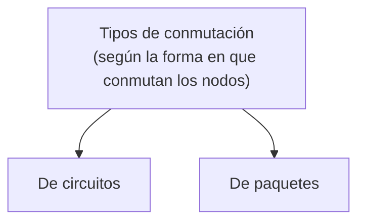

Los dos tipos principales son:

- **Conmutación de circuitos**
- **Conmutación de paquetes**

conmutacion de circuitos vs de paquetes:
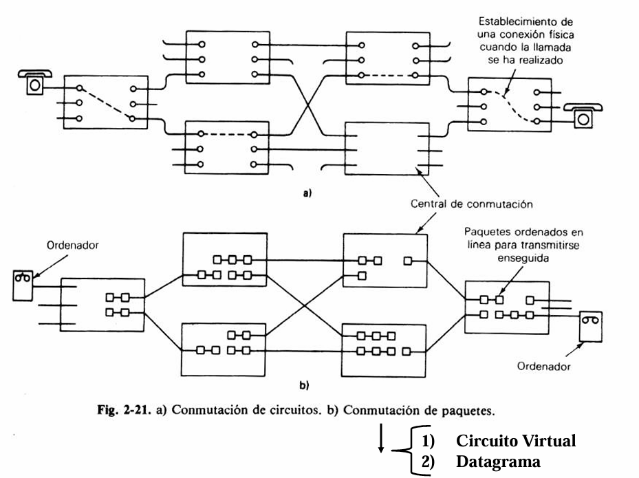


# Topologías de red

## Malla

En una topología de **malla**, los nodos se encuentran conectados entre sí mediante múltiples enlaces.

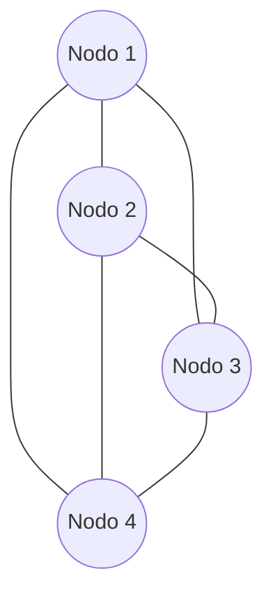

Para una **malla completa**, la cantidad de enlaces necesarios es:

\[
N_e = \frac{n(n-1)}{2}
\]

donde:

- \(N_e\): número de enlaces.
- \(n\): número de nodos.

### Representación

```text
        ┌────────┐───────────────┌────────┐
        │ Nodo 1 │               │ Nodo 2 │
        └───┬────┘\             /└────┬───┘
            │      \         /         │
            │         \   /            │
            │         /   \            │
            │      /         \         │
        ┌───┴────┐/             \┌────┴───┐
        │ Nodo 3 │───────────────│ Nodo 4 │
        └────────┘               └────────┘
```

---

## Estrella

En la topología de **estrella**, todos los equipos se conectan a un dispositivo central, representado en la diapositiva como un **HUB**.

```text
                    ┌──────────┐
                    │ Equipo 1 │
                    └────┬─────┘
                         │
                         │
 ┌──────────┐       ┌────┴────┐       ┌──────────┐
 │ Equipo 2 │───────│   HUB   │───────│ Equipo 3 │
 └──────────┘       └────┬────┘       └──────────┘
                         │
                         │
                    ┌────┴─────┐
                    │ Equipo 4 │
                    └──────────┘
```
---

## Bus o lineal

En la topología **bus o lineal**, los equipos se conectan a un mismo medio de transmisión compartido.

```text
      ┌────────┐        ┌────────┐        ┌────────┐
      │Equipo 1│        │Equipo 2│        │Equipo 3│
      └───┬────┘        └───┬────┘        └───┬────┘
          │                 │                 │
          │                 │                 │
══════════╪═════════════════╪═════════════════╪══════════
          │                                   │
          │                                   │
      ┌───┴────┐                          ┌───┴────┐
      │Equipo 4│                          │Equipo 5│
      └────────┘                          └────────┘
```

---

## Ring o anillo

En una topología de **anillo**, los equipos se encuentran conectados formando una estructura cerrada.

En la diapositiva se representa mediante una red **Token Ring**.

```text
                         ┌──────────┐
                         │ Equipo 1 │
                         └────┬─────┘
                              │
                    ┌─────────┴─────────┐
              ┌─────┤                   ├─────┐
              │     │    TOKEN RING     │     │
              │     │                   │     │
              │     └─────────┬─────────┘     │
              │               │               │
         ┌────┴─────┐    ┌────┴─────┐    ┌────┴─────┐
         │ Equipo 2 │    │ Equipo 3 │    │ Equipo 4 │
         └──────────┘    └──────────┘    └──────────┘
```


---

## Híbridas

Las topologías **híbridas** combinan características de dos o más topologías de red.

Por ejemplo:

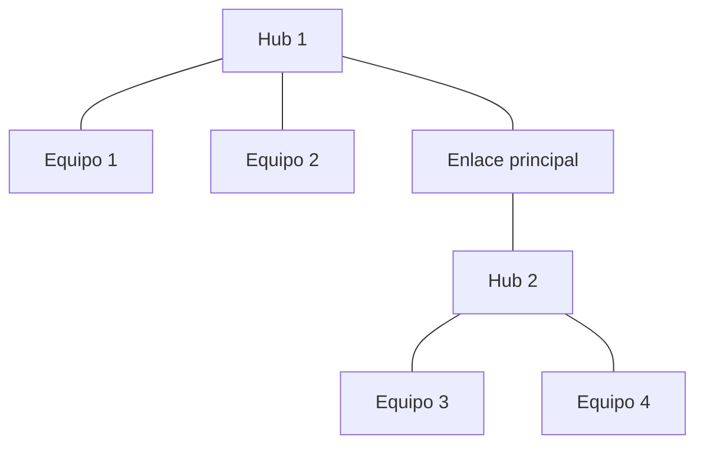

---

## Cuadro comparativo

| Característica | Estrella | Malla | Anillo | Bus |
|---|---|---|---|---|
| **Número de nodos** | *Bajo / Medio | Alto | Medio / Alta | Medio / Alta |
| **Confiabilidad** | Media | Media | Baja | Media |
| **Facilidad de reconfiguración de la red** | Baja | Alta | Baja | Alta |
| **Facilidad de localización de las fallas** | Alta | Baja | Alta | Baja |
| **Cantidad de enlaces necesarios** | Alta | Alta | Baja | Baja |

