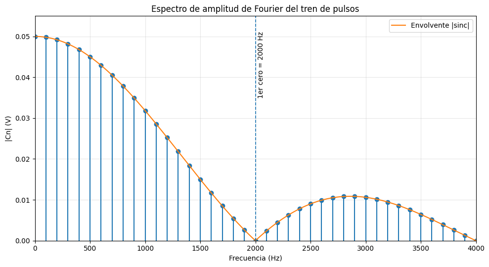

# Cuestionario – Comunicación de Datos

## Pregunta 1 – Velocidad de transferencia de un medio físico

**Imagine que Ud. entrenó a su perro San Bernardo para llevar una caja con 4 diskettes en vez del barrilito de brandy. Cada diskette contiene 250000 Bytes. El perro viaja a 18 km/h. ¿Para qué rango de distancias el perro tiene mayor velocidad de transferencia que un enlace de 300 bps?**

### Opciones

a. **Distancia menor que 133,33 km ✅**  
b. Distancia mayor que 133333 m  
c. Ninguna de las anteriores  
d. Distancia entre 140 y 233,33 km  
e. Distancia mayor de 233,33 km  

### Respuesta correcta

**a. Distancia menor que 133,33 km**

### Procedimiento

Primero calculamos cuánta información transporta el perro.

Cada diskette contiene:

$$
250000\ Bytes
$$

Como lleva 4 diskettes:

$$
4 \cdot 250000\ Bytes = 1000000\ Bytes
$$

Pasamos de Bytes a bits:

$$
1000000\ Bytes \cdot 8\frac{bits}{Byte}
=
8000000\ bits
$$

La velocidad del perro es:

$$
18\frac{km}{h}
$$

Pasamos a metros por segundo:

$$
18\frac{km}{h}
\cdot
\frac{1000\ m}{1\ km}
\cdot
\frac{1\ h}{3600\ s}
=
5\frac{m}{s}
$$

Si la distancia recorrida es $d$, el tiempo de viaje será:

$$
t=\frac{d}{5}
$$

La velocidad efectiva de transferencia del perro es:

$$
V=\frac{8000000\ bits}{d/5}
$$

$$
V=\frac{40000000}{d}\ bps
$$

Queremos que sea mayor que el enlace de 300 bps:

$$
\frac{40000000}{d}>300
$$

Despejando:

$$
d<\frac{40000000}{300}
$$

$$
d<133333,33\ m
$$

Pasando a kilómetros:

$$
\boxed{d<133,33\ km}
$$

### Idea clave

Aunque el perro se mueve lentamente, transporta una gran cantidad de información de una sola vez. Para distancias suficientemente cortas, su **velocidad efectiva de transferencia** puede superar a la de un enlace de 300 bps.

---

## Pregunta 2 – Tren de pulsos y espectro de Fourier

**Dados los siguientes datos de un tren de pulsos:**

- FRP = 100 pps
- Velocidad de modulación = 2000 baudios
- Amplitud del pulso $A = 1\ V$

Se solicita:

a. Realizar el gráfico de amplitud del espectro de Fourier.  
b. Calcular el ancho de banda y la cantidad de armónicas.  
c. Calcular el valor de la amplitud máxima de $C_n$.

---

### Datos

La frecuencia de repetición de pulsos es:

$$
FRP=100\ pps=100\ Hz
$$

La velocidad de modulación es:

$$
V_{mod}=2000\ baudios
$$

La amplitud es:

$$
A=1\ V
$$

---

### 1. Período de repetición

El período del tren de pulsos es:

$$
T=\frac{1}{FRP}
$$

$$
T=\frac{1}{100\ Hz}
$$

$$
\boxed{T=0,01\ s=10\ ms}
$$

---

### 2. Duración de cada pulso

La duración del pulso se obtiene a partir de la velocidad de modulación:

$$
\tau=\frac{1}{V_{mod}}
$$

$$
\tau=\frac{1}{2000}
$$

$$
\boxed{\tau=0,0005\ s=0,5\ ms}
$$

El ciclo de trabajo es:

$$
\frac{\tau}{T}
=
\frac{0,0005}{0,01}
=
0,05
$$

---

### a. Espectro de Fourier

Las componentes espectrales aparecen en múltiplos de la frecuencia de repetición:

$$
f_n=n\cdot FRP
$$

Por lo tanto:

$$
0,\ 100,\ 200,\ 300,\ldots\ Hz
$$

La amplitud de las componentes sigue una envolvente tipo **sinc**:

$$
|C_n|=
A\frac{\tau}{T}
\left|
\frac{\sin\left(n\pi\frac{\tau}{T}\right)}
{n\pi\frac{\tau}{T}}
\right|
$$

El primer cero de la envolvente ocurre en:

$$
f=\frac{1}{\tau}
$$

$$
f=\frac{1}{0,0005\ s}
$$

$$
\boxed{f=2000\ Hz}
$$

---

### b. Ancho de banda

Tomando el ancho de banda hasta el primer cero de la envolvente:

$$
AB=\frac{1}{\tau}
$$

$$
AB=\frac{1}{0,0005\ s}
$$

$$
\boxed{AB=2000\ Hz}
$$

### Cantidad de armónicas

Las armónicas están separadas por la FRP:

$$
\Delta f=100\ Hz
$$

Entonces:

$$
N=\frac{AB}{FRP}
$$

$$
N=\frac{2000}{100}
$$

$$
\boxed{N=20}
$$

La armónica número 20 se encuentra en:

$$
f_{20}=20\cdot100\ Hz=2000\ Hz
$$

que coincide con el primer cero de la envolvente.

Por lo tanto, se suele expresar:

$$
\boxed{20\ armónicas\ hasta\ el\ primer\ cero}
$$

Aunque estrictamente existen **19 armónicas no nulas antes del primer cero**.

---

### c. Amplitud máxima de $C_n$

La amplitud máxima de la envolvente es:

$$
C_{n,max}=A\frac{\tau}{T}
$$

Reemplazando:

$$
C_{n,max}
=
1\ V
\cdot
\frac{0,0005\ s}{0,01\ s}
$$

$$
C_{n,max}=1\ V\cdot0,05
$$

$$
\boxed{C_{n,max}=0,05\ V}
$$

### Resultados

$$
\boxed{T=10\ ms}
$$

$$
\boxed{\tau=0,5\ ms}
$$

$$
\boxed{AB=2000\ Hz}
$$

$$
\boxed{N=20}
$$

$$
\boxed{C_{n,max}=0,05\ V}
$$

### Idea clave

- La **FRP** determina la separación entre las componentes del espectro.
- La duración del pulso $\tau$ determina la posición del primer cero de la envolvente.
- A menor duración del pulso, mayor ancho de banda.

---

## Pregunta 3 – Tipo de transmisión en radiodifusión

**¿Qué tipo de transmisión se utiliza en la radiodifusión comercial?**

### Opciones

a. **Simplex ✅**  
b. Half duplex  
c. Semi duplex  
d. Full duplex  
e. Ninguno de los anteriores  

### Respuesta correcta

**a. Simplex**

### Explicación

En la radiodifusión comercial la información circula en **un único sentido**:

$$
\text{Emisora} \longrightarrow \text{Receptores}
$$

La estación de radio transmite la señal y los oyentes solamente la reciben.

No existe, dentro de ese mismo canal de comunicación, una transmisión de regreso desde los receptores hacia la emisora.

Por lo tanto:

$$
\boxed{\text{Radiodifusión} \rightarrow \text{Simplex}}
$$

### Tipos de transmisión

- **Simplex:** transmisión en un solo sentido.
  - Ejemplo: radio y televisión.

- **Half duplex:** se puede transmitir en ambos sentidos, pero no simultáneamente.
  - Ejemplo: walkie-talkie.

- **Full duplex:** se puede transmitir en ambos sentidos simultáneamente.
  - Ejemplo: llamada telefónica.

---

# Resumen rápido

- **Velocidad efectiva de transferencia:** cantidad de información transportada dividida por el tiempo necesario para transportarla.
- En el ejercicio del perro:

$$
\boxed{d<133,33\ km}
$$

- En un tren de pulsos:

$$
T=\frac{1}{FRP}
$$

$$
\tau=\frac{1}{V_{mod}}
$$

$$
AB=\frac{1}{\tau}
$$

- Para el ejercicio:

$$
\boxed{AB=2000\ Hz}
$$

$$
\boxed{N=20}
$$

$$
\boxed{C_{n,max}=0,05\ V}
$$

- **Radiodifusión comercial → Simplex**