# Unidad 4 — Modulación, digitalización y multiplexación

> **Idea central:** adaptar una señal al canal, convertir valores analógicos en bits y compartir un vínculo entre comunicaciones son problemas diferentes que se combinan en un sistema real.

**Por qué importa.** U2 explica la señal y su espectro; U3 distingue símbolos, bits y flujo útil. Acá elegimos qué característica transporta información y cómo reunir comunicaciones. Multiplexar NO crea capacidad ilimitada: hay que presupuestar carga, control y perturbaciones.

**Requisitos:** [ancho de banda U2](../02-senales-telecomunicaciones/APUNTE.md#ancho-banda), [velocidades U3](../03-redes-telecomunicaciones/APUNTE.md#velocidades) y [multinivel U3](../03-redes-telecomunicaciones/APUNTE.md#multinivel).

## Fuentes y procedencias

Las páginas citadas son **páginas PDF**, contadas desde 1. Los caches existentes sirven para buscar; no son fuentes independientes. Los ejemplos **hipotéticos** y las deducciones aritméticas son elaboración propia a partir del modelo citado.

| ID | Fuente original / procedencia |
|---|---|
| M1 | [U4 MODULACION 1](../../../material/teoria/U4/U4%20MODULACION%201.pdf), 27 pp. |
| M2 | [U4 MODULACION 2](../../../material/teoria/U4/U4%20MODULACION%202.pdf), 13 pp. |
| X | [U4 MULTIPLEXACION](../../../material/teoria/U4/U4%20MULTIPLEXACION.pdf), 36 pp. |
| P | [UT 4 MODULACION Y MULTIPLEXACION](../../../material/practica/U%204/UT%204%20MODULACION%20Y%20MULTIPLEXACION.pdf), 20 pp. |
| V | [Parámetros de métodos de modulación](../../../material/practica/U%204/U%204%20-%20PARAMETROS%20PRINCIPALES%20DE%20%20LOS%20DIFERENTES%20METODOS%20DE%20MODULACION.pdf), tabla gráfica p.1 |
| R | [Respuestas TP4](../../../material/practica/U%204/EXPRESIONES%20%20Y%20RTAS%20UNIDAD%20%20TEMATICA%20NRO%204.pdf), 4 pp. |
| C5 | [Clase 5,10/09/2026](../../../capturas/teoria/04-modulacion-digitalizacion-multiplexacion/clase%205.md) |
| C6 | [Clase 6,17/09/2026](../../../capturas/teoria/04-modulacion-digitalizacion-multiplexacion/Clase%206.md) |
| C62 | [Clase 6.2,17/09/2026](../../../capturas/teoria/04-modulacion-digitalizacion-multiplexacion/clase%206.2.md) |
| CP | [Práctica 6,15/09/2026](../../../capturas/practica/clase%2006.md) |
| CQ | [Cuestionario registrado](../../../capturas/teoria/Cuestionarios/cuestionario%20-%20modulacion%20y%20multiplexacion.md), Q1–4 |

**Mapa de fragmentos y cobertura del programa.** Alcance: corpus registrado, sin ampliar temas desde bibliografía. OFDM, WDM y CDM ya están registrados; se explican como multiplexación, sin abrir medios U7 ni hardware U8.

| Tema / fragmento | Destino | Evidencia | Cobertura |
|---|---|---|---|
| Definición, señales, clasificación, cadena | [Modulación](#modulacion) | C5/CP inicio; M1 pp.2–6; P pp.2–8 | Cubierto |
| AM, envolvente, DBL/BLU, variantes | [AM](#am) | C5/CP AM; M1 pp.7–8 | Cubierto |
| FM, índice y banda; ASK/FSK | [FM/PM](#fm-pm), [ASK/FSK](#ask-fsk) | C5; M1 pp.9–14; P p.10 | FM desarrollado; criterio FSK pendiente |
| PM | [Definición y clasificación](#fm-pm) | C5 clasificación; M1 pp.5–6 | Sólo definición/clasificación; sin modelo ni cálculo PM en el corpus; no se evalúan cuantitativamente |
| PSK, Gray, QAM, constelaciones, ruido, variantes | [PSK/QAM](#psk-qam) | C5 PSK–TCM; CP Gray; M1 pp.15–27; V p.1 | Cubierto; discrepancias visibles |
| Pulsos analógicos y ventajas | [Pulsos](#pulsos) | C5 segunda parte; CP pulsos; M2 pp.2–3 | Cubierto |
| Muestreo, cuantificación, codificación, PCM, leyes A/μ | [PCM](#pcm) | C5 final; C6 inicio; M2 pp.3–10 | Cubierto; μ simplificada no universalizada |
| Delta, ADM, DPCM | [Variantes](#delta-dpcm) | C6; M2 pp.11–13 | Cubierto |
| MUX/DEMUX, Qo S, voz/datos, uso del AB | [Multiplexación](#multiplexacion) | C62/CP inicio; X pp.2–5; P pp.15–16 | Cubierto; capas y unidades acotadas |
| FDM, guardas, jerarquía analógica | [FDM/OFDM](#fdm-ofdm) | C62 FDM; X pp.6–10; P p.17 | Cubierto; pregrupo sólo mencionado |
| OFDM, ortogonalidad, mapper, IFFT/FFT | [FDM/OFDM](#fdm-ofdm) | C62 OFDM; X pp.11–13 | Cubierto |
| TDM, entramado bits/caracteres, E1/T1 | [TDM](#tdm) | C62 TDM–comparación; X pp.14–18; P p.18 | Cubierto; tasa útil/línea explícita |
| PDH, tributarias, relojes, relleno, órdenes | [PDH/SDH](#pdh-sdh) | C62 PDH; X pp.19–22 | Cubierto; período E5 recalculado |
| SDH/SONET, add-drop, STM-N, VC | [PDH/SDH](#pdh-sdh) | C62 SDH–VC; X pp.23–27 | Cubierto al detalle registrado |
| STDM/ATDM, TDM vs STDM | [STDM](#stdm) | C62/CP; X p.28; P p.19 | Cubierto |
| WDM, CWDM/DWDM, equipos, comparación SONET | [WDM/CDM](#wdm-cdm) | C62 WDM–CWDM; X pp.29–33; P p.20 | Cubierto; absolutos pendientes |
| CDM, FDMA/TDMA/CDMA/DAMA/SDMA/OFDMA | [WDM/CDM](#wdm-cdm) | C62 final; X pp.34–36 | Cubierto al nivel registrado |
| TP4 E1–10; cuestionario Q1–4 | [Práctica](#practica) | CP TP4; R pp.1–4; CQ | Recursos separados |

## 1) Modulación: adaptar la señal, no cambiar la información

**Fuentes:** M1 pp.2–6; P pp.2–8. **Procedencia:** C5 «Modulación»; CP «Señales intervinientes».

### Problema físico → concepto → modelo mental

Una señal en banda base puede no ocupar la región de frecuencias admitida por el canal. **Modular** transforma su representación en otra adecuada al medio; **demodular** recupera la información. La moduladora aporta el mensaje; la portadora es la señal cuyos parámetros controlamos; la modulada atraviesa el canal. No es necesariamente una suma aritmética de ambas.

### Formalización y ejemplo

CON LA MODULACIÓN SE MODIFICAN ALGUNO DE LOS SIGUIENTES PARÁMETROS:
- AMPLITUD
- FRECUENCIA
- FASE

$$p(t)=A_p\sin(2\pi f_p t+\theta_p),\qquad T_p=1/f_p,\qquad \omega_p=2\pi f_p.$$

| Símbolo | Significado | Unidad |
|---|---|---|
| $p(t),A_p$ | Tensión instantánea y amplitud máxima | V |
| $t,T_p$ | Tiempo y período | s |
| $f_p$ | Frecuencia | Hz |
| $\omega_p$ | Pulsación angular | rad/s |
| $\theta_p$ | Fase inicial | rad |

**Supuesto:** portadora sinusoidal ideal sin modulación, representada como tensión. **Ejemplo hipotético:** amplitud 2 V, frecuencia 1000 Hz y fase cero: período 1 ms; pulsación $2000\pi$ rad/s; a 0,25 ms vale 2 V. La amplitud máxima no es la tensión en todo instante.

### Clasificación de cátedra

| Familia | Moduladora | Portadora | Modulada | Métodos |
|---|---|---|---|---|
| Continua analógica | Analógica | Analógica | Analógica | AM, FM, PM |
| Continua digital | Digital | Analógica | Analógica | ASK, FSK, PSK, DPSK, M-PSK, M-QAM |
| Pulsos analógica | Analógica | Tren de pulsos («digital» en tabla) | Analógica | PAM, PDM, PPM |
| Pulsos digital | Secuencia digital codificada | Tren de pulsos | Digital | PCM/MIC, DPCM, DM, ADM |

La tabla clasifica representaciones, no el origen remoto: PCM puede partir de voz analógica y entregar bits tras digitalizar. PAM no es digital por tener pulsos: el tiempo está muestreado pero la amplitud todavía puede variar continuamente.

**Errores típicos:** CP afirma «PSK portadora digital» y «FSK resultante digital», contradiciendo su propia tabla y M1 p.5. En ambas se modula una sinusoidal: mensaje digital, forma de onda pasabanda analógica. Modulación cambia representación; multiplexación reúne comunicaciones.

> **Para examen:** la moduladora contiene información y modifica una característica de la portadora. La señal modulada es lo transmitido; la demodulación recupera el mensaje con calidad limitada por el canal.

## 2) AM: amplitud, envolvente y bandas laterales

**Fuentes:** M1 pp.7–8; P p.9. **Procedencia:** C5/CP «AM».

### Problema físico → concepto → modelo mental

Para trasladar un mensaje lento alrededor de una portadora alta, **AM (Amplitude Modulation)** varía la amplitud según el mensaje. La envolvente lo dibuja mientras las oscilaciones internas siguen rápidas. La información aparece en bandas laterales alrededor de la portadora.

### Formalización y ejemplo

Modelo didáctico propio del mecanismo de M1 p.7:

$$s(t)=A_p[1+\mu\cos(2\pi f_a t)]\cos(2\pi f_p t),\qquad B_{DBL}=2B_m,\quad B_{BLU}=B_m.$$

| Símbolo | Significado | Unidad |
|---|---|---|
| $s(t),A_p$ | Tensión modulada y amplitud portadora | V |
| $\mu$ | Índice AM | adimensional |
| $t$ | Tiempo | s |
| $f_a,f_p$ | Tono modulador y portadora | Hz |
| $B_m$ | Banda base de la moduladora | Hz |
| $B_{DBL},B_{BLU}$ | Banda con doble banda lateral / única | Hz |

**Supuestos:** mensaje limitado en banda, traslado/filtrado ideales; índice AM entre 0 y 1 para envolvente convencional sin inversión. Bandas sin márgenes de filtros reales.

**Ejemplo hipotético:** portadora 100 k Hz, mensaje de banda 3 k Hz, amplitud 2 V e índice 0,5: envolvente de 1 a 3 V. DBL ocupa 97–103 k Hz: 6 k Hz; BLU superior 100–103 k Hz: 3 k Hz. Un tono de 1 k Hz da componentes laterales en 99 y 101 k Hz.

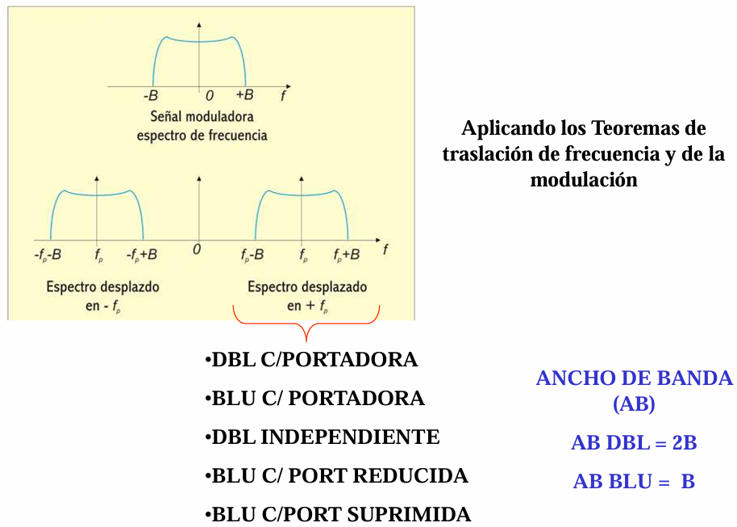

Figura C5 image-3 / M1 p.8. Frecuencias negativas son la representación matemática de una señal real, no otra banda física que sumemos de nuevo.

### Variantes registradas

- **DBL con portadora:** dos bandas y portadora presente; recuperación por envolvente bajo condiciones adecuadas.
- **BLU con portadora, reducida o suprimida:** conserva una banda; reducir/suprimir portadora ahorra potencia, no vuelve a reducir la banda informativa. La suprimida exige una referencia apropiada para recuperar.
- **DBL independiente:** las bandas pueden llevar mensajes independientes; no son entonces copias redundantes de uno solo.

**Errores típicos:** portadora ≠ ancho de banda; BLU no transmite «media información» de un mensaje real: elimina una copia espectral redundante. Ruido de amplitud afecta el parámetro que lleva información.

> **Para examen:** AM lleva el mensaje en amplitud. DBL requiere dos veces la banda de base y BLU conserva una sola; la recuperación depende también de cómo se transmite la portadora.

## 3) FM y PM: frecuencia no es fase

**Fuentes:** M1 pp.5–6,12; P p.10; R p.3 E6/E8. **Procedencia:** C5 «FM»; CP «AM–FM».

### Problema → concepto → modelo mental

Si el mensaje se coloca en amplitud, las fluctuaciones de amplitud lo contaminan directamente. Las modulaciones angulares mantienen idealmente amplitud constante y cambian el ángulo: **FM** varía frecuencia instantánea; **PM** varía fase según la moduladora. La frecuencia expresa qué tan rápido cambia el ángulo, pero no es la fase.

**Ejemplo conceptual de la distinción:** mensaje constante en FM puede mantener una frecuencia desplazada; en PM produce un desplazamiento fijo de fase, no necesariamente otra frecuencia. Es una aclaración propia de las definiciones, no un ejercicio PM de cátedra.

**Alcance PM:** M1 pp.5–6 y C5 la registran como modificación de fase, pero el corpus asignado no desarrolla una ecuación PM ni parámetros para un ejemplo calculado. Acá se exige sólo reconocerla y distinguirla de FM. El modelo, índice, banda y cálculos que siguen son **de FM**, no de PM; no se atribuye a esta sección cobertura cuantitativa de PM ni se la evalúa como confirmada.

### Formalización y supuestos

Para un tono sinusoidal, M1 p.12 utiliza:

$$s(t)=A_p\sin(2\pi f_p t+\beta\sin(2\pi f_a t)+\theta_p),\quad \beta=\frac{\Delta f}{f_a},\quad B_{FM}\approx2(\Delta f+f_a).$$

| Símbolo | Significado | Unidad |
|---|---|---|
| $s(t),A_p$ | Tensión y amplitud constante | V |
| $t$ | Tiempo | s |
| $f_p,f_a$ | Portadora y tono modulador | Hz |
| $\Delta f$ | Desviación máxima respecto de portadora | Hz |
| $\beta,\theta_p$ | Índice FM y fase inicial | adimensional; rad |
| $B_{FM}$ | Banda aproximada | Hz |

**Límites:** tono sinusoidal y desviación conocida; regla de Carson estima banda significativa, no soporte espectral exactamente finito. Para mensaje compuesto se usa su frecuencia máxima significativa. En banda angosta, desviación mucho menor que el tono, M1 aproxima la banda a dos veces la frecuencia moduladora.

**Ejemplos:** tono 10 k Hz, desviación 1 MHz, portadora 100 MHz → índice 100 y banda 2,02 MHz, no 100 MHz de banda. Ejemplo hipotético angosto: tono 1 k Hz y desviación 10 Hz → índice 0,01; banda dominante ≈2 k Hz (Carson: 2,02 k Hz).

**Caso y ruido:** R p.3 compara FM con AM: limitar fluctuaciones de amplitud antes de demodular no elimina el mensaje FM. No significa inmunidad al ruido que perturba fase/frecuencia ni «mejor modulación» para cualquier potencia/canal/receptor.

**Discrepancia pendiente:** M1 p.12 expresa desviación angular incluyendo frecuencia moduladora y luego índice proporcional a amplitud; P p.10 omite ese factor pero conserva el índice. No se igualan constantes de sensibilidad ambiguas. Se usa índice = desviación/frecuencia con datos explícitos; no se deduce que el índice nunca dependa del tono modulador.

**Errores típicos:** confundir desviación con portadora, índice FM con índice AM o FM con PM.

> **Para examen:** FM lleva el mensaje en frecuencia instantánea; para PM el objetivo respaldado es sólo definición/clasificación: modifica fase, no es sinónimo de FM. Amplitud ideal constante permite limitar fluctuaciones de amplitud; **en FM** hay que distinguir portadora, desviación, índice y banda. No se pide deducir ni calcular un modelo PM ausente del corpus.

## 4) ASK y FSK: estados discretos sobre portadora continua

**Fuentes:** M1 pp.9–14; P pp.6–7. **Procedencia:** C5 ASK/FSK; CP clasificación.

- **ASK (Amplitude Shift Keying):** selecciona amplitudes. Ejemplo hipotético: 0 → 1 V, 1 → 2 V, misma frecuencia 10 k Hz. En **OOK**, variante por supresión, 0 → ausencia y 1 → portadora. Ruido de amplitud puede confundir niveles.
- **FSK (Frequency Shift Keying):** selecciona frecuencias. Ejemplo hipotético: 0 → 10 k Hz, 1 → 12 k Hz, amplitud 1 V. El receptor distingue densidad de ciclos, no alturas.

**Modelo mental:** ASK elige altura; FSK elige ciclos por segundo. Son señales pasabanda analógicas aunque la selección tenga estados discretos. Dos frecuencias representan un bit por símbolo, no dos.

**Banda:** M1 p.11 dibuja portadora y bandas laterales para una moduladora periódica; no define banda universal de flujos binarios. Velocidad, forma de pulso, separación de frecuencias y filtrado importan. No aplicar indiscriminadamente la FM de tono sinusoidal a toda FSK.

**Pendiente no evaluable:** M1 p.14 clasifica FSK angosta/ancha usando índice menor/mayor que $\pi/2$ y una expresión sinusoidal, sin definir suficientemente ese índice para el flujo digital. Requiere aclaración docente; no se publica como criterio universal.

**Errores típicos:** OOK no es otra familia distinta de ASK; «digital» en el nombre de modulación describe la información, no una portadora cuadrada obligatoria.

> **Para examen:** ASK asigna amplitudes y FSK frecuencias discretas a símbolos digitales; la portadora continua y la forma de onda pasabanda siguen siendo analógicas.

## 5) PSK, Gray y QAM: velocidad y separación ante ruido

**Fuentes:** M1 pp.15–27; P pp.11–14; V p.1. **Procedencia:** C5 PSK–TCM; CP Gray–8-PSK; CQ Q2.

### Problema → concepto → modelo mental

Para enviar más bits sin aumentar símbolos por segundo, se necesitan más estados distinguibles. **PSK (Phase Shift Keying)** selecciona fases; M-PSK coloca M estados en una circunferencia de amplitud constante. **QAM (Quadrature Amplitude Modulation)** combina componentes I y Q sobre portadoras en cuadratura (90°), formando puntos de amplitudes y fases distintas.

Una **constelación** representa estados permitidos. El ruido dispersa los puntos recibidos alrededor del estado transmitido; cruzar la región del vecino produce error de símbolo.

### Formalización y ejemplo

$$b=\log_2M,\qquad V_t=V_m b,\qquad \Delta\theta=360^\circ/M.$$

| Símbolo | Significado | Unidad |
|---|---|---|
| $M$ | Estados | adimensional |
| $b$ | Bits representados por símbolo | bit/símbolo |
| $V_m$ | Símbolos por segundo | baudios |
| $V_t$ | Tasa binaria bruta representada | bit/s |
| $\Delta\theta$ | Separación de vecinos M-PSK regular | grados |

**Supuestos:** M potencia de 2, mapeo fijo sin redundancia. La tasa útil puede disminuir por codificación/control. La fórmula angular no corresponde a QAM.

**Ejemplo CQ:** a 4800 baudios, 8-PSK: 3 bits/símbolo, 14 400 bit/s, 45°; 16-PSK: 4 bits/símbolo, 19 200 bit/s, 22,5°. Más bits pero vecinos más cercanos. Repetir un símbolo puede no cambiar la fase: «estado» no es «salto efectivamente realizado».

### Gray por reflexión

Etiquetas de vecinos difieren en un bit. Construcción: `0,1`; copiar y reflejar, prefijar 0 a primera mitad y 1 a reflejada → `00,01,11,10`; repetir → `000,001,011,010,110,111,101,100`. Comprobar también cierre último → primero. La cuenta binaria natural falla en 011 → 100, con tres bits cambiados.

| Fase | M1 p.19 / C5, tabla y diagrama | P p.14 / CP, tabla y diagrama; convención adoptada en TP/repaso |
|---:|:---:|:---:|
| 0° | 011 | 000 |
| 45° | 010 | 001 |
| 90° | 000 | 011 |
| 135° | 001 | 010 |
| 180° | 101 | 110 |
| 225° | 100 | 111 |
| 270° | 110 | 101 |
| 315° | 111 | 100 |

**Gray no cambia distancias ni evita error de símbolo:** reduce bits dañados cuando la decisión cae en un vecino. No corrige errores.

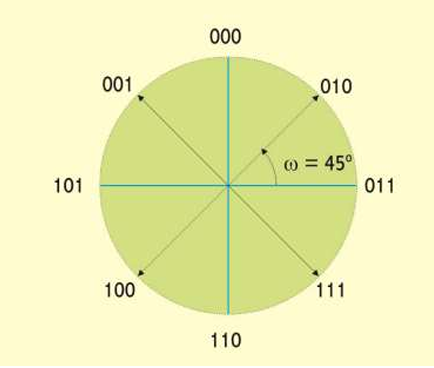

Figura C5 image-14/M1 p.19: **su diagrama y su tabla coinciden en los ocho pares fase/bits**. P p.14 y CP (tabla y image-38) también coinciden internamente, pero usan la segunda convención del cuadro: ésa es la adoptada en TP/repaso. No hay contradicción dentro de M1/C5: la diferencia es **entre fuentes**. En este caso, cada etiqueta de M1/C5 se obtiene invirtiendo los dos bits finales de P/CP (XOR con `011`); ambas asignaciones son Gray circular y válidas. No mezcles etiquetas de una convención con fases de la otra; emisor y receptor deben acordar la misma.

### QAM: contar puntos, no multiplicar radios por ángulos

Ejemplo didáctico 16-QAM rectangular: cada eje I/Q admite−3,−1,1,3 unidades normalizadas → 16 pares, 4 bits/símbolo. M1 p.20 muestra variante circular y rectangular: M no impone geometría única. Tres radios y doce ángulos diferentes no significan 36 estados: no todos los pares están permitidos.

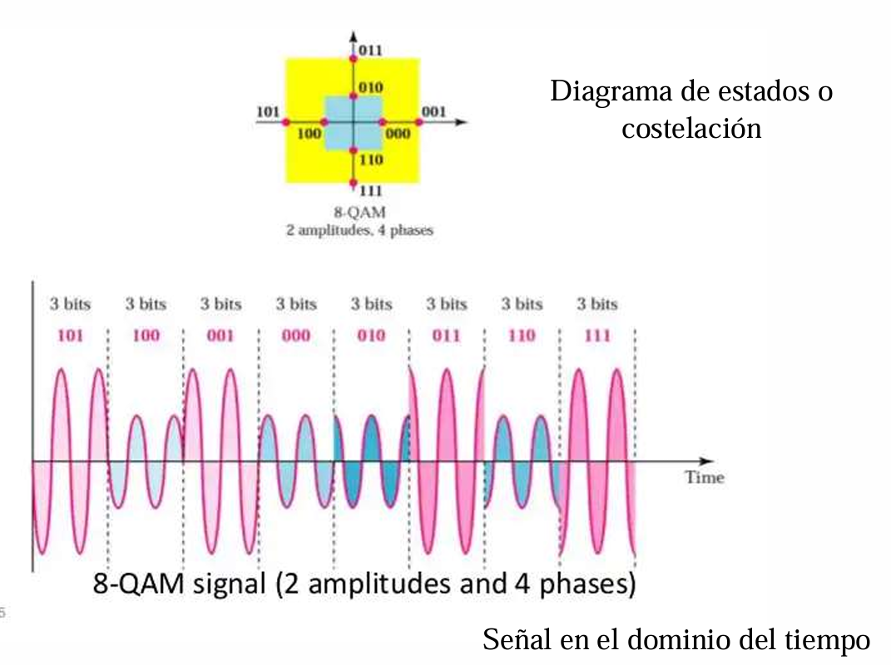

Figura C5 image-16/M1 p.21: 8 puntos, 2 amplitudes y 4 fases, 3 bits/símbolo. La forma temporal cambia amplitud/fase según el punto elegido.

### Ruido y eficiencia espectral

A mismo orden, energía media y canal comparable, 16-QAM rectangular separa mejor los vecinos que 16-PSK; las curvas M1 p.24 respaldan menor error. Aumentar M en una familia aprieta puntos a potencia fija. «QAM siempre mejor» omite orden, canal, energía y detector.

$$\eta=V_t/B.$$

| Símbolo | Significado | Unidad |
|---|---|---|
| $\eta$ | Eficiencia espectral | bit/s/Hz |
| $V_t$ | Tasa definida para la comparación | bit/s |
| $B$ | Banda con el mismo criterio de medida | Hz |

**Supuesto:** filtrado/criterio compatibles, aclarar tasa útil o bruta. **Ejemplo hipotético:**9600 bit/s en 4000 Hz → 2,4 bit/s/Hz; 4800 en igual banda → 1,2. No significa duplicar baudios necesariamente.

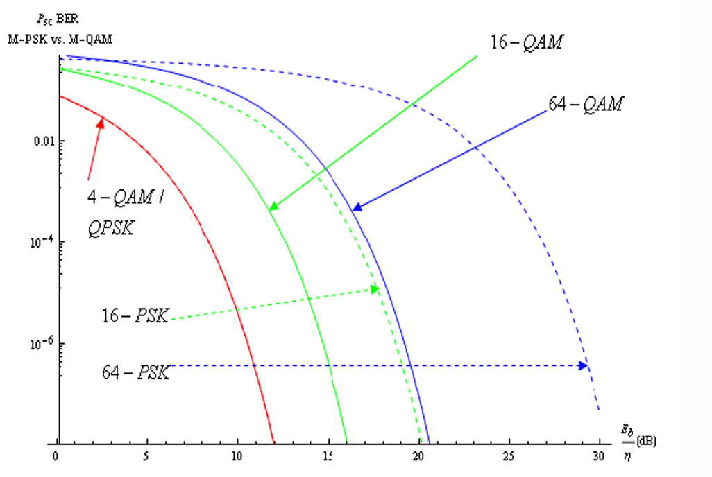

Vertical: probabilidad de error logarítmica; horizontal: energía por bit respecto de densidad de ruido en d B. A igual horizontal, menor vertical es mejor; a igual objetivo de error, más a la izquierda requiere menos energía relativa. **$E_b/N_0$ no es directamente S/N del canal:** la tasa binaria y banda de ruido afectan la relación.

V p.1 informa para 2/4/8/16-PSK y 16-QAM: 1/2/3/4/4 bits y 0,7/1,4/2,1/2,8/2,8 bit/s/Hz. Su fila «S/N» contiene 13/16/22/30/28 dB; son valores de esa comparación, no umbrales universales. La condición BER se imprime literalmente **`16-6 (VER 1)`**, con caracteres en línea base, no un exponente confirmado. Es notación dudosa y no especifica detector/filtrado: **no se usa para ejercicios numéricos de BER** ni se corrige silenciosamente a una potencia. La tendencia sí coincide con M1 p.24.

### Variantes registradas

| Variante | Problema atendido | Ejemplo/límite |
|---|---|---|
| BPSK/QPSK | Dos/cuatro fases | 0°–180°: 1 bit; cuatro estados a 90°: 2 bits |
| OQPSK, offset | Evitar transición simultánea I/Q y saltos de 180° | Escalona ramas, reduce excursiones de envolvente; no añade bits |
| DPSK/DBPSK | Recuperar sin fase absoluta | Convención hipotética 0 conserva, 1 invierte: 0° → 180° → 180° indica 1,0; referencia es el estado previo, no el valor aislado del último bit |
| TCM, modulación codificada en trellis | Proteger con diseño conjunto código/constelación | Ejemplo hipotético: 7 bits de etiqueta para 128 estados, 1 redundante → 6 útiles/símbolo; no deducir tasa de código sólo de una imagen |

**Corrección C5:**128-QAM sin codificación representa **7 bits**, no 8, porque 2⁷=128; con TCM no todos son útiles. «Codificación entrelazada» es el término docente para TCM; no equivale automáticamente a un interleaver temporal.

**Errores típicos:** baudios=bit/s; Gray corrige; M-QAM tiene M amplitudes por M fases; subir M siempre mejora. Todos omiten qué se representa y a qué costo frente al ruido.

> **Para examen:** PSK/QAM asignan grupos de bits a estados. Más estados dan más bits por símbolo pero exigen distinguir vecinos próximos; Gray limita bits errados por confusión de vecinos y TCM añade protección codificada.

## 6) Pulsos analógicos: muestrear no es cuantificar

**Fuentes:** M2 pp.2–3; P pp.5–7. **Procedencia:** C5 segunda parte; CP pulsos.

### Problema → concepto → modelo mental

Podemos representar periódicamente valores de una señal mediante pulsos. Variar una característica continua de esos pulsos produce **modulación de pulsos analógica**: altura, duración o posición indican lo medido, sin redondearlo todavía a niveles discretos.

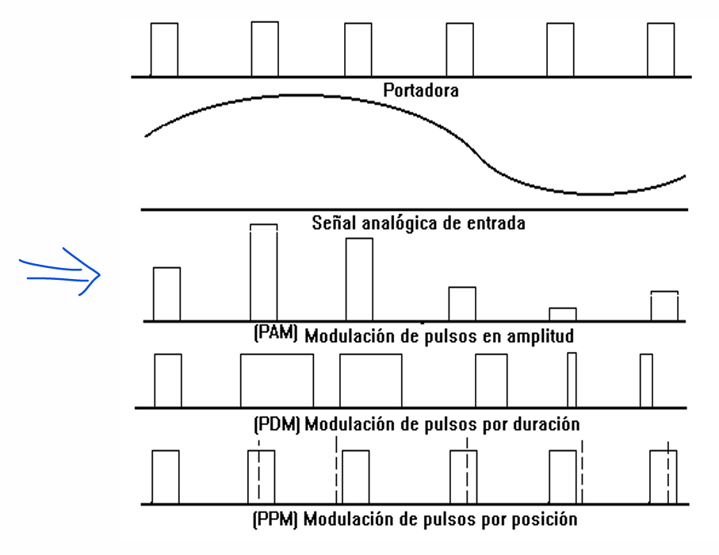

| Método | Variable | Ejemplo hipotético |
|---|---|---|
| PAM, amplitud | Altura | Muestra 0,7 V → pulso 0,7 V, ancho fijo |
| PDM/PWM, duración | Ancho | Valores distintos → pulsos 1 μs y 2 μs, amplitud fija |
| PPM, posición | Desplazamiento temporal | Valores distintos → retrasos 1 μs y 2 μs, ancho fijo |

En las tres, el parámetro informativo admite valores continuos. PPM requiere referencia temporal; PDM no transmite «más bits» por tener pulsos más anchos. La distinción importa antes de PCM.

**Formalización:** misma relación frecuencia/período de §1. **Ejemplo calculado propio:**10 000 pulsos/s → intervalo 100 μs; ancho 2 μs ocupa sólo parte de él. No son parámetros normativos.

**Ventajas y límites:** representar por muestras facilita procesamiento y compartir tiempos; tras cuantificar/codificar, facilita regeneración digital y TDM. PAM sola sigue sensible al ruido de amplitud; el muestreo exige banda/sincronismo adecuados. Pulsos breves no significan banda estrecha.

**Errores típicos:**«hay pulsos, entonces es digital» y «muestrear elimina ruido» son falsos: puede haber amplitudes continuas y perturbaciones.

> **Para examen:** PAM cambia amplitud, PDM duración y PPM posición de pulsos. Muestrear discretiza tiempo; cuantificar amplitud y codificar son operaciones posteriores distintas.

## 7) Digitalización y PCM: tiempo, niveles y bits

**Fuentes:** M2 pp.3–10; R p.1 E1; X pp.15–16. **Procedencia:** C5 final; C6 cuantificación–PCM; CP E1; CQ Q3–4.

### Problema → concepto → modelo mental

La voz varía continuamente; un circuito digital maneja un repertorio finito. **PCM (Pulse Code Modulation), MIC en español**, toma muestras, aproxima sus amplitudes a niveles y codifica cada nivel como palabra binaria. Elegir muestras por segundo y bits por muestra son decisiones diferentes.

**Ejemplo hipotético, paso a paso.** Usemos un cuantificador uniforme de 0 a 4 V, con cuatro intervalos de 1 V y niveles representativos de 0,5; 1,5; 2,5 y 3,5 V.

1. **Muestrear:** en uno de los instantes del reloj, la señal filtrada vale **1,3 V**. Elegimos cuándo medir; todavía no redondeamos la amplitud.
2. **Cuantificar:** 1,3 V cae en el intervalo de 1 a 2 V, al que le asignamos **1,5 V**. Acá se pierde la amplitud exacta de la muestra: el código sólo permite recuperar el valor representativo.
3. **Codificar:** si numeramos los cuatro niveles desde cero, 1,5 V tiene índice 1. Su etiqueta binaria de dos bits es **`01`**. La salida del codificador es esa palabra, no la amplitud de la muestra.

### Formalización y ejemplo de tasa

Ya vimos qué bits salen de **una** muestra. Para saber cuántos salen **por segundo**, contamos cuántas muestras se toman y cuántos bits lleva cada una.

$$f_s=1/T_s,\qquad f_s\ge2f_{max},\qquad b=\log_2L,\qquad V_{PCM}=f_s b.$$

| Símbolo | Significado | Unidad |
|---|---|---|
| $f_s$ | Muestreo | muestras/s (Hz) |
| $T_s$ | Intervalo entre muestras | s |
| $f_{max}$ | Máxima frecuencia después del filtro | Hz |
| $L$ | Niveles | adimensional |
| $b$ | Longitud de palabra | bit/muestra |
| $V_{PCM}$ | Tasa PCM sin overhead | bit/s |

**Supuestos:** señal limitada en banda, reconstrucción ideal, palabras fijas, L potencia de 2. La igualdad es un límite ideal: un tono exactamente en la frecuencia de Nyquist puede perderse con fase desfavorable. Se deja margen práctico y se filtra contra **aliasing**, cuando frecuencias distintas se vuelven indistinguibles después de muestrear. Éste es el teorema de muestreo, no la fórmula de capacidad Nyquist de U3/U6.

**Ejemplo TP4 (otro cuantificador):** 125 μs entre muestras → 8000 muestras/s. Con 128 niveles, cada muestra ocupa 7 bits → **56 kbit/s**; con 256 niveles, ocupa 8 bits → **64 kbit/s**. El filtro 4000 Hz se interpreta pasa-bajos hasta esa frecuencia: límite ideal; la tasa se obtiene primero del período dado. Más niveles mejoran resolución y aumentan bits, no muestras por segundo.

### Error de cuantificación

Varios valores dentro de una celda se reemplazan por un representante. La diferencia ya no puede recuperarse sólo del código transmitido.

$$e_q=S-C,\qquad \Delta=\frac{x_{max}-x_{min}}{L},\qquad |e_q|\le\Delta/2.$$

| Símbolo | Significado | Unidad |
|---|---|---|
| $S,C,e_q$ | Muestra, valor cuantificado y diferencia | V |
| $x_{max},x_{min}$ | Límites del rango de entrada | V |
| $L$ | Celdas uniformes | adimensional |
| $\Delta$ | Ancho de celda | V |

**Supuestos:** cuantificador uniforme, representantes centrales, redondeo y sin sobrecarga fuera de rango. El límite no vale para saturación/truncamiento. M2 p.4 llama al error «granular o de cuantificación»; se conserva su vocabulario y se distingue el caso Delta de §8.

**Volvé a la muestra del ejemplo:** 1,3 V − 1,5 V = **−0,2 V**. El signo indica que el valor representativo quedó por encima de la muestra. La magnitud del error, 0,2 V, no supera la mitad del paso (0,5 V).

### TIPOS DE CUANTIFICACIÓN: Uniforme, no uniforme y compansión

Uniforme significa pasos iguales en entrada. A señales pequeñas, un error fijo resulta grande relativamente: 0,02 V es 20% de 0,1 V y 2% de 1 V (ejemplo propio). La cuantificación **no uniforme** reserva pasos finos cerca de cero y mayores hacia extremos.

Una implementación conceptual comprime amplitudes grandes, cuantifica uniformemente en escala comprimida y expande al recuperar: **compansión = compresión + expansión**. No es compresión sin pérdida de archivos.

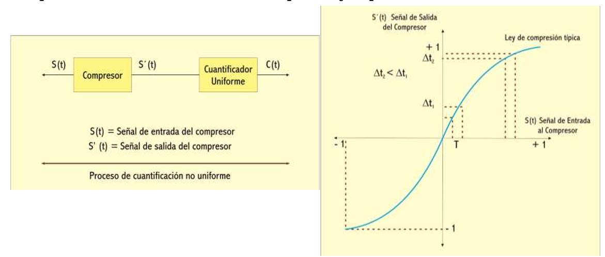

### Leyes A y μ

M2 pp.6–7 muestra curvas logarítmicas aproximadas por segmentos: **A, 13 segmentos** en representación europea; **μ, 15 segmentos** en americana. Los segmentos centrales colineales pueden contarse agrupados: 13 segmentos no son 13 niveles ni 13 bits.

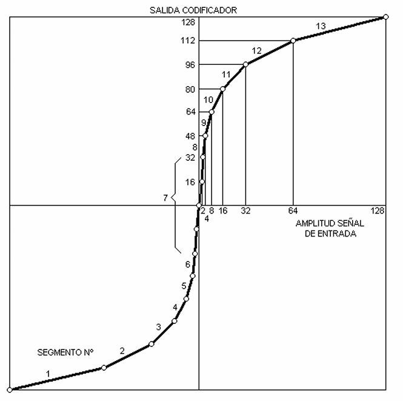

El eje positivo hasta 128 no determina la longitud total de la palabra con signo. **Discrepancia:** M2 p.10/C6 relacionan ley μ con 128 niveles/7 bits, pero X p.16 usa octetos T1. Los formatos **PCMA y PCMU G.711** usan **8 bits por muestra**, según [RFC3551 §4.5.14](https://datatracker.ietf.org/doc/html/rfc3551#section-4.5.14); a 8 k Hz son 64 kbit/s. No identificar el ejercicio hipotético 128 niveles con μ-law normativo. La simplificación docente queda registrada por aclarar.

**Caso del corpus:** una voz PCM a 8000 muestras/s y 8 bits/muestra genera 64 kbit/s. [TDM](#tdm) intercala esas palabras ya codificadas con las de otras voces en una trama E1/T1: no vuelve a medir ni a redondear la voz. Señalización robada T1 es una operación de transporte distinta de compansión.

**Errores típicos:** cuantificar antes de muestrear en esta cadena; igualar 8 k Hz y 64 kbit/s; pensar que más muestreo elimina error de amplitud; atribuir cuantificación al MUX TDM.

> **Para examen:** PCM muestrea, cuantifica y codifica. Su tasa es muestras por segundo por bits por muestra; muestreo controla aliasing y cuantificación introduce error de amplitud, distribuible mediante leyes no uniformes.

## 8) MODULACIÓN POR PULSOS DIGITAL: Delta, ADM y DPCM: enviar diferencias

**Fuentes:** M2 pp.11–13. **Procedencia:** C6 DM/ADM/DPCM.

### Problema → concepto → modelo mental

Muestras cercanas pueden diferir poco: mandar siempre su valor absoluto desaprovecha esa relación. **DM (Delta Modulation)** indica si una aproximación escalonada debe subir o bajar un paso fijo. Comparador: entrada menos aproximación; signo → bit; integrador → actualización de escalera.

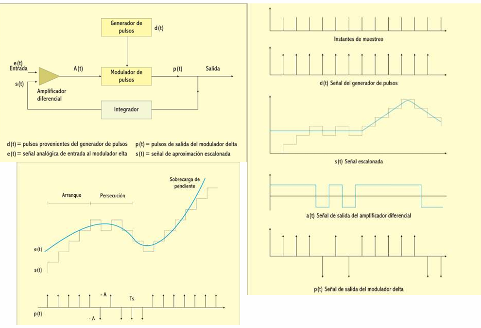

La figura distingue arranque, persecución y sobrecarga. Si la entrada sube demasiado rápido, muchos bits «subir» no alcanzan a seguirla.

### Formalización y ejemplo

Modelo discreto propio reconstruido de M2 p.11:

$$s_k=s_{k-1}+\Delta\operatorname{sgn}(e_k-s_{k-1}),\qquad V_{DM}=f_s\cdot1\ \text{bit/muestra}.$$

| Símbolo | Significado | Unidad |
|---|---|---|
| $s_k,s_{k-1}$ | Aproximación actual/anterior | V |
| $e_k$ | Muestra de entrada | V |
| $\Delta$ | Paso de reconstrucción | V |
| $k,\operatorname{sgn}$ | Índice y decisión+1/−1 | adimensional |
| $f_s,V_{DM}$ | Muestreo y tasa Delta | muestras/s; bit/s |

**Supuestos:** paso fijo, un bit/muestra; convenio subir 1/bajar 0; empate con convenio común. No supone misma frecuencia de muestreo que PCM con igual calidad.

**Ejemplo hipotético:** inicial 0 V, paso 0,1 V, muestras 0,15; 0,25; 0,18 V → `110`, reconstrucción 0,1; 0,2; 0,1 V. A32 000 muestras/s → 32 kbit/s. Intervalo 31,25 μs: avanzar 0,1 V por muestra equivale a 3200 V/s; una entrada que sube 0,2 V por intervalo exige 6400 V/s y no puede seguirse.

- **Sobrecarga de pendiente:** señal más rápida que la escalera; paso mayor o muestras más frecuentes ayudan.
- **Ruido granular DM:** la escalera oscila alrededor de una señal casi constante; un paso grande lo empeora. Resolver sobrecarga aumentando paso puede agravar este otro error.

**ADM (Adaptive Delta Modulation)** adapta el tamaño del paso. Ejemplo propio: varios «subir» consecutivos → paso 0,2 V en vez de 0,1 V; en tramo casi constante → reducirlo. M2 p.12 muestra alturas variables, no prescribe algoritmo numérico específico.

**DPCM (Differential PCM)** cuantifica/codifica una diferencia respecto de aproximación o predicción; admite más valores que subir/bajar. Ejemplo propio: predicción 1 V, muestra 1,3 V → diferencia+0,3 V; si el repertorio de 3 bits incluye ese valor, se manda su código y se reconstruye 1,3 V. Si no, habrá error de cuantificación de la diferencia.

**Errores típicos:** DM transmite valor absoluto; ADM necesariamente cambia el muestreo; DPCM siempre usa un bit. Todos son falsos. Tampoco confundir error de aproximación con ruido del canal.

> **Para examen:** Delta manda signo y reconstruye una escalera, con compromiso entre seguimiento y granularidad. ADM adapta el paso; DPCM codifica una diferencia cuantificada con más de dos posibles valores.

## 9) Multiplexación: recurso compartido y presupuesto

**Fuentes:** X pp.2–5; P pp.15–16. **Procedencia:** C62 inicio/voz-datos; CP multiplexación.

### Problema → concepto → modelo mental

Un vínculo puede transportar más que una comunicación requiere. El **MUX** reúne subcanales y el **DEMUX** los separa: compartir reduce enlaces físicos independientes. «Simultáneo» en el servicio no implica mismos instantes para cada bit: TDM alterna turnos rápidos recurrentes.

`Voz + datos → MUX → agregado → DEMUX → voz + datos`

Los equipos actúan como ETCD del circuito. **Qo S**, calidad de servicio: transparencia es el objetivo de mantener el servicio acordado al compartir, no garantía automática por usar un MUX.

### Formalización y ejemplo

$$V_{salida}\ge\sum_iV_i+V_{control}.$$

| Símbolo | Significado | Unidad |
|---|---|---|
| $V_{salida}$ | Tasa requerida del agregado | bit/s |
| $V_i$ | Tasa sostenida del tributario i | bit/s |
| $V_{control}$ | Organización/identificación/auxiliares | bit/s |

**Supuesto:** todas las entradas simultáneas a tasa sostenida, sin compresión/descarte. STDM admite picos mayores mediante colas, no sobrecarga indefinida sin demora/pérdida. **Ejemplo hipotético:**3 entradas 64 kbit/s y control 8 kbit/s → 200 kbit/s; carga útil 192 kbit/s. Hz, longitudes de onda y bit/s no se suman como magnitudes equivalentes.

**Discrepancias X p.3:** «C=AB, Vtx, long onda» describe recursos relacionados, no igualdad dimensional. «Operan en enlace» es la clasificación docente, no ley universal: FDM/WDM son mecanismos físicos y TDM también organiza transporte físico; no todo MUX pertenece a capa 2.

**Errores típicos:** MUX crea capacidad; sumar sólo datos; multiplexación=conmutación. Compartir requiere recursos y auxiliares; conmutar elige destino/ruta.

> **Para examen:** multiplexar comparte un vínculo mediante un recurso distinguible; el receptor revierte la organización. La capacidad debe alcanzar para carga y control con la calidad requerida.

## 10) FDM y OFDM: bandas separadas o subportadoras ortogonales

**Fuentes:** X pp.6–13; P p.17. **Procedencia:** C62 FDM/OFDM; CP FDM.

### FDM: problema, concepto y modelo

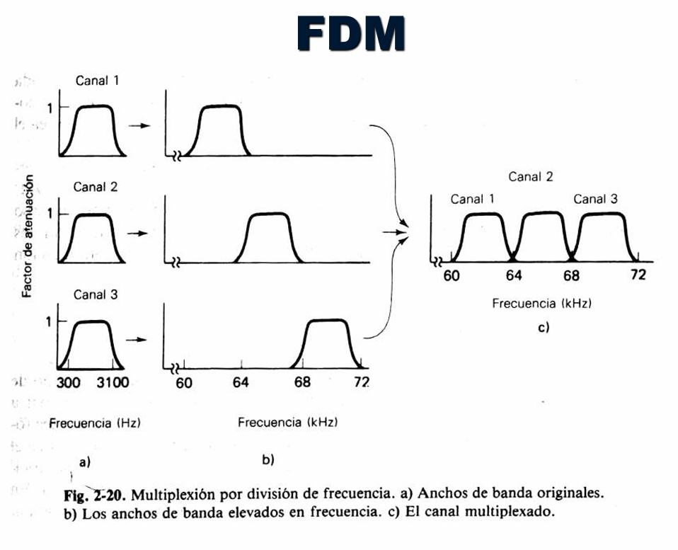

**FDM (Frequency Division Multiplexing)** desplaza señales a bandas diferentes simultáneas. Filtros reales no cortan abruptamente: se dejan **guardas**. El MUX puede incluir moduladores/módems y filtros; entradas digitales pueden transportarse como subcanales pasabanda.

`canal1 | guarda | canal2 | guarda | canal3`

$$B_{total}\ge\sum_iB_i+\sum_jG_j.$$

| Símbolo | Significado | Unidad |
|---|---|---|
| $B_{total},B_i$ | Banda disponible y banda de subcanal | Hz |
| $G_j$ | Guarda entre bandas | Hz |

**Supuesto:** bandas no superpuestas y guardas sólo donde se especifican. **Ejemplo hipotético:**3 señales de 4 k Hz y 2 guardas de 0,5 k Hz → 13 k Hz. No entran en 12 k Hz con esas guardas. Aumentar usuarios en vínculo fijo obliga a reducir recursos individuales o cambiar diseño, no por una ley sin condiciones.

**Jerarquía analógica X p.10:** primario 12 canales/48 k Hz(60–108 k Hz); secundario 60/240 k Hz; terciario 300/1200 k Hz; cuaternario 900/3716 k Hz; quinario 2700/12026 k Hz. Son grupos del sistema mostrado. Pregrupo sólo nombrado en p.6. Ejemplo: 12×4 k Hz=48 k Hz de separación nominal; en órdenes altos hay organización/guardas adicionales: 900×4=3600 k Hz, menor que 3716 k Hz.

### OFDM: problema, concepto y modelo

Guardas entre todos los canales consumen espectro. **OFDM (Orthogonal FDM)** divide un flujo rápido en flujos lentos modulados sobre subportadoras ortogonales. Sus espectros se superponen; el receptor los separa en una ventana sincronizada. Ortogonal no significa espectros que nunca se tocan.

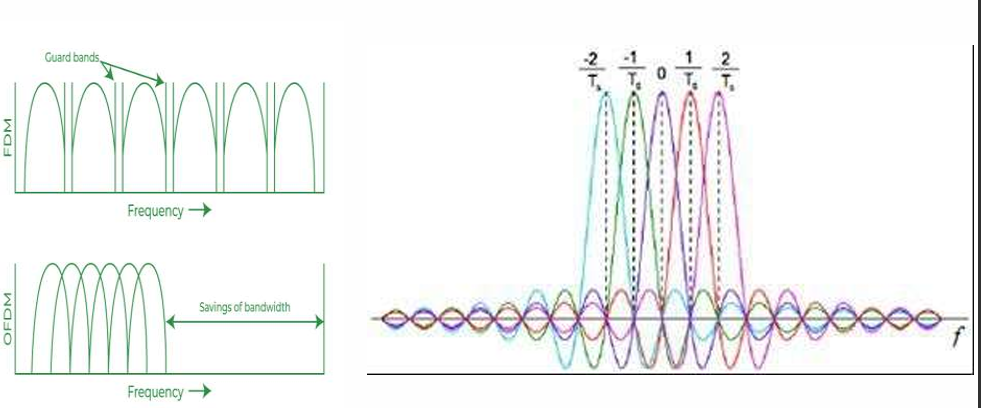

$$\Delta f=1/T_u.$$

| Símbolo | Significado | Unidad |
|---|---|---|
| $\Delta f$ | Separación de subportadoras | Hz |
| $T_u$ | Duración útil del símbolo OFDM | s |

**Supuesto:** grilla común, ventana ideal y sincronismo; figura X p.11 marca centros a 1/T. **Ejemplo hipotético:**duración útil 1 ms → 1 k Hz de separación; centros 0,1,2 k Hz respecto de referencia. En cada centro las otras funciones espectrales ideales tienen ceros. Desajustes destruyen ortogonalidad y causan interferencia entre subportadoras.

**Cadena:** serie → paralelo → mapper PSK/QAM → **IFFT**, transformada rápida inversa de Fourier → canal; receptor → **FFT** → demapper → paralelo/serie. IFFT compone subportadoras; no es codificación binaria ni elimina ruido. Ejemplo propio: 8000 bit/s repartidos en 4 flujos → 2000 bit/s cada uno, mismo total antes de overhead.

X pp.11–13 cita resistencia a multitrayecto y LTE/5G, TV digital y Wi-Fi. Es una ventaja de diseño, no inmunidad: sincronización y gestión del retardo importan. No se desarrollan estándares ni implementaciones nuevas.

**Errores típicos:** OFDM no usa modulación (usa PSK/QAM); superposición siempre implica interferencia (no bajo ortogonalidad); FDM es simplex por definición (la división espectral no fija dirección).

> **Para examen:** FDM separa bandas con guardas; OFDM admite superposición espectral bajo ortogonalidad y sincronismo. IFFT/FFT implementan eficientemente composición y separación.

## 11) TDM y PCM: turnos, tramas, E1 y T1

**Fuentes:** X pp.14–18; P p.18. **Procedencia:** C62 TDM/PCM30/24; CP TDM y notas de grupo primario.

### Problema → concepto → modelo mental

El agregado rápido puede alternar porciones de fuentes lentas. **TDM (Time Division Multiplexing)** asigna ranuras; en TDM síncrono, posición y orden se repiten incluso con una entrada vacía. El receptor necesita sincronismo de bits y de trama para separar destinatarios.

**Entramado por bits:** uno de cada entrada por turno. **Por caracteres/octetos:** palabra completa por entrada. Ejemplo propio A=`101`, B=`011`: bits → `10|01|11`; palabras de 3 bits → `101|011`. Para voz: primero PCM, después reunir octetos. Si el medio exige pasabanda se modula; TDM no impone forma física final universal.

### Formalización y ejemplo

$$V_{linea}=N_bf_{trama},\qquad T_{trama}=1/f_{trama}.$$

| Símbolo | Significado | Unidad |
|---|---|---|
| $V_{linea}$ | Tasa bruta del agregado | bit/s |
| $N_b$ | Bits completos por trama | bit/trama |
| $f_{trama}$ | Frecuencia de trama | trama/s |
| $T_{trama}$ | Período de trama | s |

**Supuesto:** estructura y duración fijas con todos los auxiliares. **Ejemplo:**8000 tramas/s → 125 μs; 256 bits/trama → 2 048 000 bit/s. No multiplicar otra vez por 30 si ya contamos toda la trama.

### E1/PCM30

X p.16 cita G.732: 32 ranuras de 8 bits → 256 bits/trama.

| Ranuras | Función del esquema PCM30 |
|---|---|
| TS0 | Alineación/control de trama |
| TS1–15 | 15 canales de información |
| TS16 | Señalización |
| TS17–31 | Otros 15 canales de información |

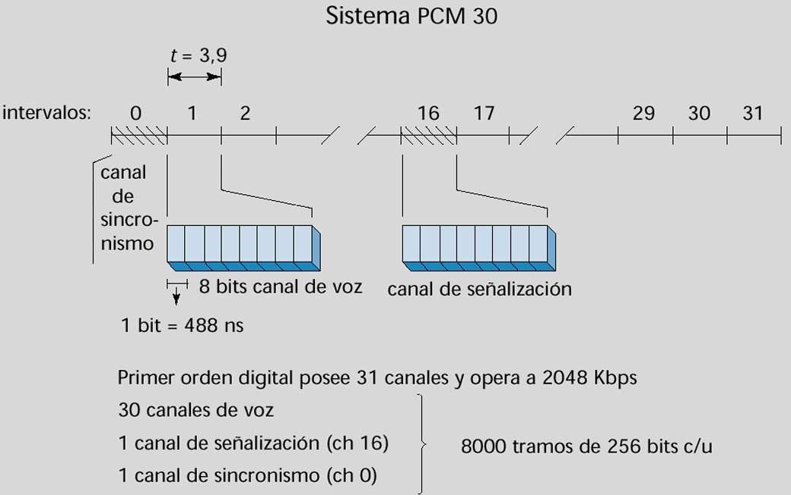

**Cuentas:**32×8×8000=2,048 Mbit/s de línea; voz 30×8×8000=1,920 Mbit/s; auxiliares 2×8×8000=0,128 Mbit/s. Ranura 125/32=3,90625 μs; bit 125/256=0,48828125 μs≈488 ns. Se comprueba 1,920+0,128=2,048 Mbit/s.

Otras configuraciones de señalización no autorizan afirmar que todo E1 tiene siempre 30 canales útiles. La frase de figura «31 canales» cuenta 30 voz+1 señalización, sin TS0; NO31 canales B más D. [U3 RDSI](../03-redes-telecomunicaciones/APUNTE.md#rdsi) conserva su discrepancia; acá se demuestra el conteo físico del esquema PCM30.

### T1/PCM24

X pp.16,18 cita G.733: 24 octetos y 1 bit de trama → 193 bits/trama.193×8000=1,544 Mbit/s. Campo de canales 192×8000=1,536 Mbit/s; bit de alineación 8000 bit/s. **El campo no equivale necesariamente a carga útil libre:** algunos bits pueden señalizar.

La figura simplifica «7 información+1 señalización». En CAS con señalización robada, el bit menos significativo se usa **en ciertas tramas**, no en toda muestra: [Cisco T1 CAS](https://www.cisco.com/c/en/us/support/docs/voice/digital-cas/22444-t1-cas-ios.html) explica la extracción cada sexta trama. Eso no prueba queμ-law G.711 sea siempre 7 bits.

| Magnitud | E1 registrado | T1 registrado |
|---|---:|---:|
| Período / tramas por segundo |125 μs/8000 |125 μs/8000 |
| Tamaño total |256 bits |193 bits |
| Canales de voz |30 |24 |
| Tasa de línea |2,048 Mbit/s |1,544 Mbit/s |
| Campo agregado de canales |1,920 Mbit/s voz |1,536 Mbit/s antes de señalización |

**Errores típicos:** CP «2,058» y «1,56» se corrigen a 2,048/1,544 mediante estas cuentas y X p.16. No contar 32 canales de voz ni omitir el bit de trama T1. El ruido granular se origina al cuantificar, no al alternar ranuras.

> **Para examen:** TDM síncrono identifica porciones por posición y sincronismo. E1 transmite 256 bits cada 125 μs, 2,048 Mbit/s; T1 reúne 24 octetos y un bit de trama, 193 bits y 1,544 Mbit/s.

## 12) PDH, SDH y SONET: crecer y acceder a tributarios

**Fuentes:** X pp.19–27. **Procedencia:** C62 órdenes superiores/SDH/SONET/STM/VC.

### Problema → concepto → modelo mental

Para agregar grupos básicos se construye una jerarquía. Un **tributario** es el flujo menor que ingresa al agregado. **PDH (Plesiochronous Digital Hierarchy)** acepta relojes independientes casi iguales: adapta diferencias con control y justificación/relleno. Acceder a un tributario pequeño requiere normalmente demultiplexar por niveles.

**SDH (Synchronous Digital Hierarchy)** organiza transporte con referencia común, período de trama constante y mecanismos de localización/adaptación de tributarios. Tiene control, gestión y mantenimiento, y facilita agregar/extraer (**add-drop**). El **cross-connect** interconecta tributarios sin bajar innecesariamente toda la jerarquía a la tasa mínima.

`PDH: orden4→orden3→orden2→E1` frente a `SDH: localizar contenedor→extraer tributario`.

### PDH europea: tasas, períodos y overhead

$$T_{trama}=N_b/V_{linea}.$$

| Símbolo | Significado | Unidad |
|---|---|---|
| $T_{trama}$ | Duración | s |
| $N_b$ | Bits por trama | bit/trama |
| $V_{linea}$ | Tasa bruta | bit/s |

**Supuesto:** formato del orden considerado; 125 μs no vale para todos los órdenes PDH. **Ejemplo:**848 bits/8 448 000 bit/s=100,3788 μs para E2.

| Orden | Tasa de línea | Bits/trama X p.21 | Período recalculado | Canales de voz del esquema |
|---|---:|---:|---:|---:|
| E1 |2,048 Mbit/s |256 |125 μs |30 |
| E2 |8,448 Mbit/s |848 |100,3788 μs |120 |
| E3 |34,368 Mbit/s |1536 |44,6927 μs |480 |
| E4 |139,264 Mbit/s |2904 |20,8525 μs |1920 |
| E5 |564,992 Mbit/s |2688 |**4,7576 μs** |7680 |

X p.21 imprime E5 «4,70 μs»; su tamaño y tasa dan 4,7576 μs, redondeado 4,76 μs. No se cambia el original: se muestra la comprobación.

**Ejemplo overhead:**4 E1 suman 8,192 Mbit/s; E2 transporta 8,448: diferencia 0,256 Mbit/s para organización/justificación del nivel nuevo, no más canales de voz libres.4 E2 suman 33,792, menor que 34,368 Mbit/s de E3. Canales del esquema: 30 → 120 → 480 → 1920 → 7680, cuatro veces por orden.

X p.22 compara órdenes con cifras **redondeadas**: E1≈2/T1≈1,5; E2≈8/T2≈6; E3≈34/T3≈44; E4≈140/DS4≈274; E5≈565 Mbit/s. No usar esos redondeos como tasas exactas de cálculo. Jerarquías americana/japonesa difieren en órdenes altos; no trasladar multiplicador 4 a todas.

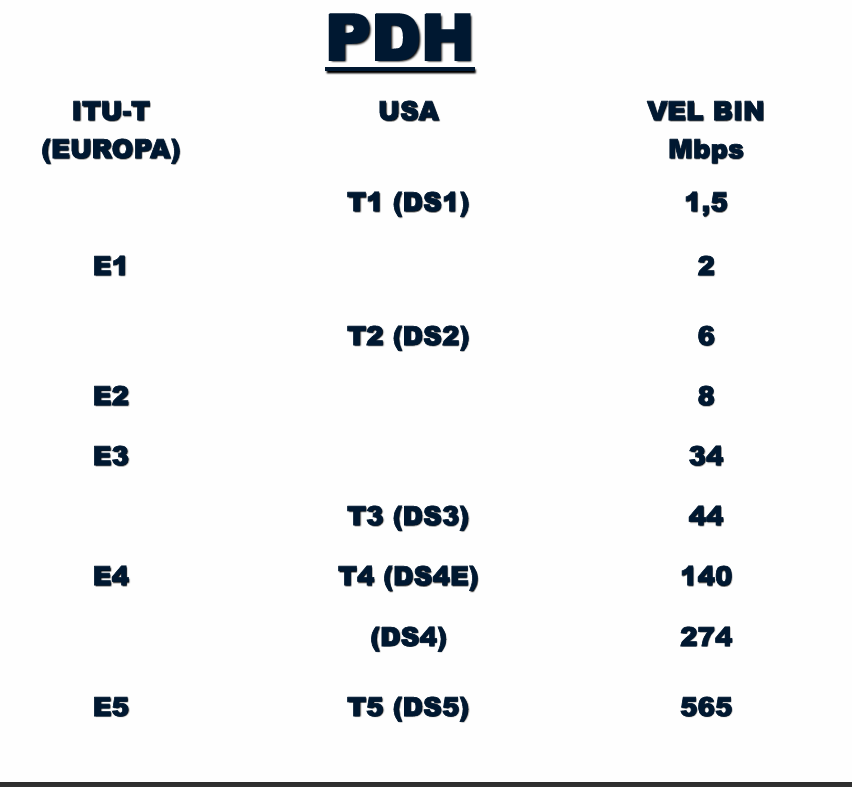

### SDH/SONET y STM-N

**SONET (Synchronous Optical Network)** es la jerarquía norteamericana registrada: STS para señales eléctricas, OC para portadoras ópticas. **STM-N (Synchronous Transport Module)** denomina señales SDH. Equivalencias de tasa no significan idéntico detalle de trama.

| SDH | SONET óptico | Tasa de línea |
|---|---|---:|
| — |OC-1 |51,84 Mbit/s |
| STM-1 |OC-3 |155,52 Mbit/s |
| — |OC-9 |466,56 Mbit/s |
| STM-4 |OC-12 |622,08 Mbit/s |
| — |OC-24 |1244,16 Mbit/s |
| STM-16 |OC-48 |2488,32 Mbit/s |
| STM-64 |OC-192 |9953,28 Mbit/s |
| STM-256 |OC-768 |39813,12 Mbit/s |

C62 registra órdenes y tasas; X p.24 redondea. **Deducción propia:** STM1 se calcula abajo; dividirlo por 3 da OC1; cada OCn multiplica 51,84 y cada STM-N multiplica 155,52 Mbit/s. Ejemplo STM4: 4×155,52=622,08 Mbit/s. No tomar «1200/2400» como exactos.

### Trama STM-1 y carga

X p.25 representa 9 filas×270 columnas de octetos. Se transmiten secuencialmente, no nueve líneas paralelas: la matriz permite localizar campos.

$$V_{STM-N}=9\,(270N)\,8\,(8000)=155\,520\,000N\ \text{bit/s}.$$

| Símbolo/factor | Significado | Unidad |
|---|---|---|
| $N$ | Orden STM | adimensional |
|9; 270N | Filas; columnas | adimensional |
|8 | Bits por octeto | bit/octet |
|8000 | Frecuencia de trama | trama/s |
| $V_{STM-N}$ | Tasa total | bit/s |

**Supuesto:** estructura síncrona registrada, 125 μs en todos los órdenes. **Ejemplos:**STM1 tiene 2430 octetos/trama → 155,52 Mbit/s; STM16 tiene 38 880 → 2488,32 Mbit/s, mismo período.

Después de 9 columnas de organización, el área 9×261=2349 octetos por período representa 150,336 Mbit/s: **carga de transporte VC, NO todo datos de usuario**. La figura además separa 1 columna de overhead de camino: 9×260=2340 octetos → 149,760 Mbit/s de campo de contenedor. La carga útil concreta depende del mapeo/adaptación. Las 9 columnas iniciales incluyen overhead de sección y área de punteros, no son datos. No se prescribe un reparto normativo más detallado que el corpus.

**Puntero, aclaración conceptual:** localiza una carga dentro de la estructura. Referencia común de transporte no implica que todos los tributarios tengan idéntica fase de origen; la adaptación permite transportar PDH en SDH.

### Contenedores virtuales

**VC (Virtual Container)** reúne carga adaptada y overhead de camino. El número de VC no es tasa en Mbit/s. X p.26 enumera **tributarios**, no tasa bruta de VC:

| VC | Tributario |
|---|---|
| VC-11 |1,544 Mbit/s |
| VC-12 |2,048 Mbit/s |
| VC-2 |6,312 Mbit/s; X p.26 imprime 6,048 |
| VC-3 |34,368 o 44,736 Mbit/s |
| VC-4 |139,264 Mbit/s |

C62 advierte el conflicto VC2. [UIT-T G.707 §10.1.3](https://www.itu.int/rec/dologin_pub.asp?id=T-REC-G.707-200312-S%21%21PDF-E&lang=e&type=items) identifica mapeo de 6312 kbit/s en VC2; se adopta 6,312 sin corregir la fuente local en silencio. Ejemplo: un E1 de 2,048 Mbit/s se adapta a VC12, con organización añadida; no significa que la tasa interna del VC sea 2,048.

**Errores típicos:** PDH sincroniza exacto todos sus relojes; SDH no tiene overhead; 150,336 Mbit/s equivale a caudal útil contractual; SONET=WDM. Una organiza transporte temporal; otra separa canales ópticos.

> **Para examen:** PDH agrega tributarios casi síncronos con justificación y acceso jerárquico. SDH usa tramas periódicas, contenedores y overhead para localizar/gestionar cargas, facilitando add-drop; SONET comparte equivalencias de tasa como jerarquía norteamericana.

## 13) STDM: aprovechar intermitencia no garantiza picos

**Fuentes:** X p.28; P p.19; R p.4. **Procedencia:** C62/CP STDM.

### Problema → concepto → modelo mental

TDM síncrono reserva posiciones aunque estén vacías. **STDM (Statistical TDM)** asigna servicio a fuentes activas; también se llama **ATDM/asíncrona** en el material. Asíncrona describe asignación respecto de fuentes, no ausencia de sincronismo para recibir bits/tramas.

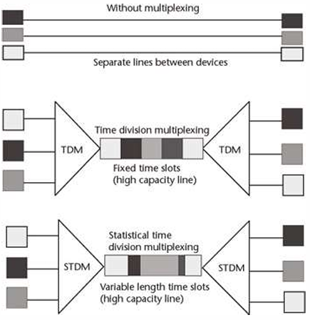

**Ejemplo hipotético:** A, B, C; sólo A/C activos. TDM:`A|vacíoB|C`; STDM:`idA+A|idC+C`. Si cada bloque lleva 8 bits, TDM reserva 24; STDM con 2 bits de ID por bloque envía 20. Si los 3 están activos, STDM exige 30 con ese formato: el control cuesta y no siempre ahorra. No son formatos normativos.

**Formalización:** presupuesto de tasas de §9 aplicado a demanda sostenida y control. Demanda 48 kbit/s sostenida, salida 32 → cola crece 16 kbit cada segundo; ninguna estadística resuelve esa sobrecarga indefinida. Picos superiores a la media pueden introducir espera aun si el promedio es admisible.

**Errores típicos:** STDM siempre más rápido; slots dinámicos siempre tienen longitud física variable; no necesita reconocer fuente. Lo esencial es asignación por demanda, no un único formato; destino no queda implícito sólo por una posición fija como TDM.

> **Para examen:** STDM evita reservas vacías atendiendo fuentes activas. Exige identificación y puede introducir colas; no garantiza todos los picos si el agregado no alcanza.

## 14) WDM, CDM y acceso múltiple

**Fuentes:** X pp.29–36; P p.20. **Procedencia:** C62 WDM hasta otros métodos; CP comparación FDM/WDM/TDM.

### WDM: problema, concepto y modelo

Una fibra puede llevar señales ópticas de distintas regiones del espectro. **WDM (Wavelength Division Multiplexing)** las reúne por longitudes de onda; un DEMUX óptico las separa. Son canales concurrentes, no turnos: análogo conceptual de FDM en dominio óptico.

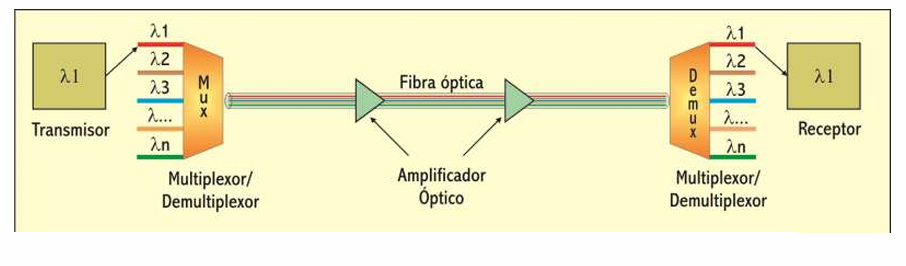

$$V_{agregado}=\sum_iV_i,\qquad c=\lambda_0f.$$

| Símbolo | Significado | Unidad |
|---|---|---|
| $V_{agregado},V_i$ | Suma y tasa de canal | bit/s |
| $c$ | Velocidad de luz en vacío | m/s |
| $\lambda_0$ | Longitud de onda en vacío | m |
| $f$ | Frecuencia óptica | Hz |

**Supuestos:** sumar tasas al mismo nivel, bruto con bruto/útil con útil; overhead de cada señal ya contemplado. Relación óptica usa vacío: para longitud en fibra no sustituir sin índice. **Ejemplos:** X p.29 cita 160 canales de 10 Gbit/s → 1600 Gbit/s=1,6 Tbit/s, no máximo actual universal. Ejemplo propio 1500 nm y velocidad≈3×10⁸ m/s → 200 THz, que no equivale a 200 Tbit/s.

**CWDM (Coarse WDM)** usa separación más gruesa, menor densidad/costo; **DWDM (Dense WDM)** separación más fina y más canales, con amplificación óptica conjunta destacada en el material. Ejemplo propio 8×10 Gbit/s=80; 32×10=320 Gbit/s. Número, espaciado, potencia y alcance dependen del sistema, no sólo del nombre.

**WDM vs SDH/SONET:** SDH organiza bits/tributarios y puede ocupar una longitud de onda; WDM combina varios canales ópticos que pueden llevar SDH, Ethernet u otras señales admitidas. Se pueden combinar.

**Equipos:** MUX/DEMUX combinan/separan; OADM (Optical Add-Drop Multiplexer) agrega/extrae longitudes; cross-connect óptico interconecta; amplificador repone potencia. Hay MUX/OADM pasivos, no toda la cadena sin energía. [Cisco CWDM, ficha de solución](https://www.cisco.com/c/en/us/products/collateral/interfaces-modules/cwdm-transceiver-modules/product_data_sheet09186a00801a557c.html) distingue transmisores enchufables de MUX/OADM pasivos.

**Pendientes no evaluables:** X p.31 «CWDM no bidireccional» y p.29 «señales llegan al mismo tiempo» no especifican configuración/retardos. No publicarlos como imposibilidad universal ni igualdad exacta de retardos; conservar como afirmaciones docentes por aclarar. Se explica simultaneidad sin abrir dispersión/medios U7.

**Errores típicos:** cantidad de λ=bits/símbolo; WDM corrige errores; frecuencia óptica=tasa binaria; pasivo=toda la cadena sin energía.

> **Para examen:** WDM reúne canales ópticos de distintas longitudes en una fibra. Es compatible con SDH/SONET; CWDM/DWDM difieren en densidad/diseño, no en el principio de separación.

### CDM: definición, ejemplo y relación

**CDM (Code Division Multiplexing)** separa comunicaciones simultáneas en la misma banda con códigos de correlación controlada. El receptor correlaciona con el suyo; espectro ensanchado distribuye la señal por una banda mayor. Códigos meramente distintos no garantizan separación perfecta: correlación, tiempo y potencia importan.

**Ejemplo ideal propio de X p.34:** A=(+1,+1), B=(+1,−1); los productos suman 0: son ortogonales. Bit A=+1, bit B=−1 → señal sumada (0,2). Correlacionar con A: 0+2=2, dividir por 2 → +1; con B: 0−2=−2, dividir por 2 → −1. Dos chips representan un bit por usuario bajo esta convención. Supuestos: sin ruido, sincronismo perfecto e igual potencia. Fuera de ellos no se garantiza recuperación exacta. X p.34 afirma «menor potencia que FDM/TDM» sin presupuesto comparable: queda pendiente, no es ley general.

### Multiplexación frente a acceso múltiple

Un MUX puede reunir flujos centrales; **acceso múltiple** aplica separación a estaciones/usuarios que comparten un recurso, organizando quién usa qué.

| Método | Separación | Ejemplo propio |
|---|---|---|
| FDMA | Bandas | A en banda 1, B en banda 2 simultáneos |
| TDMA | Turnos | A ranura 1, B ranura 2, misma banda |
| CDMA | Códigos | A/B simultáneos, códigos del ejemplo |
| OFDMA | Subportadoras ortogonales por usuario | Grupo para A, otro para B dentro de OFDM |
| DAMA | Asignación bajo demanda | Usuario pide recurso al iniciar comunicación |
| SDMA | Espacio | Regiones/haces diferentes |

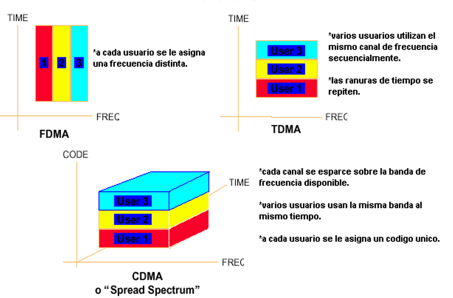

Son los métodos nombrados en X pp.35–36/C62, sin abrir protocolos nuevos. TDMA no requiere emitir a la vez; DAMA es un criterio de asignación, no un parámetro de la portadora.

## 15) Gotchas y pendientes por sección

Correcciones demostradas en sus secciones: señales PSK/FSK analógicas; 128-QAM representa 7 bits; tasas E1/T1; período E5; tributario VC-2. Originales intactos. **Los siguientes pendientes no se evalúan como conocimiento confirmado.**

| Sección | Qué falta / acción |
|---|---|
| [FM/PM](#fm-pm) | Aclarar sensibilidad FM M1 p.12/P p.10; no extrapolar dependencia del índice. PM sólo definición/clasificación: no hay modelo/ejemplo calculado fuente en el corpus |
| [ASK/FSK](#ask-fsk) | Aclarar índice y criterio π/2 de M1 p.14 |
| [PSK/QAM](#psk-qam) | Condición BER, detector y filtrado de V p.1: literal `16-6 (VER 1)` en línea base; no usado como umbral ni interpretado como exponente |
| [PCM/T1](#pcm) | Aclarar cuadro μ 128/7 de M2 p.10 frente a G.711/señalización robada |
| [WDM/CDM](#wdm-cdm) | Aclarar absolutos X pp.29–34: retardos idénticos, CWDM no bidireccional, todos equipos pasivos, potencia menor por código |
| Unidad | Revisiones iniciales realizadas; re-revisión de las correcciones pendiente. Se mantiene en-progreso, no revisado |

## 16) Registro de revisión del autor

| Fecha | Evidencia | Controles reales | Límites |
|---|---|---|---|
| 2026-10-11 | M1 pp.1–27, M2 pp.1–13, X pp.1–36, P pp.1–20, TP4 pp.1–3, R pp.1–4, V p.1 | Render con pdftoppm; hojas de contacto inspeccionadas; ampliadas X21/X25, V1, R3/R4, TP2; 14 figuras de captura vistas y copias de hash idéntico | Discrepancias citadas; no revisión independiente |
| 2026-10-11 | C5/C6/C62/CP/CQ | Lectura y mapa de fragmentos; PCM/FM/E1/T1/PDH/STM/Gray recalculados; enlaces controlados con script | No «revisado»; normativa online sólo aclara alcance registrado |
| 2026-10-13 | Correcciones U04-A-001/002/003 y U04-B-001 | 32 pares fase/bits re-cotejados dentro de cuatro fuentes; 34 recálculos; 107 enlaces/anclas; 14 PNG de hash idéntico; cuadros y dibujos propios Q2 comprobados | Autocontrol del autor, no aprobación independiente; PM sólo definición/clasificación y BER literal ambiguo |

Las fórmulas auxiliares y ejemplos propios rotulados son reconstrucción pedagógica, no citas normativas. El [registro de imágenes](registro-imagenes.md) mantiene origen y SHA-256.

## 17) Práctica, repaso y relaciones

- [TP4 completo, E1–10](../../practica/tp-04-modulacion-multiplexacion.md): método, cuentas, diagramas, trampas.
- [Repaso parcial, Q1–4 registrados](../../repaso/u04-modulacion-multiplexacion.md): enunciados y respuestas separados.
- [U2 Fourier](../02-senales-telecomunicaciones/APUNTE.md#fourier): traslado/filtrado del espectro.
- [U3 velocidades](../03-redes-telecomunicaciones/APUNTE.md#velocidades): símbolos, tasa binaria, caudal útil.
- Ruido/capacidad y códigos correctores pertenecen a U6; acá sólo se incluye la comparación necesaria. U7/U8 excluidas.

## 18) Resumen mental

> Primero adecuamos la representación al canal: AM modifica amplitud, FM frecuencia, PSK fase y QAM componentes I/Q. Una fuente analógica puede convertirse con PCM: muestreo, cuantificación, codificación. Multiplexación reúne comunicaciones por frecuencia, tiempo, longitudes de onda o códigos, sin crear capacidad gratis. E1/T1 organizan voz PCM; PDH agrega tributarios casi síncronos; SDH/SONET facilitan transporte y acceso a tributarios. Siempre separamos tasa de línea, auxiliares y tasa útil.

**Checklist para examen**

- [ ] Distingo señales intervinientes y su representación.
- [ ] Explico DBL/BLU, índice FM, desviación y bandas.
- [ ] Construyo Gray por reflexión y compruebo el cierre.
- [ ] Relaciono M, bits por símbolo, baudios y riesgo de error.
- [ ] Separo muestreo, cuantificación y codificación.
- [ ] Calculo tasa PCM y distingo μ normativo de la simplificación docente.
- [ ] Explico granularidad/sobrecarga de DM, ADM y DPCM.
- [ ] Distingo FDM/OFDM/TDM/STDM/WDM/CDM.
- [ ] Derivo E1/T1/STM-1 contando auxiliares.
- [ ] Explico PDH/SDH/SONET, contenedores y tributarios.
- [ ] Reconozco pendientes: no respondo como ley lo que no está verificado.
