10-09-2026

---
# primera parte:
material\teoria\U4\U4 MODULACION 1.pdf
---

# Modulación

La **modulación** es un proceso que consiste en transformar una señal —que representa información— en otro tipo de señal adecuada para su transmisión por un medio de comunicación, **sin modificar sustancialmente la información que ella representaba**.

---

## Proceso de modulación

Mediante un **modulador**, una señal llamada **portadora** \(p(t)\) es transformada por una señal llamada **moduladora** \(m(t)\), obteniéndose como producto una señal que se conoce como **modulada** \(M(t)\).

La operación de recuperación de la señal original es llevada a cabo por un **demodulador**.

### Esquema general

```text
                    MODULACIÓN

 Señal moduladora
      m(t)
       │
       ▼
 ┌─────────────┐
 │             │
 │  MODULADOR  │──────────────► Señal modulada
 │             │                     M(t)
 └─────────────┘
       ▲
       │
 Señal portadora
      p(t)


                   DEMODULACIÓN

 Señal modulada
      M(t)
       │
       ▼
 ┌───────────────┐
 │               │
 │ DEMODULADOR   │──────────────► Señal recuperada
 │               │                     m(t)
 └───────────────┘
```

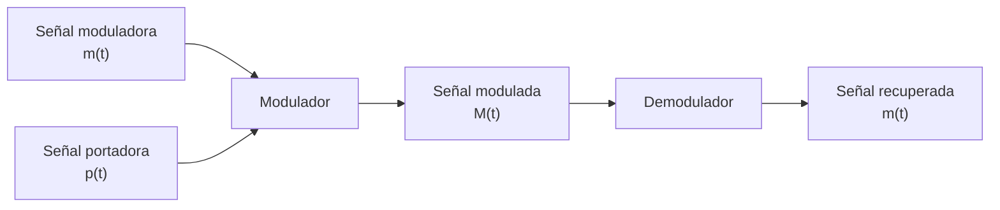

## Señales involucradas

- **Portadora \(p(t)\):** señal que se modifica para transportar la información.
- **Moduladora \(m(t)\):** señal que contiene la información que se desea transmitir.
- **Modulada \(M(t)\):** señal resultante del proceso de modulación.
- **Modulador:** dispositivo o sistema que realiza la modulación.
- **Demodulador:** dispositivo o sistema que recupera la señal original a partir de la señal modulada.


### ejemplos de portadoras:

- **Señal senoidal:** \(p(t) = A \sin(\omega t + \phi)\)
- **Señal cosenoidal:** \(p(t) = A \cos(\omega t + \phi)\)
- **Señal cuadrada:** \(p(t) = A \text{sgn}(\sin(\omega t))\)


## Esquema de una transmisión modulada:

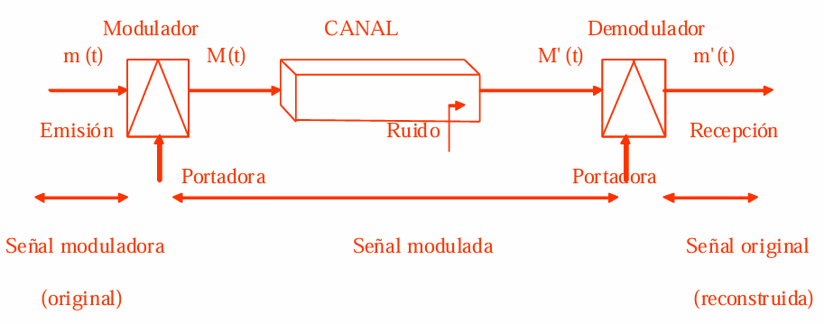

# Tipos de modulación

| Tipo de modulación | Moduladora | Portadora | Modulada | Nombre de la modulación |
|---|---|---|---|---|
| **Continua analógica** | Analógica | Analógica | Analógica | **AM**<br>**FM**<br>**PM** |
| **Continua digital** | Digital | Analógica | Analógica | **ASK**<br>**FSK**<br>**PSK** · **DPSK**<br>**M-PSK** · **M-QAM** |
| **Por pulsos analógica** | Analógica | Digital | Analógica | **PAM**<br>**PDM**<br>**PPM** |
| **Por pulsos digital** | Digital | Digital | Digital | **PCM (MIC)**<br>**DPCM**<br>**DELTA**<br>**DELTA ADAPTIVA** |

---

# modulación por onda continua - modulacion en amplitud (AM)

## portadora:

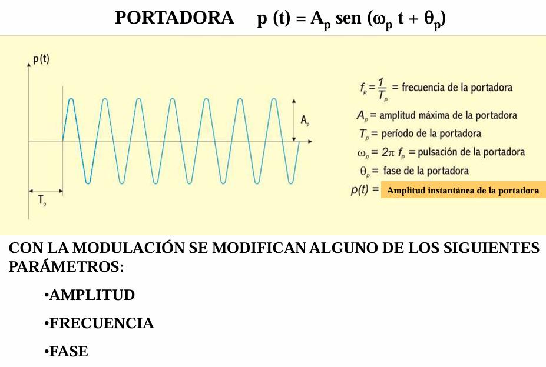

## am: moduladora

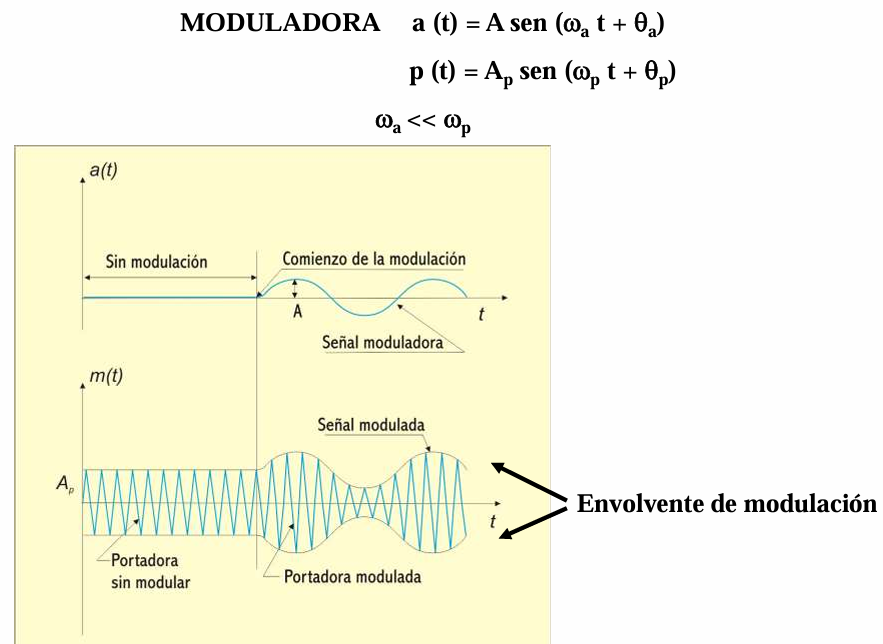

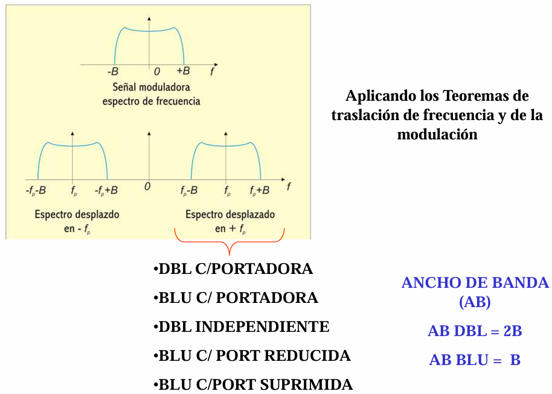

hoy en dia se busca usar una banda lateral para ahorrar espectro.
hay diferencias entre usar doble banda o banda lateral única.

--- 

# ASK: 

## VARIACION DE NIVEL DE PORTADORA

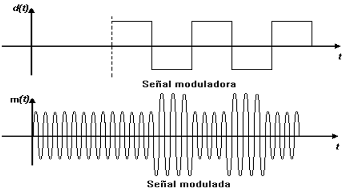

## POR SUPRESION DE PORTADORA

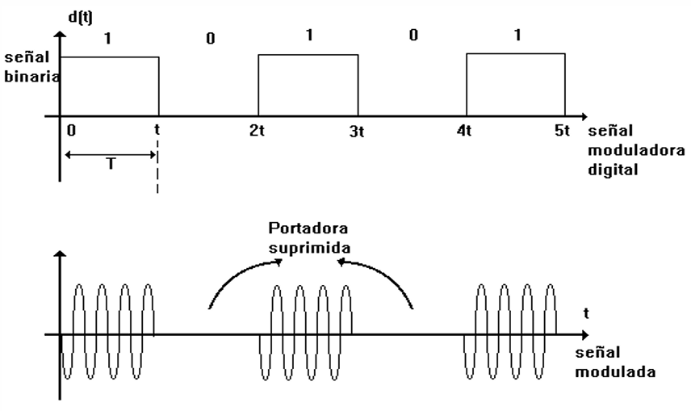

## ANCHO DE BANDA

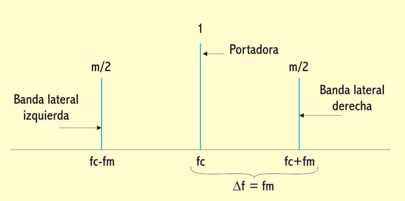

# FM

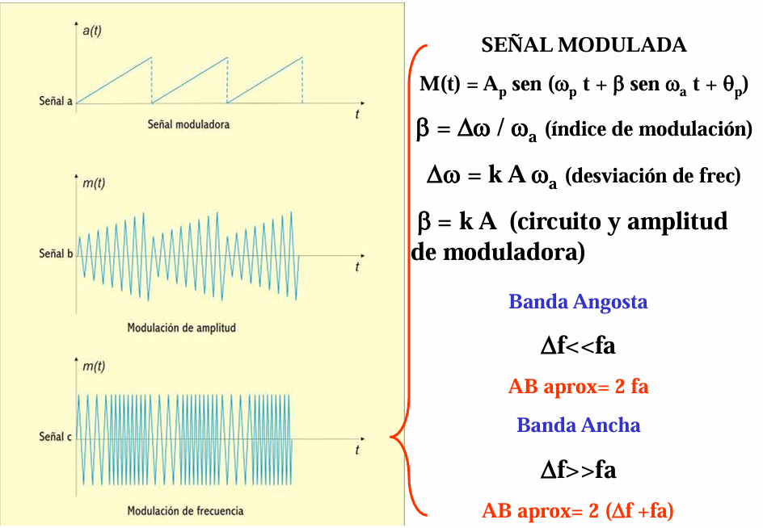

## Señal modulada

La señal modulada se expresa como:

\[
M(t)=A_p\,\sin\left(\omega_p t+\beta\,\sin(\omega_a t)+\theta_p\right)
\]

El **índice de modulación** es:

\[
\beta=\frac{\Delta\omega}{\omega_a}
\]

La **desviación de frecuencia** es:

\[
\Delta\omega=kA\omega_a
\]

Por lo tanto:

\[
\beta=kA
\]

donde \(k\) depende del **circuito** y \(A\) es la **amplitud de la señal moduladora**.

### Banda angosta

Se cumple:

\[
\Delta f \ll f_a
\]

El ancho de banda aproximado es:

\[
\boxed{AB \approx 2f_a}
\]

### Banda ancha

Se cumple:

\[
\Delta f \gg f_a
\]

El ancho de banda aproximado es:

\[
\boxed{AB \approx 2(\Delta f+f_a)}
\]

## Conclusiones:

- La modulación en frecuencia (FM) permite transmitir información variando la frecuencia de la portadora.
- El índice de modulación \(\beta\) y la desviación de frecuencia \(\Delta\omega\) son parámetros clave para caracterizar la señal modulada.
- La banda angosta se cumple cuando \(\Delta f \ll f_a\) y su ancho de banda aproximado es \(AB \approx 2f_a\).
- La banda ancha se cumple cuando \(\Delta f \gg f_a\) y su ancho de banda aproximado es \(AB \approx 2(\Delta f+f_a)\).
- a mas amplitud, mas desviacion y mayor índice de modulación. a menos amplitud, menos desviación y menor índice de modulación.


# FSK

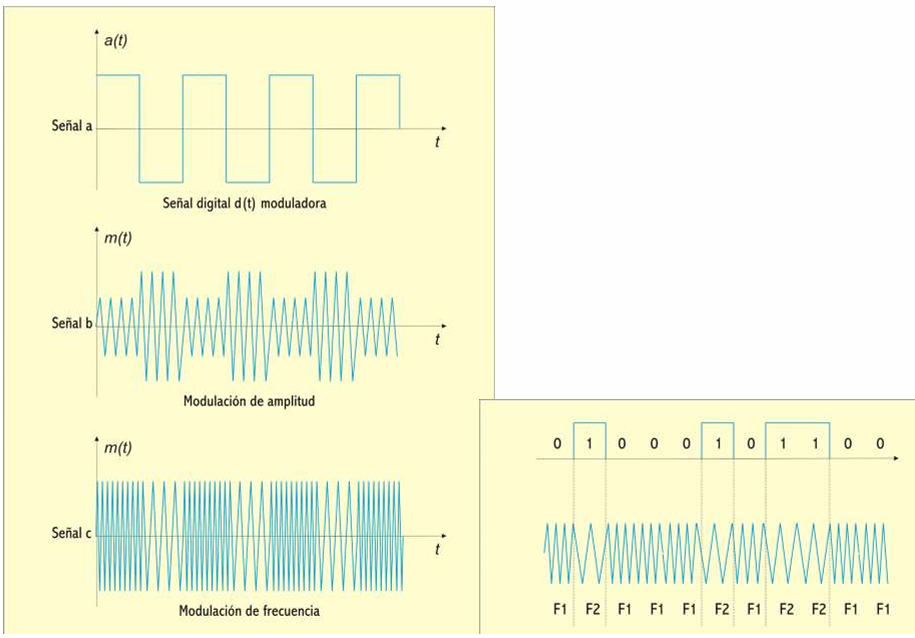

## ANCHO DE BANDA
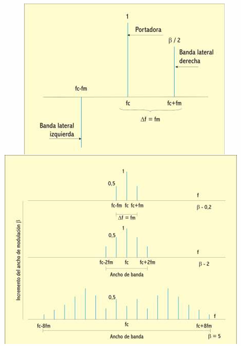
### Banda angosta

\[
\beta < \frac{\pi}{2}
\]

La señal modulada se expresa como:

\[
M(t)=A_p\,\sin\left(\omega_p t+\beta\,\sin(\omega_a t)+\theta_p\right)
\]

Además:

\[
\beta=kA
\]

---

### Banda ancha

\[
\beta > \frac{\pi}{2}
\]

# PSK
lo mas importante sobre estas modulaciones es que la información se transmite variando la fase de la portadora.

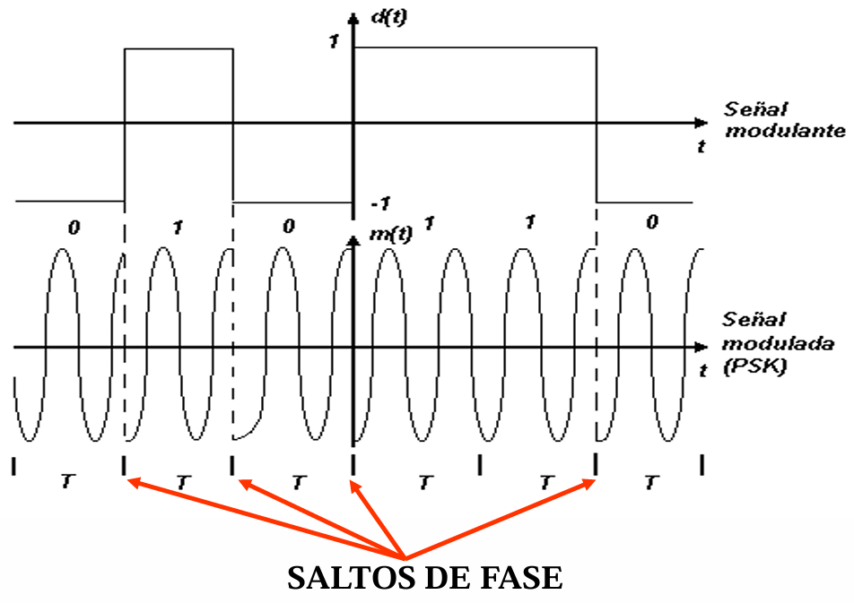

- diagrama de estados: estados indicados en una circunferencia.
- cuadro de asignacion: cada estado de la circunferencia se asigna a un símbolo binario específico. se tiene de un lado los angulos y del otro los símbolos binarios.

## SEÑAL 2-PSK / B-PSK

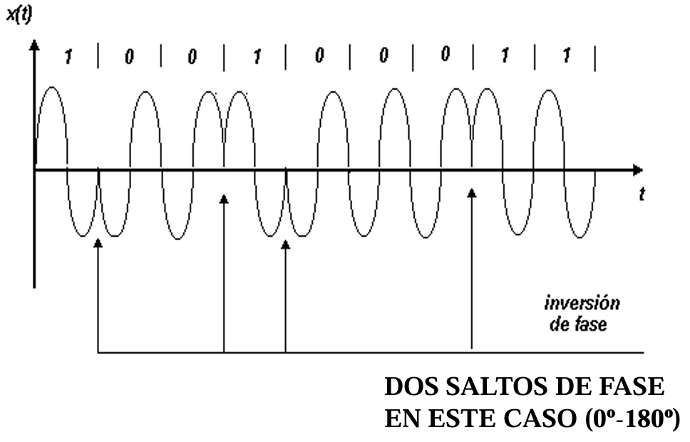

## ASIGNACION DE SECUENCIA DE BITS Y DE ESTADOS
### DIAGRAMA DE FASES
### MODULACION 4-PSK / Q-PSK
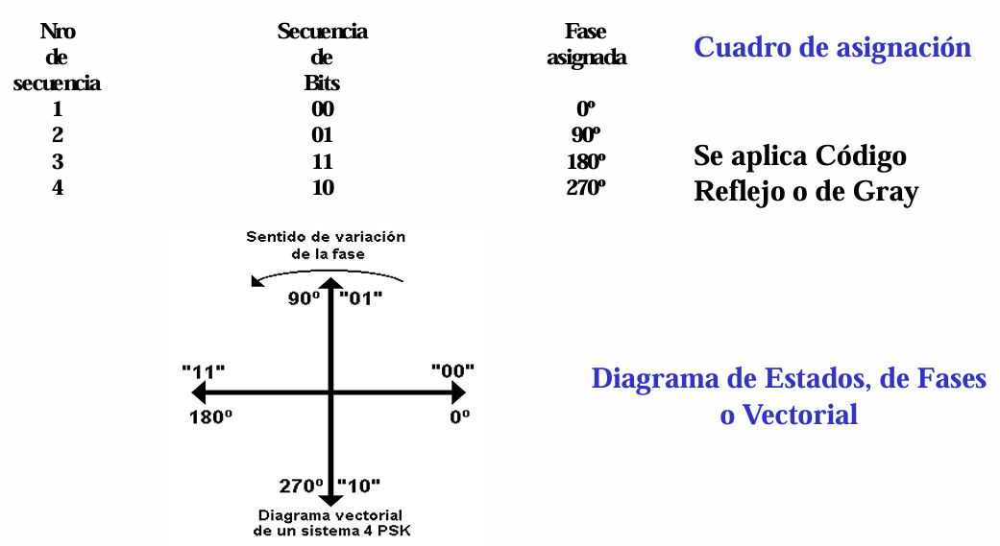


## CONSTRUCCIÓN DEL CÓDIGO DE GRAY

se explico en detalle el mecanismo de reflejo/gray con 2 bits. falta dejar explicado aquí.

### EJEMPLO CON 3 BITS

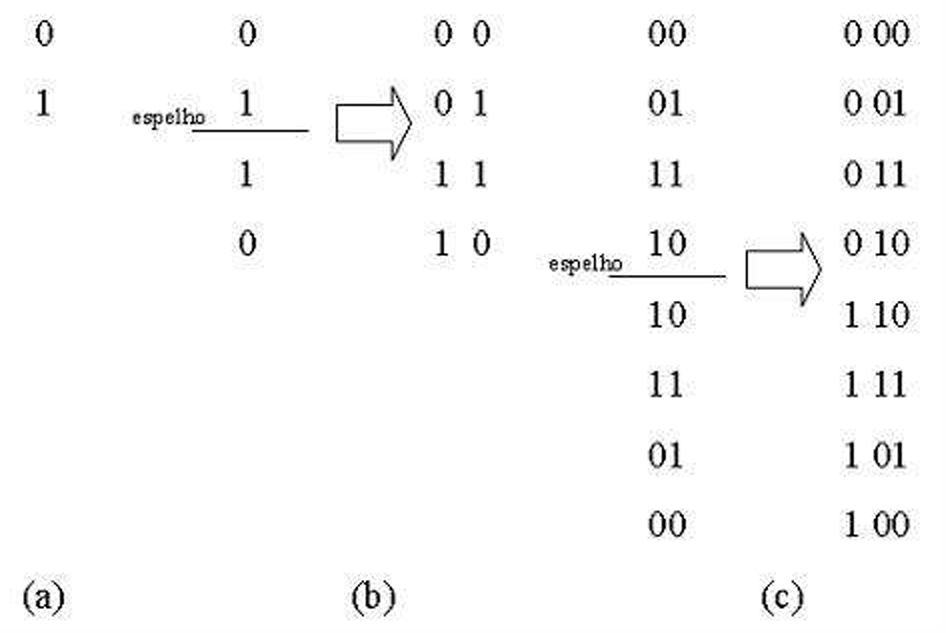

## MODULACION M-PSK

El ángulo entre cada fase es:

\[
\theta = \frac{2\pi}{M}
\]

donde \(M\) es la cantidad de saltos de fase.

Cada salto representa una cantidad de bits dada por:

\[
n = \log_2 M
\]

Por lo tanto, cada salto lleva \(n\) bits.

La relación entre la velocidad de transmisión y la velocidad de modulación es:

\[
V_{tx} = V_{mod}\cdot n
\]

---

### 8-PSK

Para \(M=8\):

\[
n=\log_2 8 = 3 \text{ bits}
\]

y el ángulo entre fases es:

\[
\theta=\frac{2\pi}{8}=\frac{\pi}{4}=45^\circ
\]

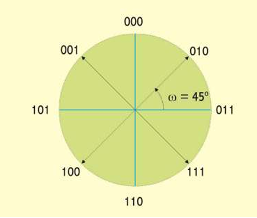

| N.º de secuencia | Dígitos binarios | Fase asignada |
|---:|:---:|---:|
| 1 | 011 | \(0^\circ\) |
| 2 | 010 | \(45^\circ\) |
| 3 | 000 | \(90^\circ\) |
| 4 | 001 | \(135^\circ\) |
| 5 | 101 | \(180^\circ\) |
| 6 | 100 | \(225^\circ\) |
| 7 | 110 | \(270^\circ\) |
| 8 | 111 | \(315^\circ\) |


# Modulación M-QAM

La modulación **M-QAM** utiliza **dos portadoras independientes en cuadratura**, es decir, desfasadas \(90^\circ\) entre sí.

Combina:

- saltos de **amplitud**
- saltos de **fase**

---

## Modulación 16-QAM

En **16-QAM** se utilizan 16 estados posibles de la señal, combinando distintos niveles de amplitud y fase.
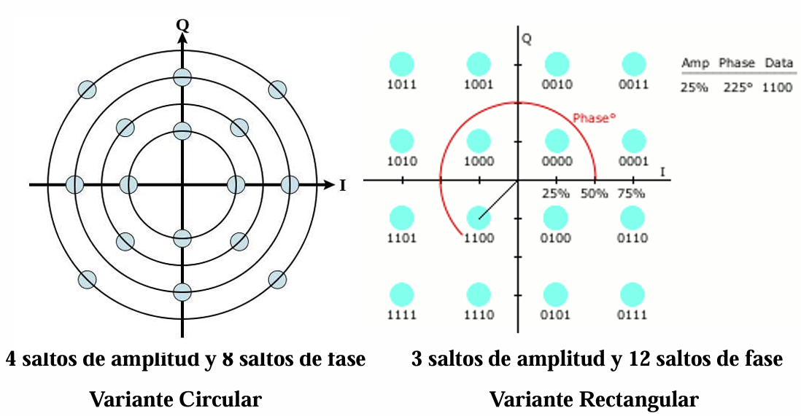

## Diagrama de estados o constelación
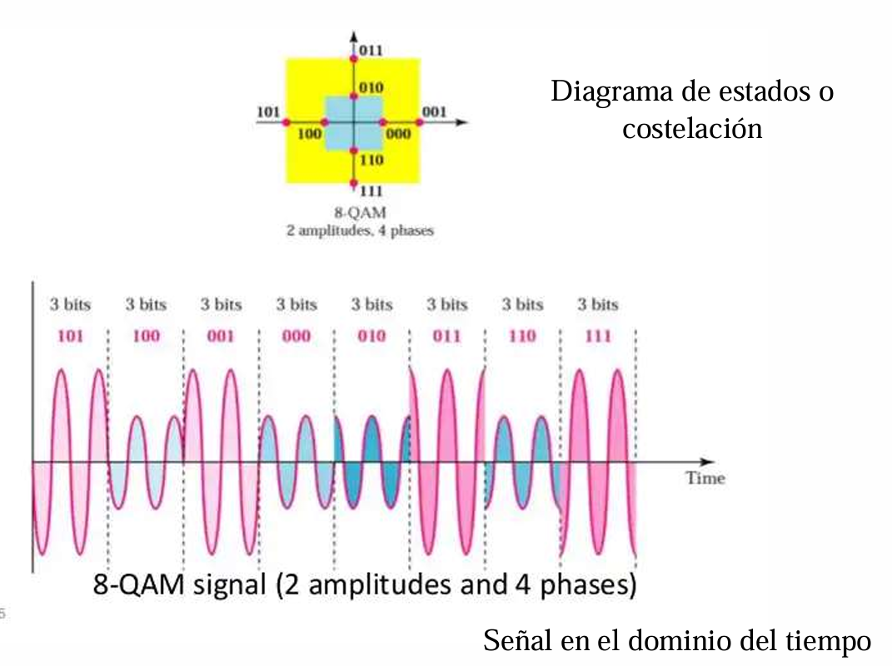
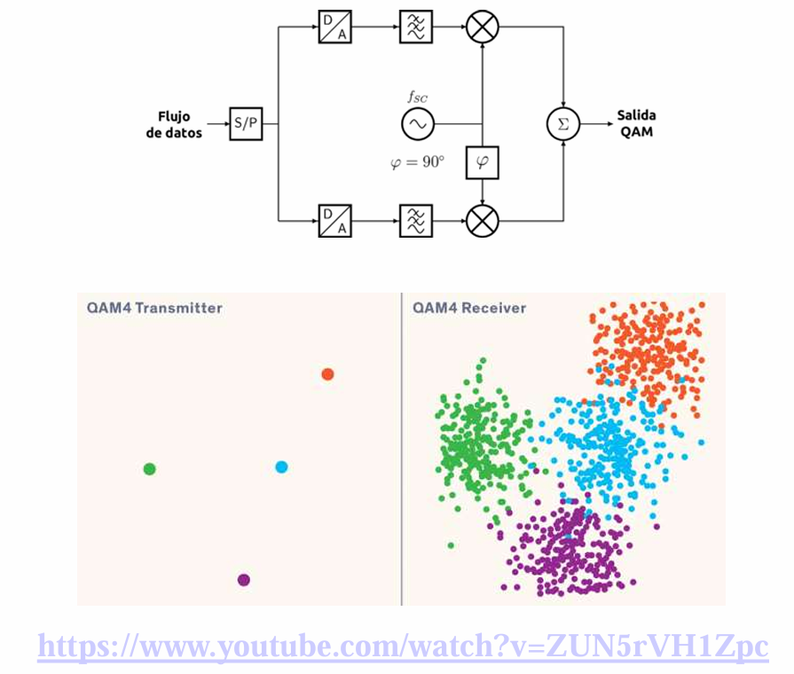
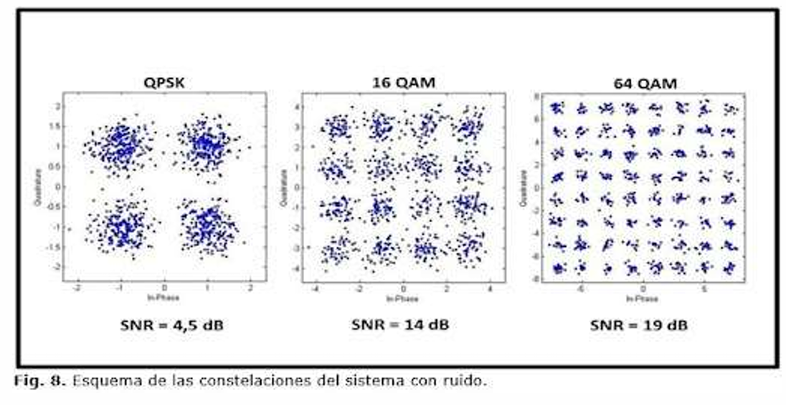

## COMPARACIÓN DE MODULACIÓN   M-PSK / M-QAM

V tx (bps) / AB (Hz)      Sensibilidad al ruido (Pe) S/N (Eb/No)

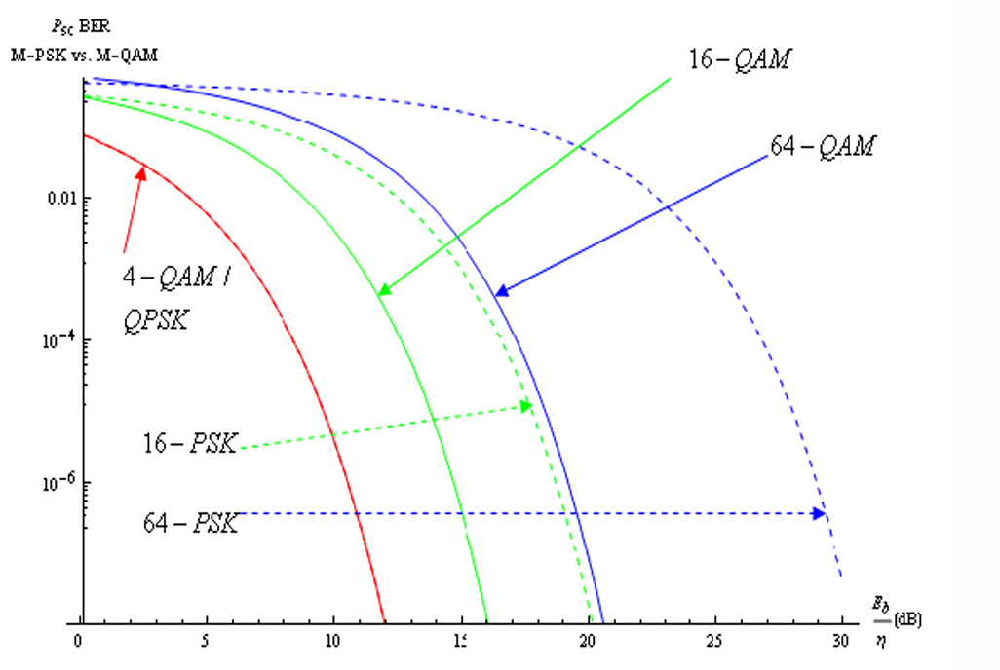

TEMA DE PARCIAL ESTO!!!!!!!!!!!!!

# VARIANTES M-PSK
- OQPSK (offset - compensada)
- Evita fluctuaciones de gran amplitud en los saltos de 180º

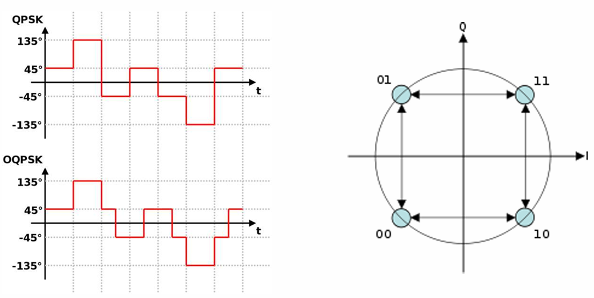

# VARIANTES M-PSK
- DPSK (diferencial) Sin referencia de fase absoluta. 
- La referencia que se toma es la del último bit recibido.

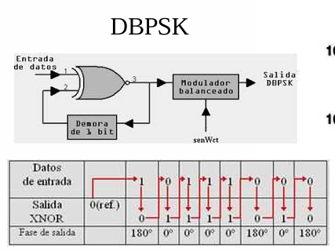
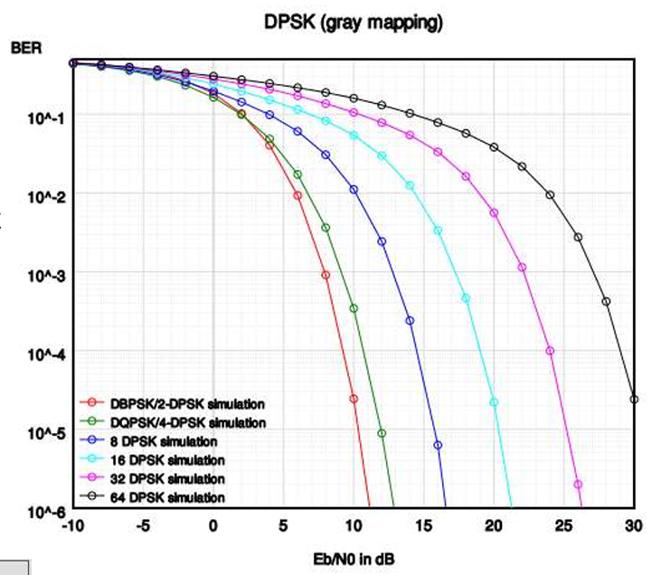

# VARIANTES M-PSK o M-QAM
- TCM (Trellis Codes Modulation)
- También Modulación por Codificación Entrelazada.
- Proporciona una mayor inmunidad al ruido ante la complejidad de las constelaciones generadas por ambas técnicas de modulación.
- Agregado de bits redundantes.

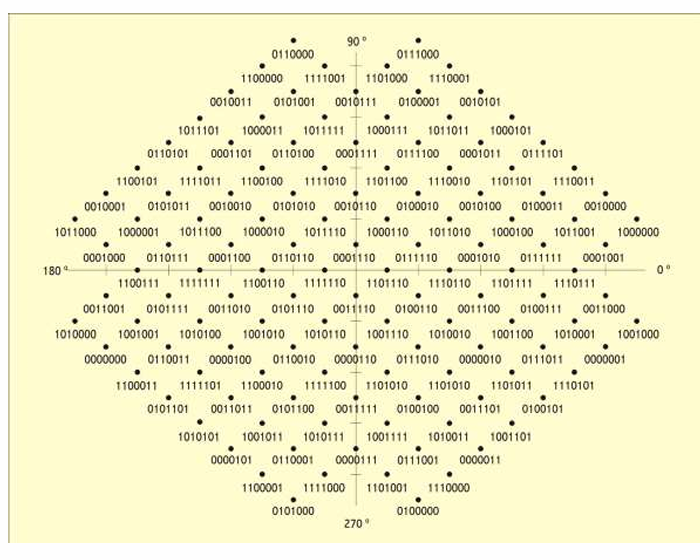

este tiene 128 QAM, primero veo la cantidad de bits para sacar la cantidad de saltos! en este caso 8 bits
TEMA DE PARCIAL ESTO!!!!!!!!!!!!!

---
# segunda parte:
material\teoria\U4\U4 MODULACION 2.pdf
---

# MODULACION POR PULSOS ANALOGICA

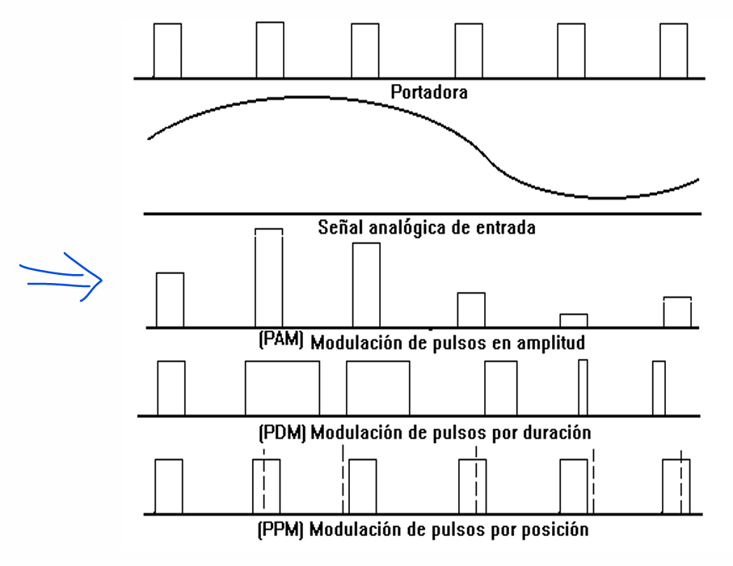
vamos a tomarle mayor importancia a la marcada.

# DIGITALIZACION DE UNA SEÑAL ANALOGICA

- **MUESTREO**
f muestreo = > 2 x f máxima (T. Nyquist)
- **CUANTIFICACION**
Aproximar valores de las muestras a niveles cuánticos.
- **CODIFICACION**
Codificación de los niveles cuánticos

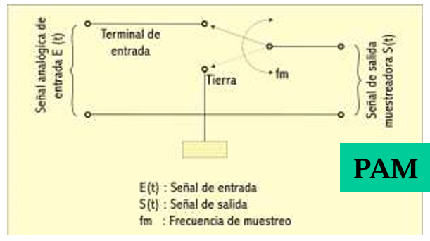
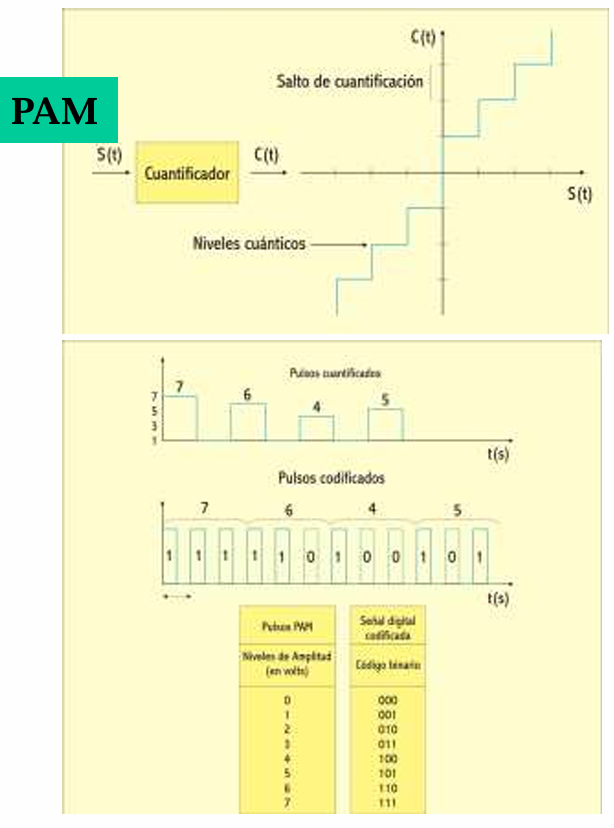