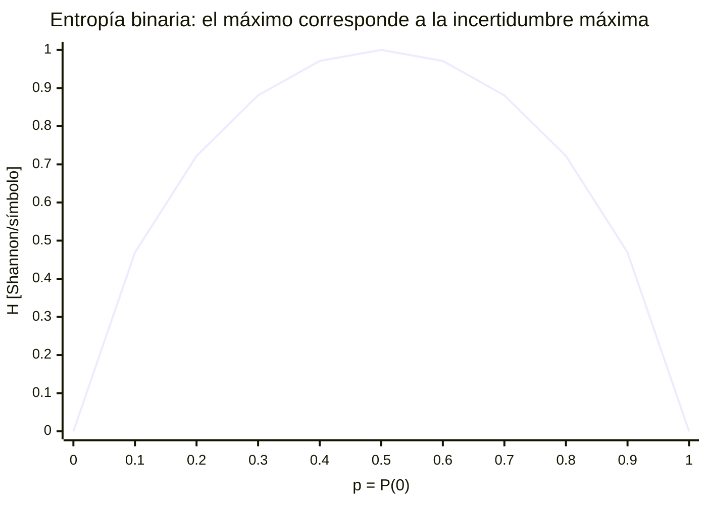

# Unidad 5 — Teoría de la información y de la codificación

> Contar bits transmitidos no alcanza: primero hay que saber cuánta incertidumbre eliminan y después cómo los representamos.

## Alcance y fuentes

Se integra lo registrado el **01/10/2026**, §§1–22 de la [captura teórica](../../../capturas/teoria/05-Teoría%20de%20la%20información%20y%20de%20la%20codificación/01_10_26_U5.md), y la práctica del [06/10/2026](../../../capturas/practica/practica_un5.md). Las capturas son evidencia de clase, **no autoridad que vuelva verdaderas sus afirmaciones**. El [TP5 oficial](../../../material/practica/U%205/TP%20%205%20%202026.pdf), PDF pp.2–3, fija los catorce ejercicios, desarrollados [aparte](../../practica/tp-05-informacion-codificacion.md). Las diez preguntas finales existentes se separan en [repaso](../../repaso/u05-informacion-codificacion.md).

**Fuente bibliográfica local:** Castro Lechtaler y Fusario, *Comunicaciones: una introducción a las redes digitales de transmisión de datos y señales isócronas*, **2013**, [PDF local](../../../material/teoria/DOC-20230425-WA0040.pdf), §§3.6.1–3.6.4, PDF pp.202–212 / impresas 176–186. No es la edición 2015 citada en la bibliografía del programa. Los caches se usaron para búsqueda; las fórmulas empleadas se contrastaron visualmente. Se usan normas y documentación primaria sólo para aclarar códigos ya registrados; no se incorpora un nuevo repertorio de temas.

**Lectura:** información → entropía → tasa → representación → propiedades → Huffman → códigos de caracteres. Ver [índice](INDICE.md). Los [pendientes](#pendientes) impiden declarar revisada o final toda la unidad.

## 1. Medir información: incertidumbre, no significado

**Origen:** captura §§1–2. **Respaldo:** Castro/Fusario 2013 §3.6.1, PDF 203–205 / impresas 177–179.

### Problema, concepto y modelo mental

Una fuente elige un mensaje; el receptor no sabe cuál fue. Dos mensajes igual de largos pueden ser muy diferentes en cuanto a sorpresa. Un aviso seguro no elimina incertidumbre; uno poco probable sí. La teoría de la información mide esa incertidumbre mediante probabilidades, **no la importancia humana ni el significado** del mensaje.

Pensá en elegir una casilla de un conjunto: cuanto menos esperable era la casilla observada, más información recibiste. Shannon estudia medida de información, capacidad del canal, codificación y uso fiable del canal. En esta unidad medimos y representamos; los límites y errores del canal se desarrollan en [U6](../06-canales-comunicaciones/APUNTE.md).

Es un esquema funcional simplificado: no sustituye la cadena física completa de modulación. Los dos codificadores distinguen funciones; no afirma que todo sistema use ambos.

### Formalización

$$I_b(x_i)=\log_b\!\left(\frac{1}{p_i}\right)=-\log_b p_i$$

| Símbolo | Significado | Unidad |
|---|---|---|
| $x_i$ | Resultado de la fuente | Símbolo, no unidad física |
| $p_i$ | Probabilidad de ese resultado | Adimensional |
| $b$ | Base del logaritmo, mayor que 1 | Adimensional |
| $I_b$ | Información de ese resultado | Shannon si $b=2$; Nat si $b=e$; Hartley si $b=10$ |

**Supuestos:** evento discreto con probabilidad conocida y positiva. El resultado seguro aporta cero. Un evento de probabilidad cero no es un resultado realizable del modelo: su información diverge al aproximarse a cero; no se introduce como un número finito.

**Ejemplo hipotético:** para $p_A=0,99$, $I_2(A)=0,01450$ Shannon; para $p_B=0,01$, $I_2(B)=6,64386$ Shannon. El segundo resultado es más sorprendente aunque ambos se codifiquen con un dígito binario. Para $p=1/8$, $I_2=3$ Shannon.

### Errores típicos

- **Información = tamaño del archivo:** el tamaño cuenta dígitos almacenados; la información depende del modelo de probabilidades.
- **Improbable = importante:** información de Shannon no mide relevancia semántica.
- **Promediar sin probabilidades:** información puntual y promedio de la fuente son distintas magnitudes.

**Para examen:** «La información de un resultado mide la incertidumbre que elimina conocerlo. Es el logaritmo del inverso de su probabilidad: un resultado seguro aporta cero y uno improbable aporta más.»

## 2. Unidades y dígitos binarios

**Origen:** captura §§3–4. **Respaldo:** Castro/Fusario 2013 PDF203 y 205 / impresas 177 y 179; Tabla 3-2 y Ejemplo 3-9.

Cambiar la base cambia la escala, no el fenómeno. Para un resultado con probabilidad 0,1 obtenemos 1 Hartley,2,302585 Nat o 3,321928 Shannon. Las conversiones son:

$$1\ \text{Hartley}=\log_2(10)\ \text{Shannon}\approx3,321928\ \text{Shannon}$$
$$1\ \text{Nat}=\log_2(e)\ \text{Shannon}\approx1,442695\ \text{Shannon}$$
$$1\ \text{Hartley}=\ln(10)\ \text{Nat}\approx2,302585\ \text{Nat}$$

| Símbolo | Significado | Unidad |
|---|---|---|
| Hartley, Nat, Shannon | Unidades según bases 10, $e$,2 | Información |
| $e$ | Base natural, aproximadamente 2,718282 | Adimensional |
| Factores de conversión | Cociente de unidades de información | Shannon/Hartley, Shannon/Nat o Nat/Hartley |

**Supuesto:** mismo suceso y misma probabilidad, expresados en bases diferentes. **Ejemplo:**2 Hartley equivalen a 6,643856 Shannon; coincide con la información del resultado de probabilidad 0,01 de §1.

Un **bit como dígito** vale 0 o 1. Un **bit como unidad informativa**, usado habitualmente como equivalente de Shannon, no garantiza que cada dígito transmitido aporte 1 Shannon. Con probabilidades 0,99/0,01 el promedio es mucho menor que 1 Shannon/dígito. En el vocabulario del libro se distingue el dígito (*binit*) de la medida Shannon; acá mantenemos esa distinción aunque usemos bit/s en conexiones con otras unidades.

**Fuente binaria equiprobable:** cada resultado tiene probabilidad 0,5; su información es 1 Shannon y su promedio 1 Shannon/símbolo. Esto no requiere que todo dispositivo digital sea equiprobable: la equiprobabilidad es una **hipótesis**, no una consecuencia de usar ceros y unos.

**Error típico:** «un byte siempre contiene 8 Shannon». Siempre contiene 8 dígitos binarios; sólo llega a 8 Shannon de entropía por byte cuando sus 256 valores son equiprobables.

## 3. Entropía y fuente de memoria nula

**Origen:** captura §§5–7 y recapitulación §9. **Respaldo:** Castro/Fusario 2013 §§3.6.2.1–3.6.2.3, PDF 206–210 / impresas 180–184.

### Problema, concepto y modelo mental

Un sistema no se dimensiona sólo para el mensaje excepcional: tiene que transportar una sucesión de mensajes. Necesitamos la información **promedio por símbolo**. La entropía es la esperanza de la información puntual: pondera cada sorpresa por la frecuencia con que ocurre.

Una **fuente de memoria nula** emite símbolos estadísticamente independientes. Saber los anteriores no cambia las probabilidades del siguiente. «Aparecen igual cantidad de 0 y 1» no prueba independencia: una secuencia que alterna obligatoriamente 0,1,0,1 puede tener proporciones iguales y ser predecible una vez conocido su estado.

### Formalización

$$H(X)=E[I(X)]=\sum_{i=1}^{N}p_i I_2(x_i)=-\sum_{i=1}^{N}p_i\log_2 p_i$$

| Símbolo | Significado | Unidad |
|---|---|---|
| $X$ | Variable aleatoria de salida | Símbolo de fuente |
| $N$ | Cantidad de símbolos posibles | Adimensional, conteo |
| $p_i$ | Probabilidad del símbolo $i$ | Adimensional; suma 1 |
| $I_2(x_i)$ | Información del resultado | Shannon |
| $H(X)$ | Información media por símbolo | Shannon/símbolo, equivalente informativo bit/símbolo |

**Supuestos:** fuente discreta de alfabeto finito, probabilidades no negativas normalizadas; se toma $0\log_2 0=0$ por límite. La fórmula describe la entropía de una variable discreta; para identificarla con la información media por emisión de una fuente y sumar símbolos sucesivos sin condicionar, acá se trabaja con memoria nula. No se extiende ese modelo silenciosamente a textos reales.

**Ejemplo con datos del TP5 E3:** probabilidades 0,2;0,5;0,3. Las informaciones son 2,321928;1;1,736966 Shannon. Su media es $0,2(2,321928)+0,5(1)+0,3(1,736966)=1,485475$ Shannon/mensaje. No es la media aritmética simple de las tres sorpresas.

### Máximo, mínimo y curva binaria

$$0\leq H(X)\leq H_{\max}=\log_2 N$$
$$H(p)=-p\log_2p-(1-p)\log_2(1-p),\qquad 0\leq p\leq1$$

| Símbolo | Significado | Unidad |
|---|---|---|
| $H_{\max}$ | Máximo para alfabeto de $N$ resultados | Shannon/símbolo |
| $p$ | Probabilidad de 0 en esta curva | Adimensional |
| $1-p$ | Probabilidad de 1 | Adimensional |
| $H(p)$ | Entropía binaria | Shannon/símbolo |

**Supuestos:** alfabeto fijo de $N$ símbolos para el límite general; fuente binaria para la segunda expresión. El mínimo 0 se alcanza con un resultado seguro; el máximo cuando todos son equiprobables. Para $N=128$, el máximo es 7 Shannon/símbolo, no 128. Para $p=1/2$, el máximo binario es 1; para $p=0$ o 1 es 0.

| $p$ | $H(p)$ [Shannon/símbolo] |
|---:|---:|
|0|0|
|0,01|0,080793|
|0,10|0,468996|
|0,25|0,811278|
|0,50|1|
|0,75|0,811278|
|0,90|0,468996|
|1|0|

Es una gráfica calculada, no una copia de la figura original; el valor exacto se obtiene con la fórmula. El concepto de simetría también significa que permutar los nombres de los resultados no cambia la entropía. La entropía es continua en las probabilidades; pequeñas variaciones no producen saltos. La aditividad de informaciones de símbolos sucesivos requiere independencia; no se aplica a cualquier fuente sólo porque tenga varios símbolos.

**Errata contrastada, no ocultada:** en el Ejemplo 3-12 del libro, PDF208–209 / impresas 182–183, aparecen 0,89 para probabilidades 0,25/0,75 y 0,35 para 0,01/0,99; la tabla posterior incluso da 0,00 a varias fuentes no deterministas. El recálculo da 0,811278 y 0,080793. Se conserva el original; se estudian los valores corregidos de esta tabla. El orden del ejemplo sí coincide: equiprobable >0,25/0,75 >0,10/0,90 >0,01/0,99.

### Errores típicos y respuesta de examen

- Entropía en Shannon/s: **incorrecto** sin duración; la entropía va en Shannon/símbolo.
- Equiprobabilidad = memoria nula: son supuestos diferentes.
- Información puntual = entropía: sólo coinciden para todos los símbolos de una fuente equiprobable.
- Usar conteos de una muestra como probabilidades verdaderas exactas: son estimaciones, como en TP5 E2.

**Para examen:** «La entropía es la información media por símbolo. En una fuente de memoria nula los símbolos son independientes; la entropía es máxima con equiprobabilidad y nula cuando la salida es segura.»

## 4. Tasa de información y relación con el canal

**Origen:** captura §8. **Respaldo:** Castro/Fusario 2013 §3.6.4, PDF210–212 / impresas 184–186; TP5 E9–10.

### Problema, concepto y modelo mental

Dos fuentes con la misma entropía pueden exigir canales diferentes: una emite más símbolos por segundo. La tasa combina **cuánta información aporta una emisión** con **cuántas emisiones ocurren por segundo**. No confundas los símbolos de la fuente con los estados de una modulación posterior.

### Formalización

$$\Gamma=\frac{H(X)}{\overline{\tau}}=r_s H(X),\qquad r_s=\frac{1}{\overline{\tau}}$$
$$\overline{\tau}=\sum_i p_i\tau_i$$

| Símbolo | Significado | Unidad |
|---|---|---|
| $H$ | Información media por emisión | Shannon/símbolo |
| $\tau_i$ | Duración del símbolo $i$ | s/símbolo |
| $\overline{\tau}$ | Duración media ponderada | s/símbolo |
| $p_i$ | Probabilidad del símbolo | Adimensional |
| $r_s$ | Ritmo de emisiones de la fuente | Símbolos/s |
| $\Gamma$ | Tasa informativa | Shannon/s; bit/s como unidad informativa |

**Supuestos:** emisiones independientes en el modelo de esta unidad y duraciones conocidas; contar las pausas que correspondan o declarar que se omiten. Para duración fija, la media es esa duración. Si cada símbolo fuente coincide con un símbolo de modulación, $r_s$ coincide numéricamente con $V_m$ en baudios; sin esa correspondencia NO se identifican.

**Ejemplo hipotético:** una fuente binaria de probabilidades 0,25/0,75 emite 1000 símbolos/s. Su tasa es 811,278 Shannon/s. Si se manda un dígito por emisión, se transmiten 1000 dígitos binarios/s: la tasa de bits físicos no es la tasa de información de la fuente.

**Ejemplo registrado TP5 E9:** punto con probabilidad 2/3 y duración 0,2s; raya 1/3 y 0,4s. La duración media es 0,266667s/símbolo y la entropía 0,918296 Shannon/símbolo; tasa 3,443609 Shannon/s. Estos tiempos son los datos del ejercicio, no la relación temporal normalizada de Morse.

La comparación con la capacidad exige unidades compatibles:

$$\Gamma\leq C$$

| Símbolo | Significado | Unidad |
|---|---|---|
| $\Gamma$ | Información generada por segundo | bit/s informativos |
| $C$ | Capacidad del canal según su modelo | bit/s |

**Supuesto y alcance:** condición límite necesaria en el modelo de comunicación; no garantiza que cualquier código práctico funcione con errores mínimos. Para comunicación asintóticamente fiable se diseña con tasa por debajo de la capacidad y codificación adecuada; el margen, ruido y teoremas pertenecen a [U6](../06-canales-comunicaciones/APUNTE.md). **Ejemplo:** una fuente de 1000 Shannon/s no puede transportarse fielmente a largo plazo por un canal de capacidad 800 bit/s. En TP5 E10 se obtiene 43,75 MShannon/s de demanda, pero no se deduce la capacidad real del canal sin conocerlo.

**Errores típicos:** multiplicar entropía por bits/s en vez de símbolos/s; sumar duraciones sin ponderarlas; llamar $C$ a la demanda calculada. **Para examen:** «La tasa es entropía por ritmo de emisión. Se compara con la capacidad en unidades de información por segundo; baudios y bits físicos por segundo no se igualan automáticamente.»

## 5. Codificar: representación, fuente y canal

**Origen:** captura §§10–11. **Respaldo:** finalidad de codificación en Castro/Fusario 2013 §3.6.1 y Huffman 1952, PDF 1–2 / impresas 1098–1099; control de errores desarrollado en [U6](../06-canales-comunicaciones/APUNTE.md). Las clasificaciones breves y ejemplos de formatos conservan el alcance de la captura; no constituyen comparación de implementaciones particulares.

**Problema:** los símbolos de la fuente no se transportan por sus nombres. Necesitamos asignarles palabras de un alfabeto de código y una regla inversa. Esa representación puede perseguir ahorro o protección: son objetivos distintos.

**Concepto y modelo:** codificar transforma mensaje → palabra de código; decodificar busca reconstruir el mensaje. El código de **fuente** elimina redundancia estadística para reducir representación; el de **canal** añade estructura redundante para reconocer alteraciones. No son funciones contradictorias: se comprime primero y luego se agrega protección controlada.

| Clasificación registrada | Qué cambia | Ejemplo y límite |
|---|---|---|
| Fuente sin pérdida | Representación, no los datos reconstruidos | Huffman: el texto debe recuperarse exactamente |
| Fuente con pérdida | Se descartan detalles según un criterio | JPEG, MP 3, MPEG como ejemplos de usos con pérdida de la captura; no afirmar que toda variante o perfil sea con pérdida |
| Canal de bloque | Un bloque de entrada produce una palabra de salida | Paridad o repetición como ejemplos mínimos; desarrollo en U6 |
| Canal convolucional | La salida depende de entrada actual y estado previo | Clasificación registrada; no construir un codificador no visto |

**Viterbi** es un algoritmo de decodificación mencionado para códigos convolucionales, no el nombre de un código ni una garantía universal de elegir «la secuencia recibida más probable» sin especificar modelo y métrica. Su mecanismo no se amplía aquí.

**Ejemplo hipotético de funciones:** para mensajes A y B, una representación A→0, B→1 conserva la elección con 1 dígito. Transmitir A→000, B→111 usa 3 dígitos por elección para separar palabras válidas. Ahorro y protección se comparan con magnitudes diferentes, formalizadas en §6.

**Errores típicos:** llamar a toda tabla de caracteres «código corrector»; confundir pérdida con error de transmisión; llamar Viterbi código. **Para examen:** «La codificación de fuente representa datos de manera compacta; la de canal agrega redundancia para control de errores. La primera puede conservar exactamente los datos o permitir pérdidas; la segunda no se reduce a elegir una tabla de caracteres.»

## 6. Propiedades, eficiencia y redundancia

**Origen:** captura §12 y TP5 E12–14. **Respaldo:** Huffman 1952 PDF 1 / impresa 1098 para longitud media/prefijo; conteo de representaciones en Castro/Fusario 2013 PDF 212 / impresa 186; distancia y control de errores en [U6](../06-canales-comunicaciones/APUNTE.md). Los ejemplos numéricos de esta sección son construcciones pedagógicas, no tablas oficiales.

### Problema y modelo mental

Una palabra más larga ocupa más tiempo; una tabla más grande permite representar más elecciones; una tabla con palabras muy próximas puede confundir errores con mensajes válidos. Necesitamos separar **longitud**, **cantidad de palabras**, **probabilidades** y **distancia**. Más bits no significan automáticamente más protección.

### Código de bloque binario

$$M=2^k,\quad R_{\rm abs}=n-k,\quad r_c=\frac{k}{n},\quad R_{\rm rel}=1-r_c$$

| Símbolo | Significado | Unidad |
|---|---|---|
| $k$ | Dígitos de entrada por bloque | bit/bloque de entrada |
| $n$ | Dígitos de la palabra transmitida | bit/palabra |
| $M$ | Cantidad de palabras válidas | Adimensional, conteo |
| $R_{\rm abs}$ | Redundancia agregada por bloque | bit/palabra |
| $r_c$ | Tasa del código | Adimensional |
| $R_{\rm rel}$ | Fracción redundante | Adimensional o % |

**Supuestos:** todos los $2^k$ bloques de entrada se representan inyectivamente en palabras binarias de longitud fija $n\geq k$. La fórmula $M=2^k$ **no describe cualquier alfabeto de $M$ símbolos**, por ejemplo 10 dígitos BCD o 252 palabras de peso fijo. Si no se usan todas las entradas o si el código no es binario, hay que rehacer el conteo.

**Ejemplo:** repetición 0→000,1→111: $k=1$, $n=3$, $M=2$, $R_{\rm abs}=2$bit/palabra, $r_c=1/3$, redundancia relativa 2/3. Hay 6 palabras de 3 bit no válidas; seis combinaciones descartadas no son «6 bits de redundancia».

### Eficiencia de representación: otra definición

$$\overline L=\sum_i p_i\ell_i,\quad \eta_{\rm inf}=\frac{H}{\overline L},\quad R_{\rm inf}=\overline L-H$$
$$\eta_{\rm eq} =\frac{\log_2 M}{n},\qquad u=\frac{M}{2^n}$$

| Símbolo | Significado | Unidad |
|---|---|---|
| $\ell_i$ | Longitud asignada al símbolo $i$ | bit/símbolo |
| $\overline L$ | Longitud media transmitida | bit/símbolo |
| $H$ | Entropía de la fuente en base 2 | Shannon/símbolo |
| $\eta_{\rm inf}$ | Relación información media/representación | Adimensional, unidades informativas equivalentes |
| $R_{\rm inf}$ | Exceso medio respecto de la entropía | bit/símbolo, equivalencia informativa |
| $M,n$ | Símbolos válidos y bits por palabra fija | Conteo; bit/símbolo |
| $u$ | Aprovechamiento del espacio de código | Adimensional |

**Supuestos:** código de fuente binario sin pérdida, decodificable sin ambigüedad, probabilidades conocidas. La expresión con $\log_2 M$ supone símbolos equiprobables y longitud fija $n$. No llamar $k$ a un logaritmo fraccionario como si fueran bits enteros de entrada de un código de bloque.

**Ejemplo TP5 E14:**90 símbolos,7 bit/símbolo. Si equiprobables, entropía 6,491853 Shannon/símbolo; eficiencia 92,7408%, exceso 0,508147 bit/símbolo. Se ocupan 90 de 128 combinaciones:70,3125% de aprovechamiento. **70,31% y 92,74% responden preguntas distintas.** Sin probabilidades no se conoce la eficiencia media real de la fuente; puede informarse el valor máximo equiprobable.

La **redundancia de la fuente** describe previsibilidad estadística; la **redundancia del código de canal** es estructura agregada; el **exceso de representación** compara longitud y entropía. No son sinónimos. Huffman reduce exceso estadístico; un código de canal puede añadir bits deliberadamente.

### Singularidad y longitud

- **No singular:** entradas diferentes tienen palabras diferentes. Ejemplo A→0,B→1; singular sería A→0,B→0.
- **Longitud fija:** se conoce el tamaño de cada palabra. ASCII7 tiene 7 bit por carácter.
- **Longitud variable:** cambia la longitud; requiere una regla de separación/decodificación. Ejemplo A→0,B→10,C→11 es prefijo.
- **No singular NO basta para secuencias variables:** A→0,B→01,C→10 son palabras distintas, pero 010 puede ser A+C o B+A. La decodificación unívoca de palabras aisladas no garantiza la del flujo concatenado. Huffman usa la propiedad prefijo para evitarlo.

### Distancia de Hamming

$$d_H(a,b)=\#\{j:a_j\ne b_j\},\quad d_{\min}=\min_{a\ne b}d_H(a,b)$$
$$e_{\rm det}\leq d_{\min}-1,\qquad e_{\rm corr}\leq\left\lfloor\frac{d_{\min}-1}{2}\right\rfloor$$

| Símbolo | Significado | Unidad |
|---|---|---|
| $a,b$ | Palabras válidas de igual longitud | Secuencias de bits |
| $j$ | Posición de un bit | Índice |
| $d_H,d_{\min}$ | Posiciones diferentes; mínimo entre pares válidos | Conteo de posiciones |
| $e_{\rm det},e_{\rm corr}$ | Errores garantizadamente detectables/corregibles | Conteo de bits alterados por palabra |

**Supuestos:** errores de sustitución de bits en palabras alineadas; detección por pertenencia al código y corrección adecuada hasta la distancia indicada. No cubre inserciones, borrados ni fallas de sincronismo. Las capacidades de detección y corrección se interpretan según el modo de decodificación, no como promesa de corregir y avisar simultáneamente todo patrón dentro de ambos límites.

**Ejemplos:**101101 y 100011 difieren en las posiciones 3,4,5: distancia 3. Para el código completo 000/111, distancia mínima 3; se garantizan detección de hasta 2 errores en modo detector o corrección de 1 en modo corrector. En cambio BCD8421 incluye 0000 y 0001: distancia mínima 1, aunque tenga combinaciones inválidas. No garantiza detectar toda alteración de un bit.

**Errores típicos:** longitud $n$ = tamaño $M$; contar códigos inválidos como bits redundantes; tasa de código 1 = entropía máxima; no singular = prefijo; redundancia = protección garantizada. **Para examen:** «La tasa $k/n$ se aplica a bloques binarios de entrada. La eficiencia informativa usa entropía y longitud media; el aprovechamiento cuenta combinaciones. La distancia mínima, no la mera longitud, limita el control de errores.»

## 7. Huffman: gastar menos bits donde más se repite

**Origen:** captura §13. **Respaldo:** David A.Huffman 1952, *A Method for the Construction of Minimum-Redundancy Codes*, Proceedings IRE, pp.1098–1101, [DOI](https://doi.org/10.1109/JRPROC.1952.273898). Se contrastaron visualmente las cuatro páginas del escaneo; algoritmo binario en PDF2 / impresa 1099. [Copia externa identificada](https://compression.ru/download/articles/huff/huffman_1952_minimum-redundancy-codes.pdf), conservada temporalmente por curaduría; su cache de 213 caracteres NO contiene el cuerpo del artículo.

**Problema:** dar la misma longitud a un símbolo frecuente y a uno raro puede desperdiciar representación. **Concepto:** Huffman construye un código prefijo de longitud variable que minimiza la longitud media para probabilidades dadas, dentro de los códigos prefijo símbolo a símbolo del alfabeto elegido. Es **sin pérdida**, no una técnica de control de errores.

**Modelo y procedimiento:** unir los dos pesos menores, sumar sus probabilidades y reinsertar el grupo; repetir hasta formar la raíz. Asignar 0 y 1 a cada bifurcación. La palabra de cada símbolo es el recorrido hasta su hoja: ninguna hoja es antecesora de otra, por lo que ninguna palabra es prefijo de otra.

**Ejemplo pedagógico con las probabilidades ya registradas en TP5 E5:** C y L tienen 1/8; A,B,E tienen 1/4. Unir C+L→1/4; luego unir A+B→1/2 y E+(CL)→1/2; unir esos dos grupos. Una asignación válida es:

| Símbolo | Probabilidad | Código | Longitud [bit/símbolo] |
|---|---:|---|---:|
|A|1/4|00|2|
|B|1/4|01|2|
|E|1/4|10|2|
|C|1/8|110|3|
|L|1/8|111|3|

La longitud media de §6 da 2,25 bit/símbolo y la entropía 2,25 Shannon/símbolo: eficiencia 100% bajo estas probabilidades y sin contar tabla ni metadatos. Un código fijo para cinco símbolos usaría 3 bit/símbolo. CABLE se representa `110 00 01 111 10`,12 bit; sin separadores `110000111110`, decodificable con el árbol conocido. Cambiar etiquetas de ramas o resolver empates de otro modo puede cambiar palabras sin cambiar el objetivo.

La captura registra un ejemplo parcial n→000,o→0010,m→0011,h→0101,a→1001,e→1111,espacio→110. **No es una tabla universal de Huffman.** Falta el conjunto completo de frecuencias y árbol del ejemplo original; no se usa para calcular eficiencia ni para codificar un texto arbitrario.

**Errores típicos:** «Huffman siempre ahorra en cualquier archivo»; ignorar la tabla compartida y overhead; construir por orden alfabético; confundir más frecuente con necesariamente longitud estrictamente menor en todos los empates. **Para examen:** «Huffman une los dos pesos menores para formar un árbol prefijo. Acorta los símbolos frecuentes y minimiza longitud media en su clase de códigos, manteniendo recuperación exacta.»

## 8. Morse: longitud variable y tiempos de separación

**Origen:** captura §14. **Respaldo:** [UIT-R M.1677-1 (2009)](https://www.itu.int/rec/R-REC-M.1677-1-200910-I/), Anexo 1 Parte I §§1–2, PDF4–5 / impresas 2–3, tablas y tiempos contrastados visualmente.

Morse representa caracteres mediante secuencias de punto y raya. Ejemplos registrados: A `.-`, B `-...`, S `...`, O `---`,1 `.----`,0 `-----`, punto `.-.-.-`, interrogación `..--..`. Es variable: E usa un punto y S tres, pero puntos/rayas **no son bits equiprobables de igual duración**.

La palabra se delimita temporalmente: raya dura tres unidades de punto; separación interna una; entre letras tres; entre palabras siete. Ejemplo hipotético con unidad de punto 0,1s: A requiere punto 0,1s + pausa interna 0,1s + raya 0,3s =0,5s antes de la separación externa. Sin esas pausas, `...` podría significar S o tres E; Morse sobre el alfabeto punto/raya no es prefijo como Huffman.

**Corrección de la captura:** «sin redundancia» es demasiado absoluto. No se incorpora aquí un código de canal FEC ni garantía matemática de detección/corrección, pero hay separación y estructura de representación. No equivale a afirmar que toda su duración transporta información útil ni que $\eta=1$. Comparar eficiencia exige probabilidades, duraciones y pausas; no se inventan.

## 9. Baudot en clase e ITA N.º2

**Origen:** captura §15 y requisito «Repertorio de caracteres del Alfabeto Internacional N.º 2» del programa analítico, PDF p.4. **Respaldo:** [UIT-T S.1 (03/1993)](https://www.itu.int/rec/T-REC-S.1-199303-I/en), §§2–4 y Cuadro 1/S.1, PDF pp.5–8 / impresas 1–4, contrastados visualmente. La tabla siguiente completa ese requisito autorizado desde la norma preparada para U5; no se presenta como reproducción de una lámina de clase ausente.

El sistema de la captura llamado «Baudot» se estudia como **ITA2 de cinco unidades**, sin dar por idénticas todas las tablas históricas llamadas Baudot. Cinco posiciones binarias dan 32 combinaciones; el estado interpretativo letras/cifras permite reutilizarlas. Los cambios son comandos, no caracteres impresos nuevos que multipliquen el espacio físico de cinco bits.

Ejemplo: la combinación 5 es E en posición letras y 3 en cifras; se envía cambio a cifras para que el mismo patrón produzca 3. Según S.1, A representa 0 y Z1; en su Cuadro 1 el patrón de E/3, **orden de transmisión 1→5**, es `10000`. Si se escribe el número con bit más significativo a la izquierda, aparece `00001`: invertir presentación sin declarar orden genera tablas aparentemente contradictorias. No se añaden aquí bits de arranque/parada al conteo de cinco unidades del carácter.

Cambio a letras: combinación 29; a cifras:30. La norma especifica **retroceso del carro**, no borrar el último carácter. La frase de la captura «incluye una función para borrar el último carácter» no se conserva como descripción de ITA2: retorno del carro cambia la posición del mecanismo, no elimina el carácter impreso.

No hay bits de paridad inherentes en esas cinco unidades. Si se consideran las 32 palabras físicas, la distancia mínima es 1; «tasa 1» sólo significa que en ese conteo no se agregó protección, **no** que cada carácter de texto aporte 5 Shannon ni que los cambios tengan costo cero.

### Repertorio y las 32 combinaciones de S.1

**Cómo leer la tabla:** el número de combinación es el identificador de la fila en S.1, **no** el valor decimal del patrón. Se conserva el orden de elementos **1, 2, 3, 4, 5**, con el elemento 1 enviado primero. En la columna binaria se traduce A→0 y Z→1; no se invierte ese orden para escribir un número convencional. Las filas 1–26 se interpretan según la última señal de cambio recibida; las funciones 27–32 no se convierten en letras o cifras por cambiar de posición.

| N.º de combinación | Posición letras | Posición cifras o función común | A/Z, orden 1→5 | Binario, orden 1→5 |
|---:|---|---|---|---|
| 1 | A | Guion / signo menos `–` | `ZZAAA` | `11000` |
| 2 | B | `?` | `ZAAZZ` | `10011` |
| 3 | C | `:` | `AZZZA` | `01110` |
| 4 | D | WRU: ¿con quién comunico? (§4.1) | `ZAAZA` | `10010` |
| 5 | E | `3` | `ZAAAA` | `10000` |
| 6 | F | Uso nacional/privado, no asignado internacionalmente (§4.2) | `ZAZZA` | `10110` |
| 7 | G | Uso nacional/privado, no asignado internacionalmente (§4.2) | `AZAZZ` | `01011` |
| 8 | H | Uso nacional/privado, no asignado internacionalmente (§4.2) | `AAZAZ` | `00101` |
| 9 | I | `8` | `AZZAA` | `01100` |
| 10 | J | Señal acústica (§4.3) | `ZZAZA` | `11010` |
| 11 | K | `(` | `ZZZZA` | `11110` |
| 12 | L | `)` | `AZAAZ` | `01001` |
| 13 | M | `.` | `AAZZZ` | `00111` |
| 14 | N | `,` | `AAZZA` | `00110` |
| 15 | O | `9` | `AAAZZ` | `00011` |
| 16 | P | `0` | `AZZAZ` | `01101` |
| 17 | Q | `1` | `ZZZAZ` | `11101` |
| 18 | R | `4` | `AZAZA` | `01010` |
| 19 | S | Apóstrofo `’` | `ZAZAA` | `10100` |
| 20 | T | `5` | `AAAAZ` | `00001` |
| 21 | U | `7` | `ZZZAA` | `11100` |
| 22 | V | `=` | `AZZZZ` | `01111` |
| 23 | W | `2` | `ZZAAZ` | `11001` |
| 24 | X | `/` | `ZAZZZ` | `10111` |
| 25 | Y | `6` | `ZAZAZ` | `10101` |
| 26 | Z | `+` | `ZAAAZ` | `10001` |
| 27 | — | Retroceso del carro (CR) | `AAAZA` | `00010` |
| 28 | — | Cambio de renglón (LF) | `AZAAA` | `01000` |
| 29 | — | Cambio a letras / inversión letras | `ZZZZZ` | `11111` |
| 30 | — | Cambio a cifras / inversión cifras | `ZZAZZ` | `11011` |
| 31 | — | Espacio | `AAZAA` | `00100` |
| 32 | — | Todos espacios / nulo; utilización restringida (§4.7) | `AAAAA` | `00000` |

**Límites de la versión:** se transcribe el repertorio de **S.1 (03/1993)**, no una tabla nacional supuestamente universal. En posición cifras, las combinaciones 6–8 sólo pueden usarse internacionalmente por acuerdo expreso entre administraciones; por eso no se rellenan con signos elegidos de otra variante. WRU se forma con cambio a cifras (30) seguido de la combinación 4; 4 y 10 pueden también producir un símbolo impreso según las disposiciones citadas. La combinación 32 no se usa durante la fase de comunicación del télex internacional; los usos nacionales/bilaterales permitidos están delimitados en §4.7. La norma no fija una fuente tipográfica ni convierte esta tabla en garantía universal de mayúsculas/minúsculas (§§2.3 y 4.6).

**Ejemplo de lectura:** para enviar E, luego 3, y volver a E, partiendo en letras: `10000 11011 10000 11111 10000`. Las combinaciones son 5, 30, 5, 29, 5; sólo se imprimen **E3E**, porque los dos cambios son controles. Se envían 5 combinaciones × 5 unidades = **25 unidades de código**, sin contar arranque/parada. Así se ve por qué los cambios no crean más palabras físicas ni son gratuitos.

**Errores típicos:** confundir identificador de fila con decimal del patrón; invertir el orden de bits sin avisar; imprimir el shift como letra; importar cifras/símbolos de una variante nacional a las tres posiciones reservadas. **Para examen:** «ITA2 distingue 32 combinaciones físicas de cinco unidades y reutiliza parte de ellas con estados letras/cifras. El repertorio se debe leer con versión y orden de transmisión explícitos; controles y posiciones de uso nacional no son caracteres imprimibles universales.»

## 10. BCD: el dígito decimal no es el número completo

**Origen:** captura §16; TP5 E12 y 14 ejercitan el conteo y la eficiencia asociados. **Respaldo:** conteo binario Castro/Fusario 2013 PDF212 / impresa 186 y cálculo explícito siguiente. La tabla específica de variantes de la clase no está disponible: el pendiente se delimita abajo.

BCD (*Binary Coded Decimal*) representa **cada dígito decimal** con una palabra binaria. En BCD natural 8421 los pesos son 8,4,2,1; los dígitos 0–9 se asignan a `0000,0001,0010,0011,0100,0101,0110,0111,1000,1001`. Quedan sin asignar `1010`–`1111`.

**Ejemplo registrado:**59→`0101 1001`; el binario puro de 59 es`111011`. BCD utiliza 8 bit para conservar dos dígitos decimales; no es una conversión directa del entero 59 al sistema base 2.

Usando la definición equiprobable de §6, diez dígitos tienen entropía 3,321928 Shannon/dígito. La eficiencia representativa en 4 bit es 83,0482%; el exceso es 0,678072 bit/dígito; ocupación 10/16=62,5%. No es un código de bloque con $k=3,321928$ bits binarios de entrada; no puede haber una entrada fraccionaria de ese tipo.

**Variantes registradas:** Aiken 2421 usa esos pesos y una asignación particular; los pesos solos no bastan para fijar todas las palabras porque distintas combinaciones pueden dar el mismo valor. Exceso 3 suma 3 a cada dígito y representa ese resultado en cuatro bits:5→8→`1000`;9→12→`1100`. Con paridad impar se agrega un bit para que el total de unos sea impar: para 5 con Exceso 3, `1000` ya tiene un uno; agregando paridad a la derecha resulta`10000`. El mecanismo de paridad se desarrolla en [U6](../06-canales-comunicaciones/APUNTE.md), no se confunde con combinaciones BCD no utilizadas.

**Límite de protección:**0000 puede alterarse a 0001 y ambos son válidos; seis palabras inválidas no garantizan detectar un error cualquiera de un bit. **Pendiente de esta sección:** cotejar la tabla Aiken/Exceso 3/paridad concreta mostrada en clase, especialmente convención de posición del bit. Los ejemplos de Exceso 3 son derivados del criterio registrado, no copia verificada de esa tabla. No se evalúa una tabla Aiken completa hasta contar con su original.

## 11. FIELDATA: límite de lo verificable

**Origen:** captura §17. Se registra una presentación de FIELDATA con palabras de 7 bit, código primario militar y supervisor y referencia histórica a ASCII. **No se identificó el documento original ni la versión de la tabla** en el material local. Por eso no se afirma que todo FIELDATA tenga 7 bit,128 caracteres asignados, mayúsculas/minúsculas, tasa 1 o repertorio único.

Lo que sí puede deducirse del modelo descrito es que 7 posiciones binarias permiten hasta 128 palabras distintas. Eso no prueba cuántas usa la tabla registrada. Ejemplo de la diferencia: un alfabeto que asignara 90 de esas 128 palabras ocuparía 70,3125% del espacio; sería una tabla fija de 7 bit pero NO quedaría demostrado que no tiene exceso de representación. Ese es el caso hipotético del TP5 E14, no un dato de FIELDATA.

**Pendiente específico:** recuperar la lámina/tabla FIELDATA usada por la cátedra e identificar versión, significado de siete bits y repertorio; contrastar con documento primario. No se reemplaza este pendiente con una historia inventada ni se evalúan sus propiedades como confirmadas.

## 12. ASCII de 7 bits y AI N.º5

**Origen:** captura §18. **Respaldo:** [RFC20, ASCII format for Network Interchange](https://www.rfc-editor.org/rfc/rfc20.html), §§2–4, tabla y representación de 7 bit. La captura asocia ASCII con AI N.º5; la equivalencia normativa detallada entre US-ASCII y repertorio internacional se mantiene como pendiente, no como identidad de toda variante nacional.

ASCII básico tiene 128 valores 0–127. Los 0–31 son controles;32 es espacio;33–126 son imprimibles;127 es DEL. NUL no es espacio: es un control de valor 0; el espacio tiene valor 32. Ejemplo: K está en columna 4,fila 11 de la tabla; binario 7 bit `1001011`, decimal 75; guardado en un byte con bit superior 0: `01001011`.

Controles vistos: NUL (nulo),SOH (inicio encabezado),STX/ETX (inicio/fin texto),EOT (fin transmisión),ACK/NAK (confirmaciones),BS (retroceso),HT (tabulación),LF (avance línea),CR (retorno carro),ESC (escape). Su función se interpreta dentro de un protocolo o terminal, no como letras imprimibles. Ejemplo: CR y LF pueden ocupar bytes sin aparecer como dos glifos en pantalla.

Paridad opcional usa un octavo bit **para protección**, no para extender a 256 caracteres. ASCII de 7 bit más paridad y una página de caracteres de 8 bit son sistemas diferentes. El código del carácter no es por sí solo un corrector de errores.

## 13. PC-8: declarar página de códigos

**Origen:** captura §19; TP5 E8 y E13. **Respaldo:** registro [IANA Character Sets](https://www.iana.org/assignments/character-sets), entrada `IBM437` y alias `csPC8CodePage437`; [Microsoft, Code Pages](https://learn.microsoft.com/en-us/windows/win32/intl/code-pages).

En esta captura, PC-8 designa **página 437 (IBM437)**. Tiene posiciones de 8 bit, conserva los valores ASCII básicos y usa la zona 128–255 para un repertorio adicional. «ASCII extendido» NO nombra una tabla universal; otra página puede asignar otro carácter al mismo byte. Los valores de control tampoco se convierten universalmente en imprimibles porque una fuente de pantalla dibuje un glifo allí.

Ejemplo registrado: U decimal 85,hex 55,binario 8 bit `01010101`; T84,54,`01010100`; N78,4E,`01001110`. En `Red`, R82,52,`01010010`; e 101,65,`01100101`; d 100,64,`01100100`. Las minúsculas importan. Como todos pertenecen al conjunto básico, esos valores coinciden con ASCII, pero se entregan en 8 bit por la consigna. No se deduce «8 Shannon por carácter» de la longitud del byte sin probabilidades.

## 14. EBCDIC: otra asignación de caracteres a bytes

**Origen:** captura §20. **Respaldo:** [IBM Db2, EBCDIC](https://www.ibm.com/docs/en/db2-for-zos/13.0.0?topic=schemes-ebcdic), definición, variantes y tabla CCSID37; [IBM, Customizing EBCDIC-to-ASCII code page mapping](https://www.ibm.com/docs/en/i/7.6.0?topic=support-customizing-ebcdic-ascii-code-page-mapping).

EBCDIC (*Extended Binary Coded Decimal Interchange Code*) es una familia de codificaciones de IBM. En el esquema de 8 bit hay 256 posiciones posibles, no 256 caracteres imprimibles garantizados. También requiere página/CCSID:37,500 o 1047 no son nombres intercambiables de una tabla universal.

**Ejemplo verificado para CCSID37:** A→hex C1→decimal 193→binario`11000001`; en ASCII A eshex 41→65→`01000001` si se almacena en 8 bit. La misma letra tiene valores diferentes; copiar bytes sin convertir la codificación cambia su interpretación. No se identifica automáticamente la tabla EBCDIC de la captura como CCSID37: es sólo una comparación explícita con una versión verificada.

**Pendiente:** identificar CCSID de la tabla vista en clase antes de transcribir todo su repertorio o calcular eficiencia real. No afirmar tasa 1, ausencia de redundancia estadística ni protección inherente sólo porque ocupa 8 bit.

## 15. Comparación: qué mide cada código

**Origen:** captura §§21–22. **Respaldo:** las secciones anteriores; las propiedades no contrastadas se muestran como límites, no como datos confirmados.

| Código registrado | Longitud de representación | Función y ejemplo | Control / precaución |
|---|---|---|---|
| Huffman | Variable | Fuente sin pérdida; CABLE→12 bit en el ejemplo construido | Prefijo, no FEC; depende de probabilidades |
| Morse | Variable y temporizada | A `.-` | Pausas indispensables; no asignar eficiencia 1 |
| ITA2, llamado Baudot en clase |5 unidades por combinación | E/3 depende del cambio de posición | Cinco unidades no incluyen todo el framing; no borrar con CR |
| BCD8421 |4 bit/dígito |59→`0101 1001` | Seis patrones inválidos; otros errores dan dígitos válidos |
| FIELDATA registrado |7 bit en la descripción de clase, por confirmar | Tabla/version pendiente | No universalizar repertorio/tasa |
| ASCII básico |7 bit/caracter | K→`1001011` | Controles más imprimibles; paridad aparte |
| PC-8/IBM437 |8 bit/posición | U→hex 55 | No todo byte es imprimible; identificar página |
| EBCDIC8 bit |8 bit/posición | A→C1 en CCSID37 | No compatible byte a byte con ASCII |

## 16. Programa, fragmentos y destino

**Programa:** [original analítico](../../../material/catedra/PROGRAMA%20de%20la%20materia.pdf), Unidad 5. El programa fija vocabulario; esta consolidación sólo desarrolla los temas registrados, sin abrir pendientes programáticos nuevos desde bibliografía.

| Tema programático | Registro y destino | Cobertura real |
|---|---|---|
| Medida y unidades de información | Captura 1–4 → [§1](#informacion),[§2](#unidades) | Desarrollado y contrastado |
| Entropía/fuente de memoria nula | Captura 5–7 → [§3](#entropia) | Desarrollado; erratas documentadas |
| Tasa frente a capacidad | Captura 8 → [§4](#tasa), enlace U6 | Desarrollado como conexión, no teoría de canal duplicada |
| Clasificación y propiedades de códigos | Captura 10–12 → [§5](#codificacion),[§6](#propiedades) | Desarrollado; convolucional/Viterbi sólo mención registrada |
| AI N.º2 y su repertorio | Captura 15 y programa PDF p.4 → [§9](#ita2), [32 combinaciones](#ita2-repertorio) | Tabla S.1 (03/1993) completa y contrastada, con orden A/Z y límites de variante; no se atribuye a una lámina de clase ausente |
| AI N.º5, repertorio VIR y controles | Captura 18 → [§12](#ascii) | ASCII/controles desarrollados; VIR/variantes normativas pendientes no ampliados |
| BCD/EBCDIC/ASCII y juegos de caracteres | Captura 16,18–20 → [§10](#bcd),[§12–14](#ascii) | Desarrollo registrado; versión de tablas pendientes |
| Eficiencia y redundancia | Captura 12,16,21; TP12/14 → [§6](#propiedades) | Distinciones y cuentas explícitas |
| Código 4 de 8 | TP5 E12 lo cita como criterio de peso fijo → [TP E12](../../practica/tp-05-informacion-codificacion.md#ejercicio-12) | Sólo antecedente confirmado; [repertorio y criterio de cierre pendientes](#pendiente-codigo-4-de-8) |
| Código de intercambio de datos | Programa PDF p.4; sin desarrollo específico identificado en capturas autorizadas | [Identificación del código pendiente](#pendiente-intercambio) |
| AI5 / VIR | Programa PDF p.4; ASCII básico sí respaldado por RFC20 | [Repertorio internacional y correspondencias pendientes](#pendiente-vir) |
| Recomendación T.51 | Programa PDF p.4; documento normativo no disponible entre las fuentes usadas | [Versión y contraste pendientes](#pendiente-t51) |
| Juego primario | Programa PDF p.4; sin tabla original identificada | [Tabla y alcance pendientes](#pendiente-juego-primario) |
| Juego suplementario | Programa PDF p.4; sin tabla original identificada | [Tabla y alcance pendientes](#pendiente-juego-suplementario) |
| Juego para Teletex | Programa PDF p.4; sin tabla original identificada | [Documento/repertorio pendientes](#pendiente-teletex) |

**Mapa de los 22 fragmentos teóricos:**

| Sección original | Destino canónico |
|---|---|
|1 Idea general;2 Medida|[Información](#informacion)|
|3 Unidades;4 Fuente binaria equiprobable|[Unidades](#unidades) y [Entropía](#entropia)|
|5 Entropía;6 Propiedades;7 Curva binaria|[Entropía](#entropia)|
|8 Tasa|[Tasa](#tasa)|
|9 Resumen de información y siete controles iniciales|Conceptos de [§1–4](#informacion) y [Resumen mental](#resumen-mental); no se duplican preguntas dentro del apunte|
|10 Teoría de codificación;11 Clasificación|[Codificación](#codificacion)|
|12 Propiedades|[Propiedades](#propiedades)|
|13 Huffman|[Huffman](#huffman)|
|14 Morse|[Morse](#morse)|
|15 Baudot/ITA2|[ITA2](#ita2) y [repertorio S.1 autorizado por programa](#ita2-repertorio)|
|16 BCD|[BCD](#bcd)|
|17 FIELDATA|[FIELDATA](#fieldata), pendiente acotado|
|18 ASCII7|[ASCII](#ascii)|
|19 PC-8|[PC-8](#pc8)|
|20 EBCDIC|[EBCDIC](#ebcdic)|
|21 Comparación|[Comparación](#comparacion)|
|22 Resumen y diez preguntas finales|[Resumen mental](#resumen-mental) y [repaso Q01–Q10](../../repaso/u05-informacion-codificacion.md)|

La [captura práctica](../../../capturas/practica/practica_un5.md), ejercicios 1–14, se coteja con los mismos números del [TP resuelto](../../practica/tp-05-informacion-codificacion.md). No se incorpora al canon como teoría nueva ni se confunde una resolución registrada con una clave oficial.

## 17. Pendientes por sección

Cada fila separa **contenido confirmado/documentado** de **evidencia aún faltante**. Una ruta de búsqueda no significa que allí exista el documento: no se inventan fuentes locales. El requisito programático se verifica en el programa analítico, PDF p.4; obtener un original nuevo exige el workflow de curaduría/cache antes de consolidarlo. Los siguientes pendientes no se evalúan como conocimientos confirmados.

| Pendiente y destino | Confirmado / documentado | Evidencia faltante | Próxima búsqueda o comprobación | Criterio verificable de cierre |
|---|---|---|---|---|
|  **P05-4/8** → [§6](#propiedades) y [TP5 E12](../../practica/tp-05-informacion-codificacion.md#ejercicio-12) | Programa exige el código; TP5 E12 lo cita como antecedente del 5 de 10 | Tabla original, asignación a símbolos y criterio de redundancia de la cátedra | Buscar «4 de 8» en `material/teoria/` y capturas U5; no hay tabla identificada en fuentes usadas. Si no aparece, solicitar la lámina al docente | Citar original/página; verificar palabras de 8 posiciones, peso y asignación efectivamente usados; distinguir cantidad de patrones, tasa y redundancia. No completar sólo por analogía |
|  **P05-INTERCAMBIO** → [§15](#comparacion) | Programa menciona «Código de intercambio de datos» | Identidad precisa, versión y fuente del código mencionado | Localizar ese título en material/capturas U5 o consultar al docente qué código designa; no asumir que equivale a EBCDIC | Nombre, versión y repertorio identificados con fuente/página; mapa programático distingue este requisito de otros códigos |
|  **P05-VIR / AI5** → [§12](#ascii) | ASCII básico y controles verificados con RFC20; programa nombra AI5 y VIR | Original que defina VIR, repertorio AI5 de clase y correspondencia con US-ASCII | Buscar lámina AI5/VIR en `material/teoria/` y captura U5 §18; si falta, pedir documento normativo/versión citada por cátedra | Definiciones, posiciones y posibles variantes cotejadas; correspondencia explícita sin afirmar identidad universal |
|  **P05-T51** → [§16](#cobertura), futura sección normativa sólo con evidencia | El programa cita Recomendación T.51; no se usó su contenido en este canon | Texto original y edición aplicable al curso | Buscar T.51 en material U5 o solicitar al docente edición/ficha; si se autoriza contraste externo, curar original oficial UIT y cache, no inventar que existe en repo | Edición, alcance y páginas registradas; comparar sólo requisitos del programa con original y aclarar relación con los juegos de caracteres antes de redactar |
|  **P05-PRIMARIO** → [§16](#cobertura), futura sección de repertorio | El programa exige juego de caracteres primario | Tabla original y norma/versión que la identifica | Buscar «juego primario» en material/capturas U5; no hay tabla identificada. Recuperar lámina o documento citado por el docente | Tabla trazable con posiciones, controles y asignaciones cotejadas; no sustituirla silenciosamente por ASCII básico |
|  **P05-SUPLEMENTARIO** → [§16](#cobertura), futura sección de repertorio | El programa exige juego suplementario | Tabla original y reglas de uso/composición si corresponden a la versión | Buscar «juego suplementario» en material/capturas U5 o pedir fuente al docente; no asumir el repertorio de una página PC-8 | Versión, tabla y mecanismo efectivamente descritos verificados; diferencia con juego primario respaldada por ejemplos de esa fuente |
|  **P05-TELETEX** → [§16](#cobertura), futura sección del juego específico | Programa exige juego de caracteres codificado para Teletex | Documento/repertorio y vínculo normativo utilizados por cátedra | Buscar Teletex en material/capturas U5 o pedir original al docente; no hay documento suficiente entre fuentes usadas | Servicio y juego identificados; tabla y uso cotejados con páginas concretas, sin importar un estándar por similitud del nombre |
|  **P05-AIKEN / PARIDAD** → [§10](#bcd) | BCD8421 y ejemplos derivados de Exceso3 desarrollados; captura §16 registra Aiken2421 y paridad | Tabla Aiken de clase y convención de posición del bit de paridad | Recuperar la tabla original de captura §16/material U5 o solicitar lámina; no hay original local identificado | Cotejar los diez dígitos/pesos y asignación exacta; comprobar paridad de cada ejemplo y ubicación del bit; citar versión/página |
|  **P05-FIELDATA** → [§11](#fieldata) | Captura §17 documenta una presentación de 7 bits, no la confirma universalmente | Versión, significado de los siete bits y repertorio original | Buscar lámina FIELDATA usada por cátedra en material U5; si falta, solicitarla y contrastar la versión con documento primario | Repertorio y longitud confirmados para esa versión; propiedades y eficiencia calculadas sólo con asignaciones/probabilidades conocidas |
|  **P05-CCSID** → [§14](#ebcdic) | Comparación A→C1 verificada para CCSID37; no identifica la tabla de clase | CCSID y original de la tabla EBCDIC de captura §20 | Recuperar encabezado/tabla del material U5 o preguntar versión al docente | Tabla identificada y asignaciones cotejadas; no presentar CCSID37 como versión de clase sin evidencia |
|  **P05-HUFFMAN-TABLA** → [§7](#huffman) | Algoritmo y ejemplo CABLE contrastados; captura §13 contiene palabras parciales | Árbol/frecuencias completos del ejemplo de letras de la clase | Recuperar lámina de captura §13/material U5 o solicitarla | Reconstruir códigos y longitudes desde frecuencias; verificar prefijo, longitud media y eficiencia de esa tabla particular |
|  **P05-TP5-DOCENTE** → [TP5](../../practica/tp-05-informacion-codificacion.md) | E2/E8/E10/E12/E14 resueltos bajo hipótesis visibles; consigna oficial verificada | Convención docente sobre muestra/memoria, tasa física, capacidad y R/eficiencia | Consultar las cinco ambigüedades junto a sus ejercicios en el TP oficial pp.2–3; no atribuir al docente una resolución alternativa inventada | Registrar respuesta docente y efecto preciso; conservar distinciones de unidades y verificar cualquier recálculo requerido |
|  **P05-REVALIDACIÓN** → [§18](#qa) | Dictámenes iniciales A/B y transversal recibidos; correcciones de ciclo1 documentadas | Revalidación independiente de correcciones y cierre de cobertura material | Entregar candidato congelado a revisores, con cada ID de cierre y evidencias; no modificar informes iniciales | Dictámenes de cierre y evidencia de requisitos; mientras falten fuentes o verificación, conservar `en-progreso`, no `completo/revisado` |

## 18. Registro de control del autor

- **2026-10-11:** leídas metodología/plantillas, captura teórica completa y práctica; TP5 oficial PDF2–3 inspeccionado visualmente:14 ejercicios, secuencia 010101000001 y literales UTN/Red confirmados.
- Castro 2013 PDF203–210 / impresas 177–184: inspección visual de información/unidades, independencia, fórmula y curva de entropía, tasa y erratas del Ejemplo 3-12. Cache disponible previamente; PDF202 y 211–212 se usaron para contexto textual, no se declara revisión visual integral de ese extracto.
- S.1 PDF6–7 / impresas 2–3: cinco unidades, estado A/Z, cambios, orden de envío y retorno de carro contrastados en la primera tanda. M.1677-1 PDF4–5 / impresas 2–3: señales y tiempos contrastados; no se agregan procedimientos radiotelegráficos.
- Huffman 1952 PDF1–4 / impresas 1098–1101 inspeccionadas: identidad del artículo, longitud media, prefijo y unión de pesos menores; ejemplo aquí construido y recalculado. Cache limitado reconocido; no se presenta como transcripción íntegra.
- Fuentes HTML primarias verificadas: RFC20,IANA,Microsoft e IBM para ASCII/PC8/EBCDIC. Las tablas históricas no disponibles conservan pendientes específicos.
- Cuentas recalculadas con Python sin ejecutar build ni instalar dependencias; resultados y comprobación de enlaces se registran en [TP5](../../practica/tp-05-informacion-codificacion.md#control). Gráficas Mermaid son datos calculados; no se verificó su render en todos los lectores.
- Control local de los cuatro archivos U5: 87 enlaces/anclas internas comprobados inicialmente, cero errores; resultados detallados en el registro temporal `tmp/autor-u05/resultado-control.json`. La verificación definitiva cuenta también los enlaces añadidos al cerrar esta tabla de cobertura.
- Cierre del autocontrol: **88 enlaces/anclas locales, cero errores**; recálculos, CP437, unicidad de las 90 palabras y propiedad prefijo del ejemplo Huffman comprobados. Baseline de **259 originales/cache históricos: cero diferencias SHA-256**, verificado sin restaurar ni alterar archivos.
- No hay imágenes originales de U5 adjuntas a las dos capturas. No se copiaron ni modificaron originales; los renders de contraste quedan temporales, no son figuras nuevas de clase.
- **2026-10-13, ciclo1:** correcciones del autor para U05-A-001 y U05-B-001/002/003, pendientes de revalidación independiente. S.1 PDF5–8 / impresas 1–4 contrastadas visualmente: Cuadro 1 completo, A→0/Z→1, elemento 1 primero, cambios, reserva nacional/privada de cifras 6–8 y límites de combinación 32. Las 32 filas coinciden con el original; traducción binaria, unicidad de los 32 patrones y ejemplo E3E (25 unidades, sin framing) comprobados por script.
- Retest del ciclo: **112 enlaces/anclas locales**, cero fallas; tablas Markdown sin columnas desalineadas; 13 pendientes con ancla/destino, evidencia faltante y prueba de cierre. E1–E14 recalculados y contrastados con los resultados escritos; CP437, 90 palabras únicas y ejemplo prefijo comprobados. **292 archivos protegidos: cero diferencias SHA-256**, incluidos fuentes/caches, dictámenes iniciales y snapshot. Repaso conservado sin cambios. Evidencia temporal: `tmp/autor-u05-ciclo1/qa.json`.
- Representación Markdown inspeccionada: tablas ITA2/pendientes y TP5 E9–E13 renderizados con `marked` bundled y Chrome headless, cinco capturas vistas, sin desborde horizontal. Para este control editorial LaTeX se preservó literalmente; no se certifica composición matemática MathJax ni render en todos los lectores. Sólo cambió whitespace en E9–E13: cifras, fórmulas y texto sin espacios idénticos antes/después. Este autocontrol **no promueve** `estado` ni cierra las fuentes programáticas faltantes.

## Resumen mental

Una fuente genera elecciones: la probabilidad define su sorpresa. La entropía promedia esa información y el ritmo de emisión la convierte en tasa. La representación consume dígitos, pero no todos los dígitos son información nueva. Codificar fuente busca compactar; codificar canal busca proteger. Para comparar códigos hay que declarar alfabeto, probabilidades, longitudes, versión y definición de eficiencia. El mero número de bits no fija información ni control de errores.

## Checklist de examen

- [ ] Explico información puntual, entropía y tasa con sus unidades distintas.
- [ ] Distingo equiprobabilidad de independencia y explico memoria nula.
- [ ] Calculo entropía y verifico máximos, extremos y orden de magnitud.
- [ ] Distingo símbolos de fuente, baudios, dígitos transmitidos e información/s.
- [ ] Separo código de fuente/canal y compresión con/sin pérdida.
- [ ] No mezclo tasa $k/n$, eficiencia informativa y ocupación de combinaciones.
- [ ] Explico no singular/prefijo y el papel de distancia mínima.
- [ ] Construyo el ejemplo de Huffman sin convertirlo en tabla universal.
- [ ] Explico pausas Morse, cambios ITA2 y por qué CR no significa borrar.
- [ ] Codifico por dígitos en BCD e identifico límites de detección.
- [ ] Diferencio ASCII7, paridad, PC8/437 y EBCDIC con versión explícita.
- [ ] No estudio pendientes FIELDATA/tablas ausentes como hechos confirmados.
