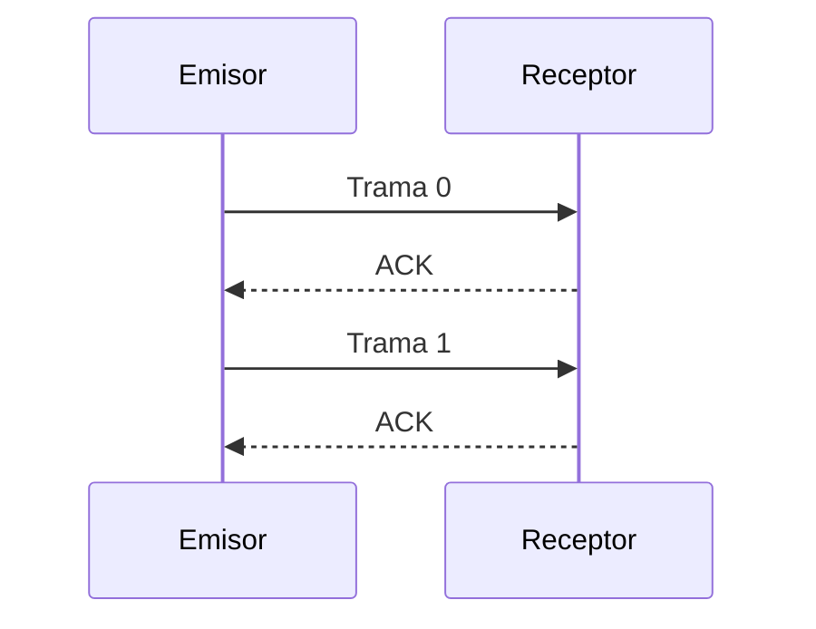

# Unidad 6 — Canales de comunicaciones y control de errores

> El canal altera la señal; sus límites físicos y el tratamiento de los errores determinan cuánta información podemos recuperar confiablemente.

**Por qué importa:** una señal con más niveles puede representar más bits por símbolo, pero no sirve si el receptor los confunde. Esta unidad conecta las señales de U2 y las velocidades de U3 con la capacidad, la degradación física y la recuperación de información.

**Requisitos:** [ancho de banda y Fourier (U2)](../02-senales-telecomunicaciones/APUNTE.md#ancho-banda), [velocidades y multinivel (U3)](../03-redes-telecomunicaciones/APUNTE.md#multinivel) y [U5 información/codificación](../05-teoria-informacion-codificacion/APUNTE.md).

**Fuentes generales:** [filminas U6 de Echazú](../../../material/teoria/U6/U%206%20Canales%20de%20Comunicaciones%20y%20control%20de%20errores.pdf), [filminas U2](../../../material/teoria/U2/U%202%20Características%20de%20las%20señales%20de%20telecom.pdf), [libro de cátedra, edición 2013](../../../material/teoria/DOC-20230425-WA0040.pdf). En las secciones 1–23, «PDF U6» designa las primeras filminas y su página **PDF**, no impresa. La procedencia de esas 23 secciones es [captura del 08/10/2026](../../../capturas/teoria/06-Canales%20de%20comunicaciones/08_10_2026.md), con el mismo número de sección. El libro se usa para aclarar; no añade temas no registrados.

**Cómo leer:** «Base de cátedra» remite a la lámina verificada; «ampliación/apoyo pedagógico» es elaboración explicativa, no una atribución al docente ni una transcripción oral. Las correcciones se documentan acá: captura, PDFs y anexo de 38 láminas no se modifican. El cache sólo permite buscar: NO es fuente independiente.

<a id="cobertura"></a>
## Alcance y cobertura del programa

| Programa U6 | Destino | Evidencia registrada | Cobertura actual |
|---|---|---|---|
| Canal ideal/real; capacidad | [Canal](#canal), [capacidad](#capacidad), [Nyquist](#nyquist), [Shannon](#shannon) | Captura U6 §§1–5; PDF U6 pp.2–7; TP6-I E1–6 | Desarrollo y ejercicios |
| Señalización | [Niveles](#informacion), [ISI](#isi) | PDF pp.4–5,17–18 | Significado físico, baudios y límite sin ISI; no se añade señalización telefónica |
| Ruido, distorsión, S/N y factor de ruido | [Ruido](#ruido), [factor](#factor-ruido), [distorsión](#distorsion) | Captura §§6–10; PDF pp.8–15 | Desarrollo y erratas explícitas |
| Atenuación y unidades de transmisión | [Atenuación](#atenuacion), [decibeles](#decibeles), [balance](#balance-enlace) | U2 clase2; PDF U2 pp.4–11; prácticas4/5 | Fundamento U6; cuentas de enlace permanecen U3 |
| Tasa de error | [BER](#ber) | PDF p.16; TP6-II E4–5,10 | Desarrollo; diagnóstico Ethernet condicionado |
| Detección/paridad/CRC y corrección | [Control](#control) hasta [Hamming](#hamming) | Captura §§14–23; PDF pp.19–38; TP6-II | Todos los métodos desarrollados; Hagelbarger/Bose Chaudhuri sólo nombres registrados |
| Eco y efecto pelicular | [Pendientes](#pendientes) | Programa; no desarrollo específico en captura ni TP6 | **Fuera del alcance registrado actual**: no se incorporan desde bibliografía |

**Estado:** candidato `en-progreso`, no final/revisado. La cobertura de lo registrado no equivale a cubrir todo el programa ni a aprobación de las revisiones independientes.

---

<a id="canal"></a>
## 1. Canales de comunicaciones

**Fuente:** PDF U6, p. 2.

### Fenómeno e intuición (apoyo pedagógico)

**Problema físico:** no alcanza con conectar dos terminales. La señal debe atravesar un medio y seguir siendo interpretable al llegar.

**Modelo mental:** no son necesariamente dos cables diferentes, sino dos miradas sobre la misma comunicación:

### Base de cátedra

El canal es el vínculo que permite efectivizar la comunicación entre terminales. Tiene por objetivo la transferencia máxima de información, libre de errores. Se asocia al **Enlace de Datos del Circuito Teleinformático Básico**.

Comprende dos aspectos:

| Aspecto | Qué considera el PDF |
|---|---|
| **Canal físico** | Características físicas y eléctricas del medio: resistencia, inductancia y capacitancia; efectos de atenuación y distorsión; ruido aditivo. |
| **Canal de información** | Especificación técnica y lógica de la transmisión: codificación, redundancia e integridad de la información. |

Para el análisis, distingue **canal ideal**, sin ruido y libre de errores, y **canal real**, con ruido y con errores.

### Ampliación pedagógica


**Ejemplo mínimo:** queremos enviar `1010`. El canal físico determina qué tensión llega y cómo cambia su forma; el canal de información determina cómo representar esos bits y qué agregar para comprobarlos.

El canal ideal es un **modelo de referencia**. Que no tenga ruido no significa que tenga ancho de banda infinito. El canal real puede cometer errores: no significa que *cada* transmisión tenga obligatoriamente un error.

**Errores típicos:** confundir canal físico con protocolo; suponer que canal ideal equivale a velocidad ilimitada; interpretar el objetivo «libre de errores» como garantía automática de un cable real.

**Para examen:** el canal vincula las terminales y puede analizarse desde sus propiedades físicas o desde el tratamiento lógico de la información. El modelo ideal permite estudiar límites sin ruido; el real incorpora perturbaciones y exige control de errores.

<a id="capacidad"></a>
## 2. Capacidad de un canal

**Fuente:** PDF U6, p. 3.

### Fenómeno e intuición (apoyo pedagógico)

**Problema:** queremos enviar más información por segundo, pero el receptor necesita distinguir lo enviado. El medio y el ruido limitan esa distinción.

**Modelo mental:** capacidad es el techo, no la velocidad que necesariamente estás usando. El ancho de banda es una extensión de frecuencias en **Hz**; la capacidad es una tasa en **bit/s**. NO son la misma magnitud.

### Base de cátedra

La capacidad es la máxima velocidad de transmisión que se puede cursar libre de errores, en el planteo ideal. El PDF la expresa como:

$$
C=V_{t,\max}
$$

Y señala que, si la tasa de información $\Gamma$ supera la capacidad $C$, aparecen errores.

| Símbolo | Significado en esta clase | Unidad |
|---|---|---|
| $C$ | Capacidad del canal | bit/s |
| $V_{t,\max}$ | Velocidad máxima compatible con el modelo | bit/s |
| $\Gamma$ | Tasa de información ofrecida al canal; interpretación del símbolo de la lámina | bit/s |

El PDF relaciona **velocidad de transmisión, ancho de banda, ruido y tasa de errores**.

### Ampliación pedagógica

**Supuesto:** esta definición se interpreta dentro del modelo de canal utilizado. En Shannon, la fiabilidad se entiende como posibilidad de hacer la probabilidad de error arbitrariamente pequeña mediante codificación adecuada, no como una garantía de cero errores en cualquier equipo.

**Ejemplo didáctico:** para un modelo con capacidad de 10 000 bit/s, operar a 6 000 bit/s está por debajo del límite; intentar comunicar información nueva a 12 000 bit/s lo supera. Estar por debajo **no garantiza** que un sistema mal diseñado no cometa errores.

**Errores típicos:** identificar capacidad con velocidad contratada; expresar $C$ en baudios; creer que bajar de $C$ elimina el ruido.

**Para examen:** la capacidad es el límite de tasa de información que el canal puede sostener con la fiabilidad admitida por el modelo. Depende de las restricciones físicas, especialmente ancho de banda y ruido.

<a id="nyquist"></a>
## 3. Nyquist y Hartley: canal sin ruido

**Fuente:** PDF U6, p. 4.

### Fenómeno e intuición (apoyo pedagógico)

**Problema físico:** un canal de banda limitada no conserva cambios arbitrariamente rápidos. Si acercamos demasiado los pulsos, dejan de distinguirse correctamente.

**Concepto y modelo mental:** hay dos usos de Nyquist relacionados, pero NO idénticos:

1. **Muestreo:** cuántas mediciones por segundo necesito para representar una señal analógica.
2. **Señalización:** cuántos símbolos por segundo puedo transmitir sin interferencia intersímbolos en el modelo ideal.

### Base de cátedra

El teorema de Nyquist determina cuántas muestras por unidad de tiempo deben tomarse para reconstruir una señal de forma unívoca. La lámina presenta:

$$
f_N\geq 2f_{\max},\qquad f_N=2\Delta f
$$

También expresa que un canal se comporta como un filtro pasabanda y muestra la capacidad sin ruido para señal binaria y multinivel:

$$
C=2\Delta f\quad\text{(binaria)},\qquad C=2\Delta f\log_2 n\quad\text{(multinivel)}
$$

| Símbolo | Significado | Unidad |
|---|---|---|
| $f_N$ | Frecuencia de muestreo en la notación de la lámina | muestras/s, expresada en Hz |
| $f_{\max}$ | Frecuencia máxima de la señal | Hz |
| $\Delta f=B$ | Ancho de banda considerado | Hz |
| $n$ | Cantidad de niveles distinguibles | adimensional |
| $C$ | Capacidad ideal para esos niveles | bit/s |

### Ampliación pedagógica

Para la señalización ideal en banda base, la formalización usual es:

$$
V_{m,\max}=2B,\qquad V_t=V_m\log_2 n
$$

| Símbolo | Significado | Unidad |
|---|---|---|
| $V_m$ | Velocidad de modulación | baudios, símbolos/s |
| $V_t$ | Velocidad de transmisión | bit/s |
| $B$ | Ancho de banda del modelo | Hz |
| $\log_2 n$ | Bits por símbolo para niveles equiprobables con mapeo binario completo | bit/símbolo |

**Supuestos:** señal limitada en banda para muestreo; canal sin ruido y pulsos adecuados para el límite de señalización; niveles perfectamente distinguibles para Hartley. El mapeo de un número entero de bits por símbolo se ve directamente cuando $n$ es potencia de dos.

**Aclaración de la lámina:** $f_N=2\Delta f$ no debe aplicarse ciegamente a cualquier señal pasabanda sólo por conocer el ancho de su banda. El muestreo pasabanda necesita considerar dónde está ubicada esa banda. Para una señal de banda base, $B=f_{\max}$ y la relación es directa. Además, la igualdad de muestreo NO es garantía universal: una sinusoide situada exactamente en $f_s/2$ puede muestrearse siempre en sus cruces por cero y desaparecer. Se necesita ausencia apropiada de contenido en el borde u otras condiciones ideales; para reconstrucción general se usa margen por encima del doble y filtro antialias. El límite de señalización sin ISI y el de muestreo se distinguen aunque ambos invoquen Nyquist.

### Ejemplos didácticos

- **Muestreo:** una señal de banda base con frecuencia máxima 3 000 Hz tiene un límite teórico de 6 000 muestras/s. No confundirlo con 6 000 bit/s: cada muestra puede codificarse con varios bits.
- **Canal binario:** con $B=3\,000$ Hz y $n=2$, el límite es $2\cdot3\,000\cdot\log_2 2=6\,000$ bit/s, a 6 000 baudios.
- **Cuatro niveles:** con el mismo $B$ y $n=4$, cada símbolo representa 2 bits. El límite pasa a $2\cdot3\,000\cdot2=12\,000$ bit/s, **sin aumentar los 6 000 baudios**.

**Razonabilidad:** aumentar los bits por símbolo aumenta la tasa de bits, no necesariamente la cantidad de símbolos por segundo.

**Errores típicos:** confundir muestras/s, baudios y bit/s; aplicar Hartley a niveles que el ruido no deja distinguir; trasladar sin condiciones el muestreo de banda base al pasabanda.

**Para examen:** Nyquist fija una restricción asociada a la banda disponible. Hartley incorpora cuántos niveles distinguibles se usan: más niveles dan más bits por símbolo en el canal ideal, pero el ruido limita esa ventaja en el canal real.

<a id="informacion"></a>
## 4. Uso de la medida de la información: niveles y bits

**Fuente:** PDF U6, p. 5.

### Fenómeno e intuición (apoyo pedagógico)

**Modelo mental:** un símbolo no es necesariamente un bit; es una elección entre estados físicos. Si hay cuatro elecciones, se pueden representar cuatro combinaciones de dos bits.

### Base de cátedra

La lámina muestra una señal **2B1Q**, dos bits representados por un símbolo cuaternario, con cuatro tensiones: −3 V, −1 V, +1 V y +3 V. Expresa:

$$
N=2^n,\qquad n=\log_2 N
$$

| Símbolo | Significado **en esta lámina** | Unidad |
|---|---|---|
| $N$ | Mensajes, niveles, estados o combinaciones posibles | adimensional |
| $n$ | Cantidad de bits necesarios | bits |

**Atención:** acá $n$ representa bits, mientras que en la fórmula de Hartley de la página anterior representaba **niveles**. En Shannon, $N$ será potencia de ruido. El significado se toma de cada contexto, no de la letra aislada.

### Ampliación pedagógica

La figura asocia `00` a −3 V, `01` a −1 V, `11` a +1 V y `10` a +3 V. La secuencia ilustrada es:

```text
Bits agrupados: 01 | 10 | 11 | 11 | 00 | 10 | 01 | 00 | 01 | 01 | 01
Nivel [V]:      -1 | +3 | +1 | +1 | -3 | +3 | -1 | -3 | -1 | -1 | -1
```

**Supuesto:** agrupamiento fijo de bits y cuatro estados distinguibles según el mapeo mostrado; no estamos calculando la entropía de una fuente con probabilidades desiguales.

**Ejemplo:** cuatro estados requieren $\log_2 4=2$ bits. Una señal de cuatro niveles a 1 000 baudios representa 2 000 bit/s de bits mapeados, antes de descontar cualquier redundancia adicional.

**Error típico:** llamar «digital» sólo a una señal de dos niveles. Una señal digital puede ser multinivel.

<a id="shannon"></a>
## 5. Shannon-Hartley: el ruido limita la capacidad

**Fuente:** PDF U6, pp. 6–7.

### Fenómeno e intuición (apoyo pedagógico)

**Problema físico:** al ubicar muchos niveles dentro del mismo intervalo de amplitudes, quedan cada vez más cerca. Una perturbación pequeña puede hacer que el receptor elija el nivel vecino.

**Modelo mental:** Hartley permite aumentar los estados en el modelo sin ruido; Shannon pone el techo cuando esos estados deben distinguirse en presencia de ruido.

### Base de cátedra

Para canales reales con ruido aditivo existe un límite al aumento de velocidad mediante niveles: el ruido dificulta distinguirlos. La lámina presenta el desarrollo:

$$
C=V_{m,\max}\log_2 n_{\max},\qquad
n_{\max}=\left(1+\frac{S}{N}\right)^{1/2}
$$

$$
C=2\Delta f\log_2\left(1+\frac{S}{N}\right)^{1/2}
=\Delta f\log_2\left(1+\frac{S}{N}\right)
$$

| Símbolo | Significado | Unidad |
|---|---|---|
| $C$ | Capacidad del canal | bit/s |
| $V_{m,\max}$ | Límite de velocidad de modulación usado en el desarrollo | baudios |
| $n_{\max}$ | Número efectivo de niveles en la presentación didáctica | adimensional |
| $S$ | Potencia media de señal | W |
| $N$ | Potencia media de ruido blanco aditivo | W |
| $S/N$ | Relación de potencias **lineal** | veces, adimensional |
| $\Delta f=B$ | Ancho de banda del canal | Hz |

La p. 7 grafica capacidad por unidad de ancho de banda frente a relación señal/ruido, y compara el límite teórico con modulaciones concretas para una BER determinada. La figura indica BER de $10^{-4}$.

### Ampliación pedagógica

**Supuestos y límites:** la expresión de Shannon-Hartley corresponde al canal limitado en banda con ruido aditivo blanco gaussiano, potencia media de señal restringida y posibilidad de codificación adecuada. Es un límite teórico, no la tasa garantizada por una modulación particular. El $n_{\max}$ de la lámina es parte de su explicación del límite, no una receta para elegir un número entero de niveles de cualquier módem.

### Relación señal/ruido en decibeles

**Ampliación pedagógica:** para usar la fórmula hay que convertir los dB a una relación lineal:

$$
\mathrm{SNR}_{dB}=10\log_{10}(S/N),\qquad S/N=10^{\mathrm{SNR}_{dB}/10}
$$

| Símbolo | Significado | Unidad |
|---|---|---|
| $\mathrm{SNR}_{dB}$ | Relación señal/ruido logarítmica | dB |
| $S/N$ | Cociente entre potencias de señal y ruido | adimensional |

**Supuesto:** cociente de **potencias** en el mismo punto y banda de medida. Se usa 10, no 20; el factor 20 corresponde a cocientes de amplitudes cuando las condiciones de impedancia permiten relacionarlos con potencias.

### Ejemplo didáctico completo

Datos: $B=3\,000$ Hz y relación señal/ruido de 30 dB.

1. La relación lineal es $10^{30/10}=1\,000$ veces.
2. En la presentación intermedia del PDF, el número efectivo de niveles es $\sqrt{1\,001}\approx31,64$.
3. La capacidad resulta $3\,000\log_2(1\,001)\approx29\,901,68$ bit/s: **29,90 kbit/s**.

**Razonabilidad:** el logaritmo es adimensional; al multiplicarlo por Hz obtenemos la tasa en bit/s del modelo. Si, *manteniendo la misma relación S/N*, duplicamos $B$, duplicamos $C$. Si mantenemos potencia de señal pero incorporamos más ruido al ampliar la banda, ya no podemos mantener S/N sin justificación.

**Lectura de la p. 7:** no alcanza con decir «tengo más niveles». Debemos saber si el receptor los distingue y con qué probabilidad de error. Los puntos de modulaciones concretas quedan por debajo del límite ideal.

**Errores típicos:** introducir 30 directamente donde va $S/N$; afirmar que más niveles aumentan la capacidad indefinidamente; confundir la frontera de Shannon con una velocidad de operación sin errores garantizada.

**Para examen:** Shannon-Hartley relaciona ancho de banda y relación señal/ruido para establecer la capacidad del canal gaussiano. El ruido limita el beneficio de aumentar los niveles, porque reduce su distinguibilidad.

---


<a id="fenomenos"></a>
## 6. Fenómenos que afectan al canal

**Fuente:** PDF U6, p. 8.

### Base de cátedra

| Fenómeno | Descripción de la lámina |
|---|---|
| **Atenuación** | Disminución de la intensidad de la señal útil; crece con la frecuencia. |
| **Distorsión** | Deformación de la señal original por los efectos reactivos de los canales. |
| **Ruido** | Perturbación o interferencia no deseada que se suma a la señal útil. |

Estos fenómenos pueden producir **errores**.

### Ampliación pedagógica

No son sinónimos. Una señal puede llegar más pequeña conservando su forma, llegar deformada o llegar con una perturbación superpuesta. En un canal real pueden coexistir las tres situaciones.

**Ejemplo:** un pulso de 1 V llega con 0,5 V de amplitud —atenuación—; además llega ensanchado —distorsión—; y sobre él aparece un pico breve no enviado —ruido impulsivo—.

**Aclaración:** «crece con la frecuencia» describe una tendencia importante en medios como conductores, no una ley universal de respuesta monótona de cualquier canal o filtro.

<a id="atenuacion"></a>
## 7. Atenuación

**Fuente:** PDF U6, p. 9.

### Fenómeno e intuición (apoyo pedagógico)

**Problema físico:** parte de la energía útil no alcanza el receptor. Éste tiene menos margen para distinguir la señal del ruido.

**Modelo mental:** comparamos lo que sale con lo que entra. No se mide la potencia absoluta en dB: se expresa un **cociente** de potencias.

### Base de cátedra

La lámina define la relación entre potencia recibida en el destino y potencia transmitida en el origen:

$$
A_{dB}=10\log_{10}\left(\frac{P_2}{P_1}\right)
$$

| Símbolo | Significado | Unidad |
|---|---|---|
| $P_1$ | Potencia transmitida en el origen | W |
| $P_2$ | Potencia recibida en el destino | W |
| $A_{dB}$ | Atenuación según la **convención negativa del PDF** | dB |

Para $P_2<P_1$ es negativa. Cuanto más negativa, peor; el ideal es 0 dB.

### Ampliación pedagógica

**Supuestos:** potencias positivas medidas en condiciones comparables; usamos un medio con pérdida, sin una ganancia intermedia que cambie el planteo.

**Ejemplo didáctico:** se transmiten 100 mW y llegan 10 mW. El cociente es 0,1 y la cuenta da $10\log_{10}(0,1)=-10$ dB. Llega una décima parte de la potencia. Si sólo llega 1 mW, obtenemos −20 dB: una centésima parte.

**Aclaración de convención:** también se usa «pérdida» como $L_{dB}=10\log_{10}(P_1/P_2)=-A_{dB}$, positiva. Con el ejemplo anterior son **10 dB de pérdida**, equivalentes a **−10 dB en la convención del PDF**. $L_{dB}$ es la pérdida en dB; $P_1$ y $P_2$ conservan los significados de la tabla y los mismos supuestos.

**Errores típicos:** invertir el cociente sin avisar; tratar −20 dB como mejor que −10 dB; confundir dB con dBm; aplicar 20 al cociente de potencias.

**Para examen:** la atenuación disminuye la potencia útil recibida. En este material se expresa con el cociente recibido/transmitido, por lo que una pérdida produce un valor negativo en dB.

<a id="decibeles"></a>
<a id="db"></a>
## 7.1. Decibeles: relaciones, niveles y balance

**Fuentes:** PDF U2 pp.4–11; [captura U2 clase2](../../../capturas/teoria/02-senales-telecomunicaciones/apuntes-clase%202.md), desde «unidades de transmisión» hasta «divisor»; [práctica4](../../../capturas/practica/clase%2004.md), unidades de transmisión y amplificación. Las cuentas aplicadas se conservan completas en [TP3 E12–18](../../practica/tp-03-redes.md) y [E19 existente](../../practica/tp-03-ejercicio-19-calculo-enlace.md); enlazarlos NO declara revisión de U7.

### Problema, concepto y modelo mental

Una cadena puede amplificar decenas de miles de veces y después perder gran parte de esa potencia. Multiplicar todos esos factores lineales es incómodo. El logaritmo convierte los productos en sumas: **dB expresa una relación**, no una potencia sola. «Absoluto» en la clasificación de cátedra significa nivel referido a una referencia fija, no ausencia de referencia.

### Formalización de relaciones

$$
G_{dB}=10\log_{10}(P_2/P_1),\qquad P_2/P_1=10^{G_{dB}/10}
$$

$$
G_{dB}=20\log_{10}(V_2/V_1),\qquad G_{dB}=20\log_{10}(I_2/I_1)
$$

| Símbolo | Significado | Unidad |
|---|---|---|
| $P_1,P_2$ | Potencias de entrada/salida | W (o ambas mW) |
| $V_1,V_2$ | Tensiones eficaces comparadas | V |
| $I_1,I_2$ | Corrientes eficaces comparadas | A |
| $G_{dB}$ | Ganancia, positiva o negativa | dB |

**Supuestos:** magnitudes positivas o amplitudes eficaces; las relaciones de tensión/corriente representan una **relación de potencias** sólo con las condiciones de impedancia apropiadas (aquí resistencias iguales). Para impedancias complejas no es correcto usar indiscriminadamente $P=V^2/Z$: potencia activa se calcula considerando parte real y fase. En cargas resistivas, $P=V^2/R=I^2R$, con $P$ [W], $R$ [Ω], $V$ [V], $I$ [A]. Por ejemplo 2 V eficaces en 100 Ω producen 0,04 W y 0,02 A; elevar la tensión a 4 V produce 0,16 W: cuatro veces potencia, no dos.

**Ejemplos registrados recalculados:** 10 W→20 W y 40 W→80 W dan 3,0103 dB; 10 W→40 W da 6,0206 dB. Duplicar tensión o corriente sobre la misma resistencia da 6,0206 dB. El equipo de PDF U2 p.9 declara 43 dB: $10^{43/10}=19\,952,62$ veces de **potencia**, no de tensión. La relación de tensiones sería $10^{43/20}=141,25$ sobre igual resistencia.

| dB de potencia | Veces exactas o aproximadas |
|---:|---:|
| 3 | 1,9953 (≈2) |
| 6 | 3,9811 (≈4) |
| 10 / 20 / 30 / 40 | 10 / 100 / 1 000 / 10 000 |
| −3 / −6 / −10 | 0,5012 / 0,2512 / 0,1 |

Los «doble/mitad» de la tabla de clase son aproximaciones. 3 dB no es exactamente 2.

### Ejemplo de equipo registrado, no catálogo vigente

El equipo mostrado en PDF U2 p.9 (GainMaker, amplificador de 1 GHz) diferencia ganancia y ruido:

| Parámetro del ejemplo | Valor registrado | Qué leer |
|---|---:|---|
| Ganancia operativa mínima | 43 dB | Relación de potencia salida/entrada |
| Internal Tilt (con tolerancia ±0,5 dB en la lámina) | 15,5 dB | Diferencia de ganancia a lo largo de la banda; no es otra ganancia uniforme que se sume automáticamente |
| Figura de ruido a 54 MHz | 8,5 dB | Degradación de S/N, no aumento de señal |
| Figura de ruido a 1 GHz | 8,0 dB | Otra condición de frecuencia, no contradicción del valor anterior |

El significado de figura de ruido se desarrolla en [factor de ruido](#factor-ruido). Una salida más potente no equivale a S/N mejor.

<a id="dbm"></a>
### dBm: potencia referida a 1 mW

$$
P_{dBm}=10\log_{10}\left(\frac{P}{1\,\mathrm{mW}}\right),\qquad
P=1\,\mathrm{mW}\,10^{P_{dBm}/10}
$$

| Símbolo | Significado | Unidad |
|---|---|---|
| $P$ | Potencia física positiva | mW |
| $P_{dBm}$ | Nivel de esa potencia referido a 1 mW | dBm |

**Supuesto:** referencia fija de 1 mW; no hace falta fijar impedancia para definir una potencia. **Ejemplos:** 1 mW=0 dBm; 10 mW=10 dBm; 100 mW=20 dBm; 0,1 mW=−10 dBm. Nivel negativo NO significa potencia física negativa. Restar dos niveles en dBm da la relación en dB: 20 dBm−10 dBm=10 dB; sumar 10 dBm+20 dBm NO suma las potencias.

<a id="dbmv"></a>
### dBmV: tensión referida a 1 mV

$$
V_{dBmV}=20\log_{10}\left(\frac{V}{1\,\mathrm{mV}}\right),\qquad
V=1\,\mathrm{mV}\,10^{V_{dBmV}/20}
$$

| Símbolo | Significado | Unidad |
|---|---|---|
| $V$ | Tensión eficaz positiva | mV |
| $V_{dBmV}$ | Nivel referido a 1 mV | dBmV |

**Supuesto:** amplitudes medidas con el mismo criterio. Para pasar a **potencia/dBm** se necesita la impedancia. **Ejemplos registrados:** 42,9 dBmV→139,637 mV; 2,3 dBmV→1,3032 mV (PDF U2 p.10, no valores «típicos universales» de cable módem).

### Atenuación dependiente de frecuencia, cortes y divisores

PDF U2 p.7 define banda mediante puntos de **3 dB de pérdida** respecto de la referencia indicada. Equivalen a −3 dB de ganancia y a 0,5012 de potencia, o 0,70795 de amplitud con igual resistencia. Esto es un criterio de corte, no la definición universal de toda banda. El desarrollo espectral permanece en [U2](../02-senales-telecomunicaciones/APUNTE.md#ancho-banda).

La tabla del cable **F6TSVM** de 75 Ω (PDF U2 p.11) sirve para leer **pérdidas**, no para abrir teoría de coaxial U7:

| MHz | dB/100 ft (máx.) | dB/100 m (máx.) |
|---:|---:|---:|
| 5 | 0,58 | 1,90 |
| 55 | 1,60 | 5,25 |
| 83 | 1,95 | 6,40 |
| 187 | 2,85 | 9,35 |
| 211 | 3,05 | 10,00 |
| 250 | 3,30 | 10,82 |
| 300 | 3,55 | 11,64 |
| 350 | 3,85 | 12,63 |
| 400 | 4,15 | 13,61 |
| 450 | 4,40 | 14,43 |
| 500 | 4,66 | 15,29 |
| 550 | 4,90 | 16,08 |
| 600 | 5,10 | 16,73 |
| 750 | 5,65 | 18,54 |
| 865 | 6,10 | 20,01 |
| 1000 | 6,55 | 21,49 |

$$
L_{cable}=L_{100m}\frac{\ell}{100\,\mathrm m}
$$

| Símbolo | Significado | Unidad |
|---|---|---|
| $L_{cable}$ | Pérdida total positiva | dB |
| $L_{100m}$ | Pérdida especificada de un tramo de 100 m | dB |
| $\ell$ | Longitud efectiva | m |

**Supuestos:** misma frecuencia y cable uniforme, sin añadir conectores ni divisores dentro del coeficiente. **Ejemplo didáctico sobre dato registrado:** 50 m a 1000 MHz pierden $21,49(50/100)=10,745$ dB; 50 m a 5 MHz pierden 0,95 dB. La tendencia creciente es de **este cable**, no de todo canal.

Un divisor ideal de dos salidas iguales entrega la mitad de la potencia de entrada en cada una: por ejemplo 10 mW→5 mW por salida. El cociente 0,5 representa −3,0103 dB de ganancia (3,0103 dB de pérdida) por rama; un divisor real agrega pérdidas propias. No se destruye la otra mitad: va a la otra salida en el modelo ideal.

<a id="balance-enlace"></a>
<a id="balance"></a>
### Balance, sensibilidad y margen

**Problema:** el receptor necesita un nivel mínimo; no basta sumar una ganancia total sin revisar el nivel a lo largo del camino. Modelo mental: empezá en dBm y avanzá sumando ganancias y restando pérdidas **en dB**.

$$
P_{Rx,dBm}=P_{Tx,dBm}+\sum G_{dB}-\sum L_{dB},\qquad
M=P_{Rx,dBm}-S_{Rx,dBm}
$$

| Símbolo | Significado | Unidad |
|---|---|---|
| $P_{Tx,dBm},P_{Rx,dBm}$ | Niveles transmitido/recibido | dBm |
| $G_{dB},L_{dB}$ | Ganancia y pérdida positiva de cada etapa | dB |
| $S_{Rx,dBm}$ | Sensibilidad: mínimo nivel aceptable para criterio de calidad especificado | dBm |
| $M$ | Margen disponible | dB |

**Supuestos:** cadena lineal, sin saturación y pérdidas al punto/frecuencia de trabajo; se comparan sensibilidades al mismo criterio de calidad. **Ejemplo del esquema registrado (PDF U2 p.8 / práctica4):** −5 dBm, dos ganancias de 10 dB, dos conectores de 0,5 dB y 2 km a 0,2 dB/km dan pérdida de cable 0,4 dB y recibido 13,6 dBm. Si se exige margen de 3 dB, la sensibilidad del receptor elegido debe ser **como máximo 10,6 dBm**. Es el umbral límite del diseño, no una medición de sensibilidad ni una razón para decir que todo receptor tiene ese valor. Desarrollo de ejercicios: [TP3](../../practica/tp-03-redes.md).

**Errores típicos:** mezclar dB con dBm/dBmV; usar 20 para potencia; «0 dBm no hay señal»; sumar niveles como potencias; confundir sensibilidad con recibido; ignorar saturación de amplificadores o receptor.

**Para examen:** dB expresa cocientes y permite sumar las variaciones de una cadena. dBm y dBmV son niveles con referencias fijas; el balance calcula qué llega y el margen lo compara con el mínimo que requiere el receptor.

<a id="ruido"></a>
## 8. Tipos de ruido

**Fuente:** PDF U6, pp. 10–13.

### 8.1. Ruido de origen térmico (denominado de Johnson): modelo de cátedra blanco y gaussiano

**Base de cátedra, p. 10:** surge de la agitación térmica de los electrones y está presente en medios de transmisión y dispositivos electrónicos.

$$
N=kTB
$$

| Símbolo | Significado | Unidad |
|---|---|---|
| $N$ | Potencia de ruido térmico | W |
| $k$ | Constante de Boltzmann, valor usado en el PDF: $1,38\cdot10^{-23}$ | J/K |
| $T$ | Temperatura absoluta | K |
| $B$ | Ancho de banda | Hz |

**Ampliación pedagógica — problema y modelo mental:** incluso sin una fuente interferente externa, el movimiento térmico introduce fluctuaciones. Más temperatura o más banda de recepción implican más potencia de este ruido en el modelo.

**Supuestos:** aproximación clásica de ruido térmico; potencia disponible en una banda $B$ con condiciones de adaptación apropiadas. Si el filtro no es ideal, se utiliza su ancho de banda equivalente de ruido. $T$ debe estar en kelvin, no en grados Celsius.

**Ejemplo didáctico:** para $T=300$ K y $B=3\,000$ Hz, la potencia es $1,38\cdot10^{-23}\cdot300\cdot3\,000=1,242\cdot10^{-17}$ W. Con 6 000 Hz y la misma temperatura es $2,484\cdot10^{-17}$ W.

**Razonabilidad:** el resultado es pequeño, pero no nulo. Un receptor que trabaja con señales muy débiles debe tenerlo en cuenta.

**Aclaración:** los términos describen propiedades diferentes: *térmico* indica el origen; *blanco*, una densidad espectral aproximadamente plana en la banda; *gaussiano*, la distribución de amplitudes. La lámina los reúne para este modelo, pero no todo ruido blanco tiene necesariamente origen térmico ni distribución gaussiana.

**Errores típicos:** decir que un cable quieto no tiene ruido; introducir Celsius; confundir «blanco» con «amplitud constante».

**Para examen:** el ruido térmico tiene origen en la agitación de los portadores y su potencia disponible aumenta con temperatura y ancho de banda. En el modelo empleado se trata como ruido blanco y gaussiano.

### 8.2. Diafonía o crosstalk

**Base de cátedra, p. 11:** acoplamiento inductivo entre líneas que transportan señales.

- **NEXT:** mide la diafonía en el extremo donde se inyecta la señal, extremo cercano.
- **FEXT:** mide la diafonía en el extremo donde se recibe la señal, extremo lejano.

La expresión del PDF es:

$$
\mathrm{NEXT}_{dB}=10\log_{10}\left(\frac{P_2}{P_1}\right)
$$

| Símbolo | Significado en la figura | Unidad |
|---|---|---|
| $P_1$ | Potencia de la señal que provoca el acoplamiento | W |
| $P_2$ | Potencia acoplada a la otra línea, medida cerca del transmisor | W |
| $\mathrm{NEXT}_{dB}$ | Cociente logarítmico en la convención negativa del PDF | dB |

Lo ideal, según la lámina, es una diafonía infinitamente negativa, con potencia acoplada nula.

**Ampliación pedagógica:** una línea se comporta como «agresora» y otra como «víctima». La víctima recibe algo que no debía recibir. Además del acoplamiento inductivo, puede existir acoplamiento capacitivo; esta observación amplía, no reemplaza, el enfoque de la lámina.

**Supuestos:** medición de potencias comparables en el extremo definido y cociente acoplada/inyectada. Para potencia acoplada cero, el logaritmo no tiene un valor finito: el ideal se expresa como un límite hacia menos infinito.

**Ejemplo didáctico:** si $P_1=1$ mW y $P_2=1$ nW, el cociente es $10^{-6}$ y NEXT resulta −60 dB. Si $P_2$ aumenta a 10 nW, resulta −50 dB: hay más interferencia y es peor según esta convención.

**Aclaración:** también se publican valores de *pérdida NEXT* positivos, con el cociente inverso. Antes de comparar, revisá el signo y cómo se definió la razón.

**Error típico:** creer que FEXT significa «más ruido» que NEXT; los nombres indican **dónde se mide**, no cuál tiene más magnitud.

### 8.3. Ruido impulsivo

**Base de cátedra, p. 12:** aparece a intervalos irregulares, con picos breves de gran amplitud, no continuamente; su origen puede ser difícil de localizar. La figura muestra errores en bits por superar el umbral de detección.

**Ampliación pedagógica:** no importa sólo la potencia media. Un pico breve puede atravesar el umbral justo cuando se decide un bit.

**Ejemplo didáctico:** un impulso de 2 ms durante una transmisión de 1 000 bit/s abarca aproximadamente dos intervalos de bit. Puede provocar varios errores próximos, aunque que un bit efectivamente falle depende de la forma del impulso y del receptor.

**Relación con la unidad:** ayuda a entender por qué interesa proteger también contra ráfagas, no sólo contra errores aislados.

### 8.4. Productos de intermodulación, PIM

**Base de cátedra, p. 13:** el comportamiento no lineal de transmisores, receptores o sistemas que transportan señales produce nuevas componentes:

$$
f_1+f_2,\quad f_1-f_2,\quad f_1+2f_2,\quad f_1-2f_2,\quad
2f_1+f_2,\quad 2f_1-f_2,\ldots
$$

| Símbolo | Significado | Unidad |
|---|---|---|
| $f_1,f_2$ | Frecuencias de componentes presentes a la entrada | Hz |
| Combinaciones | Frecuencias de productos de intermodulación | Hz |

**Supuestos:** hay no linealidad y señales simultáneas. Para representar frecuencias físicas no negativas se toma el valor absoluto de las diferencias cuando corresponde. No todos los productos tienen igual amplitud ni necesariamente caen en la banda útil.

**Ampliación pedagógica y ejemplo:** con tonos de 1 000 Hz y 1 200 Hz, la suma aparece a 2 200 Hz y la diferencia a 200 Hz. Productos de tercer orden como $2f_1-f_2$ y $2f_2-f_1$ aparecen a 800 Hz y 1 400 Hz. Si caen dentro de la banda que el receptor acepta, pueden interferir.

**Error típico:** atribuir nuevas frecuencias a una simple suma en un sistema lineal. La generación de estos productos requiere **no linealidad**.

<a id="factor-ruido"></a>
## 9. Factor de ruido de amplificadores o canales

**Fuente:** PDF U6, p. 14; contraste de ganancia: libro de cátedra (2013), §3.5.6, PDF199–200 / impresas173–174.

### Fenómeno e intuición (apoyo pedagógico)

**Problema físico:** un amplificador puede aumentar la señal, amplificar el ruido que ya venía y agregar ruido propio. Una señal de salida más grande no implica una relación S/N mejor.

**Modelo mental:** preguntamos cuánto se degradó la calidad, no sólo cuánto aumentó la amplitud.

### Base de cátedra

$$
F_r=\frac{(S/N)_i}{(S/N)_o}=\frac{N_o}{G N_i},\qquad F_r\geq1
$$

| Símbolo | Significado | Unidad |
|---|---|---|
| $F_r$ | Factor de ruido | adimensional |
| $(S/N)_i,(S/N)_o$ | Relación señal/ruido a la entrada y salida | veces |
| $N_i,N_o$ | Potencia de ruido a la entrada y salida | W |
| $G$ | Ganancia de potencia de señal | veces, adimensional |

### Ampliación pedagógica

**Supuestos:** mismo ancho de banda de referencia y relaciones lineales; ganancia definida por la señal, de modo que la potencia de señal de salida es $G$ veces la de entrada. La igualdad con $N_o/(GN_i)$ usa esa relación. La interpretación convencional del factor de ruido emplea una referencia de ruido de entrada especificada.

**Erratas de la figura:** junto al amplificador se escribe que la señal de entrada es la de salida multiplicada por la ganancia. Para la ganancia de potencia usada en la ecuación principal debe ser al revés: **salida = ganancia × entrada**. Además, la leyenda inferior llama «entrada» a las magnitudes de salida. Los rótulos permanecen intactos en el original; no se usan para hacer las cuentas. El libro Castro Lechtaler/Fusario (2013), §3.5.6, PDF 199 / impresa 173, ecuación (3-40), confirma $S_2=S_1G$. Su figura 3.21 (PDF 200 / impresa 174) también tiene los rótulos erróneos: el texto y la identidad de ganancia permiten resolverlos, no la autoridad del dibujo por sí sola.

**Ejemplo didáctico:** S/N de entrada 100 y de salida 50 dan $F_r=100/50=2$. Con $G=10$, $N_i=1$ nW y $N_o=20$ nW también obtenemos $20/(10\cdot1)=2$.

Para expresarlo como **figura de ruido** en dB se usa, como ampliación:

$$
NF=10\log_{10}F_r
$$

| Símbolo | Significado | Unidad |
|---|---|---|
| $NF$ | Figura de ruido | dB |
| $F_r$ | Factor de ruido lineal | adimensional |

**Supuestos:** los mismos de $F_r$, positivo y expresado en veces. En el ejemplo, $NF=10\log_{10}2\approx3,01$ dB. El ideal es $F_r=1$, equivalente a 0 dB: **sin degradación adicional**, no «sin ruido de entrada».

**Errores típicos:** creer que amplificar elimina ruido; introducir ganancia en dB en una fórmula que exige veces; confundir factor y figura de ruido.

**Para examen:** el factor de ruido compara la relación señal/ruido antes y después del dispositivo. Cuantifica su degradación; un dispositivo ideal no la degrada y tiene factor uno.


<a id="distorsion"></a>
## 10. Distorsión y ecualización

**Fuente:** PDF U6, p. 15.

### Fenómeno e intuición (apoyo pedagógico)

**Problema físico:** una señal compleja reúne componentes de distintas frecuencias. Para conservar su forma, deben llegar con proporciones de amplitud y relaciones temporales adecuadas.

**Modelo mental:** si algunas componentes se debilitan más que otras o llegan con retardos diferentes, al recomponerlas no obtenemos la forma original.

### Base de cátedra

**Aclaración de procedencia:** la captura agrega que la distorsión es más perjudicial que la atenuación. La lámina 15 no formula esa comparación. Una deformación puede complicar la decisión más que una pérdida uniforme, pero la gravedad depende del margen y del receptor: NO es un orden universal.

La lámina distingue **distorsión por atenuación**, **por retardo de grupo** y **por efectos meteorológicos en radio**. Para las dos primeras señala técnicas de **ecualización**.

También incluye un modelo de impedancia compleja de un circuito RLC serie:

$$
Z(j\omega)=R+j\left(\omega L-\frac{1}{\omega C_e}\right),\qquad
X=X_L-X_C
$$

| Símbolo | Significado | Unidad |
|---|---|---|
| $Z$ | Impedancia compleja | Ω |
| $R$ | Resistencia | Ω |
| $j$ | Unidad imaginaria; en la figura se usa una grafía equivalente | adimensional |
| $\omega$ | Frecuencia angular | rad/s |
| $L$ | Inductancia | H |
| $C_e$ | Capacitancia; se agrega el subíndice para no confundirla con capacidad del canal | F |
| $X_L=\omega L$ | Reactancia inductiva | Ω |
| $X_C=1/(\omega C_e)$ | Magnitud de reactancia capacitiva | Ω |
| $X$ | Reactancia neta | Ω |

**Supuestos:** régimen sinusoidal y modelo concentrado RLC **serie**. Es el modelo ilustrativo de la figura, no una descripción completa de cualquier línea de transmisión distribuida.

**Ejemplo didáctico:** con $\omega=1\,000$ rad/s, $R=10$ Ω, $L=0,02$ H y $C_e=100$ μF, tenemos $X_L=20$ Ω, $X_C=10$ Ω y $Z=10+j10$ Ω. El término reactivo explica por qué la respuesta depende de la frecuencia.

### Ampliación pedagógica

- **Por atenuación:** no se atenúan todas las componentes por igual. Ejemplo: una componente de 1 000 Hz pierde 3 dB y otra de 2 000 Hz pierde 10 dB; cambia su proporción.
- **Por retardo de grupo:** distintas porciones espectrales experimentan distintos retardos. Ejemplo: una componente llega a 1 ms y otra a 2 ms; el pulso puede ensancharse.
- **Meteorológica en radio:** las condiciones de propagación pueden cambiar la señal recibida. Como apoyo general, lluvia o variaciones atmosféricas pueden afectar ciertos enlaces; el efecto depende de frecuencia y trayecto, no es igual en toda radiocomunicación.

**Ecualizar** es compensar la respuesta del canal en amplitud y/o fase. No equivale a «subir el volumen»: una amplificación uniforme no restituye relaciones entre componentes que se alteraron de manera diferente. Tampoco garantiza eliminar ruido aleatorio.

**Errores típicos:** llamar distorsión a toda pérdida uniforme de potencia; confundir retardo común con retardo diferencial; suponer que ecualización equivale a control de errores por CRC.

**Para examen:** la distorsión modifica la forma porque el canal trata de manera diferente las componentes de la señal. La ecualización busca compensar esa respuesta; actúa sobre la señal, mientras que el control de errores comprueba o recupera la información.

<a id="ber"></a>
## 11. Tasa de error: BER

**Fuente:** PDF U6, p. 16.

### Fenómeno e intuición (apoyo pedagógico)

**Problema y modelo mental:** no basta con afirmar que hubo errores; debemos compararlos con la cantidad total de bits observados. La BER medida es una estimación sobre ese conjunto, no una certeza sobre todos los bits futuros.

### Base de cátedra

$$
\mathrm{BER}=\frac{b_{err}}{b_{tx}}
$$

| Símbolo | Significado | Unidad |
|---|---|---|
| $b_{err}$ | Cantidad de bits erróneos | bits contados |
| $b_{tx}$ | Cantidad de bits transmitidos considerados | bits contados |
| BER | Proporción de bits erróneos | adimensional |

La lámina identifica **ancho de banda y ruido** como limitantes físicos de los sistemas.

### Ampliación pedagógica

**Supuestos:** contamos errores y bits sobre el mismo intervalo y punto de observación; se distingue si se mide antes o después de una corrección, cuando corresponda.

**Ejemplo didáctico:** 10 bits erróneos entre 1 000 000 transmitidos dan BER $10^{-5}$, equivalente a 0,001 %. Un bit erróneo cada 100 000 es una interpretación **promedio**, no un error periódico cada 100 000 posiciones.

**Errores típicos:** expresar BER en bit/s; confundir error de bit con error de bloque; concluir que observar cero errores en un ensayo finito demuestra una probabilidad de error exactamente nula.

**Para examen:** BER expresa la proporción de bits erróneos sobre el total considerado. Permite evaluar la calidad de la transmisión y relacionarla con las restricciones de banda y ruido.

<a id="banda-pulsos"></a>
## 12. Efecto del ancho de banda sobre una señal digital

**Fuente:** PDF U6, p. 17, figura 2.36 reproducida en la lámina.

### Fenómeno e intuición (apoyo pedagógico)

**Problema físico:** un pulso rectangular ideal contiene componentes de frecuencia alta. Un canal de banda limitada no deja pasar todas ellas.

**Modelo mental:** el canal «redondea» los bordes porque recorta componentes que ayudaban a hacerlos abruptos. Con banda muy estrecha, las contribuciones de pulsos vecinos se mezclan.

### Base de cátedra

La figura compara una señal digital periódica de **2 000 bit/s**, secuencia `01000010`, al atravesar canales con:

- ancho de banda infinito;
- 4 000 Hz;
- 900 Hz;
- 300 Hz.

Al reducirse la banda, se pierde la forma rectangular y se suavizan las transiciones.

### Ampliación pedagógica

**Ejemplo numérico de lectura:** a 2 000 bit/s cada intervalo de bit dura 0,5 ms. La figura mantiene esa velocidad mientras cambia la banda: **2 000 bit/s no significa 2 000 Hz**.

**Error típico:** concluir que una señal deja de representar información digital porque su forma recibida ya no es rectangular. Lo relevante es si el receptor puede decidir los símbolos correctamente.


<a id="isi"></a>
## 13. Interferencia intersímbolos, ISI

**Fuente:** PDF U6, p. 18, figura 2.41.

### Fenómeno e intuición (apoyo pedagógico)

**Problema físico:** un pulso puede prolongarse más allá de su intervalo y aportar tensión cuando el receptor está decidiendo otro símbolo.

**Concepto:** la ISI es la influencia de otros símbolos sobre la decisión del símbolo actual. Puede aparecer por banda limitada y respuesta temporal del canal; **no necesita ruido aleatorio** para existir.

**Modelo mental:** cada pulso deja una «cola». El receptor ve la suma del pulso actual y de colas vecinas.

### Base de cátedra

La figura muestra pulsos que se superponen en intervalos sucesivos y señala **interferencia intersímbolos**. Identifica $\tau$ como ancho de pulso.

### Ampliación pedagógica

**Ejemplo didáctico:** a 1 000 símbolos/s el intervalo es 1 ms. Si el pulso recibido mantiene una contribución importante durante 1,5 ms, puede afectar la decisión siguiente. Suponer esa cola sirve para ilustrar el problema, no para establecer un umbral universal de error.

**Matiz:** una superposición temporal no implica automáticamente ISI en los instantes de decisión: el diseño de pulsos de Nyquist puede anular las contribuciones vecinas precisamente en esos instantes.

**Errores típicos:** tratar ISI como sinónimo de ruido; pensar que todos los pulsos deben ser rectángulos perfectos; considerar que todo solapamiento es perjudicial sin mirar los instantes de muestreo.

**Para examen:** la ISI aparece cuando símbolos vecinos contribuyen a la muestra utilizada para decidir el actual. Se relaciona con la respuesta del canal y el diseño de pulsos; puede mitigarse con ecualización y señalización adecuada.

---


<a id="control"></a>
## 14. Detección y corrección: redundancia y compromisos

**Fuente:** PDF U6, pp. 19–23. La p. 23 es el separador «Detección».

### Fenómeno e intuición (apoyo pedagógico)

**Problema:** si todas las combinaciones de bits fueran datos válidos, una alteración podría transformar un mensaje válido en otro sin dejar evidencia. La redundancia introduce relaciones que el receptor puede comprobar.

**Modelo mental:** la información adicional no es «basura»; es el costo de poder distinguir una recepción consistente de una inconsistente.

### Base de cátedra

El control de errores comprende **detección** y **corrección**, requiere datos adicionales y establece compromisos.

La eficiencia de transmisión se define como:

$$
E=\frac{b_{info}}{b_{tot}}
$$

| Símbolo | Significado | Unidad |
|---|---|---|
| $E$ | Fracción de bits que llevan información útil | adimensional o % |
| $b_{info}$ | Bits de información | bits |
| $b_{tot}$ | Bits totales transmitidos en el bloque considerado | bits |

Las pp. 20–21 indican:

- Más redundancia $R$: más protección contra errores, pero menor eficiencia $E$.
- Mayor tamaño de bloque $T_b$ en transmisión sincrónica: mayor eficiencia, pero si hay errores puede disminuir la eficiencia efectiva.
- Mayor velocidad de transmisión $V_{tx}$: mayor probabilidad de error y BER, como compromiso de diseño.

Aquí $R$ refiere a redundancia y $T_b$ al **tamaño** de bloque; no confundirlos con resistencia ni con un tiempo.

### Ampliación pedagógica

**Supuestos de $E$:** contamos información y sobrecarga con un criterio explícito. Esta eficiencia de formato no incluye automáticamente esperas, retransmisiones o pérdidas. Para rendimiento útil real deben considerarse también esos costos.

**Ejemplo didáctico:** 100 bits útiles más 20 de control dan $E=100/120\approx83,33\%$. Con 100 bits útiles más 40 de control resulta $100/140\approx71,43\%$.

**Compromiso de tamaño:** con 20 bits fijos de control, 1 000 bits útiles dan $1\,000/1\,020\approx98,04\%$. Pero, si se retransmite todo el bloque ante un error, repetir ese bloque cuesta mucho más que repetir el de 120 bits. Bajo una misma probabilidad de error por bit, más bits también ofrecen más oportunidades de que el bloque falle.

**Compromiso de velocidad:** la tendencia de la lámina se entiende manteniendo condiciones comparables de banda, potencia y esquema de transmisión. No es una ley universal que toda tecnología más rápida tenga siempre mayor BER: cambiar codificación, medio o S/N puede cambiar el resultado.

**Matiz de redundancia:** añadir más bits no asegura protección mejor por sí solo; importa cómo se construye el código y contra qué errores protege.

### Mapa de métodos de la p. 22

| Acción | Familia | Métodos nombrados |
|---|---|---|
| Detección | Control de paridad | Vertical —la imagen escribe «VCR»—, longitudinal LRC, bidimensional o doble paridad, cíclica o entrelazada |
| Detección | Código polinomial | Desarrollo posterior mediante CRC |
| Corrección | Códigos autocorrectivos | Hamming, Hagelbarger, Bose Chaudhuri |
| Corrección | Técnicas especiales de transmisión | FEC y ARQ |

**Aclaración de sigla:** la denominación habitual es **VRC**, *Vertical Redundancy Check*. Se conserva «VCR» como rótulo de la imagen, no como una familia diferente. **LRC** significa *Longitudinal Redundancy Check*. Hagelbarger y Bose Chaudhuri sólo se nombran en el esquema: el PDF no desarrolla su construcción y este apunte tampoco inventa ese desarrollo.

**Errores típicos:** confundir detectar con corregir; tratar la eficiencia de formato como rendimiento efectivo; creer que más redundancia siempre gana sin considerar su estructura.

**Para examen:** controlar errores exige información adicional y recursos. El diseño equilibra protección, eficiencia, tamaño de bloque y velocidad, distinguiendo la comprobación de errores de la recuperación de los datos.

<a id="paridad"></a>
## 15. Paridad par, impar, longitudinal y bidimensional

**Fuente:** PDF U6, pp. 24–25.

### Fenómeno e intuición (apoyo pedagógico)

**Problema:** necesitamos una comprobación simple que permita advertir ciertas alteraciones.

**Modelo mental:** si un único bit se invierte, falla su fila y su columna. La intersección permite localizarlo bajo el supuesto de **un solo error**.

### Base de cátedra: par e impar

La p. 24 muestra el carácter `01101101100`:

| Criterio | Bit agregado | Dato mostrado (control aparte) |
|---|---|---|
| Paridad par | 0 | `01101101100` |
| Paridad impar | 1 | `01101101100` |

### Ampliación pedagógica

**Concepto y modelo mental:** se agrega un bit para que la cantidad **total de unos, incluido el bit de paridad**, sea par o impar según lo acordado.

**Regla formal de paridad par:** el bit agregado es el XOR de los bits de datos. XOR da 1 cuando las entradas son distintas y 0 cuando son iguales. No hay magnitudes físicas en esta operación: cada entrada y salida es un bit lógico.

**Supuestos:** emisor y receptor usan el mismo criterio y verifican el mismo grupo de bits.

**Ejemplo de la fuente explicado:** `01101101100` tiene seis unos. Para paridad par se agrega 0 y quedan seis; para impar se agrega 1 y quedan siete.

Con el dato didáctico `1011`, hay tres unos: el bit par es 1 y el impar es 0. Un cambio de un bit cambia la paridad; **dos cambios la pueden conservar**.

**Límite:** una comprobación simple de paridad detecta todo número impar de inversiones dentro de su grupo, pero no detecta un número par. No indica por sí sola cuál bit cambiar.

### Base de cátedra: tabla longitudinal y vertical, p. 25

Se reproduce la tabla de paridad par. Cada columna corresponde a un dato; la columna derecha es el **BCC**, carácter de comprobación de bloque.

| Posición | Dato 1 | Dato 2 | Dato 3 | Dato 4 | Dato 5 | BCC |
|---|---:|---:|---:|---:|---:|---:|
| Bit 1 | 1 | 1 | 0 | 1 | 0 | 1 |
| Bit 2 | 1 | 1 | 0 | 1 | 1 | 0 |
| Bit 3 | 1 | 1 | 0 | 1 | 0 | 1 |
| Bit 4 | 0 | 0 | 0 | 0 | 1 | 1 |
| Bit 5 | 0 | 0 | 0 | 1 | 0 | 1 |
| Bit 6 | 1 | 0 | 1 | 1 | 1 | 0 |
| Bit 7 | 0 | 0 | 1 | 1 | 0 | 0 |
| Paridad vertical | 0 | 1 | 0 | 0 | 1 | 0 |

### Ampliación pedagógica: cómo leerla

- **Vertical:** se verifica cada carácter completo, una columna en esta figura. Dato 2 tiene tres unos de información; al agregar 1 queda par.
- **Longitudinal:** se verifica la misma posición a través de varios caracteres, una fila. En la fila 1 hay tres unos; su BCC es 1 y completa cuatro.
- **Bidimensional:** se combinan ambas comprobaciones, como en esta tabla. Los nombres no obligan a una orientación en la hoja: importa **qué conjunto de bits** se verifica.

**Ejemplo numérico:** 5 caracteres con 7 bits útiles contienen 35 bits de información. La tabla completa tiene 6 columnas por 8 filas: 48 bits, incluidos paridades y BCC. Su eficiencia, sin otra sobrecarga, es $35/48\approx72,92\%$ usando $E$ de la sección 14.

**Límite importante:** cuatro inversiones ubicadas en las esquinas de un rectángulo pueden conservar todas las paridades. No es protección universal contra cualquier cantidad de errores.

**Errores típicos:** contar sólo los unos del dato y olvidar el bit de control; decir que paridad simple corrige; atribuir a la paridad bidimensional corrección arbitraria de múltiples errores.

**Para examen:** la paridad agrega restricciones sobre la cantidad de unos. La vertical protege caracteres y la longitudinal protege posiciones a lo largo de un bloque; combinarlas mejora la detección y puede localizar un error único, pero quedan patrones no detectables.


<a id="paridad-ciclica"></a>
## 16. Paridad cíclica o entrelazada

**Fuente:** PDF U6, p. 26.

### Fenómeno e intuición (apoyo pedagógico)

**Modelo mental:** no comprobamos todos los bits en una sola bolsa, sino grupos entrelazados.

### Base de cátedra

La figura toma el carácter `010101` y agrega dos bits de paridad par: `0` y `1`. El carácter con control queda `01010101`, en el orden mostrado.

### Ampliación pedagógica

Las flechas separan posiciones alternadas en dos grupos:

- posiciones 1, 3 y 5: `000`; necesitan paridad 0;
- posiciones 2, 4 y 6: `111`; necesitan paridad 1 para completar cuatro unos.

**Ejemplo de limitación:** dos inversiones en un mismo grupo pueden pasar inadvertidas; una inversión en cada grupo altera ambas comprobaciones.

**Error típico:** confundir esta figura con CRC porque ambas usan la palabra «cíclica». **La paridad entrelazada mostrada acá no es la división polinomial del CRC.**

<a id="crc"></a>
## 17. Chequeo de redundancia cíclica: CRC

**Fuente:** PDF U6, pp. 27–28.

### Fenómeno e intuición (apoyo pedagógico)

**Problema:** una paridad muy simple deja escapar muchos patrones. Queremos una relación más rica entre los bits de un bloque y sus bits de comprobación.

**Modelo mental:** el emisor construye una secuencia divisible por el generador. El receptor verifica esa divisibilidad.

### Base de cátedra

CRC significa **Cyclic Redundancy Check**. Se obtiene como el resto de dividir un polinomio mensaje, desplazado, por un polinomio generador. La lámina presenta el cociente y resto de esa división y la transmisión:

$$
M(x)x^r=Q(x)G(x)+R(x),\qquad T(x)=M(x)x^r+R(x)
$$

| Símbolo | Significado | Unidad |
|---|---|---|
| $M(x)$ | Polinomio del mensaje | representación algebraica de bits |
| $G(x)$ | Polinomio generador acordado | representación algebraica de bits |
| $r$ | Grado de $G(x)$; cantidad de bits CRC | bits de control contados |
| $Q(x)$ | Cociente, llamado $C(x)$ en la p. 27 | representación algebraica de bits |
| $R(x)$ | Resto, de grado menor que $r$ | representación algebraica de bits |
| $T(x)$ | Polinomio de la secuencia transmitida | representación algebraica de bits |
| $x$ | Variable formal, no tiempo ni frecuencia | sin unidad física |

Se usa $Q(x)$ para no confundir el cociente con la capacidad del canal. La fuente menciona **CRC-16 y CRC-12** como ejemplos normalizados, sin especificar allí sus polinomios.

El esquema de trama incluye `SOH | bloque de datos con byte stuffing | EOT | CRC`. SOH y EOT son marcadores de comienzo y fin; *byte stuffing* inserta caracteres de escape para que un dato no se confunda con un delimitador. Es contexto de la figura, no un requisito universal de todo CRC.

### Ampliación pedagógica

**Supuestos y operación:** coeficientes en el campo binario, operaciones **módulo 2**. Sumar o restar equivale a XOR; no hay acarreo ni préstamo. Multiplicar por $x^r$ agrega $r$ ceros a la derecha. El grado determina el largo del CRC: un generador de 5 bits, con primer bit 1, tiene grado 4 y produce un resto representado con 4 bits.

### Ejemplo completo del PDF, p. 28

La fuente usa:

$$
M(x)=x^5+x^4+x^2+1,\qquad G(x)=x^4+x^3+1
$$

Los símbolos mantienen los significados de la tabla anterior y los mismos supuestos módulo 2.

```text
Mensaje M:                 110101
Generador G:               11001
Grado del generador:       4
Mensaje desplazado:        1101010000
```

División del emisor, mostrando los XOR alineados:

```text
  1101010000
⊕ 1100100000
  ----------
  0001110000
⊕ 0001100100
  ----------
  0000010100
⊕ 0000011001
  ----------
  0000001101
```

El cociente es `100101` y el resto es **`1101`**, como en el PDF. Se agrega ese resto en las posiciones reservadas:

```text
  1101010000
⊕ 0000001101
  ----------
  1101011101   ← secuencia transmitida
```

Verificación del receptor:

```text
  1101011101
⊕ 1100100000
  ----------
  0001111101
⊕ 0001100100
  ----------
  0000011001
⊕ 0000011001
  ----------
  0000000000   ← resto nulo
```

**Razonabilidad:** son 6 bits de mensaje más 4 de CRC: 10 bits transmitidos. La eficiencia de este ejemplo, sin otros campos, es $6/10=60\%$.

### Qué concluye el receptor

- **Resto no nulo:** se detectó una inconsistencia.
- **Resto nulo:** la secuencia pasa la comprobación. Puede estar bien o tener un patrón de error no detectado.

Un patrón de error cuyo polinomio sea múltiplo del generador puede conservar la divisibilidad. Por eso CRC **no demuestra** ausencia absoluta de errores. Sus garantías concretas dependen del generador y de la longitud protegida.

**Errores típicos:** dividir como enteros decimales; usar acarreo; agregar tantos ceros como bits tiene $G$ en lugar de su grado; asumir que resto cero garantiza mensaje intacto; afirmar que CRC corrige por sí mismo.

**Para examen:** CRC agrega el resto de una división polinomial módulo 2. El receptor verifica la divisibilidad de la secuencia por el mismo generador; detecta determinados errores, pero no recupera por sí solo el mensaje original.


<a id="checksum"></a>
## 18. Checksum

**Fuente:** PDF U6, p. 29.

### Fenómeno e intuición (apoyo pedagógico)

**Problema y concepto:** un checksum resume un bloque mediante una operación acordada, frecuentemente una suma. El receptor repite el cálculo y compara.

**Modelo mental:** igual resumen no implica igual contenido. El ejemplo del PDF tiene $1+2+3+1=7$ y $3+0+1+3=7$: cambios compensados pueden pasar inadvertidos.

### Base de cátedra

La lámina muestra dos bloques **diferentes** con la misma suma:

| Bloque A | Valor | Bloque B | Valor |
|---|---:|---|---:|
| `00001` | 1 | `00011` | 3 |
| `00010` | 2 | `00000` | 0 |
| `00011` | 3 | `00001` | 1 |
| `00001` | 1 | `00011` | 3 |
| **Total** | **7** | **Total** | **7** |

### Ampliación pedagógica

**Supuestos:** la lámina usa una suma sencilla para ilustrar el concepto y sus limitaciones. No especifica longitud de palabra, complemento ni tratamiento del acarreo para un protocolo concreto.

**Aclaración con fuente adicional:** el checksum de Internet descrito en [RFC 1071, §1](https://www.rfc-editor.org/rfc/rfc1071.html) usa palabras de 16 bits, suma en complemento a uno y complemento del resultado. Por eso **no debe identificarse automáticamente** con la suma decimal sencilla del ejemplo.

**Errores típicos:** llamar CRC a cualquier checksum; suponer que suma igual prueba bloque igual; inferir el algoritmo de TCP/IP sólo de esta lámina.

**Para examen:** el checksum es una comprobación calculada sobre los datos. Detecta ciertas modificaciones, pero distintos bloques pueden compartir el mismo valor, como demuestra el ejemplo de cátedra.

---

<a id="arq"></a>
## 19. Corrección hacia atrás: ARQ

**Fuente:** PDF U6, pp. 30–31. La p. 30 es el separador «Corrección».

### Fenómeno e intuición (apoyo pedagógico)

**Problema:** sabemos que un bloque no es confiable, pero no tenemos suficiente información para reconstruirlo localmente.

**Modelo mental:** «no puedo arreglar lo recibido; necesito otra copia». El emisor conserva lo pendiente y lo vuelve a enviar cuando corresponde.

### Base de cátedra

1. Primero se detecta, mediante paridad, CRC u otro método.
2. Después se recupera mediante repetición del bloque de datos, por ejemplo ARQ.

**ARQ**, *Automatic Repeat reQuest*, es el requerimiento automático de repetición. La lámina lo presenta entre dos estaciones, con variantes **Stop and Wait** y **Sliding Windows**. También lo considera un método de control de flujo.

- **ACK:** confirmación positiva.
- **NAK:** confirmación negativa.

### Ampliación pedagógica

**Ejemplo:** A envía un bloque protegido con CRC. B detecta resto no nulo y solicita repetición; A retransmite. Si el bloque pasa la comprobación, B puede enviar ACK.

**Condiciones:** debe existir comunicación de retorno y una política para manejar errores, pérdidas y confirmaciones. Como apoyo general, también se usan temporizadores: perder un bloque o un ACK puede exigir retransmisión aun sin recibir NAK. La numeración permite reconocer duplicados.

**Error típico:** creer que el CRC «corrigió» el bloque. El CRC detectó; ARQ permitió recuperar mediante otra transmisión.

**Para examen:** ARQ realiza recuperación hacia atrás: combina detección con realimentación y retransmisión. Mejora la fiabilidad, pero consume tiempo y recursos de comunicación y almacenamiento.

<a id="stop-wait"></a>
## 20. ARQ Stop and Wait: parar y esperar

**Fuente:** PDF U6, p. 32.

### Fenómeno e intuición (apoyo pedagógico)

**Problema y modelo mental:** aunque una trama tarde poco en salir, el emisor puede pasar mucho tiempo esperando que llegue y vuelva la confirmación. Mientras espera, el enlace no transporta otra trama de ese emisor.

### Base de cátedra

Se transmite una trama y se espera su confirmación antes de transmitir la siguiente. La figura compara tiempo de transmisión y propagación. Señala ineficiencia para velocidades altas y grandes distancias.

### Ampliación pedagógica



Una estimación didáctica de utilización, no dada como fórmula en el PDF, es:

$$
t_{tx}=\frac{L}{V_t},\qquad U=\frac{t_{tx}}{t_{tx}+2t_p}
$$

| Símbolo | Significado | Unidad |
|---|---|---|
| $L$ | Longitud total de la trama | bits |
| $V_t$ | Velocidad de transmisión del enlace | bit/s |
| $t_{tx}$ | Tiempo para transmitir la trama | s |
| $t_p$ | Tiempo de propagación en un sentido | s |
| $U$ | Fracción de tiempo empleada en transmitir tramas de datos | adimensional |

**Supuestos:** sin errores, propagación simétrica, ACK de duración despreciable y procesamiento despreciable. No es directamente eficiencia de información útil: ésta también descuenta cabeceras y redundancia.

**Ejemplo didáctico:** $L=1\,000$ bits, $V_t=1\,000\,000$ bit/s y $t_p=10$ ms. Transmitir tarda 1 ms; la ida y vuelta de propagación, 20 ms. La utilización resulta $1/(1+20)=1/21\approx4,76\%$.

**Razonabilidad:** enviamos durante 1 ms y esperamos aproximadamente 20 ms; una utilización baja es coherente. Aumentar la velocidad sin cambiar longitud ni propagación acorta el envío, pero no esa espera.

**Errores típicos:** confundir transmisión con propagación; usar sólo la propagación de ida; pensar que un enlace más rápido garantiza mayor utilización en Stop and Wait.

**Para examen:** Stop and Wait permite una sola trama pendiente de confirmación. Es simple, pero desperdicia capacidad cuando el tiempo de ida y vuelta es grande respecto del tiempo de transmisión.

<a id="ventana"></a>
## 21. ARQ Sliding Windows: ventana deslizante

**Fuente:** PDF U6, p. 33.

### Fenómeno e intuición (apoyo pedagógico)

**Problema:** esperar por cada trama deja ocioso el enlace. La ventana permite tener varias tramas «en vuelo».

**Modelo mental:** una ventana de tres permite enviar 0, 1 y 2 sin esperar confirmación individual entre ellas. Cuando se confirman las primeras, se libera espacio y se puede enviar la siguiente.

### Base de cátedra

La lámina muestra varias tramas enviadas antes de recibir confirmaciones y una ventana que avanza. Destaca:

- tamaño de ventana fijo o variable;
- eficiencia;
- necesidad de **buffer**;
- confirmación en full duplex mediante **piggyback**.

### Ampliación pedagógica

El emisor necesita buffer para retener tramas pendientes de una posible repetición. El receptor puede necesitar almacenamiento según el esquema y cómo trate el orden de llegada.

**Piggyback:** en comunicación bidireccional simultánea, una confirmación puede viajar dentro de una trama de datos enviada en sentido contrario. No significa que desaparezca el ACK lógico; evita una trama separada para esa confirmación.

Como apoyo didáctico, manteniendo los supuestos temporales de Stop and Wait:

$$
U_W\approx\min\left(1,\frac{W t_{tx}}{t_{tx}+2t_p}\right)
$$

| Símbolo | Significado | Unidad |
|---|---|---|
| $U_W$ | Utilización idealizada con ventana | adimensional |
| $W$ | Máximo de tramas pendientes | tramas contadas |
| $t_{tx}$ | Tiempo de transmisión por trama | s |
| $t_p$ | Propagación en un sentido | s |

**Supuestos:** tramas de igual longitud, sin errores ni cuellos de botella adicionales; ACK y procesamiento despreciables, flujo sostenido y confirmaciones oportunas. Es una aproximación de utilización, no una especificación de todas las variantes ARQ.

**Ejemplo didáctico:** con los tiempos anteriores y ventana de 3 tramas, la utilización idealizada es $3/21\approx14,29\%$. Con 21 tramas pendientes puede alcanzarse 100 % en este modelo. No se promete ese rendimiento en un sistema real con errores y sobrecarga.

**Errores típicos:** creer que la ventana vuelve más rápida la propagación; olvidar los buffers; suponer que todos los protocolos de ventana retransmiten exactamente de la misma forma.

**Para examen:** la ventana deslizante mejora la utilización permitiendo varias tramas sin confirmar. A cambio, requiere numeración, seguimiento y almacenamiento de las tramas pendientes.

<a id="fec"></a>
## 22. Corrección hacia adelante: FEC

**Fuente:** PDF U6, p. 34.

### Fenómeno e intuición (apoyo pedagógico)

**Problema:** pedir repeticiones puede ser costoso o no existir un canal de retorno útil. Conviene enviar protección por adelantado.

### Base de cátedra

La lámina de **FEC**, *Forward Error Correction*, indica:

- entre dos o más estaciones;
- doble envío del mensaje en tiempo diferido.

Presenta dos series, $D_x$ y $R_x$, que contienen copias separadas en el tiempo, con estas decisiones:

| Serie $D_x$ | Serie $R_x$ | Operación de la tabla |
|---|---|---|
| Sin error | Sin error | Imprimir el carácter |
| Con error | Sin error | Imprimir el carácter de $R_x$ |
| Sin error | Con error | Imprimir el carácter de $D_x$ |
| Con error | Con error | Imprimir un carácter especial que indique error de recepción |

### Ampliación pedagógica

**Concepto y modelo mental:** el receptor intenta recuperar la información usando la redundancia ya recibida, sin solicitar una nueva copia para esa recuperación.

**Aclaración importante:** el doble envío diferido es el **caso mostrado por la cátedra**, no la definición universal de FEC. También existen códigos que agregan bits calculados sin duplicar el mensaje completo; Hamming es el ejemplo desarrollado a continuación. La distinción general entre FEC y recuperación mediante solicitudes de repetición se respalda en [RFC 3453, §1](https://datatracker.ietf.org/doc/html/rfc3453).

**Supuestos del ejemplo de la lámina:** la tabla presupone que se puede identificar qué copia tiene error. Si dos copias difieren y no hay una comprobación adicional, **dos copias solas no permiten saber cuál es correcta**. El envío diferido intenta que una perturbación breve no afecte ambas, pero no garantiza independencia ni ausencia de errores.

**Ejemplo didáctico:** enviamos dos veces un carácter de 8 bits, cada copia con una comprobación que permite descartar la defectuosa. Si la primera falla y la segunda pasa, usamos la segunda. Los dos envíos ya cuestan 16 bits para 8 útiles, como máximo 50 % de eficiencia antes de añadir esa comprobación.

**Errores típicos:** definir todo FEC como «mandar dos veces»; creer que basta comparar dos copias distintas para corregir; identificar hacia adelante con mayor velocidad física.

**Para examen:** FEC usa redundancia enviada de antemano para recuperar información sin solicitar su retransmisión en esa operación. La cátedra ilustra un esquema de copias diferidas; los códigos autocorrectores implementan otra forma de esa protección.

<a id="hamming"></a>
## 23. Códigos autocorrectores y Hamming

**Fuente:** PDF U6, pp. 35–38.

### 23.1. Distancia de Hamming

**Base de cátedra, p. 35:** $d_H$ es el número de bits en los que difieren dos secuencias; $d_{H,\min}$ es la menor distancia dentro de un código determinado.

La tabla toma como referencia el símbolo B:

| Conjunto | Representa | Secuencia | Distancia respecto de B |
|---|---|---|---:|
| $S_1$ | B | `0100001` | — |
| $S_2$ | C | `1100001` | 1 |
| $S_3$ | D | `0010001` | 2 |
| $S_4$ | E | `1010001` | 3 |
| $S_5$ | U | `1010101` | 4 |

**Ampliación pedagógica — problema:** corregir requiere decidir cuál palabra válida se transmitió. Si las palabras válidas están demasiado cerca, una alteración nos puede llevar a otra palabra válida o dejar una decisión ambigua.

**Formalización operativa:** se cuentan las posiciones diferentes, o equivalentemente los unos del XOR de ambas secuencias. $d_H$ y $d_{H,\min}$ son conteos de posiciones de bit, sin unidad física.

**Supuestos:** secuencias de la misma longitud y distancia mínima calculada sobre **todos los pares de palabras distintas válidas**. No alcanza con comparar sólo contra B para determinar la distancia mínima del código completo.

**Ejemplo:** `0100001` y `0010001` difieren en las posiciones 2 y 3: distancia 2, aunque representan símbolos diferentes. La distancia se calcula sobre sus bits, no sobre la proximidad entre letras.

### 23.2. Capacidad de detección y corrección

**Base de cátedra, p. 36:** pueden detectarse hasta $d_{H,\min}-1$ errores; la capacidad de corrección queda limitada por la mitad de esa separación menos uno. La presentación precisa para un número entero de errores es:

$$
e_{det}=d_{H,\min}-1,\qquad
e_{corr}=\left\lfloor\frac{d_{H,\min}-1}{2}\right\rfloor
$$

| Símbolo | Significado | Unidad |
|---|---|---|
| $d_{H,\min}$ | Menor distancia entre palabras distintas válidas | posiciones de bit contadas |
| $e_{det}$ | Máximo número de errores cuya detección se garantiza | bits erróneos contados |
| $e_{corr}$ | Máximo número de errores cuya corrección se garantiza | bits erróneos contados |
| $\lfloor\cdot\rfloor$ | Parte entera inferior | operación matemática |

**Supuestos:** código de bloque, inversiones de bits y distancia de Hamming; detección y corrección interpretadas como capacidades consideradas por separado. No implica garantizar simultáneamente todas las detecciones al usar un decodificador que siempre intenta corregir.

La tabla y los ejemplos de la fuente son:

| Distancia mínima | Detección garantizada hasta | Corrección garantizada hasta |
|---:|---:|---:|
| 1 | 0 | 0 |
| 2 | 1 | 0 |
| 3 | 2 | 1 |
| 4 | 3 | 1 |

| Código del PDF | Palabras válidas | Distancia mínima | Capacidades |
|---|---|---:|---|
| Código 1 | `000`, `111` | 3 | Detectar hasta 2; corregir hasta 1 |
| Código 2 | `000`, `011`, `110`, `101` | 2 | Detectar hasta 1; no corregir con garantía |
| Código 3 | Las ocho combinaciones de tres bits | 1 | Sin detección ni corrección garantizada |

**Ejemplo explicado:** en el código 1, recibir `001` queda a distancia 1 de `000` y 2 de `111`. Si sabemos que hubo como máximo un error, corregimos a `000`. En el código 2, recibir `001` queda a distancia 1 tanto de `000` como de `011`: la corrección es ambigua.

**Por qué se divide por dos:** alrededor de cada palabra válida debe caber el conjunto de errores corregibles sin solaparse con el de otra. Corregir requiere más separación que sólo detectar.

### 23.3. Formación de Hamming para cuatro bits de información

**Base de cátedra, pp. 37–38:** se colocan tres bits de paridad y cuatro de información:

| Posición | 1 | 2 | 3 | 4 | 5 | 6 | 7 |
|---|---|---|---|---|---|---|---|
| Contenido | $P_1$ | $P_2$ | $I_3$ | $P_4$ | $I_5$ | $I_6$ | $I_7$ |

El código mostrado tiene distancia mínima 3. Las relaciones de la p. 38 son:

| Bit de paridad | Bits de información asociados |
|---|---|
| $P_1$ | $I_3,I_5,I_7$ |
| $P_2$ | $I_3,I_6,I_7$ |
| $P_4$ | $I_5,I_6,I_7$ |

**Ampliación pedagógica — modelo mental:** cada posición participa en un conjunto diferente de comprobaciones. Si una posición falla, la combinación de comprobaciones que falla la identifica.

Para paridad par:

$$
P_1=I_3\oplus I_5\oplus I_7,\quad
P_2=I_3\oplus I_6\oplus I_7,\quad
P_4=I_5\oplus I_6\oplus I_7
$$

| Símbolo | Significado | Unidad |
|---|---|---|
| $P_1,P_2,P_4$ | Bits de comprobación | bits lógicos |
| $I_3,I_5,I_6,I_7$ | Bits útiles en las posiciones indicadas | bits lógicos |
| $\oplus$ | XOR, suma módulo 2 | operación lógica |

**Supuestos:** Hamming (7,4) con ubicación de posiciones como la tabla y paridad par. La corrección garantizada aplica a **un error** por palabra.

### Ejemplo de la fuente desarrollado

El carácter original es `0011`, colocado como $I_3=0$, $I_5=0$, $I_6=1$, $I_7=1$.

```text
P1 = 0 XOR 0 XOR 1 = 1
P2 = 0 XOR 1 XOR 1 = 0
P4 = 0 XOR 1 XOR 1 = 0

Posición:          1 2 3 4 5 6 7
Tipo:             P1 P2 I3 P4 I5 I6 I7
Palabra formada:   1 0 0 0 0 1 1  → 1000011
```

Coincide con la palabra formada en el PDF. La eficiencia, sin otra sobrecarga, es $4/7\approx57,14\%$.

**Errata visible, p. 38:** en la tabla derecha de cálculo se repite el rótulo $P_2$ en la tercera fila; debe leerse $P_4$, según la tabla izquierda y la ubicación final. La imagen original se conserva en el [anexo de la captura](../../../capturas/teoria/06-Canales%20de%20comunicaciones/08_10_2026.md#anexo).

### Ejemplo agregado: localizar y corregir un error

Transmitimos `1000011` y se invierte el bit 6: recibimos `1000001`.

| Comprobación | Posiciones examinadas | Bits recibidos | XOR |
|---|---|---|---:|
| $s_1$ | 1, 3, 5, 7 | 1, 0, 0, 1 | 0 |
| $s_2$ | 2, 3, 6, 7 | 0, 0, 0, 1 | 1 |
| $s_4$ | 4, 5, 6, 7 | 0, 0, 0, 1 | 1 |

$s_1,s_2,s_4$ son bits lógicos de resultado de las comprobaciones: 0 significa paridad correcta y 1, fallida. La combinación, llamada **síndrome**, se interpreta en el orden $s_4s_2s_1$.

```text
Síndrome:       110 en binario = posición 6
Recibido:       1000001
Invertir bit 6: 1000011
Datos útiles:   posiciones 3, 5, 6 y 7 → 0011
```

**Supuesto indispensable:** no hay más de un error. Con dos errores, un decodificador de Hamming (7,4) que corrige automáticamente puede interpretar el síndrome como si señalara un error único y equivocarse. Por eso «distancia 3 permite detectar 2» no equivale a «este decodificador distingue siempre uno y dos errores mientras corrige».

**Errores típicos:** ubicar los datos en posiciones 1 a 4; olvidar que las posiciones 1, 2 y 4 llevan paridad; leer el síndrome en orden inverso; afirmar corrección garantizada de dos errores; calcular la distancia mínima sólo con una pareja.

**Para examen:** la distancia mínima determina cuánto puede proteger un código. Hamming (7,4) añade tres bits de paridad a cuatro de información y permite localizar y corregir un error mediante el síndrome de comprobaciones.

---


<a id="aclaraciones"></a>
## Aclaraciones del material y límites de este desarrollo

| Página | Qué conserva la fuente | Consideración para estudiar correctamente |
|---:|---|---|
| 3 | Capacidad como velocidad máxima «libre de errores» | En el marco de Shannon es fiabilidad arbitrariamente alta con codificación adecuada, no garantía literal para un dispositivo finito. |
| 4 | Muestreo, banda y capacidad en la misma lámina | Distinguir muestreo de señalización; no generalizar $2\Delta f$ a cualquier ubicación pasabanda sin condiciones. |
| 4–6 | $n$ como niveles y luego como bits; $N$ como estados y luego ruido | Leer siempre la tabla de símbolos local. |
| 6 | Explicación intermedia mediante $n_{\max}$ | Interpretarla dentro del modelo de la lámina, no como elección universal de niveles de un módem. |
| 9 y 11 | Atenuación y NEXT con cociente que produce dB negativos | No mezclarlo con las convenciones de pérdida positiva sin invertir el cociente. |
| 14 | La figura invierte la relación de ganancia y algunos rótulos de $S_2,N_2$ dicen entrada | Para la ecuación principal, salida = ganancia × entrada; $S_2,N_2$ son magnitudes de salida. |
| 20–21 | Más redundancia, bloque o velocidad en relación con eficiencia y error | Son compromisos bajo condiciones comparables; no leyes universales independientes del diseño. |
| 22 | Rótulo «VCR» | Denominación habitual VRC; la lámina original permanece intacta. |
| 26–27 | Paridad «cíclica» y redundancia cíclica | El entrelazado de paridades no es la división polinomial del CRC. |
| 29 | Suma sencilla como checksum | No asumir que especifica el checksum de Internet. |
| 34 | Doble envío diferido bajo FEC | Es el caso ilustrado; la recuperación exige saber qué copia es utilizable. FEC es una familia más amplia. |
| 36 | Límite de corrección escrito con «menor o igual» | Usar parte entera inferior para contar errores; distinguir capacidad de detección de decisión automática de corrección. |
| 38 | Tercera fila derecha rotulada nuevamente $P_2$ | Corresponde a $P_4$, según la propia tabla izquierda y el carácter resultante. |

No se agregan desarrollos de temas que **este PDF no explica**, aunque pertenezcan al programa general de U6: por ejemplo efecto pelicular o eco. Tampoco se inventan polinomios específicos de CRC-12/CRC-16 ni procedimientos de los códigos sólo nombrados en el mapa.

**Trazabilidad de esta consolidación:** se leyó la captura íntegra y se cotejaron visualmente las láminas U6 pp. 2–38, mediante los PNG originales de su anexo. La portada p. 1 no se usó como evidencia técnica. El cache histórico omite imágenes: tablas, CRC y Hamming se contrastaron con la lámina, no sólo con el texto. Los ejemplos agregados conservan su rótulo pedagógico y no son mediciones de clase. Ver [registro de revisión](#revision).

<a id="mapa"></a>
## Mapa de fragmentos: origen → destino

| Origen inmutable | Fragmento | Destino canónico |
|---|---|---|
| Captura U6 08/10/2026 | §§1–5 / PDF pp.2–7 | [Canal](#canal)–[Shannon](#shannon), mismos números |
| Misma captura | §§6–10 / PDF pp.8–15 | [Fenómenos](#fenomenos)–[distorsión](#distorsion) |
| Misma captura | §§11–13 / PDF pp.16–18 | [BER](#ber), [banda](#banda-pulsos), [ISI](#isi) |
| Misma captura | §§14–18 / PDF pp.19–29 | [Control](#control), paridades, CRC, checksum |
| Misma captura | §§19–23 / PDF pp.30–38 | [ARQ](#arq), Stop/Wait, ventana, FEC, Hamming |
| Misma captura | Aclaraciones/resumen/anexo | [Aclaraciones](#aclaraciones), cierre; anexo permanece [en original](../../../capturas/teoria/06-Canales%20de%20comunicaciones/08_10_2026.md#anexo) |
| U2 clase2 del 20/08/2026 | unidades, ganancias, tabla, cable módem, pérdidas/divisor / PDF U2 pp.4–11 | [Decibeles](#decibeles), referencias U2 para cortes |
| Práctica4 01/09/2026 | mismos fundamentos y balance | [Decibeles](#decibeles); resolución aplicada [TP3](../../practica/tp-03-redes.md) |
| Práctica5 08/09/2026 | Q3 dBm | [Repaso U6, Q-P5-3](../../repaso/u06-canales.md#q-p5-3); otras preguntas quedan U3 |
| TP6-I PDF p.2 | E1–6 | [TP6 primera parte](../../practica/tp-06-canales.md#parte-1) |
| TP6-II PDF pp.2–3 | E1–10 y enlace Hamming | [TP6 segunda parte](../../practica/tp-06-canales.md#parte-2) |

<a id="pendientes"></a>
## Pendientes por sección

| Sección | Pendiente / límite | Próxima comprobación |
|---|---|---|
| Cobertura programática | Eco, efecto pelicular y señalización telefónica no registrados en corpus específico usado | Esperar captura/material específico; no agregarlos del libro |
| Capacidad | Muestreo pasabanda y selección exacta de niveles no desarrollados | No tratar el límite didáctico como diseño de módem |
| TP6-I E3 | No da banda ni cantidad de niveles | Respuesta general, no inventar número |
| TP6-I E6 | No declara valor eficaz/impedancia de tensiones | Resultado condicionado a igual resistencia y mismo criterio de amplitud |
| TP6-II E5 | BER sola no identifica distribución de errores ni tamaño de trama | Inferencia cualitativa, no pronóstico exacto |
| TP6-II Hamming | Enlace externo, sin datos ni ejercicio adicional | Resuelto sólo ejemplo registrado U6; no se atribuye consigna nueva |
| Toda unidad | Revisiones independientes y puerta integral §6.1 pendientes | Mantener `en-progreso`; no afirmar «revisado» |

<a id="revision"></a>
## Registro de revisión del candidato

| Fecha | Evidencia realmente contrastada | Control / resultado | Limitación |
|---|---|---|---|
| 2026-10-11 | Captura U6 completa, cache histórico, PNG originales U6 pp.2–38 | Lectura visual de teoremas, p14, paridad, CRC, checksum, FEC y Hamming; tablas legibles y transcritas; erratas anotadas | No afirma revisión independiente ni edición de originales |
| 2026-10-11 | PDF U2 pp.3–11 renderizado con Poppler; captura clase2 y prácticas4/5 | Referencias dBm/dBmV, valores de cable, esquema y cifras cotejadas; advertencias Poppler Symbol/ArialUnicode, figuras observadas legibles | No se usa imagen como catálogo vigente |
| 2026-10-11 | Libro Castro/Fusario 2013 PDF199–200 / impresas173–174 | Ganancia correcta en eq3-40; la figura repite errores. Además eq3-37 escribe log base2 para dB y eq3-39/3-42 tienen inconsistencias: usar derivación $F=(S/N)_i/(S/N)_o=N_o/(GN_i)$ | No reproducir una errata porque sea bibliografía obligatoria |
| 2026-10-11 | TP6-I p.2 y TP6-II pp.2–3 renderizadas | 6+10 ejercicios cotejados; sin clave oficial; soluciones propias rotuladas | Ambigüedades visibles en tabla anterior |
| 2026-10-11 | Recálculos Python y comprobaciones de enlaces locales | Ver resultados y hashes en [evidencia QA](evidencia-qa.md) | No build, instalación ni commit |

## Práctica, repaso y conexiones

- [TP6: capacidad y control de errores](../../practica/tp-06-canales.md).
- [Repaso: pregunta registrada sobre dBm](../../repaso/u06-canales.md). La captura U6 contiene checklist, **no** cuestionario: no se inventa simulacro.
- [TP3: balances de enlace](../../practica/tp-03-redes.md) y [E19 revisado previamente](../../practica/tp-03-ejercicio-19-calculo-enlace.md), conservados sin cambios por esta consolidación.
- [U2 señales/Fourier](../02-senales-telecomunicaciones/APUNTE.md): explica qué banda necesitan los pulsos.
- [U3 velocidades](../03-redes-telecomunicaciones/APUNTE.md#velocidades): separa símbolos, bits y rendimiento.
- [U5 información/codificación](../05-teoria-informacion-codificacion/APUNTE.md): separa representación, tasa de información y redundancia.

<a id="resumen"></a>
## Resumen mental

> Un canal tiene un límite de capacidad y no transporta una señal sin alteraciones. Nyquist y Hartley relacionan banda y niveles en el modelo sin ruido; Shannon incorpora el límite impuesto por la relación señal/ruido. Atenuación, distorsión y ruido pueden impedir la decisión correcta de los símbolos y producir errores de bits. La redundancia permite detectar mediante paridad, CRC o checksum, y recuperar mediante ARQ o FEC. La distancia de Hamming explica por qué corregir exige más separación entre palabras válidas que sólo detectar.

### Checklist de examen

- [ ] Distingo canal físico, canal de información, ideal y real.
- [ ] Distingo Hz, muestras/s, baudios y bit/s.
- [ ] Explico por qué más niveles no dan velocidad ilimitada con ruido.
- [ ] Convierto S/N de dB a veces antes de aplicar Shannon.
- [ ] Indico los supuestos de Nyquist, Hartley, Shannon y ruido térmico.
- [ ] Explico el signo de atenuación y NEXT usado en el PDF.
- [ ] Diferencio ruido térmico, diafonía, impulsivo e intermodulación.
- [ ] Explico factor de ruido, distorsión, ecualización e ISI.
- [ ] Calculo BER y no la confundo con tasa de bits.
- [ ] Distingo eficiencia de formato de rendimiento efectivo.
- [ ] Explico qué detecta la paridad y qué puede dejar pasar.
- [ ] Desarrollo el CRC de la fuente y explico por qué resto cero no es garantía absoluta.
- [ ] Distingo checksum de CRC.
- [ ] Explico ARQ, ACK, NAK, Stop and Wait, ventana y piggyback.
- [ ] Distingo FEC general del doble envío ilustrado.
- [ ] Calculo distancia mínima y sus límites de detección/corrección.
- [ ] Formo `1000011` a partir de `0011` y explico el síndrome de un error único.

