# Unidad 7 — Medios de comunicaciones

**Material principal:** UTN FRBA, presentación del Ing. Alejandro Echazú: [U7 Medios de Comunicaciones.pdf](../../../material/teoria/U7/U7%20Medios%20de%20Comunicaciones.pdf).

**Material de comunicaciones ópticas:** [UT 7 Medios de Comunicaciones opticas.pdf](../../../material/teoria/U7/UT%207%20Medios%20de%20Comunicaciones%20opticas.pdf), del mismo docente; desarrollado en [§10](#optica).

**Clases:** 15 y 22 de octubre de 2026, según lo informado por el estudiante. No se asignan diapositivas a una fecha particular porque no se dispone de evidencia para esa separación.

> **Idea central:** elegir un medio es decidir cómo viaja físicamente la señal y comprobar si llega con potencia, forma y tiempo adecuados para recuperar la información.

**Alcance:** esta versión desarrolla las dos presentaciones: medios de comunicaciones, de 43 páginas, y comunicaciones ópticas, de 21 páginas. Incluye fibra y la introducción a láser por espacio libre. No equivale a cubrir todos los temas del programa; los faltantes se registran al final y la unidad continúa **en progreso**.

**Criterio de estudio:** se priorizan el vocabulario, las explicaciones y las agrupaciones del profesor. Los apoyos conceptuales aclaran lo visto, no amplían el temario. Las diferencias de redondeo o las simplificaciones didácticas no se tratan como errores; las aclaraciones técnicas se reservan para evitar una confusión importante y se distinguen de lo que dice la presentación.

Las páginas citadas cuentan la portada como p. 1. En §1–9, “PDF” refiere a la presentación general; en §10, “PDF óptico” identifica la nueva fuente. Las imágenes reproducen páginas de esas presentaciones; no son dibujos nuevos ni fuentes independientes. Los **ejemplos didácticos** son hipotéticos, no mediciones de la cátedra. Las explicaciones de **apoyo conceptual** provienen de conocimiento general; las correcciones externas tienen evidencia específica y no alteran los originales.

**Requisitos previos:** frecuencia y espectro de [U2](../02-senales-telecomunicaciones/INDICE.md); transmisión/modulación de U3–U4; atenuación, ruido y dB/dBm de [U6](../06-canales-comunicaciones/INDICE.md).

**Alcance del programa:** [programa analítico](../../../material/catedra/PROGRAMA%20de%20la%20materia.pdf), U7, pp. 4–5. Define los temas de la unidad; no debe confundirse con el cronograma de clases.

## Mapa de cobertura

| Tema | Sección | Evidencia | Alcance |
|---|---|---|---|
| Circuito, espectro, elección del medio | [1](#medio) | PDF pp. 1–5 | Desarrollado |
| Línea conductora, adaptación, efecto pelicular | [2](#conductores) | PDF pp. 6–8 | Desarrollado |
| Pares, cableado, categorías, diafonía | [3](#pares) | PDF pp. 9–15 | Desarrollado; discrepancias visibles |
| Coaxil y conectores | [4](#coaxil) | PDF pp. 16–20 | Desarrollado |
| Guía de onda | [5](#guia) | PDF p. 21 | Introducción de la presentación |
| Radio y antenas | [6](#radio) | PDF pp. 22–24 | Desarrollado |
| Propagación, ionósfera, horizonte | [7](#propagacion) | PDF pp. 25–32 | Desarrollado; modelos delimitados |
| Radioenlace y microondas | [8](#radioenlace) | PDF pp. 33–34 | Desarrollado |
| Satélites, acceso y VSAT | [9](#satelites) | PDF pp. 35–43 | Desarrollado; cifras históricas delimitadas |
| Fibra: construcción, RTI, tipos, ventanas, pérdidas, optoelectrónica y cables | [10](#optica) | PDF óptico pp. 3–20 | Desarrollado al nivel de la presentación |
| Cobre submarino y multipares exteriores en detalle | [Pendientes](#pendientes) | Programa U7; PDF pp. 9 y 17 | Parcial |
| Historia, operadores, INTELSAT y sistemas iberoamericanos | [Pendientes](#pendientes) | Programa U7, no desarrollado en este PDF | Pendiente |
| Láser por espacio libre | [10.13](#laser-espacio-libre) | PDF óptico p. 21 | Introducción; no desarrollo integral del programa |
| Redes inalámbricas de voz/datos en detalle | [Pendientes](#pendientes) | Programa U7 | Pendiente |

---

## 1. El medio dentro del sistema de comunicación

**Fuente:** PDF pp. 1–5.

### 1.1. Problema físico y concepto

Los bits no viajan solos: el transmisor modifica una magnitud física y el receptor observa esa variación. Entre ambos se propaga una señal electromagnética. El **medio** es el soporte o región del espacio que permite esa propagación, pero también introduce pérdidas, distorsión y perturbaciones.

Un cable no es el circuito de datos completo: hacen falta equipos que generen, adapten y recuperen la señal. La p. 2 distingue **LC**, línea de comunicación; **ETCD**, equipo terminal del circuito de datos; **CD**, circuito de datos; **ED**, enlace de datos. No todos esos términos designan el mismo tramo.

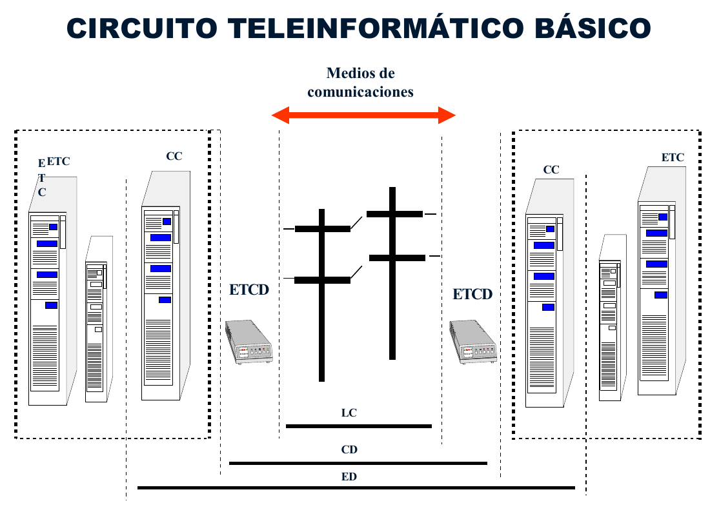

**Cómo leerlo:** ubicá los terminales, después los ETCD y finalmente la línea que los conecta. La U7 se concentra en el tramo físico, dentro de un sistema más amplio.

### 1.2. Clasificación y modelo mental

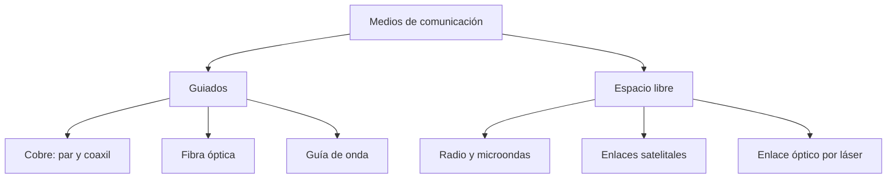

- **Guiado:** una estructura condiciona por dónde se propaga la onda. Ejemplo: coaxil.
- **Espacio libre:** no hay una línea que confine la onda. Ejemplo: dos antenas. No significa vacío ideal: en un enlace terrestre intervienen aire, lluvia y obstáculos.
- **Guiado no significa metálico:** la fibra guía luz, no corriente eléctrica entre extremos.
- La lista original de p. 5 incluye también **cobre desnudo** y **cable telefónico**. Son ejemplos de construcciones conductoras, no un tercer grupo de propagación. La presentación desarrolla después pares y coaxil, pero no el cobre desnudo como tema separado.
- **Apoyo conceptual:** el satélite forma parte de un sistema de radio, no es una tercera naturaleza de onda. El láser es una fuente óptica: puede alimentar una fibra o un enlace por espacio libre.

### 1.3. Frecuencia, longitud de onda y espectro

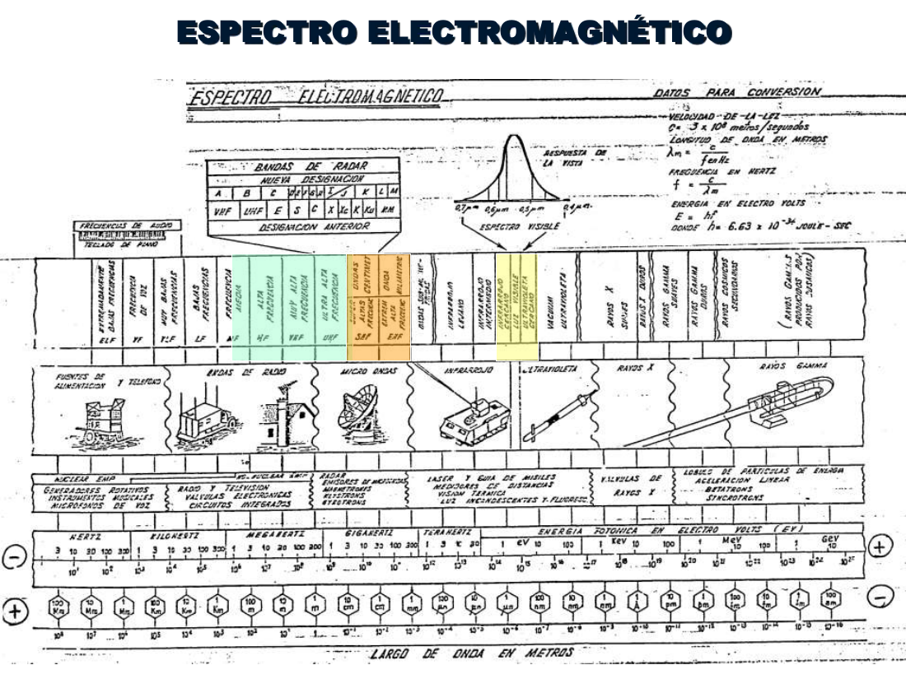

**Cómo leerlo:** frecuencias mayores corresponden a longitudes de onda menores. La ilustración no es una tabla de tasas de datos: la frecuencia se mide en Hz y la tasa de información en bit/s.

**Formalización — apoyo conceptual:**

$$
\lambda=\frac{v}{f}
$$

| Símbolo | Significado | Unidad |
|---|---|---|
| $\lambda$ | Longitud de onda | m |
| $v$ | Velocidad de propagación | m/s |
| $f$ | Frecuencia | Hz |

**Supuestos:** onda de frecuencia definida. En vacío o aproximadamente en aire, $v\simeq3\times10^8\ \mathrm{m/s}$; en cables depende de la estructura y del dieléctrico.

**Ejemplo didáctico:** a 100 MHz, $\lambda=(3\times10^8)/(100\times10^6)=3\ \mathrm m$. A 1 GHz resulta 0,30 m. La longitud disminuye diez veces; no se deduce una tasa de bits diez veces mayor.

### 1.4. Cómo elegir un medio

| Criterio de p. 4 | Pregunta práctica | Ejemplo |
|---|---|---|
| Ancho de banda y velocidad | ¿Qué rango de frecuencias admite y qué tasa exige el sistema? | MHz de cable no son Gbit/s |
| Costo | ¿Cuánto cuesta el enlace completo? | Incluir equipos, tendido y mantenimiento |
| Parámetros físicos | ¿Resiste peso, tracción y ambiente? | Cable de interior no es automáticamente apto para intemperie |
| Atenuación y distorsión | ¿Llega suficiente señal y conserva su forma? | Más longitud puede exigir regeneración |
| Ruido e interferencia | ¿Qué perturbaciones habrá? | Entorno industrial frente a oficina |
| Confiabilidad | ¿Qué disponibilidad se necesita? | Puede ser importante una ruta redundante |
| Instalación y estética | ¿Cómo se tiende y protege? | Canalizaciones y radios de curvatura |
| Flexibilidad | ¿Se podrá ampliar? | Espacio para nuevas conexiones |

**Ejemplo didáctico:** para exigir 100 Mbit/s a 80 m no basta comprar equipos de 1 Gbit/s: también deben verificarse cable, conectores, condiciones de ruido y configuración.

**Errores típicos:** confundir ancho de banda con tasa; decir que guiado significa cobre; comparar sólo el precio por metro.

> **Para examen:** el medio permite la propagación física y condiciona pérdidas, distorsión e interferencias. Se selecciona considerando el enlace completo y sus restricciones.

---

## 2. Qué ocurre en una línea conductora

**Fuente:** PDF pp. 6–8. La notación con prima y los ejemplos son apoyo conceptual.

### 2.1. El cable no es un resistor ideal

Cada tramo presenta resistencia e inductancia; entre conductores aparecen capacitancia y fugas por el dieléctrico. El modelo de línea repite esos parámetros a lo largo de toda la longitud.

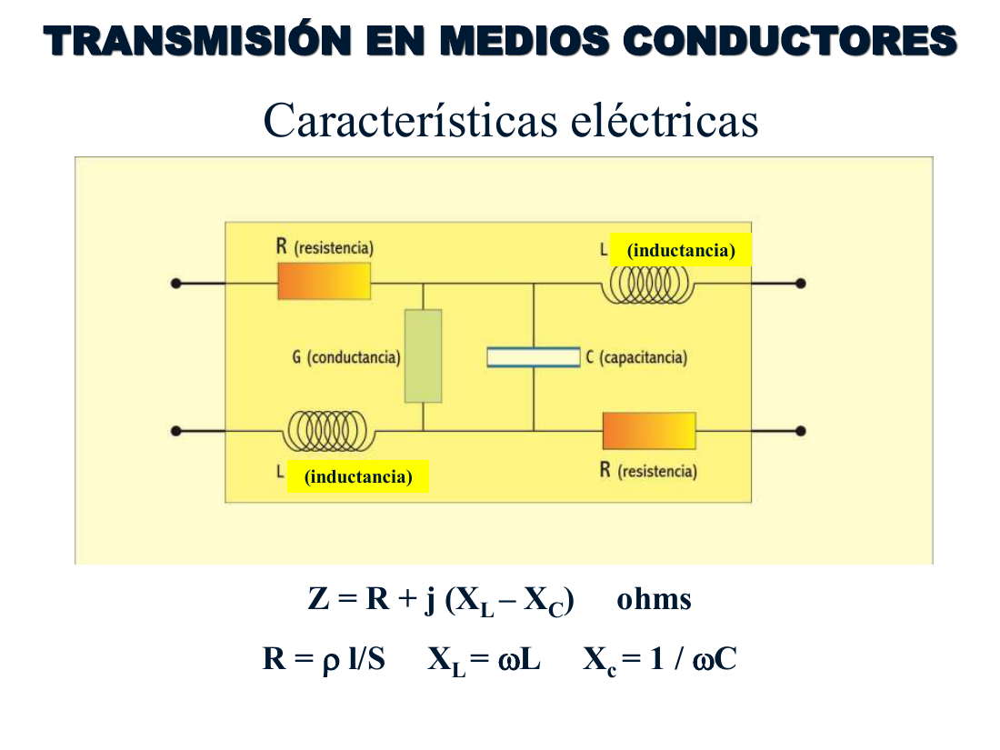

**Cómo leerlo:** los elementos serie modelan el conductor; los transversales, el almacenamiento de campo eléctrico y las fugas entre conductores. **G** es conductancia en siemens, no ganancia en dB.

**Apoyo conceptual para entender el modelo:** $R$ representa disipación en el conductor; $L$, almacenamiento de energía magnética; $C$, almacenamiento de energía eléctrica entre conductores; $G$, fugas a través del aislamiento. La **impedancia** reúne la respuesta resistiva y reactiva a una señal alterna; la reactancia explica por qué esa respuesta depende también de la frecuencia.

La diapositiva presenta las relaciones de componentes:

$$
Z=R+j(X_L-X_C),\qquad R=\rho\frac{\ell}{A},\qquad
X_L=\omega L,\qquad X_C=\frac{1}{\omega C},\qquad \omega=2\pi f
$$

| Símbolo | Significado | Unidad |
|---|---|---|
| $Z$, $R$ | Impedancia del circuito serie y resistencia | Ω |
| $j$ | Unidad imaginaria | Sin unidad |
| $X_L$, $X_C$ | Magnitudes de reactancia inductiva y capacitiva | Ω |
| $\rho$ | Resistividad | Ω·m |
| $\ell$, $A$ | Longitud y sección del conductor | m; m² |
| $L$, $C$ | Inductancia y capacitancia | H; F |
| $\omega$, $f$ | Frecuencia angular y frecuencia | rad/s; Hz |

**Supuestos:** conductor uniforme a temperatura fijada y componentes ideales en régimen sinusoidal. La primera ecuación corresponde a una asociación **serie**, no a la impedancia de toda la línea distribuida del dibujo.

**Ejemplo didáctico:** $\rho=1,7\times10^{-8}\ \Omega\cdot\mathrm m$, $\ell=10\ \mathrm m$, $A=1\ \mathrm{mm^2}=10^{-6}\ \mathrm{m^2}$: $R=0,17\ \Omega$. En un circuito serie hipotético con esa resistencia, $L=1\ \mathrm{mH}$, $C=10\ \mathrm{\mu F}$ y $f=1\ \mathrm{kHz}$: $\omega=6283,19\ \mathrm{rad/s}$, $X_L=6,28\ \Omega$, $X_C=15,92\ \Omega$ y $Z=0,17-j9,63\ \Omega$. Predomina la reactancia capacitiva. No son parámetros de un cable comercial.

### 2.2. Impedancia característica y adaptación

**Problema físico:** cuando la onda encuentra un cambio de impedancia puede reflejarse. Esa copia retardada puede deformar la señal útil.

**Concepto:** la impedancia característica $Z_0$ relaciona tensión y corriente de la onda que avanza por una línea uniforme. No es la resistencia en continua de un rollo de cable.

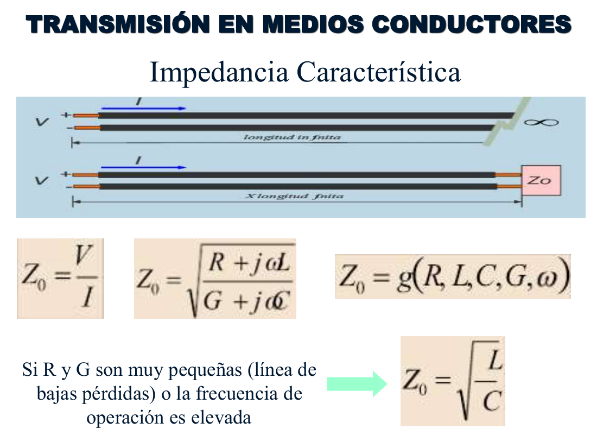

**Modelo mental:** una línea finita terminada en $Z_0$ recibe la onda sin devolver reflexión, como una línea que continuara indefinidamente.

$$
Z_0=\frac{V^+}{I^+}=
\sqrt{\frac{R'+j\omega L'}{G'+j\omega C'}}
\quad\longrightarrow\quad Z_0\simeq\sqrt{\frac{L'}{C'}}
$$

| Símbolo | Significado | Unidad |
|---|---|---|
| $Z_0$ | Impedancia característica | Ω |
| $V^+$, $I^+$ | Tensión y corriente de la onda incidente | V; A |
| $R'$ | Resistencia serie por longitud | Ω/m |
| $L'$ | Inductancia serie por longitud | H/m |
| $G'$ | Conductancia transversal por longitud | S/m |
| $C'$ | Capacitancia transversal por longitud | F/m |
| $\omega$ | Frecuencia angular | rad/s |

**Supuestos:** línea uniforme y régimen sinusoidal. La aproximación requiere $R'\ll\omega L'$ y $G'\ll\omega C'$: las pérdidas resultan pequeñas frente a los términos reactivos. La prima hace explícitos los parámetros por longitud de la p. 7.

**Ejemplo didáctico:** $L'=250\ \mathrm{nH/m}$ y $C'=100\ \mathrm{pF/m}$, despreciando pérdidas: $Z_0=\sqrt{250\times10^{-9}/(100\times10^{-12})}=50\ \Omega$. Una onda de 1 V tiene corriente de $1/50=0,02\ \mathrm A=20\ \mathrm{mA}$. Una carga de 50 Ω adapta la línea ideal; una de 75 Ω no coincide.

**Caso real del material:** coaxiles de 50 y 75 Ω, p. 17. Cable y conectores deben ser compatibles con la impedancia del sistema.

**Errores típicos:** medir resistencia con multímetro y llamarla $Z_0$; multiplicar 50 Ω por los metros; aplicar la ecuación de circuito serie como si fuera la impedancia característica.

> **Para examen:** $Z_0$ depende de los parámetros distribuidos de la línea. Terminarla en esa impedancia evita reflexiones en el modelo uniforme; no equivale a anular su resistencia ni sus pérdidas.

### 2.3. Efecto pelicular

**Problema físico:** a frecuencias altas, la corriente alterna no aprovecha uniformemente toda la sección: se concentra cerca de la superficie y aumenta la resistencia efectiva.

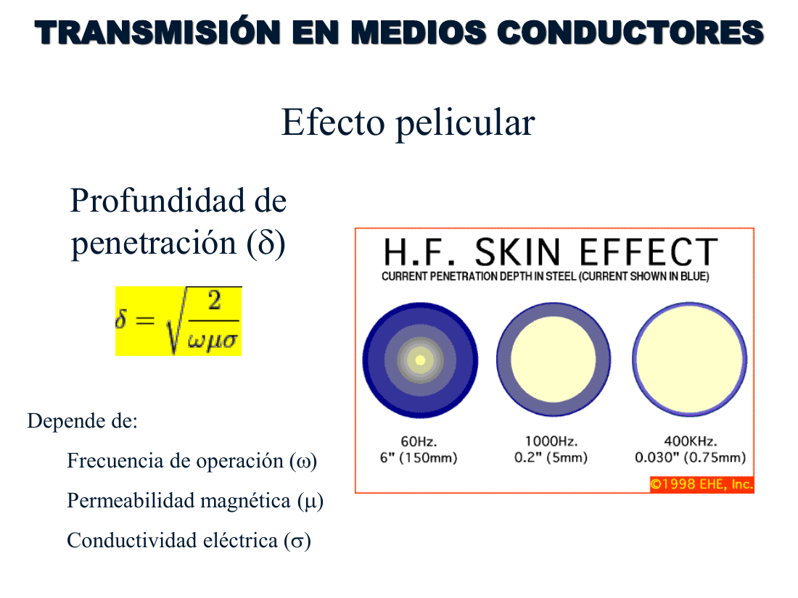

**Cómo leerlo:** la región superficial concentra cada vez más corriente. Los valores del dibujo corresponden al material de esa ilustración, no a una tabla universal para cobre.

$$
\delta=\sqrt{\frac{2}{\omega\mu\sigma}}
$$

| Símbolo | Significado | Unidad |
|---|---|---|
| $\delta$ | Profundidad a la que la amplitud cae a $1/e$ de la superficial | m |
| $\omega$ | Frecuencia angular | rad/s |
| $\mu$ | Permeabilidad magnética | H/m |
| $\sigma$ | Conductividad | S/m |

**Supuestos:** buen conductor y régimen sinusoidal; interpretar una capa delgada es útil cuando el espesor del conductor es mucho mayor que $\delta$.

**Ejemplo didáctico:** cobre idealizado con $\sigma=5,8\times10^7\ \mathrm{S/m}$ y $\mu=4\pi\times10^{-7}\ \mathrm{H/m}$; a 1 MHz, $\omega=2\pi\times10^6\ \mathrm{rad/s}$ y $\delta\simeq66,1\ \mathrm{\mu m}$. A 4 MHz resulta $33,0\ \mathrm{\mu m}$. Cuadruplicar frecuencia reduce la penetración a la mitad. Son supuestos del ejemplo.

**Modelo mental:** disminuye la sección efectiva → aumenta resistencia de CA → aumenta una de las causas de atenuación.

**Errores típicos:** hablar de una superficie de espesor cero; aplicar números de otro material; confundir este efecto con diafonía.

> **Para examen:** el efecto pelicular concentra la corriente alterna en la periferia. Al aumentar la frecuencia disminuye la profundidad de penetración y crece la resistencia efectiva.

---

## 3. Pares telefónicos y par trenzado

**Fuente:** PDF pp. 9–15.

### 3.1. Par y multipar

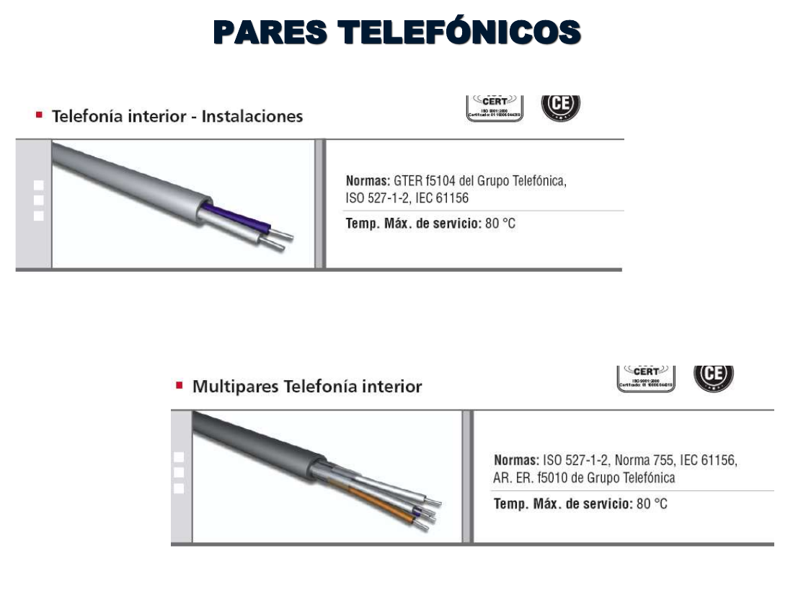

Un **par** reúne dos conductores; un **multipar**, varios pares dentro de una cubierta. La agrupación transporta varias conexiones, pero favorece oportunidades de acoplamiento entre circuitos próximos. Ejemplo didáctico: 25 pares contienen 50 conductores, no 25 hilos.

La p. 9 muestra telefonía interior: no demuestra aptitud para tendido subterráneo o aéreo exterior. Eso exige revisar cubierta, humedad, protección y resistencia mecánica.

### 3.2. Por qué el trenzado reduce interferencias

**Problema físico:** un campo externo induce perturbaciones y un par vecino puede acoplar parte de su señal: **diafonía**.

**Concepto — apoyo conceptual a pp. 10 y 14:** el receptor balanceado observa la diferencia entre conductores. Si una perturbación afecta de manera semejante a ambos, puede rechazar gran parte de ella. Al alternar sus posiciones frente al entorno, el trenzado mejora la simetría de exposición.

**Modelo mental:** no es un blindaje invisible: ayuda a equilibrar lo que se induce en cada hilo.

**Ejemplo didáctico:** señales de +0,5 V y −0,5 V dan una diferencia de 1 V. Sumando una perturbación común de +0,2 V quedan +0,7 V y −0,3 V: la diferencia sigue en 1 V, con receptor ideal. Si la perturbación se acopla de manera desigual, la cancelación es incompleta.

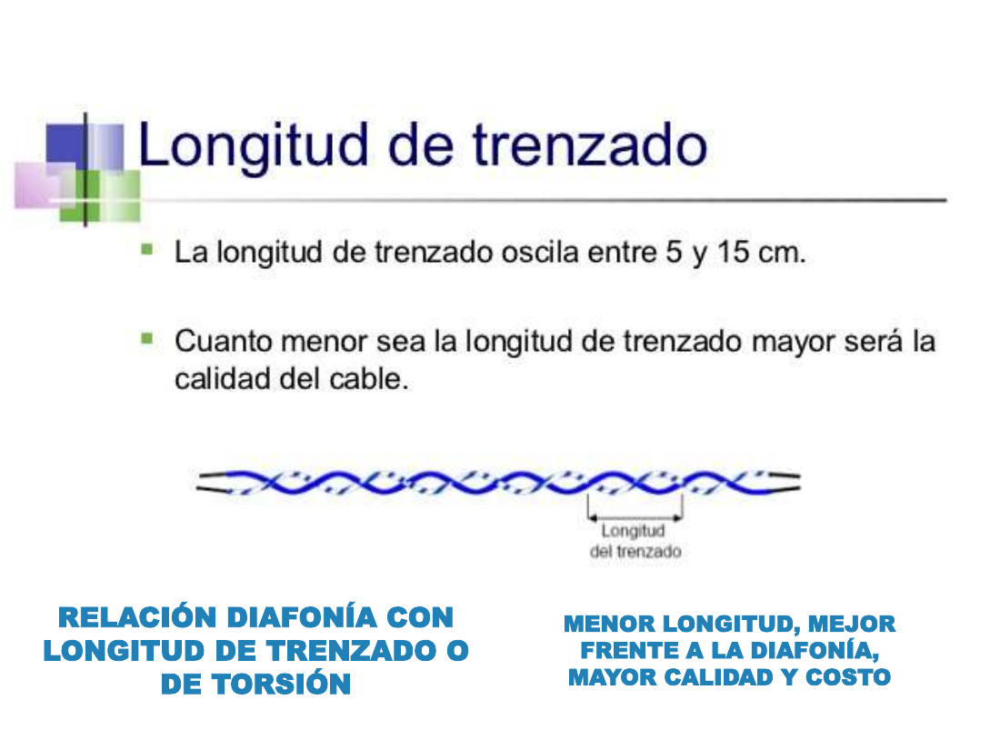

El **paso de trenzado** es la distancia de una vuelta, no el largo total del cable. La p. 14 indica 5–15 cm como referencia de su ilustración y vincula menor paso con mejor respuesta frente a diafonía. No es una garantía universal de categoría: también importan geometría, balance, frecuencia, materiales e instalación. Como apoyo conceptual, pasos diferentes entre pares ayudan a evitar acoplamientos repetitivos.

El ejemplo anterior muestra el modelo diferencial; para este tema basta entender el mecanismo, sin agregar una fórmula de diafonía.

**Errores típicos:** decir que el trenzado elimina todo ruido; confundir diafonía con ruido térmico; destrenzar excesivamente al terminar el cable y esperar igual desempeño.

> **Para examen:** el par trenzado ayuda a reducir acoplamientos y mantener el balance. El receptor diferencial rechaza perturbaciones comunes, pero el resultado depende también de construcción e instalación.

### 3.3. Blindaje y cubierta no son la misma clasificación

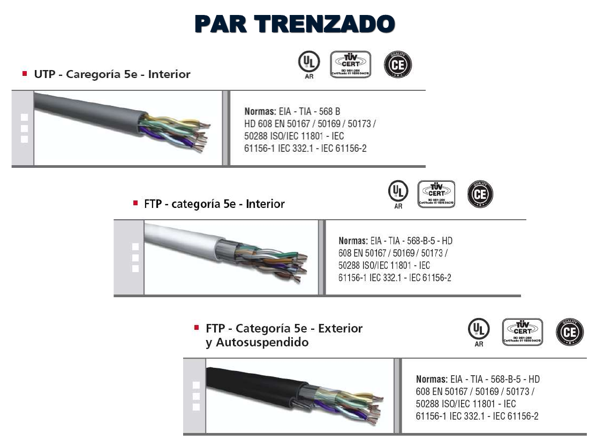

**UTP** significa par trenzado sin blindaje. La p. 10 también muestra FTP interior y exterior autosoportado. Blindaje describe protección electromagnética; exterior/autosoportado describe adaptación ambiental o mecánica. Una pantalla no reemplaza una cubierta apta para intemperie.

La p. 13 presenta:

| Denominación del PDF | Impedancia indicada | Descripción de la lámina |
|---|---:|---|
| STP | 150 Ω | Par trenzado blindado |
| FTP | 120 Ω | Pantalla de aluminio |
| SFTP | 120 Ω | Pantalla y malla de cobre adicional |
| SSTP | 120 Ω | Pantalla por par y malla exterior |

**Para estudiar esta clasificación:** retené la construcción y los valores tal como los presenta el profesor. No generalices esos valores a todo producto con blindaje: existen F/UTP de 100 Ω, como muestra la [ficha Belden 50105F](https://catalog.belden.com/techdata/EN/50105F_techdata.pdf). La tabla de clase y la especificación de un cable concreto cumplen funciones distintas.

### 3.4. T568A, T568B, recto y cruzado

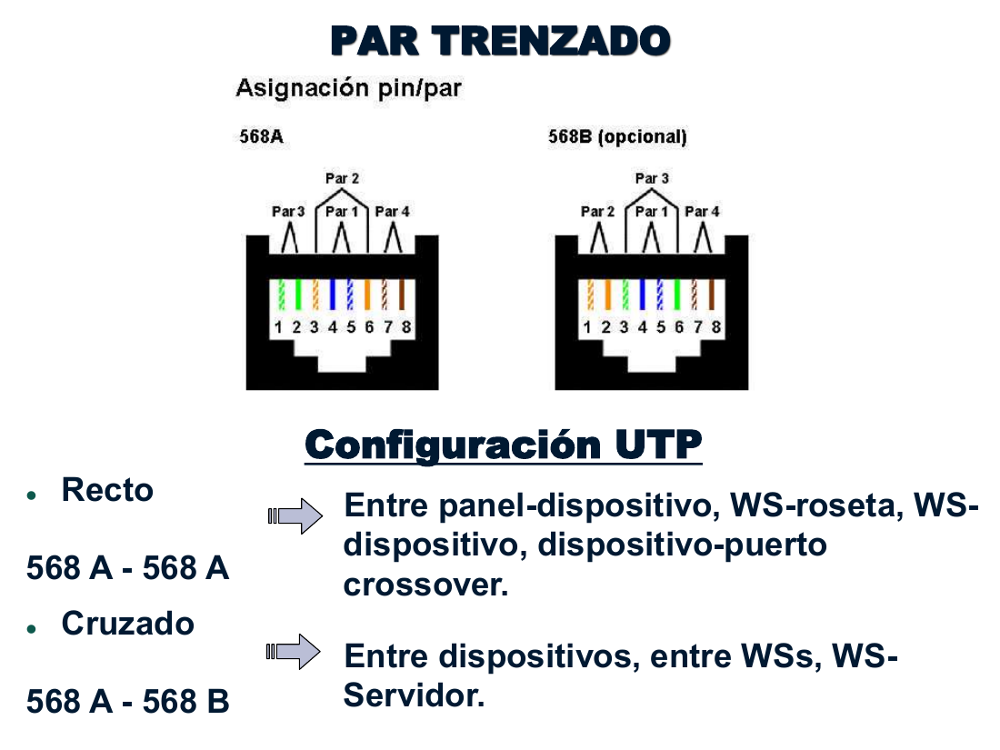

A y B asignan pares a contactos: no son categorías ni velocidades. Respetá la orientación del conector que muestra el dibujo.

| Pin | T568A | T568B |
|---:|---|---|
| 1 | Blanco/verde | Blanco/naranja |
| 2 | Verde | Naranja |
| 3 | Blanco/naranja | Blanco/verde |
| 4 | Azul | Azul |
| 5 | Blanco/azul | Blanco/azul |
| 6 | Naranja | Verde |
| 7 | Blanco/marrón | Blanco/marrón |
| 8 | Marrón | Marrón |

- **Recto:** misma asignación en ambos extremos: A–A o B–B. Ejemplo tradicional: estación a switch.
- **Cruzado A–B:** intercambia los pares 1–2 y 3–6. Ejemplo tradicional: dos estaciones 10/100 sin corrección automática de cruce.
- Los contactos 3 y 6 deben pertenecer al mismo par. Tener continuidad con hilos de pares distintos no conserva la calidad electromagnética.

La regla de clase explica el cableado tradicional. Como aclaración de uso, algunos equipos resuelven el cruce automáticamente; eso no cambia la diferencia física entre cable recto y cruzado.

### 3.5. Categoría, frecuencia y tasa

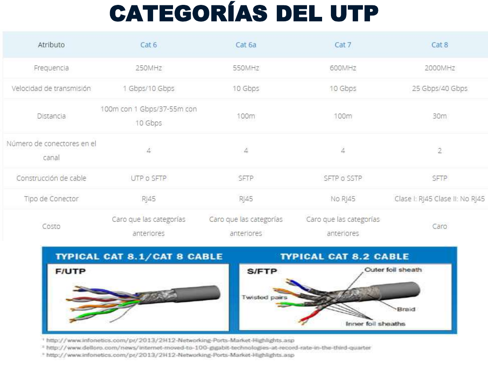

La categoría expresa prestaciones bajo condiciones definidas: no es sinónimo de blindaje ni una tasa de bits por sí sola.

| Categoría en p. 12 | Frecuencia impresa | Aplicación y distancia indicadas |
|---|---:|---|
| Cat 6 | 250 MHz | 1 Gbit/s a 100 m; 10 Gbit/s en 37–55 m |
| Cat 6a | **550 MHz en el original** | 10 Gbit/s a 100 m |
| Cat 7 | 600 MHz | 10 Gbit/s a 100 m |
| Cat 8 | 2000 MHz | 25/40 Gbit/s a 30 m |

**Corrección contrastada:** Cat 6A se ensaya hasta **500 MHz**, no 550 MHz: [Fluke Networks, rangos de ensayo](https://ko.flukenetworks.com/knowledge-base/dtx-cableanalyzer/frequency-steps-dtx-cableanalyzer). La imagen se conserva; la lectura corregida queda aquí.

**Cómo usarla:** separá frecuencia, tasa y distancia. Las prestaciones corresponden al canal completo, incluidos conectores y terminaciones, no sólo a un tramo del cable. La tabla muestra 4 conectores para varias categorías y 2 para Cat 8. Los detalles de construcción y costo se leen en el contexto de la lámina.

Cat 5e figura en los productos de p. 10, aunque la comparación de p. 12 empiece en Cat 6.

**Ejemplo didáctico:** un canal de 90 m no admite automáticamente 40 Gbit/s por incluir un tramo Cat 8: la referencia de esa aplicación en la tabla es 30 m, y todos los componentes cuentan.

### 3.6. Leer el folleto UTP

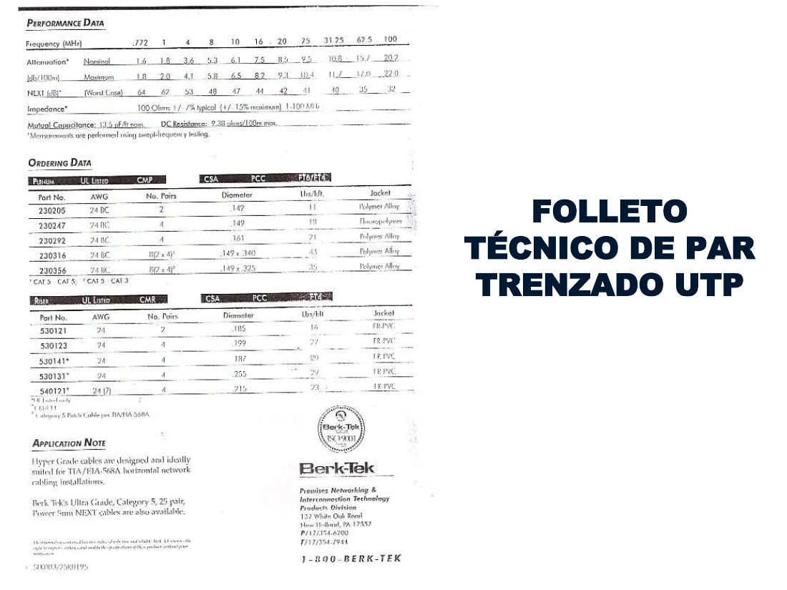

Para ampliar: [escaneo original](../../../material/teoria/U7/Folleto%20UTP%205.jpg). Es una ficha de producto, no una especificación universal de todo par trenzado.

| Campo a buscar | Qué indica |
|---|---|
| Frecuencia de ensayo | Condición en que se mide la prestación |
| Atenuación por longitud | Pérdida del recorrido |
| NEXT, diafonía de extremo cercano | Acoplamiento entre pares observado en ese extremo |
| Impedancia y pérdida de retorno | Adaptación y reflexiones |
| Resistencia y balance | Pérdidas y simetría eléctrica |
| Retardo/propagación, si está especificado | Cuánto tarda la señal; no es tasa de bits |
| Dimensiones, cubierta y temperatura | Condiciones mecánicas y ambientales |

**Ejemplo didáctico, no dato del folleto:** si una ficha indica 20 dB/100 m a una frecuencia, un tramo uniforme de 50 m aporta aproximadamente 10 dB, sin conectores. No extrapoles a toda frecuencia. La ecuación y unidades de esta relación se desarrollan en §4.3.

**Error típico:** si NEXT está expresado como pérdida de acoplamiento, un número mayor indica menos señal intrusa, no más. Leé cómo define la ficha cada parámetro.

---

## 4. Cable coaxil: geometría, blindaje e impedancia

**Fuente:** PDF pp. 16–20.

### 4.1. Problema físico y estructura

Para guiar altas frecuencias y reducir acoplamientos se coloca un conductor central rodeado por dieléctrico y por un conductor exterior concéntrico.

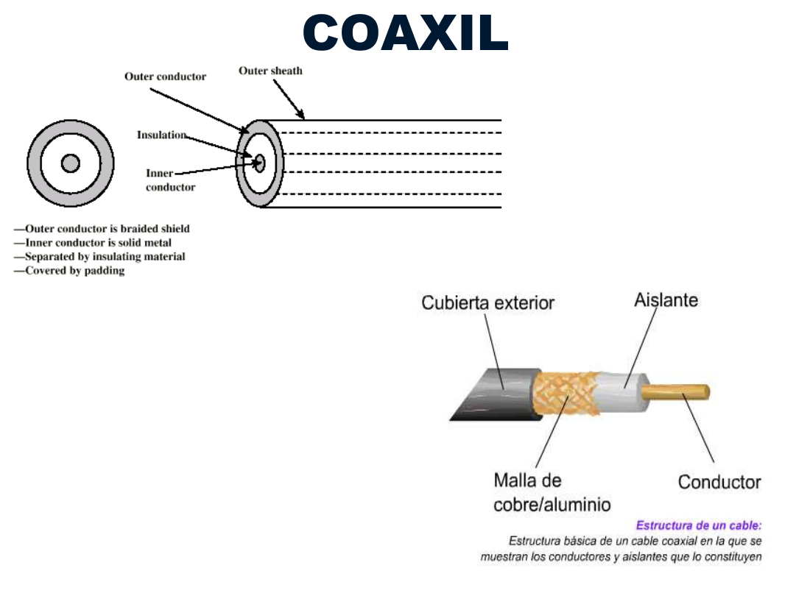

**Cómo leerlo:** del centro hacia afuera aparecen conductor, dieléctrico, pantalla y cubierta. El dieléctrico mantiene separación y condiciona propiedades eléctricas; el conductor exterior es **camino de retorno**, no sólo un protector. La cubierta aporta protección ambiental y mecánica.

**Modelo mental:** el campo útil se concentra principalmente entre ambos conductores. La información no viaja solamente por el alambre central dejando al blindaje sin función eléctrica.

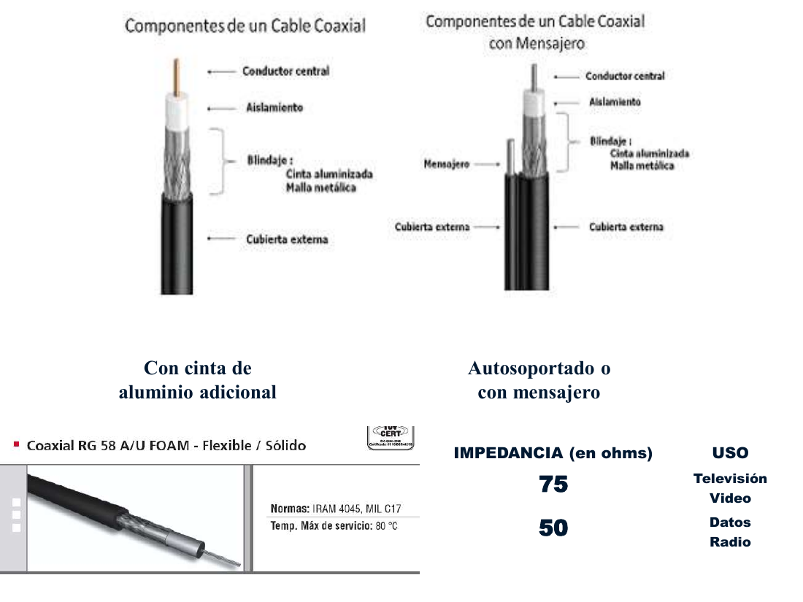

La lámina adicional mejora cobertura electromagnética; el **mensajero** soporta la tracción del tendido aéreo, no es otro conductor de información.

### 4.2. Impedancia y familias

| Impedancia | Usos de las láminas | Consecuencia |
|---:|---|---|
| 50 Ω | Radio y datos | Cadena de equipos/cables/conectores compatible |
| 75 Ω | TV y video | No intercambiar por 50 Ω sólo porque encastra |
| 93 Ω | RG-62, conexión histórica mainframe-terminal | No todos los coaxiles son de 50/75 Ω |

**Ejemplo didáctico:** transmisor de 50 Ω, cable de 50 Ω y carga de 50 Ω forman una cadena adaptada ideal. Reemplazar sólo el cable por uno de 75 Ω introduce discontinuidades; una menor resistencia de continua no compensa eso. La fórmula y ejemplo de $Z_0$ están en §2.2.

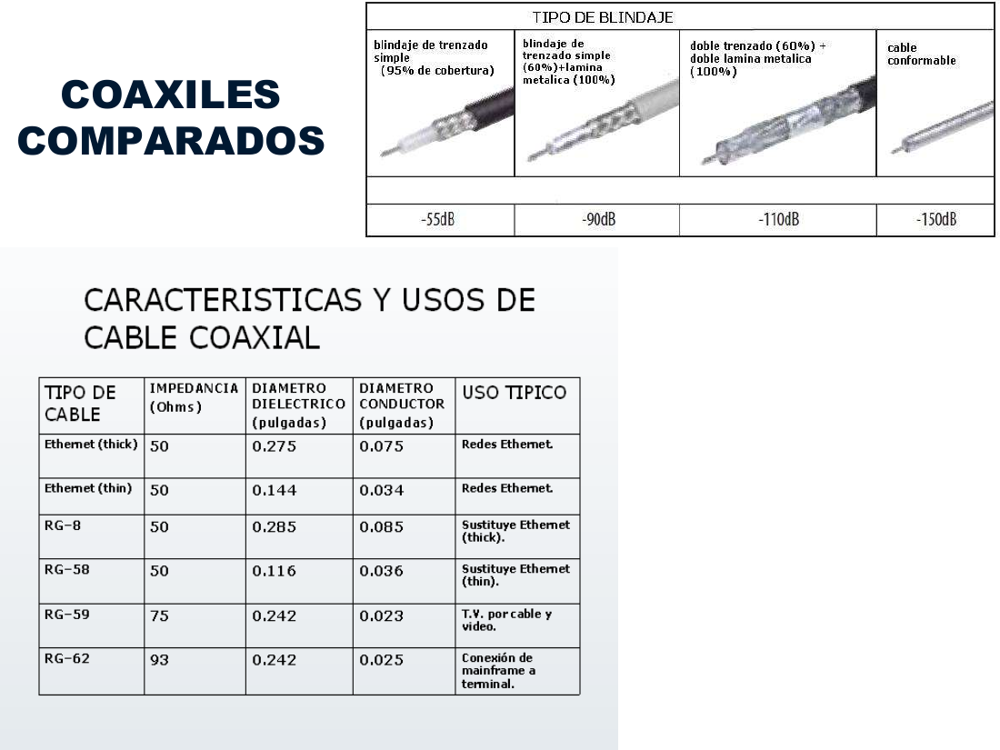

La tabla inferior relaciona Ethernet grueso/delgado, RG-8, RG-58, RG-59 y RG-62 con usos históricos. No es un catálogo de Ethernet actual. Los números negativos en dB del panel de blindaje no incluyen aquí condiciones suficientes para tratarlos como prestaciones universales de cada construcción.

### 4.3. Folleto y atenuación del tramo

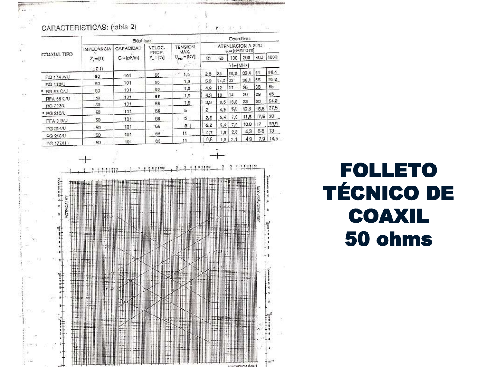

Para ampliar: [escaneo original](../../../material/teoria/U7/Folleto%20coaxil%2050%20ohms.jpg). Buscá modelo, impedancia, dimensiones, dieléctrico, frecuencia y pérdidas. Dos cables de 50 Ω pueden tener distintas atenuaciones y restricciones mecánicas.

**Formalización — apoyo conceptual:**

$$
L_{\mathrm{cable}}=\alpha(f)\,\ell
$$

| Símbolo | Significado | Unidad |
|---|---|---|
| $L_{\mathrm{cable}}$ | Pérdida del tramo | dB |
| $\alpha(f)$ | Atenuación por longitud a la frecuencia de trabajo | dB/m |
| $\ell$ | Longitud | m |

**Supuestos:** línea uniforme y adaptada; no incluye conectores. Si la ficha usa dB/100 m, convertí antes a la misma base de longitud.

**Ejemplo didáctico:** $\alpha=0,10\ \mathrm{dB/m}$ a la frecuencia elegida y $\ell=30\ \mathrm m$: $L=3\ \mathrm{dB}$. Dos conectores de 0,5 dB cada uno llevan el total a 4 dB. Es una pérdida relativa, no una potencia absoluta en dBm.

### 4.4. Conectores

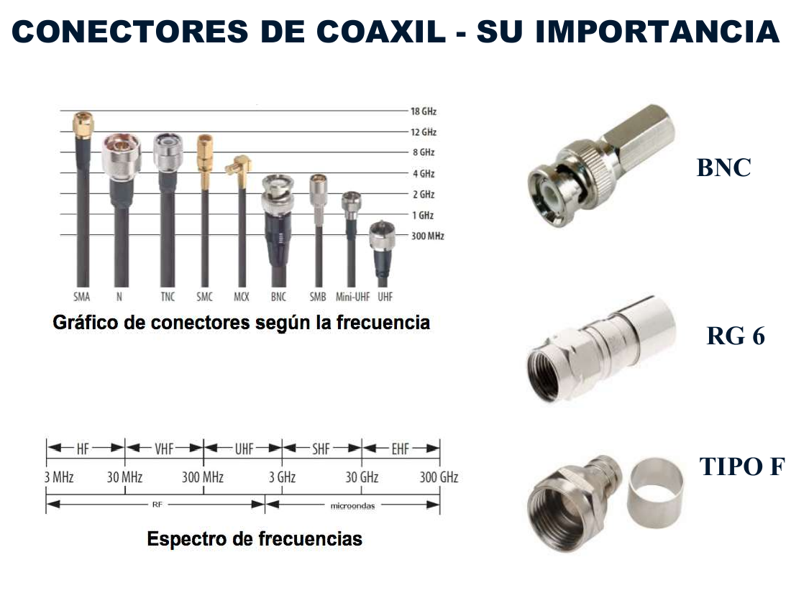

Una terminación debe conservar impedancia y continuidad del blindaje. Un contacto defectuoso puede introducir reflexión, pérdida e ingreso de interferencia.

**Aclaración:** RG-6 es una designación de **cable**, no una familia de conector equivalente a BNC o tipo F. La lámina lo ubica junto a conectores: no estudiar esa lista como tres nombres equivalentes. También hay que comprobar la variante eléctrica del conector; no todos los BNC son intercambiables por impedancia.

**Errores típicos:** identificar mensajero con retorno; considerar el blindaje sólo mecánico; llamar conector al RG-6; asumir inmunidad absoluta por tener pantalla.

> **Para examen:** la geometría concéntrica guía el campo y reduce interferencias. La impedancia, pérdidas según frecuencia y terminaciones determinan la viabilidad del enlace; el conductor exterior es parte eléctrica esencial.

---

## 5. Guía de onda

**Fuente:** PDF p. 21. Modos y corte: apoyo conceptual.

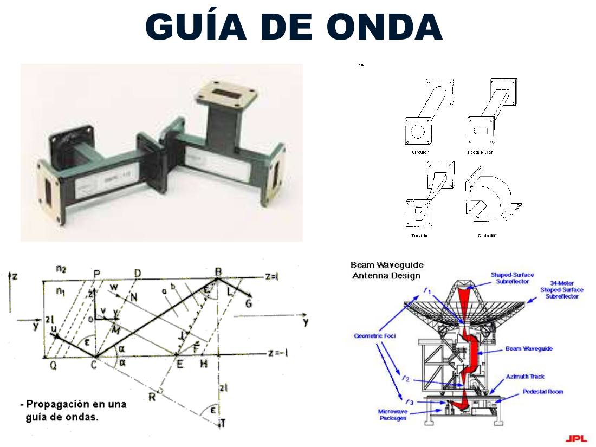

Una guía de onda confina y conduce un campo electromagnético. En las estructuras metálicas huecas mostradas no hace falta un conductor central como el del coaxil.

**Problema:** llevar energía de microondas entre equipo y antena con una estructura apropiada. **Concepto:** el campo se distribuye en **modos**, patrones compatibles con geometría y paredes.

**Cómo leerlo:** piezas y bridas unen tramos; los dibujos de secciones representan distribuciones del campo. La antena inferior relaciona transporte guiado con radiación: no son la misma etapa.

**Modelo mental:** las paredes guían el campo; los modos son las formas en que éste puede distribuirse y propagarse dentro de la estructura.

**Ejemplo:** una guía rectangular elegida para una banda no funciona a cualquier frecuencia. Cada modo tiene una **frecuencia de corte**: por debajo no se propaga como onda viajera. No hace falta agregar aquí su cálculo para comprender la función de la guía.

**Errores típicos:** creer que hueca significa sin campo; asumir funcionamiento desde continua; confundir guía con antena.

> **Para examen:** una guía conduce energía mediante modos electromagnéticos determinados por su estructura. Se usa especialmente en microondas y debe seleccionarse según banda y modo de operación.

---

## 6. Radio y antenas

**Fuente:** PDF pp. 22–24.

### 6.1. La cadena física

Un **transceptor** reúne transmisor y receptor. El tramo hasta la antena sigue siendo guiado: usar radio no elimina cables ni sus pérdidas.

**Apoyo conceptual de nomenclatura** a las bandas de p. 22:

| Banda | Nombre | Intervalo |
|---|---|---:|
| HF | High Frequency, alta frecuencia | 3–30 MHz |
| VHF | Very High Frequency, muy alta frecuencia | 30–300 MHz |
| UHF | Ultra High Frequency, ultra alta frecuencia | 300 MHz–3 GHz |
| SHF | Super High Frequency, super alta frecuencia | 3–30 GHz |

Una banda no tiene una tasa de bits fija. Importan ancho del canal, modulación, potencia, ruido y condiciones de propagación. Microondas se superpone con parte de estas bandas; no es una frecuencia única ni una técnica exclusivamente analógica.

### 6.2. Antena: transición entre circuito y espacio

**Problema físico:** hay que acoplar energía de la línea al espacio y viceversa. La antena convierte energía guiada en radiada al transmitir y capta la onda al recibir.

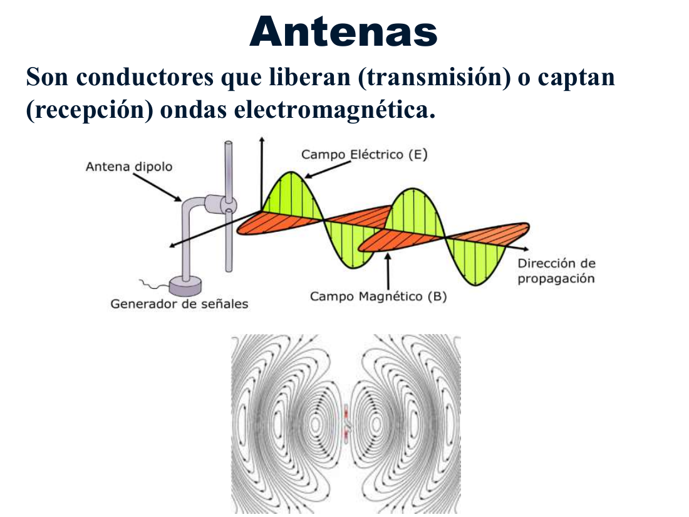

**Modelo mental:** es una transición física, no una fuente de potencia gratuita. Los campos eléctrico y magnético de la figura forman parte de la onda radiada.

### 6.3. Ganancia, directividad y polarización

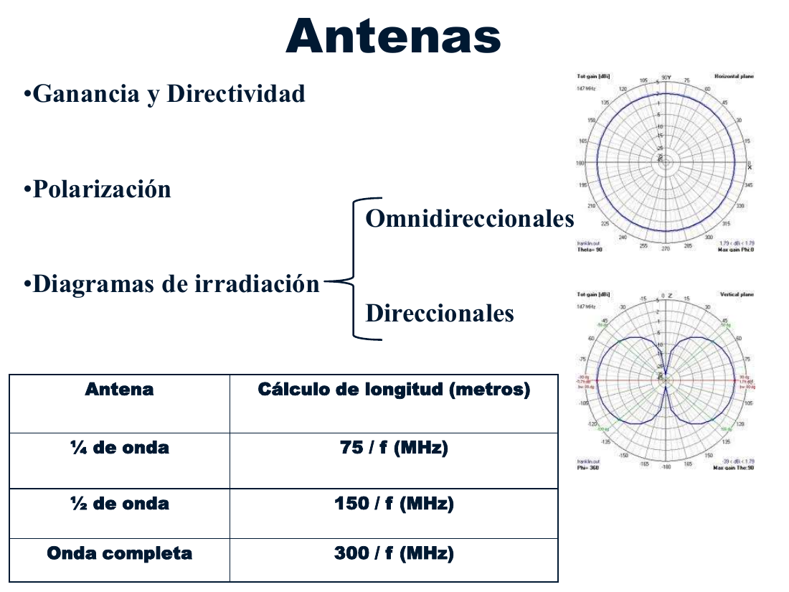

| Propiedad | Significado | Ejemplo |
|---|---|---|
| Directividad | Concentración en ciertas direcciones | Parabólica apuntada al otro extremo |
| Ganancia | Directividad considerando eficiencia y una referencia | dBi toma como referencia un radiador isotrópico ideal |
| Polarización | Orientación/comportamiento del campo eléctrico | Una desalineación reduce recepción |
| Diagrama de radiación | Respuesta según dirección | Lóbulo principal y direcciones desfavorables |
| Omnidireccional | Respuesta aproximadamente uniforme en un plano | No implica radiación igual en toda la esfera |
| Direccional | Favorece una región angular | Radioenlace punto a punto |

**Cómo leer el diagrama:** ángulo significa dirección; radio significa respuesta según la escala. Un círculo horizontal no prueba que el corte vertical también sea circular.

**Distinción clave:** la directividad describe hacia dónde se concentra la radiación; la ganancia también considera las pérdidas de la antena. No se crea energía: se concentra la disponible en ciertas direcciones.

### 6.4. Longitud de antena y frecuencia

La p. 24 aplica la relación de §1.3:

$$
\ell_{\lambda/4}\simeq\frac{75}{f_{\mathrm{MHz}}},\qquad
\ell_{\lambda/2}\simeq\frac{150}{f_{\mathrm{MHz}}},\qquad
\ell_{\lambda}\simeq\frac{300}{f_{\mathrm{MHz}}}
$$

| Símbolo | Significado | Unidad |
|---|---|---|
| $\ell_{\lambda/4}$, $\ell_{\lambda/2}$, $\ell_\lambda$ | Longitudes aproximadas de cuarto, media y una onda | m |
| $f_{\mathrm{MHz}}$ | Valor numérico de frecuencia expresado en MHz | MHz en la entrada |

**Supuestos:** velocidad aproximada de la luz en aire. Son referencias eléctricas; la longitud resonante física depende de geometría y entorno, no son instrucciones finales de fabricación. En un dipolo de media onda, la longitud es la total, no la de cada brazo.

**Ejemplo didáctico:** a 150 MHz, un cuarto de onda mide aproximadamente 0,50 m; media onda, 1 m; onda completa, 2 m. El dipolo idealizado de media onda tiene dos brazos de unos 0,50 m.

**Caso del material:** las antenas direccionales de microondas de p. 34 concentran energía hacia la otra estación, a diferencia de una cobertura omnidireccional.

**Errores típicos:** confundir ganancia con potencia generada o dBi con dBm; decir que omni significa esfera; usar Hz en una expresión que exige MHz.

> **Para examen:** la antena acopla circuito y espacio. Ganancia y directividad describen la distribución de energía; polarización y diagramas permiten decidir orientación y cobertura.

---

## 7. Propagación de las ondas de radio

**Fuente:** PDF pp. 25–32.

### 7.1. Modos de propagación

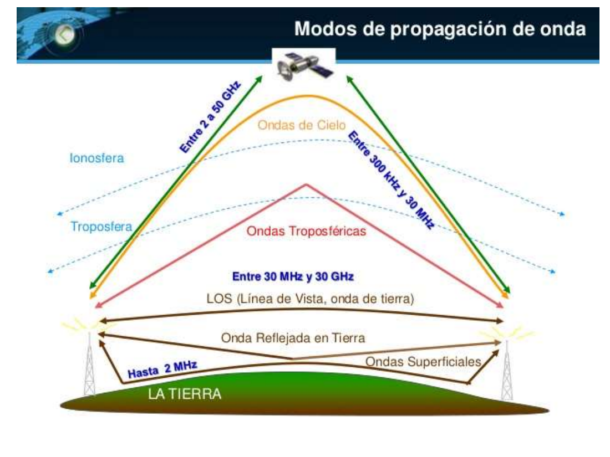

La p. 25 organiza el tema en **onda ionosférica** y **onda terrestre**. Dentro de la propagación terrestre, distinguí la onda directa, la reflejada en el suelo y la superficial. La p. 26 amplía visualmente los caminos posibles:

| Camino | Qué ocurre | Ejemplo conceptual |
|---|---|---|
| Superficial | Onda próxima a la superficie, afectada por el terreno | Baja frecuencia más allá de la visión directa |
| Ionosférico | Curvatura y posible regreso desde regiones ionizadas | Enlace HF lejano |
| Directo | Trayecto aproximadamente visible entre antenas | Radioenlace terrestre |
| Reflejado en suelo | Copia que rebota en la superficie | Interferencia con la onda directa |
| Troposférico | Atmósfera baja modifica o dispersa propagación | Trayectos distintos del vacío ideal |
| Tierra–espacio | Trayecto hacia/desde satélite | No se busca retorno ionosférico |

Las frecuencias impresas orientan: no son fronteras universales y excluyentes de cada mecanismo. En una recepción pueden combinarse varios caminos.

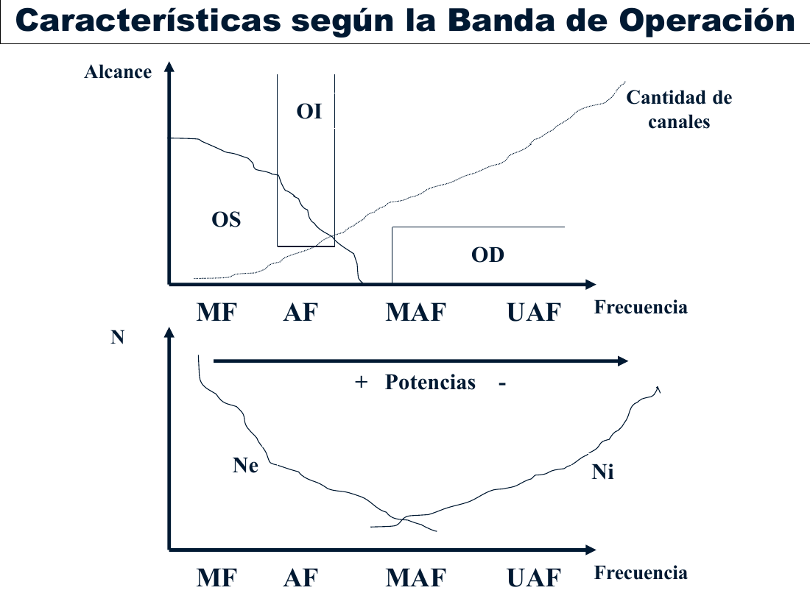

**Cómo leerlo:** OS, OI y OD refieren a onda superficial, ionosférica y directa; Ne y Ni distinguen ruido externo e interno. Son tendencias, no una fórmula numérica ni una tasa fija por banda. No permiten afirmar “más frecuencia siempre da más alcance”. El ruido depende también de entorno, ancho de banda y receptor.

La flecha de potencias de p. 27 también es cualitativa: no permite calcular potencia de transmisión sin fijar distancia, antenas, pérdidas y calidad requerida. Para eso se usa el balance de §8.

### 7.2. Onda ionosférica

**Problema:** comunicar estaciones separadas más allá del horizonte. **Concepto:** la ionización modifica la propagación; ciertas ondas, especialmente aprovechadas en HF, pueden curvar su trayectoria y regresar al suelo.

**Modelo mental:** “reflexión” ayuda a dibujar el recorrido, pero la ionósfera no es un espejo metálico. La explicación del retorno por curvatura es apoyo conceptual a las láminas.

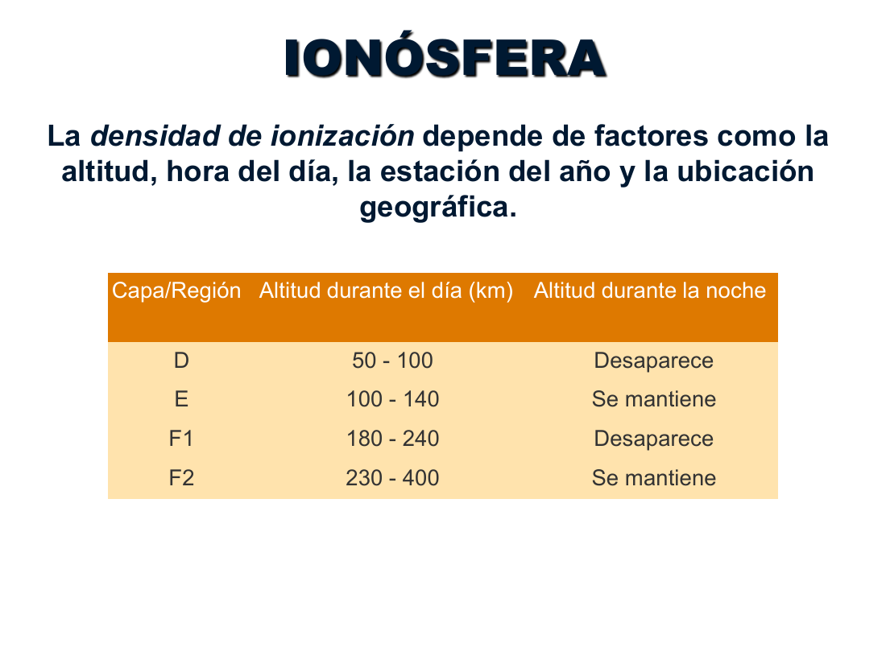

| Región | Altitud diurna indicada | Descripción nocturna de la lámina |
|---|---:|---|
| D | 50–100 km | Desaparece |
| E | 100–140 km | Se mantiene |
| F1 | 180–240 km | Desaparece |
| F2 | 230–400 km | Se mantiene |

**Qué hay que entender:** esas alturas son aproximadas y la ionización cambia con altitud, hora, estación y ubicación. “Desaparece” se refiere a la región ionizada diferenciable, no a que desaparezca el aire. Por eso un enlace ionosférico no se comporta igual de día que de noche.

### 7.3. Distancia de salto

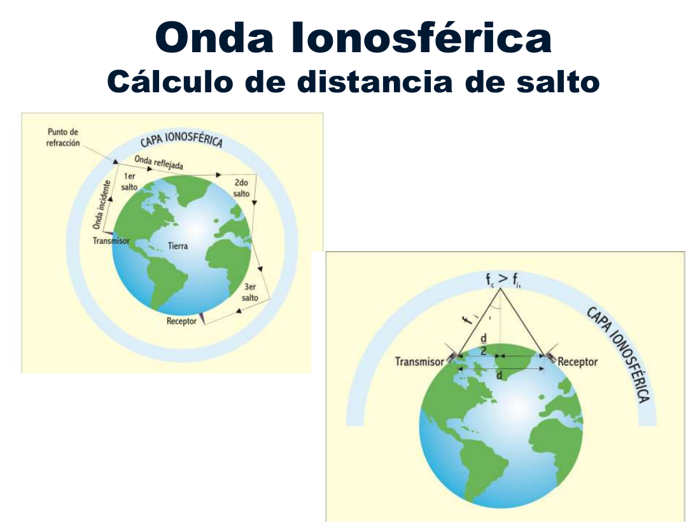

Un **salto** es el recorrido desde que la onda sale del suelo hasta que vuelve a él por acción de la ionósfera. La **distancia de salto** es la separación sobre Tierra entre esos puntos, no la longitud total del camino recorrido por la onda.

**Cómo leerlo:** la primera figura muestra retornos sucesivos: primer, segundo y tercer salto. La segunda relaciona distancia con altura y ángulo de la trayectoria. Lo importante aquí es que el alcance depende de esa geometría y de las condiciones de propagación, no sólo de la potencia.

**Ejemplo conceptual:** dos estaciones sin visión directa pueden comunicarse mediante un retorno ionosférico; para alcanzar una estación más lejana pueden intervenir varios saltos. No se agrega una ecuación de cálculo que no esté desarrollada en la presentación.

**Errores típicos:** creer que toda frecuencia vuelve; tomar altitudes fijas; confundir salto con distancia recorrida por la onda.

> **Para examen:** el retorno ionosférico permite enlaces más allá del horizonte bajo ciertas condiciones. Depende de frecuencia, ionización y geometría, y cambia durante el día.

### 7.4. Onda directa y horizonte

**Problema:** la curvatura terrestre limita visibilidad aun sin edificios. **Concepto:** elevar antenas aumenta la distancia al horizonte, pero eso no asegura potencia suficiente.

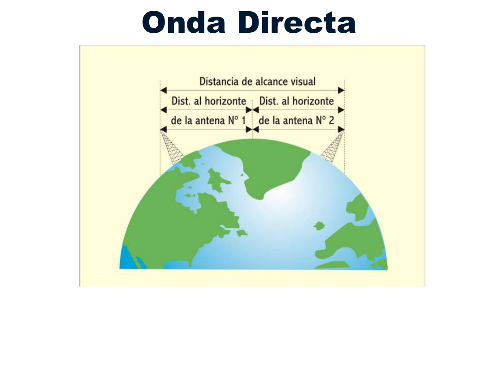

**Modelo mental:** sumá el horizonte de cada extremo, no uses una sola torre para todo el enlace.

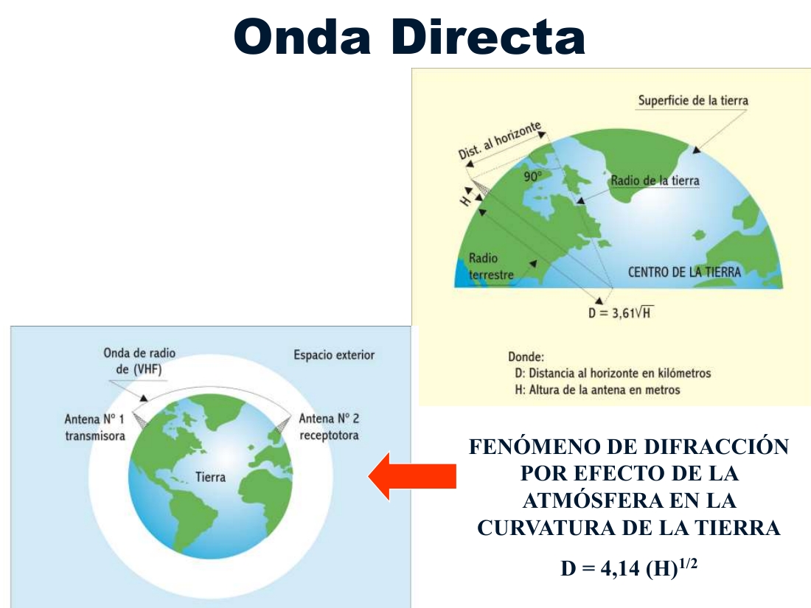

La atmósfera puede curvar ligeramente la trayectoria y ampliar el horizonte de radio respecto del visual. **Aclaración terminológica:** la p. 32 lo llama “difracción”; este efecto se modela mediante refracción atmosférica. No confundirlo con difracción ante obstáculos ([UIT-R P.530-14, §2.2](https://www.itu.int/dms_pubrec/itu-r/rec/p/R-REC-P.530-14-201202-S%21%21PDF-E.pdf)).

$$
D_r\simeq4,14\sqrt H,\qquad
D_{\mathrm{enlace}}\simeq4,14\left(\sqrt{H_t}+\sqrt{H_r}\right)
$$

| Símbolo | Significado | Unidad |
|---|---|---|
| $D_r$ | Radiohorizonte de una antena | km |
| $D_{\mathrm{enlace}}$ | Suma de radiohorizontes | km |
| $H$, $H_t$, $H_r$ | Alturas sobre superficie de referencia | m |

**Supuestos:** superficie terrestre lisa y refracción atmosférica estándar. Se conserva el coeficiente 4,14 empleado por la cátedra. No incluye relieve, obstáculos ni potencia.

**Ejemplo didáctico:** a 25 m, $D_r\simeq4,14\sqrt{25}=20,7\ \mathrm{km}$. Dos antenas a 25 m dan aproximadamente 41,4 km de radiohorizonte estándar; una loma todavía puede impedir el enlace.

La visibilidad y la ausencia de obstáculos se verifican aparte del cálculo de horizonte.

**Errores típicos:** omitir unidades; usar una sola altura; creer que potencia elimina curvatura.

> **Para examen:** el alcance directo depende de ambas alturas y de refracción. El horizonte es una condición geométrica, no reemplaza presupuesto de enlace ni estudio de obstáculos.

---

## 8. Presupuesto de enlace y microondas

**Fuente:** PDF pp. 33–34.

### 8.1. Problema, concepto y modelo

Ver la otra antena no demuestra que la señal llegue utilizable: hay que comparar el nivel recibido con la sensibilidad exigida por el servicio y reservar margen.

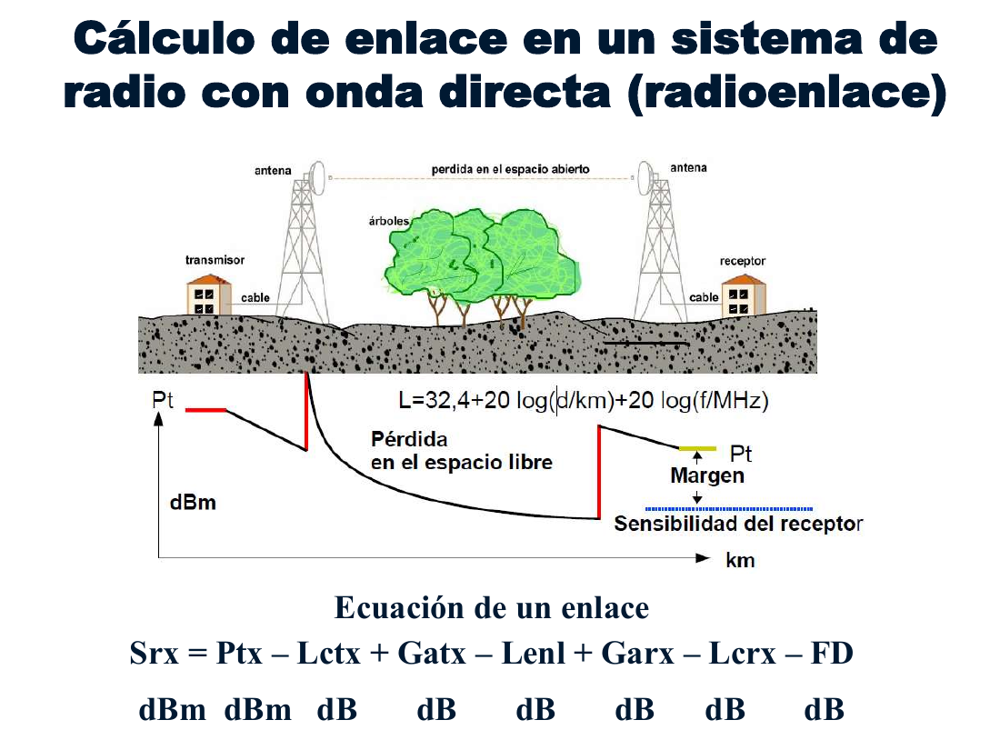

**Modelo mental:** una cuenta de potencia a lo largo del camino. Cables y propagación restan; ganancias de antena aumentan el nivel en la dirección del enlace.

La ecuación de la cátedra es:

$$
S_{rx}=P_{tx}-L_{ctx}+G_{atx}-L_{enl}+G_{arx}-L_{crx}-FD
$$

| Símbolo | Significado | Unidad |
|---|---|---|
| $P_{tx}$ | Potencia en salida del transmisor | dBm |
| $L_{ctx}$, $L_{crx}$ | Pérdidas de líneas/conexiones en cada extremo | dB |
| $G_{atx}$, $G_{arx}$ | Ganancias en dirección del enlace | dBi si la referencia es isotrópica |
| $L_{enl}$ | Pérdida de propagación | dB |
| $FD$ | Desvanecimiento de diseño o reserva descontada en la ecuación del PDF | dB |
| $S_{rx}$ | Nivel después de descontar FD | dBm |
| $S_{\min}$ | Sensibilidad para la calidad y tasa requeridas | dBm |

**Supuestos:** referencias y puntos compatibles, antenas orientadas, pérdidas no duplicadas. La sensibilidad depende de ancho de banda, modo y tasa de error. No sumar potencias en mW con dB.

**Cómo interpretarla:** primero seguí pérdidas y ganancias del trayecto; después descontá FD, la reserva considerada frente al desvanecimiento. La fórmula ya lo resta: no descontarlo otra vez.

### 8.2. Pérdida de espacio libre

La misma página incluye:

$$
L_{fs}=32,4+20\log_{10}(d_{\mathrm{km}})+20\log_{10}(f_{\mathrm{MHz}})
$$

| Símbolo | Significado | Unidad |
|---|---|---|
| $L_{fs}$ | Pérdida de espacio libre | dB |
| $d_{\mathrm{km}}$ | Valor numérico de distancia expresada en km | km en la entrada |
| $f_{\mathrm{MHz}}$ | Valor numérico de frecuencia expresada en MHz | MHz en la entrada |

**Supuestos:** espacio libre ideal y campo lejano; ganancias de antenas por separado. La constante incorpora esas unidades. No incluye lluvia, obstáculos ni conectores.

**Ejemplo didáctico integrado:** a 2400 MHz y 1 km, $L_{fs}=32,4+20\log_{10}(1)+20\log_{10}(2400)\simeq100,0\ \mathrm{dB}$.

Si $P_{tx}=20\ \mathrm{dBm}$, hay 1 dB de pérdida por cable y 15 dBi de ganancia en cada antena, el nivel sin descontar FD es $20-1+15-100+15-1=-52\ \mathrm{dBm}$. Con $FD=10\ \mathrm{dB}$, la ecuación da $S_{rx}=-62\ \mathrm{dBm}$. Si la sensibilidad es $S_{\min}=-75\ \mathrm{dBm}$, quedan $-62-(-75)=13\ \mathrm{dB}$ por encima del mínimo, después de reservar esos 10 dB.

**Razonabilidad:** domina la pérdida de propagación y la potencia recibida es menor que la de salida. La cuenta debe complementarse con las condiciones reales del trayecto.

**Distinción útil:** duplicar distancia o frecuencia suma unos 6 dB de pérdida de espacio libre si se mantienen iguales las ganancias. Una antena diferente puede cambiar el resultado del sistema.

### 8.3. Antenas de microondas

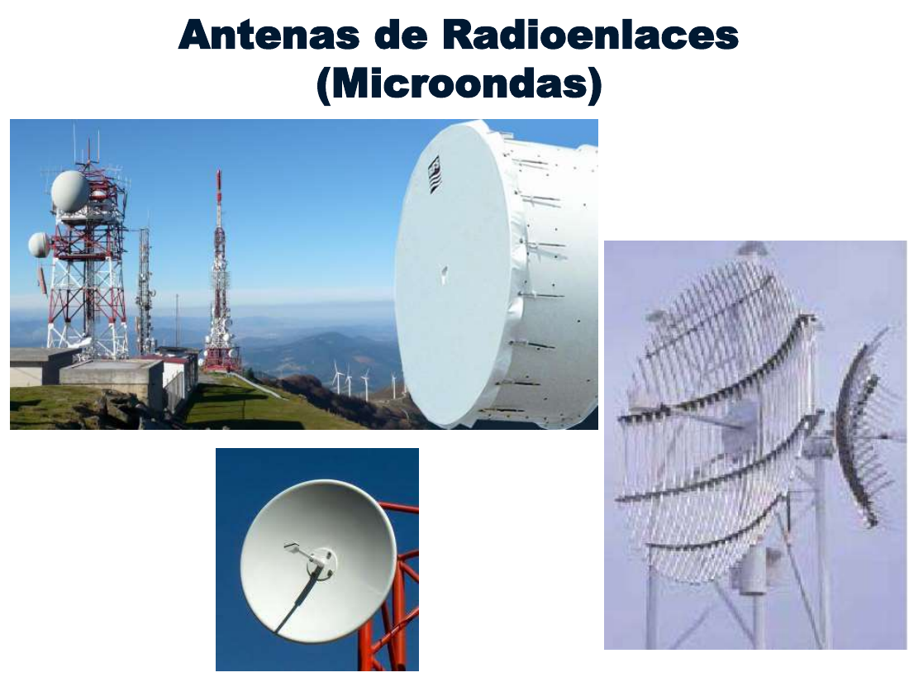

La parábola concentra respuesta; un radomo protege sin ser el reflector. Alineación, polarización y estabilidad mecánica importan tanto como el montaje eléctrico.

**Apoyo conceptual:** microondas analógicas y digitales usan ondas electromagnéticas; cambia la representación de información, no desaparecen atenuación, interferencia ni multitrayecto.

**Errores típicos:** sumar dBm como si fueran ganancias; restar FD dos veces; usar sensibilidad de otra tasa; tomar visibilidad como prueba de viabilidad.

> **Para examen:** el balance calcula el nivel recibido sumando ganancias y restando pérdidas. Se compara con sensibilidad y margen, y se complementa con geometría e interferencias.

---

## 9. Comunicaciones satelitales

**Fuente:** PDF pp. 35–43. Los términos uplink/downlink también fueron tratados en clase, según lo confirmado por el estudiante; corresponden a los enlaces ascendente y descendente de p. 35.

### 9.1. Componentes, uplink y downlink

**Problema:** conectar estaciones alejadas mediante un satélite que recibe y retransmite señales.

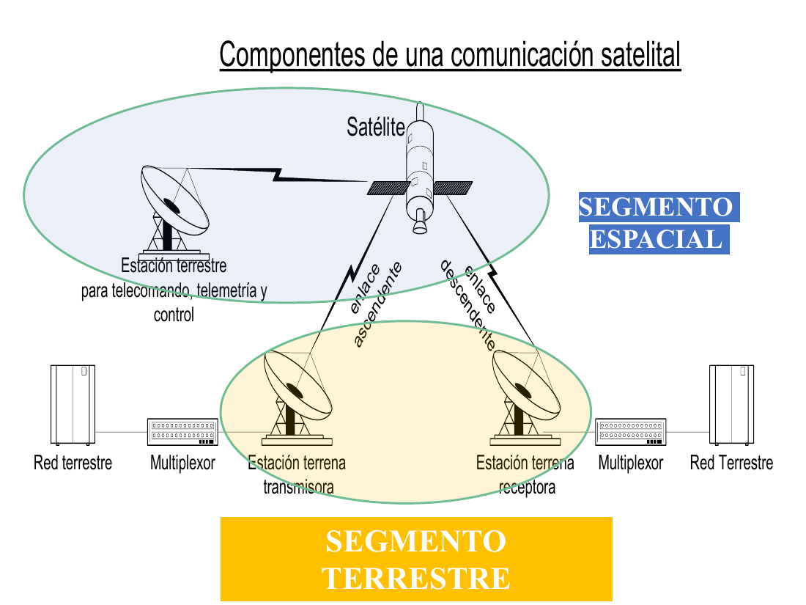

- **Segmento espacial:** satélite y equipos de comunicaciones a bordo.
- **Segmento terrestre:** estaciones terrenas y su conexión con las redes.
- **Telecomando, telemetría y control:** funciones para operar y supervisar el satélite. No son lo mismo que transmitir la información de los usuarios.

#### Uplink y downlink: el sentido físico del enlace

| Concepto | Sentido | Qué ocurre |
|---|---|---|
| **Uplink — enlace ascendente** | Estación terrena → satélite | La estación transmite y el satélite recibe |
| **Downlink — enlace descendente** | Satélite → estación terrena | El satélite transmite y la estación recibe |

las frecuencias son distintas ya que si fueran iguales habria interferencia entre la señal que sube y la que baja. La separación de bandas depende del sistema y de la regulación.

**Modelo mental:** primero la señal sube al satélite; después baja a la estación destinataria. “Subida” y “bajada” se nombran respecto del satélite, no según quién sea cliente o servidor.

**Ejemplo conceptual:** para enviar información de una estación A a una B: **A → uplink → satélite → downlink → B**. Para contestar, B realiza su propio uplink y A recibe por un downlink. Una comunicación entre estaciones incluye ambos tramos.

Un **transponder** es el equipo a bordo que recibe la señal, la amplifica y la retransmite, normalmente en otra frecuencia. Así enlaza el tramo ascendente con el descendente; no es la antena terrestre ni todo el satélite.

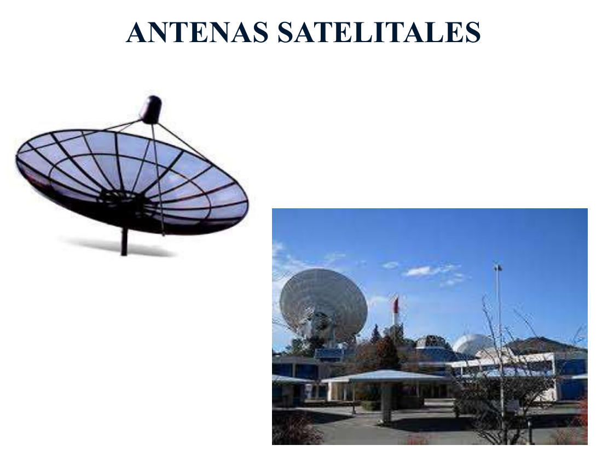

El reflector concentra la energía recibida sobre el alimentador o dirige la que éste emite. El tamaño y el apuntamiento de la antena condicionan la comunicación.

### 9.2. Tipos de satélites: LEO, MEO y GEO

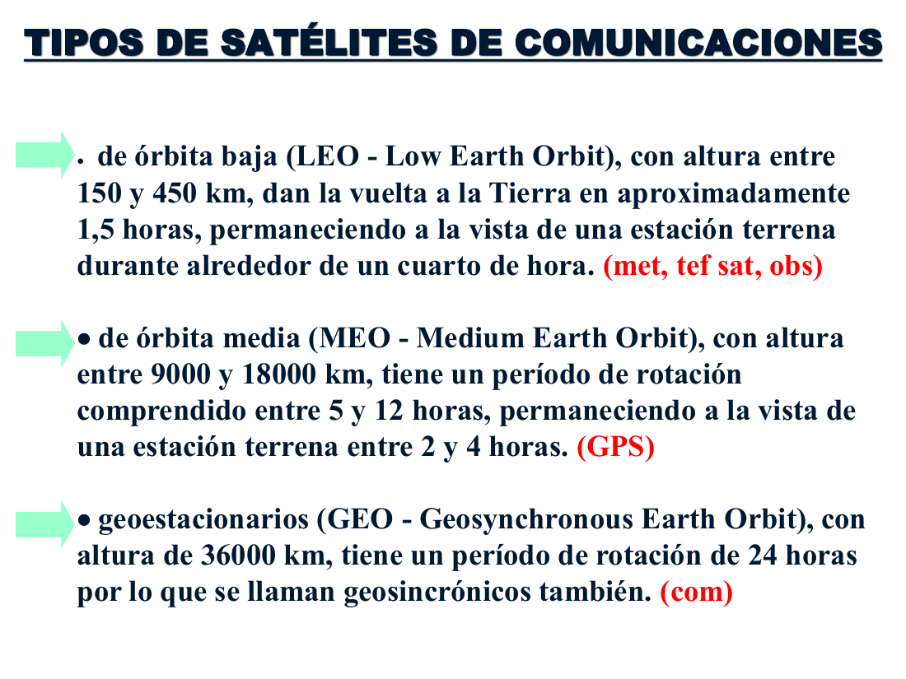

| Tipo | Altura indicada en clase | Período indicado | Visibilidad indicada |
|---|---|---|---|
| LEO, órbita baja | 150–450 km | Aproximadamente 1,5 h | Alrededor de 15 min |
| MEO, órbita media | 9000–18 000 km | 5–12 h | 2–4 h |
| GEO, geoestacionario | Aproximadamente 36 000 km | Aproximadamente 24 h | Posición aparente fija |

**Qué hay que entender:** el **período orbital** es lo que tarda en dar una vuelta; la **visibilidad** es cuánto tiempo puede observarse desde una estación. No son lo mismo. Los valores de LEO/MEO son las referencias de la presentación, no tiempos y alturas universales.

Un GEO acompaña la rotación terrestre y parece fijo para la estación. Para que eso ocurra, además del período apropiado, la órbita debe ser circular, ecuatorial y en el sentido de rotación terrestre. **Aclaración necesaria:** geoestacionario es un caso particular de geosincrónico; no alcanza sólo con igualar el período ([NASA, órbitas](https://science.nasa.gov/earth/earth-observatory/catalog-of-earth-satellite-orbits/)). Se conserva el redondeo de 36 000 km y 24 h de la cátedra.

La lámina da como ejemplos meteorología, telefonía y observación para LEO, GPS para MEO y comunicaciones para GEO. **Nota sobre GPS:** es MEO, pero su altura aproximada de 20 200 km queda fuera del intervalo de esa tabla ([GPS.gov](https://www.gps.gov/space-segment)); no invalida la clasificación.

### 9.3. Retardo y constelaciones

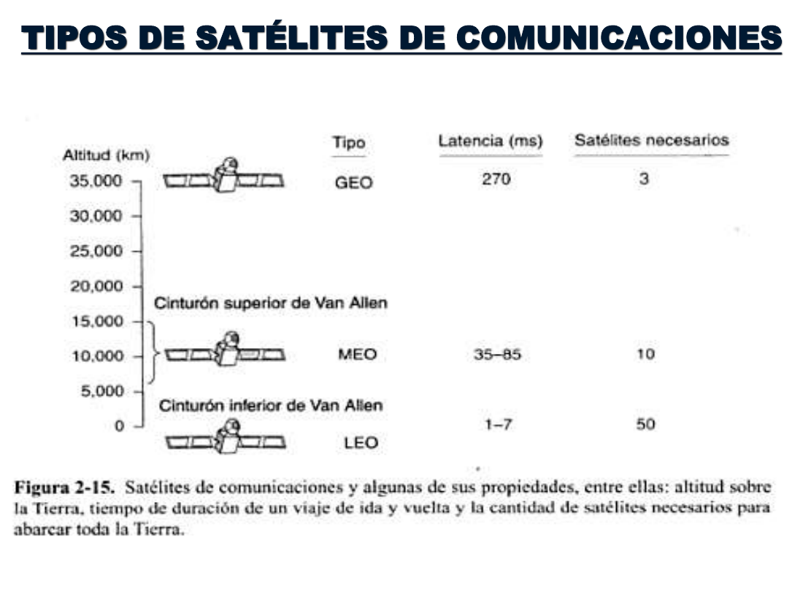

**Idea física:** a mayor recorrido, mayor tiempo de propagación. No confundas ese tiempo con período orbital ni con tiempo de visibilidad.

**Apoyo conceptual para interpretar el retardo de la figura:**

$$
t=\frac{\ell_{\mathrm{trayecto}}}{c}
$$

| Símbolo | Significado | Unidad |
|---|---|---|
| $t$ | Tiempo de propagación | s |
| $\ell_{\mathrm{trayecto}}$ | Suma de longitudes recorridas | km |
| $c$ | Velocidad aproximada: 300 000 | km/s |

**Supuestos:** sólo propagación, sin procesamiento ni esperas. Usamos la altura GEO redondeada del profesor y un trayecto vertical idealizado para mostrar el orden de magnitud.

**Ejemplo didáctico:** un tramo de 36 000 km tarda $36\,000/300\,000=0,12\ \mathrm s=120\ \mathrm{ms}$. Un uplink más un downlink suma unos 240 ms. Si también vuelve una respuesta por el satélite, son cuatro tramos: unos 480 ms. Los trayectos oblicuos aumentan esas distancias.

#### Notación de la práctica: retardo total $R=2T$

**Fuente:** diapositiva «SISTEMAS SATELITALES — Retardos Satelitales», aportada por el estudiante durante el registro de la clase práctica del 27/10/2026. El archivo completo de esa presentación todavía está pendiente de localizar; no se atribuye esta notación al PDF teórico existente.

**Problema y modelo mental:** para comunicar dos estaciones terrestres mediante un satélite, la señal debe subir y después bajar. El retardo del enlace suma ambos tiempos: Tierra → satélite → Tierra. Si cada tramo tarda lo mismo, $T$, el retardo total es **dos veces ese tiempo**.

La diapositiva lo expresa así:

$$
V_p=\frac{H}{T},\qquad T=\frac{H}{V_p},\qquad \boxed{R=2T}
$$

| Símbolo | Significado en la diapositiva | Unidad |
|---|---|---|
| $V_p$ | Velocidad de propagación aproximada: $3\times10^8$ | m/s |
| $H$ | Altura del satélite, usada como longitud de cada tramo idealizado | m |
| $T$ | Tiempo de subida **o** de bajada | s |
| $R$ | Retardo total de una subida **más** una bajada | s |

**Supuestos de $R=2T$:** dos tramos de igual longitud, idealizados como verticales y de longitud $H$, con igual velocidad de propagación. Se cuenta sólo propagación, sin procesamiento ni esperas. Si los tiempos de subida y bajada difieren, deben sumarse sus valores particulares en lugar de duplicar uno.

**Ejemplo didáctico con la altura GEO redondeada de cátedra:** para $H=36\,000\,000\ \mathrm m$ y $V_p=300\,000\,000\ \mathrm{m/s}$, se obtiene $T=0,12\ \mathrm s$. La relación inversa da $H/T=300\,000\,000\ \mathrm{m/s}$, y el retardo total es $R=2(0,12)=0,24\ \mathrm s=240\ \mathrm{ms}$.

**Error típico:** interpretar $R=2T$ como el tiempo de un mensaje **y su respuesta**. Aquí $R$ ya incluye subida y bajada de un solo envío; una respuesta por el mismo recorrido agrega otros dos tramos y da 480 ms en este ejemplo.

> **Para examen:** en el modelo de dos tramos iguales, cada subida o bajada tarda $T=H/V_p$ y el retardo total del enlace satelital es $R=2T$.

**Aclaración de la p. 38:** la figura indica 270 ms para GEO y habla de “ida y vuelta”. Para evitar confusión, identificá el recorrido: ese orden de tiempo es compatible con una subida más una bajada, no con el recorrido completo de un mensaje y su respuesta. Sus cantidades de satélites y latencias son orientativas del esquema, no constantes de todos los sistemas.

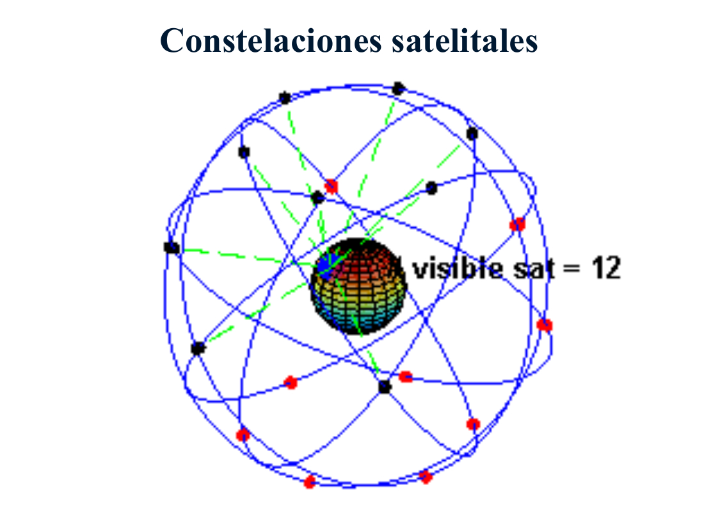

Una **constelación** organiza varios satélites para dar cobertura. En órbitas no geoestacionarias, los satélites se desplazan respecto de la estación; disponer de varios permite sostener el servicio al cambiar cuál resulta visible. El número 12 del dibujo corresponde a esa ilustración.

### 9.4. Características de interés

**Fuente:** PDF pp. 40–42. Se conserva la agrupación de las diapositivas: primero las características técnicas, después las económicas y de servicio, y finalmente tipos de enlace y bandas.

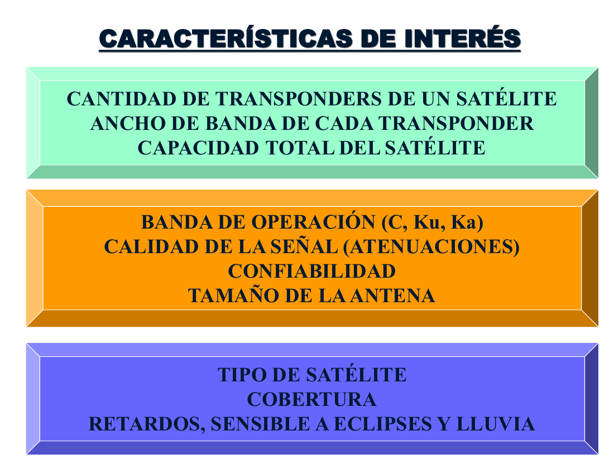

#### 9.4.1. Cantidad de transponders, ancho de banda y capacidad total

Son el primer bloque de p. 40:

- **Cantidad de transponders:** cuántos equipos de retransmisión tiene el satélite.
- **Ancho de banda de cada transponder:** qué intervalo de frecuencias puede utilizar para las señales.
- **Capacidad total:** cuánta información puede transportar el conjunto bajo sus condiciones de operación.

**Relación:** más transponders y ancho de banda aportan recursos, pero MHz no son Mbit/s. Ejemplo didáctico: dos transponders de 36 MHz representan 72 MHz de ancho agregado si se suman esos recursos; no permiten afirmar por sí solos que la tasa sea 72 Mbit/s.

#### 9.4.2. Banda, calidad de señal, confiabilidad y tamaño de antena

Son el segundo bloque de p. 40:

- **Banda de operación — C, Ku o Ka:** zona del espectro en la que trabaja el enlace.
- **Calidad de señal — atenuaciones:** cuánto se debilita la señal y en qué condiciones llega.
- **Confiabilidad:** posibilidad de mantener la comunicación con la calidad requerida.
- **Tamaño de antena:** dimensión necesaria para transmitir y recibir adecuadamente.

**Relación:** no se elige una banda sin considerar atenuación y antena. La comparación de bandas del profesor se conserva en §9.4.7.

#### 9.4.3. Tipo de satélite, cobertura, retardos, eclipses y lluvia

Son el tercer bloque de p. 40:

- **Tipo de satélite:** LEO, MEO o GEO, con los comportamientos explicados en §9.2.
- **Cobertura:** región en la que puede prestarse el servicio.
- **Retardos:** tiempo que demora la señal en recorrer el enlace.
- **Sensibilidad a eclipses y lluvia:** condiciones que deben considerarse para mantener el servicio.

**Qué distinguir:** la lluvia afecta la propagación; un eclipse afecta la iluminación solar y las condiciones de alimentación del satélite. Son aclaraciones de apoyo al listado: ninguno implica por sí solo que todo servicio vaya a interrumpirse.

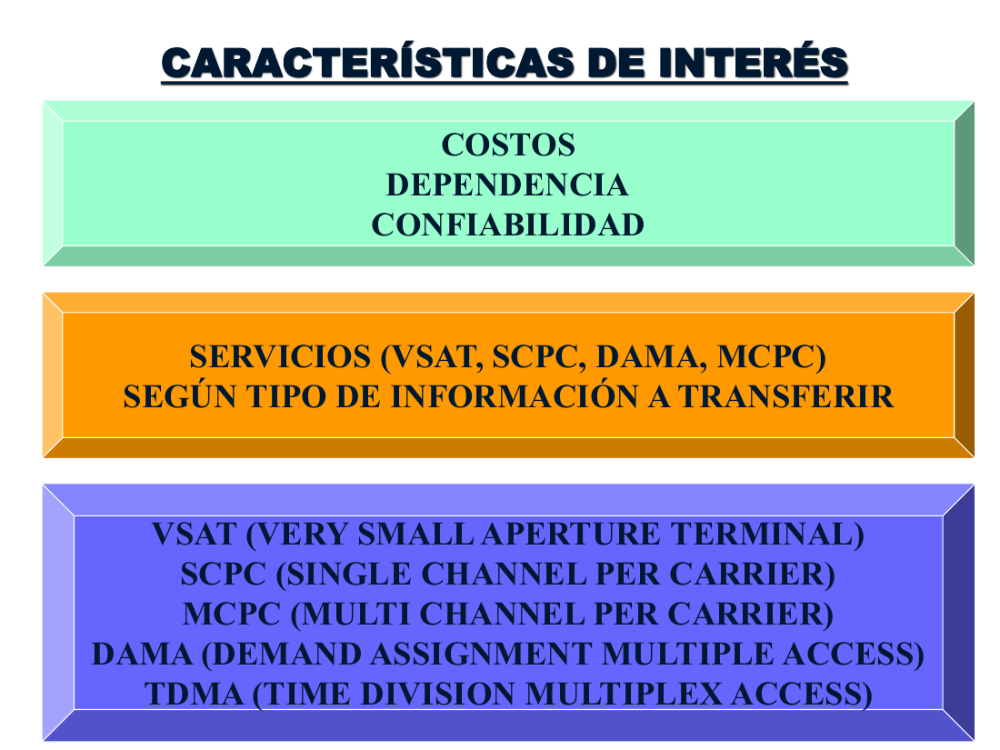

#### 9.4.4. Costos, dependencia y confiabilidad

La p. 41 retoma la confiabilidad junto con los aspectos de contratación y operación:

- **Costos:** equipos, instalación y uso del servicio.
- **Dependencia:** necesidad del operador y de la infraestructura satelital que presta el servicio.
- **Confiabilidad:** si esa solución mantiene la comunicación necesaria.

La repetición de “confiabilidad” se conserva: la presentación la incluye en ambos bloques.

#### 9.4.5. Servicios según la información a transferir

| Sigla | Significado | Idea para entenderla |
|---|---|---|
| VSAT | Very Small Aperture Terminal | Terminal de pequeña apertura para acceder al sistema satelital |
| SCPC | Single Channel Per Carrier | Un canal por portadora |
| MCPC | Multi Channel Per Carrier | Varios canales por portadora |
| DAMA | Demand Assignment Multiple Access | Recursos asignados según demanda |
| TDMA | Time Division Multiple Access | Varias estaciones acceden en turnos de tiempo |

**Ejemplos conceptuales:** SCPC dedica una portadora a un canal; MCPC agrupa varios en una portadora; DAMA asigna recursos cuando se necesitan; TDMA separa las transmisiones por turnos. VSAT describe el terminal: no debe confundirse con una forma de asignar turnos.

Para TDMA, la diapositiva escribe “Multiplex Access”; la expansión técnica es “Multiple Access”. La idea a retener es el acceso por división de tiempo.

#### 9.4.6. Enlace punto a punto y punto a multipunto

La p. 42 presenta estas asociaciones:

- **Punto a punto — SCPC:** enlace entre dos estaciones.
- **Punto a multipunto — VSAT:** una estación central se comunica con varias terminales remotas.

**Modelo mental:** dos extremos frente a un centro con varias sucursales. Son las configuraciones mostradas por el profesor; no hace falta ampliar aquí a otras arquitecturas.

#### 9.4.7. Comparación de bandas C, Ku y Ka

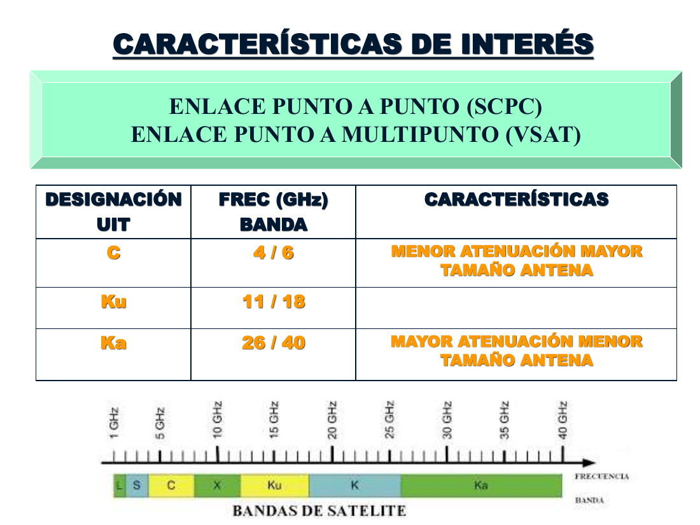

| Banda | Frecuencias indicadas por la cátedra | Comparación de la lámina |
|---|---|---|
| C | 4 / 6 GHz | Menor atenuación; mayor tamaño de antena |
| Ku | 11 / 18 GHz | Situación intermedia |
| Ka | 26 / 40 GHz | Mayor atenuación; menor tamaño de antena |

**Qué hay que entender:** la elección es un compromiso entre propagación y tamaño de antena, no una escala de “mejor a peor”. Como apoyo conceptual, la comparación de tamaño supone prestaciones comparables de antena; en bandas altas importa especialmente considerar lluvia.

Se conservan las cifras del profesor como referencias de la lámina. No se usan para deducir una pareja universal uplink/downlink: la tabla no identifica los sentidos de transmisión.

### 9.5. Red VSAT: hub, inroute y outroute

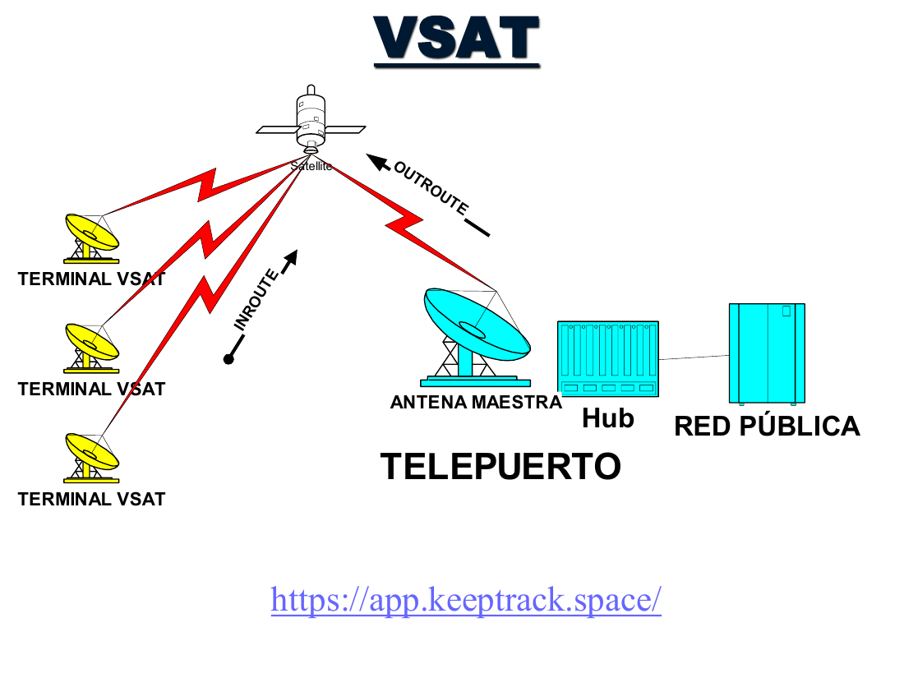

El **hub** es el centro que concentra tráfico y conecta con la red terrestre. El **telepuerto** reúne la infraestructura terrestre de acceso al satélite.

| Término | Recorrido de la información |
|---|---|
| **Inroute** | Terminal remota → satélite → hub |
| **Outroute** | Hub → satélite → terminal remota |

**No confundir con uplink/downlink:** éstos nombran cada tramo Tierra–satélite o satélite–Tierra. Inroute y outroute nombran el sentido respecto del hub. **Ambas rutas incluyen subida y bajada.**

**Ejemplo conceptual:** una sucursal envía información al centro por la inroute: primero hace uplink al satélite y luego la señal baja al hub por downlink. La respuesta usa la outroute, que también incluye uplink y downlink.

El enlace a [KeepTrack](https://app.keeptrack.space/) de la diapositiva permite explorar órbitas; no agrega contenidos de estudio obligatorios.

**Errores típicos de satélites:** confundir período con visibilidad; llamar RTT a una sola subida; equiparar MHz con Mbit/s; tomar inroute como sinónimo de uplink.

> **Para examen:** un enlace satelital conecta estaciones mediante subida, retransmisión y bajada. Para caracterizarlo se consideran recursos del satélite, banda, señal, antenas, órbita, cobertura, retardos, condiciones de operación y servicio, siguiendo los bloques de la presentación.

---

## 10. Comunicaciones ópticas

**Fuente de este bloque:** [UT 7 Medios de Comunicaciones ópticas](../../../material/teoria/U7/UT%207%20Medios%20de%20Comunicaciones%20opticas.pdf), pp. 1–21, Ing. Alejandro Luis Echazú. En esta sección, “PDF óptico” identifica esa presentación, para no confundir sus páginas con las del material anterior.

**Problema físico:** transportar información mediante luz exige generarla, guiarla o dirigirla y detectarla en el destino. La señal no deja de tener limitaciones por ser óptica: puede perder potencia y sus pulsos pueden deformarse.

La p. 2 vuelve al espectro electromagnético: la luz utilizada en estas comunicaciones también es una onda electromagnética. La relación entre frecuencia y longitud de onda ya se explicó en §1.3; ahora importa cómo se comporta esa luz en la fibra.

### 10.1. Fibra óptica: construcción e índice de refracción

**Fuente:** PDF óptico p. 3.

Una **fibra óptica — FO** es una guía de luz. La figura distingue un **núcleo**, donde se guía la señal; un **recubrimiento o revestimiento óptico**, de índice diferente; y una **protección exterior de polietileno**, con función mecánica. El revestimiento óptico no debe confundirse con la cubierta protectora.

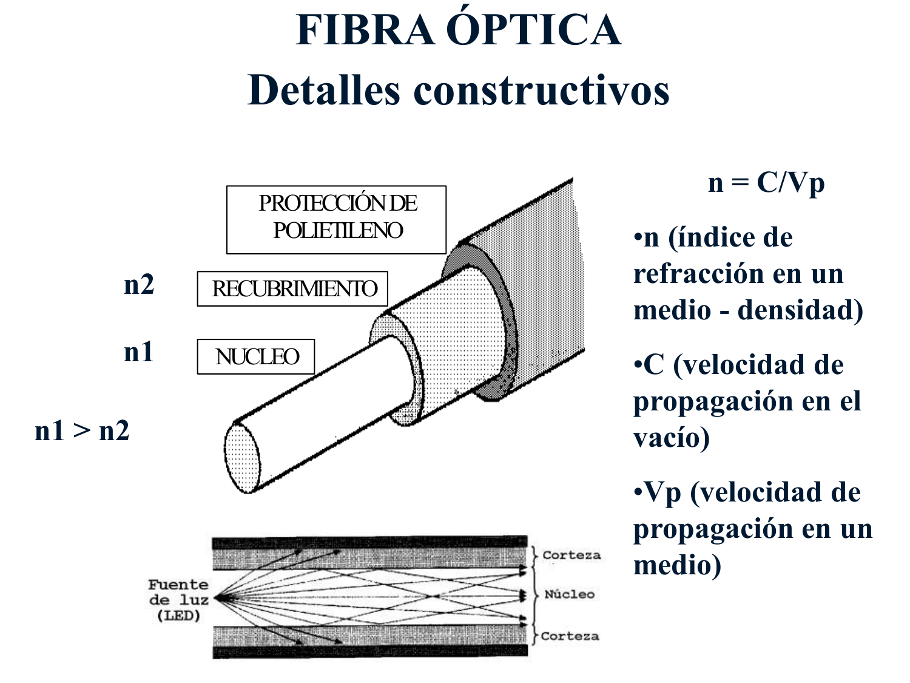

**Cómo leerlo:** el núcleo tiene índice $n_1$ y el recubrimiento, $n_2$, con $n_1>n_2$. Esa diferencia es la condición que permite explicar el guiado mediante reflexión total interna; no se trata de una pared metálica que refleje la luz.

El **índice de refracción** relaciona la velocidad de la luz en el vacío con su velocidad de propagación en el medio:

$$
n=\frac{C}{V_p}
$$

| Símbolo | Significado | Unidad |
|---|---|---|
| $n$ | Índice de refracción | Sin unidad |
| $C$ | Velocidad de la luz en el vacío, aproximadamente $3\times10^8$ | m/s |
| $V_p$ | Velocidad de propagación en el medio | m/s |

**Supuestos:** se considera el índice para la luz y el medio de interés; puede variar con la longitud de onda. La palabra “densidad” de la diapositiva debe entenderse en sentido óptico, no como una densidad de masa en kg/m³.

**Ejemplo didáctico:** con $n=1,5$, la luz se propaga a $V_p=(3\times10^8)/1,5=2\times10^8\ \mathrm{m/s}$. Un índice mayor significa menor velocidad en ese medio; no significa directamente más bits por segundo.

**Errores típicos:** confundir recubrimiento óptico con protección mecánica; creer que el índice tiene unidades; pensar que “óptica” significa que la luz siempre sea visible.

> **Para examen:** la fibra guía luz mediante un núcleo de índice mayor que el revestimiento. La protección exterior cuida la estructura, mientras que la diferencia de índices determina su comportamiento óptico.

### 10.2. Ley de Snell, reflexión total interna y cono de aceptación

**Fuente:** PDF óptico pp. 4–5.

**Problema:** si la luz escapara del núcleo en cada encuentro con el revestimiento, no podría recorrer la fibra. Hay que entender qué ocurre en la interfaz entre ambos medios.

Al pasar entre medios de diferente índice, la luz puede cambiar de dirección: **refracción**. La **ley de Snell** relaciona los ángulos:

$$
n_1\sin\theta_1=n_2\sin\theta_2
$$

| Símbolo | Significado | Unidad |
|---|---|---|
| $n_1$, $n_2$ | Índices de los medios de incidencia y refracción | Sin unidad |
| $\theta_1$ | Ángulo incidente respecto de la normal a la interfaz | Grados o radianes |
| $\theta_2$ | Ángulo refractado respecto de esa misma normal | Grados o radianes |

**Supuestos:** modelo de rayos en la interfaz entre medios transparentes. Los ángulos se miden desde la **normal**, la perpendicular a la superficie, no desde la superficie ni desde el eje de la fibra.

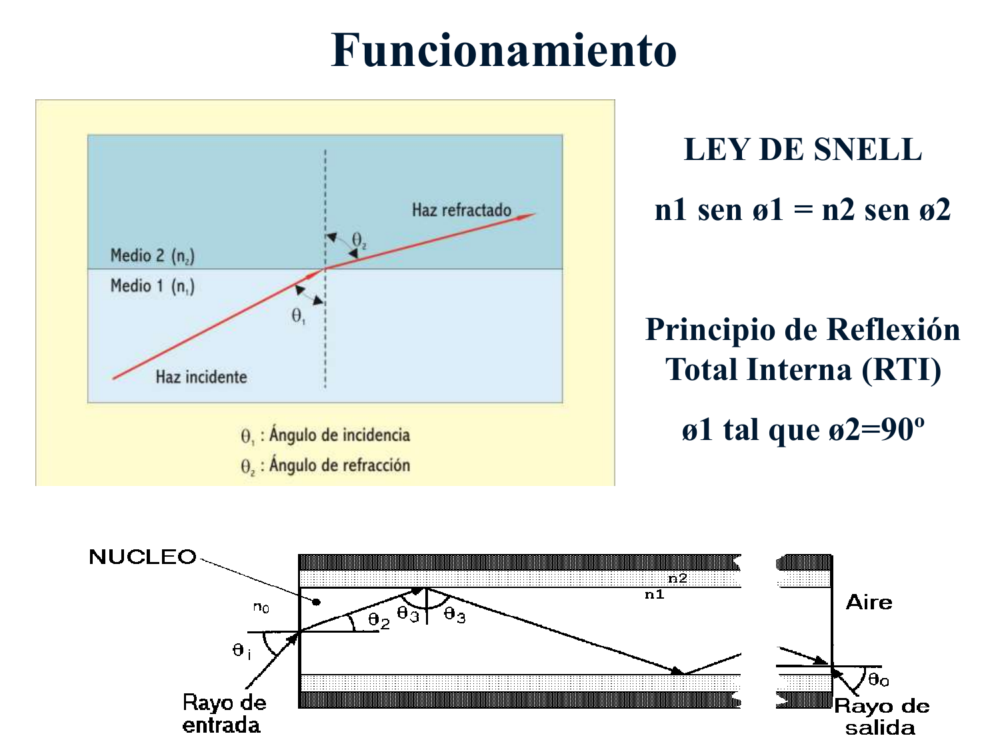

Cuando la luz va del núcleo de mayor índice al revestimiento de menor índice, existe un **ángulo crítico**: para él, el rayo refractado queda a 90° de la normal, como indica la diapositiva. Para ángulos de incidencia **mayores** que ese crítico ocurre **reflexión total interna — RTI**: en el modelo de rayos, la luz se refleja hacia el núcleo en lugar de propagarse hacia el revestimiento.

**Formalización de ese límite, obtenida de Snell:**

$$
\sin\theta_c=\frac{n_2}{n_1}
$$

| Símbolo | Significado | Unidad |
|---|---|---|
| $\theta_c$ | Ángulo crítico de incidencia, medido desde la normal | Grados o radianes |
| $n_1$, $n_2$ | Índices del núcleo y del revestimiento, con $n_1>n_2$ | Sin unidad |

**Supuestos:** el paso es desde el medio de mayor índice al de menor índice. La igualdad determina el límite; la RTI se da por encima de él.

**Ejemplo didáctico:** con $n_1=1,50$ y $n_2=1,45$, una incidencia de 45° da $\theta_2\simeq47,0^\circ$ por Snell: hay rayo refractado. El ángulo crítico es aproximadamente $75,2^\circ$; una incidencia de 80° supera ese límite y permite RTI. Los ángulos de incidencia de este ejemplo se miden desde la normal a la frontera núcleo–revestimiento.

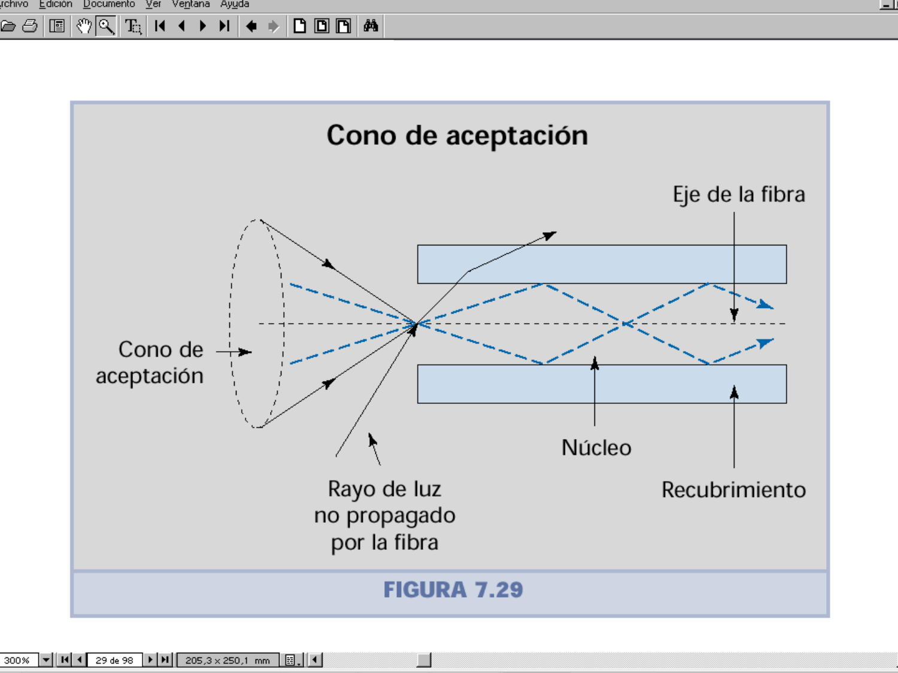

**Cono de aceptación:** no toda luz que entra por el extremo queda guiada. El cono reúne las direcciones de entrada que permiten cumplir las condiciones de propagación dentro de la fibra. La figura muestra rayos admitidos y otro que escapa hacia el revestimiento.

**Modelo mental:** el ángulo de entrada se observa en la cara de la fibra; el ángulo crítico se evalúa en la frontera núcleo–revestimiento. Son ángulos en lugares distintos del recorrido.

**Errores típicos:** decir que cualquier rayo que ingresa queda atrapado; medir todos los ángulos desde el eje; llamar RTI al caso de igualdad sin distinguirlo del límite crítico.

> **Para examen:** Snell describe la refracción entre medios. Con núcleo de mayor índice que el revestimiento, los rayos que cumplen la condición angular de reflexión total interna pueden quedar guiados; el cono de aceptación representa las direcciones de entrada admisibles.

### 10.3. Tipos de fibra: multimodo escalón, multimodo gradual y monomodo

**Fuente:** PDF óptico p. 6.

Un **modo** es una forma de propagación del campo guiado. La presentación lo representa mediante trayectorias: sirve para entender que distintas formas de recorrer la fibra pueden producir diferentes tiempos de llegada.

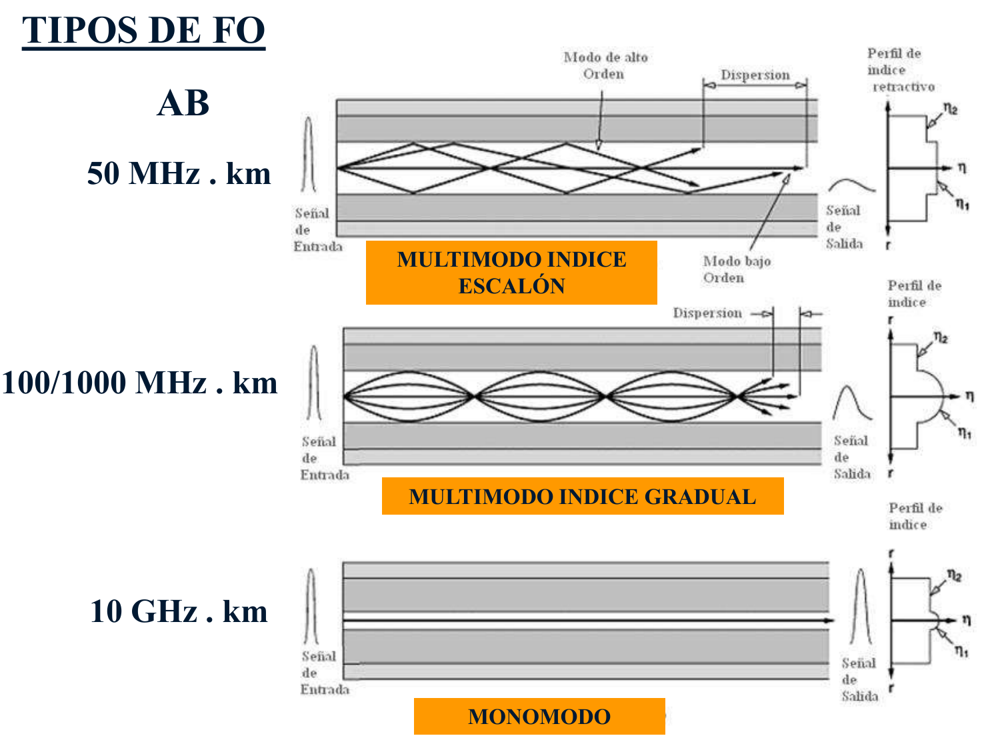

| Tipo | Qué cambia en el índice | Qué muestra el dibujo | Valor de AB·distancia de la lámina |
|---|---|---|---|
| Multimodo de índice escalón | Índice aproximadamente uniforme en el núcleo, con salto al revestimiento | Varias trayectorias con diferencias de tiempo apreciables | 50 MHz·km |
| Multimodo de índice gradual | El índice del núcleo cambia gradualmente desde el centro | Trayectorias curvas con menor diferencia de tiempo de llegada | 100/1000 MHz·km |
| Monomodo | Estructura que admite un único modo de propagación para su operación | Desaparece el ensanchamiento por diferencias entre modos | 10 GHz·km |

**Cómo entender la diferencia:** en multimodo escalón, partes de un mismo pulso recorren caminos distintos y llegan en tiempos diferentes. En índice gradual, el índice disminuye desde el centro hacia la periferia: los recorridos más largos atraviesan zonas de menor índice y mayor velocidad. Esa compensación reduce las diferencias de llegada y el ensanchamiento. Esta explicación de apoyo relaciona los perfiles de la figura con $V_p=C/n$. En monomodo no hay diferencias de llegada entre modos, pero puede persistir dispersión cromática.

**Ejemplos conceptuales:** el dibujo superior muestra un pulso de salida mucho más ancho; el central, uno menos ensanchado; el inferior, uno que no sufre dispersión entre modos. “Multimodo” no significa que se transmitan necesariamente varios mensajes independientes, ni “monomodo” significa una única longitud de onda.

Los números de la tabla son las referencias comparativas del profesor. Su unidad es un producto de ancho de banda por distancia, explicado a continuación; no son límites universales ni velocidades en Gbit/s.

**Errores típicos:** equiparar modos con usuarios; decir que monomodo carece de dispersión; confundir diámetro del cable con diámetro del núcleo.

> **Para examen:** la multimodo permite varios modos; el índice gradual reduce las diferencias de tiempo respecto del escalón. La monomodo evita la dispersión modal, por lo que favorece enlaces de mayor alcance y prestaciones, sin quedar libre de otras limitaciones.

### 10.4. Dispersión y ancho de banda: por qué importa la distancia

**Fuente:** PDF óptico pp. 6–7 y 12.

**Problema físico:** un pulso entra definido, pero no toda su energía llega al mismo tiempo. El pulso se ensancha y puede superponerse con el siguiente, dificultando decidir qué símbolo se recibió.

- **Dispersión modal:** distintos modos llegan en tiempos diferentes. Es propia de la fibra multimodo.
- **Dispersión cromática:** distintas longitudes de onda tienen distintos retardos. La presentación la vincula con LED, cuya emisión tiene mayor ancho espectral; no debe entenderse como un fenómeno exclusivo de LED.

**Modelo mental:** atenuación es un pulso que llega más débil; dispersión es un pulso que llega más ancho. Un receptor puede tener potencia suficiente y aun así no distinguir pulsos demasiado superpuestos.

**Ejemplo didáctico:** si los comienzos de dos pulsos consecutivos están separados 20 ns y, después de propagarse, cada pulso dura unos 30 ns, sus intervalos se superponen. El receptor tiene más dificultad para distinguirlos; aumentar potencia no vuelve a separarlos en el tiempo.

La p. 7 indica que el ancho de banda disponible disminuye al alejarnos de la fuente y usa GHz·km. **Lectura de la unidad:** Hz mide ancho de banda; MHz·km o GHz·km mide el **producto ancho de banda–distancia**, no ancho de banda solo.

**Modelo aproximado para interpretar los valores de clase:**

$$
K=B\,L,\qquad B\simeq\frac{K}{L}
$$

| Símbolo | Significado | Unidad |
|---|---|---|
| $K$ | Producto ancho de banda–distancia | MHz·km |
| $B$ | Ancho de banda de la señal que admite el modelo | MHz |
| $L$ | Longitud del enlace | km |

**Supuestos:** comparación aproximada para una fibra y condiciones de operación fijadas, cuando se caracteriza así la limitación por dispersión. No calcula por sí solo la tasa de bits ni garantiza un enlace real.

**Ejemplo didáctico:** con $K=500\ \mathrm{MHz\cdot km}$, a 1 km se estiman 500 MHz y a 2 km, 250 MHz. El producto se mantiene en el modelo, mientras disminuye el ancho de banda disponible. No se puede cambiar MHz por Mbit/s sin especificar cómo se transmite.

**Errores típicos:** creer que más potencia corrige el ensanchamiento; confundir MHz·km con MHz; suponer que monomodo elimina toda dispersión.

> **Para examen:** la dispersión ensancha los pulsos y limita cuánto pueden aproximarse en el tiempo. Por eso la distancia condiciona las prestaciones; hay que distinguir ancho de banda en Hz, producto ancho de banda–distancia y tasa de bits.

### 10.5. Ventanas de operación y dimensiones de la fibra

**Fuente:** PDF óptico pp. 8–10.

Una **ventana de operación** es una región de longitudes de onda utilizada para comunicar, con condiciones favorables de transmisión. No es una abertura física en el cable.

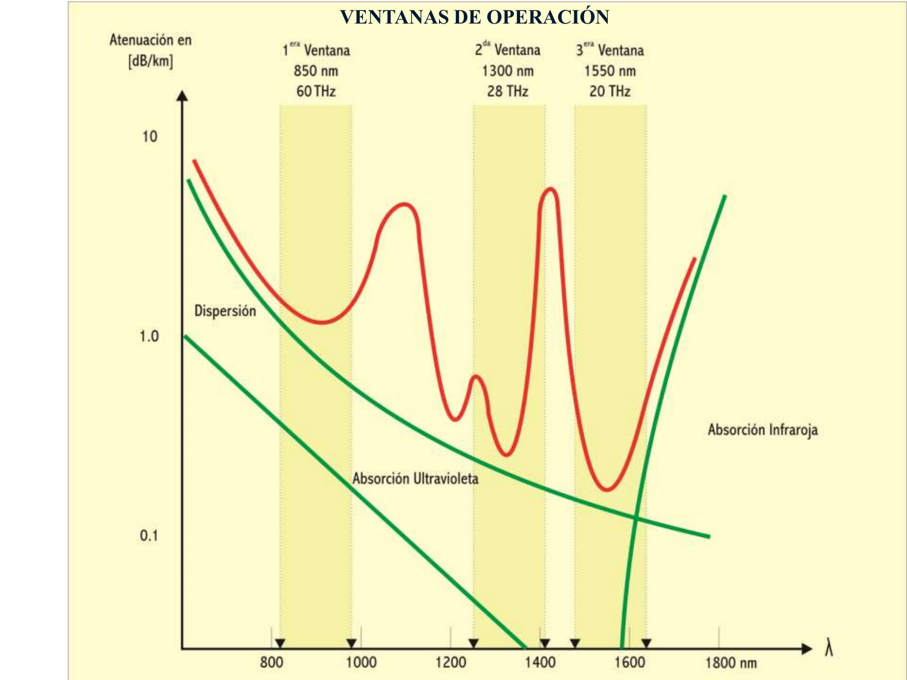

**Cómo leerlo:** el eje horizontal es longitud de onda, en nm; el vertical es atenuación por kilómetro. Las zonas de menor pérdida favorecen el uso de ciertas longitudes de onda. La curva no dice que toda fibra tenga exactamente los mismos valores.

| Ventana | Longitud de onda de referencia de la presentación | Tipos indicados en p. 8 |
|---|---|---|
| Primera | 850 nm | Multimodo |
| Segunda | Alrededor de 1300 nm | Multimodo y monomodo |
| Tercera | 1550 nm | Monomodo |

se habla de DOPAJE para ir cambiando de ventana, utilizando materiales que DOPAN al pelo de fibra optica, que a su vez sabemos que es muy barato el pelo, lo que es caro son los materiales que dopan.

el material base de la fibra optica es silicio, que es basicamente arena. -> material barato.

La segunda ventana aparece como 1300 nm en pp. 8–9 y como 1330 nm en p. 10. Para este tema retené la región aproximada y su relación con el tipo de fibra. Los rótulos en THz de p. 9 no son tasas de bits ni el producto MHz·km de §10.4; su interpretación queda señalada entre los pendientes.

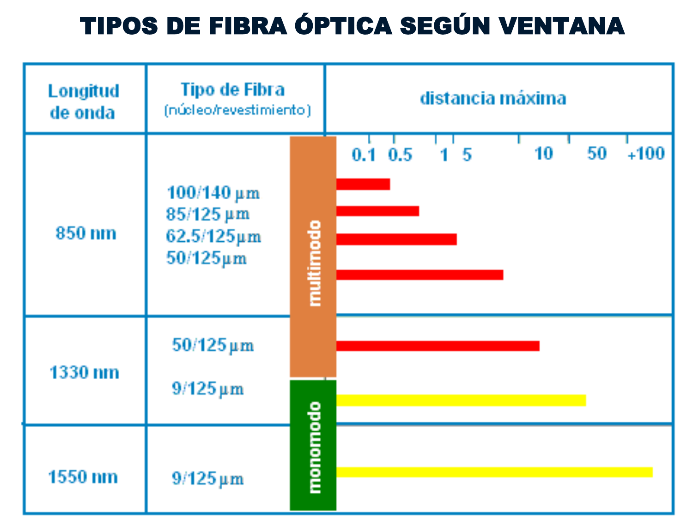

La escritura **50/125 µm** significa 50 µm de diámetro de núcleo y 125 µm de revestimiento óptico. **No** es una división matemática ni el diámetro de la cubierta exterior. La figura compara 100/140, 85/125, 62,5/125 y 50/125 µm para multimodo, y 9/125 µm para monomodo.

**Ejemplo de lectura:** 850 nm describe la luz empleada; 50 µm describe el diámetro de un núcleo. Son magnitudes distintas aunque ambas sean longitudes. La escala de distancias del gráfico es orientativa; antes de usarla en un ejercicio hay que fijar aplicación, emisor y receptor.

**Errores típicos:** confundir nm con µm; tratar una ventana como tasa de transmisión; llamar núcleo al conjunto de 125 µm.

### 10.6. Categorías multimodo OM1–OM5

**Fuente:** PDF óptico p. 11.

Las categorías OM distinguen prestaciones dentro de la familia multimodo; no son sinónimos de monomodo ni del número de fibras que contiene un cable.

| Categoría | Dimensiones que presenta la lámina | Característica destacada por el profesor |
|---|---|---|
| OM1 | 62,5/125 µm | Más antigua; menciona hasta 2 km y hasta 1 Gbit/s |
| OM2 | 50/125 µm | Mayor ancho de banda y alcance que OM1, especialmente para Gigabit Ethernet |
| OM3 | 50/125 µm | Referencia de 10 Gbit/s hasta 300 m |
| OM4 | Como OM3: 50/125 µm | Referencia de 10 Gbit/s hasta 400 m |
| OM5 | No especificadas en esa lámina | Mayor ancho de banda; uso en centros de datos, corta y media distancia |

**Aclaración importante sobre OM1:** no estudiar “1 Gbit/s a 2 km” como garantía conjunta. La distancia depende del transceptor y la aplicación: por ejemplo, Cisco especifica 275 m para 1000BASE-SX sobre OM1 de 200 MHz·km ([ficha técnica](https://www.cisco.com/c/en/us/products/collateral/interfaces-modules/gigabit-ethernet-gbic-sfp-modules/datasheet-c78-366584.html)). La frase de clase se conserva en su columna, pero no habilita a diseñar un enlace con esos dos máximos combinados.

**Qué retener:** para una tasa dada, las mejoras de fibra permiten distintos alcances bajo condiciones definidas. Ejemplo de la propia comparación: 300 m para OM3 frente a 400 m para OM4 a 10 Gbit/s. La categoría sola no reemplaza verificar el sistema completo.

### 10.7. Pérdidas en fibra óptica

**Fuente:** PDF óptico p. 12.

La presentación reúne bajo “pérdidas” dos efectos: **disminución de potencia** y **reducción del ancho de banda utilizable**. Conviene mantener la agrupación del profesor, distinguiendo qué produce cada mecanismo.

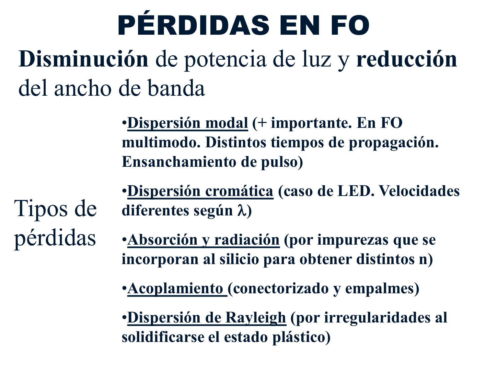

| Mecanismo de la lámina | Qué ocurre | Consecuencia que hay que entender |
|---|---|---|
| Dispersión modal | Diferentes tiempos entre modos | Ensanchamiento del pulso en multimodo |
| Dispersión cromática | Diferentes retardos según longitud de onda | Ensanchamiento, relacionado con el espectro del emisor |
| Absorción y radiación | Parte de la energía es absorbida o deja de permanecer guiada | Menor potencia útil |
| Acoplamiento | Se pierde parte de la luz en conexiones y empalmes | Pérdida adicional en cada unión |
| Dispersión de Rayleigh | Irregularidades microscópicas del material dispersan luz | Parte de la potencia deja el modo útil |

**No confundas los dos usos de “dispersión”:** la modal/cromática describe diferencias temporales; Rayleigh se refiere a dispersión de luz por el material. No tienen la misma consecuencia principal.

**Ejemplo didáctico de atenuación:** usando la relación de §4.3, una fibra con 0,3 dB/km en la ventana elegida pierde 3 dB en 10 km. Dos uniones de 0,5 dB cada una elevan el total a 4 dB. Los valores son hipotéticos; esta cuenta no cuantifica el ensanchamiento de pulsos.

La p. 12 relaciona estas pérdidas con el material, sus impurezas y su fabricación: la transmisión no depende sólo de la longitud de la fibra.

**Errores típicos:** sumar ensanchamientos de tiempo como si fueran pérdidas en dB; confundir Rayleigh con dispersión modal; omitir pérdidas de conectores y empalmes.

> **Para examen:** el enlace óptico debe cumplir dos condiciones distintas: potencia suficiente en el receptor y pulsos distinguibles. Las pérdidas de potencia y la dispersión temporal se analizan por separado aunque la cátedra las reúna como degradaciones de la fibra.

### 10.8. Sistema optoelectrónico: de datos eléctricos a luz y de vuelta

**Fuente:** PDF óptico pp. 13–14.

La fibra guía luz, pero los equipos manejan señales eléctricas. El sistema necesita un **emisor óptico** que transforme la señal de entrada en variaciones de luz y un **detector** que permita recuperar la señal eléctrica en recepción.

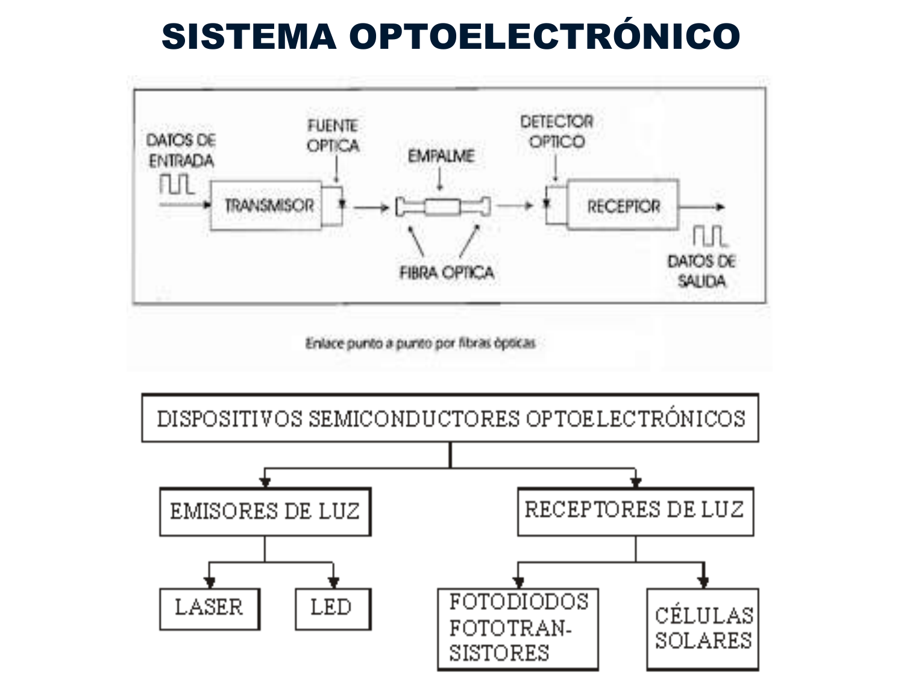

**Recorrido completo:** datos eléctricos → transmisor y fuente óptica → fibra y sus uniones → detector y receptor → datos eléctricos recuperados.

La clasificación del profesor separa **emisores** —LED y láser— de **receptores de luz** —fotodiodos, fototransistores y células solares—. En la cadena de comunicación importa su función: emitir la señal luminosa y detectar la que llega; no se debe confundir el detector con una fuente de luz.

**Ejemplo conceptual:** un pulso eléctrico hace variar la emisión; esa variación viaja por la fibra y el receptor la convierte en una señal eléctrica interpretable. No viaja corriente eléctrica de un extremo al otro por el núcleo óptico.

#### LED y láser comparados

**LED** significa diodo emisor de luz. El **láser** emite luz coherente: como apoyo conceptual, mantiene una relación de fase definida entre sus ondas. La coherencia no significa por sí sola que la fuente transmita información: la emisión debe modularse.

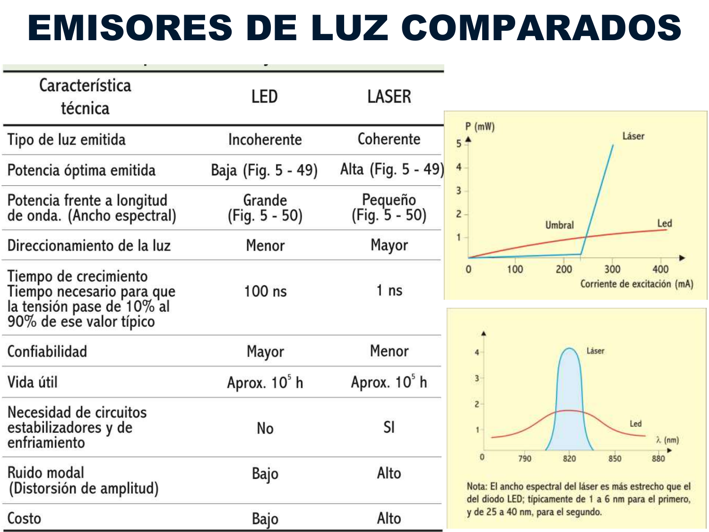

| Característica de la comparación | LED | Láser |
|---|---|---|
| Luz emitida | Incoherente | Coherente |
| Potencia óptica emitida | Baja | Alta |
| Ancho espectral | Grande | Pequeño |
| Direccionamiento | Menor | Mayor |
| Tiempo de crecimiento indicado | 100 ns | 1 ns |
| Confiabilidad indicada | Mayor | Menor |
| Vida útil indicada | Aproximadamente $10^5$ h | Aproximadamente $10^5$ h |
| Estabilización y enfriamiento en la tabla | No | Sí |
| Ruido modal, asociado a distorsión de amplitud | Bajo | Alto |
| Costo | Bajo | Alto |

**Cómo leer las curvas:** arriba se grafica potencia óptica en mW frente a corriente de excitación en mA; el láser presenta un umbral a partir del cual la potencia crece marcadamente. Abajo se muestra la distribución respecto de longitud de onda: el láser concentra la emisión en un intervalo más estrecho.

**Tiempo de crecimiento:** intervalo que tarda la respuesta en pasar del 10% al 90% del valor considerado, según la definición de la lámina. Describe qué tan rápido responde el emisor, no cuánto tarda la luz en recorrer la fibra.

**Ancho espectral no es ancho de banda de datos:** la nota de la figura da 1–6 nm para el láser y 25–40 nm para LED como ejemplos de esa comparación. Esos nm describen cuánto se extiende la emisión en longitudes de onda, no cuántos bits transmite por segundo.

**Ejemplo didáctico:** el crecimiento de 1 ns de la tabla es cien veces más corto que el de 100 ns; permite entender por qué un emisor más rápido puede seguir cambios de señal más rápidos. No implica convertir automáticamente esos tiempos en una tasa exacta de datos.

**Ruido modal no es dispersión modal:** en esta tabla, el primero se asocia con distorsión de amplitud; la segunda se explicó como ensanchamiento temporal por distintos tiempos de llegada. Son efectos diferentes, aunque ambos usen la palabra “modal”.

Se conservan las características del cuadro como comparación del material: potencia, costo y vida útil de un dispositivo concreto se verifican en su ficha, no se toman como constantes universales.

**Errores típicos:** creer que toda luz es visible; confundir coherencia con información; intercambiar emisor y detector; confundir ancho espectral en nm con tasa de bits.

> **Para examen:** un enlace optoelectrónico convierte señal eléctrica en luz y la recupera en recepción. La fuente, la fibra, las uniones y el detector deben ser compatibles; LED y láser difieren en espectro, direccionamiento, rapidez y requerimientos del dispositivo.

### 10.9. Cables, conectores y empalmes

**Fuente:** PDF óptico p. 15.

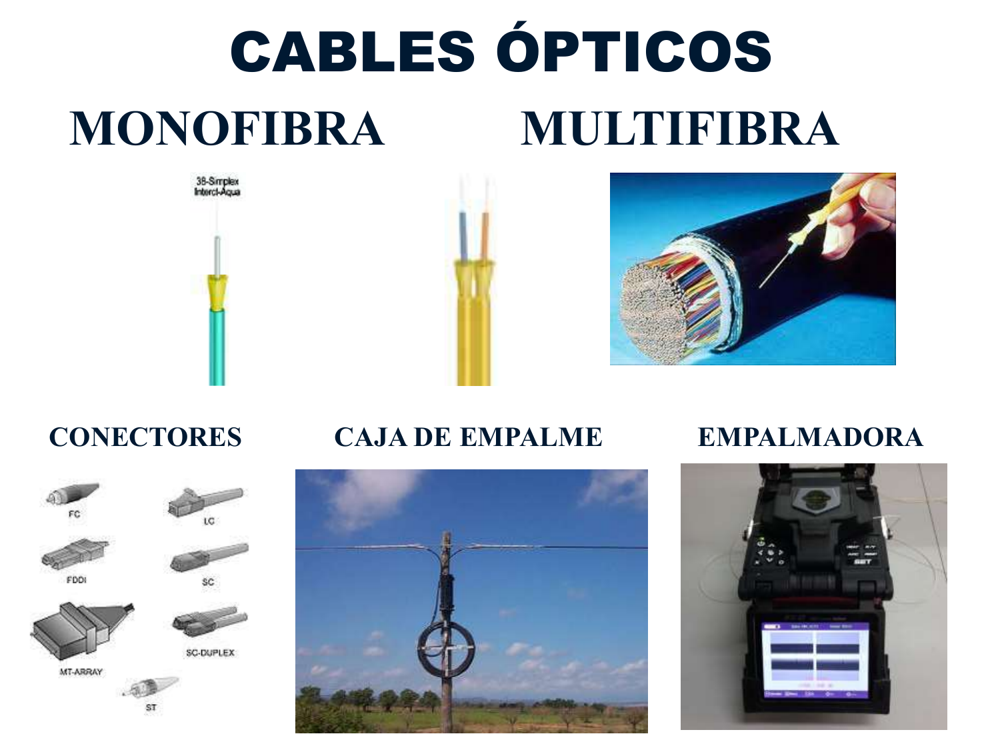

- **Cable monofibra:** contiene una fibra óptica.
- **Cable multifibra:** reúne varias fibras en una estructura protectora.
- **Conector:** permite una unión desmontable, que debe alinear las fibras.
- **Empalme:** une fibras para dar continuidad al recorrido; la empalmadora es el equipo usado para realizar la unión.
- **Caja de empalme:** protege y organiza las uniones.

**Distinción clave:** monofibra/multifibra cuenta fibras; monomodo/multimodo describe propagación. Por ejemplo, un cable multifibra puede contener varias fibras monomodo.

**Relación con las pérdidas:** una desalineación hace que no toda la luz de una fibra se acople a la otra. El empalme y el conector no deben tratarse como elementos sin pérdida.

### 10.10. Fibra óptica plástica — POF

**Fuente:** PDF óptico p. 16. POF significa Plastic Optical Fiber.

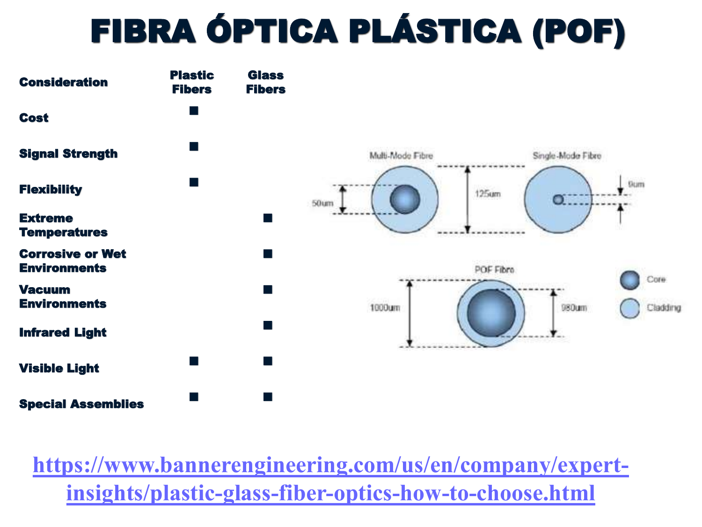

La presentación compara fibras de plástico y de vidrio según costo, intensidad de señal, flexibilidad y condiciones de uso. No cambia el principio de transportar luz: cambia el material y sus posibilidades de aplicación.

| Criterios destacados en la tabla | Opción señalada |
|---|---|
| Costo, intensidad de señal y flexibilidad | Plástico |
| Temperaturas extremas, ambientes corrosivos/húmedos, vacío e infrarrojo | Vidrio |
| Luz visible y montajes especiales | Ambas |

**Cómo leerlo:** son criterios de selección de la comparación enlazada por la cátedra, no prestaciones garantizadas para cualquier producto. El dibujo de POF muestra un núcleo de 980 µm y diámetro con revestimiento de 1000 µm; son dimensiones de ese ejemplo, no la definición de toda POF.

**Ejemplo de distinción:** “plástica” y “multimodo” responden a preguntas diferentes: de qué material está hecha y cómo se propaga la luz.

### 10.11. Propiedades y empleo de la fibra

**Fuente:** PDF óptico pp. 17–18.

#### Propiedades:

- **Gran ancho de banda:** permite transportar señales con altas prestaciones, dentro de las limitaciones de fuente, fibra y receptor.
- **Inmunidad al ruido y las interferencias electromagnéticas:** el trayecto óptico no recibe esas perturbaciones como una línea conductora. No significa ausencia de toda degradación.
- **Tamaño y peso adecuados:** facilita reunir fibras y tender cables, según construcción e instalación.
- **Bajas potencias ópticas de operación:** el trayecto transporta una señal luminosa de baja potencia. No es lo mismo que el consumo eléctrico total de los equipos ni determina por sí solo la tasa de transmisión.
- **Baja atenuación:** favorece alcance, dependiendo de ventana y fibra.
- **WDM — multiplexión por división de longitud de onda:** permite compartir una fibra mediante distintas longitudes de onda.

**Modelo mental de WDM:** se combinan varias señales ópticas, cada una con una longitud de onda diferente; comparten el recorrido y después se separan en recepción. No es dispersión cromática: WDM aprovecha la separación entre canales; la dispersión describe una degradación temporal.

**Ejemplo conceptual:** dos canales ópticos de longitudes de onda distintas pueden compartir una fibra si los equipos los combinan y separan correctamente. Monomodo no significa “un solo canal WDM”.

#### Aplicaciones de FO:

| Empleo de p. 18 | Qué significa en este tema |
|---|---|
| Backbone de redes | Enlaces troncales que concentran comunicaciones |
| Cables submarinos | Transporte óptico entre puntos separados por mares u océanos |
| Anillos SDH/SONET | Transporte síncrono en anillo, relacionado con U4 |
| FDDI — Fiber Distributed Data Interface | Ejemplo de red que utiliza fibra |
| HFC — Hybrid Fiber Coax | Red que combina tramos de fibra y coaxil |
| FTTH — Fiber To The Home | La fibra llega al hogar |
| FTTC — Fiber To The Curb | Llega hasta un punto próximo a los usuarios, en la acera |
| FTTB — Fiber To The Building | Llega al edificio |
| FTTO — Fiber To The Office | Llega a la oficina |

**Qué distinguir:** FTTH/FTTC/FTTB/FTTO indican hasta dónde llega el tramo de fibra, no diferentes leyes de propagación. Ejemplo conceptual: que llegue al edificio no implica que cada conexión interna hasta la vivienda sea óptica.

La lámina enlaza [Submarine Cable Map](https://www.submarinecablemap.com/) como recurso para visualizar tendidos.

### 10.12. Folleto técnico y datos para decisiones: HAY QUE LLEVARLO AL PARCIAL.

**Fuente:** PDF óptico pp. 19–20.

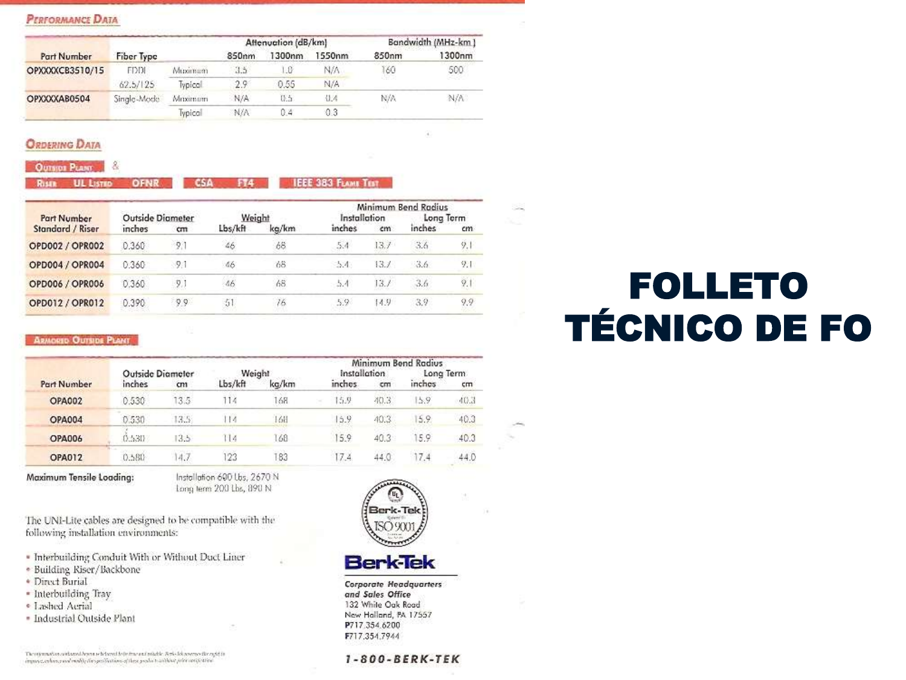

Para ampliar, consultá el [folleto original](../../../material/teoria/U7/Folleto%20FO.jpg). La tabla diferencia **atenuación en dB/km por ventana** y **producto ancho de banda–distancia en MHz·km**. También informa diámetros, peso y radios de curvatura para instalación y uso permanente.

**Ejemplo de lectura del folleto:** para la fibra monomodo, la fila típica indica 0,4 dB/km a 1300 nm y 0,3 dB/km a 1550 nm; la fila máxima indica **0,5 dB/km a 1300 nm y 0,4 dB/km a 1550 nm**. Estos valores se contrastaron con el [escaneo original](../../../material/teoria/U7/Folleto%20FO.jpg), cuya tabla permite distinguir mejor las cifras. No mezcles típico con máximo ni generalices a todas las fibras.

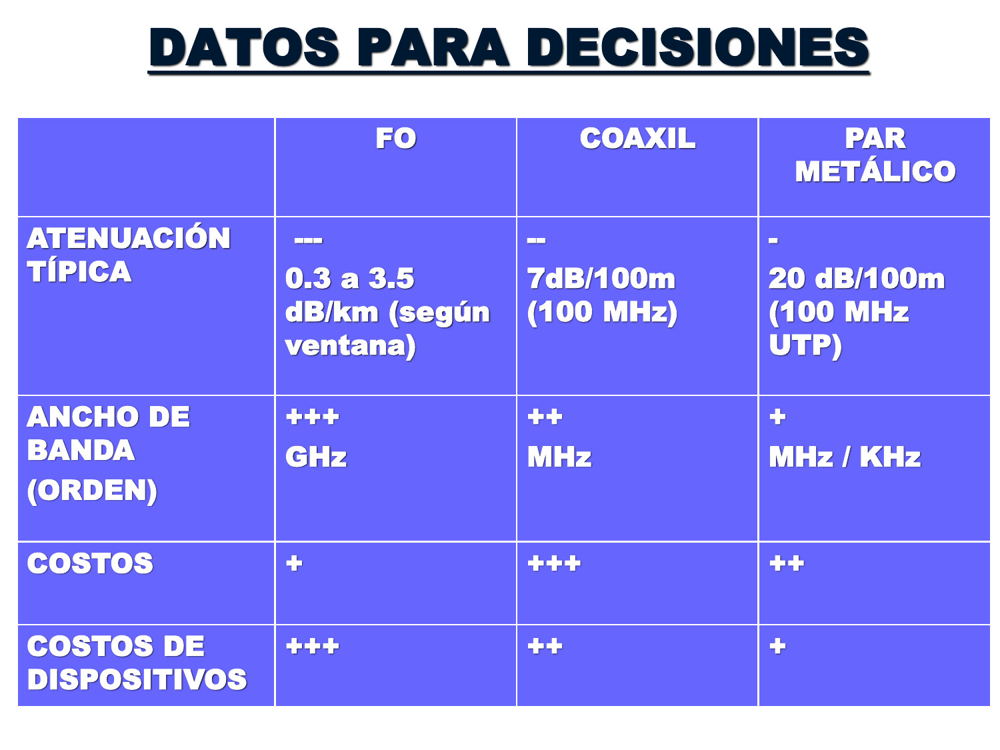

| Criterio | Fibra óptica | Coaxil | Par metálico |
|---|---|---|---|
| Atenuación típica indicada | 0,3–3,5 dB/km, según ventana -> gana espacio respecto a la atenuación de los demás medios | 7 dB/100 m a 100 MHz | 20 dB/100 m a 100 MHz, UTP |
| Ancho de banda, orden indicado | GHz | MHz | MHz/kHz |
| Costos, escala de la lámina | + | +++ | ++ |
| Costos de dispositivos, escala de la lámina | +++ | ++ | + |

**Cómo usarla:** en las filas de costos, más signos “+” representan un nivel relativo mayor. La lámina ubica el costo de la fibra en “+”, pero el de sus dispositivos en “+++”: medio y equipos no cuestan lo mismo. Es una comparación docente, no una cotización actual. Las atenuaciones también tienen condiciones distintas: no compares sólo “0,3 frente a 7” sin mirar longitud, frecuencia o ventana.

**Ejemplo didáctico de unidades:** 7 dB/100 m equivale a 70 dB/km a la misma frecuencia y para ese cable. Convertir unidades permite comparar bases de longitud; no vuelve idénticas las condiciones ópticas y eléctricas.

> **Para examen:** elegir fibra requiere mirar no sólo capacidad y pérdidas del medio, sino emisores, receptores, terminaciones, montaje y costo de los equipos. La ficha técnica debe leerse con sus unidades y condiciones.

### 10.13. Láser por espacio libre

**Fuente:** PDF óptico p. 21.

La presentación define la transmisión de información mediante un **haz de luz coherente convenientemente modulado**. En este ejemplo, el haz viaja entre equipos de edificios sin estar guiado por una fibra.

**Distinción central:** un láser es una fuente; la fibra es un medio guiado. Por eso usar láser no implica necesariamente usar fibra. En el esquema de espacio libre, los extremos deben apuntar el haz hacia el receptor.

**Ejemplo de lectura:** los edificios del dibujo intercambian información por el haz óptico. El rótulo de 5 km pertenece a ese esquema; no se toma como alcance garantizado de cualquier enlace láser.

**Errores típicos:** identificar láser con cable de fibra; suponer que coherencia equivale a modulación; adoptar el alcance de una ilustración como dato universal.

> **Para examen:** la información puede transmitirse mediante luz modulada tanto en fibra como por espacio libre. En el segundo caso no existe una guía física entre extremos y es necesario dirigir el haz hacia el receptor.

---

## 11. Síntesis comparativa

| Medio/sistema | Propagación | Fortaleza | Condición crítica |
|---|---|---|---|
| Par trenzado | Guiada por par balanceado | Uso en voz/datos e instalación accesible | Balance, diafonía, longitud y terminación |
| Coaxil | Campo entre conductores concéntricos | Confinamiento y blindaje | Impedancia, conectores y pérdidas |
| Guía de onda | Modos en estructura | Transporte de microondas | Dimensiones y banda |
| Radio terrestre | Onda entre antenas | Evita tendido entre estaciones | Trayecto, interferencia y margen |
| Satélite | Radio con infraestructura espacial | Cobertura extensa | Órbita, topología y retardo |
| Fibra | Onda óptica guiada | Gran ancho de banda y baja atenuación en ventanas apropiadas | Fuente, detector, dispersión y terminaciones |
| Láser por espacio libre | Haz óptico no guiado por fibra | Enlaza extremos sin tendido de una guía | Direccionamiento del haz y recepción |

No existe un ganador absoluto: una oficina, un alimentador de antena y una conexión remota plantean problemas distintos.

## 12. Trazabilidad de las presentaciones

Los enlaces abren reproducciones locales. Las páginas sólo fotográficas también se incluyen. Las numeraciones son independientes para cada PDF.

### 12.1. Medios de comunicaciones — 43 páginas

| Página | Contenido | Desarrollo |
|---|---|---|
| [1](recursos/pagina-01.png) | Portada y autor | Encabezado |
| [2](recursos/pagina-02.png) | Circuito | §1.1 |
| [3](recursos/pagina-03.png) | Espectro | §1.3 |
| [4](recursos/pagina-04.png) | Criterios | §1.4 |
| [5](recursos/pagina-05.png) | Clasificación | §1.2 |
| [6](recursos/pagina-06.png) | Modelo eléctrico | §2.1 |
| [7](recursos/pagina-07.png) | Impedancia característica | §2.2 |
| [8](recursos/pagina-08.png) | Efecto pelicular | §2.3 |
| [9](recursos/pagina-09.png) | Telefonía y multipares | §3.1 |
| [10](recursos/pagina-10.png) | UTP y FTP | §3.2–3.3 |
| [11](recursos/pagina-11.png) | Pines y cruce | §3.4 |
| [12](recursos/pagina-12.png) | Categorías | §3.5 |
| [13](recursos/pagina-13.png) | Blindajes | §3.3 |
| [14](recursos/pagina-14.png) | Paso de torsión | §3.2 |
| [15](recursos/pagina-15.png) | Folleto UTP | §3.6 |
| [16](recursos/pagina-16.png) | Estructura coaxil | §4.1 |
| [17](recursos/pagina-17.png) | Variantes y aplicaciones | §4.1–4.2 |
| [18](recursos/pagina-18.png) | Folleto coaxil | §4.3 |
| [19](recursos/pagina-19.png) | Coaxiles comparados | §4.2 |
| [20](recursos/pagina-20.png) | Conectores | §4.4 |
| [21](recursos/pagina-21.png) | Guías | §5 |
| [22](recursos/pagina-22.png) | Radio y bandas | §6.1 |
| [23](recursos/pagina-23.png) | Antena y campos | §6.2 |
| [24](recursos/pagina-24.png) | Propiedades y longitudes | §6.3–6.4 |
| [25](recursos/pagina-25.png) | Ionosférica/terrestre | §7.1 |
| [26](recursos/pagina-26.png) | Caminos | §7.1 |
| [27](recursos/pagina-27.png) | Tendencias por banda | §7.1 |
| [28](recursos/pagina-28.png) | Atmósfera | §7.2 |
| [29](recursos/pagina-29.png) | Día/noche | §7.2 |
| [30](recursos/pagina-30.png) | Saltos | §7.3 |
| [31](recursos/pagina-31.png) | Horizontes de dos antenas | §7.4 |
| [32](recursos/pagina-32.png) | Horizonte y atmósfera | §7.4 |
| [33](recursos/pagina-33.png) | Balance de enlace | §8.1–8.2 |
| [34](recursos/pagina-34.png) | Antenas microondas | §8.3 |
| [35](recursos/pagina-35.png) | Sistema satelital | §9.1 |
| [36](recursos/pagina-36.png) | Antenas satelitales | §9.1 |
| [37](recursos/pagina-37.png) | Órbitas | §9.2 |
| [38](recursos/pagina-38.png) | Latencia y cobertura | §9.2–9.3 |
| [39](recursos/pagina-39.png) | Constelaciones | §9.3 |
| [40](recursos/pagina-40.png) | Características técnicas, tres bloques originales | §9.4.1–9.4.3 |
| [41](recursos/pagina-41.png) | Costos, dependencia, confiabilidad y servicios | §9.4.4–9.4.5 |
| [42](recursos/pagina-42.png) | Tipos de enlace y bandas | §9.4.6–9.4.7 |
| [43](recursos/pagina-43.png) | VSAT, inroute y outroute | §9.5 |

### 12.2. Comunicaciones ópticas — 21 páginas

| Página del PDF óptico | Contenido | Desarrollo |
|---|---|---|
| [1](recursos/optica/optica-pagina-01.png) | Portada y docente | Encabezado de §10 |
| [2](recursos/optica/optica-pagina-02.png) | Espectro electromagnético | Introducción de §10 y §1.3 |
| [3](recursos/optica/optica-pagina-03.png) | Construcción e índice | §10.1 |
| [4](recursos/optica/optica-pagina-04.png) | Snell y reflexión total interna | §10.2 |
| [5](recursos/optica/optica-pagina-05.png) | Cono de aceptación | §10.2 |
| [6](recursos/optica/optica-pagina-06.png) | Tipos, perfiles y pulsos | §10.3–10.4 |
| [7](recursos/optica/optica-pagina-07.png) | Ancho de banda y dispersión | §10.4 |
| [8](recursos/optica/optica-pagina-08.png) | Ventanas en el espectro | §10.5 |
| [9](recursos/optica/optica-pagina-09.png) | Curva de atenuación y ventanas | §10.5 |
| [10](recursos/optica/optica-pagina-10.png) | Dimensiones y alcances ilustrativos | §10.5 |
| [11](recursos/optica/optica-pagina-11.png) | Categorías OM1–OM5 | §10.6 |
| [12](recursos/optica/optica-pagina-12.png) | Pérdidas y degradaciones | §10.7 |
| [13](recursos/optica/optica-pagina-13.png) | Sistema optoelectrónico | §10.8 |
| [14](recursos/optica/optica-pagina-14.png) | LED y láser | §10.8 |
| [15](recursos/optica/optica-pagina-15.png) | Cables, conectores y empalmes | §10.9 |
| [16](recursos/optica/optica-pagina-16.png) | Fibra plástica | §10.10 |
| [17](recursos/optica/optica-pagina-17.png) | Propiedades y WDM | §10.11 |
| [18](recursos/optica/optica-pagina-18.png) | Aplicaciones | §10.11 |
| [19](recursos/optica/optica-pagina-19.png) | Folleto técnico | §10.12 |
| [20](recursos/optica/optica-pagina-20.png) | Comparación para decisiones | §10.12 |
| [21](recursos/optica/optica-pagina-21.png) | Láser por espacio libre | §10.13 |

## 13. Pendientes por sección y registro de revisión

**Revisión de la presentación general — 22/10/2026:**

- Se generó cache UTF-8 con pypdf y se renderizaron las 43 páginas.
- Se inspeccionó el conjunto visual y se ampliaron las páginas técnicas de fórmulas, categorías, comparación de coaxiles, salto y horizonte. Las figuras conservan los errores originales: se deben leer junto a las aclaraciones.
- Se diferenciaron fórmulas de la presentación, apoyos conceptuales y datos hipotéticos.
- Se contrastaron externamente Cat 6A, un contraejemplo F/UTP de 100 Ω, GPS, condiciones GEO y refracción/radio efectivo; fuentes junto a cada aclaración.
- Originales y capturas permanecen sin cambios. No se ejecutaron builds.
- Control automático de archivos: 43 PNG legibles por el decodificador, 43 páginas con enlace de trazabilidad, 36 imágenes incrustadas y 4 bloques Mermaid con delimitadores balanceados.
- Enlaces relativos y anclas explícitas de apunte, índice y registro comprobados: sin destinos faltantes. No se verificó la representación de Mermaid en todos los lectores Markdown.
- Cálculos recomputados: resistencia y reactancias, impedancia de 50 Ω, profundidades de 66,1/33,0 µm, longitudes de onda, horizontes, pérdida de 100,0 dB, nivel de −52,0 dBm, nivel de diseño de −62,0 dBm con 13,0 dB sobre sensibilidad y propagación GEO de 120/240/480 ms. Sin discrepancias de redondeo materiales.

**Última revisión pedagógica — 22/10/2026:**

- Restituidos los bloques de “Características de interés” de pp. 40–42, sin sustituirlos por categorías editoriales propias. Se conserva incluso la repetición de confiabilidad.
- Explicitados uplink/downlink y su diferencia con inroute/outroute, con recorridos de ejemplo.
- Retirada la fórmula geométrica de salto añadida como apoyo y la comparación de coeficientes del horizonte que no era necesaria para estudiar. Se mantienen las fórmulas y redondeos de clase.
- Recuperada la forma original de la ecuación de enlace; mejoradas las explicaciones de parámetros eléctricos y de directividad/ganancia, sin incorporar temas nuevos.
- Se conservaron las aclaraciones con fuente que evitan confusiones importantes, separadas del desarrollo docente. El hash del PDF original no cambió; enlaces y cálculos se comprobaron otra vez.

**Integración de comunicaciones ópticas — 22/10/2026:**

- Se generó cache textual UTF-8 y se renderizaron las 21 páginas del segundo PDF. Se inspeccionaron todas en hojas de contacto y se ampliaron las figuras de construcción, Snell/RTI, aceptación, perfiles, ventanas, dimensiones, emisores, POF y folleto.
- Se incorporaron 14 ilustraciones del PDF óptico, comentadas junto al concepto. Las 21 páginas tienen enlace y sección de destino: el conjunto suma 64 páginas trazables y 50 ilustraciones incrustadas.
- Se comprobaron los ejemplos: índice 1,5 → velocidad de 200 000 000 m/s; Snell a 45° → 47,0°; ángulo crítico → 75,2°; producto de 500 MHz·km → 500/250 MHz a 1/2 km; pérdidas de 4 dB y conversión de 7 dB/100 m a 70 dB/km.
- Se distinguieron datos del profesor, ejemplos didácticos y apoyos derivados. La aclaración de OM1 se apoyó en documentación de fabricante; no se sustituyeron silenciosamente los valores de la cátedra.
- Enlaces, anclas y lectura de los 21 PNG nuevos comprobados. Ambos PDFs mantienen su hash original. Párrafos nuevos en una línea lógica, sin hard-wrap; no se ejecutaron builds.

**Review pedagógica del bloque óptico — 22/10/2026:**

- Se repasaron las 21 páginas y sus explicaciones; se mantuvieron orden, valores de referencia y agrupaciones de la cátedra, sin incorporar temas nuevos.
- Se corrigió una transcripción propia en §10.12: el folleto monomodo indica atenuación máxima de 0,4 dB/km a 1550 nm, no 0,5 dB/km. Evidencia: tabla Performance Data del escaneo Folleto FO.jpg; el original no se modificó.
- Se precisó la compensación del índice gradual, el intervalo de los pulsos del ejemplo y la diferencia entre tiempo de crecimiento, ancho espectral, dispersión y ruido modal.
- Se explicitó la escala de costos y se retiraron comentarios editoriales que no ayudaban a estudiar. Las fórmulas, figuras y anclas permanecen; los párrafos continúan sin cortes manuales.

| Sección/alcance | Pendiente y próxima comprobación |
|---|---|
| §3.3–3.5 | Identificar edición normativa y condiciones de cada categoría/conector para revisión normativa integral |
| §3.6 y §4.3 | No se certificó ni transcribió cada cifra pequeña de los folletos; ampliar originales antes de usar un modelo concreto en ejercicios |
| §7.2–7.3 | Incorporar bibliografía específica para cálculo operativo de saltos/frecuencias; aquí se desarrolla el nivel introductorio |
| §9.2–9.3 | Precisar geometría y servicio antes de usar visibilidad, latencias o cantidades de satélites como datos de diseño |
| §9.4.7 | Verificar asignaciones concretas por región/servicio y sentido de enlace antes de un cálculo real; aquí se conservan las referencias de clase |
| §10.6 | No combinar los máximos de distancia y tasa de OM1 de la lámina sin especificar aplicación; aclaración con fuente junto a la tabla |
| §10.5 | Los rótulos 60/28/20 THz de p. 9 no explicitan qué intervalo representan; no usarlos como frecuencias centrales ni como datos de cálculo sin aclaración docente. Las ventanas se estudian aquí por sus longitudes de onda |
| §10.12 | Folleto: se verificaron los valores ópticos citados; para calcular con un producto concreto, comprobar fila y condiciones completas, también mecánicas |
| Programa: otros medios | Completar cobre submarino, multipares exteriores y redes inalámbricas desde fuentes específicas |
| Programa: láser | §10.13 desarrolla la introducción de la presentación; tipos y principio de generación del láser en detalle siguen fuera de ese alcance |
| Programa: satélites | Completar historia, operadores, INTELSAT y sistemas iberoamericanos |
| Procedencia de clase | Fechas registradas por pedido; falta evidencia para separar qué se vio el 15 y qué el 22 |

**Estado:** ambas presentaciones recorridas, pero la unidad no se declara final ni revisada. Los pendientes no deben evaluarse como conocimientos confirmados.

---

## Resumen mental

La información se representa en una señal física. El medio la guía o permite su radiación, y condiciona pérdidas, distorsión e interferencias. En cobre importan parámetros distribuidos, adaptación y frecuencia: el trenzado favorece el balance y el coaxil confina el campo entre conductores. La guía conduce modos de microondas; la antena conecta circuito y espacio.

En radio, frecuencia, entorno y antenas determinan los caminos. La ionósfera permite retornos bajo ciertas condiciones; el enlace directo exige altura, despeje y potencia suficiente. El margen positivo no demuestra por sí solo disponibilidad.

En satélites, órbita y topología cambian cobertura, seguimiento y retardo. Hay que contar tramos, separar MHz de Mbit/s y distinguir terminal, acceso y servicio. Las tablas orientan, pero sus simplificaciones no son leyes universales.

En óptica, un núcleo de mayor índice permite guiar luz por reflexión total interna bajo las condiciones angulares adecuadas. Los tipos de fibra y su perfil de índice condicionan la dispersión; las ventanas permiten elegir regiones de transmisión favorables. Atenuación reduce potencia, dispersión temporal ensancha pulsos. El enlace sólo funciona si fuente, fibra, uniones y receptor son compatibles.

Monomodo no significa monofibra ni un único canal WDM. WDM combina longitudes de onda en una misma fibra; FTTH y las otras siglas de acceso describen hasta dónde llega esa fibra. Un láser también puede comunicar por espacio libre: fuente luminosa y medio de propagación son decisiones diferentes.

### Checklist de examen — alcance de las dos presentaciones

- [ ] Justifico la elección del medio por restricciones del enlace.
- [ ] Distingo guiado, espacio libre y sistema satelital.
- [ ] Separo frecuencia, ancho de banda, tasa de bits y velocidad de propagación.
- [ ] Explico parámetros distribuidos, impedancia y adaptación.
- [ ] Relaciono efecto pelicular con frecuencia y resistencia.
- [ ] Explico trenzado, diafonía y recepción diferencial.
- [ ] Distingo categoría, blindaje, cubierta y terminación A/B.
- [ ] Reconozco la función eléctrica del conductor exterior del coaxil.
- [ ] Leo fichas con frecuencia, longitud y unidades.
- [ ] Distingo guía, antena y potencia de ganancia.
- [ ] Comparo mecanismos de propagación y sus límites.
- [ ] Uso ambas alturas y las unidades correctas para horizonte.
- [ ] Hago un balance dB/dBm sin duplicar margen.
- [ ] Explico transponder, segmentos, uplink y downlink.
- [ ] Distingo geosincrónico/geoestacionario y período/visibilidad/retardo.
- [ ] Distingo uplink/downlink de inroute/outroute en una red VSAT.
- [ ] Explico las características de interés siguiendo los bloques de la cátedra.
- [ ] Identifico erratas de la presentación y pendientes de la unidad.
- [ ] Identifico núcleo, revestimiento óptico y protección mecánica.
- [ ] Explico índice de refracción, Snell, ángulo crítico y RTI con ángulos respecto de la normal.
- [ ] Distingo cono de aceptación de ángulo crítico en el interior.
- [ ] Comparo multimodo escalón, multimodo gradual y monomodo.
- [ ] Distingo ancho de banda, producto MHz·km, longitud de onda y tasa de bits.
- [ ] Diferencio atenuación, dispersión modal, cromática y Rayleigh.
- [ ] Leo dimensiones núcleo/revestimiento y categorías OM sin tomar alcances como universales.
- [ ] Reconstruyo la cadena optoelectrónica y comparo LED con láser.
- [ ] Distingo monofibra/multifibra de monomodo/multimodo, conector y empalme.
- [ ] Explico POF, WDM, HFC y hasta dónde llega FTTH/FTTC/FTTB/FTTO.
- [ ] Comparo fibra con láser por espacio libre sin confundir fuente y medio.
