# Unidad 8 — Hardware de comunicaciones

> La interfaz permite que un terminal y su equipo de comunicación se entiendan; el módem adapta las señales al medio que las transporta.

## Fuentes y criterio de lectura

- **H:** [U8 Hardware de comunicaciones](../../../material/teoria/U8/U8%20Hardware%20de%20comunicaciones.pdf), presentación de Alejandro Luis Echazú, 37 páginas.
- **T:** [Transmisión de datos paralela, serie, síncrona y asíncrona](../../../material/teoria/U8/Z-Transmisión-de-datos-paralela-serie-síncrona-y-asíncrona.pdf), complemento de 14 páginas.
- **Programa:** [programa analítico](../../../material/catedra/PROGRAMA%20de%20la%20materia.pdf), p. 5, apartado «Unidad 8: Hardware de comunicaciones».

**Las páginas citadas son páginas del archivo PDF, contadas desde 1**, no números del libro reproducido en una diapositiva. H y T evitan repetir nombres extensos. Las imágenes son derivados de los originales; su procedencia está en el [registro de imágenes](recursos/registro-imagenes.md).

Los ejemplos **didácticos** son apoyos elaborados para entender las fuentes, no datos de equipos atribuidos a la cátedra. Los apoyos de conocimiento general se identifican como tales. No se localizó una captura de clase específica de U8: no se inventa una fecha ni se atribuye esta redacción a una clase registrada.

**Por qué importa.** U3 distingue bits, símbolos y sincronismo; U4 explica la modulación; U6, las alteraciones del canal; U7, los medios. U8 reúne esas decisiones en equipos: conectar un cable exige compatibilidad mecánica, eléctrica y funcional, no solamente que entre la ficha.

**Requisitos previos:** [modos y sentidos de U3](../03-redes-telecomunicaciones/APUNTE.md#sentidos-modos), [sincronismo de U3](../03-redes-telecomunicaciones/APUNTE.md#sincronismo), [modulación de U4](../04-modulacion-digitalizacion-multiplexacion/APUNTE.md#modulacion), [canales de U6](../06-canales-comunicaciones/APUNTE.md) y [medios de U7](../07-medios-comunicaciones/INDICE.md).

<a id="cobertura"></a>
## Alcance y cobertura del programa

**Se desarrollan las dos presentaciones, no se certifica todavía toda la unidad del programa.** El estado queda `en-progreso`: mencionar una prestación no equivale a explicar su funcionamiento.

| Tema del programa / vocabulario docente | Desarrollo | Evidencia | Cobertura |
|---|---|---|---|
| Interfases de capa física; serie y empleo práctico | [Interfaces](#interfaces), [normalización](#normalizacion), [cables](#cables) | H pp. 2–18; T pp. 6–14 | Desarrollado; ver [límites de consulta](#otras-interfaces) |
| V.24 / RS-232: niveles, funciones y limitaciones | [RS-232](#rs232), [señales](#senales) | H pp. 5–14, 16; T pp. 8–12 | Desarrollado; discrepancias documentadas |
| RS-449, X.21 y V.35 | [Otras interfaces](#otras-interfaces) | H pp. 4–6, 17–18 | Comparación; sin procedimiento detallado X.21 en estas fuentes |
| Módem: características, funciones y clasificación | [Módems](#modems), [selección](#seleccion) | H pp. 19–27, 33–37 | Desarrollado al alcance de las filminas |
| Módem inteligente; procesamiento/almacenamiento | [Funciones](#funciones) | H p. 20 | Prestaciones introductorias; comandos y arquitectura interna pendientes |
| Establecimiento de comunicación | [Secuencia DTE–DCE](#establecimiento) | H p. 11; T p. 12 | Secuencia funcional; falta entrenamiento/negociación completo entre módems |
| QAM con codificación entrelazada | [Módem vocal](#vocal) | H pp. 23–24: QAM/TCM | Asociación reconocida; construcción/decodificación del código pendientes |
| Flujo, errores y compresión | [Funciones](#funciones) | H p. 20; RTS/CTS H pp. 10–14 | Funciones y señales; algoritmos/protocolos específicos pendientes |
| Operación facsímil | [Pendientes](#pendientes) | No desarrollada en H/T | Pendiente; no se completa por suposición |
| V.34 y 56K | [Normas vocales](#vocal) | H pp. 23–24 | Tasas, modulación y arquitectura; funcionamiento interno parcial |
| Internet y computadores; muy alta velocidad | [xDSL](#xdsl), [cable módem](#cable-modem) | H pp. 27–37 | Desarrollado con topologías, bandas y condiciones de ejemplos |
| Diagnóstico y pruebas | [Funciones](#funciones), [pendientes](#pendientes) | H p. 20; T p. 10 | Se nombran autodiagnóstico/circuitos; falta procedimiento completo |

---

<a id="interfaces"></a>
## 1. Interfaces digitales: dónde terminan los roles

**Fuentes:** H pp. 2–4; T pp. 6–7. Relación con [U1](../01-introduccion-comunicaciones/APUNTE.md): circuito teleinformático.

### Problema físico

El computador produce datos, pero el medio puede requerir otros niveles, codificación y temporización. Hace falta un límite definido donde ambos equipos acuerden qué señal entrega cada uno y cómo interpretarla.

### Concepto

Una **interfaz digital —ID, «interfase» en las filminas—** es el conjunto de condiciones de interconexión. No es solamente el conector.

- **DTE —Data Terminal Equipment— / ETD:** equipo terminal de datos; origina o recibe datos.
- **DCE —Data Circuit-terminating Equipment— / ETCD:** equipo de terminación del circuito de datos, que adapta la señal para acceder al medio. Las filminas también usan **ECD**, equipo de comunicación de datos, para este rol.

H p. 2 muestra ETC (equipo terminal de cómputo), CC (controlador de comunicaciones), ETCD, LC (línea de comunicaciones), CD (circuito de datos) y ED (enlace de datos). La ID está en la frontera local con el ETCD; no es toda la línea ni todo el enlace. El desarrollo del circuito corresponde a U1.

### Modelo mental

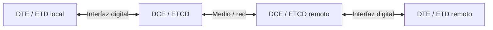

El DTE entrega datos a **su DCE**. Eso no significa que el número de su pin transmisor sea el del receptor remoto: los roles se interpretan en cada conexión local.

### Formalización y ejemplo didáctico

Sin introducir una fórmula innecesaria, el criterio es **salida → entrada compatible**, con referencia y función acordadas. Dos DTE con DB-9 tienen TD en el pin 3 y RD en el 2: conectar 3 con 3 enfrenta transmisores; para sus datos hay que llevar 3 de A a 2 de B y 3 de B a 2 de A, más referencia y controles necesarios.

### Caso real y errores típicos

Computador y módem son el ejemplo DTE–DCE de T pp. 6–7. El **null-módem** resuelve otra situación: dos DTE sin DCE intermedios.

- **Error:** «DCE siempre es módem analógico». Es un rol de terminación/adaptación; no obliga a una red telefónica analógica.
- **Error:** «La interfaz es el cable». El cable materializa conexiones, pero las reglas incluyen señales y condiciones eléctricas.

### Para examen

> La interfaz digital define cómo se conectan un DTE y un DCE. El terminal genera/recibe datos y el equipo de terminación los adapta al circuito; deben coincidir condiciones mecánicas, eléctricas y funcionales.

<a id="modos"></a>
## 2. Serie, paralelo, síncrona y asíncrona: repaso aplicado

**Fuentes:** T pp. 1–5; H pp. 2–3. El desarrollo principal está en [modos de U3](../03-redes-telecomunicaciones/APUNTE.md#sentidos-modos) y [sincronismo de U3](../03-redes-telecomunicaciones/APUNTE.md#sincronismo); acá se retiene lo necesario para U8.

| Distinción docente | Concepto y ejemplo | Consecuencia para la interfaz |
|---|---|---|
| Paralelo | Varios bits simultáneos; T p. 2 muestra 8 bits por 8 líneas | Coordinar las líneas de la palabra; más conexiones de datos |
| Serie | Bits uno detrás de otro; T p. 3 muestra conversores paralelo/serie y serie/paralelo | Serializar; puede requerir además referencia, control, reloj y otro sentido |
| Serie asíncrona | Inicio/parada por carácter; puede haber intervalos | Reconocer el comienzo y muestrear con temporización acordada |
| Serie síncrona | Secuencia coordinada sin start/stop por carácter en T p. 5 | Mantener sincronismo; no significa ausencia de reloj o control de bloques |

**Ejemplo didáctico:** una palabra de 8 bits puede ocupar un intervalo en un paralelo de 8 líneas; una línea serie binaria requiere 8 intervalos de bit, sin control. Se supone igual duración del intervalo: no demuestra que cualquier paralelo sea más rápido que cualquier serie. H p. 3 presenta **ATA** y **Centronics —IEEE 1284—** como ejemplos paralelos.

### Ejemplo de carácter asíncrono

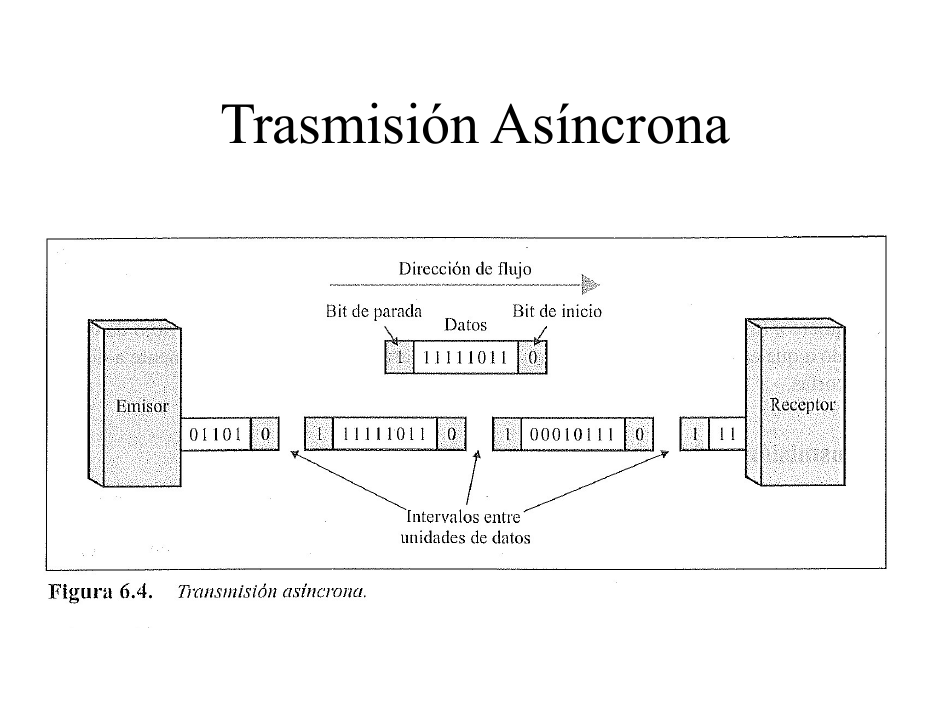

*Fuente: T p. 4, figura 6.4. El inicio está en el extremo que primero alcanza al receptor: leé el orden de llegada, no izquierda/derecha de un bloque aislado.*

Ejemplo didáctico **8N1**: 8 bits de datos, sin paridad y 1 de parada, más 1 de inicio. No es una configuración universal impuesta por RS-232.

En T p. 4, el **inicio lógico 0** señala el comienzo del carácter y la **parada lógica 1** marca su cierre después de los datos; entre caracteres puede haber intervalos, y estos valores lógicos todavía no indican voltajes.

$$
t_{car}=\frac{N}{V_t},\qquad \eta=\frac{N_d}{N}
$$

| Símbolo | Significado | Unidad |
|---|---|---|
| $t_{car}$ | Tiempo del carácter completo | s |
| $N$ | Cantidad de bits de un carácter completo, incluido control | bit |
| $V_t$ | Tasa binaria de la línea serie | bit/s |
| $\eta$ | Fracción de bits útiles, sin pausas | Adimensional |
| $N_d$ | Cantidad de bits de datos de ese carácter | bit |

**Supuestos:** señalización binaria, tasa constante, sin pausas ni otros protocolos; es serialización, no retardo total de red. Con 1 inicio + 8 datos + 1 parada son 10 bits/caracter. A 9600 bit/s, $10/9600\ \text{s}\approx1,042\ \text{ms}$; $8/10=0,8$, **80 %**. Se envían **960 caracteres/s** y **7680 bit/s útiles**. La tasa de interfaz sigue siendo 9600 bit/s.

**Errores típicos:** serie no significa simplex; asíncrona no significa sin temporización. La «línea/hilo» de T p. 3 simplifica el camino de datos: no describe un circuito eléctrico sin retorno. El número de hilos totales no se deduce del número de bits de la palabra.

<a id="normalizacion"></a>
## 3. Niveles de normalización

**Fuentes:** H pp. 4, 6–7; T p. 7. Aclaración: UIT-T V.24 (02/2000), §§1.1–1.3.

### Problema → concepto → modelo mental

Dos conectores pueden encastrar y ser incompatibles. Hay tres preguntas:** ¿cómo se enchufa?, ¿qué tensiones se interpretan?, ¿quién produce cada señal y para qué?** H p. 7 agrupa **mecánico, eléctrico y lógico**; T p. 7 llama **funcionales** a estas últimas características.

| Nivel docente | Qué especifica | Ejemplo |
|---|---|---|
| Mecánico | Conector, contactos, macho/hembra | DB-25/DB-9; contactos no son bits simultáneos |
| Eléctrico | Tensiones/corrientes; asimétrica/desbalanceada o simétrica/balanceada | V.28 asimétrica; V.11/X.27 simétrica |
| Lógico / funcional | Datos, sincronismo, control, mantenimiento y tierra | TD lleva datos; RTS solicita emisión; reloj no sustituye TD |

**Apoyo conceptual —conocimiento general:** en desbalanceada se interpreta tensión respecto de una referencia; en balanceada, diferencia entre conductores de señal. «Balanceada» no significa igual velocidad de subida/bajada: esa es otra asimetría.

H p. 4 ordena familias:** UIT-T V** (V.24, V.28, V.10, V.11, V.35, V.36), **UIT-T X** (X.20, X.20b, X.21, X.21b, X.26, X.27) y **EIA** (RS-232C, RS-449, RS-423A, RS-422A, RS-530). Se conservan las abreviaturas «b» de esa filmina, sin inventar equivalencias entre revisiones.

### V.24 no define por sí sola todos los niveles

Se conserva la agrupación docente «RS-232 / V.24», pero **no se toma como identidad normativa**: V.24 define circuitos y remite las características eléctricas a recomendaciones como V.28 y las mecánicas a ISO (V.24 §§1.2–1.3).

### Normas conexas

Transcripción del cuadro H p. 6, normalizando unidades. **Cifras del cuadro docente, no máximos universales verificados para cualquier carga, cable o revisión.**

| Norma | Circuito / nivel eléctrico | Tasa escrita | Acompaña |
|---|---|---|---|
| V.28 | Asimétrico | Menores que 20 kbit/s | V.24 |
| V.10 / X.26 | Asimétrico | 20/100 kbit/s | V.24; X.21 |
| V.11 / X.27 | Simétrico | Menores que 10 Mbit/s | V.24; X.21 |
| RS-422 | Transmisión simétrica | Menores que 2 Mbit/s | RS-449 |
| RS-423 | Transmisión asimétrica | Menores que 40 kbit/s | RS-449 |

### Ejemplo, errores y examen

**Ejemplo didáctico:** 25 contactos pueden distribuirse entre datos, control, sincronismo y referencia; no representan necesariamente 25 bits simultáneos. El pinout debe leerse por función.

- **Error:** conectar por coincidencia de ficha: faltan los niveles eléctrico y funcional.
- **Error:** llamar «función» a una amplitud: función del circuito y condición eléctrica son decisiones diferentes.

> **Para examen:** normalizar implica definir condiciones mecánicas, eléctricas y lógicas/funcionales. V.24 especifica circuitos; V.28 aporta condiciones eléctricas conexas, de modo que una ficha compatible no garantiza una interfaz compatible.

<a id="rs232"></a>
## 4. RS-232 / V.24: niveles eléctricos y limitaciones

**Fuentes:** H pp. 5, 8–9; T pp. 8–11. Contraste: UIT-T V.28 (03/1993), §§4–5 y tabla 1.

### Problema físico y concepto

El receptor no ve un «0 abstracto»: mide tensión, alterada por caída de tensión, referencias y perturbaciones. Necesita regiones para decidir y separación entre lo emitido y el umbral de recepción.

H p. 8 describe una **interfaz digital serie DTE–DCE, full dúplex, con o sin sincronismo**, con **15 m** y **20 kbit/s** para el caso clásico. No es una ley que permita combinar cualquier cable, carga y velocidad: H pp. 5–6 mezcla condiciones eléctricas conexas; se registra la ambigüedad en [gotchas](#gotchas).

En lo mecánico aparecen **DB-25** y **DB-9**; H p. 8 también rotula el de nueve contactos **DE-9**. Se mantiene «DB-9» para reconocer el uso habitual de las filminas, sin confundir las designaciones de carcasa.

### Modelo mental y formalización

Para datos, **la polaridad invierte la intuición «positivo = 1»**:

| Circuito / condición | Estado | Tensión respecto de referencia | Evidencia |
|---|---|---|---|
| Transmisión de datos según H | 0 | Mayor que +5 V | H p. 9 |
| Transmisión de datos según H | 1 | Menor que −5 V | H p. 9 |
| Recepción de datos | 0 | Mayor que +3 V | H p. 9; V.28 §5 |
| Recepción de datos | 1 | Menor que −3 V | H p. 9; V.28 §5 |
| Recepción, zona intermedia | No asignado | Entre −3 V y +3 V | T p. 8; V.28 §5 |
| Control / temporización | ON / activo | Mayor que +3 V | T p. 9; V.28 tabla 1 |
| Control / temporización | OFF / inactivo | Menor que −3 V | T p. 9; V.28 tabla 1 |

**Magnitudes y condiciones:** tensión en voltios, V; 0/1 son valores lógicos. Estos umbrales interpretan circuitos de la interfaz, no su alimentación ni los niveles de cualquier circuito digital.

H p. 9 escribe «valores máximos ±25 V». **No se adopta como amplitud normal que deba generar todo transmisor**: V.28 §4 especifica magnitud entre 5 y 15 V bajo su carga de ensayo; la nota contempla equipo antiguo de hasta 25 V. La condición evita convertir la filmina en una instrucción eléctrica incorrecta.

### Ejemplo numérico didáctico

Entre +5 V emitidos y el umbral receptor +3 V hay **2 V de separación**, el «margen 2 V» de H p. 9. No garantiza tolerancia a cualquier combinación de ruido, masa y distorsión.

Si llegan **+4 V**, se interpreta dato **0**; con **−4 V**, dato **1**; con **+2 V**, zona indefinida. Para **control**, +4 V es ON, no «bit 0»: hay que identificar el circuito.

### Una inversión en el complemento

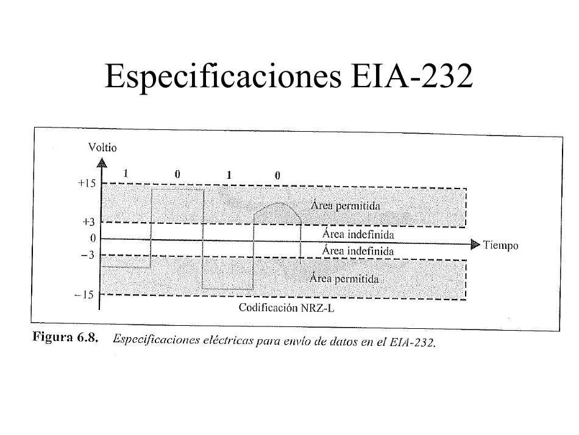

*Fuente: T p. 8, figura 6.8. **Advertencia:** los rótulos 1 positivo / 0 negativo contradicen H p. 9 y UIT-T V.28 §5. Se conserva la evidencia, NO se estudia esa polaridad como correcta. La zona indefinida sí permite visualizar los umbrales.*

### Errores típicos

- **«0 lógico equivale a 0 V».** Acá 0 usa tensión positiva, 1 negativa y 0 V es indefinido.
- **«RS-232 y UART son lo mismo».** Apoyo de conocimiento general: serialización/formato y niveles eléctricos son problemas diferentes; una salida lógica UART no se conecta directamente a RS-232 por compartir datos serie.
- **«20 kbit/s son 20 kbaudios en cualquier módem».** La interfaz y la línea telefónica son tramos distintos; bit/s y baudios no son sinónimos.

### Para examen

> RS-232 es una interfaz serie DTE–DCE estudiada junto con V.24 y sus niveles conexos. Para datos, tensión negativa válida representa 1 y positiva válida representa 0; entre −3 V y +3 V el receptor no tiene un dato válido, por lo que el pinout solo no garantiza compatibilidad.

<a id="senales"></a>
## 5. Señales principales, pines y establecimiento

**Fuentes:** H pp. 9–11; T pp. 10–12. Direcciones leídas **desde el DTE local**.

### Problema → concepto → modelo mental

Los datos no alcanzan si el otro equipo no está listo, no se detectó portadora o no se acuerda cuándo muestrear. Se separan **datos, control, sincronismo, mantenimiento y tierras**: unos circuitos llevan bits y otros indican disponibilidad/temporización.

### Formalización funcional y pinout principal

| Función docente | Acrónimo | Desarrollo en inglés | Sentido | DB-25 | DB-9 |
|---|---|---|---|---|---|
| Datos transmitidos | TD / TxD | Transmitted Data / Transmit Data | DTE → DCE | 2 | 3 |
| Datos recibidos | RD / RxD | Received Data / Receive Data | DCE → DTE | 3 | 2 |
| Pedido de emisión | RTS | Request to Send | DTE → DCE | 4 | 7 |
| Preparado para emisión | CTS | Clear to Send | DCE → DTE | 5 | 8 |
| Terminal listo | DTR | Data Terminal Ready | DTE → DCE | 20 | 4 |
| Módem listo | DSR | Data Set Ready | DCE → DTE | 6 | 6 |
| Protección / blindaje | GND en H p. 10 | Ground | Protección, no datos | 1 | No integra los nueve contactos de T p. 11 |
| Tierra de señalización | SIG / SG | Signal (SIG, rótulo docente) / Signal Ground (SG) | Referencia común | 7 | 5 |
| Detección de portadora | DCD | Data Carrier Detect | DCE → DTE | 8 | 1 |
| Detección de llamada | RI | Ring Indicator | DCE → DTE | 22 | 9 |
| Sincronismo tx desde DTE | Reloj de transmisión | Transmitter timing — DTE source | DTE → DCE | 24 | No figura |
| Sincronismo tx desde DCE | Reloj de transmisión | Transmitter timing — DCE source | DCE → DTE | 15 | No figura |
| Sincronismo rx | Reloj de recepción | Receiver timing — DCE source | DCE → DTE | 17 | No figura |

**Apoyo terminológico:** nombres en inglés contrastados con [CONTEC, asignación de señales](https://www.contec.com/support/basic-knowledge/daq-control/serial-communicatin/) y [Analog Devices, tabla 2](https://www.analog.com/en/resources/technical-articles/fundamentals-of-rs232-serial-communications.html). `SIG` conserva el rótulo docente, no una nueva designación normativa; en las filas de sincronismo se describe la función sin introducir otra sigla.

**Condiciones y límites:** circuitos principales de H p. 9 y T pp. 10–12, no inventario universal de variantes. La tierra de señal no se reemplaza por blindaje por semejanza del nombre. T p. 10 agrega circuitos secundarios, selectores de velocidad, bucles y modo de prueba. H pp. 17–18 conserva [pinouts](recursos/hardware-p17.png) y [conversión](recursos/hardware-p18.png): se preservan, pero **no se certifica cada fila diminuta como instrucción de cableado**; ampliar y contrastar con norma/manual antes de usarlas.

<a id="establecimiento"></a>
### Establecimiento: secuencia del ejemplo

1. **Preparación:** conexiones de referencia y protección.
2. **Listo:** el DTE indica DTR y el DCE responde DSR; son disponibilidades diferentes.
3. **Establecimiento:** RTS solicita emisión; CTS la habilita. La portadora viaja por el medio y el DCE remoto indica su detección con DCD.
4. **Transferencia:** TD se adapta al medio y reaparece como RD remoto. En el ejemplo síncrono se agregan relojes.
5. **Desconexión:** se retiran habilitaciones/portadoras según la figura.

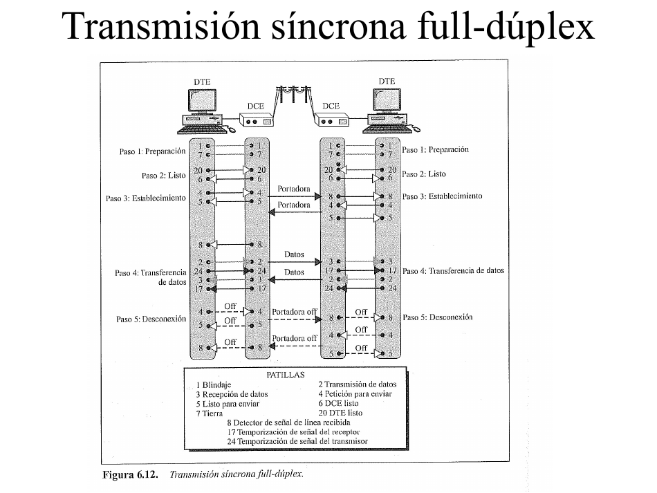

*Fuente: T p. 12, figura 6.12. H p. 11 muestra DTR → DSR → RTS → CTS → TD, portadora/detección y RD remoto. Es una secuencia docente, no toda la negociación/entrenamiento del módem ni una exigencia de que cualquier equipo use todos esos circuitos.*

### Ejemplo numérico didáctico

Un DTE DB-9 pide emitir por **pin 7**, observa CTS por **pin 8** y entrega datos por **pin 3**: tres funciones en tres contactos diferentes. CTS activo habilita la transferencia bajo la configuración utilizada; no transporta por sí mismo el contenido.

### Errores típicos y examen

- **DTR no es RTS:** disponibilidad del terminal no es pedido de emisión.
- **DSR no es DCD:** un módem puede estar listo sin portadora remota.
- **RI no es RD:** llamada detectada no significa datos recibidos.
- **Reloj no es dato:** TD/RD no resuelven solos una transmisión síncrona.

> **Para examen:** la interfaz distribuye datos, disponibilidad, habilitación, portadora y sincronismo en circuitos distintos. DTR/DSR indican disponibilidad, RTS/CTS intervienen en la emisión y DCD informa portadora; TD/RD llevan datos y sus pines dependen del conector.

<a id="cables"></a>
## 6. Cable módem, null-módem y variantes

**Fuentes:** H pp. 12–16; T pp. 13–14. «Cable módem» acá significa **cable de interfaz DTE–DCE**, no el equipo CATV de [§14](#cable-modem).

### Problema físico y concepto

Una salida debe llegar a una entrada. La conexión recta funciona con roles complementarios; dos DTE requieren cruzar datos o una adaptación equivalente.

| Caso | Datos DB-25 | Referencia | Condición |
|---|---|---|---|
| DTE–DCE mínimo, H p. 12 | 2↔2 y 3↔3 | 7↔7 | Roles complementarios; no exigir controles ausentes |
| DTE–DTE mínimo | 2↔3 y 3↔2 | 7↔7 | Control de flujo resuelto por la configuración |
| DTE–DTE DB-9, H p. 16 | 3↔2 y 2↔3 | 5↔5 | Cambia numeración, no función |

En el cable DTE–DCE, igual número no significa dos salidas: el DCE recibe el circuito que el DTE transmite. T p. 13 muestra por qué el mismo cableado recto no sirve para enfrentar dos DTE.

### Modelo mental: controlar no es puentear

H pp. 13–14 muestra **puentes locales** RTS–CTS y DTR–DSR/DCD. Simulan estados de disponibilidad local, pero **no informan espacio del receptor remoto**: no son control de flujo extremo a extremo.

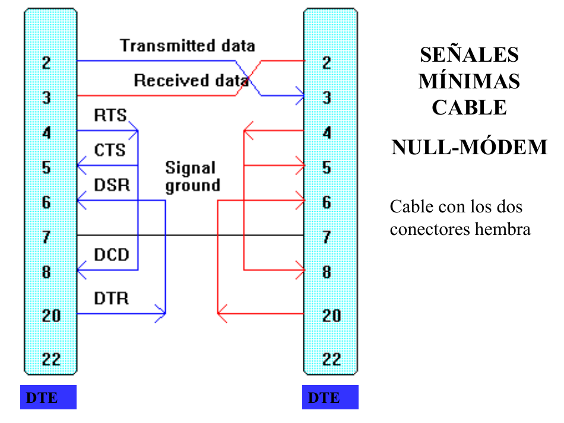

*Fuente: H p. 14. Dos conectores hembra corresponden a esos equipos; el sexo de una ficha no define por sí solo la función de cualquier cable.*

H p. 16 presenta una [variante DB-9](recursos/hardware-p16.png) con RTS/CTS cruzados y DTR hacia DSR/DCD remoto. **No hay un pinout null-módem único independiente del equipo:** no mezcles partes de variantes para inventar un cable.

> [!WARNING]
> La frase «DTR hacia DSR/DCD remoto» no corresponde a la variante de H p. 16: DTR (4) conecta con DSR (6) remoto, pero DCD (1) está puenteado a DTR (4) **local**. En esta figura, DCD no informa disponibilidad remota.

### La variante síncrona también requiere temporización

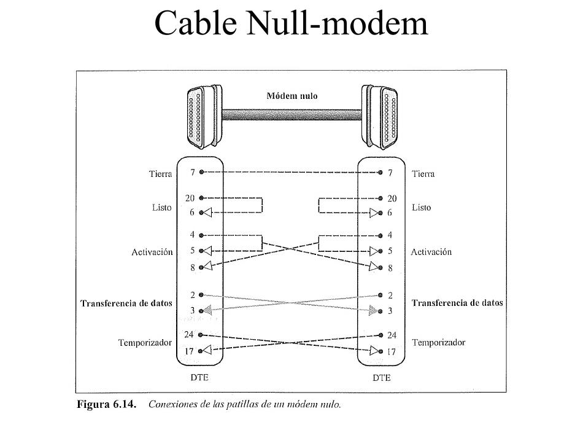

*Fuente: T p. 14, figura 6.14. Cruza datos 2↔3, conserva referencia 7 e incorpora temporización 24↔17. No es la misma variante de control de H p. 14.*

### Ejemplo numérico y errores

**Ejemplo didáctico:** dos DTE DB-9, sin controles adicionales requeridos, pueden tener un camino de datos de **3 conductores**: 3→2,2←3 y 5↔5. Si la aplicación exige CTS remoto, esos conductores no bastan; puentearlo localmente no satisface el requisito.

- **Error:** trasladar números DB-25 a DB-9: conservar función, no número.
- **Error:** creer que null-módem modula: sustituye una interconexión entre terminales, no convierte a rango vocal.

> **Para examen:** el cable DTE–DCE interconecta roles complementarios y puede ser recto; el null-módem conecta DTE cruzando datos. Control y relojes requieren una variante explícita, no se resuelven por la forma de la ficha.

<a id="otras-interfaces"></a>
## 7. Otras interfaces y conversión

**Fuentes:** H pp. 4–6, 15, 17–18. Se conserva el bloque **«Resumen comparativo de normas»**.

| Interfase | Descripción / uso en H p. 5 | Distancia escrita | Tasas escritas | Conector |
|---|---|---|---|---|
| V.24 / RS-232C | Digital serie DTE–DCE; módem | 15 m | 20 kbit/s; 100 kbit/s; 10 Mbit/s | DB-25 / DB-9 |
| V.36 / RS-449 | Digital serie DTE–DCE; mejora V.24 | 60 m | 40 kbit/s; 2 Mbit/s | 37 contactos |
| X.21 | DTE–DCE; X.25, dúplex; síncrona digital | No indicada | 64 kbit/s | DB-15 |
| X.21b | DTE–DCE; X.25, dúplex; síncrona analógica | No indicada | 20 kbit/s | DB-15 |
| RS-530 | «Bal»; banda ancha | No indicada | No indicada | 25 contactos |
| V.35 | DTE–DCE; «Bal–Desbal»; síncrono, banda ancha | No indicada | 48 a 168 kbit/s | 34 contactos, Winchester |

**Lectura crítica:** es transcripción docente, no especificación universal. **No se interpreta que RS-232C a 15 m garantice 10 Mbit/s**: H p. 8 trata 20 kbit/s y H p. 6 distingue normas eléctricas conexas. H p. 5 no explicita qué combinación corresponde a cada valor. Las demás cifras también necesitan revisión/condiciones antes de usarse como límites de diseño.

- **RS-449:** mejora presentada junto con RS-422 simétrica y RS-423 asimétrica. Ejemplo: cambiar una ficha de 25 por otra de 37 contactos no crea sus condiciones eléctricas.
- **X.21:** interfaz síncrona DTE–DCE para enlace digital en el contexto del cuadro. Ejemplo: el DB-15 de H p. 17 no se interpreta copiando pines RS-232. X.25 figura como contexto de red, no se presenta como conector.
- **RS-530:** el cuadro presenta señalización balanceada y 25 contactos, otro ejemplo de igual conector sin igual interfaz.
- **V.35:** combina señales balanceadas/desbalanceadas para conexión síncrona. Ejemplo: adecuar datos y controles no equivale a unir todos los pines uno a uno.

H p. 15 ilustra **Ethernet industrial** con equipos concretos. No aporta una nueva norma serie ni especificaciones verificables de esos modelos: no se inventan prestaciones desde su foto.

### Conversión entre interfaces

H p. 17 conserva [pinouts de consulta](recursos/hardware-p17.png).

H p. 18 muestra la [tabla de conversión de RAD](recursos/hardware-p18.png): tierras, datos, control, temporización y pruebas con columnas RS-232, V.35, RS-449, RS-530 y X.21.

**Lectura guiada de una correspondencia:** buscá la fila **Transmitted Data —TD, datos transmitidos—**; la columna «Direction of Signal to» indica **DCE**, es decir, desde el DTE hacia el DCE. En la columna EIA RS-232 de 25 contactos aparece el **pin 2**; para esa misma función, V.35 de 34 contactos muestra el par **P/S**, balanceado. La correspondencia conserva la función, no demuestra por sí sola compatibilidad eléctrica ni autoriza a reemplazar el conversor por un cable.

**Apoyo conceptual —conocimiento general:** un adaptador pasivo redistribuye contactos compatibles; cambiar características eléctricas/funcionales puede requerir electrónica. La correspondencia de circuitos de una familia de conversores no demuestra que cualquier conversión sea un simple cable.

---

<a id="modems"></a>
## 8. Módems: adaptación y clasificación

**Fuentes:** H pp. 19–21, 26–27, 35. Contraste de capas: UIT-T X.200 (07/1994), §7.7 y figura 19.

### Problema físico

Los bits del terminal no atraviesan cualquier medio conservando su representación. Un canal telefónico vocal, un par sin limitar a voz y una red coaxial tienen bandas/condiciones diferentes: hace falta adecuar las señales.

### Concepto y modelo mental

**Módem** reúne **modulación/demodulación** en el caso clásico. La cátedra amplía el nombre a adaptaciones como el **módem de banda base**, cuya excepción se explica en H p. 26.

```text
DTE → interfaz digital → adaptación/codificación/modulación → medio
medio → recuperación/demodulación/decodificación → interfaz digital → DTE
```

Se necesita un extremo compatible al otro lado, que puede estar integrado en la infraestructura del operador: no siempre es una caja idéntica al equipo del abonado.

| Clasificación docente | Qué aprovecha | Ejemplo |
|---|---|---|
| Rango vocal | Canal telefónico limitado a voz | Recomendaciones V; red telefónica conmutada |
| Banda base | Circuito metálico sin modulación vocal | Extensión de interfaces digitales |
| xDSL | Banda disponible del par del abonado | ADSL, HDSL, SDSL, VDSL |
| Cable módem | Red CATV coaxial / HFC | DOCSIS y terminación CMTS |

### Formalización funcional: capa y prestaciones

H p. 19 afirma «operan en el nivel de enlace del modelo OSI». **No se repite como definición universal.** X.200 §7.7 describe el servicio físico y su figura 19 ubica módems en una conexión física: adaptar/modular señales pertenece a esa función. El equipo puede agregar control de errores y otras prestaciones, sin trasladar toda la función de módem a capa de enlace. [Contraste](#gotchas).

### Ejemplo didáctico y errores

Un terminal puede entregar **9600 bit/s** y el módem utilizar **2400 baudios** con **4 bits de información por símbolo** en un modelo sin redundancia/sobrecargas: los 2400 símbolos de un segundo representan 9600 bits. La formalización y sus límites están en [§10](#vocal); no significa que la señal de ambos tramos sea la misma.

- **«Digital implica ausencia de señales analógicas».** Los datos son discretos; la señal física se adapta al canal.
- **«Todo módem usa voz».** Sólo caracteriza al vocal, no a toda la clasificación.
- **«Banda base es conectar sin adaptación».** El equipo sigue adecuando la transmisión y extendiendo su alcance.

> **Para examen:** el módem adapta la representación de los datos al medio y puede agregar funciones de control. Vocal, banda base, xDSL y cable módem no son sinónimos por compartir el nombre; sus medios, bandas y condiciones son diferentes.

<a id="funciones"></a>
## 9. Funciones e inteligencia del módem

**Fuente:** H p. 20. Se preservan **principales, complementarias y especiales**. Las explicaciones son apoyos conceptuales de conocimiento general para comprender las funciones nombradas, no protocolos/comandos atribuidos a la filmina.

| Grupo docente | Función | Problema / ejemplo |
|---|---|---|
| Principales | Modulación | Representar datos en una señal compatible; ejemplo vocal PSK/QAM |
| Principales | Codificación | Organizar su representación; no significa automáticamente cifrar |
| Complementarias | Control de flujo de datos | Regular la entrega según disponibilidad del receptor/búfer; RTS/CTS interviene según configuración |
| Complementarias | Señalización | Intercambiar llamada, disponibilidad y habilitación, no contenido de usuario |
| Complementarias | Ecualización del canal | Compensar efectos de respuesta del canal y distorsión de U6 |
| Complementarias | Protección contra sobretensiones | Reducir daños eléctricos; no retransmite bits dañados |
| Especiales | Discado y recepción automática de llamadas | Establecer/atender sin operar manualmente cada llamada |
| Especiales | Almacenamiento y procesamiento de información | Mantener estados, parámetros/datos para operar |
| Especiales | Detección y corrección de errores | Reconocer/proteger datos dañados; H no identifica un protocolo |
| Especiales | Compresión de datos | Reducir su representación aprovechando redundancia; no aumentar capacidad física del canal |
| Especiales | Autodiagnóstico | Comprobar estados/fallas; faltan pasos y criterios concretos de prueba |
| Especiales | Multiplexado de canales | Compartir recursos entre canales; no equivale a compresión |

**Ejemplo didáctico:** un terminal entrega 1000 octetos y el receptor dispone de 200 lugares de búfer; puede haber pérdida sin un solo error eléctrico. Controlar el flujo atiende disponibilidad, no el mismo problema que detectar bits dañados.

El **módem inteligente** se reconoce acá por automatización y procesamiento/almacenamiento, no sólo tasa alta. No se inventa un repertorio AT ni operación facsímil sin evidencia: falta ese desarrollo específico en H/T.

**Error típico:** confundir flujo, errores y compresión: regulan **cuánto/cuándo entregar**, atienden **datos dañados** y reducen **representación**, respectivamente. Pueden coexistir, pero no son lo mismo.

<a id="vocal"></a>
## 10. Módem vocal y recomendaciones

**Fuentes:** H pp. 21–24; modulación U4 y canal U6.

### Problema → concepto → modelo mental

La red telefónica conmutada ofrece un canal pensado para voz. El módem coloca su señal modulada dentro de ese canal, no en toda la banda que podría admitir el cobre. H p. 21 indica **300 a 3400 Hz**; el terminal intercambia datos por su interfaz digital mientras el medio lleva otra representación.

### Series UIT-T y categorías docentes

H p. 22 presenta este mapa histórico de series, no un catálogo actualizado. Se conserva como **tabla de consulta**, no como nuevos temas para desarrollar.

| Serie | Referencia docente |
|---|---|
| A | organización |
| B | expresiones/definiciones/símbolos |
| C | estadísticas |
| D | tarificación |
| E | explotación telefónica/factores humanos |
| F | servicios no telefónicos |
| G | transmisión/redes digitales |
| H | audiovisual/multimedia |
| I | RDSI |
| J | cable/distribución de programas |
| K | interferencias |
| L | cables/planta exterior |
| M | gestión/mantenimiento |
| N | mantenimiento de transmisión de programas |
| O | aparatos de medida |
| P | calidad telefónica/redes locales |
| Q | conmutación/señalización |
| R | telegrafía |
| S | terminales telegráficos |
| T | telemática |
| U | conmutación telegráfica |
| V | datos por red telefónica |
| X | redes de datos/sistemas abiertos |
| Y | infraestructura mundial de información/Internet |
| Z | lenguajes/soporte lógico |

Para U8: reconocer V para red telefónica, X para redes de datos y G en DSL. H pp. 23–24 agrupa **baja velocidad**, **media y alta**, **muy alta velocidad inteligentes**: categorías de la presentación, no un ranking de accesos actuales.

### Formalización y ejemplo numérico

Para representación de longitud fija, sin redundancia de codificación ni sobrecarga adicional:

$$
V_t=V_m\, k
$$

| Símbolo | Significado | Unidad |
|---|---|---|
| $V_t$ | Tasa de información considerada | bit/s |
| $V_m$ | Tasa de símbolos / modulación | baudios = símbolos/s |
| $k$ | Bits de información por símbolo | bit/símbolo |

**Supuestos:** $k$ fijo, sin agregar redundancia ni descontar protocolos. No inferir mecánicamente una constelación o código TCM desde cocientes nominales aislados.

**Ejemplo de H p. 23:** V.22, 600 baudios y 1200 bit/s: 600 símbolos/s por 2 bit/símbolo producen **1200 bit/s**. V.22 bis, 600 baudios y 2400 bit/s: 4 bit/símbolo dan **2400 bit/s** sin elevar la tasa de símbolos.

**Banda vocal:** entre 300 y 3400 Hz hay **3100 Hz** de extensión, no «3100 bit/s». La tasa depende además de modulación, codificación y canal.

| Ejemplos de H pp. 23–24 | $V_m$ escrito | $V_t$ máximo escrito | Modulación |
|---|---|---|---|
| V.22 | 600 baudios | 1200 bit/s | PSK |
| V.22 bis | 600 baudios | 2400 bit/s | QAM |
| V.26 / V.26 bis / V.26 ter | 1200 baudios; «ter» también muestra 75 de retorno | 2400 bit/s | PSK |
| V.27 / V.27 bis / V.27 ter | 1600 baudios | 4800 bit/s | DPSK |
| V.29 | 2400 baudios | 9600 bit/s | QAM |
| V.32 | 2400 baudios | 9600 bit/s | QAM/TCM |
| V.32 bis / V.33 | 2400 baudios | 14400 bit/s | QAM/TCM |
| V.34 | 3429 baudios | 33600 bit/s | QAM/TCM |

**Lectura guiada de V.22 (H p. 23):** $V_m$ indica **600 símbolos/s —baudios—** y $V_t$ máximo, **1200 bit/s**, como en el ejemplo anterior; $F_p$ es la frecuencia portadora, **1200 Hz para el canal 1** y **2400 Hz para el canal 2**. **PSK** indica cómo se modula; **Modo** admite asíncrono o síncrono, **Tipo: dúplex** permite ambos sentidos simultáneos y **Enlace: RTC** identifica la red telefónica conmutada. Son preguntas distintas: sincronismo no es sentido de transmisión, y el tipo de red no es la cantidad de hilos.

**PSK:** desplazamiento de fase; **DPSK:** diferencial; **QAM:** amplitud en cuadratura; **TCM:** Trellis-Coded Modulation, modulación codificada en retícula. La expansión es apoyo terminológico; el programa llama al bloque «QAM con codificación entrelazada». H sólo muestra la asociación QAM/TCM: estados, codificación y decodificación permanecen pendientes.

La tabla original preserva también frecuencias, modos, explotación y líneas:

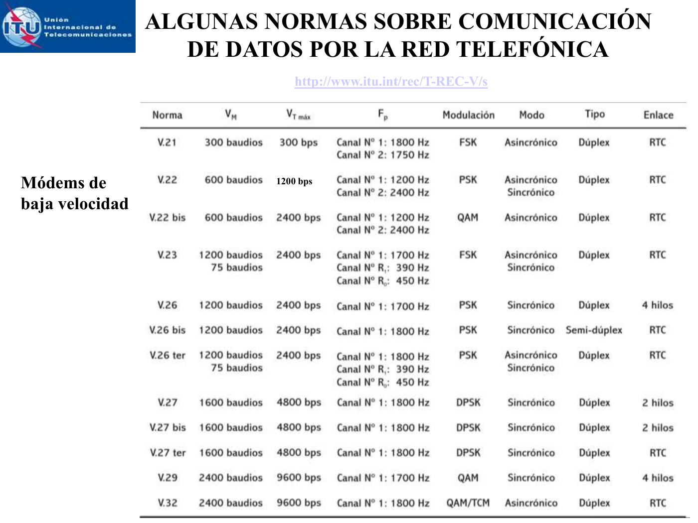

*Fuente: H p. 23. **No memorizar dos celdas erróneas:** V.21 canal 1 dice 1800 Hz pero V.21 §3 indica frecuencia media 1080 Hz (canal 2: 1750 Hz, correcto); V.23 dice 2400 bit/s, pero V.23 §§1–4 establece FSK binaria —desplazamiento de frecuencia— de 600/1200 baudios y retorno hasta 75 baudios. Se conserva la imagen sin retocar; los demás parámetros no quedan certificados normativamente por detectar esas erratas.*

### V.34, V.90 y V.92: separar los sentidos

V.34 figura QAM/TCM síncrona y dúplex. **3429 baudios es el valor presentado:** dividir 33600 por ese número no explica el código ni produce por sí solo «bits enteros por símbolo».

| Norma H p. 24 | Ascendente | Descendente | Condición presentada |
|---|---|---|---|
| V.90 | 33,6 kbit/s | 56 kbit/s | Par de módem digital y analógico |
| V.92 | 48 kbit/s | 56 kbit/s | Mejora de V.90 |

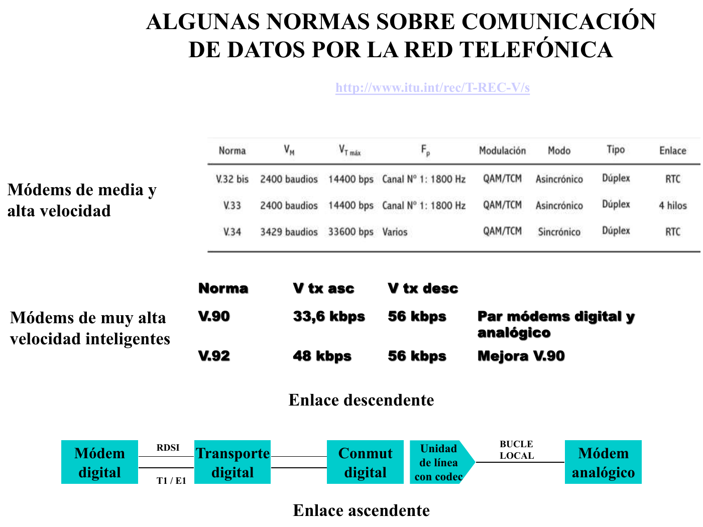

*Fuente: H p. 24. Descendente: módem digital → transporte digital (RDSI/T1/E1) → conmutación digital → unidad de línea con códec → bucle local → módem analógico. El ascendente recorre el camino contrario. No son dos módems vocales analógicos equivalentes sobre cualquier circuito.*

**Ejemplo didáctico:** a tasas máximas V.90, serializar 56000 bits requiere idealmente 1 s descendente y $56000/33600\ \text{s}\approx1,667\ \text{s}$ ascendente. Se usa cantidad/tasa como en §2, con bloque en vez de carácter: sin negociación, protocolos ni retransmisión. No es tasa útil garantizada.

### Errores típicos y examen

- **«56K en ambos sentidos».** La fuente distingue ascendente y descendente.
- **«Compresión crea capacidad física».** Reduce representación cuando hay redundancia; no elimina banda/ruido.
- **«bit/s es modulación».** Los símbolos se miden en baudios, no se cambian etiquetas.

> **Para examen:** el módem vocal transmite una señal modulada dentro del canal telefónico. Las normas permiten distinguir símbolos, bits, modulación y explotación; V.90/V.92 tienen tasas por sentido y una arquitectura digital/analógica, no describen cualquier trayecto simétrico.

<a id="seleccion"></a>
## 11. Características técnicas y operativas

**Fuente:** H p. 25, lista de 26 criterios. Se preserva: elegir sólo por bit/s deja sin comprobar interfaz, línea, reloj y alimentación.

| Columna izquierda docente | Columna derecha docente |
|---|---|
| Velocidad de modulación | Tensión de alimentación |
| Velocidad de transmisión | Frecuencia de alimentación |
| Número de bits por baudio | Sistema de portadora |
| Modo de transmisión | Tipo de actualización |
| Tipo de explotación | Requerimientos del canal |
| Tipo de línea a utilizar | Banda pasante |
| Calidad de línea a utilizar | Distorsión |
| Interfase a utilizar con el ETD | Relación señal/ruido |
| Origen de señal de sincronismo | Supresión de eco |
| Base de tiempo interna y externa | Codificación de señales |
| Sensibilidad de recepción | Llamada automática |
| Consumo de potencia | Contestación automática |
| Tipo de modulación | Posibilidad de trabajo multipunto |

**Cómo usarla:** identificar medio/servicio; verificar línea/canal; después interfaz, reloj, tasas y explotación; finalmente alimentación/operación. «Bits por baudio» se interpreta bits por símbolo en su modelo, no igualdad de unidades bit/s y baudios. H no define «tipo de actualización»: se conserva pendiente, sin reemplazarlo por un criterio inventado.

**Apoyo conceptual —conocimiento general— para tres criterios de H p. 25:**

- **Sensibilidad de recepción:** nivel mínimo de señal que permite cumplir las condiciones de recepción especificadas; al seleccionar, se compara con el nivel que llegará al equipo.
- **Base de tiempo interna/externa:** el equipo genera la temporización o la toma de una fuente externa; hay que verificar cuál requiere la interfaz, no sólo que coincida la tasa.
- **Trabajo multipunto:** capacidad de operar en un enlace compartido por más de dos terminales; debe corresponder con la organización de la red, no sólo con la pareja de equipos elegida.

**Ejemplo didáctico:** dos módems anunciados a 2 Mbit/s pueden no servir como pareja si uno espera V.35 síncrona y el otro una interfaz eléctrica/funcional incompatible. Coincidir en tasa no basta.

<a id="banda-base"></a>
## 12. Módem de banda base

**Fuente:** H p. 26.

H advierte que **no modula/demodula** como el vocal: extiende el alcance de interfaces digitales e interconecta circuitos digitales sobre **2 o 4 hilos metálicos**, con tasa **hasta 2 Mbit/s** en el ejemplo de la presentación.

**Modelo mental:** el esquema ubica interfaces digitales, codificador, bloque receptor/transmisor y decodificador para adecuar y recuperar la representación de los datos, sin llevarlos a una portadora vocal. La filmina muestra esos bloques, no el detalle de sus códigos.

**Ejemplo:** 2 hilos no implica automáticamente simplex y 4 hilos no significa cuatro bits paralelos. Son dimensiones diferentes. **Error típico:** borrar el nombre «módem de banda base» por la excepción: la cátedra lo usa explícitamente y explica que no realiza esa modulación; hay que reconocer función y diferencia.

<a id="xdsl"></a>
## 13. xDSL: aprovechar el par más allá de la voz

**Fuentes:** H pp. 27–34. «Banda ancha, más de 2 Mbit/s» es la caracterización de esa presentación, no una definición regulatoria universal ni una tasa mínima de toda variante DSL.

### Problema físico y concepto

El servicio vocal no agota lo que puede transportar el cobre. **DSL —Digital Subscriber Line, línea de abonado digital—** aprovecha banda del bucle de abonado para datos; longitud, calidad y perturbaciones siguen condicionando el servicio.

H p. 27 enumera **ADSL/ADSL2+** (asimétricas), **RADSL** (Rate Adaptive Asymmetric DSL), **HDSL/HDSL1** (High Bit Rate DSL), **SDSL** (Symmetric DSL) y **VDSL** (Very High-Speed DSL). La asimetría ADSL es de tasas/bandas por sentido, no la señalización desbalanceada de una interfaz.

### Modelo mental: arquitectura ADSL

- En el **abonado**, un **splitter** separa telefonía y módem **ATU-R**, ADSL Transceiver Unit–Remote.
- El **bucle de abonado** llega a la central: otro splitter separa telefonía hacia el switch telefónico y datos hacia el **DSLAM**, DSL Access Multiplexer.
- **ATU-C**, ADSL Transceiver Unit–Central, es el extremo ADSL de central. El camino de datos continúa hacia el **ISP**, Internet Service Provider.

La filmina expande ATU como «ADSL Transmisión Unit»; se aclara la denominación de transceptor sin cambiar su rol central/remoto.

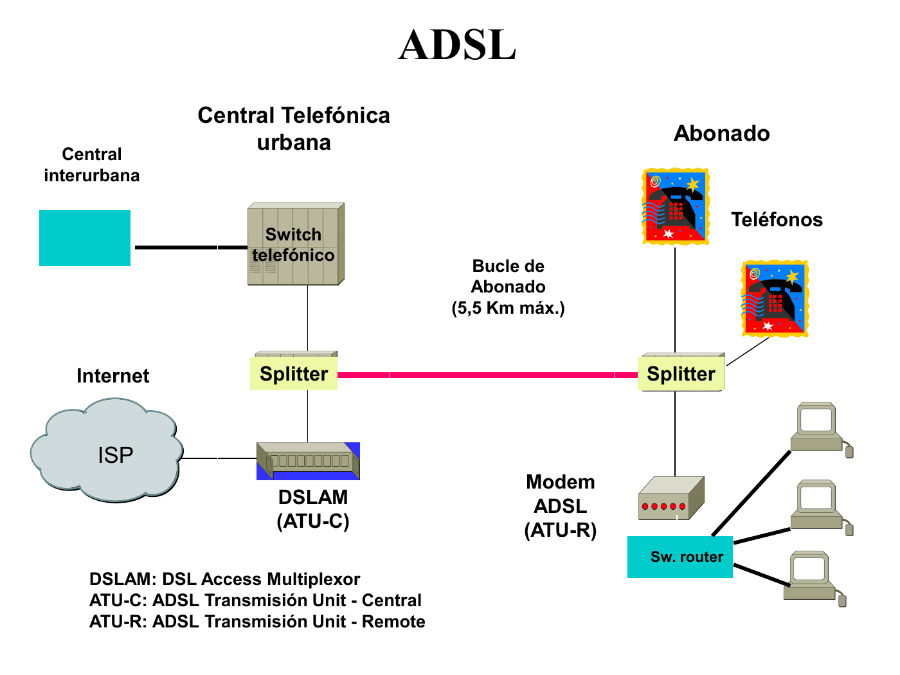

*Fuente: H p. 28. «5,5 km máx.» pertenece al esquema: no garantiza ese alcance para cualquier par, variante y tasa.*

### Formalización: bandas y DMT

H p. 30 presenta **DMT —Discrete Multitone, modulación por multitono discreto—**, relacionada allí con **OFDM —Orthogonal Frequency-Division Multiplexing—**: portadoras de distintas frecuencias moduladas en PSK o QAM. Se transportan partes de los datos en subcanales, no un único canal vocal más rápido.

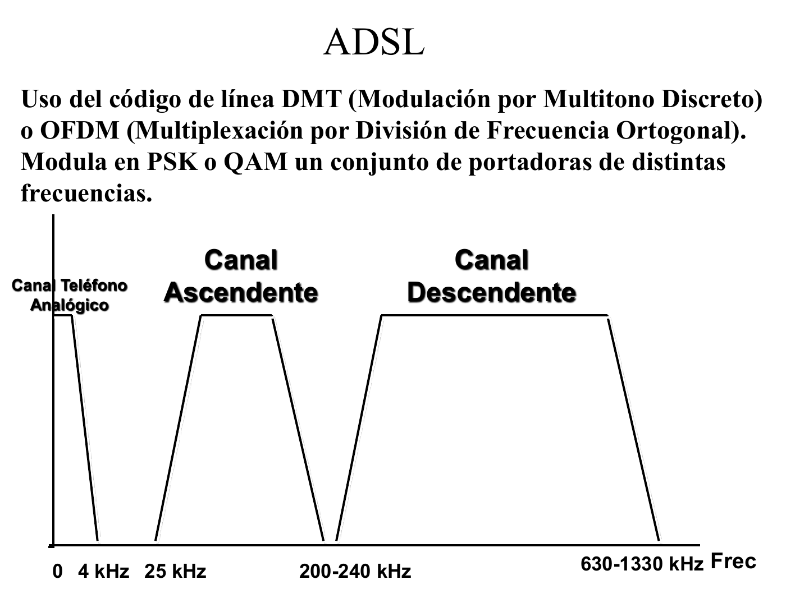

*Fuente: H p. 30. Voz hasta 4 kHz, comienzo de datos alrededor de 25 kHz, frontera subida/bajada200–240 kHz y extremo superior630–1330 kHz: son rótulos de esa figura, no un plan universal de todas las variantes/anexos.*

**Magnitudes/condiciones:** frecuencias en Hz/kHz/MHz; tasas en bit/s. El detalle de guardas, subportadoras y carga de bits no se deduce de la altura de las ondas del dibujo ni está desarrollado en estas filminas.

### Ejemplo didáctico y distancia

Con **8 Mbit/s descendentes** y **640 kbit/s ascendentes**, la bajada nominal permite 12,5 veces tantos bits por segundo como la subida. Son datos didácticos dentro de órdenes de magnitud H p. 34, no medición ni garantía.

H p. 29 muestra **tasa decreciente con longitud**; no se leen valores exactos de la curva como tabla contractual:

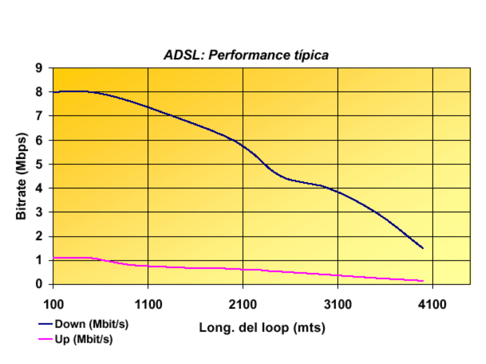

*Fuente: H p. 29. Longitud del bucle en metros; tasas por sentido en Mbit/s. Es una tendencia del ejemplo, no una ecuación universal del par.*

### ADSL2 y ADSL2+

H p. 31 compara banda:** 1,1 MHz ADSL2** y **2,2 MHz ADSL2+** en el esquema inferior. Relaciona G.992.1/G.992.2 con ADSL y G.992.3/4/G.992.5 con ADSL2/ADSL2+; los años/asignaciones de anexos de su tabla **no se adoptan sin revisión**.

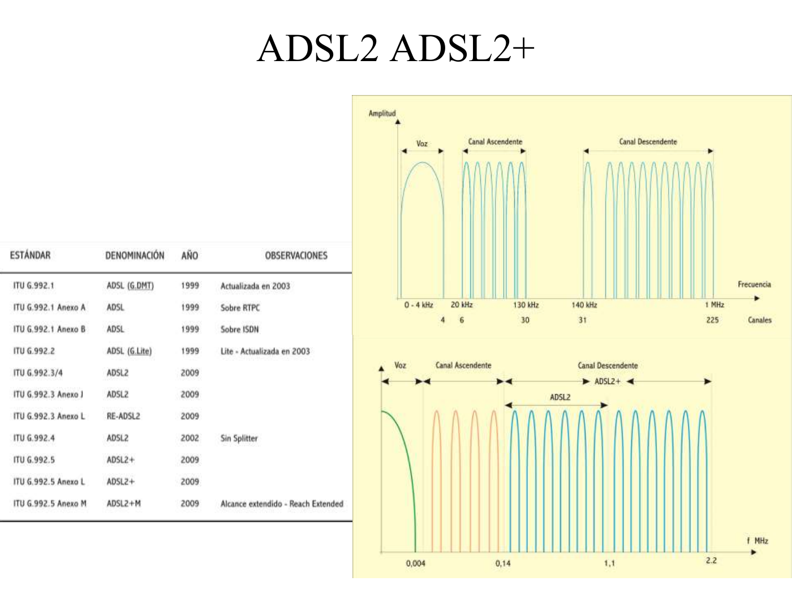

*Fuente: H p. 31. «Anexo M —alcance extendido / Reach Extended» no coincide con G.992.5: su anexo M se titula «Extended upstream bandwidth above POTS». No usar la tabla de años/anexos como datos confirmados por haber verificado el gráfico contiguo.*

### HDSL: tasa de línea y de servicio

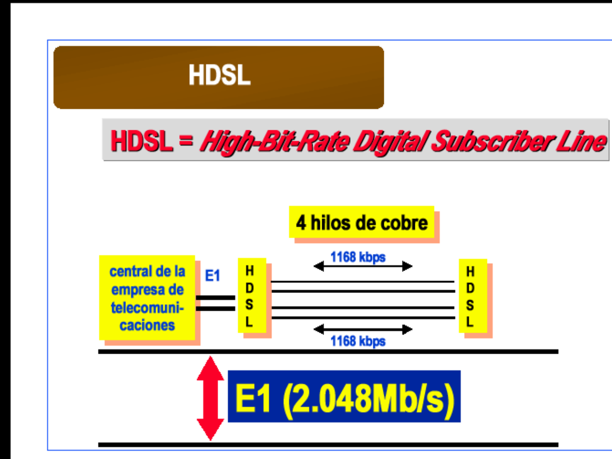

*Fuente: H p. 32. Interfaz E1 **2,048 Mbit/s**, dos pares rotulados **1168 kbit/s** cada uno en ambos sentidos. Sus valores suman **2336 kbit/s**, no 2048: distinguir tasa de línea y servicio. La filmina no desglosa el excedente; no se inventa una asignación de control.*

### Caso real de la filmina: ASM-61

H p. 33 presenta un **VDSL simétrico de dos hilos**: Ethernet **10 Mbit/s full dúplex**, par **24 AWG —0,5 mm en el texto—**, hasta **1 km** bajo las condiciones publicitadas. Usa QAM según requerimientos ETSI, ecualización, filtros adaptables y cancelación de eco. Tiene reloj interno para interfaz/línea, alimentación AC —corriente alterna— y formato de escritorio adaptable a bastidor 19 pulgadas.

«VDSL» no obliga al perfil asimétrico de H p. 34: son equipos/perfiles diferentes; no se mezclan sus máximos/distancias para inventar un equipo.

### Resumen de especificaciones de módems sobre cobre

Agrupación de H p. 34:** perfiles/distancias del material histórico, no máximos de todas las versiones de cada tecnología**.

| Tecnología | Tasa y sentido del cuadro | Aplicación / condición |
|---|---|---|
| Vocal | 1200 bit/s a 56 kbit/s; dúplex | Datos; no reemplaza tasas por sentido V.90/V.92 |
| HDSL | 1,544 Mbit/s (T1) /2,048 Mbit/s (E1); dúplex | Redes privadas, PBX —central telefónica privada—, servidores; hasta 3,6 km |
| SDSL | 1,544 /2,048 Mbit/s; dúplex | Similar a HDSL, menos plantel exterior; hasta 3 km; aquí se llama «digital simple», frente a Symmetric DSL de H p. 27 |
| ADSL | 1,5–9 Mbit/s bajada; 16–640 kbit/s subida | Internet, LAN remota, multimedia; ejemplo hasta 5,3 km para hasta 8 Mbit/s |
| VDSL | 13–52 Mbit/s bajada; 1,5–2,3 Mbit/s subida | Lo anterior y HDTV —TV de alta definición—; ejemplo 52 Mbit/s a 300 m |
| IDSL | 128 kbit/s por sentido | Líneas ISDN/RDSI; 5400 m del cuadro |

### Errores típicos y examen

- **«ADSL usa sólo 300–3400 Hz».** Eso describe canal vocal, no toda banda DSL.
- **«Asimétrico es un solo sentido».** Hay subida y bajada con diferente asignación.
- **«Duplicar banda duplica cualquier tasa real».** Intervienen canal, ruido y perfil.
- **«La máxima distancia sirve a cualquier tasa».** Cada cifra tiene condiciones.

> **Para examen:** DSL aprovecha banda del par más allá del canal vocal; ADSL separa voz, subida y bajada, con ATU-R y ATU-C/DSLAM. DMT distribuye datos en subportadoras y las tasas dependen del perfil/canal; HDSL, SDSL y VDSL no comparten un único alcance.

<a id="cable-modem"></a>
## 14. Cable módem: CATV y HFC

**Fuentes:** H pp. 35–37. Nombre distinto del cable de interfaz de §6.

### Problema físico y concepto

Una red de televisión por cable puede llevar datos si tiene canales, equipos y retorno adecuados. **Cable módem** es el equipo de acceso a esa infraestructura; H p. 35 lo caracteriza como banda ancha sobre coaxial **CATV**, televisión por cable.

**DOCSIS —Data Over Cable Service Interface Specification—** nombra las especificaciones del acceso; **HFC —Hybrid Fiber-Coaxial—**, la combinación fibra/coaxial; **CMTS —Cable Modem Termination System—**, la terminación de los cable módems en el operador. Las expansiones son apoyo terminológico; H muestra sus roles.

### Modelo mental


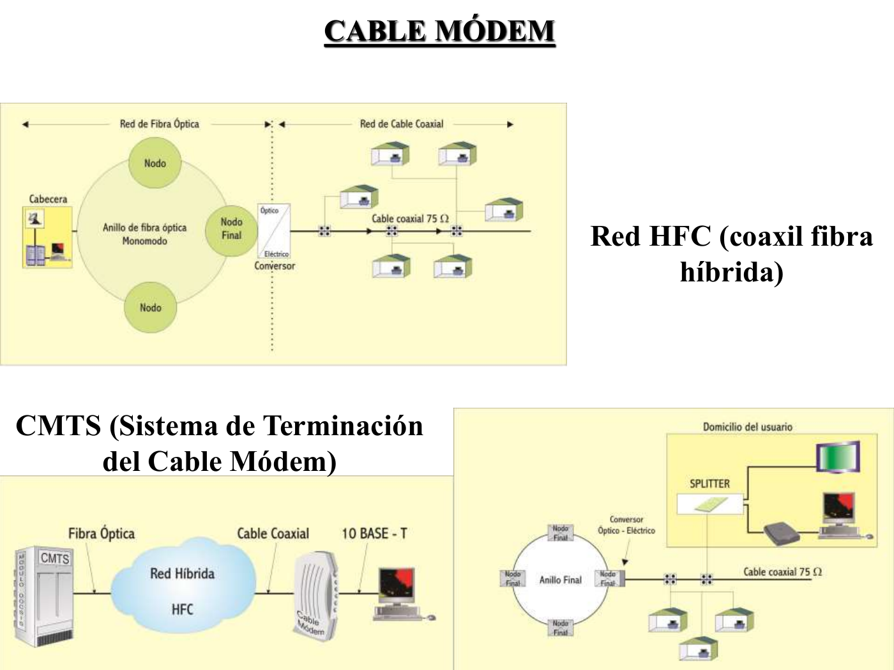

*Fuente: H p. 36. Fibra monomodo, conversión óptica/eléctrica y coaxial 75 Ω; CMTS → HFC → cable módem → 10BASE-T del ejemplo. No limita toda red HFC a esa interfaz del dibujo.*

**Apoyo conceptual para leer H pp. 35–37:** varios hogares comparten la distribución coaxial, a diferencia del bucle individual de abonado del esquema ADSL. Ese medio compartido exige coordinar las transmisiones de retorno: **TDMA —acceso múltiple por división de tiempo—** organiza turnos, mientras **QAM** describe cómo se representa la información en la señal.

### Formalización y ejemplo numérico

Se distinguen **tramos y funciones**: fibra no significa necesariamente fibra hasta el abonado; cable módem no es CMTS. **75 Ω** es impedancia del coaxial, no tasa binaria ni ancho de banda.

H p. 37 compara canales descendentes **6 MHz (NTSC)** y **8 MHz (PAL)**: hay **2 MHz de diferencia por canal** en esa comparación histórica, no 2 Mbit/s de diferencia de acceso. Para relacionar banda y tasa faltan modulación, codificación y canal.

### Comparación con ADSL que sí se sostiene

| Aspecto | Cable módem | ADSL |
|---|---|---|
| Medio presentado | Coaxial y fibra HFC | Par del bucle de abonado |
| Terminación | CMTS | DSLAM / ATU-C |
| Separación local de servicios | Derivación TV/datos del ejemplo | Splitter voz/datos |
| Representación de la señal | QAM, H p. 37 | DMT y PSK/QAM por subportadoras, H p. 30 |
| Organización del acceso | TDMA sobre el medio compartido del ejemplo, H p. 37 | Bucle entre ATU-R y ATU-C/DSLAM, H p. 28 |
| Qué no garantiza un máximo aislado | Tasa útil individual o cualquier versión DOCSIS | Combinar cualquier tasa y distancia sin condición de par/perfil |

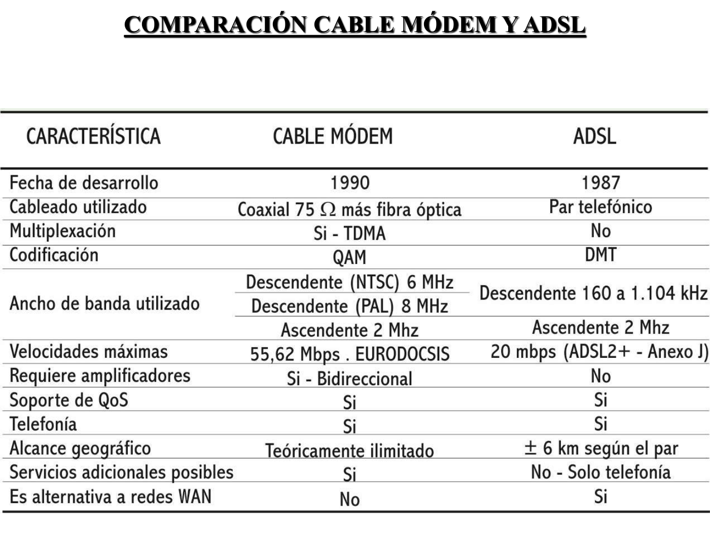

*Fuente: H p. 37. **Tabla histórica NO validada como especificación general.** ADSL «multiplexación: no» contradice H p. 30; «ascendente 2 MHz» no se adopta como banda ADSL; «alcance teóricamente ilimitado» no es un límite físico de tramo coaxial; 20 Mbit/s/ADSL2+/anexo J y otras celdas permanecen pendientes. No usarlas como conocimiento confirmado.*

### Errores típicos y examen

- **«Cable módem es cualquier cable al módem».** Acá es tecnología/equipo de acceso CATV.
- **«HFC es fibra hasta cada usuario».** La figura incluye coaxial después de la conversión.
- **«El cable tiene alcance ilimitado».** Extender una red con infraestructura no elimina pérdidas/ruido de sus segmentos.

> **Para examen:** cable módem usa CATV/HFC para datos, con DOCSIS y terminación CMTS. ADSL usa el par del abonado y DSLAM; se comparan infraestructura, organización, versión y condiciones, no sólo una tasa publicitada.

---

<a id="gotchas"></a>
## 15. Gotchas del material

Se separa **lectura fiel** de **validez técnica**. No se retocan las figuras para ocultar errores. Las normas externas se consultaron para discrepancias concretas, no para ampliar el temario.

| Tema | Qué dice la fuente docente | Contraste y localizador | Tratamiento |
|---|---|---|---|
| V.24 y niveles | H agrupa RS-232/V.24 y enumera conexas | [V.24 (02/2000)](https://www.itu.int/rec/dologin_pub.asp?id=T-REC-V.24-200002-I!!PDF-S&lang=e&type=items), §§1.1–1.3, PDF pp. 7–8: circuitos y remisiones eléctrica/mecánica | Conservar agrupación sin identidad normativa |
| Polaridad | H p. 9: 0 positivo/1 negativo; T p. 8 los invierte | [V.28 (03/1993)](https://www.itu.int/rec/dologin_pub.asp?id=T-REC-V.28-199303-I!!PDF-E&lang=e&type=items), §5 PDF p. 7 y tabla 1 PDF p. 8 | Datos 1 negativo/0 positivo; control ON positivo/OFF negativo; advertencia junto a figura |
| «Máximos ±25 V» | H p. 9 sin condición | V.28 §4 PDF p. 6: magnitud 5–15 V bajo carga; nota de equipo antiguo hasta 25 V | No dar 25 V como amplitud normal obligatoria |
| Capa del módem | H p. 19 dice nivel de enlace | [X.200 (07/1994)](https://www.itu.int/rec/dologin_pub.asp?id=T-REC-X.200-199407-I!!PDF-S&lang=e&type=items), §7.7.2 PDF p. 57, figura 19 PDF p. 61 | Adaptación/modulación física; separar otras prestaciones |
| V.21 canal 1 | H p. 23: 1800 Hz; canal 2: 1750 Hz | [V.21 (1988)](https://www.itu.int/rec/dologin_pub.asp?id=T-REC-V.21-198811-I!!PDF-S&lang=e&type=items), §3 PDF p. 4: medias 1080/1750 Hz | Errata sólo primer canal; el segundo coincide |
| V.23 tasa | H p. 23: 2400 bit/s; 1200/75 baudios | [V.23 (1988)](https://www.itu.int/rec/dologin_pub.asp?id=T-REC-V.23-198811-I!!PDF-S&lang=e&type=items), §§1,2,4 PDF p. 3: FSK binaria 600/1200 baudios, retorno hasta 75 | No estudiar 2400 bit/s como correcto: 600/1200 bit/s, retorno hasta 75 bit/s |
| ADSL2+ anexo M | H p. 31: alcance extendido | [G.992.5 (01/2009), índice](https://www.itu.int/dms_pubrec/itu-t/rec/g/T-REC-G.992.5-200901-I!!TOC-HTM-E.htm): M «Extended upstream bandwidth above POTS» | Refutar esa asignación no valida los otros años/anexos |
| Tasas de interfaces | H p. 5 agrupa 20/100 kbit/s/10 Mbit/s | H pp. 5, 6, 8, contraste interno visual | Ver [lectura crítica del cuadro](#otras-interfaces) y [comprobación pendiente](#pendientes) |
| HDSL | H p. 32: dos pares 1168 kbit/s; E1: 2048 kbit/s | Lectura y recálculo 2336 frente a 2048 | Distinguir línea/servicio; no inventar desglose |
| SDSL/VDSL | H p. 27 Symmetric DSL; p. 34 «simple»; p. 33 VDSL simétrico frente a p. 34 asimétrico | Contraste interno | Conservar términos por fuente y diferenciar perfiles |
| Comparación cable/ADSL | H p. 37: sin multiplexación, subida 2 MHz, alcance ilimitado | H pp. 28–31 muestran bandas/subportadoras y condición del bucle | No adoptar generalizaciones; tabla preservada advertida |

<a id="pendientes"></a>
## 16. Pendientes por sección

| Sección | Qué falta | Próxima comprobación |
|---|---|---|
| [Interfaces](#otras-interfaces) | Condiciones de máximos H pp. 5–6; filas densas H pp. 17–18; procedimiento X.21 | Norma/revisión y manual de equipo antes de usar como límite o cablear |
| [Funciones](#funciones) | Operación/comandos y capacidad interna de módem inteligente; protocolos específicos de flujo/errores/compresión | Bibliografía obligatoria o nueva fuente de cátedra, sin atribuirlo a H/T |
| [Establecimiento](#establecimiento) | Entrenamiento y negociación completos | Fuente específica: T p. 12 sólo aporta secuencia de interfaz |
| [Vocal](#vocal) | Construcción/decodificación QAM/TCM y relación con «codificación entrelazada»; parámetros restantes H pp. 23–24 | Recomendaciones/bibliografía; no inferir códigos de cocientes nominales |
| [Selección](#seleccion) | Significado de «tipo de actualización», H p. 25 | Aclaración docente o bibliografía; conservar término sin inventar definición |
| [xDSL](#xdsl) | Años/anexos H p. 31; tasas/distancias por perfil H p. 34; desglose HDSL | Recomendaciones específicas y condiciones del ejemplo |
| [Cable módem](#cable-modem) | Celdas restantes H p. 37 y versiones/condiciones DOCSIS | Contraste normativo específico, no comparación de ofertas actuales |
| Programa: facsímil | Sin desarrollo en los dos PDF | Localizar fuente/bibliografía obligatoria |
| Programa: diagnóstico/pruebas | Sólo nombres y circuitos, sin secuencia/criterio | Fuente con bucles, pasos y criterios; conocer el pin 25 no equivale a diagnosticar |

<a id="registro-revision"></a>
## 17. Registro de revisión

| Fecha | Tipo | Alcance y método | Resultado / límite |
|---|---|---|---|
| 2026-10-29 | Fuentes/cobertura | H: 37 páginas, T: 14; temas frente a U8 del programa analítico, p. 5 | Presentaciones integradas; faltantes del programa declarados |
| 2026-10-29 | Extracción | pypdf UTF-8 por página; T sólo aporta títulos; se agregaron notas visuales manuales diferenciadas | Cache auxiliar, no fuente independiente; texto ausente no equivale a contenido ausente |
| 2026-10-29 | Contraste visual | H pp. 1–18 y T pp. 1–14 leídas visualmente; H pp. 19–37 inspeccionadas por verificador; tablas H pp. 17–18 conservadas sin certificar fila por fila | Figuras sustantivas preservadas; discrepancias registradas |
| 2026-10-29 | Contraste técnico externo | Lectura textual de V.24, V.28, X.200, V.21, V.23 e índice G.992.5 en localizadores §15 | Resuelve discrepancias concretas; no inspección visual integral de normas ni revisión normativa de cada fila de H |
| 2026-10-29 | Recálculo | 8N1 a 9600 bit/s; margen 5−3 V; 600×2/×4; tiempos V.90; razón 8 Mbit/s÷640 kbit/s; HDSL | Cuentas separadas de la procedencia de datos; resultados en secciones |
| 2026-10-29 | Estructural | 117 enlaces locales/anclas de APUNTE, INDICE y registro: 0 errores; 23 PNG abren correctamente; front matter y recálculos comprobados con Python | Hash SHA256 de ambos PDF sin cambios según comprobación del coordinador; navegación/cuentas no certifican rigor técnico ni cierran pendientes |
| 2026-10-29 | Orden expositivo | Cotejo del orden de H pp. 2–37 y T pp. 1–14: restauradas secuencias internas en §§3, 5, 6, 7, 10 y 13, con bloques sin reescribir | Se mantienen roles/modos/niveles antes de comparar interfaces, variantes de cable agrupadas y bandas/DMT antes de la curva tasa–distancia para distinguir mecanismo y rendimiento; no es revisión técnica integral |
| 2026-10-29 | Enriquecimiento pedagógico | H pp. 18, 22–26, 35–37 y T p. 4: lecturas TD/V.22, tres glosas, banda base/HFC, consulta UIT-T, inicio/parada y cautelas referenciadas | Figuras cotejadas; 120 enlaces/anclas válidos; fórmulas y anclas conservadas; sin ampliar temario ni certificar normas/tablas completas |

**Evidencia de datos críticos**

| Dato | Fuente y localizador | Valor / condición | Resultado |
|---|---|---|---|
| RS-232 | H p. 8, Generalidades |15 m; 20 kbit/s del caso | Leído visualmente, sin generalizar cargas/revisiones |
| Umbrales | H p. 9, izquierda; V.28 §5 |Tx±5 V; Rx±3 V; separación 2 V | Contraste y advertencia inversión T p. 8 |
| Pines | H p. 9 derecha; T pp. 10–12 |TD: DB25-2/DB9-3; RD: DB25-3/DB9-2; tierra: 7/5 | Tabla §5; controles por variante |
| V.34 | H p. 24, fila |3429 baudios; 33600 bit/s; QAM/TCM | Valor de la filmina, no inferir código entero |
| V.90/V.92 | H p. 24, tabla por sentido |33,6/56 y 48/56 kbit/s asc/desc | Sentidos/arquitectura preservados |
| ADSL | H p. 30, eje |4, 25, 200–240, 630–1330 kHz | Rótulos del ejemplo, no plan universal |
| ADSL2/2+ | H p. 31, gráfico inferior |1,1/2,2 MHz | Lectura visual no valida tabla contigua |
| HDSL/E1 | H p. 32, diagrama |Dos pares 1168 kbit/s; servicio 2048 kbit/s | Tasas distintas; desglose pendiente |
| ASM-61 | H p. 33, texto |10 Mbit/s simétrico; 24AWG(0,5 mm); hasta 1 km | Condiciones del equipo, no toda VDSL |
| HFC | H p. 36, diagrama |Coaxial 75 Ω; fibra/conversor; CMTS; 10BASE-T | Arquitectura del ejemplo, no restricción universal |

<a id="relaciones"></a>
## 18. Relación con otras unidades y recursos

- [U1](../01-introduccion-comunicaciones/APUNTE.md): roles y circuito teleinformático.
- [U3: sincronismo](../03-redes-telecomunicaciones/APUNTE.md#sincronismo): temporización además de datos.
- [U4: modulación](../04-modulacion-digitalizacion-multiplexacion/APUNTE.md#modulacion): PSK, QAM y subportadoras en equipos concretos.
- [U6](../06-canales-comunicaciones/APUNTE.md): ruido, distorsión, ecualización y errores condicionan el hardware.
- [U7](../07-medios-comunicaciones/INDICE.md): cobre, fibra y coaxial imponen límites que el módem no elimina.

No se generó práctica ni cuestionario U8. [Práctica](../../practica/INDICE.md) y [repaso](../../repaso/INDICE.md) permanecen separados; esos enlaces no afirman que ya exista una actividad U8.

<a id="resumen-mental"></a>
## 19. Resumen mental

> Una interfaz define condiciones mecánicas, eléctricas y funcionales: ficha y tasa no bastan para asegurar compatibilidad. RS-232 separa datos, control, referencia y reloj; se conectan salidas con entradas según DTE/DCE. El módem adapta señales al medio y puede agregar automatización, flujo y protección de datos, sin confundir esas funciones. El vocal usa el canal telefónico, DSL aprovecha más banda del par y cable módem usa CATV/HFC. Toda velocidad, distancia o banda requiere su sentido/perfil/condición, y las erratas se estudian con evidencia, no como verdad por estar impresas.

### Checklist de examen

- [ ] Distingo interfaz, cable, circuito y medio.
- [ ] Explico DTE/ETD y DCE/ECD/ETCD sin confundirlos con fichas.
- [ ] Separo serie/paralelo, síncrona/asíncrona y simplex/dúplex.
- [ ] Distingo niveles mecánico, eléctrico y lógico; V.24 no reemplaza V.28.
- [ ] Interpreto datos RS-232: 1 negativo, 0 positivo; reconozco la inversión del complemento.
- [ ] Distingo DTR/DSR, RTS/CTS, DCD, RI, TD/RD y relojes, sin mezclar DB-25/DB-9.
- [ ] Explico null-módem y límites de puentes locales.
- [ ] Reconozco RS-449, X.21, V.35 y por qué convertir puede exigir más que recablear.
- [ ] Separo baudios y bit/s y el supuesto del modelo simple.
- [ ] Distingo funciones principales, complementarias y especiales.
- [ ] Comparo vocal, banda base, xDSL y cable módem por medio y función.
- [ ] Interpreto V.34/V.90/V.92 y sus sentidos, sin prometer tasa útil.
- [ ] Reconstruyo ADSL: splitter, ATU-R, bucle, ATU-C/DSLAM; DMT y voz.
- [ ] Reconstruyo HFC/CMTS, sin fibra a todo usuario ni alcance ilimitado.
- [ ] Identifico faltantes: facsímil, TCM detallada, operación inteligente y diagnóstico/pruebas; no están resueltos por su mera mención.
