15-09-2026

# UNIDAD 4:

# MODULACIÓN

La **modulación** es un proceso que consiste en transformar una señal (que representa información) en otro tipo de señal adecuada para su transmisión por un medio de comunicación, sin modificar sustancialmente la información que ella representaba.

## SEÑALES INTERVINIENTES

Mediante un **modulador**, una señal llamada **portadora** `p(t)` *(oficia de transporte)* es transformada por una señal llamada **moduladora** `m(t)` *(la que contiene la información)*, obteniéndose como **resultado** una señal que se conoce como **señal modulada** `M(t)`. Esta **señal resultante** conserva la información de `m(t)` y se transmite por el medio de comunicación para luego ser recuperada por un **demodulador**.

La operación de recuperación de la señal original es llevada a cabo por un **demodulador**.

# ESQUEMA BÁSICO DE MODULACIÓN

La modulación puede representarse mediante el siguiente esquema:

```text
Señal moduladora m(t)                          Señal modulada M(t)
(Analógica o digital)                              (Analógica o digital)
          │                                                ▲
          └───────────────► [ MODULADOR ] ────────────────┘
                                  ▲
                                  │
                           Portadora p(t)
                        (Analógica o digital)
```

Señales intervinientes
Señal moduladora m(t)
Contiene la información que se desea transmitir.
Puede ser analógica o digital.
Portadora p(t)
Es la señal utilizada como medio de transporte de la información.
Puede ser analógica o digital.
Señal modulada M(t)
Es la señal obtenida a la salida del modulador.
Es la **señal resultante** de la combinación de la **señal moduladora** `m(t)` con la **portadora** `p(t)`.
Puede ser analógica o digital.
Esquema general

m(t) + p(t) → Modulador → M(t)

En otras palabras, la **portadora** actúa como soporte, la **moduladora** aporta la información y la **señal modulada** `M(t)` es la señal resultante que se transmite. 


Para apuntes de **Comunicación de Datos**, yo lo dejaría así porque no solo copia la diapositiva sino que además queda legible cuando después estudies desde el `.md`.

# Metodos de modulacion

## modulacion por onda continua

La **modulación por onda continua** es un tipo de modulación en la que la portadora es una señal continua, generalmente una onda sinusoidal, y se modifica en alguna de sus características (amplitud, frecuencia o fase) de acuerdo con la señal moduladora.

Es aquel proceso por el cual la **señal portadora** *(se caracteriza por ser una señal sinusoidal)* va a ser modificado alguno de sus parámetros característicos **(A, fr, fase)**, por medio de la **señal moduladora**, siendo esta **Analogica o Digital**.

Según el parámetro a modificar, será el **tipo de modulación**.

## modulacion por pulsos


Es aquel proceso por el cual la **señal portadora** *(se caracteriza por ser un tren de pulsos(DIGITAL))* va a ser modificado alguno de sus parámetros característicos **(A, Duración o Posición)**, por medio de la **señal moduladora**, siendo esta **A o D**.

Según el parámetro a modificar, será el **tipo de modulación**.

# Clasificacion de las tecnicas de modulacion

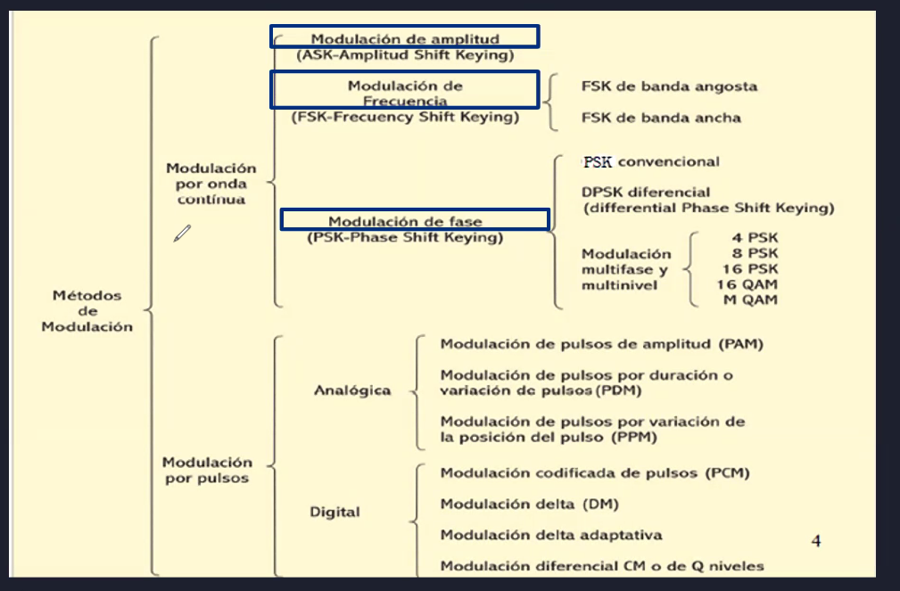

## 1. Modulación por onda continua
portadora analógica.

### Modulación de amplitud
- **ASK (Amplitude Shift Keying)**

### Modulación de frecuencia
- **FSK (Frequency Shift Keying)**
  - FSK de banda angosta
  - FSK de banda ancha
resultante digital.

### Modulación de fase
- **PSK (Phase Shift Keying)**
  - PSK convencional
  - DPSK diferencial (**Differential Phase Shift Keying**)
  - Modulación multifase y multinivel:
    - 4 PSK
    - 8 PSK
    - 16 PSK
    - 16 QAM
    - M-QAM
portadora siempre digital.

---

## 2. Modulación por pulsos
portadora digital.

segun su señal moduladora:
### Analógica
- **PAM:** Modulación de pulsos de amplitud
- **PDM:** Modulación de pulsos por duración o variación de pulso
- **PPM:** Modulación de pulsos por variación de la posición del pulso

### Digital
- **PCM:** Modulación codificada de pulsos
- **DM:** Modulación Delta
- **ADM:** Modulación Delta adaptativa
- **DPCM:** Modulación diferencial CM o de Q niveles


# Tipos de modulación

| Tipo de modulación | Moduladora | Portadora | Modulada | Nombre de la modulación |
|---|---|---|---|---|
| **Continua** | Analógica | Analógica | Analógica | AM, FM, PM |
| **Continua** | Digital | Analógica | Analógica | ASK, FSK, PSK, DPSK, M-PSK, M-QAM |
| **Por pulsos** | Analógica | Digital | Analógica | PAM, PDM, PPM |
| **Por pulsos** | Digital | Digital | Digital | PCM (MIC), DPCM, DELTA, DELTA ADAPTIVA |

# Modulación por onda continua

## Portadora

La señal portadora se representa mediante:

$$
p(t) = A_p \cdot \sin(\omega_p t + \theta_p)
$$

Donde:

- $p(t)$ = señal portadora
- $A_p$ = amplitud máxima de la portadora
- $T_p$ = período de la portadora
- $f_p$ = frecuencia de la portadora
- $\omega_p$ = pulsación de la portadora
- $\theta_p$ = fase de la portadora

### Relaciones fundamentales

**Frecuencia de la portadora:**

$$
f_p = \frac{1}{T_p}
$$

**Pulsación de la portadora:**

$$
\omega_p = 2\pi f_p
$$

---

## Parámetros que pueden modificarse

Con la modulación se modifica alguno de los siguientes parámetros de la **señal portadora**:

- **Amplitud**
- **Frecuencia**
- **Fase**

Dependiendo del parámetro que se modifique, tendremos un tipo diferente de modulación.

# Modulación AM — Modulación de Amplitud

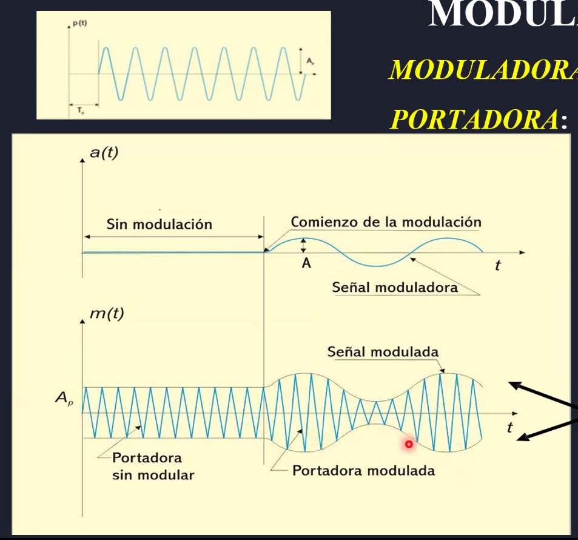

En la **modulación AM (Amplitude Modulation)** se modifica la **amplitud de la señal portadora** de acuerdo con la señal moduladora.

## Señal moduladora

La señal moduladora contiene la información que se desea transmitir:

$$
a(t) = A \sin(\omega_a t + \theta_a)
$$

Donde:

- $A$ = amplitud de la señal moduladora.
- $\omega_a$ = pulsación de la señal moduladora.
- $\theta_a$ = fase de la señal moduladora.

## Señal portadora

La portadora es una señal sinusoidal de frecuencia mucho mayor que la señal moduladora:

$$
p(t) = P \sin(\omega_p t + \theta_p)
$$

Donde:

- $P$ = amplitud de la portadora.
- $\omega_p$ = pulsación de la portadora.
- $\theta_p$ = fase de la portadora.

Se cumple:

$$
\omega_a \ll \omega_p
$$

Es decir, la **frecuencia de la señal moduladora es mucho menor que la frecuencia de la portadora**.

---

## Señal modulada

Al aplicar la señal moduladora sobre la portadora, se obtiene la **señal modulada AM**.
siempre señal analógica.

En AM:

> La **amplitud de la portadora varía** siguiendo el comportamiento de la señal moduladora, mientras que su frecuencia permanece constante.

### Envolvente de modulación

La **envolvente** es la curva que delimita los valores máximos y mínimos de amplitud de la señal modulada.

La forma de esta envolvente reproduce la forma de la **señal moduladora**, es decir, de la información que se desea transmitir.

# Modulación AM - FM

Partiendo de una **señal moduladora** $a(t)$, podemos modificar distintos parámetros de la portadora.

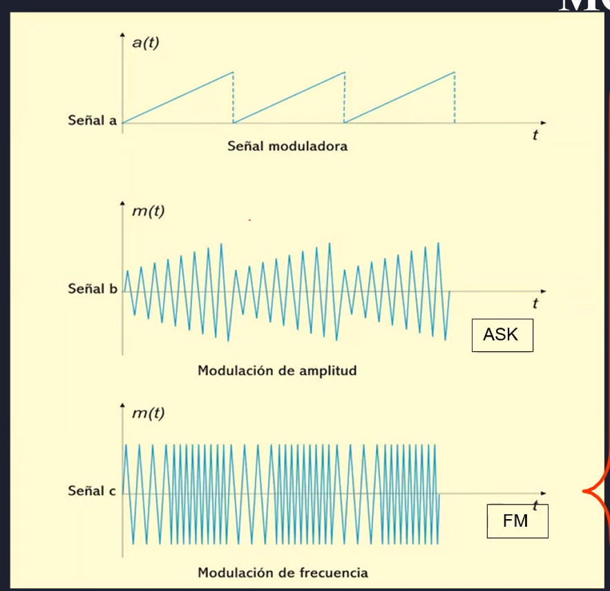

moduladora digital

## Modulación de amplitud — AM

En **AM (Amplitude Modulation)**, la señal moduladora provoca una variación en la **amplitud** de la portadora.

- La **amplitud varía** según la señal moduladora.
- La **frecuencia de la portadora permanece constante**.
- La envolvente de la señal modulada sigue la forma de la señal moduladora.

---

## Modulación de frecuencia — FM

En **FM (Frequency Modulation)**, la señal moduladora provoca una variación en la **frecuencia instantánea** de la portadora.

- La **amplitud permanece constante**.
- La **frecuencia varía** según la amplitud instantánea de la señal moduladora.
- A mayor valor de la señal moduladora, mayor será el desplazamiento de frecuencia respecto de la frecuencia de la portadora.

### Señal modulada

Para una moduladora sinusoidal, la señal FM puede expresarse como:

$$
M(t) = A_p \sin(\omega_p t + \beta \sin(\omega_a t) + \theta_p)
$$

Donde:

- $A_p$ = amplitud de la portadora.
- $\omega_p$ = pulsación angular de la portadora.
- $\omega_a$ = pulsación angular de la señal moduladora.
- $\theta_p$ = fase inicial de la portadora.
- $\beta$ = índice de modulación FM.

### Índice de modulación

$$
\beta = \frac{\Delta \omega}{\omega_a}
$$

Donde:

- $\beta$ = índice de modulación.
- $\Delta \omega$ = desviación máxima de pulsación.
- $\omega_a$ = pulsación de la señal moduladora.

La desviación de frecuencia depende de la amplitud de la señal moduladora:

$$
\Delta \omega = k A_a
$$

Donde:

- $k$ = constante de sensibilidad del modulador.
- $A_a$ = amplitud máxima de la señal moduladora.

Por lo tanto:

$$
\beta = \frac{k A_a}{\omega_a}
$$

> **Idea clave:** en **AM** cambia la amplitud de la portadora, mientras que en **FM** cambia su frecuencia.


# modulacion de fase - señal 2-psk / B-PSK

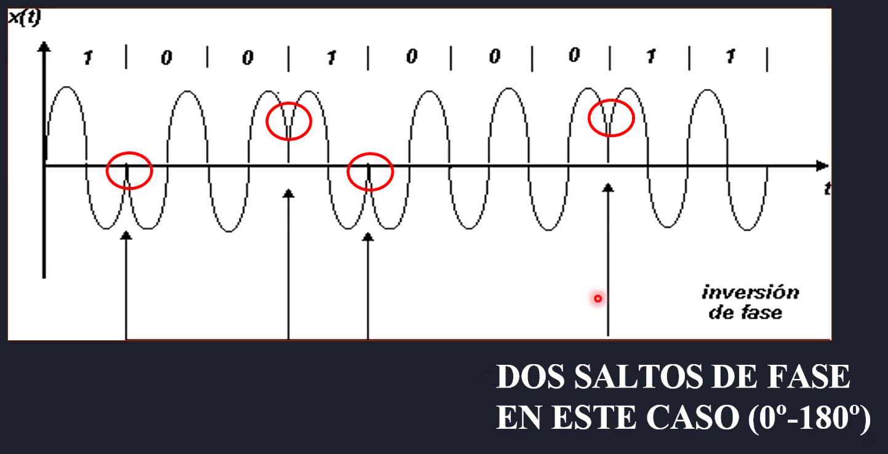

# asiganación de secuencia de bits y de estados - DIAGRAMA DE FASES - modulacinon 4-PSK/Q-psk

mudlacion de onda continua y modulacion de fase multinivel.
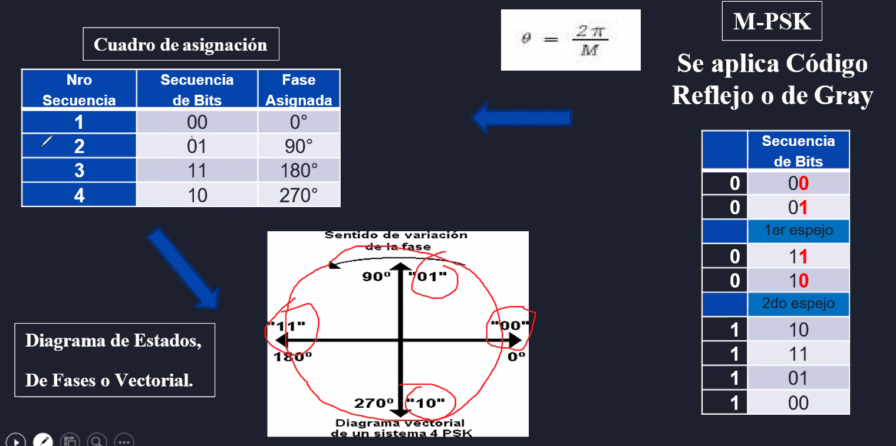

se vé el paso a paso en la imagen.

## construccion del codigo de gray
ejemplo con 3 bits.
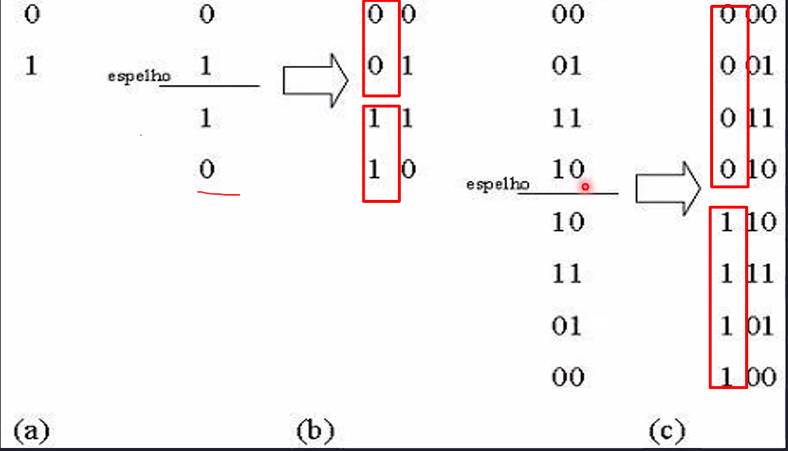


# Modulación M-PSK

En **M-PSK (M-ary Phase Shift Keying)** se utilizan **M saltos o estados de fase**, existiendo un ángulo $\theta$ entre cada fase posible.

## Separación entre fases

El ángulo entre dos fases consecutivas es:

$$
\theta = \frac{2\pi}{M}
$$

o, expresado en grados:

$$
\theta = \frac{360^\circ}{M}
$$

Donde:

- $M$ = cantidad de fases posibles.
- $\theta$ = separación angular entre fases.

---

## Cantidad de bits por símbolo

Cada salto o estado de fase representa **n bits**:

$$
n = \log_2(M)
$$

Por lo tanto:

$$
M = 2^n
$$

---

## Relación entre velocidad de transmisión y velocidad de modulación

La relación entre ambas velocidades está dada por:

$$
V_{tx} = V_{mod} \cdot n
$$

Donde:

- $V_{tx}$ = velocidad de transmisión, medida en **bit/s (bps)**.
- $V_{mod}$ = velocidad de modulación, medida en **baudios (Bd)**.
- $n$ = cantidad de bits transmitidos por símbolo.

Como:

$$
n = \log_2(M)
$$

también podemos escribir:

$$
V_{tx} = V_{mod} \cdot \log_2(M)
$$

---

# Ejemplo: 8-PSK

En **8-PSK** existen:

$$
M = 8
$$

### Bits por símbolo

$$
n = \log_2(8) = 3 \text{ bits/símbolo}
$$

Por lo tanto, **cada símbolo o salto de fase representa 3 bits**.

### Separación entre fases

$$
\theta = \frac{360^\circ}{8} = 45^\circ
$$

Por lo tanto, las fases posibles están separadas entre sí por **45°**.

## Asignación de bits y fases

| Secuencia | Dígitos binarios | Fase asignada |
|---:|:---:|---:|
| 1 | `000` | 0° |
| 2 | `001` | 45° |
| 3 | `011` | 90° |
| 4 | `010` | 135° |
| 5 | `110` | 180° |
| 6 | `111` | 225° |
| 7 | `101` | 270° |
| 8 | `100` | 315° |

> **Idea clave:** en 8-PSK hay **8 símbolos posibles**, cada uno representado por una fase diferente. Como $2^3 = 8$, cada símbolo transporta **3 bits**.

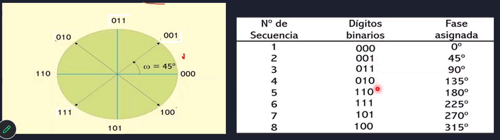


# Multiplexación

La **multiplexación** es una técnica que permite agrupar, en un mismo **medio de comunicación**, distintos canales correspondientes a diferentes servicios, con el objetivo de:

- Aprovechar la totalidad del **ancho de banda (AB)** disponible.
- Hacer más eficiente el uso del **canal de comunicaciones**.

> **Idea clave:** la multiplexación permite que **varias señales o canales compartan un mismo medio de transmisión**.

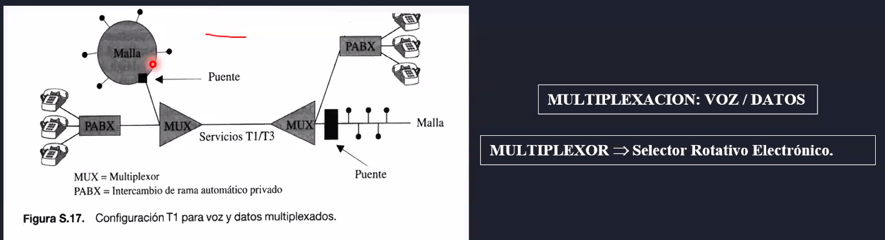

## Tipos de técnicas de multiplexación:

- **Por división de frecuencia (FDM)** — *Frequency Division Multiplexing*
- **Por división de tiempo (TDM)** — *Time Division Multiplexing*
- **Por división de tiempo estadística (STDM)** — *Statistical Time Division Multiplexing*
- **Por división de longitud de onda (WDM)** — *Wavelength Division Multiplexing*
- **Por división de código (CDM)** — *Code Division Multiplexing*

### Por división de frecuencia (FDM)** — *Frequency Division Multiplexing

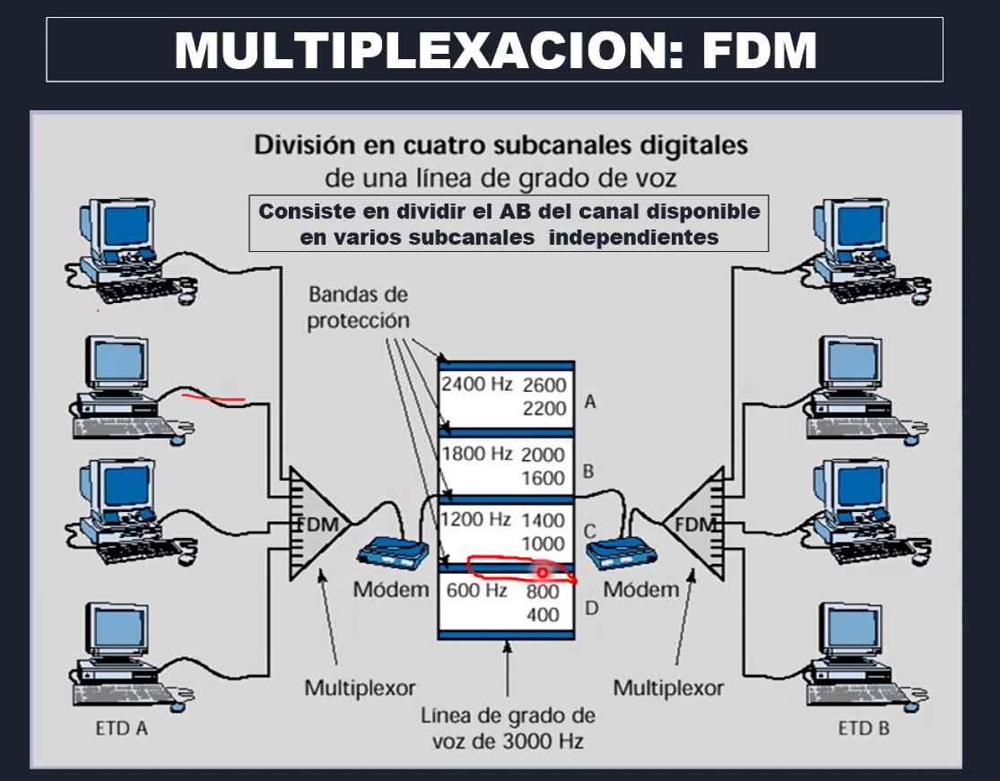

### Por división de tiempo (TDM)** — *Time Division Multiplexing

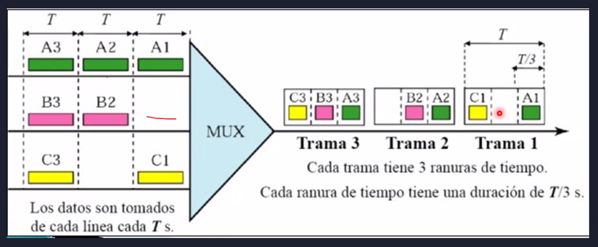

### Por división de tiempo estadística (STDM)** — *Statistical Time Division Multiplexing

- asignacion estadistica
- aprovecha tofdos los tiempos
asignacion por demanada de ranuras
tambien se denominca mux asincronica - atdm

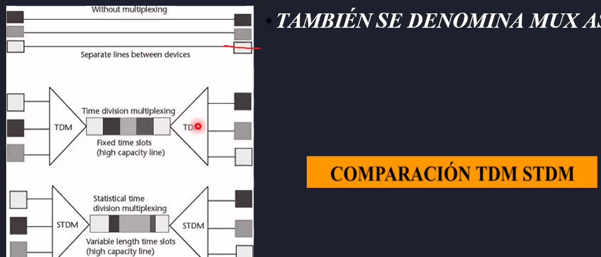

### comparacion FDM-WDM-TDM
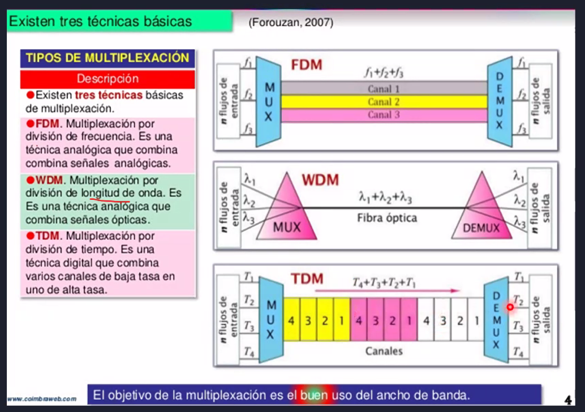

**el objetivo de la multiplexacion es aprovechar el ancho de banda del canal de transmision.**


# TRABAJO PRÁCTICO N° 4

**Modulacion, multiplexacion digital: PDH,SDH y SONET..**

1. Se tiene que transmitir una señal analógica que pasa a través de un filtro de 4000 Hz de ancho de banda. Dicha señal entra a un modulador PCM donde se toman muestras cada 125 microsegundos, codificándose cada muestra según un proceso de cuantificación de 128 niveles. Hallar la capacidad que debe tener el vínculo de salida del modulador. Cuál sería dicha capacidad si fueran 256 niveles cuánticos?

**Datos:**

- Ancho de banda de la señal analógica:

$$
AB = 4000 \text{ Hz}
$$

- Período de muestreo:

$$
T_m = 125 \ \mu s = 125 \times 10^{-6} \text{ s}
$$

- Niveles de cuantificación:

$$
L = 128
$$

Un canal de voz analógico tiene aproximadamente **4000 Hz de ancho de banda**.

Un canal de voz digitalizado mediante PCM clásico tiene una velocidad de **64 kbps**, utilizando 8000 muestras/s y 8 bits por muestra.

La frecuencia de muestreo se obtiene a partir del período:

$$
f_m = \frac{1}{T_m}
$$

$$
f_m = \frac{1}{125 \times 10^{-6} \text{ s}}
$$

$$
\boxed{f_m = 8000 \text{ muestras/s}}
$$

También podemos comprobarlo mediante el **teorema de Nyquist**:

$$
f_m \geq 2f_{max}
$$

$$
f_m \geq 2 \times 4000 \text{ Hz}
$$

$$
f_m \geq 8000 \text{ Hz}
$$

Para **128 niveles de cuantificación**, la cantidad de bits necesarios por muestra es:

$$
L = 2^n
$$

$$
n = \log_2(L)
$$

$$
n = \log_2(128) = 7 \text{ bits/muestra}
$$

La capacidad necesaria del vínculo es:

$$
C = f_m \cdot n
$$

$$
C = 8000 \frac{\text{muestras}}{\text{s}}
\cdot
7 \frac{\text{bits}}{\text{muestra}}
$$

$$
\boxed{C = 56000 \text{ bps} = 56 \text{ kbps}}
$$

Si se utilizan **256 niveles cuánticos**:

$$
n = \log_2(256) = 8 \text{ bits/muestra}
$$

Entonces:

$$
C = 8000 \frac{\text{muestras}}{\text{s}}
\cdot
8 \frac{\text{bits}}{\text{muestra}}
$$

$$
\boxed{C = 64000 \text{ bps} = 64 \text{ kbps}}
$$

Por lo tanto:

- **128 niveles → 56 kbps**
- **256 niveles → 64 kbps**

> **Para recordar:**  
> Canal de voz analógico: **4000 Hz**  
> Canal de voz digitalizado PCM clásico: **64 kbps**


**Estándares — Normas de Grupo Primario**

- **E1:** 2,058 Mbps — 32 canales — **PCM-30**
- **T1:** 1,56 Mbps — 24 canales — **PCM-24**
- **Argentina:** E1 → PCM-30 → 32 canales → ~2,048 Mbps
- **EE.UU.:** T1 → PCM-24 → 24 canales → 1,544 Mbps
---

2. Se dispone de un modem que trabaja con el tipo de modulación 16-PSK. Calcule el desfasaje entre estados que adopta la señal modulada.

**Módem de 16-PSK**

En una modulación **16-PSK** existen 16 estados de fase posibles:

$$
M = 16 = 2^4
$$

Por lo tanto, cada símbolo representa:

$$
n = \log_2(16) = 4 \text{ bits/símbolo}
$$

Es decir, es una transmisión **multinivel de 4 bits por símbolo (cuatribits)**.

La separación angular entre dos fases consecutivas es:

$$
\theta = \frac{2\pi}{M}
$$

$$
\theta = \frac{2\pi}{16} = \frac{\pi}{8}
$$

Pasando a grados:

$$
\theta = \frac{360^\circ}{16}
$$

$$
\boxed{\theta = 22,5^\circ}
$$

> **RTA:** La portadora puede adoptar **16 fases diferentes**, separadas entre sí por **22,5°**. Cada estado de fase representa **4 bits**.

---
3. Qué relación hay entre la velocidad de transmisión Vt y la velocidad de modulación Vm, con respecto al ejercicio anterior?

Del ejercicio anterior tenemos una modulación **16-PSK**:

$$
M = 16
$$

La relación entre la velocidad de transmisión y la velocidad de modulación es:

$$
V_t = V_m \cdot \log_2(M)
$$

Como:

$$
\log_2(16) = 4
$$

Entonces:

$$
V_t = V_m \cdot 4
$$

$$
\boxed{V_t = 4V_m}
$$

Esto ocurre porque en **16-PSK cada símbolo representa 4 bits (cuatribit)**.

> **RTA:** La velocidad de transmisión es **4 veces** la velocidad de modulación: $V_t = 4V_m$.


---
4. Se tiene un modem cuyo tipo de modulación es 8-PSK. Indicar:
• De la señal moduladora, portadora y modulada, cuáles son analógicas y cuáles digitales?
• Proponer una asignación de fases a secuencias de bits y realizar el diagrama de fases.
• Qué relación existe entre la velocidad de modulación y la velocidad de transmisión?

**Se tiene un módem cuyo tipo de modulación es 8-PSK.**

**a)** En una modulación PSK, la información de entrada es digital y modifica la fase de una portadora analógica:

- **Moduladora:** Digital
- **Portadora:** Analógica
- **Modulada:** Analógica

**b)** Para **8-PSK** tenemos:

$$
M = 8
$$

Cada símbolo transporta:

$$
n = \log_2(M)
$$

$$
n = \log_2(8) = 3 \text{ bits/símbolo}
$$

Por lo tanto, se transmiten **tribits**.

La separación angular entre las fases es:

$$
\theta = \frac{360^\circ}{M}
$$

$$
\theta = \frac{360^\circ}{8}
$$

$$
\boxed{\theta = 45^\circ}
$$

Podemos realizar la asignación utilizando **Código Gray**, de forma que entre fases consecutivas cambie solamente un bit:

| Secuencia | Bits | Fase |
|---:|:---:|---:|
| 1 | `000` | 0° |
| 2 | `001` | 45° |
| 3 | `011` | 90° |
| 4 | `010` | 135° |
| 5 | `110` | 180° |
| 6 | `111` | 225° |
| 7 | `101` | 270° |
| 8 | `100` | 315° |

Diagrama de fases:

                  011
                   |
             010   |   001
                \  |  /
                 \ | /
          110 -----+----- 000
                 / | \
                /  |  \
             111   |   100
                   |
                  101

Cada estado se encuentra separado del siguiente por **45°**.

**c)** La relación entre la velocidad de transmisión y la velocidad de modulación es:

$$
V_{tx} = V_{mod} \cdot \log_2(M)
$$

Como:

$$
\log_2(8) = 3
$$

Entonces:

$$
V_{tx} = V_{mod} \cdot 3
$$

$$
\boxed{V_{tx} = 3V_{mod}}
$$

> **RTA:** La velocidad de transmisión es **3 veces la velocidad de modulación**, porque en 8-PSK cada símbolo transmite **3 bits (tribit)**.

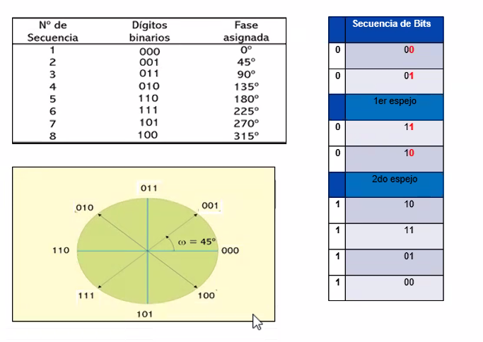


---
5. Se quiere transmitir por un canal telefónico a 9600 bps y se cuenta con un modem de 2400 baudios que opera con transmisión multinivel y modulación PSK. Hallar:
• Qué tipo de modulación PSK debe emplearse para transmitir a la velocidad de transmisión requerida.
• El diagrama vectorial y la asignación de fases correspondiente.

**Se quiere transmitir por un canal telefónico a 9600 bps y se cuenta con un módem de 2400 baudios que opera con transmisión multinivel y modulación PSK.**

**a)** Datos:

$$
V_{tx} = 9600 \text{ bps}
$$

$$
V_{mod} = 2400 \text{ baudios}
$$

La relación entre ambas velocidades es:

$$
V_{tx} = V_{mod} \cdot \log_2(M)
$$

Reemplazando:

$$
9600 = 2400 \cdot \log_2(M)
$$

$$
\log_2(M) = \frac{9600}{2400} = 4
$$

Por lo tanto:

$$
M = 2^4 = 16
$$

$$
\boxed{M = 16}
$$

Se debe utilizar una modulación:

$$
\boxed{\text{16-PSK}}
$$

Cada símbolo representa **4 bits (cuatribit)**.

**b)** La separación angular entre fases será:

$$
\theta = \frac{360^\circ}{M}
$$

$$
\theta = \frac{360^\circ}{16}
$$

$$
\boxed{\theta = 22,5^\circ}
$$

Para asignar las fases se puede utilizar **Código Gray**, de manera que entre dos fases adyacentes cambie solamente **1 bit**:

| Bits | Fase |
|:---:|---:|
| `0000` | 0° |
| `0001` | 22,5° |
| `0011` | 45° |
| `0010` | 67,5° |
| `0110` | 90° |
| `0111` | 112,5° |
| `0101` | 135° |
| `0100` | 157,5° |
| `1100` | 180° |
| `1101` | 202,5° |
| `1111` | 225° |
| `1110` | 247,5° |
| `1010` | 270° |
| `1011` | 292,5° |
| `1001` | 315° |
| `1000` | 337,5° |

Diagrama vectorial simplificado:

                   0110
                    90°
                     |
           0111      |      0010
          112,5°     |      67,5°
               \     |     /
        0101     \   |   /     0011
         135°      \ | /        45°
                    \|/
  0100 157,5° -------+------- 22,5° 0001
                     |
  1100 180°  --------+-------- 0° 0000
                     |
  1101 202,5° -------+------- 337,5° 1000
                    /|\
        1111      /  |  \      1001
         225°   /    |    \     315°
              /      |      \
           1110      |      1011
          247,5°     |      292,5°
                     |
                   1010
                    270°


> **RTA:** Se necesita una modulación **16-PSK**, con **16 fases separadas 22,5°** entre sí. Cada símbolo transmite **4 bits**, permitiendo obtener $9600$ bps a partir de $2400$ baudios.


---
6. Una portadora de 100 Mhz se modula en frecuencia con una señal sinusoidal de 10 Khz (fm) de manera tal que la desviación máxima de frecuencia (f) es de 1 Mhz. Determinar el ancho de banda aproximado de la señal de FM en este caso.

**Una portadora de 100 MHz se modula en frecuencia con una señal sinusoidal de 10 kHz ($f_m$), de manera tal que la desviación máxima de frecuencia ($\Delta f$) es de 1 MHz. Determinar el ancho de banda aproximado de la señal de FM.**

Datos:

$$
f_p = 100 \text{ MHz}
$$

$$
f_m = 10 \text{ kHz}
$$

$$
\Delta f = 1 \text{ MHz} = 1000 \text{ kHz}
$$

Para calcular el ancho de banda aproximado de una señal FM utilizamos la **regla de Carson**:

$$
AB \approx 2(\Delta f + f_m)
$$

Reemplazando:

$$
AB \approx 2(1000 \text{ kHz} + 10 \text{ kHz})
$$

$$
AB \approx 2(1010 \text{ kHz})
$$

$$
\boxed{AB \approx 2020 \text{ kHz}}
$$

También puede expresarse como:

$$
\boxed{AB \approx 2,02 \text{ MHz}}
$$

> **RTA:** El ancho de banda aproximado de la señal FM es **2020 kHz = 2,02 MHz**.


---
7. Confeccione un cuadro resumen de los tipos de modulación especificando para cada uno si la señal moduladora, portadora y modulada son analógicas o digitales.

(en apuntes)


---
8. Qué tipos de modulación se ven menos afectados por el ruido y por qué?

La modulación que se ve **menos afectada por el ruido es FM**, ya que la información se transmite mediante **variaciones en la frecuencia** de la portadora y no mediante variaciones en su amplitud.

Como gran parte del ruido introduce principalmente **variaciones no deseadas de amplitud**, estas pueden eliminarse o limitarse en el receptor sin afectar significativamente la información transmitida.

En comparación, **AM es más sensible al ruido**, porque justamente utiliza las variaciones de amplitud para transportar la información.

> **RTA:** **FM es menos susceptible al ruido que AM**, porque la información está contenida en las variaciones de frecuencia y no en las de amplitud.
---

9. Qué tipo de señales (analógicas o digitales) se obtienen después de un proceso de multiplexión FDM y TDM?

- **FDM (Multiplexación por División de Frecuencia):** la señal resultante es **analógica**.
- **TDM (Multiplexación por División de Tiempo):** la señal resultante es **digital**.

> **RTA:**  
> **FDM → Analógica**  
> **TDM → Digital**

---
10. Confeccione un cuadro comparativo entre el multiplexor con sus variantes FDM, TDM y STDM.

| Característica | FDM | TDM | STDM |
|---|---|---|---|
| **Significado** | División de Frecuencia | División de Tiempo | División de Tiempo Estadística |
| **Cómo divide el medio** | En distintas bandas de frecuencia | En intervalos de tiempo (slots) | En intervalos de tiempo asignados dinámicamente |
| **Tipo de señal resultante** | Analógica | Digital | Digital |
| **Asignación del canal** | Cada señal tiene una banda de frecuencia propia | Cada canal tiene un intervalo de tiempo fijo | Los intervalos se asignan solo a los canales que tienen datos para transmitir |
| **Transmisión** | Los canales transmiten simultáneamente en diferentes frecuencias | Los canales transmiten por turnos | Transmiten por turnos únicamente los canales activos |
| **Uso del medio** | Divide el ancho de banda disponible | Divide el tiempo disponible | Divide el tiempo según la demanda |
| **Eficiencia** | Requiere bandas de guarda entre canales | Puede desperdiciar slots si un canal no transmite | Mayor aprovechamiento que TDM cuando hay canales inactivos |
| **Ejemplo típico** | Radiodifusión / TV por cable | Sistemas PCM | Redes de datos con tráfico variable |

> **Idea clave:**  
> **FDM → divide frecuencia.**  
> **TDM → divide tiempo en turnos fijos.**  
> **STDM → divide tiempo en turnos asignados dinámicamente según quién necesite transmitir.**

**segun profesor:**
| Parámetro | FDM | TDM | STDM |
|---|---|---|---|
| **Modo de transmisión de la información** | Simplex | ------ | ------ |
| **Envío de señales** | Analógicas - Digitales | Digitales | Digitales |
| **Señal resultante del proceso** | Analógica | Digital | Digital |
| **Relación S/N (señal/ruido)** | Se deteriora | No se deteriora | No se deteriora |
| **Tecnología** | Analógica | Digital | Digital |
| **Costos de implementación** | Más bajo | Más elevados | Más elevados |
| **Eficiencia del uso del ancho de banda** | **Menos eficiente:** asigna bandas de guarda para separar cada subcanal | **Más eficiente:** asigna el AB en intervalos de tiempo fijo a cada subcanal | **Más eficiente aún:** asigna el AB en intervalos de tiempo variables a cada subcanal |
