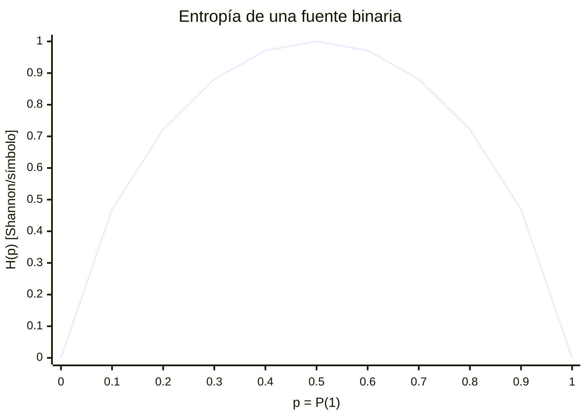

# clase practica de 06-10-2026

# contenido de clase de práctica


# Trabajo Práctico N° 5

## Teoría de la información y codificación

**Materia:** Comunicaciones  
**Carrera:** Ingeniería en Sistemas de Información  
**Unidad:** 5

---

### 1.

Calcular la cantidad de información asociada a una palabra de cuatro caracteres proveniente de una fuente equiprobable de símbolos. Considerar un alfabeto de 32 símbolos.

**Resolución**

La fuente es equiprobable, por lo tanto todos sus símbolos tienen la misma probabilidad de ocurrencia. Como el alfabeto posee 32 símbolos:

La probabilidad de cada símbolo es:

$$
P(x_i) = \frac{1}{32}
$$

La información suministrada por un carácter es:

$$
I(x_i) = \log_2\left(\frac{1}{P(x_i)}\right)
	= \log_2(32)
	= 5\ \text{Shannon}
$$

Como la palabra tiene cuatro caracteres:

Cada posición de la palabra aporta 5 Shannon. Por eso, la información total se obtiene sumando la información de los cuatro caracteres:

$$
I(\text{palabra}) = 4 \times 5 = \boxed{20\ \text{Shannon}}
$$

También puede verificarse considerando que existen $32^4$ palabras posibles de cuatro caracteres. La probabilidad de una palabra determinada es:

$$
P(\text{palabra}) = \left(\frac{1}{32}\right)^4 = \frac{1}{32^4}
$$

Entonces:

$$
I(\text{palabra}) = \log_2\left(\frac{1}{P(\text{palabra})}\right)
					= \log_2(32^4)
					= 4\log_2(32)
					= 20\ \text{Shannon}
$$

Las dos formas de cálculo dan el mismo resultado.


### 2.

Dado un tren de pulsos correspondiente a la siguiente secuencia: `010101000001`, calcular la información suministrada con la aparición de un uno o de un cero y la entropía de la fuente.

**Resolución**

La secuencia tiene 12 pulsos:

```text
0 1 0 1 0 1 0 0 0 0 0 1
```

En ella aparecen 8 ceros y 4 unos. Por lo tanto, las probabilidades de aparición son:

$$
P(0) = \frac{8}{12} = \frac{2}{3}
\qquad
P(1) = \frac{4}{12} = \frac{1}{3}
$$

La información suministrada por la aparición de un cero es:

$$
I(0) = \log_2\left(\frac{1}{P(0)}\right)
	= \log_2\left(\frac{3}{2}\right)
	\approx 0{,}585\ \text{Shannon}
$$

La información suministrada por la aparición de un uno es:

$$
I(1) = \log_2\left(\frac{1}{P(1)}\right)
	= \log_2(3)
	\approx 1{,}585\ \text{Shannon}
$$

El uno aporta más información que el cero porque es menos probable:

$$
P(1) < P(0) \quad\Longrightarrow\quad I(1) > I(0)
$$

La entropía de la fuente es la información promedio por símbolo:

$$
H = P(0)I(0) + P(1)I(1)
$$

$$
H = \frac{2}{3}\cdot 0{,}585
  + \frac{1}{3}\cdot 1{,}585
	\approx \boxed{0{,}918\ \text{Shannon/s}}
$$

Redondeando a dos decimales:

$$
\boxed{H \approx 0{,}92\ \text{Shannon/símbolo}}
$$

Como comprobación, la información total de los 12 pulsos es:

$$
I_{\text{total}} = 8I(0) + 4I(1)
			   \approx 11{,}02\ \text{Shannon}
$$

Al dividirla por los 12 símbolos se obtiene nuevamente la entropía:

$$
\frac{I_{\text{total}}}{12}
= \frac{11{,}02}{12}
\approx 0{,}918\ \text{Shannon/símbolo}
$$

### 3.

Dados 3 mensajes con la siguiente probabilidad de ocurrencia:

- `p₁ = 20 %`
- `p₂ = 50 %`
- `p₃ = 30 %`

Calcular la cantidad de información suministrada por cada uno de ellos. Calcular la información promedio por mensaje de esta fuente.

**Resolución**

La información de cada mensaje se calcula con:

$$
I(m_i) = \log_2\left(\frac{1}{P(m_i)}\right)
$$

Para el mensaje 1:

$$
I(m_1) = \log_2\left(\frac{1}{0{,}2}\right)
	= \log_2(5)
	\approx 2{,}322\ \text{Shannon}
$$

Para el mensaje 2:

$$
I(m_2) = \log_2\left(\frac{1}{0{,}5}\right)
	= \log_2(2)
	= 1\ \text{Shannon}
$$

Para el mensaje 3:

$$
I(m_3) = \log_2\left(\frac{1}{0{,}3}\right)
	= \log_2\left(\frac{10}{3}\right)
	\approx 1{,}737\ \text{Shannon}
$$

La información promedio por mensaje, que corresponde a la entropía de la fuente, se obtiene ponderando la información de cada mensaje por su probabilidad:

$$
H = P(m_1)I(m_1) + P(m_2)I(m_2) + P(m_3)I(m_3)
$$

$$
H = (0{,}2\cdot 2{,}322) + (0{,}5\cdot 1) + (0{,}3\cdot 1{,}737)
$$

$$
H \approx 0{,}4644 + 0{,}5 + 0{,}5211
  \approx \boxed{1{,}4855\ \text{Shannon/mensaje}}
$$

### 4.

Se tiene un alfabeto de 128 símbolos diferentes y equiprobables. Se desea transmitir un mensaje. Calcular:

a. La probabilidad de ocurrencia de un símbolo.
b. La cantidad de información obtenida con la recepción de dicho símbolo.
c. La cantidad de información de una palabra formada por 6 símbolos.
d. La entropía de la fuente.

**Resolución**

#### a. Probabilidad de ocurrencia de un símbolo

Como los 128 símbolos son diferentes y equiprobables, todos tienen la misma probabilidad:

$$
P(x_i) = \frac{1}{128} = 0{,}0078125
$$

#### b. Información obtenida con la recepción de un símbolo

$$
I(x_i) = \log_2\left(\frac{1}{P(x_i)}\right)
			 = \log_2(128)
			 = \boxed{7\ \text{Shannon}}
$$

#### c. Información de una palabra de 6 símbolos

Cada símbolo aporta 7 Shannon. Por lo tanto, la información de una palabra formada por 6 símbolos es:

$$
I(\text{palabra}) = 6\cdot 7
									 = \boxed{42\ \text{Shannon}}
$$

También puede calcularse considerando las $128^6$ palabras posibles:

$$
I(\text{palabra}) = \log_2(128^6)
									 = 6\log_2(128)
									 = 42\ \text{Shannon}
$$

#### d. Entropía de la fuente

La entropía es:

$$
H = -\sum_{i=1}^{128}P(x_i)\log_2 P(x_i)
$$

Como todos los símbolos tienen probabilidad $1/128$:

$$
H = 128\cdot\frac{1}{128}\cdot\log_2(128)
	= \boxed{7\ \text{Shannon/símbolo}}
$$

En una fuente equiprobable, la entropía coincide con la información de cada símbolo.


### 5.

Suponiendo una fuente con los símbolos `A`, `B`, `C`, `E`, `L`, donde cada uno tiene asociada la siguiente probabilidad:

- `A = 1/4`
- `B = 1/4`
- `C = 1/8`
- `E = 1/4`
- `L = 1/8`

Calcular la información suministrada con el mensaje: `CABLE`.

**Resolución**

La información de cada símbolo se calcula con:

$$
I(x_i) = \log_2\left(\frac{1}{P(x_i)}\right)
$$

| Símbolo | Probabilidad | Información |
| --- | --- | --- |
| `C` | $1/8$ | $\log_2(8)=3$ Shannon |
| `A` | $1/4$ | $\log_2(4)=2$ Shannon |
| `B` | $1/4$ | $\log_2(4)=2$ Shannon |
| `L` | $1/8$ | $\log_2(8)=3$ Shannon |
| `E` | $1/4$ | $\log_2(4)=2$ Shannon |

La información suministrada por el mensaje `CABLE` es la suma de la información de sus símbolos:

$$
I(\text{CABLE}) = I(C)+I(A)+I(B)+I(L)+I(E)
$$

$$
I(\text{CABLE}) = 3+2+2+3+2
								 = \boxed{12\ \text{Shannon}}
$$

También puede verificarse calculando la probabilidad del mensaje completo:

$$
P(\text{CABLE}) = \frac{1}{8}\cdot\frac{1}{4}\cdot\frac{1}{4}
									\cdot\frac{1}{8}\cdot\frac{1}{4}
								= \frac{1}{4096}
$$

Entonces:

$$
I(\text{CABLE}) = \log_2\left(\frac{1}{P(\text{CABLE})}\right)
								 = \log_2(4096)
								 = 12\ \text{Shannon}
$$

### 6.

Suponiendo una imagen de 600 líneas horizontales y 300 puntos discretos por línea, donde cada punto tiene 8 niveles equiprobables de brillo, y un vocabulario de 100.000 palabras equiprobables, demostrar el proverbio que dice que una imagen vale más que 1000 palabras.

**Resolución**

#### Información de la imagen
Estamos hablando de un ejemplo de imagen digital, donde cada punto de la imagen puede tener distintos niveles de brillo. La información de la imagen se calcula considerando cada punto como un símbolo de la fuente, con probabilidad equiprobable para cada nivel de brillo.

La cantidad total de puntos de la imagen es:

$$
N_{\text{puntos}} = 600\cdot300 = 180000\ \text{puntos}
$$

Cada punto puede tener 8 niveles de brillo equiprobables. Por lo tanto, la información de un punto es:

$$
I(\text{punto}) = \log_2(8) = 3\ \text{Shannon}
$$

La información total de la imagen es:

$$
I(\text{imagen}) = 180000\cdot3
				  = \boxed{540000\ \text{Shannon}}
$$

#### Información de las palabras

El vocabulario tiene 100.000 palabras equiprobables. La información de una palabra es:

$$
I(\text{palabra}) = \log_2(100000)
				  \approx 16{,}61\ \text{Shannon}
$$

Entonces, la información correspondiente a 1000 palabras es:

$$
I(1000\ \text{palabras}) = 1000\cdot16{,}61
						   \approx 16610\ \text{Shannon}
$$

#### Comparación

La relación entre la información de la imagen y la de 1000 palabras es:

$$
\frac{I(\text{imagen})}{I(1000\ \text{palabras})}
 = \frac{540000}{16610}
 \approx 32{,}5
$$

La imagen contiene aproximadamente 32,5 veces más información que 1000 palabras. De manera equivalente, la información de la imagen corresponde a:

$$
N_{\text{palabras equivalentes}}
 = \frac{540000}{16{,}61}
 \approx \boxed{32510\ \text{palabras}}
$$

Por lo tanto, bajo las hipótesis del ejercicio y sin compresión, la imagen contiene mucha más información que 1000 palabras, demostrando cuantitativamente el proverbio.

### 7.

Se tiene una fuente binaria con igual probabilidad de ocurrencia. Calcular la entropía `H` y graficar la curva correspondiente que relaciona a la misma con la probabilidad de ocurrencia de cada símbolo.

**Resolución**

Sea $p=P(1)$ la probabilidad de aparición del símbolo `1`. Como la fuente es binaria:

$$
P(0)=1-p
$$

La entropía de una fuente binaria es:

$$
H(p) = -p\log_2(p) - (1-p)\log_2(1-p)
$$

Para una fuente binaria equiprobable, $P(0)=P(1)=0,5$:

$$
H(0{,}5) = -0{,}5\log_2(0{,}5)-0{,}5\log_2(0{,}5)
$$

$$
H(0{,}5) = -0{,}5(-1)-0{,}5(-1)
		   = \boxed{1\ \text{Shannon/símbolo}}
$$

La entropía es máxima cuando ambos símbolos tienen la misma probabilidad. Si un símbolo es seguro ($p=0$ o $p=1$), la entropía es cero porque no existe incertidumbre.

| $P(1)=p$ | $P(0)=1-p$ | $H(p)$ [Shannon/símbolo] |
| ---: | ---: | ---: |
| 0,0 | 1,0 | 0,000 |
| 0,1 | 0,9 | 0,469 |
| 0,2 | 0,8 | 0,722 |
| 0,3 | 0,7 | 0,881 |
| 0,4 | 0,6 | 0,971 |
| 0,5 | 0,5 | 1,000 |
| 0,6 | 0,4 | 0,971 |
| 0,7 | 0,3 | 0,881 |
| 0,8 | 0,2 | 0,722 |
| 0,9 | 0,1 | 0,469 |
| 1,0 | 0,0 | 0,000 |



### 8.

Se transmite una imagen en modo gráfico de 640 × 480 píxeles, si cada punto tiene 256 niveles equiprobables de brillo. Calcular la información de la imagen y el tiempo total de transmisión si se utiliza un canal que permite enviar información a razón de 33.600 Shannon/segundo. Comparar con una transmisión en modo texto que utiliza 25 líneas × 80 columnas utilizando un código ASCII de 8 bits. Ambas imágenes se transmiten sin comprimir. No tener en cuenta el overhead.

**Resolución**

### Transmisión en modo gráfico

La cantidad de píxeles de la imagen es:

$$
N_{\text{píxeles}} = 640\cdot480 = 307200\ \text{píxeles}
$$

Cada píxel puede tener 256 niveles de brillo equiprobables. La información de cada píxel es:

$$
I(\text{píxel}) = \log_2(256) = 8\ \text{Shannon}
$$

Por lo tanto, la información total de la imagen es:

$$
I_{\text{gráfico}} = 307200\cdot8
					= 2457600\ \text{Shannon}
$$

El canal transmite a razón de 33.600 Shannon por segundo. Entonces, el tiempo de transmisión es:

$$
t_{\text{gráfico}} = \frac{2457600}{33600}
					\approx \boxed{73{,}14\ \text{s}}
$$

### Transmisión en modo texto

La cantidad de caracteres del texto es:

$$
N_{\text{caracteres}} = 25\cdot80 = 2000\ \text{caracteres}
$$

El código ASCII de 8 bits permite representar:

$$
2^8 = 256\ \text{niveles}
$$

Si los caracteres son equiprobables, la probabilidad de cada uno es:

$$
P(\text{carácter}) = \frac{1}{256}
$$

Por lo tanto, la información de un carácter es:

$$
I(\text{carácter}) = \log_2\left(\frac{1}{P(\text{carácter})}\right)
					= \log_2(256)
					= 8\ \text{Shannon}
$$

Entonces, para los 2000 caracteres:

$$
I_{\text{texto}} = 2000\cdot8
				 = 16000\ \text{Shannon}
$$

El tiempo de transmisión del texto es:

$$
t_{\text{texto}} = \frac{16000}{33600}
				  \approx \boxed{0{,}476\ \text{s}}
$$

### Comparación

La relación entre ambas cantidades de información es:

$$
\frac{I_{\text{gráfico}}}{I_{\text{texto}}}
 = \frac{2457600}{16000}
 = 153{,}6
$$

Por lo tanto, la imagen en modo gráfico contiene 153,6 veces más información y tarda aproximadamente 153,6 veces más en transmitirse que la pantalla de texto, bajo las condiciones indicadas y sin compresión ni overhead.

### 9.

Calcular la tasa de información `T` [Shannon/segundo] de una fuente telegráfica, sabiendo que:

- `P(punto) = 2/3`
- `P(raya) = 1/3`
- `T(punto) = 0,2 s`
- `T(raya) = 0,4 s`

**Resolución**

La información promedio de cada símbolo de la fuente es la entropía:

$$
H = -\frac{2}{3}\log_2\left(\frac{2}{3}\right)
		-\frac{1}{3}\log_2\left(\frac{1}{3}\right)
		\approx 0{,}9183\ \text{Shannon/símbolo}
$$

El tiempo promedio de transmisión de un símbolo es:

$$
\overline{t} = \frac{2}{3}\cdot0{,}2 + \frac{1}{3}\cdot0{,}4
						 = 0{,}2667\ \text{s/símbolo}
$$

Por lo tanto, la tasa de información es:

$$
T = \frac{H}{\overline{t}}
	= \frac{0{,}9183}{0{,}2667}
	\approx \boxed{3{,}44\ \text{Shannon/s}}
$$

### 10.

Una imagen de TV tiene 625 líneas con 500 puntos por línea. Cada punto tiene 128 niveles equiprobables de brillo. Si se transmiten 20 imágenes por segundo, calcular la tasa de información y la capacidad del canal.

**Resolución**

La cantidad de puntos de una imagen es:

$$
N_{\text{puntos}} = 625\cdot500 = 312500\ \text{puntos}
$$

Cada punto tiene 128 niveles equiprobables, por lo que aporta:

$$
I(\text{punto}) = \log_2(128) = 7\ \text{Shannon}
$$

La información de una imagen es:

$$
I(\text{imagen}) = 312500\cdot7
									= 2.187.500\ \text{Shannon}
$$

Como se transmiten 20 imágenes por segundo, la tasa de información es:

$$
T = 2.187.500\cdot20
	= \boxed{43.750.000\ \text{Shannon/s}}
$$

Por lo tanto, la capacidad mínima del canal debe ser:

$$
\boxed{C \geq 43{,}75\ \text{MShannon/s}}
$$

### 11.

Calcular la cantidad de palabras que son necesarias pronunciar para transmitir la misma cantidad de información que contiene una imagen que posee 400 líneas horizontales y 500 puntos por línea. A cada punto se le asocia 128 niveles discretos equiprobables de brillo. Para describir dicha imagen supondremos un vocabulario de 10.000 palabras equiprobables.

**Resolución**

La imagen tiene:

$$
N_{\text{puntos}} = 400\cdot500 = 200000\ \text{puntos}
$$

Cada punto tiene 128 niveles equiprobables:

$$
I(\text{punto}) = \log_2(128) = 7\ \text{Shannon}
$$

Entonces, la información total de la imagen es:

$$
I(\text{imagen}) = 200000\cdot7
				  = 1400000\ \text{Shannon}
$$

La información de una palabra del vocabulario es:

$$
I(\text{palabra}) = \log_2(10000)
				  \approx 13{,}2877\ \text{Shannon}
$$

La cantidad de palabras necesarias es:

$$
N_{\text{palabras}} = \frac{1400000}{13{,}2877}
					 \approx \boxed{105360{,}5\ \text{palabras}}
$$

Como no se puede pronunciar una fracción de palabra, se necesitan aproximadamente **105.361 palabras**.

### 12.

Suponer un código llamado 5 de 10, construido con el mismo criterio que el 4 de 8. ¿Cuántos símbolos se podrían representar con este alfabeto código? ¿Cuál es su redundancia (`R`)?

**Resolución**

En un código 5 de 10, cada palabra tiene 10 bits y contiene exactamente 5 unos y 5 ceros. Por lo tanto, no se pueden utilizar las $2^{10}$ combinaciones posibles, sino únicamente aquellas que tienen 5 posiciones ocupadas por unos.

La cantidad de símbolos representables se calcula eligiendo 5 posiciones entre las 10 disponibles:

$$
M = \binom{10}{5}
	= \frac{10!}{5!\,(10-5)!}
	= \frac{10!}{5!\,5!}
	= \boxed{252\ \text{símbolos}}
$$

De las $2^{10}=1024$ combinaciones posibles, 252 son válidas y las restantes no pertenecen al código:

$$
1024-252=772\ \text{combinaciones no válidas}
$$

La información que puede transportar una palabra válida de este código es:

$$
k = \log_2(252) \approx 7{,}9773\ \text{bits}
$$

Por lo tanto, la redundancia absoluta es la diferencia entre los 10 bits transmitidos y la información útil:

$$
R = n-k = 10-\log_2(252)
	\approx \boxed{2{,}0227\ \text{bits por palabra}}
$$

Si la redundancia se expresa de manera relativa, resulta:

$$
R_{\text{relativa}} = \frac{n-k}{n}
										 = \frac{2{,}0227}{10}
										 \approx \boxed{20{,}23\%}
$$

La eficiencia del código es el complemento de la redundancia relativa:

$$
\eta = \frac{k}{n}
		 = \frac{\log_2(252)}{10}
		 \approx \boxed{79{,}77\%}
$$

### 13.

Codificar en el código PC-8 la siguiente información en sus formas decimal, hexadecimal y binaria:

a. `UTN`
b. `Red`

**Resolución**

Se utiliza PC-8, página de códigos 437. Para estos caracteres, que pertenecen al conjunto ASCII básico, los valores coinciden con ASCII. Cada carácter se representa con 8 bits.

| Carácter | Decimal | Hexadecimal | Binario |
| --- | ---: | ---: | ---: |
| `U` | 85 | `55` | `01010101` |
| `T` | 84 | `54` | `01010100` |
| `N` | 78 | `4E` | `01001110` |
| `R` | 82 | `52` | `01010010` |
| `e` | 101 | `65` | `01100101` |
| `d` | 100 | `64` | `01100100` |

Por lo tanto:

#### a. `UTN`

```text
Decimal:      85 84 78
Hexadecimal:  55 54 4E
Binario:      01010101 01010100 01001110
```

#### b. `Red`

```text
Decimal:      82 101 100
Hexadecimal:  52 65 64
Binario:      01010010 01100101 01100100
```

### 14.

Se tiene un alfabeto fuente de 90 símbolos. Diseñar un código que lo represente, determinando la cantidad de bits a emplear y la eficiencia del mismo.

**Resolución**

Para representar 90 símbolos con un código binario de longitud fija se necesita una cantidad $n$ de bits tal que:

$$
2^n \geq 90
$$

Como:

$$
2^6=64 < 90
\qquad\text{y}\qquad
2^7=128 \geq 90
$$

se necesitan **7 bits por símbolo**. Con 7 bits se pueden representar 128 combinaciones, de las cuales se utilizan 90 y quedan 38 sin asignar.

La información mínima teórica para distinguir 90 símbolos equiprobables es:

$$
H_{\min}=\log_2(90)\approx6{,}4919\ \text{Shannon}
$$

### Definiciones de eficiencia

La **eficiencia informativa** compara la información mínima necesaria para distinguir los símbolos con la cantidad de bits que realmente utiliza el código:

$$
\eta = \frac{\text{información útil}}{\text{bits transmitidos}}
	= \frac{\log_2(M)}{n}
$$

En este ejercicio, $M=90$ es la cantidad de símbolos de la fuente y $n=7$ es la longitud del código.

La **redundancia media** es la cantidad de bits que se transmiten por encima del mínimo teórico:

$$
R = n-\log_2(M)
$$

La eficiencia y la redundancia relativa son complementarias:

$$
\eta + R_{\text{relativa}} = 1
$$

Además, puede calcularse el **aprovechamiento del espacio de códigos**, que indica qué proporción de las combinaciones disponibles fue asignada a símbolos:

$$
\frac{M}{2^n} = \frac{90}{128} \approx 70{,}31\%
$$

Este 70,31% no es la eficiencia informativa: mide combinaciones utilizadas, mientras que $\eta$ mide la relación entre información útil y bits transmitidos.

La eficiencia informativa del código de 7 bits es:

$$
\eta = \frac{\log_2(90)}{7}
		 = \frac{6{,}4919}{7}
		 \approx \boxed{0{,}9274=92{,}74\%}
$$

La redundancia media respecto del mínimo teórico es:

$$
R = 7-\log_2(90)
	\approx 0{,}5081\ \text{bits/símbolo}
$$

Por lo tanto, un código binario fijo de 7 bits representa los 90 símbolos y tiene una eficiencia aproximada del 92,74\%.
