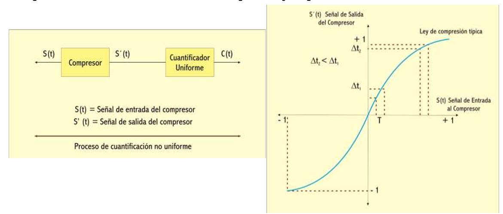
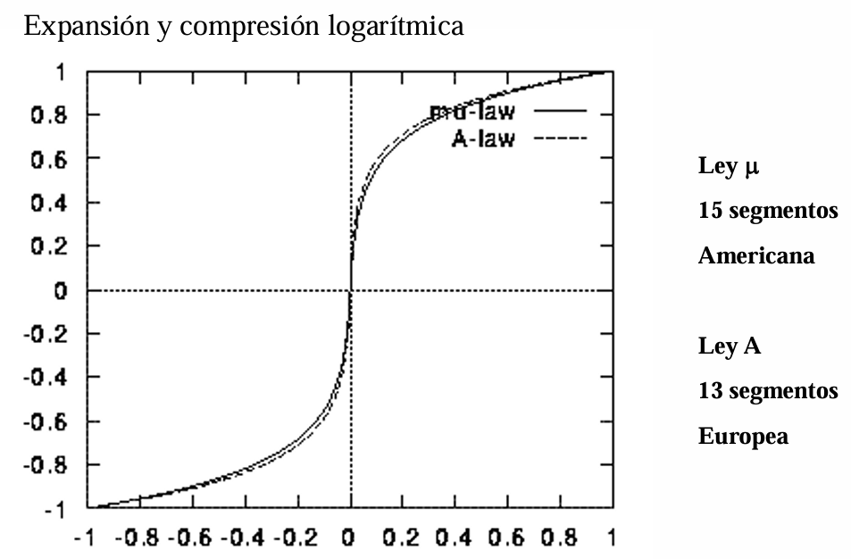
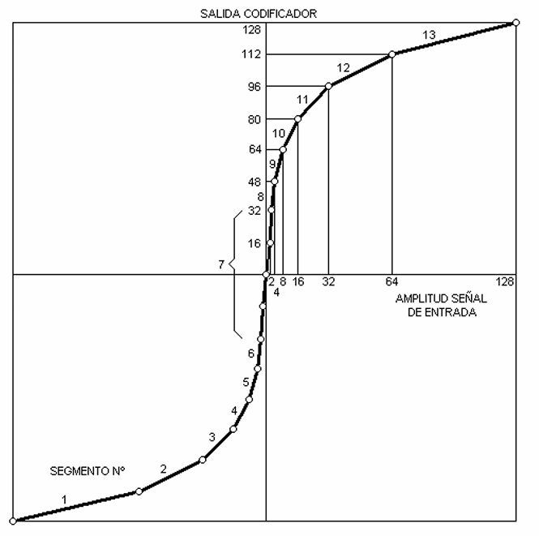
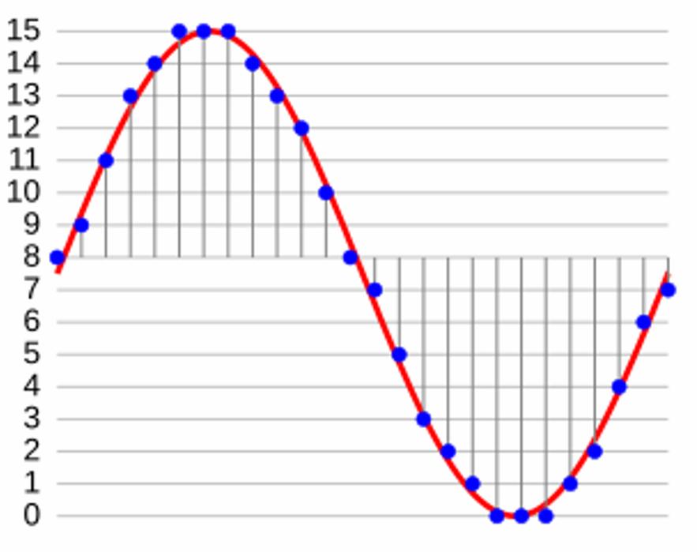
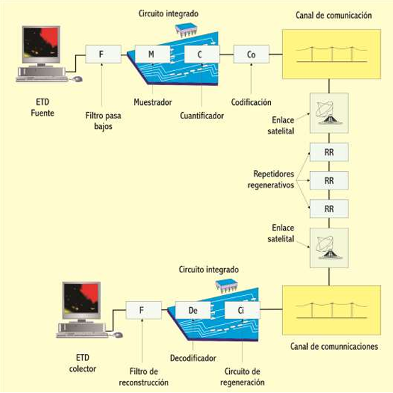
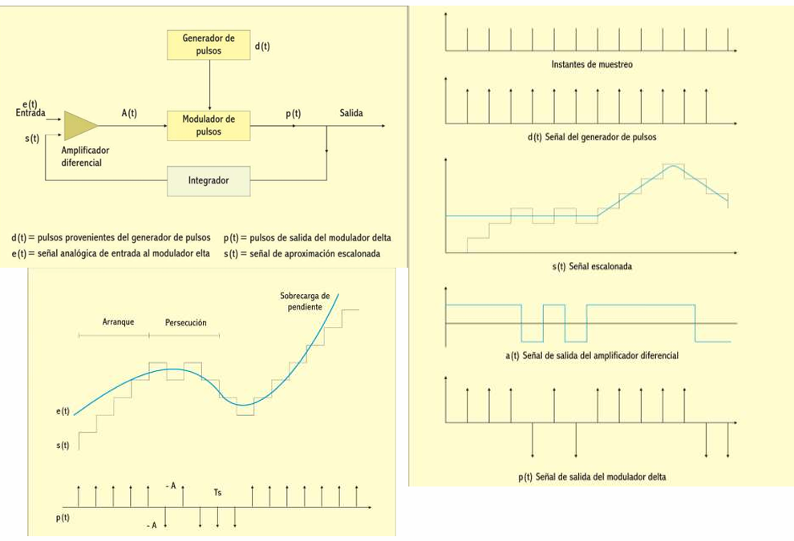
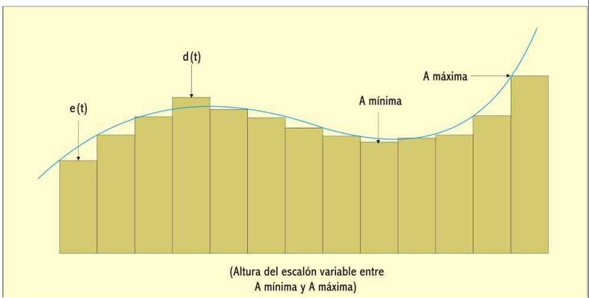
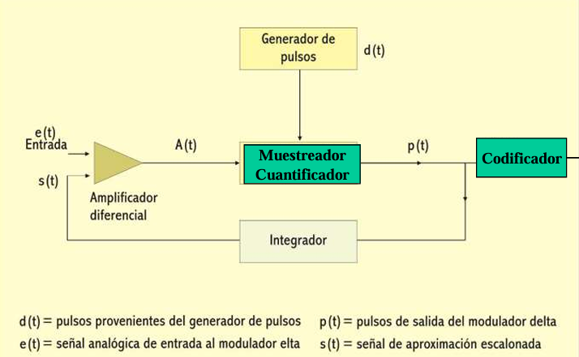

17-09-2026

# modulacion parte 2.
material\teoria\U4\U4 MODULACION 2.pdf

## TIPOS DE CUANTIFICACIÓN
•Uniforme o lineal
Niveles cuánticos con la misma medida.
Uso de un elevado número de niveles.
•No uniforme
Niveles cuánticos variables (comprimen próximos a nivel 0 y se expanden 
hacia los extremos).
Aplicación de COMPANSIÓN (comprimir y expandir).

## leyes de cuantificación
- ley A
- Ley μ

### Ley A –13 segmentos - Europea

## MODULACIÓN POR PULSOS DIGITAL
INFORMACIÓN EN LA CODIFICACIÓN

Las modulaciones que dan como resultado una señal digital son:

### MODULACIÓN POR PULSOS CODIFICADOS (PCM)
Dos Normas: 
Europea y Norteamericana

## Digitalización para PCM

### Ley A — Europa y América del Sur

**Cuantificación:**
- 256 niveles por muestra.

**Codificación:**
- 8 bits por muestra.

> Esto se debe a que:
>
> $$
> 2^8 = 256
> $$

---

### Ley μ — EE.UU. y Japón

**Cuantificación:**
- 128 niveles por muestra.

**Codificación:**
- 7 bits por muestra.

> Esto se debe a que:
>
> $$
> 2^7 = 128
> $$

### Resumen

| Ley | Regiones | Niveles por muestra | Bits por muestra |
|---|---|---:|---:|
| **Ley A** | Europa y América del Sur | 256 | 8 bits |
| **Ley μ** | EE.UU. y Japón | 128 | 7 bits |

## Modulación Delta (DM)

La **Modulación Delta (Delta Modulation, DM)** es una técnica de digitalización en la que no se transmite el valor absoluto de cada muestra de la señal, sino **cómo cambia la señal respecto de una aproximación anterior**.

En cada instante de muestreo, el sistema determina si la señal de entrada está **por encima o por debajo** de la señal aproximada.

De esta forma, solamente se necesitan **dos posibles estados**, por lo que cada muestra puede representarse mediante **1 bit**.

---

### Funcionamiento

El sistema compara continuamente:

- **e(t):** señal analógica de entrada.
- **s(t):** señal de aproximación escalonada.

El **amplificador diferencial** obtiene la diferencia entre ambas:

$$
A(t) = e(t) - s(t)
$$

El signo de esta diferencia determina qué debe hacer la aproximación en el siguiente instante de muestreo:

- Si $e(t) > s(t)$ → la aproximación debe **subir un escalón**.
- Si $e(t) < s(t)$ → la aproximación debe **bajar un escalón**.

El modulador genera entonces pulsos de amplitud:

$$
p(t) = +A
$$

cuando la señal debe aumentar, o:

$$
p(t) = -A
$$

cuando debe disminuir.

Estos pulsos son integrados para construir la señal escalonada **s(t)**, que intenta seguir a la señal analógica original.

---

### Señales del sistema

- **d(t):** pulsos provenientes del generador de pulsos. Determinan los instantes de muestreo.
- **e(t):** señal analógica de entrada.
- **A(t):** diferencia entre la señal original y la aproximación.
- **p(t):** pulsos de salida del modulador Delta, que indican si la aproximación debe subir o bajar.
- **s(t):** señal escalonada que aproxima a la señal original.

---

### Representación binaria

Como solamente existen dos posibilidades, cada muestra requiere **1 bit**.

Por ejemplo:

| Variación | Pulso | Bit |
|---|---:|---:|
| La aproximación debe subir | $+A$ | `1` |
| La aproximación debe bajar | $-A$ | `0` |

> La asociación entre `1`/`0` y $+A$/$-A$ depende de la convención utilizada. Lo importante es que únicamente existen **dos estados posibles**.

---

### Seguimiento de la señal

La señal escalonada $s(t)$ intenta seguir permanentemente a la señal de entrada $e(t)$.

En el proceso pueden distinguirse distintas situaciones:

**Arranque:**  
La señal aproximada comienza a acercarse a la señal de entrada.

**Persecución o seguimiento:**  
La señal escalonada puede seguir adecuadamente las variaciones de la señal original.

**Sobrecarga de pendiente:**  
Ocurre cuando la señal de entrada cambia demasiado rápido y los escalones de la modulación Delta no son suficientemente grandes para seguirla.

En esta situación, aunque se generen varios escalones consecutivos en la misma dirección, $s(t)$ queda retrasada respecto de $e(t)$.

---

### Idea fundamental

La Modulación Delta no intenta indicar:

> "¿Cuál es exactamente el valor de la señal?"

sino:

> "¿La señal debe subir o bajar respecto de la aproximación anterior?"

Por eso puede codificar cada muestra utilizando solamente **1 bit**.

## Modulacion DELTA ADAPTATIVA (ADM)

## Modulacion PCM DIFERENCIAL (DPCM)
Combina Modulación Delta con la codificación de sistemas PCM.
Reemplaza el modulador de pulsos por un dispositivo muestreador-cuantificador.
P(t) con amplitud proporcional a la diferencia entre e(t) y s(t), que se transmite codificada.

