17-09-2026

# Multiplexación

## Multiplexación

La **multiplexación** es una técnica que permite transmitir **simultáneamente varias comunicaciones** a través de un **único vínculo o medio de comunicación**, evitando que las distintas señales interfieran entre sí.

El medio de transmisión compartido puede ser, por ejemplo:

- Fibra óptica.
- Cable coaxial.
- Radio.
- Par de cobre.
- Otros medios de transmisión.

### Objetivos de la multiplexación

- **Aprovechar mejor el ancho de banda** disponible.
  - Puede asignarse de forma **fija**.
  - Puede asignarse **por demanda**.
- Puede utilizarse tanto en sistemas de **banda angosta** como de **banda ancha**.
- **Reducir costos**, ya que varias comunicaciones pueden compartir un mismo vínculo físico.

### Idea principal

En lugar de utilizar un medio físico independiente para cada comunicación:

**Varias comunicaciones → Multiplexor → Único vínculo de comunicación → Demultiplexor → Comunicaciones originales**

El **multiplexor (MUX)** combina las diferentes señales para transmitirlas por el mismo vínculo, mientras que el **demultiplexor (DEMUX)** las separa nuevamente en el extremo receptor.

## Multiplexación — Características

### Transparencia en el uso

La multiplexación debe ser **transparente para los usuarios**, es decir, el hecho de compartir un mismo vínculo de comunicación no debería afectar la **calidad de servicio (QoS)** de las comunicaciones.

### Capacidad del vínculo

La **capacidad de salida del multiplexor** debe ser mayor o igual que la suma de las capacidades de los canales que ingresan al mismo:

$$
C_{\text{salida MUX}} \geq \sum C_{\text{entrada MUX}}
$$

Cada una de las entradas del multiplexor puede considerarse un **subcanal**.

> **Idea clave:** el vínculo compartido debe tener capacidad suficiente para transportar la información proveniente de todos los subcanales.

---

### Capacidad (C)

Dependiendo del medio y del tipo de multiplexación, la capacidad puede estar relacionada con:

- **AB:** Ancho de banda.
- **Vtx:** Velocidad de transmisión.
- **λ:** Longitud de onda.

igualmente, mas adelante veremos que la capacidad va a volcarse como la velocidad maxima de transmisión de datos (Vtx) que puede soportar el medio de transmisión.

---

### Equipamiento

Los equipos utilizados son:

- **MUX (Multiplexor):** combina varias comunicaciones para transmitirlas a través de un único vínculo.
- **DEMUX (Demultiplexor):** recibe la señal multiplexada y separa las comunicaciones originales.

Por lo tanto, normalmente trabajan como **pares de equipos**:

**Entradas → MUX → Medio de transmisión → DEMUX → Salidas**

---

### Otras características

- Son **ETCD (Equipos Terminales de Circuito de Datos)**.
- Pueden trabajar con **distintos tipos de información**.
- Operan en el **nivel de enlace de datos (Capa 2) del modelo OSI**.
- Permiten compartir un vínculo manteniendo, idealmente, la **QoS (Quality of Service)** de cada comunicación.

## Multiplexación: Voz / Datos

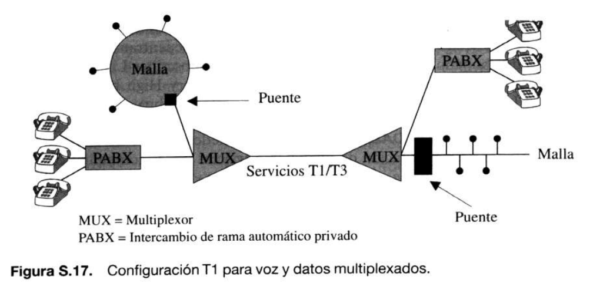

## Técnicas de multiplexación

Las técnicas de multiplexación se clasifican según **qué recurso del vínculo de comunicación es compartido por los distintos canales o usuarios**.

### Principales técnicas

1. **FDM — Multiplexación por División de Frecuencia**
   - *Frequency Division Multiplexing.*
   - El recurso compartido es el **ancho de banda disponible en frecuencia**.
   - A cada canal se le asigna una **banda de frecuencias diferente**.
   - Los canales pueden transmitir **simultáneamente**.

2. **TDM — Multiplexación por División de Tiempo**
   - *Time Division Multiplexing.*
   - El recurso compartido es el **tiempo de utilización del vínculo**.
   - Cada canal dispone del medio durante un **intervalo o ranura de tiempo (time slot)** determinado.
   - Los intervalos se asignan de manera **fija** a los distintos canales.

3. **STDM — Multiplexación por División de Tiempo Estadística**
   - *Statistical Time Division Multiplexing.*
   - Es una variante de TDM en la que las ranuras de tiempo se asignan **dinámicamente según la demanda**.
   - Un canal que no tiene información para transmitir **no ocupa innecesariamente una ranura**.
   - Permite aprovechar mejor la capacidad disponible.

4. **WDM — Multiplexación por División de Longitud de Onda**
   - *Wavelength Division Multiplexing.*
   - Utilizada principalmente en **fibra óptica**.
   - Diferentes comunicaciones utilizan distintas **longitudes de onda ($\lambda$)** de la luz.
   - Permite transmitir varios canales ópticos simultáneamente por una misma fibra.

5. **CDM — Multiplexación por División de Código**
   - *Code Division Multiplexing.*
   - A cada comunicación se le asigna un **código diferente**.
   - Los usuarios pueden compartir simultáneamente el mismo medio, tiempo y rango de frecuencias, diferenciándose mediante sus códigos.

---

### Resumen

| Técnica | División por | Recurso compartido |
|---|---|---|
| **FDM** | Frecuencia | Ancho de banda / frecuencia |
| **TDM** | Tiempo | Ranuras de tiempo fijas |
| **STDM** | Tiempo estadístico | Ranuras asignadas según demanda |
| **WDM** | Longitud de onda | Longitudes de onda ($\lambda$) |
| **CDM** | Código | Códigos diferentes |

> **Concepto clave:** las distintas técnicas de multiplexación se diferencian fundamentalmente por **cómo se divide y comparte la capacidad del vínculo entre los canales usuarios**.

## FDM — Multiplexación por División de Frecuencia

**FDM (Frequency Division Multiplexing)** es una técnica de multiplexación que consiste en **dividir el ancho de banda (AB) disponible de un canal en varios subcanales independientes**.

Cada subcanal ocupa una **banda de frecuencias diferente**, permitiendo que varias comunicaciones sean transmitidas **simultáneamente** por el mismo vínculo.

### Características principales

- El **ancho de banda total** del vínculo se divide en varios **anchos de banda menores**, uno para cada subcanal.
- Los diferentes subcanales funcionan de manera **independiente**.
- Entre los anchos de banda de los subcanales se utilizan **bandas de seguridad o bandas de guarda**.
- Las bandas de guarda permiten **evitar interferencias entre canales adyacentes**.
- FDM posee características fundamentalmente **analógicas**.

### Ancho de banda

De manera simplificada:

$$
AB_{total} \geq \sum_{i=1}^{n} AB_i + \sum AB_{guarda}
$$

Donde:

- $AB_{total}$ = ancho de banda disponible en el vínculo.
- $AB_i$ = ancho de banda correspondiente a cada subcanal.
- $AB_{guarda}$ = bandas de seguridad entre subcanales.

> **Importante:** el ancho de banda total necesario no depende únicamente de los subcanales, ya que también debe contemplarse el espacio utilizado por las **bandas de guarda**.

---

### Multiplexores FDM

Los **multiplexores (MPX)** de FDM pueden incluir los **módems**, lo que permite simplificar el equipamiento necesario para realizar la comunicación.

### Jerarquías analógicas

Existen **órdenes básicos y superiores de multiplexación** organizados en jerarquías analógicas:

1. **Pregrupo**
2. **Grupo primario**
3. **Grupo secundario**
4. ...
5. **Grupo quinario**

Estas jerarquías fueron recomendadas y normalizadas por la **UIT-T (Unión Internacional de Telecomunicaciones — Sector de Normalización de las Telecomunicaciones)**.

### Idea clave

En **FDM**, todos los usuarios pueden transmitir **al mismo tiempo**, pero cada uno utiliza una **porción diferente del espectro de frecuencias**.

**Un vínculo → división del AB → múltiples subcanales de frecuencia + bandas de guarda**

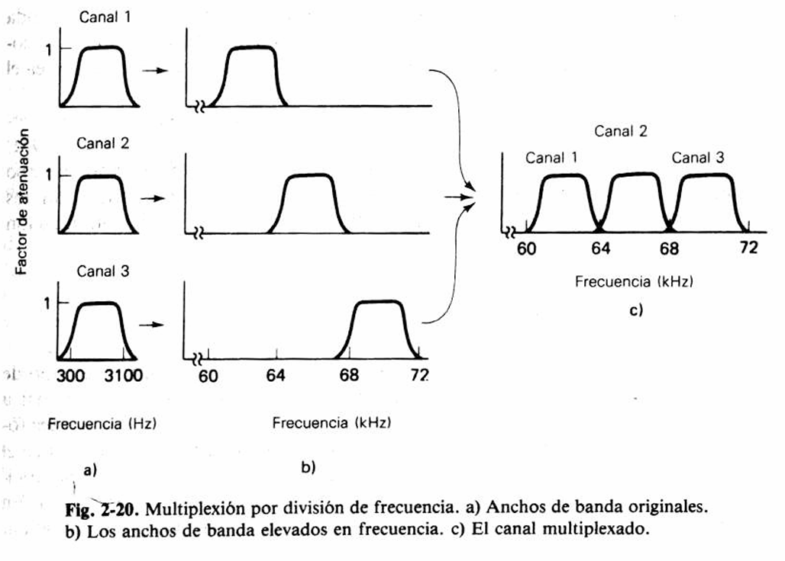

cuanto mayor cantidad de canales, menor capacidad por canal.

## OFDM — Multiplexación por División de Frecuencia Ortogonal

**OFDM (Orthogonal Frequency Division Multiplexing)** es una técnica de multiplexación basada en utilizar **múltiples subportadoras ortogonales entre sí** para transmitir información.

La idea consiste en dividir un **flujo de datos de alta velocidad** en varios flujos de datos de **menor velocidad**, transmitiendo cada uno mediante una subportadora diferente.

### Principio de funcionamiento

En OFDM:

- Se utilizan **múltiples subportadoras** simultáneamente.
- Las subportadoras se encuentran **muy próximas entre sí e incluso sus espectros se superponen**.
- A pesar de la superposición, no interfieren entre sí debido a que son **ortogonales**.
- Cada subportadora transporta una parte del flujo total de información.

> **Ortogonalidad:** las frecuencias de las subportadoras se eligen de manera que, en la frecuencia central de una subportadora, las demás presentan un valor nulo. Esto permite superponer sus espectros sin generar interferencia entre ellas en condiciones ideales.

---

### OFDM vs. FDM

En **FDM tradicional**, los distintos canales se encuentran separados mediante **bandas de guarda**:

**Canal 1 | Guarda | Canal 2 | Guarda | Canal 3**

Esto consume parte del ancho de banda disponible.

En **OFDM**, las subportadoras pueden **superponerse espectralmente** gracias a su ortogonalidad:

**Subportadoras superpuestas + ortogonales → menor ancho de banda desperdiciado**

Por este motivo, OFDM presenta una **mayor eficiencia espectral** que una implementación FDM convencional con bandas de guarda entre canales.

---

### Ventajas de OFDM

- **Mayor eficiencia espectral.**
- Permite aprovechar mejor el **ancho de banda disponible**.
- Divide transmisiones de alta velocidad en múltiples transmisiones de menor velocidad.
- Presenta buena resistencia frente a los efectos de la **propagación multitrayecto (multipath)**.
- Reduce la **interferencia entre símbolos (ISI)** producida por los diferentes retardos de propagación.

### Importancia de la sintonía de frecuencias

Para conservar la **ortogonalidad**, es fundamental mantener una correcta sincronización y sintonía de las frecuencias.

Un error de frecuencia puede provocar la pérdida de ortogonalidad y generar **interferencia entre subportadoras (ICI — Inter-Carrier Interference)**.

---

### Idea clave

> **FDM:** separa los canales en frecuencia utilizando bandas de guarda.
>
> **OFDM:** permite que las subportadoras se superpongan en frecuencia, pero mantiene su independencia mediante la **ortogonalidad**.

Por lo tanto:

**OFDM → subportadoras ortogonales → superposición espectral → mejor aprovechamiento del ancho de banda**

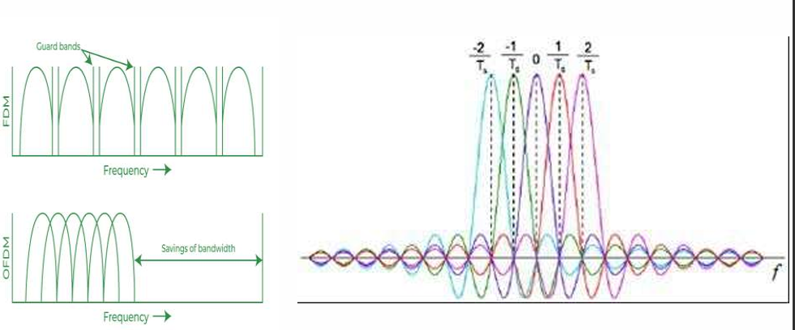
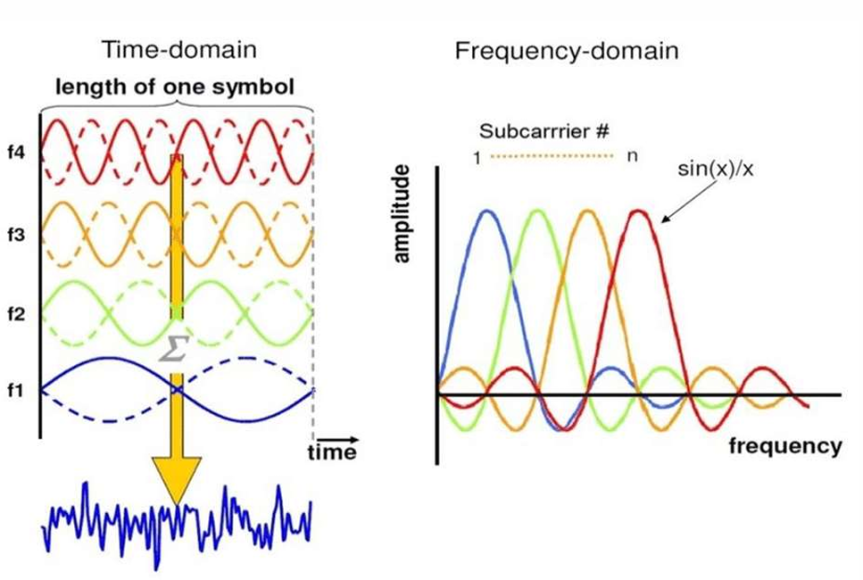

### OFDM — Generación y recepción de la señal

En un sistema **OFDM**, el flujo de datos de entrada se divide en varios flujos de menor velocidad, cada uno de los cuales será transmitido mediante una **subportadora diferente**.

Se usa en los 5G, Wi-Fi, LTE, DVB-T, ADSL y VDSL... -> MUY MODERNO.

### Proceso de transmisión

1. **Conversión Serie → Paralelo**
   - El flujo de bits de entrada se divide en múltiples flujos paralelos.
   - Cada flujo será asociado a una subportadora OFDM.

2. **Mapeo de constelación**
   - Cada uno de los flujos se modula digitalmente antes de combinarse.
   - Se pueden utilizar modulaciones como:
     - **BPSK**
     - **QPSK**
     - **M-PSK**
     - **M-QAM**

3. **Generación de las subportadoras**
   - Cada símbolo modulado se asocia a una subportadora de frecuencia diferente.
   - Todas las subportadoras deben ser **ortogonales entre sí**.

4. **Suma de las subportadoras**
   - Las diferentes señales moduladas se suman para obtener una única **señal OFDM**.

---

### Uso de la IFFT

Implementar cada subportadora utilizando individualmente osciladores y multiplicadores sería complejo.

En la práctica, OFDM utiliza la:

**IFFT — Inverse Fast Fourier Transform**

La **IFFT** permite generar simultáneamente las distintas subportadoras ortogonales y combinarlas para producir la señal OFDM.

Por lo tanto, simplifica la implementación:

**Datos → Serie/Paralelo → Modulación → IFFT → Señal OFDM**

> La IFFT reemplaza la necesidad de generar y modular individualmente cada una de las subportadoras.

---

### Proceso de recepción

En el receptor se realiza el proceso inverso:

**Señal recibida → FFT → Demodulación → Paralelo/Serie → Datos recuperados**

Se utiliza la:

**FFT — Fast Fourier Transform**

La FFT permite separar las distintas componentes ortogonales de la señal OFDM recibida.

Luego:

1. Se recupera cada subportadora.
2. Se realiza la **demodulación** correspondiente (BPSK, QPSK, QAM, etc.).
3. Los flujos paralelos se convierten nuevamente en un **único flujo serie**.

---

### Esquema general

**Transmisor:**

`Bits → Serie/Paralelo → Mapper (BPSK/QPSK/QAM) → IFFT → Canal`

**Receptor:**

`Canal → FFT → Demapper → Paralelo/Serie → Bits`

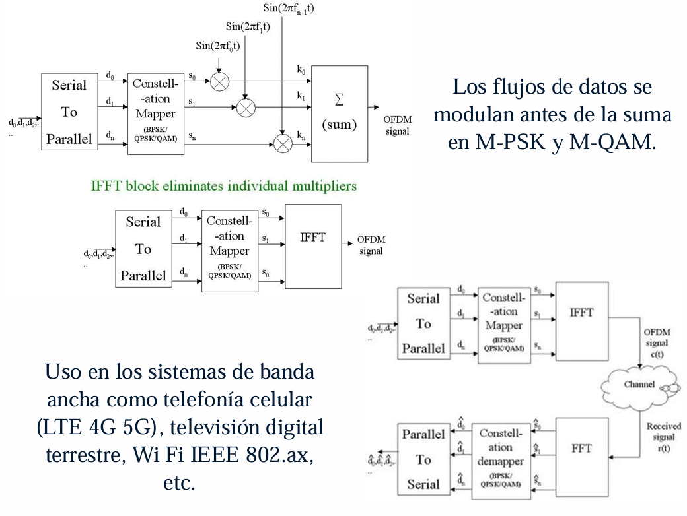
---

### Aplicaciones de OFDM

OFDM se utiliza principalmente en **sistemas de comunicaciones de banda ancha**, por ejemplo:

- Telefonía celular: **4G/LTE y 5G**.
- **Televisión digital terrestre**.
- Redes **Wi-Fi**, incluyendo estándares como **IEEE 802.11ax (Wi-Fi 6)**.
- Otros sistemas modernos de transmisión de datos de alta velocidad.

### Concepto clave

> **IFFT en transmisión:** combina eficientemente las subportadoras ortogonales para generar la señal OFDM.
>
> **FFT en recepción:** permite separar nuevamente esas subportadoras para recuperar los datos transmitidos.

## TDM — Multiplexación por División de Tiempo

**TDM (Time Division Multiplexing)** es una técnica de multiplexación de características principalmente **digitales**.

Consiste en dividir el tiempo disponible de transmisión en intervalos fijos llamados **time slots** o **ranuras de tiempo**.

Cada canal tiene asignado un determinado intervalo dentro de una trama y transmite respetando siempre un **orden preestablecido**.

ES ESCENCIAL EL SINCRONISMO.

---

### Características principales

- Es una técnica fundamentalmente **digital**.
- Divide el tiempo de transmisión en **intervalos fijos (time slots)**.
- Cada canal transmite durante la ranura que le corresponde.
- Los canales mantienen siempre un **orden determinado dentro de la trama**.
- Requiere un correcto **sincronismo** entre transmisor y receptor.
- Si la información original es analógica, primero debe ser **digitalizada**.
- Si el medio de transmisión requiere señales analógicas, será necesario utilizar algún sistema de **modulación / módem**.

### Idea básica

Supongamos cuatro canales:

- Canal A
- Canal B
- Canal C
- Canal D

Una trama TDM puede organizarse de la siguiente manera:

`| A | B | C | D | A | B | C | D | ... |`

Cada canal utiliza el vínculo solamente durante su **time slot**, pero la conmutación entre ellos es lo suficientemente rápida como para permitir el transporte de todas las comunicaciones.

> En **TDM síncrono**, la posición de cada canal dentro de la trama se encuentra previamente determinada, incluso si ocasionalmente un canal no tiene información para transmitir.

---

## Armado de tramas TDM

Para poder separar correctamente la información de cada canal, los datos transmitidos se organizan en **tramas**.

Existen diferentes formas de construirlas, entre ellas:

- **Entramado de bits**
- **Entramado de caracteres**

El receptor debe reconocer dónde comienza y termina cada trama, por lo que la **sincronización** es fundamental.

---

## TDM aplicado a señales PCM

Cuando se utiliza TDM junto con **PCM (Pulse Code Modulation)** para transmitir voz digitalizada, se trabaja tradicionalmente con una frecuencia de muestreo de:

$$
f_s = 8000 \text{ muestras/s}
$$

Por lo tanto, el período entre muestras es:

$$
T_s = \frac{1}{8000}
$$

$$
T_s = 125 \ \mu s
$$

Esto significa que se transmite una nueva **trama PCM cada 125 μs**.

Existen dos esquemas históricos principales:

- **E1 — G.732 / jerarquía europea**
- **T1 — DS1 / jerarquía norteamericana**

---

# PCM 30 — Esquema E1 - LEY A

El sistema **E1** es utilizado tradicionalmente en Europa y otras regiones, incluyendo América del Sur.

Utiliza **32 time slots por trama**, cada uno formado por **8 bits**.

De ellos:

- **30 canales** transportan información.
- **1 canal** se utiliza para sincronización y señalización de trama (**TS0**).
- **1 canal** puede utilizarse para señalización (**TS16**, en sistemas que utilizan señalización asociada al canal).

Por lo tanto:

$$
32 \text{ canales} \times 8 \text{ bits/canal}
=
256 \text{ bits/trama}
$$

Cada trama dura:

$$
T_{trama} = 125 \ \mu s [\text{microsegundos}]
$$

Como se transmiten 8000 tramas por segundo:

$$
V_{tx} = 256 \times 8000
$$

$$
\boxed{V_{tx} = 2.048.000 \text{ bit/s}}
$$

Por lo tanto:

$$
\boxed{V_{tx} = 2.048 \text{ Mbps}}
$$

de velocidad base .

### Estructura simplificada de E1

| Time Slot | Función |
|---|---|
| TS0 | Sincronización / control de trama |
| TS1 a TS15 | 15 canales de información |
| TS16 | Señalización |
| TS17 a TS31 | 15 canales de información |

Total:

$$
30 \text{ canales de información}
+
2 \text{ canales auxiliares}
=
32 \text{ time slots}
$$

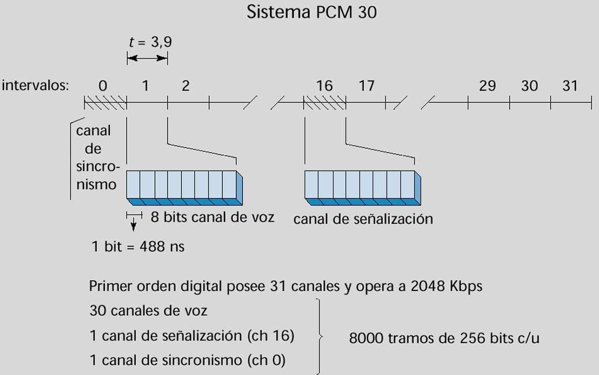

---

# PCM 24 — Esquema T1 - LEY mu

El esquema **T1 (DS1)** fue utilizado tradicionalmente en **Estados Unidos y Japón**.

Posee:

- **24 canales de información**.
- **8 bits por canal**.
- **1 bit adicional de sincronización de trama**.

Por lo tanto:

$$
24 \times 8 = 192 \text{ bits}
$$

Agregando el bit de trama:

$$
192 + 1 = 193 \text{ bits/trama}
$$

Como cada trama también dura:

$$
T_{trama} = 125 \ \mu s
$$

se transmiten:

$$
8000 \text{ tramas/s}
$$

Entonces:

$$
V_{tx} = 193 \times 8000
$$

$$
V_{tx} = 1.544.000 \text{ bit/s}
$$

Por lo tanto:

$$
\boxed{V_{tx} = 1.544 \text{ Mbps}}
$$

> En explicaciones simplificadas puede aparecer que cada canal utiliza **7 bits de información + 1 bit de señalización**.  
> En T1 clásico esto se relaciona con técnicas de **robbed-bit signaling**, donde ciertos bits de algunas tramas se utilizan para señalización. No significa necesariamente que todas las muestras tengan siempre solamente 7 bits útiles.

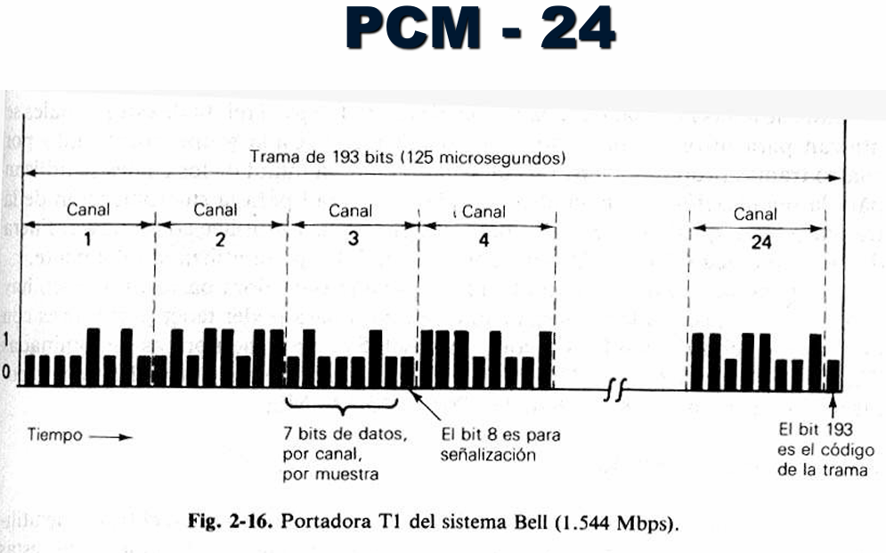

---

## Comparación E1 vs T1

| Característica | E1 | T1 |
|---|---:|---:|
| Región tradicional | Europa / América del Sur | EE.UU. / Japón |
| Canales de información | 30 | 24 |
| Bits por canal | 8 | 8 |
| Bits por trama | 256 | 193 |
| Duración de trama | 125 μs | 125 μs |
| Tramas por segundo | 8000 | 8000 |
| Velocidad de transmisión | **2.048 Mbps** | **1.544 Mbps** |

---

## Concepto clave

En **TDM**, distintos canales comparten un mismo vínculo pero **no transmiten simultáneamente sobre el mismo intervalo temporal**.

Cada canal dispone periódicamente de un **time slot** dentro de una trama:

**Canales → MUX → Trama TDM → Medio de transmisión → DEMUX → Canales**

El receptor utiliza la posición temporal de cada slot y el **sincronismo de trama** para determinar a qué canal pertenece cada conjunto de bits.

---

## Órdenes superiores de multiplexación TDM

### Jerarquía Digital Plesiócrona — PDH

**PDH (Plesiochronous Digital Hierarchy)** es una jerarquía de multiplexación digital utilizada para combinar múltiples señales TDM de menor velocidad y formar señales de velocidades cada vez mayores.

El término **plesiócrono** significa **"casi sincronizado"** o **"casi igual"**.

Esto se debe a que los distintos equipos poseen **relojes independientes**, cuyas frecuencias son muy próximas entre sí pero no exactamente iguales.

---

### Características de PDH

- El **primer nivel** de la jerarquía corresponde al **grupo básico de multiplexación**.
- Los niveles superiores se obtienen multiplexando varias señales provenientes del nivel inmediatamente inferior.
- Cada nivel incorpora información adicional destinada a:
  - Sincronización.
  - Control.
  - Adaptación de las pequeñas diferencias entre los relojes.
- Los relojes de distintos niveles son **independientes**.
- Debido a las diferencias entre velocidades se utilizan técnicas de **justificación o relleno de bits (bit stuffing)**.
- La **duración de la trama cambia según el nivel** de la jerarquía.
- Existen diferentes jerarquías históricas:
  - Europea.
  - Americana.
  - Japonesa.

---

### Multiplexación jerárquica

La información pasa sucesivamente por diferentes órdenes de multiplexación:

`Orden 1 → Orden 2 → Orden 3 → ... → Orden n → Medio de transmisión`

En el extremo receptor se realiza el proceso inverso:

`Medio → Orden n → ... → Orden 3 → Orden 2 → Orden 1`

Cada multiplexor combina varias señales tributarias para formar una señal de **mayor velocidad de transmisión**.

> **Señal tributaria:** señal de menor velocidad que ingresa a un multiplexor para formar parte de una señal de orden superior.

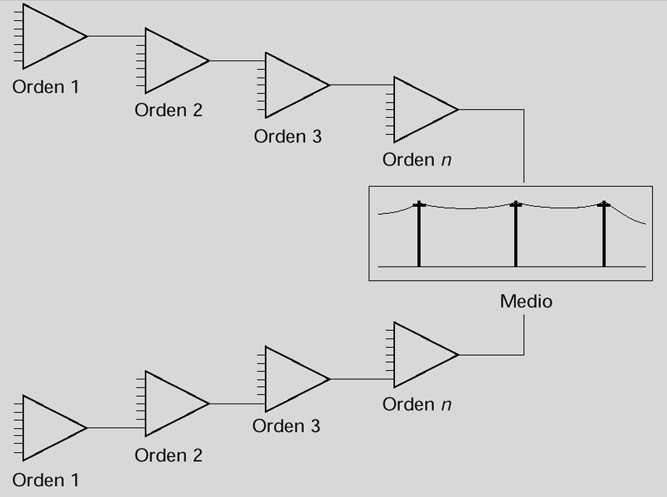

---

### Principal desventaja de PDH

PDH es una tecnología **poco flexible** para acceder a una señal tributaria determinada.

Por ejemplo, si se desea recuperar una señal de primer orden que se encuentra dentro de una señal de cuarto orden, generalmente es necesario realizar sucesivamente:

`Orden 4 → Orden 3 → Orden 2 → Orden 1`

Es decir, se debe **demultiplexar la jerarquía nivel por nivel**.

Esto implica:

- Mayor cantidad de equipamiento.
- Mayor complejidad.
- Menor flexibilidad.
- Menor capacidad de administración, supervisión y mantenimiento.

---

# Jerarquía PDH europea

El primer nivel corresponde al sistema **E1**, estudiado anteriormente:

$$
V_{E1} = 2.048\ Mbps
$$

con **30 canales de información**.

Los niveles superiores se construyen agrupando señales del nivel anterior.

| Orden | Denominación | Velocidad de transmisión | Bits por trama | Duración aprox. de trama | Canales de voz |
|---:|---|---:|---:|---:|---:|
| 1 | Primario | **2.048 Mbps** | 256 | 125 μs | 30 |
| 2 | Secundario | **8.448 Mbps** | 848 | 100.38 μs | 120 |
| 3 | Terciario | **34.368 Mbps** | 1536 | 44.69 μs | 480 |
| 4 | Cuaternario | **139.264 Mbps** | 2904 | 20.85 μs | 1920 |
| 5 | Quinario | **564.992 Mbps** | 2688 | ≈ 4.7 μs | 7680 |

---

## Formación de los distintos órdenes

### Primer orden

Lo mas comun de encontrar.

El nivel primario corresponde a:

$$
30\ canales
$$

con una velocidad de:

$$
\boxed{2.048\ Mbps}
$$

---

### Segundo orden

Se combinan **4 señales de primer orden**:

$$
4 \times 30 = 120\ canales
$$

La velocidad resultante es:

$$
\boxed{8.448\ Mbps}
$$

Puede observarse que:

$$
8.448 > 4 \times 2.048
$$

ya que:

$$
4 \times 2.048 = 8.192\ Mbps
$$

La diferencia corresponde principalmente a **bits adicionales de sincronización, control y justificación**.

---

### Tercer orden

Se combinan **4 señales de segundo orden**:

$$
4 \times 120 = 480\ canales
$$

Velocidad:

$$
\boxed{34.368\ Mbps}
$$

---

### Cuarto orden

Se combinan **4 señales de tercer orden**:

$$
4 \times 480 = 1920\ canales
$$

Velocidad:

$$
\boxed{139.264\ Mbps}
$$

---

### Quinto orden

Se combinan **4 señales de cuarto orden**:

$$
4 \times 1920 = 7680\ canales
$$

Velocidad:

$$
\boxed{564.992\ Mbps}
$$

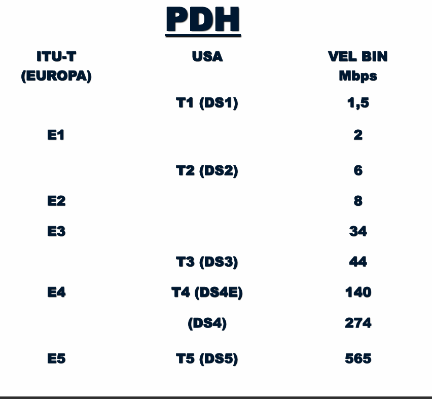

---

## ¿Por qué la velocidad no es simplemente 4 veces la anterior?

En PDH, al multiplexar cuatro señales tributarias no alcanza con concatenar directamente sus bits.

Como los relojes de las señales son **plesiócronos**, existen pequeñas diferencias entre sus velocidades.

Por eso se debe agregar información destinada a:

- Sincronización.
- Control.
- Identificación.
- **Justificación o relleno de bits**.

Por lo tanto:

$$
V_{nivel\ superior} > 4 \cdot V_{nivel\ inferior}
$$

Por ejemplo:

$$
4(2.048) = 8.192\ Mbps
$$

pero el segundo orden transmite a:

$$
8.448\ Mbps
$$

---

## Concepto clave de PDH

> **PDH construye una jerarquía de velocidades mediante la multiplexación sucesiva de señales digitales cuyos relojes son aproximadamente, pero no perfectamente, síncronos.**

Esto permite aumentar enormemente la cantidad de canales transportados:

$$
30 \rightarrow 120 \rightarrow 480 \rightarrow 1920 \rightarrow 7680
$$

pero tiene como inconveniente que para acceder a un tributario de bajo nivel es necesario **demultiplexar sucesivamente los niveles superiores**.

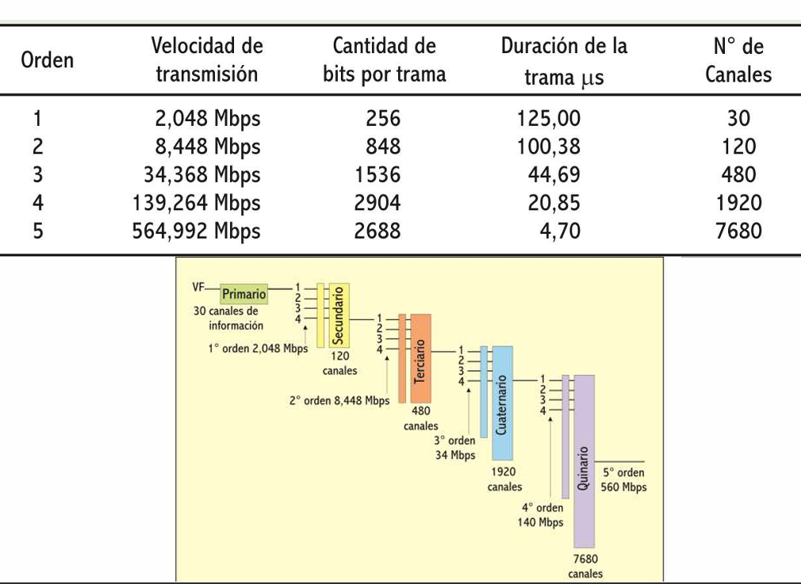

## Órdenes superiores de multiplexación TDM

# SDH — Jerarquía Digital Síncrona

**SDH (Synchronous Digital Hierarchy)** es una jerarquía de transmisión digital síncrona diseñada para transportar grandes volúmenes de información de manera más flexible y administrable que **PDH**.

Fue normalizada principalmente por la **UIT-T**, entre otras, mediante la recomendación **G.707**.

---

## Características principales de SDH

- Presenta una estructura **síncrona**.
- Los distintos niveles de la jerarquía trabajan referenciados a una **sincronización común**.
- Posee mayor **flexibilidad y sencillez** que PDH.
- Permite transportar:
  - Señales **SDH**.
  - Señales provenientes de jerarquías **PDH**.
- Tiene gran capacidad de:
  - Control.
  - Gestión.
  - Supervisión.
  - Mantenimiento.
- Utiliza equipos como:
  - **ADM (Add-Drop Multiplexer)**.
  - **Digital Cross-Connect**.
- Todas las tramas tienen una duración de:

$$
\boxed{125\ \mu s}
$$

- Permite transportar señales PDH mediante **Contenedores Virtuales (VC)**.
- Posee una gran capacidad de transmisión.
- Puede transportar servicios de banda ancha como: (se verá en redes  )
  - ATM.
  - FDDI.
  - Otros servicios digitales.

---

## Principal diferencia respecto de PDH

En **PDH**, para acceder a una señal tributaria de bajo nivel es necesario demultiplexar sucesivamente los niveles superiores.

Por ejemplo:

`Nivel 4 → Nivel 3 → Nivel 2 → Nivel 1`

En **SDH**, gracias a su estructura y a equipos **Add-Drop**, es posible agregar o extraer tributarios de una trama de orden superior de manera mucho más directa.

Esto proporciona:

- Mayor flexibilidad.
- Menor cantidad de equipos.
- Mejor administración de la red.
- Mayor facilidad para realizar mantenimiento.

---

## Equipos Add-Drop

Un **ADM (Add-Drop Multiplexer)** permite:

- **Add:** agregar una señal tributaria a una trama SDH.
- **Drop:** extraer una señal tributaria específica.

Por lo tanto, no es necesario realizar toda la cadena de demultiplexación como ocurría en PDH.

---

# SDH y SONET

**SONET (Synchronous Optical Network)** es la jerarquía síncrona desarrollada principalmente en Estados Unidos.

SDH y SONET poseen principios de funcionamiento similares y velocidades compatibles.

### Unidades utilizadas

En SDH se utiliza la denominación:

**STM-N — Synchronous Transport Module**

Mientras que SONET utiliza:

**OC-N — Optical Carrier**

---

## Equivalencias principales

| SDH | SONET equivalente | Velocidad aproximada |
|---|---|---:|
| — | OC-1 | 51.84 Mbps |
| **STM-1** | OC-3 | **155.52 Mbps** |
| — | OC-9 | ≈ 466 Mbps |
| **STM-4** | OC-12 | **622.08 Mbps** |
| — | OC-24 | ≈ 1.244 Gbps |
| **STM-16** | OC-48 | **2.488 Gbps** |
| **STM-64** | OC-192 | **9.953 Gbps** |
| **STM-256** | OC-768 | **39.813 Gbps** |

> Las velocidades aumentan como múltiplos del nivel básico.

---

# Trama SDH — STM-1

El nivel básico de SDH es:

$$
\boxed{STM-1}
$$

Su trama está formada por una matriz de:

$$
9\ filas \times 270\ columnas
$$

Como cada posición representa **1 byte**:

$$
9 \times 270 = 2430\ bytes/trama
$$

Cada byte contiene 8 bits:

$$
2430 \times 8 = 19440\ bits/trama
$$

Como cada trama dura:

$$
125\ \mu s
$$

se transmiten:

$$
\frac{1}{125 \times 10^{-6}} = 8000\ tramas/s
$$

Por lo tanto:

$$
V_{tx} = 19440 \times 8000
$$

$$
\boxed{V_{tx} = 155.52\ Mbps}
$$

---

## Estructura simplificada de una trama STM-1

La trama puede dividirse conceptualmente en:

### 1. Overhead

Contiene información utilizada para:

- Sincronización.
- Supervisión.
- Gestión.
- Control.
- Mantenimiento.
- Identificación de la información transportada.

También suele denominarse **SOH (Section Overhead)**, aunque la estructura real incluye además campos específicos de punteros.

### 2. Payload

Es la **carga útil** de la trama.

Dentro del payload se transportan los datos de los usuarios y los diferentes **Contenedores Virtuales (VC)**.

De manera simplificada:

`| Overhead | Payload |`

---

## Tramas STM-N

Para un nivel general **STM-N**, la estructura aumenta proporcionalmente:

$$
9\ filas \times (270 \times N)\ columnas
$$

La duración sigue siendo siempre:

$$
125\ \mu s
$$

Por lo tanto, al aumentar $N$ aumenta la cantidad de información transportada durante el mismo tiempo.

Ejemplos:

$$
STM-1 = 155.52\ Mbps
$$

$$
STM-4 = 4 \times 155.52 = 622.08\ Mbps
$$

$$
STM-16 = 16 \times 155.52 = 2488.32\ Mbps
$$

---

# Contenedores Virtuales — VC

Un **VC (Virtual Container)** es una estructura utilizada por SDH para transportar información proveniente de otras jerarquías o servicios.

Los contenedores virtuales permiten, entre otras cosas, incorporar **señales PDH dentro de una trama SDH**.

Conceptualmente:

**Señal PDH → adaptación → Contenedor Virtual → Payload SDH**

---

## Tipos de Contenedores Virtuales

| Contenedor | Señal PDH que puede transportar |
|---|---:|
| **VC-11** | 1.544 Mbps |
| **VC-12** | 2.048 Mbps |
| **VC-2** | 6.312 Mbps |
| **VC-3** | 34.368 Mbps o 44.736 Mbps |
| **VC-4** | 139.264 Mbps |

> **Nota:** en algunas diapositivas puede aparecer `6.048 Mbps` para VC-2. El valor habitual de la señal PDH T2 asociada es **6.312 Mbps**.

---

# SDH vs. PDH

| Característica | PDH | SDH |
|---|---|---|
| Sincronización | Relojes aproximadamente iguales | Referencia síncrona común |
| Acceso a tributarios | Demultiplexación sucesiva | Acceso más directo |
| Flexibilidad | Baja | Alta |
| Gestión y mantenimiento | Limitados | Amplios |
| Duración de trama | Depende del nivel | **125 μs en todos los niveles** |
| Transporte de PDH | Nativo | Mediante VC |
| Add/Drop | Complejo | Directo mediante ADM |
| Capacidad | Menor | Muy elevada |

---

## Concepto clave

> **PDH:** los distintos niveles son plesiócronos y para acceder a una señal de bajo orden normalmente hay que desmontar la jerarquía nivel por nivel.
>
> **SDH:** utiliza una jerarquía síncrona, tramas de duración fija y contenedores virtuales, permitiendo agregar y extraer tributarios de manera mucho más flexible.

En síntesis:

**SDH = sincronización + alta capacidad + administración + acceso flexible a tributarios**

## STDM — Multiplexación Estadística por División de Tiempo

**STDM (Statistical Time Division Multiplexing)** es una variante de TDM en la que las ranuras de tiempo se asignan **dinámicamente según la demanda de los canales**.

También puede denominarse:

**ATDM — Asynchronous Time Division Multiplexing**

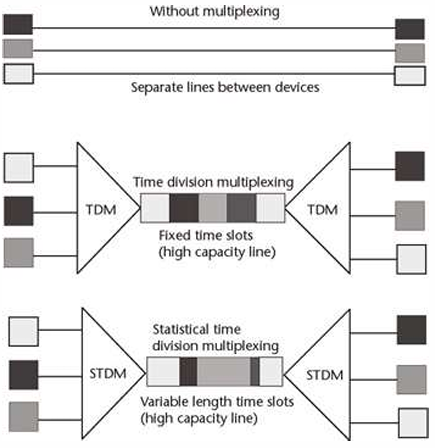

---

### Características principales

- Utiliza una **asignación estadística** de los intervalos de tiempo.
- Las ranuras se asignan **solamente a los canales que tienen información para transmitir**.
- Aprovecha mejor los tiempos disponibles del vínculo.
- Evita reservar ranuras para canales que están inactivos.
- Permite una utilización más eficiente de la capacidad disponible.
- La asignación de los *time slots* se realiza **por demanda**.

---

## TDM vs. STDM

### TDM convencional

En TDM síncrono cada canal posee una ranura fija:

`| A | B | C | D | A | B | C | D | ... |`

Aunque, por ejemplo, el canal **B** no tenga información para transmitir, su ranura continúa existiendo.

Esto puede producir **tiempo desaprovechado**.

### STDM

En STDM solamente reciben una ranura los canales activos.

Si únicamente A, C y D tienen datos:

`| A | C | D | A | D | C | ... |`

Por lo tanto:

> **TDM:** asignación fija de ranuras.  
> **STDM:** asignación dinámica según la demanda.

---

### Consecuencia de la asignación dinámica

Como la posición dentro de la trama ya no identifica necesariamente a un canal determinado, STDM necesita incorporar información que permita identificar **a qué canal pertenece cada bloque de datos**.

Además, normalmente utiliza **buffers o memorias temporales** para almacenar información mientras espera una ranura disponible.

---

### Idea clave

**STDM busca no desperdiciar time slots.**

En lugar de:

`Canal inactivo → time slot vacío`

se intenta lograr:

`Canal inactivo → ranura utilizada por otro canal con datos`

Esto aumenta la **eficiencia del vínculo**.

---

# WDM — Multiplexación por División de Longitud de Onda

**WDM (Wavelength Division Multiplexing)** es una técnica de multiplexación utilizada en **fibra óptica** que permite transmitir simultáneamente varias señales utilizando **distintas longitudes de onda de luz**.

Cada longitud de onda puede considerarse un **canal óptico independiente**.

Por ejemplo:

$$
\lambda_1,\ \lambda_2,\ \lambda_3,\ ...,\ \lambda_n
$$

Todas estas señales pueden viajar simultáneamente por la **misma fibra óptica**.

---

## Principio de funcionamiento

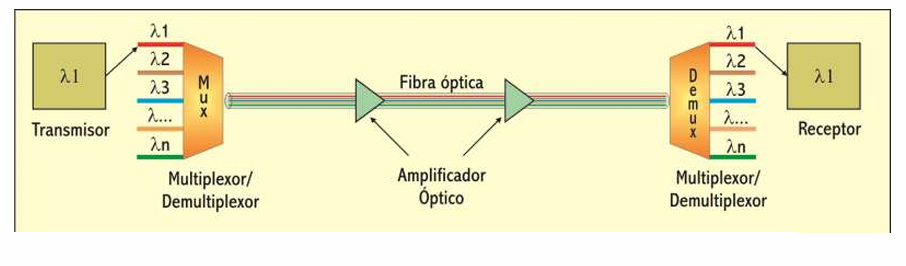
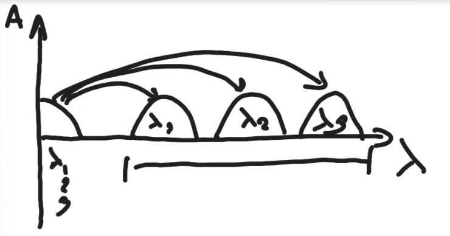

Cada transmisor genera información utilizando una longitud de onda diferente:

- Canal 1 → $\lambda_1$
- Canal 2 → $\lambda_2$
- Canal 3 → $\lambda_3$
- ...
- Canal n → $\lambda_n$

Un **multiplexor óptico** combina todas las longitudes de onda y las introduce en una única fibra:

$$
\lambda_1 + \lambda_2 + \lambda_3 + ... + \lambda_n
$$

En el extremo receptor, un **demultiplexor óptico** vuelve a separar cada longitud de onda.

### Esquema

`λ1 ─┐`

`λ2 ─┤`

`λ3 ─┼→ MUX óptico → Fibra óptica → DEMUX → λ1, λ2, λ3 ...`

`λn ─┘`

---

## Características principales de WDM

- Permite transmitir **múltiples longitudes de onda simultáneamente**.
- Cada longitud de onda puede transportar una comunicación independiente.
- Permite aumentar enormemente la capacidad de una fibra **sin instalar nuevas fibras**.
- Las comunicaciones viajan simultáneamente por el mismo medio.
- Se utiliza principalmente sobre **fibra óptica monomodo** en sistemas de gran capacidad.
- Puede transportar diferentes protocolos y tipos de señales.

> Cada longitud de onda puede transportar, por ejemplo, tráfico Ethernet, SDH/SONET u otros servicios.

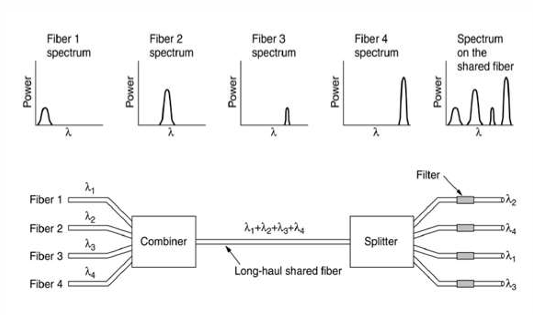

---

## Capacidad total

Si existen $N$ longitudes de onda y cada una transmite a una velocidad $V$:

$$
C_{total} = N \cdot V
$$

Por ejemplo, si se utilizan 40 longitudes de onda de 10 Gbps:

$$
C_{total} = 40 \times 10\ Gbps
$$

$$
\boxed{C_{total} = 400\ Gbps}
$$

Por lo tanto, WDM aumenta la capacidad utilizando **más canales ópticos dentro de la misma fibra**.

---

# DWDM — Dense Wavelength Division Multiplexing

**DWDM (Dense Wavelength Division Multiplexing)** es una variante de WDM que utiliza una gran cantidad de longitudes de onda **muy próximas entre sí**.

Esto permite transportar decenas o incluso muchas más señales independientes a través de una única fibra.

### Ventajas

- Gran capacidad de transmisión.
- Excelente aprovechamiento de la fibra instalada.
- Permite enlaces de larga distancia.
- Puede utilizar **amplificadores ópticos** para amplificar varias longitudes de onda simultáneamente.
- Reduce la necesidad de instalar nuevas fibras.

---

## WDM vs. SDH/SONET

No son exactamente tecnologías equivalentes.

### SDH / SONET

SDH y SONET realizan una **multiplexación digital**, fundamentalmente mediante organización temporal de la información.

Conceptualmente:

`Datos → Multiplexación digital → Señal óptica`

Una determinada señal agregada puede transmitirse utilizando una longitud de onda determinada.

### WDM

WDM permite que **varias señales ópticas independientes**, cada una utilizando una longitud de onda diferente, viajen por la misma fibra.

Por ejemplo:

`STM-16 → λ1`

`Ethernet → λ2`

`STM-64 → λ3`

`Otro servicio → λ4`

Luego:

`λ1 + λ2 + λ3 + λ4 → misma fibra óptica`

> Por este motivo, WDM puede transportar señales SDH/SONET, Ethernet y otros protocolos simultáneamente.

---

## Equipamiento WDM

Pueden utilizarse:

- **MUX ópticos:** combinan distintas longitudes de onda.
- **DEMUX ópticos:** separan las longitudes de onda.
- **Amplificadores ópticos:** amplifican la señal sin necesidad de convertirla previamente a señal eléctrica.
- **OADM (Optical Add-Drop Multiplexer):** permite agregar o extraer determinadas longitudes de onda.
- **Optical Cross-Connect:** permite interconectar y conmutar canales ópticos.

Algunos elementos ópticos pueden implementarse de forma **pasiva**, aunque los sistemas avanzados de conmutación y administración suelen requerir equipamiento activo.

---

# Comparación FDM y WDM

WDM puede interpretarse conceptualmente como una técnica similar a FDM, pero aplicada al **dominio óptico**.

| Característica | FDM | WDM |
|---|---|---|
| Medio típico | Radio, cobre, coaxial | Fibra óptica |
| Separación | Frecuencias | Longitudes de onda |
| Canales | Bandas de frecuencia | Canales ópticos |
| Parámetro | $f$ | $\lambda$ |
| Transmisión simultánea | Sí | Sí |

Como frecuencia y longitud de onda están relacionadas:

$$
c = \lambda f
$$

donde:

- $c$ = velocidad de la luz.
- $\lambda$ = longitud de onda.
- $f$ = frecuencia.

---

## Conceptos clave

### STDM

> **Los usuarios comparten el tiempo de forma dinámica.**

`Time slots → asignados según demanda`

### WDM

> **Los usuarios comparten una fibra utilizando distintas longitudes de onda.**

`Una fibra → λ1 + λ2 + λ3 + ... + λn`

Por lo tanto:

- **TDM:** divide el recurso por **tiempo**.
- **STDM:** divide el tiempo **dinámicamente según demanda**.
- **FDM:** divide el recurso por **frecuencia**.
- **WDM:** divide el recurso por **longitud de onda**.

## CWDM y DWDM

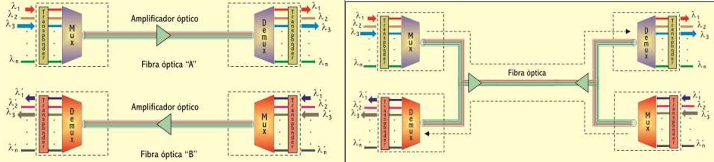

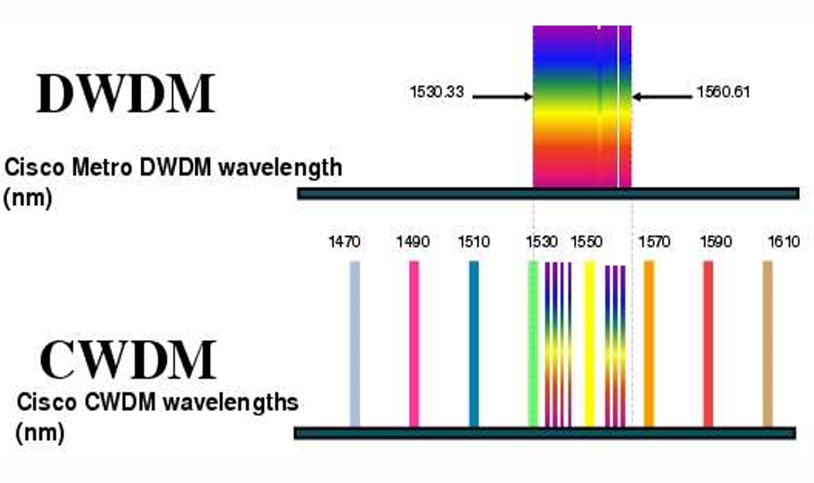

### DWDM — Dense WDM
- Canales ópticos **muy próximos entre sí**.
- Mayor **capacidad y alcance**.
- Permite amplificación óptica simultánea de varias longitudes de onda.
- Soporta señales de distintas velocidades y protocolos.
- Mayor costo y complejidad.

### CWDM — Coarse WDM
- Canales ópticos **más separados**.
- Menor costo.
- Menor capacidad y alcance que DWDM.
- Muy usado en redes metropolitanas.

> **Idea clave:**  
> **DWDM = más canales, más capacidad, mayor alcance.**  
> **CWDM = menos canales, menor costo y menor alcance.**

## CDM — Multiplexación por División de Código

**CDM (Code Division Multiplexing)** permite que varios usuarios compartan **al mismo tiempo el mismo canal y la misma banda de frecuencias**, diferenciándose mediante **códigos digitales distintos**.

se suele utilizar en telefonia celular.

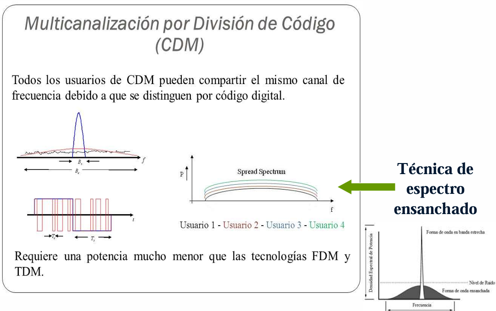

### Características

- Todos los usuarios pueden transmitir simultáneamente.
- Cada usuario posee un **código propio**.
- Utiliza técnicas de **espectro ensanchado (Spread Spectrum)**.
- La señal ocupa un ancho de banda mayor que la información original.
- El receptor recupera cada usuario utilizando su código correspondiente.

> **Idea clave:**  
> **CDM = mismo tiempo + misma frecuencia + distinto código.**

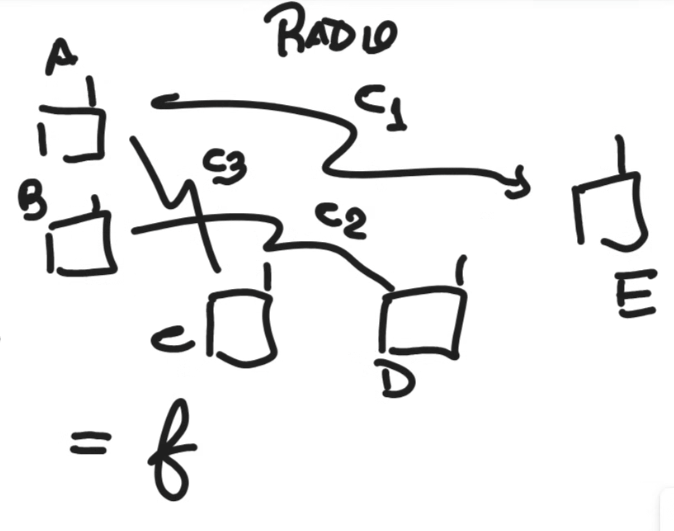
utilizando la misma frecuencia pero utilizando distintos códigos.

## Multiplexación como método de acceso múltiple

Cuando varias estaciones o usuarios comparten un mismo medio, las técnicas de multiplexación pueden utilizarse como **métodos de acceso múltiple (MA — Multiple Access)**.

### Principales métodos

- **FDMA — Frequency Division Multiple Access**
  - Cada usuario utiliza una **frecuencia distinta**.
  - Los usuarios pueden transmitir al mismo tiempo.

- **TDMA — Time Division Multiple Access**
  - Los usuarios comparten la misma frecuencia.
  - Cada uno transmite en una **ranura de tiempo diferente**.

- **CDMA — Code Division Multiple Access**
  - Los usuarios comparten **tiempo y frecuencia**.
  - Se distinguen mediante **códigos diferentes**.

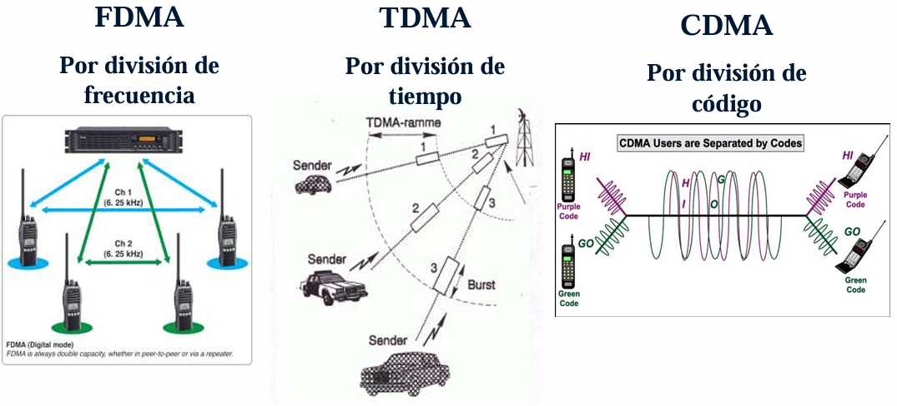

### Comparación rápida

| Técnica | Frecuencia | Tiempo | Código |
|---|---|---|---|
| **FDMA** | Diferente | Simultáneo | — |
| **TDMA** | Misma | Diferente | — |
| **CDMA** | Misma | Simultáneo | Diferente |

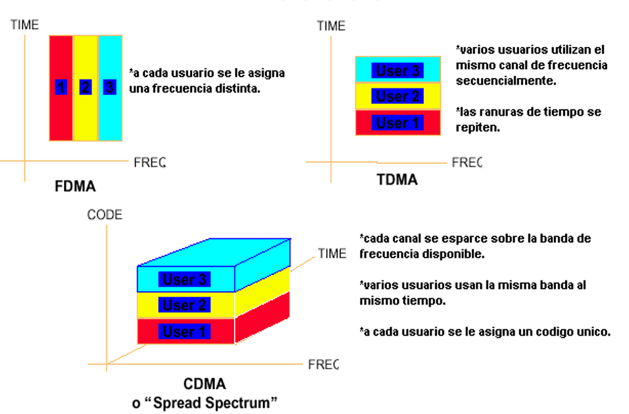

### Otros métodos

- **DAMA:** acceso por asignación bajo demanda.
- **SDMA:** acceso por división espacial.
- **OFDMA:** acceso múltiple por división de frecuencia ortogonal.

> **Idea clave:**  
> **FDMA separa por frecuencia, TDMA por tiempo y CDMA por código.**

