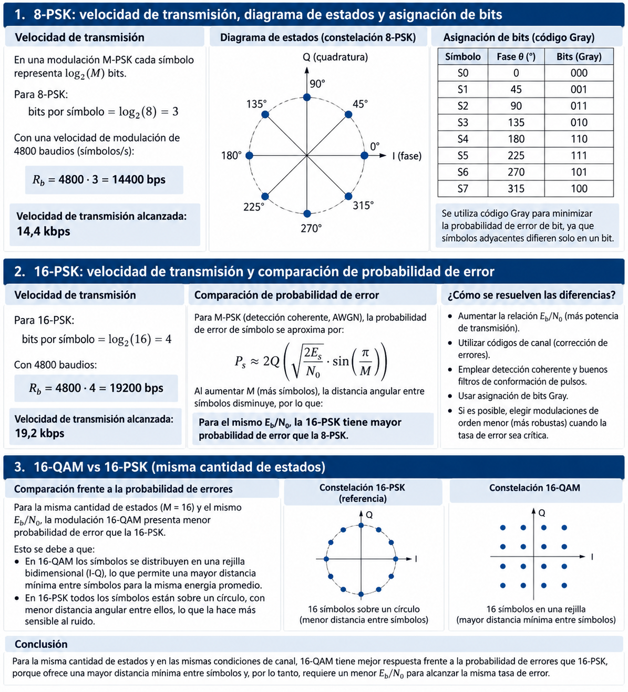

# Cuestionario – Modulación y Multiplexión

## Pregunta 1 – Tipo de modulación según el parámetro de la portadora

**El método de modulación en el cual se varía la frecuencia de la portadora según la información es el:**

### Opciones

a. PSK  
b. ASK  
c. PDM  
d. PAM  
e. **Ninguna de las anteriores ✅**

### Respuesta correcta

**e. Ninguna de las anteriores**

### Explicación

Cuando la información modifica la **frecuencia de la portadora**, hablamos de:

- **FM (Frequency Modulation)** si la señal moduladora es analógica.
- **FSK (Frequency Shift Keying)** si se trata de modulación digital.

Como ninguna de estas opciones aparece en la consigna, corresponde elegir:

**Ninguna de las anteriores.**

Para recordar:

- **ASK → Amplitud**
- **FSK → Frecuencia**
- **PSK → Fase**
- **PAM → Amplitud de pulsos**
- **PDM → Duración de pulsos**

---

## Pregunta 2 – PSK, velocidad de transmisión y probabilidad de error

**Se transmite por un canal que permite una velocidad de modulación de 4800 baudios con una modulación 8-PSK.**

1. ¿Qué velocidad de transmisión se alcanza? Proponer el diagrama de estados y el cuadro con la mejor asignación de combinación de bits a cada fase.
2. Si se empleara la modulación 16-PSK no variando las condiciones, ¿cuál sería la velocidad de transmisión? Compare la probabilidad de error de ambas modulaciones. ¿Cómo se resuelven las diferencias respecto de este parámetro?
3. Si pasamos del 16-PSK con la misma cantidad de estados a una modulación M-QAM, ¿cuál tiene mejor respuesta frente a la probabilidad de errores? Justifique.

---

## Pregunta 3 – Digitalización de señales analógicas

**En la digitalización de señales analógicas, ¿qué opción incluye a todos los procesos necesarios y en el orden correspondiente?**

### Opciones

a. **Muestreo, cuantificación, codificación ✅**  
b. Muestreo, cuantificación, señalización  
c. Ninguno de los anteriores  
d. Modulación, cuantificación, codificación  
e. Muestreo, codificación, cuantificación  

### Respuesta correcta

**a. Muestreo, cuantificación, codificación**

### Explicación

La digitalización de una señal analógica se realiza en el siguiente orden:

1. **Muestreo**
   - Se toman valores de la señal analógica en determinados instantes de tiempo.

2. **Cuantificación**
   - Cada muestra se aproxima a uno de un conjunto finito de niveles posibles.

3. **Codificación**
   - Cada nivel cuantificado se representa mediante una combinación de bits.

Por lo tanto:

**Señal analógica → Muestreo → Cuantificación → Codificación**

Una forma sencilla de recordarlo es:

**Primero tomo muestras, después les asigno niveles y finalmente represento esos niveles con bits.**

---

## Pregunta 4 – Ruido granular y multiplexión

**¿En qué técnica de multiplexión tiene presencia el ruido granular por el tipo de procesamiento que implica?**

### Opciones

a. Ninguna de las anteriores  
b. **TDM ✅**  
c. FDM  
d. CDM  
e. WDM  

### Respuesta correcta

**b. TDM**

### Explicación

El **ruido granular** aparece debido al proceso de **cuantificación** de una señal analógica cuando se la convierte a formato digital.

En sistemas de **TDM (Time Division Multiplexing)** es habitual trabajar con señales previamente digitalizadas mediante técnicas como PCM.

El procesamiento incluye:

**Muestreo → Cuantificación → Codificación → Multiplexión temporal**

Durante la cuantificación, cada muestra real debe aproximarse al nivel discreto disponible más cercano. Esa diferencia genera un:

**Error de cuantificación → Ruido granular**

Las demás técnicas separan los canales utilizando otros criterios:

- **FDM → Frecuencia**
- **WDM → Longitud de onda**
- **CDM → Código**
- **TDM → Tiempo**

Por lo tanto, en el contexto del cuestionario:

**TDM → puede involucrar cuantificación → presencia de ruido granular**

